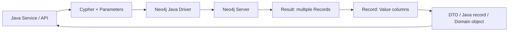
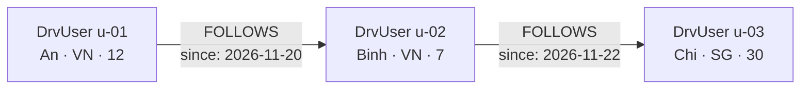
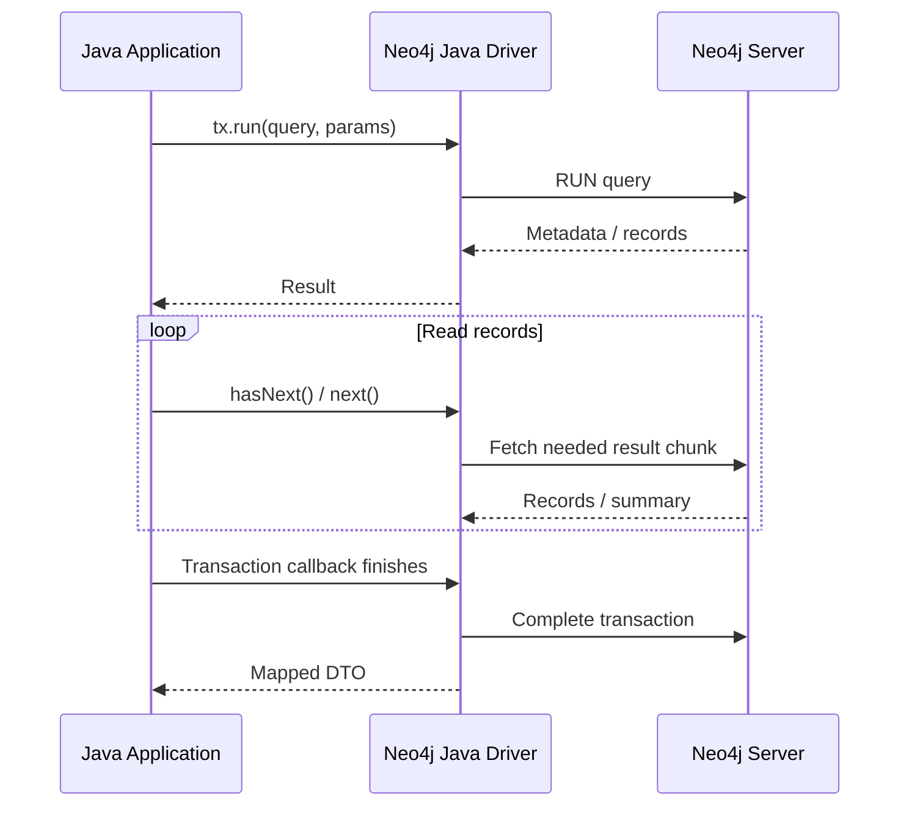

# Executing Parameterized Queries and Mapping Records or Values with Neo4j Java Driver

In Java applications working with **Neo4j**, **Cypher** statements typically follow a fixed template while input data varies per request: customer IDs, statuses, timestamps, or result limits. **Neo4j Java Driver** lets you pass these values as **parameters**, send the query to Neo4j, and read result rows via `Result`, `Record`, and `Value`.

The key takeaway of this lesson is mastering three steps: **sending Cypher with parameters**, **reading data with the right types**, and **mapping results into Java objects** while the session/transaction is still active. This topic belongs to the **Java Driver** chapter of the **DATABASE_ENGINE_GRAPH_NEO4J** module, supporting the **property graph** model, node/relationship/path queries in Cypher, and integration with service layers or **Spring Data Neo4j**.

After this lesson, you will be able to:

- Use `$parameterName` syntax and pass a `Map<String, Object>` to `tx.run(...)`.
- Choose `executeRead`, `executeWrite`, or `session.run` according to transaction boundaries.
- Distinguish `Result` (stream of rows), `Record` (one row), and `Value` (one typed cell).
- Map `Record`s into Java records/DTOs, handling `null`, numbers, dates/times, lists, maps, and graph types.
- Avoid returning unconsumed results outside the transaction scope or accidentally loading too many records into memory.

## 1. Visualizing the Query Flow from Java to Neo4j



Business example: find `:DrvUser` accounts in Vietnam with at least 5 followers, returning up to 20 users. The values for `country`, `minFollowers`, and `limit` come from the application request while the Cypher structure stays constant.

```cypher
MATCH (u:DrvUser)
WHERE u.country = $country
  AND u.followers >= $minFollowers
RETURN u.userId AS userId,
       u.name AS displayName,
       u.followers AS followers
ORDER BY followers DESC, userId ASC
LIMIT $limit;
```

The three names prefixed with `$` are **Cypher parameters**. They are supplied separately on the Java side:

```java
Map<String, Object> params = Map.of(
    "country", "VN",
    "minFollowers", 5L,
    "limit", 20
);
```

In the `Map`, keys are the parameter names **without the `$` character**. Neo4j receives the statement and parameter values via the driver protocol; the application never needs to concatenate `"VN"` into the Cypher string.

## 2. Preparing a Property Graph for Practice

Create data in a **test database** with three users and two `:FOLLOWS` relationships.

### 2.1. Constraint for Stable Identifiers

```cypher
CREATE CONSTRAINT drv_user_id_unique IF NOT EXISTS
FOR (u:DrvUser)
REQUIRE u.userId IS UNIQUE;
```

The constraint prevents two `DrvUser` nodes from sharing the same `userId` and speeds up looking up a user by business key.

### 2.2. Creating Nodes and Relationships

```cypher
UNWIND [
  {id: 'u-01', name: 'An',   country: 'VN', followers: 12, nickname: 'an.neo'},
  {id: 'u-02', name: 'Binh', country: 'VN', followers: 7,  nickname: null},
  {id: 'u-03', name: 'Chi',  country: 'SG', followers: 30, nickname: 'chi.graph'}
] AS row
MERGE (u:DrvUser {userId: row.id})
SET u.name = row.name,
    u.country = row.country,
    u.followers = row.followers,
    u.nickname = row.nickname;
```

```cypher
MATCH (a:DrvUser {userId: 'u-01'})
MATCH (b:DrvUser {userId: 'u-02'})
MATCH (c:DrvUser {userId: 'u-03'})
MERGE (a)-[r1:FOLLOWS]->(b)
SET r1.since = date('2026-11-20')
MERGE (b)-[r2:FOLLOWS]->(c)
SET r2.since = date('2026-11-22');
```



Verification query:

```cypher
MATCH (u:DrvUser)
RETURN u.userId, u.name, u.country, u.followers, u.nickname
ORDER BY u.userId;
```

In Neo4j, `SET u.nickname = null` **removes that property** from the node. Thus, `u-02` has no `nickname` property; when querying `RETURN u.nickname`, the corresponding column value is `null`.

## 3. Scoping Driver, Session, and Transaction Properly

**`Driver`** manages connections to Neo4j and is typically created **once for the application's lifetime**. **`Session`** is a lightweight unit of work that should be created per operation/request and closed afterward. Sessions **are not designed for concurrent sharing across threads**. Different requests can open their own sessions from the same `Driver`.

Scope diagram:

```text
Application startup
└── Driver (reused, closed on application shutdown)
    ├── Request A -> Session A -> Transaction -> Result -> DTO -> close
    ├── Request B -> Session B -> Transaction -> Result -> DTO -> close
    └── Request C -> Session C -> Transaction -> Result -> DTO -> close
```

Example of creating the Driver at startup (parameters and credentials loaded from secure configuration):

```java
import org.neo4j.driver.AuthTokens;
import org.neo4j.driver.Driver;
import org.neo4j.driver.GraphDatabase;

Driver driver = GraphDatabase.driver(
    "neo4j+s://db.example.com",
    AuthTokens.basic(username, password)
);
driver.verifyConnectivity();

// Driver is kept for reuse.
// On application shutdown: driver.close().
```

`neo4j+s://` illustrates a routed connection with TLS and certificate verification. In local environments, the URI and security options may differ. Never embed real credentials in source code.

Common transaction APIs for typical applications:

| API | Meaning | Success boundary |
| --- | --- | --- |
| `session.executeRead(tx -> ...)` | Managed read transaction; driver manages transaction and eligible retries | Callback completes and transaction finishes |
| `session.executeWrite(tx -> ...)` | Managed write transaction; driver can retry callback | Commit succeeds before the method returns |
| `session.run(cypher, params)` | Implicit/auto-commit transaction for the statement | Explicitly consume all rows/`consume()` to wait for completion |
| `session.beginTransaction()` | Explicit transaction | Application calls `tx.commit()` or `tx.rollback()` |

In this lesson, business read examples primarily use `executeRead` and write examples use `executeWrite`. In multi-database environments, select the database explicitly:

```java
try (Session session =
         driver.session(SessionConfig.forDatabase("neo4j"))) {
    // All queries in this session use the specified database.
}
```

If using a different database name in an actual deployment, replace `"neo4j"` with the corresponding configured value.

## 4. Executing Parameterized Cypher and Mapping to DTOs

A Java `record` representing the query's return data:

```java
public record UserSummary(
    String userId,
    String displayName,
    long followers
) {}
```

Example of a complete Java Driver service class at the method level:

```java
import org.neo4j.driver.Driver;
import org.neo4j.driver.Result;
import org.neo4j.driver.Session;
import org.neo4j.driver.SessionConfig;

import java.util.List;
import java.util.Map;
import java.util.Objects;

public final class UserQueryService {

    private final Driver driver;

    public UserQueryService(Driver driver) {
        this.driver = Objects.requireNonNull(driver);
    }

    public record UserSummary(
        String userId,
        String displayName,
        long followers
    ) {}

    public List<UserSummary> search(
            String country, long minFollowers, int limit) {

        Objects.requireNonNull(country, "country");
        if (minFollowers < 0 || limit < 1 || limit > 100) {
            throw new IllegalArgumentException("Invalid query criteria");
        }

        String cypher = """
            MATCH (u:DrvUser)
            WHERE u.country = $country
              AND u.followers >= $minFollowers
            RETURN u.userId AS userId,
                   u.name AS displayName,
                   u.followers AS followers
            ORDER BY followers DESC, userId ASC
            LIMIT $limit
            """;

        Map<String, Object> params = Map.of(
            "country", country,
            "minFollowers", minFollowers,
            "limit", limit
        );

        try (Session session =
                 driver.session(SessionConfig.forDatabase("neo4j"))) {

            return session.executeRead(tx -> {
                Result result = tx.run(cypher, params);

                return result.list(record -> new UserSummary(
                    record.get("userId").asString(),
                    record.get("displayName").asString(),
                    record.get("followers").asLong()
                ));
            });
        }
    }
}
```

Calling it:

```java
List<UserQueryService.UserSummary> users =
    service.search("VN", 5L, 20);
```

With the sample data, the list returns two users in descending follower order:

| userId | displayName | followers |
| --- | --- | ---: |
| `u-01` | An | 12 |
| `u-02` | Binh | 7 |

**Key line breakdown:**

1. `tx.run(cypher, params)` sends the statement **along with the parameter map** into the transaction.
2. `Result` represents records that may stream incrementally; do not treat it as an already-populated `List`.
3. `result.list(mapper)` iterates through all query results, transforming each `Record` into a `UserSummary`.
4. `record.get("userId")` returns a `Value`; `asString()` or `asLong()` extracts the corresponding Java type.
5. The callback returns a materialized `List<UserSummary>`, safe to use after the session closes.

`result.list(...)` is appropriate when the result set is **bounded and small/medium-sized**. For millions of records, filter, paginate, or stream instead of loading everything into one list.

## 5. Parameters Substitute Data, Not Arbitrary Cypher Structure

Compare:

```java
// AVOID: concatenating input into the query string.
String unsafe = "MATCH (u:DrvUser {userId: '" + userId + "'}) "
              + "RETURN u.name";
```

```java
// PREFER: stable statement, data passed separately.
String cypher = """
    MATCH (u:DrvUser {userId: $userId})
    RETURN u.name AS name
    """;

Map<String, Object> parameters = Map.of("userId", userId);
```

The parameterized approach:

- Prevents quotes or special syntax in input values from becoming part of Cypher.
- Makes queries easier to test and keeps query structure separate from sensitive data in logs.
- Allows Neo4j to reuse execution plans where applicable.
- Passes numbers, booleans, temporal types, lists, and maps without manually building Cypher literals.

### What Cannot Be Parameterized in the Usual Way?

```cypher
// Invalid: label position does not accept $label with this syntax.
MATCH (n:$label)
RETURN n;
```

`$label`, `$relationshipType`, or `$sortDirection` cannot be arbitrarily placed wherever Cypher expects a token or syntax keyword. Some newer Neo4j versions support **dynamic labels/relationship types** via specific syntax such as `:$(label)`, but syntax and optimization support must be verified for your exact version. For varying query shapes, design approved Cypher templates or use official dynamic features rather than concatenating arbitrary user strings.

Similarly, never let a client supply raw `ORDER BY` clauses or `MATCH` fragments to concatenate into Cypher. If business logic requires choosing a sort field, map valid choices against a fixed allowlist in the application.

### Passing List and Map Parameters

Example: finding a set of accounts by a list of IDs:

```cypher
MATCH (u:DrvUser)
WHERE u.userId IN $ids
RETURN u.userId AS userId, u.name AS name
ORDER BY userId;
```

Java:

```java
Map<String, Object> parameters = Map.of(
    "ids", List.of("u-01", "u-03")
);
```

When passing nested maps, queries can access `$payload.userId` or `$payload.country` if the map structure is valid. When sending multiple rows for updates, see the `UNWIND` example below.

## 6. How `Result`, `Record`, and `Value` Differ

Suppose a query returns:

```cypher
MATCH (u:DrvUser {userId: 'u-01'})
RETURN u.userId AS id,
       u.name AS name,
       u.followers AS followers;
```

You can visualize the result as:

```text
Result
└── Record #1
    ├── "id"        -> Value("u-01")
    ├── "name"      -> Value("An")
    └── "followers" -> Value(12)
```

| Object | What does it hold? | Common APIs |
| --- | --- | --- |
| `Result` | Stream of `Record` rows | `hasNext()`, `next()`, `single()`, `list()`, `consume()` |
| `Record` | One row, cells keyed by column/alias | `get("id")`, `get(0)`, `keys()`, `containsKey(...)` |
| `Value` | Value of one cell in the Neo4j type system | `isNull()`, `asString()`, `asLong()`, `asNode()`, `asList(...)`... |

**Use clear aliases** like `RETURN u.userId AS userId` so mappers do not depend on raw Cypher expressions or column positions. Accessing via `get(0)` works, but breaks easily if `RETURN` column ordering changes.

### Reading Exactly One Row

If the `DrvUser.userId` constraint guarantees a single node:

```java
String name = session.executeRead(tx -> {
    var result = tx.run("""
        MATCH (u:DrvUser {userId: $id})
        RETURN u.name AS name
        """, Map.of("id", "u-01"));

    return result.single().get("name").asString();
});
```

`single()` is for queries **expecting exactly one row**. If zero rows or more than one row is returned, it throws an exception rather than silently picking one. When zero rows is a valid outcome, handle it explicitly with `hasNext()`:

```java
Optional<String> maybeName = session.executeRead(tx -> {
    var result = tx.run("""
        MATCH (u:DrvUser {userId: $id})
        RETURN u.name AS name
        """, Map.of("id", "missing-id"));

    if (!result.hasNext()) {
        return Optional.empty();
    }
    return Optional.of(result.single().get("name").asString());
});
```

Because `userId` has a uniqueness constraint, after `hasNext()` confirms a row exists, `single()` also enforces the invariant that only one row was returned. For queries without uniqueness guarantees, decide explicitly whether multiple rows are allowed instead of calling `single()` blindly.

## 7. Mapping `Value` to Java Types

Each `Value` carries a Neo4j data type; call the conversion method matching the **actual type of the column**.

| Common Cypher data type | Example | Java Driver method |
| --- | --- | --- |
| `STRING` | `'An'` | `value.asString()` |
| `INTEGER` | `12` | `value.asLong()` or `asInt()` when guaranteed within `int` range |
| `FLOAT` | `3.5` | `value.asDouble()` |
| `BOOLEAN` | `true` | `value.asBoolean()` |
| `DATE` | `date('2026-11-25')` | `value.asLocalDate()` |
| `LOCAL DATETIME` | `localdatetime(...)` | `value.asLocalDateTime()` |
| `DATETIME` | `datetime(...)` | `value.asZonedDateTime()` |
| `LIST` | `['A','B']` | `value.asList(...)` |
| `MAP` | `{id:'u-01'}` | `value.asMap()` |
| `NODE` | `RETURN u AS user` | `value.asNode()` |
| `RELATIONSHIP` | `RETURN r AS rel` | `value.asRelationship()` |
| `PATH` | `RETURN p AS path` | `value.asPath()` |
| `null` | `RETURN null AS nickname` | `value.isNull()` before converting |

**Do not use `Value.toString()` to extract business data.** `toString()` is primarily a formatted representation for inspection/debugging; `asString()` is the right choice when the column actually holds a string.

### Integers, Floats, and Monetary Amounts

Neo4j `INTEGER` uses 64-bit signed integers. `asInt()` is only safe when values stay within Java's `int` range; for numeric IDs or large counters, use `asLong()`. For currency, avoid relying on `double` when exact precision is required; model values as integers in the smallest currency unit or use controlled decimal rules.

If you call `asLong()` on an incompatible string value, the driver throws a type conversion exception. This typically signals a **mismatch between schema/query and DTO**; fix the data source or mapper instead of silently swallowing the exception.

### `null` and Missing Properties

Query:

```cypher
MATCH (u:DrvUser {userId: 'u-02'})
RETURN u.userId AS userId,
       u.nickname AS nickname;
```

`nickname` returns `null` because the node lacks the property. Mapper:

```java
var record = result.single();
String userId = record.get("userId").asString();

var nicknameValue = record.get("nickname");
String nickname = nicknameValue.isNull()
    ? null
    : nicknameValue.asString();
```

If you want DTOs without `null` fields, you can use Java `Optional<String>`:

```java
Optional<String> nickname = nicknameValue.isNull()
    ? Optional.empty()
    : Optional.of(nicknameValue.asString());
```

Alternatively, Cypher can supply a default value directly in `RETURN`:

```cypher
RETURN coalesce(u.nickname, '(none)') AS nickname;
```

**Distinguish two cases:** "column `nickname` exists in `Record` with value `null`" differs from "the query did not return a column aliased `nickname`". When mappers rely on column names, keep `RETURN ... AS nickname` consistent and use `record.containsKey("nickname")` if checking result schema.

### Lists and Maps

Cypher:

```cypher
RETURN ['Graph', 'Cypher', 'Java'] AS tags,
       {userId: 'u-01', active: true} AS profile;
```

Java:

```java
var record = result.single();

List<String> tags = record.get("tags")
    .asList(value -> value.asString());

Map<String, Object> profile =
    record.get("profile").asMap();

String id = (String) profile.get("userId");
Boolean active = (Boolean) profile.get("active");
```

For complex `LIST` or `MAP` values, specify element types explicitly and avoid blind casting on data that may mix numbers, strings, and nulls. When maps are used to construct DTOs, extracting and validating each field explicitly is much easier to maintain than relying on unchecked conversions.

## 8. Mapping Property Graph Nodes, Relationships, and Paths

A `Record` does not hold only numbers or strings. Cypher queries can directly return **NODE**, **RELATIONSHIP**, and **PATH** values; the Java Driver exposes these types in `org.neo4j.driver.types`.

### 8.1. Node

```cypher
MATCH (u:DrvUser {userId: $id})
RETURN u AS user;
```

```java
import org.neo4j.driver.types.Node;

var record = result.single();
Node userNode = record.get("user").asNode();

String id = userNode.get("userId").asString();
String name = userNode.get("name").asString();
Iterable<String> labels = userNode.labels();
String elementId = userNode.elementId();
```

`elementId()` is Neo4j's **internal technical identifier** for the entity. Do not use it as a **durable business key** exchanged between systems; in this example, `userId` is the business key protected by a constraint.

In APIs returning responses to clients, it is usually better to `RETURN` the needed properties directly rather than loading entire nodes and letting controllers guess fields.

### 8.2. Relationship

```cypher
MATCH (:DrvUser {userId: 'u-01'})-[r:FOLLOWS]->(:DrvUser)
RETURN r AS relation;
```

```java
import org.neo4j.driver.types.Relationship;

Relationship rel = result.single()
    .get("relation")
    .asRelationship();

String type = rel.type();
LocalDate since = rel.get("since").asLocalDate();
```

`since` is a `DATE` property set in the sample data. Do not assume every `FOLLOWS` relationship in a real graph has this property; if optional, check `isNull()` before mapping.

### 8.3. Path

```cypher
MATCH p = (:DrvUser {userId: 'u-01'})
          -[:FOLLOWS*1..2]->(:DrvUser {userId: 'u-03'})
RETURN p AS path;
```

```java
import org.neo4j.driver.types.Node;
import org.neo4j.driver.types.Path;

Path path = result.single().get("path").asPath();

List<String> ids = new ArrayList<>();
for (Node n : path.nodes()) {
    ids.add(n.get("userId").asString());
}
// For this example: ["u-01", "u-02", "u-03"]
```

In this example there is a two-hop path `u-01 → u-02 → u-03`. `path.length()` counts the number of relationships along the path; it **does not** sum any weight property.

### Return Entities or Return DTOs?

| Cypher return | Advantage | When to use |
| --- | --- | --- |
| `RETURN u AS user` | Access node, labels, and properties in the mapper | Need graph metadata or many properties |
| `RETURN u.userId AS id, u.name AS name` | Clear column contract, smaller payload | API returning DTOs or list queries |
| `RETURN r AS relation` | Includes relationship type and properties | Logic traversing/displaying relationships |
| `RETURN p AS path` | Preserves nodes and edges along the path | Path explanation/traversal features |

For Java APIs, **DTOs usually preserve a cleaner boundary between the Neo4j model and response contracts**, especially as the graph schema evolves.

## 9. `Result` Lifecycle and Safe Record Consumption

`Result` can be **streamed/buffered** by the driver as the client calls `hasNext()`, `next()`, `list()`, or `consume()`. Having a `Result` object in hand **does not mean** all rows have already arrived in Java.



This diagram is conceptual: the driver may prefetch, batch, or buffer, so not every `next()` call incurs a separate network round-trip.

### 9.1. Iterating Record by Record

```java
try (Session session =
         driver.session(SessionConfig.forDatabase("neo4j"))) {

    session.executeRead(tx -> {
        Result result = tx.run("""
            MATCH (u:DrvUser)
            RETURN u.userId AS userId
            ORDER BY userId
            """);

        while (result.hasNext()) {
            var record = result.next();
            System.out.println(record.get("userId").asString());
        }
        return null;
    });
}
```

This processes records sequentially rather than loading everything into a `List`. However, printing/logging each record directly inside a managed transaction callback **can execute again if the callback is retried**. When operations outside Neo4j have side effects, account for retries and keep side effects out of the callback.

### 9.2. Materializing All Rows into a List

```java
List<String> ids = session.executeRead(tx -> {
    Result result = tx.run("""
        MATCH (u:DrvUser)
        RETURN u.userId AS id
        ORDER BY id
        LIMIT 100
        """);

    return result.list(record ->
        record.get("id").asString()
    );
});
```

`list(mapper)` is concise and convenient for bounded lists. Do not use `list()` on queries that could return millions of nodes without an explicit memory budget.

### 9.3. `consume()` for Summary Counters When Records Are Not Needed

```java
long updated = session.executeWrite(tx -> {
    var summary = tx.run("""
        MATCH (u:DrvUser {userId: $id})
        SET u.country = $country
        """, Map.of("id", "u-01", "country", "VN")
    ).consume();

    return (long) summary.counters().propertiesSet();
});
```

`consume()` discards unread records and returns `ResultSummary`; **do not continue iterating `Result` after calling consume**. `propertiesSet()` reflects the number of property assignments reported by query counters, **not** the number of business-valid nodes. Notably, a query can update 0 nodes without throwing an exception.

In `executeWrite`, `consume()` finishes processing the statement's result; the actual commit is performed by the **managed transaction** once the callback completes successfully. When using `session.run()` (implicit transaction), `consume()` also actively waits for query/commit completion before reporting success.

### 9.4. Never Return `Result` Outside a Closed Session

Lifecycle bug:

```java
public Result findBad(Driver driver) {
    try (Session session = driver.session()) {
        return session.run("""
            MATCH (u:DrvUser)
            RETURN u.userId AS id
            """);
    } // Session closes; caller has no safe scope to read Result.
}
```

The fix is to **map data before leaving the transaction/session**, returning a `List<UserSummary>`, single DTO, or paginated result. Never rely on the driver happening to buffer enough records during a small test run.

## 10. Parameterized Writes and Checking Results

Write queries use parameter maps just like read queries. Example: updating followers by user ID:

```java
public Optional<UserQueryService.UserSummary> updateFollowers(
        Driver driver, String userId, long followers) {

    if (followers < 0) {
        throw new IllegalArgumentException("followers must be >= 0");
    }

    try (Session session =
             driver.session(SessionConfig.forDatabase("neo4j"))) {

        return session.executeWrite(tx -> {
            Result result = tx.run("""
                MATCH (u:DrvUser {userId: $id})
                SET u.followers = $followers
                RETURN u.userId AS userId,
                       u.name AS displayName,
                       u.followers AS followers
                """, Map.of(
                    "id", userId,
                    "followers", followers
                ));

            if (!result.hasNext()) {
                return Optional.empty();
            }

            var row = result.single();
            return Optional.of(new UserQueryService.UserSummary(
                row.get("userId").asString(),
                row.get("displayName").asString(),
                row.get("followers").asLong()
            ));
        });
    }
}
```

If `userId` does not exist, `MATCH` returns **0 rows** and the method returns `Optional.empty()`. The application can translate this into a "not found" response instead of assuming the update succeeded.

**Managed transactions can retry callbacks** on eligible transient errors. Therefore, callbacks should only contain pure Neo4j operations that are safe to re-execute. Never send emails, call payment APIs, or publish external messages inside a callback assuming they will roll back with Neo4j.

### Sending Multiple Rows with `UNWIND $rows`

When updating multiple entities, pass a **list of maps** instead of building a Cypher string per user:

```cypher
UNWIND $rows AS row
MERGE (u:DrvUser {userId: row.userId})
SET u.name = row.name,
    u.country = row.country;
```

```java
List<Map<String, Object>> rows = List.of(
    Map.of(
        "userId", "u-04",
        "name", "Dung",
        "country", "VN"
    ),
    Map.of(
        "userId", "u-05",
        "name", "Em",
        "country", "SG"
    )
);

session.executeWrite(tx -> {
    tx.run("""
        UNWIND $rows AS row
        MERGE (u:DrvUser {userId: row.userId})
        SET u.name = row.name,
            u.country = row.country
        """, Map.of("rows", rows)
    ).consume();

    return null;
});
```

This keeps the query structure fixed and suits batch processing. For large files or streams, split work into suitably sized batches, backed by a constraint on `userId` and clear retry/deduplication rules.

### Passing Null from Java

Java's `Map.of(...)` **forbids `null` keys or values**. When a property genuinely needs to allow null, use a map implementation that supports null values:

```java
Map<String, Object> params = new HashMap<>();
params.put("userId", "u-02");
params.put("nickname", null);

tx.run("""
    MATCH (u:DrvUser {userId: $userId})
    SET u.nickname = $nickname
    """, params
).consume();
```

`SET u.nickname = null` removes the property in Neo4j. If business logic must distinguish between "field omitted" and "explicitly clear field", establish a dedicated update convention rather than conflating the two.

## 11. Mapping Dates/Times and Composite Values in Services

In Neo4j, `DATE`, `LOCAL DATETIME`, and `DATETIME` carry distinct timezone semantics. Example query:

```cypher
RETURN date('2026-11-25') AS birthday,
       localdatetime('2026-11-25T09:30:00') AS localMeeting,
       datetime('2026-11-25T09:30:00+07:00') AS globalMeeting;
```

Java:

```java
var row = result.single();

LocalDate birthday =
    row.get("birthday").asLocalDate();

LocalDateTime localMeeting =
    row.get("localMeeting").asLocalDateTime();

ZonedDateTime globalMeeting =
    row.get("globalMeeting").asZonedDateTime();
```

These types live in `java.time`. When returning API responses, enforce clear timezone and JSON formatting conventions; do not casually convert `DATETIME` to `LocalDateTime` if doing so drops timezone meaning for an instant in time.

### Map Projection in Cypher to Reduce Payload Size

```cypher
MATCH (u:DrvUser {userId: $id})
RETURN u {
    .userId,
    .name,
    followerCount: u.followers
} AS profile;
```

Java can read:

```java
Map<String, Object> profile =
    result.single().get("profile").asMap();
```

Map projection lets you select specific fields instead of transferring an entire node. In large APIs, strongly typed DTOs remain easier to validate and less error-prone than passing raw `Map<String,Object>` across many layers.

## 12. Common Pitfalls and How to Diagnose Them

| Symptom | Common cause | Resolution |
| --- | --- | --- |
| Query reports missing parameter | Cypher uses `$id` but map lacks key `"id"` | Match parameter names without `$` in keys |
| String-concatenated query fails syntax when input has quotes | Input concatenated into Cypher | Switch to `tx.run(query, params)` |
| `asLong()`/`asString()` throws type error | `Value` type mismatches mapper | Check Cypher `RETURN` and data/nullability |
| `NullPointerException` in `Map.of` | Passing a Java `null` value | Validate input or use a null-permitting map |
| `single()` reports missing/too many rows | Query returned 0 or multiple rows | Check uniqueness; use `hasNext()` or `list()` as appropriate |
| Reading `Record` with wrong alias | `RETURN u.name AS displayName` read as `"name"` | Standardize alias/DTO contracts |
| Reading `Result` after session closes | Result not materialized within active scope | Map to DTO/list inside the callback |
| Out-of-memory during `list()` | Result set too large | Filter, paginate, iterate, or batch |
| `MERGE` fails to create expected node | Null/mismatched key type or failed transaction | Validate parameters, check constraints, summary, commit errors |
| `executeWrite` callback causes duplicate side effects | Managed transaction retry | Move side effects outside callback and design for idempotency |
| Query slow despite parameterization | Indexes, cardinality, traversal, sort order | Run `EXPLAIN`/`PROFILE` on representative data |

### Monitoring Performance and Execution Plans

Prefix queries with `EXPLAIN` or `PROFILE` when testing on an appropriate database:

```cypher
EXPLAIN
MATCH (u:DrvUser)
WHERE u.country = 'VN'
  AND u.followers >= 5
RETURN u.userId AS id, u.followers AS followers
ORDER BY followers DESC
LIMIT 20;
```

`EXPLAIN` only generates the plan; `PROFILE` **executes the query** and reports runtime metrics. Evaluate indexes, `Estimated Rows`, `Rows`, `DB Hits`, and scan/sort operators whenever queries scale to cause performance issues.

A properly parameterized Cypher query **does not automatically guarantee** optimal performance. Indexes and constraints should align with frequent `WHERE`/`ORDER BY` patterns. For APIs accepting `limit` from clients, always validate bounds to prevent exhausting memory.

## 13. Relation to Spring Data Neo4j and DTO Boundaries

When using **Spring Data Neo4j**, repositories or `Neo4jClient` handle parts of data mapping automatically. When using **Neo4j Java Driver** directly, developers must explicitly manage `Record` and `Value`.

Shared principles:

- **Use parameters** instead of concatenating input into Cypher strings.
- Maintain **stable business keys**, using constraints where uniqueness is required.
- Process results **inside the transaction/session** and pass DTOs to outer layers.
- Distinguish **not-found** errors, **type/mapping** errors, and **query/transaction** errors.
- Account for retry behavior and idempotency on critical write operations.

A Spring-managed transaction does not automatically wrap a separately created `Driver Session`. If an application mixes Spring repositories and direct Java Driver usage, design transaction boundaries explicitly rather than assuming everything shares a single transaction.

## 14. Self-Check Exercises

**Question 1.** Why is passing `Map.of("userId", input)` to `tx.run(query, params)` better than writing `"... {userId: '" + input + "'} ..."`?

<details>
<summary>Suggested answer</summary>

Because parameters keep user input in the **data value** position, preventing it from becoming Cypher syntax, avoiding quoting bugs, preserving clear types, and enabling query plan reuse. You should still validate business inputs and keep Cypher structure safe.

</details>

**Question 2.** How do `result.single()` and `result.list()` differ?

<details>
<summary>Suggested answer</summary>

`single()` requires exactly one row and throws an exception if the row count is anything else. `list()` collects all rows into a list (optionally via a mapper), suitable for multi-row results provided result size is bounded.

</details>

**Question 3.** When `u.nickname` does not exist, is `record.get("nickname").asString()` always safe?

<details>
<summary>Suggested answer</summary>

No. When `RETURN u.nickname AS nickname` yields null, you must check `Value.isNull()` or use `coalesce(...)` if a default value is desired. Also ensure the `nickname` alias is actually present in `Record`.

</details>

**Question 4.** Why should you avoid returning `Result` directly from a method that already closed its `Session`?

<details>
<summary>Suggested answer</summary>

Because `Result` is a record stream bound to the query/session and may not yet be fully read. The caller will no longer have a valid scope to consume it. Map results to a DTO/List inside the transaction before returning.

</details>

**Question 5.** How do `RETURN u AS user` and `RETURN u.userId AS id` differ in Java mapping?

<details>
<summary>Suggested answer</summary>

The first returns a `NODE`-typed `Value`, read via `asNode()` before accessing properties. The second returns a single `STRING` value, read via `record.get("id").asString()`. Returning explicitly aliased properties is usually cleaner for small DTOs.

</details>

**Question 6.** Why should you read `followers` with `asLong()` instead of defaulting to `asInt()`?

<details>
<summary>Suggested answer</summary>

Neo4j `INTEGER` is a 64-bit integer. `asInt()` is only safe when values stay within Java's `int` range; for potentially large counters, use `long`/`asLong()` to prevent overflow or conversion errors.

</details>

**Question 7.** An `executeWrite` call creates a node and the callback is retried due to a transient error. Why shouldn't the callback send a confirmation email directly?

<details>
<summary>Suggested answer</summary>

Because sending an email is a side effect outside the Neo4j transaction. Retries can send duplicate emails even when an earlier attempt did not commit or committed without confirmation. Separate external side effects using proper idempotency/outbox mechanisms.

</details>

## Key Takeaways

- Use `tx.run(cypher, params)` with `$param` in Cypher and keys without `$` in the `Map`.
- **`Result` contains `Record`s; each `Record` contains `Value`s.** Read the exact alias, and check types and nullability before building DTOs.
- `result.single()` expects one row; `list(mapper)` fits bounded results; `hasNext()/next()` supports sequential iteration.
- In property graphs, `Value` can hold **NODE**, **RELATIONSHIP**, or **PATH**; use graph metadata only when needed, preferring business keys over internal `elementId`.
- Map data **inside the transaction callback**, never returning an unconsumed `Result` outside a closed Session.
- **`executeRead`/`executeWrite`** manage transactions and may retry callbacks; control external side effects outside Neo4j and handle zero-row outcomes explicitly.
- Parameterization makes queries safer and easier to maintain, though you still need input validation, index design, and `EXPLAIN`/`PROFILE` when tuning.

### References

- [Neo4j Java Driver Manual — Run your queries](https://neo4j.com/docs/java-manual/current/query-simple/)
- [Neo4j Java Driver Manual — Transactions](https://neo4j.com/docs/java-manual/current/transactions/)
- [Neo4j Java Driver Manual — Data types](https://neo4j.com/docs/java-manual/current/data-types/)
- [Neo4j Java Driver API — Record](https://neo4j.com/docs/api/java-driver/current/org.neo4j.driver/org/neo4j/driver/Record.html)
- [Neo4j Java Driver API — Value](https://neo4j.com/docs/api/java-driver/current/org.neo4j.driver/org/neo4j/driver/Value.html)
- [Neo4j Cypher Manual — Parameters](https://neo4j.com/docs/cypher-manual/current/syntax/parameters/)
- [Spring Data Neo4j Reference](https://docs.spring.io/spring-data/neo4j/reference/)
