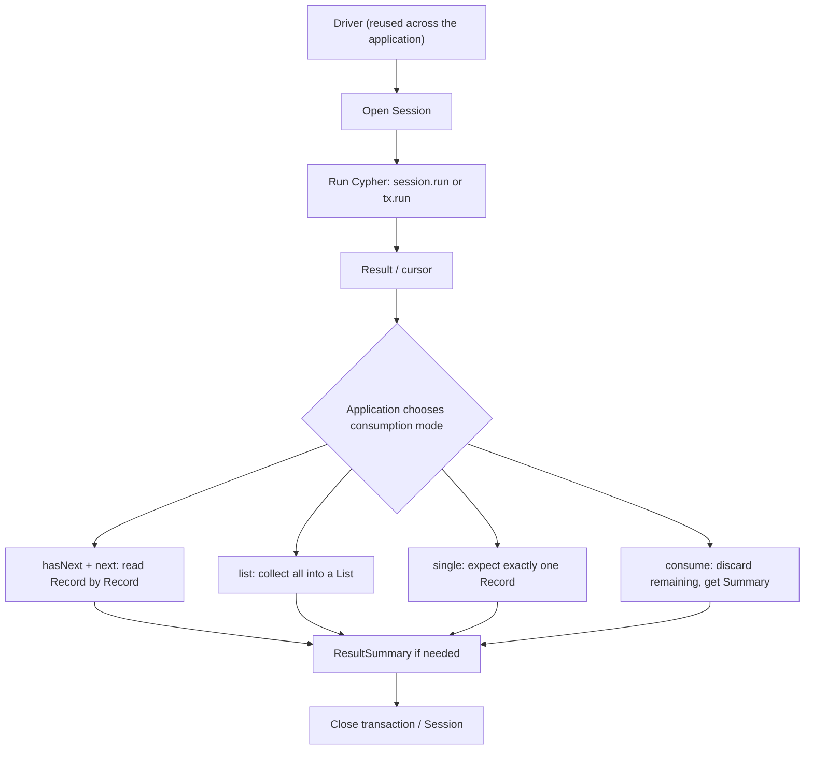

# Streaming Results and Managing Consumption Timing

## 1. Real-World Problem: Queries Returning Many Rows

In Neo4j, Cypher can return nodes, relationships, paths, or aggregated columns computed from a **property graph**. When invoking a query from Java, a result with hundreds of thousands of rows should not blindly be materialized into an in-memory `List`. Conversely, if you read only the first few rows and close the session, you cannot arbitrarily assume the remainder of the query finished executing.

**Neo4j Java Driver** supports incremental result reading via the `Result` object. The Driver receives data from Neo4j over the Bolt protocol and can fetch records in batches. Calling `session.run(...)` or `tx.run(...)` **does not mean** all `Record`s have already been transferred to Java and consumed.

This lesson belongs to the **Java Driver** chapter of the `DATABASE_ENGINE_GRAPH_NEO4J` module. The concepts apply to Cypher read flows over nodes/relationships/paths, queries using indexes and `ORDER BY`, and Java/Spring services integrating with Neo4j.

**Learning objectives**:

1. Distinguish creating a `Result`, pulling individual `Record`s, materializing everything, and obtaining a `ResultSummary`.
2. Use `hasNext()`, `next()`, `list()`, `single()`, `stream()`, and `consume()` for their intended purposes.
3. Place consumption within the active lifetime of the `Session` and transaction.
4. Know when to use `LIMIT`, fetch size, and row-by-row processing instead of buffering the entire dataset.
5. Design latency measurement, error checking, and resource management when serving APIs or batch jobs.

## 2. Lifecycle of a Java Driver Query



This diagram shows the **logical flow**. In practice, `Result` methods may request additional data over the network, and driver behavior depends on the transaction and buffering. Not every `next()` triggers a network round trip: the driver may prefetch a batch of records according to the *fetch size*.

Key concepts to distinguish:

| Component | Role | How to manage? |
|---|---|---|
| `Driver` | Manages configuration, connections/pool, and Neo4j access | Usually created once per application, reused across requests, and closed on shutdown |
| `Session` | Context unit for performing work | Usually opened per operation scope, closed via `try-with-resources`; **never shared across threads** |
| `TransactionContext` / transaction | Scope of a single transaction | Read and consume `Result` before the callback/transaction ends |
| `Result` | Result cursor for a query | Consume while the session/transaction is alive |
| `Record` | One received row of data | Map promptly to application data; avoid retaining unnecessarily |
| `ResultSummary` | End-of-query statistics/metadata | Obtained once the query is fully consumed or via `consume()` |

**Core principle:** a `Result` is not a standalone list you can return from any helper method. It is bound to the lifetime of the session and transaction that created it.

## 3. Preparing Sample Data

Use a dedicated label `JD006Document` so you can re-run the exercise without colliding with business data. Run write statements only on a practice database.

```cypher
CREATE CONSTRAINT jd006_document_id IF NOT EXISTS
FOR (d:JD006Document)
REQUIRE d.id IS UNIQUE;
```

```cypher
UNWIND range(1, 12) AS i
MERGE (d:JD006Document {id: 'doc-' + toString(i)})
SET d.title = 'Document ' + toString(i),
    d.score = i,
    d.category = CASE WHEN i % 2 = 0
                      THEN 'graph' ELSE 'java' END;
```

Verify:

```cypher
MATCH (d:JD006Document)
RETURN d.id AS id, d.title AS title,
       d.score AS score, d.category AS category
ORDER BY score;
```

In a database containing only this fixture, the query returns **12 rows**, with `score` from 1 to 12. This lesson uses the same read query with `ORDER BY score` and `LIMIT $limit` so the ordering is predictable:

```cypher
MATCH (d:JD006Document)
RETURN d.id AS id, d.title AS title, d.score AS score
ORDER BY score
LIMIT $limit;
```

`LIMIT` is a **Cypher result cap processed on Neo4j**, unlike stopping client reads after `k` rows when the server query may still generate many rows. When you only need the first page, limit the query with a parameter instead of hoping discarding the rest client-side costs the same.

## 4. Reading Sequentially with hasNext() and next()

Synchronous Java Driver example (*blocking API*) for recent Java Driver versions. This snippet assumes `Driver driver` is already configured for Neo4j; the `Session` is opened and closed within the method.

```java
import java.util.Map;
import java.util.concurrent.TimeUnit;
import org.neo4j.driver.AccessMode;
import org.neo4j.driver.Driver;
import org.neo4j.driver.Result;
import org.neo4j.driver.Session;
import org.neo4j.driver.SessionConfig;
import org.neo4j.driver.summary.ResultSummary;

public final class DocumentReader {
    private final Driver driver;

    public DocumentReader(Driver driver) {
        this.driver = driver;
    }

    public void printFirstSix() {
        String cypher = """
            MATCH (d:JD006Document)
            RETURN d.id AS id, d.title AS title, d.score AS score
            ORDER BY score
            LIMIT $limit
            """;

        SessionConfig config = SessionConfig.builder()
            .withDefaultAccessMode(AccessMode.READ)
            .withFetchSize(3)
            .build();

        try (Session session = driver.session(config)) {
            Result result = session.run(cypher, Map.of("limit", 6));

            int count = 0;
            while (result.hasNext()) {
                org.neo4j.driver.Record record = result.next();
                String id = record.get("id").asString();
                int score = record.get("score").asInt();
                System.out.printf("%s score=%d%n", id, score);
                count++;
            }

            ResultSummary summary = result.consume();
            System.out.printf("records=%d, availableAfter=%d ms%n",
                count,
                summary.resultAvailableAfter(TimeUnit.MILLISECONDS));
        }
    }
}
```

On the sample data, the method prints `doc-1` through `doc-6` in order; `count = 6`. Calling `consume()` for the `ResultSummary` after the loop is valid. `resultAvailableAfter` provides a Neo4j-reported timing metric for when results became available; **it is not end-to-end latency** for the full HTTP/Java operation and does not replace benchmarking.

Step-by-step explanation:

1. `session.run(...)` sends the query and returns a `Result`; you cannot assume all 6 records are already in Java.
2. `hasNext()` checks if another record exists, and may wait for the driver to pull more records from Neo4j.
3. `next()` advances the cursor to the next record. Read columns and process promptly rather than accumulating records unnecessarily.
4. `consume()` finishes result consumption and returns `ResultSummary`. Since the loop already read everything, no unprocessed records remain.
5. `Session` closes at the end of `try-with-resources`, even if processing throws an exception.

**Streaming does not mean holding literally one record in RAM**: the driver still buffers according to fetch size, property values may be large, and your code might store items in a collection. Still, it avoids holding **all N records** just to process them sequentially.

## 5. When to Use list(), single(), peek(), stream(), and consume()

`Result` supports several consumption methods. Choose the one matching your data contract, not personal preference.

| Method | Behavior | When to use | Risk |
|---|---|---|---|
| `hasNext()` + `next()` | Iterate sequentially over each `Record` | Exports, ETL, multi-row processing | Keeps transaction/session open for the duration of processing |
| `list()` | Reads all remaining records into `List<Record>` | Small, bounded result sets | Retains many records in the heap |
| `list(mapper)` | Reads all records and maps each to a DTO/value | Small list responses with known size | Still materializes the entire list |
| `single()` | Reads expecting **exactly one** record | Lookup by unique key or single aggregate row | Throws an error if row count is not 1 |
| `peek()` | Inspects the next record **without advancing the cursor** | Lookahead before reading with `next()` | Not suitable as the primary iteration mechanism |
| `stream()` | Exposes a Java `Stream<Record>` backed by the result | Controlled processing pipeline inside the session | Stream returned out of the session or collected into a huge `toList()` |
| `consume()` | Ends reading, **discards unread records**, returns `ResultSummary` | Writes/commands needing no rows, or closing the cursor early | Loses access to unconsumed records |

### 5.1. Bounded Materialization with list(mapper)

```java
record DocumentDto(String id, String title, int score) {}

var documents = session.executeRead(tx ->
    tx.run("""
        MATCH (d:JD006Document)
        RETURN d.id AS id, d.title AS title, d.score AS score
        ORDER BY score
        LIMIT $limit
        """, Map.of("limit", 6))
      .list(row -> new DocumentDto(
          row.get("id").asString(),
          row.get("title").asString(),
          row.get("score").asInt()
      ))
);
```

This snippet runs **inside** the program's `try (Session session = ...)` scope; `DocumentDto` is an application-defined type. `list(mapper)` reads the entire query result (limited here to 6) and returns an independent list of DTOs usable **after the transaction closes**. Having `LIMIT` caps the record count, though individual records can still be large if returning entire nodes.

### 5.2. single() Enforces an Exact Single-Row Contract

```java
long total = session.executeRead(tx ->
    tx.run("""
        MATCH (d:JD006Document)
        RETURN count(d) AS total
        """)
      .single()
      .get("total").asLong()
);
```

An ungrouped `count(d)` returns **one row**, even when the graph has zero documents (`total = 0`). Thus `single()` is appropriate. By contrast, running `MATCH (d:JD006Document) RETURN d` with `single()` fails because there are 12 rows. For queries returning 0 or more than 1 row, `single()` cannot be used as "take the first row".

### 5.3. stream() Must Only Be Consumed While the Session Is Open

```java
try (Session session = driver.session()) {
    Result result = session.run("""
        MATCH (d:JD006Document)
        RETURN d.id AS id
        ORDER BY d.score
        LIMIT 6
        """);

    try (var records = result.stream()) {
        records.map(row -> row.get("id").asString())
               .forEach(System.out::println);
    }
    result.consume();
}
```

Java `Stream` provides map/filter/forEach syntax for clients. However, never return a `Stream` from a method that already closed its session; the pipeline would try reading from a `Result` no longer in a valid scope. Also, `stream().toList()` still materializes the whole result, carrying the same memory footprint as `list()`.

### 5.4. consume() Does Not Substitute for Processing All Records

```java
try (Session session = driver.session()) {
    Result result = session.run("""
        MATCH (d:JD006Document)
        RETURN d.id AS id
        ORDER BY d.score
        """);

    if (result.hasNext()) {
        System.out.println("First: " +
            result.next().get("id").asString());
    }
    // From here no more records are needed; unread records are discarded.
    var summary = result.consume();
    System.out.println("Query type: " + summary.queryType());
}
```

This example prints `doc-1`, then discards reading the rest when calling `consume()`. **Never call `next()`/`list()` on an already-consumed `Result`**. Discarding records client-side does not mean server-side work was skipped; to reduce rows the server must generate, use filters and `LIMIT` in Cypher.

## 6. Consumption Timing and Transaction Boundaries

Common Java Driver call styles have different lifecycle boundaries:

| Call style | Result scope | Key rule |
|---|---|---|
| `session.run(...)` | Query runs in an **auto-commit transaction** | Consume the result to ensure the transaction completes; close session when done |
| `session.executeRead(tx -> ...)` | Managed read transaction | Consume `Result` **inside the callback** and return a DTO/list/value |
| `session.executeWrite(tx -> ...)` | Managed write transaction, retryable | Callback must be retry-safe; consume results before leaving the callback |
| `session.beginTransaction()` | Explicit transaction | Keep transaction open while reading; commit/rollback intentionally |

### 6.1. Wrong: Returning Result Outside executeRead()

Code **to avoid**:

```java
// Wrong: callback ends -> transaction ends,
// the cursor is no longer guaranteed to pull records.
Result result = session.executeRead(tx ->
    tx.run("""
        MATCH (d:JD006Document)
        RETURN d.id AS id
        """)
);
while (result.hasNext()) {
    System.out.println(result.next().get("id").asString());
}
```

Replace with **processing inside the callback**, returning only independent data:

```java
long processed = session.executeRead(tx -> {
    Result result = tx.run("""
        MATCH (d:JD006Document)
        RETURN d.id AS id
        ORDER BY d.score
        """);
    long count = 0L;
    while (result.hasNext()) {
        String id = result.next().get("id").asString();
        // Example data validation right inside the transaction scope:
        if (id.isBlank()) {
            throw new IllegalStateException("Document ID is blank");
        }
        count++;
    }
    result.consume();
    return count;
});
```

Result `processed = 12`. Managed transaction callbacks can **be re-executed** on transient errors; never put non-idempotent side effects like sending emails or acknowledging messages inside read/write callbacks. If processing truly needs to push records to an external system, design separate checkpoints and idempotency.

### 6.2. Auto-Commit: Do Not Leave Results Unfinished

`session.run(...)` uses an **auto-commit transaction**; a query can stream results while the transaction remains active on the server. According to the Neo4j Driver guide, **only after the result is fully consumed is the auto-commit transaction guaranteed to have completed**. Therefore:

```java
try (Session session = driver.session()) {
    Result result = session.run("""
        CREATE (m:JD006Log {source: 'exercise'})
        RETURN m.source AS source
        """);

    // Load record and summary, ensuring the query is fully consumed.
    System.out.println(result.single().get("source").asString());
    result.consume();
}
```

Run this write example only in a learning database. A write statement without `RETURN` also needs `consume()` or `ResultSummary` retrieval to obtain counters and confirm completion:

```java
try (Session session = driver.session()) {
    var summary = session.run("""
        CREATE (:JD006Log {source: 'exercise-no-return'})
        """).consume();
    System.out.println("Created nodes: " +
        summary.counters().nodesCreated());
}
```

If you close a session while a result is unfinished, or issue a new query before consuming the previous result, the driver may have to **buffer/discard** data to keep the protocol consistent. Do not rely on this for memory management: consume the previous result before starting the next query, or manage transactions explicitly.

### 6.3. Explicit Transaction: Read and Close in the Same Scope

```java
try (Session session = driver.session()) {
    try (var tx = session.beginTransaction()) {
        Result result = tx.run("""
            MATCH (d:JD006Document)
            RETURN d.id AS id
            ORDER BY d.score
            """);

        while (result.hasNext()) {
            var row = result.next();
            System.out.println(row.get("id").asString());
        }
        result.consume();
        tx.commit();
    }
}
```

With explicit transactions, the application is responsible for `commit()` or `rollback()`. Do not hold a transaction open while waiting on user input, slow HTTP streaming, or an API call that could hang: doing so ties up connections and impacts timeouts and availability.

## 7. Fetch Size: Controlling Record Batch Size

To read large volumes of records, configure `fetchSize` on `SessionConfig`:

```java
SessionConfig config = SessionConfig.builder()
    .withFetchSize(200)
    .withDefaultAccessMode(AccessMode.READ)
    .build();

try (Session session = driver.session(config)) {
    Result result = session.run("""
        MATCH (d:JD006Document)
        RETURN d.id AS id
        ORDER BY d.score
        """);

    while (result.hasNext()) {
        var row = result.next();
        // Process each record quickly; do not store everything in a List.
        System.out.println(row.get("id").asString());
    }
    result.consume();
}
```

**Fetch size is the record delivery batch size between server and driver**, not `LIMIT`, a total record cap, or transaction size. A query producing one million records will still return all one million if you iterate to the end, even with a fetch size of 200.

| Fetch size | Likely behavior | Suitable to test when |
|---|---|---|
| Small | Smaller buffers/batches; may require more pull requests | Large records, slow application processing, tight memory limits |
| Large | Fewer batch requests; may increase memory usage and per-batch wait | Small records, high-latency network, fast consumer |
| Default | Determined by driver/version | Baseline starting point before benchmarking |

There is no single optimal value for all workloads. If a query involves `Sort`, `Aggregation`, `DISTINCT`, or expensive graph expansion, server operators may process vast amounts of data **before producing the first record**. Changing fetch size does not eliminate that internal cost.

### 7.1. Backpressure and Consumer Speed

When application code calls `next()` slowly, data pulling can slow down accordingly; this does not guarantee zero RAM usage on Neo4j, the driver, or the network. Separate three bounds:

- **Server:** how much CPU, page cache, memory, and time Cypher needs to produce records?
- **Driver:** how many records have already been pulled and buffered per configuration?
- **Consumer:** how fast is each record written to file/API/transformed, and does it retain items in a list?

If the goal is streaming millions of rows to an HTTP client, consider frameworks with flow control, cancellation on client disconnect, and timeouts. Do not assume the **blocking** Java Driver turns non-blocking just because results are read sequentially.

## 8. Sorting, Pagination, and Limiting Payload Size

### 8.1. Always Use Deterministic Ordering When Paginating

Queries returning nodes without `ORDER BY` **have no guaranteed order**. If an API paginates with `SKIP`/`LIMIT`, choose a deterministic order and a tie-breaker key:

```cypher
MATCH (d:JD006Document)
WHERE d.category = $category
RETURN d.id AS id, d.score AS score
ORDER BY d.score, d.id
SKIP $offset
LIMIT $pageSize;
```

`SKIP` with large offsets can be expensive because the server must walk through many candidates. For large datasets, consider **keyset pagination**: fetch rows whose sort keys exceed the last cursor:

```cypher
MATCH (d:JD006Document)
WHERE d.category = $category
  AND (
    d.score > $lastScore OR
    (d.score = $lastScore AND d.id > $lastId)
  )
RETURN d.id AS id, d.score AS score
ORDER BY d.score, d.id
LIMIT $pageSize;
```

For example, starting page two after `lastScore = 4, lastId = 'doc-4'`; with `category = 'graph'`, the next page begins at `doc-6`. Keyset pagination reduces offset overhead, yet **does not automatically provide a consistent snapshot** if data changes between queries; the application must define pagination semantics and have suitable indexes for the workload.

### 8.2. Return Fewer Columns to Reduce Transfer Cost

If the API only needs `id` and `title`, project only those two columns:

```cypher
MATCH (d:JD006Document)
RETURN d.id AS id, d.title AS title
ORDER BY d.score
LIMIT 6;
```

Returning the whole node `RETURN d` can carry many unneeded properties; for large nodes, this increases Bolt transfer cost, decoding work, and application memory. To optimize, measure *rows*, payload size, and record processing time.

## 9. Large Results and Write Transactions: Special Controls

When using `session.executeWrite(...)`, the Driver may retry the callback on transient errors. If the callback runs `tx.run(...)` and calls an external service for every record, a retry risks causing **duplicate side effects**. Move external operations out of the transaction, using an outbox/checkpoint or idempotency keys in your integration design.

Principles for write handling:

1. Send parameterized queries, `MERGE` on business keys, and use uniqueness constraints to avoid duplicate nodes.
2. Read all results or call `consume()` to gather summary/counters before the transaction ends.
3. Handle Neo4j exceptions, timeouts, and retries; never acknowledge the source message before confirming the write transaction succeeded.
4. Never hold a write transaction open just to stream rows back to a slow HTTP client.
5. For large ETL, batch at the application layer in reasonable sizes and measure time/heap/locks. `fetchSize` only affects returned records; it **does not** split one write transaction into multiple commits.

Example updating a property:

```java
long updated = session.executeWrite(tx -> {
    Result result = tx.run("""
        MATCH (d:JD006Document)
        WHERE d.category = $category
        SET d.reviewed = true
        RETURN count(d) AS total
        """, Map.of("category", "graph"));
    long count = result.single().get("total").asLong();
    result.consume();
    return count;
});
```

With the original fixture, `updated = 6`. In production code, wrap this write inside a properly managed session lifecycle. `SET d.reviewed = true` is safe to re-run with respect to final state, whereas `SET d.counter = d.counter + 1` is **not** idempotent if the transaction is applied multiple times across duplicate message deliveries.

## 10. Measuring Consumption Timing to Find Bottlenecks

Measure **time to first record**, **time to consume all records**, and **total API duration** separately. A simple Java example:

```java
long started = System.nanoTime();
try (Session session = driver.session(
        SessionConfig.builder()
            .withDefaultAccessMode(AccessMode.READ)
            .withFetchSize(100)
            .build()
    )) {

    Result result = session.run("""
        MATCH (d:JD006Document)
        RETURN d.id AS id, d.score AS score
        ORDER BY d.score
        """);

    long firstRecordNs = -1L;
    long rows = 0L;
    while (result.hasNext()) {
        if (firstRecordNs < 0) {
            firstRecordNs = System.nanoTime();
        }
        var record = result.next();
        record.get("id").asString();
        rows++;
    }
    result.consume();

    long finishedNs = System.nanoTime();
    System.out.printf("rows=%d firstMs=%.2f totalMs=%.2f%n",
        rows,
        firstRecordNs < 0 ? -1.0 :
            (firstRecordNs - started) / 1_000_000.0,
        (finishedNs - started) / 1_000_000.0);
}
```

This snippet measures from before opening the session until after result consumption; **it excludes external HTTP logic** outside the scope. First-run driver usage may include connection setup/cold cache overhead, so benchmarks require warm-up and clear reporting of hot/cold state. On an empty result set, `firstMs = -1` indicates **no first record existed**, not negative latency.

| Measured pattern | Hypothesis to test | Next measurement |
|---|---|---|
| Slow first record | `Sort`, aggregation, scan, suboptimal query plan | `EXPLAIN`/`PROFILE`, `Rows`, and `DB Hits` |
| Fast first record, very slow full consumption | Many rows, large payloads, slow consumer, network | Record count, bytes transferred, fetch size, per-step timing |
| `list()` spikes heap | Materializing all `Record`s or large DTOs | Heap/GC, switch to row-by-row iteration, `LIMIT` |
| `executeRead` holds connections too long | Business logic/external I/O inside callback | Move I/O outside, shorten transaction |
| High p95 under concurrent load | Pool/CPU/cache/network, graph fan-out | Pool metrics, QPS, page cache, CPU, timeouts |

**Do not tune solely via fetch size:** often the primary cost is the Cypher planner picking a scan over an index, relationship expansion exploding row counts, or the server sorting before streaming. Address those at the Cypher/index level and re-measure end-to-end.

## 11. Common Mistakes and How to Fix Them

### 11.1. Returning Result from a Function That Closed the Session

```java
// Avoid:
Result unsafe(Driver driver) {
    try (Session session = driver.session()) {
        return session.run("MATCH (d:JD006Document) RETURN d");
    }
}
```

By the time the caller invokes `next()`, the session is closed. Fix this by **consuming inside the scope**, returning a small DTO/list or computed result. If continuous streaming is needed, design an API managing the reader and session lifecycle throughout the stream.

### 11.2. Treating Result as a Collection Already in Java

`session.run(...)` returns a `Result`, while records are pulled as the client consumes them. Do not call `list()` just to count rows when results could be huge; use a dedicated `RETURN count(...)` Cypher query for counting.

### 11.3. Reading One Record and Assuming the Transaction Finished

`result.next()` only fetches one record; remaining results may still be unconsumed. With auto-commit, completion is only guaranteed once the result is consumed; call `consume()` when remaining records are not needed.

### 11.4. Running the Next Query While an Old Result Remains

The driver may have to buffer the earlier result to run the next statement in the same context. If the earlier result is huge, memory usage can spike. Exhaust or `consume()` the current result before running the next query.

### 11.5. Putting Slow I/O Inside Managed Transaction Callbacks

Never let `executeRead` or `executeWrite` callbacks hold transactions open while sending HTTP responses, writing millions of rows to external services, or waiting on user input. When a callback retries, side effects can also be duplicated.

### 11.6. Confusing Fetch Size with Pagination

`withFetchSize(100)` fetches batches of 100 records at a time, but does not cap the query at 100 records. To retrieve a 100-row page, use `LIMIT 100` in Cypher with a deterministic sort order.

## 12. Practice Exercises

1. **Observe the iterator:** with `LIMIT 6`, log `hasNext()` and `next()` each iteration. Record the row count and `ResultSummary` after reading everything.
2. **Compare list vs. cursor:** run the 12-row query both ways and compare outputs. Explain memory behavior when rows scale to one million.
3. **Test single:** run `RETURN count(d) AS n` followed by `single()`; then try `RETURN d.id`. Which one can throw an exception? Why?
4. **Spot the scope bug:** write a method returning `Result` from `executeRead`. Explain why it should be avoided. Fix it using `list(mapper)` or in-callback processing.
5. **Experiment with fetch size:** run the same query with `3`, `100`, and default. Record time to first record, time to full consumption, and heap; avoid drawing conclusions from a single run.
6. **Early stop:** read only two rows from the 12-row query and call `consume()`. Compare with Cypher `LIMIT 2` regarding consumed results and potential server-side work savings.
7. **Pagination:** fetch `graph` documents sequentially with `SKIP/LIMIT` and keyset cursor `score/id`; mutate data between pages and explain the stability impact.
8. **Design an HTTP API:** an API exports 500,000 results. Sketch the `Driver → Session → Result → HTTP` lifecycle, session cleanup on client disconnect, timeouts, bandwidth limits, and processing checkpoints.

**Completion criteria:** learners can distinguish a cursor from a materialized list, consume records before the session/transaction closes, know when to use `consume()`, avoid `single()` on multi-row queries, and accurately explain the difference between `fetchSize` and `LIMIT`.

### Cleaning Up Practice Data

Clean up only data created by this lesson in the test database:

```cypher
MATCH (d:JD006Document)
DETACH DELETE d;
```

```cypher
MATCH (m:JD006Log)
DETACH DELETE m;
```

```cypher
DROP CONSTRAINT jd006_document_id IF EXISTS;
```

## 13. References

- [Neo4j Java Driver Manual — Query the database](https://neo4j.com/docs/java-manual/current/query-simple/): `Session`, `Result`, parameterized queries, and consuming records.
- [Neo4j Java Driver Manual — Transactions](https://neo4j.com/docs/java-manual/current/transactions/): managed transactions, auto-commit, callback retries, and result consumption.
- [Neo4j Java Driver Manual — Performance recommendations](https://neo4j.com/docs/java-manual/current/performance/): fetch size, limiting queries, and performance tuning.
- [Neo4j Java Driver API — Result](https://neo4j.com/docs/api/java-driver/current/org.neo4j.driver/org/neo4j/driver/Result.html): `hasNext`, `next`, `list`, `single`, `stream`, `consume`.
- [Neo4j Cypher Manual — Execution plans](https://neo4j.com/docs/cypher-manual/current/planning-and-tuning/execution-plans/): `EXPLAIN`, `PROFILE`, and Rows/DB Hits metrics for analyzing slow queries.
