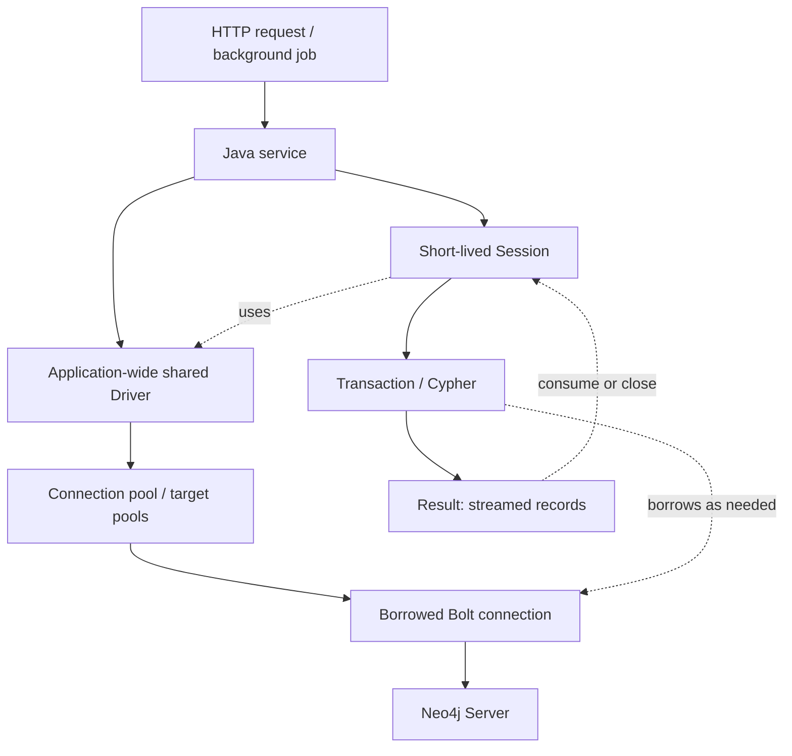
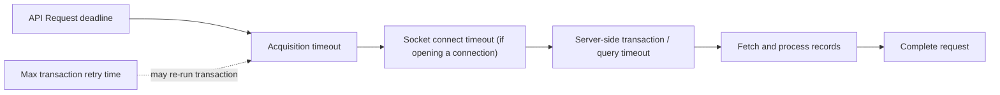

# Connection Pool, Timeouts, and Resource Limits in Neo4j Java Driver

## 1. Why Manage Connections When Using Neo4j?

In the `DATABASE_ENGINE_GRAPH_NEO4J` module, Java applications interact with a **Neo4j property graph** to create and query nodes, relationships, properties, and paths using Cypher. When running a single test query, connecting is simple. However, in a service handling hundreds of concurrent requests, each request may need a Bolt connection, a transaction, and CPU/memory resources on both the application and Neo4j.

Without proper management, an application can encounter symptoms such as:

- Many requests waiting for connections even though the Cypher syntax has no errors.
- Requests timing out while server-side transactions continue running or holding locks for a period of time.
- Connection counts growing as replicas/pods scale out, overloading the Bolt server.
- A query returning huge numbers of records causing out-of-memory errors even when the connection pool is not full.
- Transient network errors triggering aggressive retries, worsening overload.
- Sessions, results, or transactions not being closed within their proper lifecycles, causing resources to be held too long.

A **connection pool** only solves **connection reuse and connection limiting**. It does not replace query tuning, transaction management, result bounding, load testing, and layered timeouts.

### Learning Objectives

After this lesson, you will be able to:

1. Explain the relationships among `Driver`, `Session`, `Transaction`, `Result`, Bolt connections, and the connection pool.
2. Configure the pool, connection acquisition timeout, network connect timeout, connection liveness check, and max connection lifetime.
3. Distinguish connect timeout, transaction timeout, retry timeout, and request deadlines.
4. Estimate theoretical pool capacity when running multiple application instances or connecting to a cluster.
5. Avoid loading entire result sets into memory; apply `fetchSize`, filtering, and pagination.
6. Investigate pool saturation, leaked sessions, long-running transactions, and resource bottlenecks.

> **API scope:** Examples use **Neo4j Java Driver 5.x/6.x** with `org.neo4j.driver`, `Config.builder()`, `session.executeRead()`, and `session.executeWrite()`. Some APIs or defaults vary across versions. Before applying to a project, verify the exact **Java Driver, Neo4j Server, and Spring Boot/Spring Data Neo4j** versions in use and consult their API documentation.

## 2. Components of the Query Lifecycle

### 2.1. From a Request to a Bolt Connection



| Component | Role | Recommended lifecycle |
| --- | --- | --- |
| `Driver` | Manages configuration, routing, connections, and pool | Usually **one shared instance** per connection configuration in the application |
| `Session` | Context for query execution and bookmarks, selects database/access mode | **Short-lived**; created per request or unit of work, closed via `try-with-resources` |
| `Transaction` | Atomic unit of work, manages commit/rollback | As short as reasonable; never hold while waiting on external I/O |
| `Result` | Data returned by a query, possibly not yet fully fetched | Read/consume within the appropriate transaction/session lifecycle |
| Bolt connection | Physical channel between driver and server over Bolt | Reused by the pool; **never created manually per query** |
| Connection pool | Manages available/borrowed connections and connection limits | Owned by `Driver`; closed when the driver closes |

**Key distinction:** Creating a `Session` **does not mean** opening a new TCP connection. A Session is a lightweight logical object; only when running a query does the driver acquire a suitable connection from the pool. Once finished and resources are released, the connection can be returned to the pool for reuse.

### 2.2. Shared Driver, No Concurrent Thread Sharing of Sessions

A `Driver` is designed for reuse and can serve multiple threads. Conversely, **Sessions are not thread-safe**: never share a single session across concurrent requests.

Architectural pattern:

```java
public final class UserQueryService {
    private final org.neo4j.driver.Driver driver;

    // Driver is created and managed at the composition root / DI container.
    public UserQueryService(org.neo4j.driver.Driver driver) {
        this.driver = driver;
    }

    public String findName(String userId) {
        try (var session = driver.session(
                org.neo4j.driver.SessionConfig.forDatabase("neo4j"))) {
            return session.executeRead(tx -> {
                var result = tx.run(
                    """
                    MATCH (u:AppUser {userId: $id})
                    RETURN u.name AS name
                    """,
                    java.util.Map.of("id", userId)
                );
                return result.hasNext()
                    ? result.single().get("name").asString()
                    : null;
            });
        }
    }
}
```

Here only the user name is read, so an empty result returns `null`. Real applications can return `Optional<String>` and enforce access control. The core lesson is **shared Driver, Session closed after use**, not DTO design details.

> With `hasNext()` followed by `single()`, the driver only returns a result when the query produces at most one row per business key. To enforce that at the data level, create a unique constraint on `AppUser.userId`; do not use `single()` if a query can match multiple users.

### 2.3. Never Create a Driver per Request

An anti-pattern:

```java
// Do not use this pattern per HTTP request:
try (var driver = org.neo4j.driver.GraphDatabase.driver(
        uri, org.neo4j.driver.AuthTokens.basic(user, password))) {
    // run a query then close the driver
}
```

Each Driver manages its own pool and routing state. Repeatedly creating/closing Drivers multiplies TLS overhead, TCP handshakes, authentication, socket churn, and GC pressure. In Spring, let the container own the Driver bean and close it on shutdown.

## 3. How the Pool Works

### 3.1. Borrowing, Using, and Returning Connections

1. A request opens a Session and runs a query.
2. The Driver identifies the target database and server (possibly via routing).
3. The Driver tries to reuse a matching idle connection.
4. If no idle connection exists and the limit has not been reached, the driver may open a new connection.
5. If the limit is reached, the request **waits** until a connection is returned.
6. If the connection acquisition timeout expires, the driver throws an error.
7. When the transaction/result completes and the session closes properly, the connection becomes reusable.

Connections in the pool **are not necessarily all opened immediately when the Driver starts**. Active connection counts grow and shrink with load, lifetime, and network state.

### 3.2. Pool Limits Apply per Target, Not "Across All Pods"

In modern Java Drivers, `withMaxConnectionPoolSize` bounds the pool to a destination; with a direct `bolt://` URI it limits the pool to that direct endpoint, while with `neo4j://` routing it typically applies **per cluster member/destination**. Therefore:

- One Driver connected to a three-member cluster **can** maintain multiple pools per target host, not just a single cluster-wide number.
- Each application instance (pod, VM, process) has its **own** Driver/pool.
- If an application creates multiple Drivers for the same database, each Driver maintains its own set of pools.

Example of **theoretical** capacity, not a guarantee of opened sockets:

\[
\text{approximate limit} =
\text{application instances} \times
\text{Drivers per instance} \times
\text{pool limit per destination}
\]

With **8 pods**, **1 Driver** per pod, and `maxConnectionPoolSize = 40`, total connections **potentially** reaching **one destination** could rise to `8 \times 1 \times 40 = 320`. Actual counts depend on routing, request rate, and pool state.

**Do not treat this formula as an exact invariant** across multiple databases/destinations. It is a quick check to catch pool multiplication when scaling out. Application limits must be balanced against the **server's Bolt connection, thread, transaction, and memory limits**.

## 4. Key Connection Pool Settings

### 4.1. Complete Starter Configuration for Load Testing

```java
import java.util.concurrent.TimeUnit;
import org.neo4j.driver.AuthTokens;
import org.neo4j.driver.Config;
import org.neo4j.driver.Driver;
import org.neo4j.driver.GraphDatabase;

public final class DriverFactory {
    public static Driver create(
            String uri, String username, String password) {

        Config config = Config.builder()
            .withMaxConnectionPoolSize(40)
            .withConnectionTimeout(5, TimeUnit.SECONDS)
            .withConnectionAcquisitionTimeout(15, TimeUnit.SECONDS)
            .withConnectionLivenessCheckTimeout(3, TimeUnit.MINUTES)
            .withMaxConnectionLifetime(30, TimeUnit.MINUTES)
            .withMaxTransactionRetryTime(10, TimeUnit.SECONDS)
            .withFetchSize(500)
            .withLeakedSessionsLogging()
            .build();

        Driver driver = GraphDatabase.driver(
            uri,
            AuthTokens.basic(username, password),
            config
        );

        // Detect DNS/TLS/auth/network errors early during application startup.
        driver.verifyConnectivity();
        return driver;
    }
}
```

The snippet above is merely an **illustrative load-testing configuration**, not universal defaults or recommendations for every system. URIs and credentials must come from secure application configuration; never hardcode passwords in source code.

In this example:

- Maximum pool of **40** connections per applicable destination.
- Socket connect timeout of **5 seconds**.
- Maximum wait to acquire a connection of **15 seconds**.
- Connections idle for more than **3 minutes** undergo a liveness check before reuse.
- Connections older than **30 minutes** are eligible for replacement under pool policy.
- Managed transactions have a maximum retry budget of **10 seconds**.
- Default fetch batch size of **500 records**.

**Note:** Setting `withConnectionAcquisitionTimeout` higher than `withConnectionTimeout` leaves budget for establishing and selecting a connection. Never assume total API call duration is capped at 15 seconds, since routing, query execution, result fetching, retry backoff, and Java processing add time.

### 4.2. Options Table and What They Control

| Option | Effect | What it is NOT |
| --- | --- | --- |
| `withMaxConnectionPoolSize(n)` | Caps pool connections kept per destination | A cap on total app requests or threads |
| `withConnectionAcquisitionTimeout(t, unit)` | How long the driver tries to obtain a usable connection | Cypher execution time |
| `withConnectionTimeout(t, unit)` | Timeout for establishing the socket connection | End-to-end HTTP request deadline |
| `withConnectionLivenessCheckTimeout(t, unit)` | **Idle** threshold before testing a connection prior to reuse | Maximum duration of a transaction |
| `withMaxConnectionLifetime(t, unit)` | Caps how long a connection lives in the pool | Query timeout or lease time of an actively used connection |
| `withMaxTransactionRetryTime(t, unit)` | Retry time budget for managed transactions on retryable errors | Execution timeout for a single transaction attempt |
| `withFetchSize(n)` | Number of records per batch in batched fetching | Total record limit or heap ceiling |
| `withLeakedSessionsLogging()` | Diagnostic aid for unclosed Sessions | Automatic fix for resource leaks |

Zero (`0`), negative numbers, or special values carry different semantics across options and versions. **Do not assume a universal "0 means infinite" rule for all timeouts**.

### 4.3. Java Driver 6.3 Defaults Reference

Per the Java Driver 6.3 API, notable documented defaults include:

| Parameter | Documented default | Meaning |
| --- | ---: | --- |
| `maxConnectionPoolSize` | 100 | Maximum connections per destination pool scope |
| `connectionAcquisitionTimeout` | 60 seconds | Connection acquisition wait budget |
| `maxConnectionLifetime` | 1 hour | Connection age before replacement |
| `maxTransactionRetryTime` | 30 seconds | Managed transaction retry budget |
| `fetchSize` | 1,000 records | Batch size for one fetch |

These numbers are **a reference for one API version**, not an "immutable best practice". For example, a system with 50 pods each allowed 100 connections per server places vastly different connection pressure on Neo4j than a single-JVM application.

### 4.4. Connection Lifetime and Proxies/Load Balancers

Systems behind proxies, firewalls, or load balancers may drop idle or long-lived TCP connections. If the Driver tries to reuse a socket already closed by the network, requests can fail with network errors and need reconnection.

Solutions:

- Know the **idle timeout/lifetime** enforced by network gear or Neo4j infrastructure.
- Set **max connection lifetime** safely below infrastructure connection age limits when appropriate.
- Use **liveness checks** for connections idle long enough.
- Monitor stale-connection errors, reconnects, and acquisition delays after idle periods.

Do not blindly slash lifetime to a few seconds, as constant reconnection adds TLS/authentication overhead and extra server load.

## 5. Distinguishing Five Types of "Timeout"

Common timeouts operate at **different layers**:



This diagram illustrates stages; an already-open connection skips socket connect, and a managed transaction may execute multiple attempts with backoff.

### 5.1. Connection Acquisition Timeout: Waiting for a Pool Slot

When the pool is at capacity and all eligible connections are busy, requests wait. `withConnectionAcquisitionTimeout` caps **how long the driver waits to acquire a connection**. If time runs out without a connection, the driver throws an error.

Acquisition failures do not prove the database is "slow on a single query"; causes can include:

- Pool sized too small relative to traffic and **connection hold time**.
- Long transactions, queries scanning huge datasets, or clients consuming results too slowly.
- Sessions/results not closed promptly.
- Traffic spikes or retry storms.
- Routing to an overloaded destination.

Raising this timeout lets requests **wait longer**, but **adds zero actual processing capacity**. Enlarging the pool is not always better either: it can shift the bottleneck from the client to the server.

### 5.2. Connection Timeout: New Network Connection

`withConnectionTimeout` governs socket setup when the Driver needs a new connection. If the server is unreachable or DNS/routing/TCP/network fails, errors occur before any Cypher is sent.

It **does not bound** the execution time of a query already running on a borrowed connection.

### 5.3. Transaction Timeout: Bounding Server-Side Neo4j Work

With modern Java Drivers, pass `TransactionConfig` when invoking managed transactions:

```java
import java.time.Duration;
import java.util.List;
import java.util.Map;
import org.neo4j.driver.SessionConfig;
import org.neo4j.driver.TransactionConfig;

public List<String> findPeople(org.neo4j.driver.Driver driver, String city) {
    TransactionConfig txConfig = TransactionConfig.builder()
        .withTimeout(Duration.ofSeconds(8))
        .withMetadata(Map.of(
            "operation", "findPeople",
            "component", "user-service"))
        .build();

    try (var session = driver.session(
            SessionConfig.forDatabase("neo4j"))) {
        return session.executeRead(tx -> tx.run(
                """
                MATCH (p:AppPerson {city: $city})
                RETURN p.personId AS id
                ORDER BY id
                LIMIT 100
                """,
                Map.of("city", city)
            ).list(record -> record.get("id").asString()),
            txConfig);
    }
}
```

Meaning:

- `withTimeout(Duration.ofSeconds(8))` instructs the server to bound the **transaction** according to supported configuration.
- `withMetadata(...)` attaches tracing metadata to the transaction. Include only **non-sensitive technical labels**, never tokens, passwords, or personal data.
- `LIMIT 100` only caps returned records; it does not guarantee a cheap query. Proper labels, indexes, and predicates are still required.
- `list(...)` is safe here because the query is capped at 100 rows, but avoid it for multi-million-row outputs.

Transaction timeout behavior can also depend on server limits and versions. Specifically, per Java Driver docs, against Neo4j Server **4.2–5.2**, requesting a timeout **higher than the server default** may not be honored as expected and may fall back to the default. Consult version-specific docs when supporting multiple versions.

### 5.4. Maximum Transaction Retry Time: Total Retry Budget

Managed transactions such as `executeRead()` / `executeWrite()` automatically retry eligible transient errors (e.g., lost connections, transient cluster errors). `withMaxTransactionRetryTime` bounds how long the Driver keeps retrying a transaction.

It is **not** the maximum duration of a single Cypher run. Each attempt can have its own transaction timeout and connection acquisition time. Therefore, **do not add or subtract timeouts assuming every operation runs sequentially once**.

Callbacks can re-run, so avoid non-rollbackable side effects:

```java
// Unsafe if the callback is re-executed:
session.executeWrite(tx -> {
    // externalPaymentGateway.charge(card, amount); // avoid here
    tx.run("MATCH (n:Counter {id: $id}) SET n.value = n.value + 1",
           Map.of("id", counterId));
    return null;
});
```

When a business event must occur once, use an idempotency key and appropriate unique constraint, and coordinate external systems via an outbox/saga or dedicated guarantee mechanism.

### 5.5. HTTP Request Deadlines and Client Cancellation Do Not Replace Server Timeouts

An HTTP gateway may cut off a request after 3 seconds, yet if a database query is allowed to run for 30 seconds, the server may continue executing for a while depending on how the client closes/cancels the transaction and protocol.

Layered defense:

1. Bound **Cypher work**: indexes, anchors, hop limits, pagination.
2. Set a **server-side transaction timeout** for bounded operations.
3. Set an **acquisition timeout** to avoid waiting indefinitely on the pool.
4. Align **retry policies** so they do not far exceed business deadlines.
5. Enforce **deadlines and cancel/close handling** at the API layer, alongside monitoring active transactions.

Never promise that total HTTP request latency equals a single `withTimeout` value.

## 6. Pool Size and Resource Limits: Bigger Is Not Always Faster

### 6.1. Capacity Math

Suppose a query holds a connection for an average of **100 ms**. Under ideal conditions, one connection serves about **10 ops/sec**; 20 connections can serve roughly **200 ops/sec** if the server, CPU, network, and queries are uncontended. If the query takes **1 second**, the same 20-connection pool handles only around **20 ops/sec** before queueing builds up.

This is only a **back-of-the-envelope estimate**, not a benchmark or TPS guarantee. Connection hold time includes lock waits, query execution, result streaming, and client consumption time.

From Little's Law intuition:

\[
\text{active concurrency} \approx
\text{arrival rate} \times
\text{resource hold time}
\]

A slow query raises the number of concurrent connections needed even at constant QPS. Thus, **optimizing Cypher and Result consumption** is usually far more effective than blindly growing the pool.

### 6.2. Increasing the Pool Can Worsen Server Bottlenecks

When the pool is too small, client queues grow. When the pool is too large, too many concurrent queries hit the server at once:

- CPU and disk I/O contention increases.
- Page cache and transaction memory come under pressure.
- Queries may wait longer on locks.
- The server may run out of Bolt threads/connections or hit resource limits.
- P95/P99 latency rises even without proportional QPS growth.

Find the balance through **load testing**, rather than mechanically matching connection counts to HTTP thread counts.

### 6.3. Do Not Confuse Pool Limits with Query Limits

Consider a query like:

```cypher
MATCH p = (a:Account)-[:TRANSFERRED_TO*1..8]->(b:Account)
RETURN p;
```

This can expand far too many paths. No pool size fixes combinatorial data explosion. Replace it with patterns having **anchored start nodes, relationship types/directions, bounded hops, and filters**, returning only what the application needs.

Likewise, missing indexes can cause broad scans that hold connections for a long time; indexes, constraints, and `PROFILE` plans yield far greater gains than tweaking pool size.

## 7. Result Streaming, Fetch Size, and Application Memory

### 7.1. `fetchSize` Is Batch Size, Not a Result Limit

`withFetchSize(500)` asks the Driver to typically pull records in **batches of 500**, supporting Bolt **backpressure** on compatible servers and Drivers. It does not mean the query returns at most 500 records.

Illustration:

```text
Cypher produces 1,000,000 rows
    -> Driver fetches 500 rows per batch
    -> application processes each record/batch
    -> continues fetching as needed
```

The default in API 6.3 is **1,000 records**. `-1` is documented as disabling backpressure and pulling all results immediately after execution; for large result sets, avoid `-1` as it can spike memory usage.

In the reactive API, backpressure depends on **subscription demand** rather than just synchronous session `fetchSize`. Never equate `fetchSize` with the total buffer memory an application might consume.

### 7.2. Configuring Fetch Size per Session

```java
import org.neo4j.driver.SessionConfig;

SessionConfig sessionConfig = SessionConfig.builder()
    .withDatabase("neo4j")
    .withFetchSize(200)
    .build();

try (var session = driver.session(sessionConfig)) {
    // Run queries suited for batched reading.
}
```

Session-level settings override the default set via `Config.withFetchSize(...)`. Use smaller values when records are large or RAM is tight; overly small values can increase Bolt round-trips and reduce throughput. Measure with real data to decide.

### 7.3. `list()` and `collect()` Can Create Memory Bottlenecks

```java
// If the query returns millions of records, this holds all of them in a heap List:
List<String> ids = session.executeRead(tx ->
    tx.run("""
        MATCH (p:AppPerson)
        RETURN p.personId AS id
        """).list(record -> record.get("id").asString()));
```

`fetchSize(200)` cannot save the snippet above because `list()` still allocates a Java List holding **all results**. Moreover, if the query uses `collect(p)` on the server, Cypher itself may build a massive list value before the driver receives a single record.

To bound memory:

- Return only **needed properties** instead of full nodes/relationships.
- Apply filters and **deterministic pagination**.
- Process records one by one while inside the transaction/session.
- Never call `list()` on unbounded large datasets.
- For multi-million-row exports, build a dedicated job with **batching, checkpoints, and backpressure**.

### 7.4. Processing Results Record by Record

```java
import java.util.Map;
import org.neo4j.driver.Result;

int inspected;
try (var session = driver.session(
        SessionConfig.forDatabase("neo4j"))) {
    inspected = session.executeRead(tx -> {
        Result result = tx.run(
            """
            MATCH (p:AppPerson)
            WHERE p.status = $status
            RETURN p.personId AS id
            ORDER BY id
            LIMIT 5000
            """,
            Map.of("status", "ACTIVE")
        );
        int count = 0;
        while (result.hasNext()) {
            var record = result.next();
            String id = record.get("id").asString();
            if (!id.isBlank()) {
                count++;
            }
        }
        return count;
    });
}
```

This example **avoids storing 5,000 IDs in a Java List**, though it still pulls records and holds the transaction/connection while reading. Keep the loop body lightweight. If each record must be sent over an external network API, **do not perform that slow I/O inside the transaction callback**: it holds connections/locks open and risks callback re-execution.

### 7.5. Keyset Pagination on a Stable Key

With a unique constraint on `AppPerson.personId`, one pagination approach is:

```cypher
MATCH (p:AppPerson)
WHERE p.personId > $afterId
RETURN p.personId AS id, p.name AS name
ORDER BY id
LIMIT $pageSize;
```

The application starts with `$afterId = ''` if ID rules allow, then tracks the last ID of each page to fetch the next. `$pageSize` needs an **upper bound at the application layer**. An index on the key accelerates range comparisons and ordering.

Paginating across multiple transactions **does not guarantee a consistent snapshot** under concurrent writes; for point-in-time consistent exports, design data versioning/cutoffs or suitable snapshot mechanisms.

## 8. Session and Transaction Resources

### 8.1. Always Close Sessions

```java
try (var session = driver.session(
        SessionConfig.forDatabase("neo4j"))) {
    var rows = session.executeRead(tx ->
        tx.run("""
            MATCH (u:AppUser)
            RETURN u.userId AS id
            LIMIT 10
            """).list());
    // Use rows after the callback completes.
}
```

`try-with-resources` guarantees `session.close()` is called even on exceptions. For the shared `Driver`, close it only on application shutdown; closing it after one request prevents subsequent requests from using it.

### 8.2. Unconsumed Results Can Hold Resources

When a query produces a `Result`, records may remain on the server or in driver buffers. Ignoring a Result while continuing to use the session/transaction improperly can pin resources or force the driver to wait/consume before the next operation.

Rules:

- For queries needing only **update counters/query summaries**, call `result.consume()` to finish.
- For queries returning records, read all needed records **before ending the transaction lifecycle**.
- Never return an open `Result` object out of a managed transaction callback for external use.
- Never store a Session in a singleton or user-state cache.

Example:

```java
long created;
try (var session = driver.session(
        SessionConfig.forDatabase("neo4j"))) {
    created = session.executeWrite(tx ->
        tx.run("""
            UNWIND $ids AS id
            MERGE (:AppUser {userId: id})
            """, java.util.Map.of("ids", java.util.List.of("u1", "u2")))
            .consume().counters().nodesCreated()
    );
}
```

This writes by identifier key; production data needs a unique constraint and validation against null/blank IDs. `nodesCreated()` reports nodes created in that call, **not** total users in the database.

### 8.3. Explicit vs. Managed Transactions

| Usage style | Common APIs | Retries |
| --- | --- | --- |
| Managed transaction | `session.executeRead(...)`, `session.executeWrite(...)` | Driver manages retries for eligible errors |
| Explicit transaction | `session.beginTransaction()`, `commit()`, `rollback()` | Application must implement retries itself if desired |
| Implicit/auto-commit query | `session.run(...)` | Retry behavior varies by API/version; do not assume managed-transaction semantics |

Keep transactions short: never call third-party APIs, wait for user input, or hold sockets idle while a transaction is open. For large imports, **batch** with `UNWIND` and bounded transactions rather than running one massive transaction.

## 9. Pool Exhaustion Symptoms and Investigation Workflow

### 9.1. Layered Diagnosis

| Symptom | Causes to check | Remediation |
| --- | --- | --- |
| Many requests time out borrowing connections | Pool exhausted, long-held transactions, connection leaks | Measure acquisition time, session lifecycle, query latency |
| Connections fail even under low load | URI/TLS/auth/DNS/firewall/server unavailable | Check `verifyConnectivity`, network logs, routing |
| P99 rises after increasing pool size | Server CPU/I/O/lock contention | Reduce concurrency, optimize Cypher, monitor server |
| Java heap grows with record count | `list()`/caching huge results | Stream, project only needed columns, paginate |
| Connection errors after idle period | Proxy closed socket, stale connection | Adjust lifetime/liveness checks, monitor reconnects |
| Requests miss SLA despite fast queries | Retries, acquisition wait, slow fetch, GC | Break down latency per phase and adjust budgets |
| Only one cluster member is bottlenecked | Routing/load distribution/read-write target | Inspect routing and per-server metrics |
| Deadlocks or transaction timeouts | Long transactions, contending writes | Consistent lock ordering, short transactions, bounded retries |

### 9.2. Metrics to Monitor

Useful application-side metrics:

1. **QPS/throughput** by endpoint and query type.
2. **P50/P95/P99 latency** for HTTP requests, queries, and pool acquisition.
3. **Active/idle/waiting connections**, where exposed by your driver version and metrics system.
4. **Connection acquisition timeouts**, retry counts, and categorized connection errors.
5. **Active transaction count** and longest-running transaction duration.
6. **Heap/direct memory, GC, CPU**, busy threads, and application queues.
7. **Bolt connections, CPU, memory, query logs, and lock contention** on the Neo4j server.

Do not assume every Java Driver release exposes identical pool metric names out of the box. Measure latency and errors in service wrappers, and use driver logs, OpenTelemetry/Micrometer where supported, plus Neo4j server monitoring. When enabling debug logging, **avoid logging credentials, sensitive parameters, or excessive payloads** in production.

### 9.3. Investigation Order When Wait Times Spike

1. **Identify the error category**: acquisition, TCP connect, TLS/auth, transaction timeout, retry, or result fetch.
2. Inspect **actual SLAs** and P95/P99 time-series charts rather than averages alone.
3. Measure **connection hold time**: slow queries, large results, heavy Java processing, or lock waits?
4. Check **pod/Driver counts and routing**: could total potential connections overwhelm the server?
5. Inspect **Cypher plans with `EXPLAIN`/`PROFILE`**, indexes, cardinality, and intermediate rows.
6. Shed load, optimize queries, and shorten transactions **first**, before adjusting pool size and timeouts.
7. Re-test under representative load, comparing throughput, tail latency, errors, and resource cost.

Never automatically recommend "raising `maxConnectionPoolSize` from 100 to 1000" on an acquisition timeout. That often just pushes the queue onto Neo4j and slows the whole system down.

## 10. Application-Layer Backpressure and Concurrency Limits

The pool is one form of resource limit, yet letting thousands of HTTP threads block on the pool can stall the application itself. Once service capacity is understood, apply an API-layer **concurrency gate**:

```java
import java.util.concurrent.Semaphore;
import java.util.concurrent.TimeUnit;

public final class GraphAdmissionControl {
    private final Semaphore permits = new Semaphore(32);

    public <T> T call(java.util.concurrent.Callable<T> task)
            throws Exception {
        if (!permits.tryAcquire(200, TimeUnit.MILLISECONDS)) {
            throw new IllegalStateException("Graph service is busy");
        }
        try {
            return task.call();
        } finally {
            permits.release();
        }
    }
}
```

`Semaphore` is just an example mechanism for **bounded request admission/shedding**. In production APIs, translate the "busy" exception into an appropriate HTTP status (often 429 or 503 per API contract) with sensible client retry guidance.

Notes:

- The number **32** is illustrative and **must not** be derived mechanically from `maxConnectionPoolSize = 40`.
- If a single request runs multiple queries/transactions or hits multiple databases, one permit does not equal one connection.
- Across multiple instances, each instance has its own gate; enforcing a **cluster-wide limit** requires distributed admission control or server-side limits.
- A semaphore does not replace timeouts, indexes, pagination, or proper Session closing.

If demand persistently exceeds capacity, **shed load, scale appropriately, or process asynchronously via queues** rather than letting request queues grow unbounded.

## 11. Spring Boot / Spring Data Neo4j Integration Scenarios

Spring Data Neo4j uses the Neo4j Java Driver via application configuration and a framework-managed driver bean. The same principles apply:

- **One shared Driver** managed by the container per connection configuration—never create a Driver inside each repository call.
- **Short Sessions/transactions** with sensible transaction boundaries.
- Pool/timeouts are configured through Driver integration settings or customization APIs, depending on your Spring Boot version.
- Use `@Transactional(readOnly = true)` for read methods where appropriate, remembering this annotation **does not reduce row counts** or optimize Cypher by itself.
- Avoid wrapping `@Transactional` around external I/O waits or multi-minute file transfers.

Illustrative service showing **transaction scope**:

```java
import java.util.List;
import org.springframework.stereotype.Service;
import org.springframework.transaction.annotation.Transactional;

@Service
public class PersonService {
    private final PersonRepository repository;

    public PersonService(PersonRepository repository) {
        this.repository = repository;
    }

    @Transactional(readOnly = true)
    public List<PersonSummary> findActivePeople(int limit) {
        int safeLimit = Math.min(Math.max(limit, 1), 100);
        return repository.findActiveSummaries(safeLimit);
    }
}
```

`PersonRepository` and `PersonSummary` represent application interfaces/DTOs, not built-in Neo4j Driver classes. When implementing, ensure the repository runs a proper query, e.g. `MATCH (p:AppPerson {status: 'ACTIVE'}) RETURN ... ORDER BY ... LIMIT $limit`.

Property names for pool configuration in `application.yml` vary by **Spring Boot version** and Driver initialization method. Never blindly copy property keys from another version's guide, as ignored properties silently leave defaults active. Verify configuration metadata for your exact Spring Boot version and confirm the Driver picks up the values.

## 12. Protecting Correctness Under Timeouts and Retries

### 12.1. A Timeout Is Not Proof That a Transaction Rolled Back

If the HTTP layer hits its deadline, that is **not proof** the transaction rolled back or committed. On a network error right around commit time, the application cannot be sure whether the commit succeeded. Blindly retrying a non-idempotent write can create duplicate data.

When writing data:

```cypher
CREATE CONSTRAINT app_order_request_unique IF NOT EXISTS
FOR (o:AppOrder)
REQUIRE o.requestId IS UNIQUE;
```

```cypher
MERGE (o:AppOrder {requestId: $requestId})
ON CREATE SET
    o.createdAt = datetime(),
    o.status = 'PENDING'
RETURN o.requestId AS id, o.status AS status;
```

`$requestId` is stably generated by the caller for **one logical business request**. On retry, the same key matches the existing node rather than creating a second order. Still, check for cases where the same `requestId` arrives with a different payload; a unique constraint alone **does not prevent** content mismatches.

### 12.2. Distinguishing Transient Errors from Business Errors

| Error type | Auto-retry? |
| --- | --- |
| Eligible transient connection or cluster error | Yes, within retry budget and with a retry-safe callback |
| Deadlock / transaction transient error | Yes, retry the whole transaction |
| Cypher syntax error | **No**: fix the query |
| Uniqueness constraint violation from another request claiming the key | Do not retry blindly; handle business conflict |
| Invalid parameter format or insufficient permissions | No: fix input/configuration |
| HTTP timeout with unknown commit status | Check state via idempotency key before deciding to retry |

A **retry storm** occurs when many clients fail concurrently and keep retrying, amplifying load. Bound retry duration/attempts, apply backoff and jitter where appropriate, and prevent the HTTP layer, service layer, and Driver from **all retrying the same request independently** without a combined budget.

## 13. Load-Testing Methodology for Choosing Configuration

### 13.1. Prepare Representative Data

Generate data matching production scale in node count, relationship fan-out, indexes, and read/write mix. A query that flies on a 100-node graph is not representative of a multi-million-node graph.

### 13.2. Measure a Baseline

Hold configuration constant and record:

- QPS, P50/P95/P99, error rate.
- Pool acquisition time where observable.
- Query execution time and result fetch time.
- Application CPU, heap, GC; Neo4j CPU, memory, and Bolt connections.
- Number of pods/Drivers and target servers.

### 13.3. Change One Variable per Round

Test pool sizes matching load and server capacity—for example, 20 → 40 → 60—under controlled resources. Then tune acquisition timeout, fetch size, and transaction timeout against the target workload. **Do not change five parameters at once** and guess which one helped.

During testing, watch for:

- **Warm-up:** connection pools and the JVM need time to stabilize.
- **Steady state:** run long enough to expose queueing and GC patterns.
- **Burst:** test absorption of request spikes.
- **Failure:** flaky networks, a slow server, transaction timeouts, deadlocks, and retries.
- **Scale-out:** adding app instances multiplies total connections hitting the server.

### 13.4. Selection Criterion

A good configuration is not the one hitting peak QPS for a few seconds, but one maintaining **stable latency, low errors, server headroom, and clean recovery from overload**.

## 14. Common Operational Pitfalls

| Misconception | Consequence | Fix |
| --- | --- | --- |
| Creating a Driver per request | Pool never reused, extra sockets/TLS | Use a container-managed singleton Driver |
| Sharing a Session across threads | Races / driver contract violations | Separate Session per concurrent unit of work |
| Not closing Sessions | Leaked resources, exhausted pool | `try-with-resources`, check exception paths |
| Raising pool indefinitely to fix slow queries | Overloads Neo4j server | Optimize queries, shorten transactions, cap concurrency |
| Treating connection timeout as query timeout | Queries can run far too long | `TransactionConfig.withTimeout` |
| Treating retry timeout as API deadline | Requests breach SLA | End-to-end budget and cancellation |
| Treating `fetchSize` as `LIMIT` | Still returns millions of rows | Filter, proper `LIMIT`, pagination, and streaming |
| Calling `list()` on unbounded queries | Heap grows until OOM | Process in batches / per record |
| Setting `fetchSize = -1` for "max speed" | Disables backpressure, spikes memory | Pick an appropriate batch size and measure |
| Ignoring cluster routing | One destination bottlenecks or lacks connections | Verify `neo4j://`/`bolt://` URI and access mode |
| Calling external systems inside managed transaction callbacks | Retries duplicate side effects | Idempotency/outbox, separate async flow |
| Retrying commit timeouts using `CREATE` | Creates duplicate records | Idempotency key and constraints |
| Leaving debug logging continuously enabled in production | I/O overhead and sensitive data exposure | Tune log levels, redact secrets, time-box debug |

## 15. Self-Check Exercises and Suggested Answers

### Exercise 1. Calculating Pool Limits on Scale-Out

A system runs 6 pods, each creating one Driver with `maxConnectionPoolSize = 50`. If all pods route to the same target server, what is the maximum number of connections that could be maintained to **that destination** under the pool limit?

**Hint:** `6 × 1 × 50 = 300` **potential** connections. This does not guarantee 300 connections will be open simultaneously. If the cluster has multiple target servers, calculate per routing table and destination pool.

### Exercise 2. Distinguishing Timeouts

A Driver is configured with `connectionTimeout = 5s`, `connectionAcquisitionTimeout = 15s`, transaction timeout = `8s`, and managed retry time = `10s`. One request takes 30s before failing. Is there a contradiction?

**Answer:** You cannot claim a contradiction from those four numbers alone: they bound different phases, and execution may involve acquisition, routing, retries, and fetch/Java processing. Measure end-to-end latency broken down by phase alongside HTTP deadlines.

### Exercise 3. Why Did Lowering fetchSize Not Lower Heap?

Java code uses `result.list()` on a query returning 2 million records. After lowering `fetchSize` from 1,000 to 100, heap usage still spikes sharply. Why?

**Answer:** `fetchSize` only limits **each batch received over the wire**, whereas `list()` accumulates every record into a Java List. Bound the results, paginate, or process records in a stream.

### Exercise 4. Diagnosing Pool Saturation

An application has a 20-connection pool, traffic of 100 requests/sec, and each query holds a connection for 600 ms on average. Using the simple estimate, what is the average concurrency? Is there a risk of waiting on the pool?

**Answer:** `100 × 0.6 = 60` concurrent requests needing connections on average, exceeding 20; queueing and acquisition timeouts are very likely. Reduce connection hold time, shed load, or increase capacity after measuring the server—do not merely raise timeouts.

### Exercise 5. Designing Safe Retries for Orders

An order-creation call loses the connection right around commit time. The client does not know whether the order was created. Propose a retry design that avoids creating two orders.

**Answer:** Generate a stable `requestId`, enforce a unique constraint, and `MERGE` on that ID; verify payload and prior state before accepting a retry. Also ensure external side effects outside Neo4j are idempotent.

### Exercise 6. Reading 1,000 Records Within a 2-Second Deadline

An API must return 1,000 `AppPerson` nodes by status with P99 under 2 seconds. List at least five steps before changing pool size.

**Suggested answer:** Verify query/indexes, enforce `LIMIT 1000` and column projection; run `EXPLAIN`/`PROFILE`; measure query/fetch P99; configure an appropriate transaction timeout; cap request concurrency; measure acquisition delay; monitor CPU/memory/GC; verify Session/Result closure.

## 16. Production Deployment Checklist

Before deploying a Neo4j Java Driver application to high-concurrency production, verify:

- [ ] Driver is created **once per connection configuration** and closed on application shutdown.
- [ ] Each thread/request gets its own Session, closed via `try-with-resources` or proper framework lifecycle.
- [ ] Target database is explicitly specified and access mode matches read/write queries.
- [ ] Pool size is calculated across **pods, Drivers, and routing destinations**, not just one JVM.
- [ ] **Acquisition, connect, transaction, retry, and HTTP deadlines** are clearly separated.
- [ ] Transactions are kept short, and results are read/consumed within their proper lifecycle.
- [ ] Queries use labels and appropriate predicates/indexes; unbounded path expansions are avoided.
- [ ] Fetch size and batch sizes are measured against realistic workloads; no unbounded lists accumulated.
- [ ] Managed callback retries contain no non-idempotent external side effects.
- [ ] Idempotency keys protect critical data-creation operations.
- [ ] Telemetry tracks queries, acquisition waits, retries, connection errors, CPU/memory, and server Bolt metrics.
- [ ] Load tests cover steady state, bursts, failures, and scale-out.
- [ ] Configuration, defaults, and APIs are verified against the actual **Driver/Server/Spring** versions.

## 17. Summary

In Neo4j Java Driver, a **shared Driver** holds configuration and connection pools; **Sessions and Transactions** are short-lived units of work; **Results** must be consumed or closed within their lifecycle. `withMaxConnectionPoolSize` caps connections per destination, whereas acquisition timeout, connect timeout, transaction timeout, and retry timeout govern **separate stages**. No single parameter guarantees an entire HTTP request meets its SLA.

Effective tuning combines **connection pooling, resource lifecycle management, selective Cypher queries, result limits, streaming/backpressure, retry-safe design, telemetry, and load testing**. As systems scale across multiple pods or clusters, calculate total capacity and load on the Neo4j Server rather than tuning pool size inside a single process in isolation.

### Official References

- [Neo4j Java Driver Manual – Advanced connection information](https://neo4j.com/docs/java-manual/current/connect-advanced/)
- [Neo4j Java Driver Manual – Run your own transactions](https://neo4j.com/docs/java-manual/current/transactions/)
- [Neo4j Java Driver Manual – Performance recommendations](https://neo4j.com/docs/java-manual/current/performance/)
- [Neo4j Java Driver Manual – Further query mechanisms](https://neo4j.com/docs/java-manual/current/query-advanced/)
- [Neo4j Java Driver API – Config.ConfigBuilder](https://neo4j.com/docs/api/java-driver/current/org.neo4j.driver/org/neo4j/driver/Config.ConfigBuilder.html)
- [Neo4j Java Driver API – TransactionConfig.Builder](https://neo4j.com/docs/api/java-driver/current/org.neo4j.driver/org/neo4j/driver/TransactionConfig.Builder.html)
- [Neo4j Java Driver API – SessionConfig.Builder](https://neo4j.com/docs/api/java-driver/current/org.neo4j.driver/org/neo4j/driver/SessionConfig.Builder.html)
