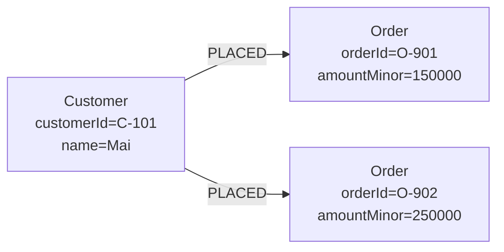
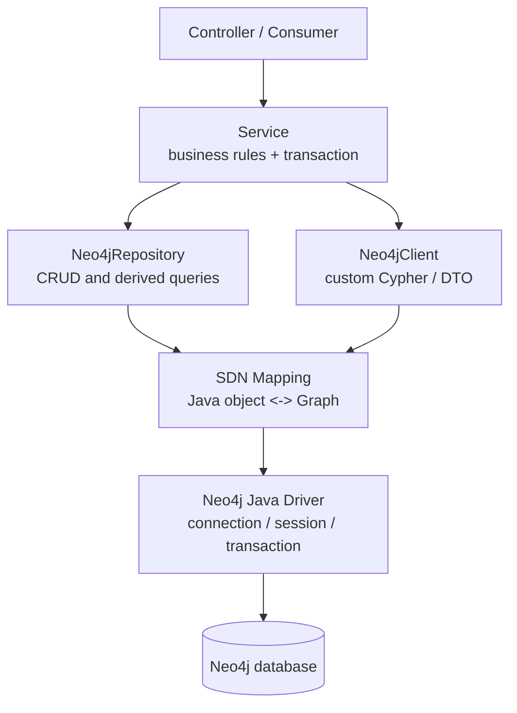

# How Spring Data Neo4j Solves Object–Graph Mapping

In Neo4j, data is modeled as a **property graph**: nodes have labels and properties, while relationships connect nodes directionally and can also carry properties. In Java, however, applications work with **classes, objects, fields, collections, and domain services**. If you use only the Neo4j Java Driver, developers typically have to send Cypher queries, read `Record` objects, extract nodes/relationships, and manually construct the corresponding Java objects.

**Spring Data Neo4j (SDN)** provides an **Object–Graph Mapping (OGM)** mechanism to bridge these two representations: defining Java entities that correspond to nodes, using annotations to describe relationships and edge properties, and leveraging Spring's repository, query mapping, and transaction integration.

This is the opening lesson of the **Spring Data Neo4j** chapter in the **DATABASE_ENGINE_GRAPH_NEO4J** module, covering the use of Neo4j to model connected data, query Cypher for nodes, relationships, and paths, optimize with indexes/constraints, import data, and integrate Java applications. This lesson focuses on answering **how Spring Data Neo4j maps object–graph structures, what it solves, and what it does not solve**.

After this lesson, you will be able to:

- Understand how the annotations `@Node`, `@Id`, `@Property`, `@Relationship`, `@RelationshipProperties`, `@TargetNode`, and `@RelationshipId` correspond to property graph components.
- Map both **nodes** and **properties on relationships** into Java objects.
- Use `Neo4jRepository`, `@Query`, and `Neo4jClient` according to your read/write goals.
- Identify the risk of loading a **partial object graph** and saving it back as if all relationships were present.
- Explain when to use SDN, explicit Cypher, or the raw Java Driver.

> **Version scope:** Examples target Spring Boot 3.x, modern Spring Data Neo4j, Java 17+, and Neo4j 5+. Always verify compatibility across your project's dependency versions. Modern Spring Data Neo4j is not the same as the legacy **Neo4j-OGM** library and is **not JPA/Hibernate for Neo4j**.

## 1. What Problem Is Object ↔ Graph Mapping?

Suppose an e-commerce model has two entities, `Customer` and `Order`:



In Neo4j, the data is represented as nodes and edges:

```cypher
(:Customer {customerId: 'C-101', name: 'Mai'})
  -[:PLACED]->
(:Order {orderId: 'O-901', amountMinor: 150000})
```

In Java, we want to work with:

```java
Customer customer = ...;
String name = customer.getName();
List<Order> orders = customer.getOrders();
```

The challenge is that **`List<Order>` is not an "array of orders" property on the Customer node**. It represents **the Order nodes connected to the Customer via the `:PLACED` relationship**.

| Neo4j property graph | Java / Spring Data Neo4j | Role |
| --- | --- | --- |
| Node `(:Customer)` | `Customer` instance annotated with `@Node` | Entity |
| Label `:Customer` | `@Node("Customer")` | Identifies node type |
| Property `customerId` | Field `customerId` | Business identity |
| Property `name` | Field `name` | Scalar data |
| `(Customer)-[:PLACED]->(Order)` | `@Relationship List<Order>` field | Object association via edge |
| Relationship with `role` or `since` | Object with `@RelationshipProperties` | Edge properties |
| Data returned from `MATCH` | Entity or DTO built by mapper | Reading data |
| `CREATE`, `MERGE`, `SET` statements | Repository save or custom Cypher | Writing data |

SDN enables Java code to express the graph as a domain model while preserving the distinction that **nodes and relationships are two different kinds of elements**.

## 2. Where Does SDN Fit in a Spring System?



The **Neo4j Java Driver** provides low-level connectivity and Cypher execution: sessions, transactions, results, and retries when appropriate. **Spring Data Neo4j** builds on top of it, providing metadata mapping and integration with Spring.

Key benefits:

1. Declare entities with annotations instead of manually converting every property from `Record` to Java fields.
2. Use repositories to save and query common models.
3. Derive queries from method names for simple conditions.
4. Use `@Query` for intentional Cypher queries, mapping results according to metadata.
5. Use `Neo4jClient` to retrieve DTOs for aggregations, paths, or non-entity results.
6. Combine with `@Transactional` to define consistency boundaries for operations in the application.

**What SDN does not do automatically:** decide which labels/relationship types should exist, choose the exact identifying key, create all required constraints, optimize every query, or automatically infer how deep a large graph should be loaded for each API.

### SDN Is Not a Renamed Relational ORM

With JPA, we commonly see `@Entity`, `@OneToMany`, and foreign keys. Neo4j does not store `Order.customer_id` as a mandatory join condition; it stores a `:PLACED` edge directly connecting the two nodes.

In SDN:

- Use `@Node` instead of `@Entity`.
- Use `@Relationship` with **type** and **direction** instead of thinking in terms of foreign keys.
- A relationship can hold business properties.
- There is no default lazy proxy and persistence context behaving like Hibernate.
- Loading and saving behavior depend on mapping metadata, query shape, and aggregate boundaries.

That is why you should not simply swap annotations on JPA classes and consider the migration to Neo4j complete.

## 3. Adding Dependencies and Configuring Connectivity

With Spring Boot using Gradle, you can add the starter:

```gradle
dependencies {
    implementation 'org.springframework.boot:spring-boot-starter-data-neo4j'
}
```

Let Spring Boot manage compatible versions, and avoid arbitrarily mixing incompatible versions of SDN and the Neo4j Driver.

Example `application.yml`:

```yaml
spring:
  neo4j:
    uri: bolt://localhost:7687
    authentication:
      username: neo4j
      password: "${NEO4J_PASSWORD}"
  data:
    neo4j:
      database: neo4j
```

In this configuration, the password value is referenced from the `NEO4J_PASSWORD` environment variable rather than hard-coding secrets into source code. In managed or clustered systems, the URI, TLS, permissions, and database name may differ.

Spring Boot automatically configures the appropriate beans when the starter and connection settings are present. SDN repositories can then be scanned by Spring and injected into services.

## 4. Declaring Nodes with `@Node`, `@Id`, and `@Property`

The sample data requires two Java classes. Each snippet containing `public class` below is assumed to live in **its own Java file**.

### 4.1. Customer Entity

```java
import java.util.ArrayList;
import java.util.List;

import org.springframework.data.annotation.Id;
import org.springframework.data.neo4j.core.schema.Node;
import org.springframework.data.neo4j.core.schema.Property;
import org.springframework.data.neo4j.core.schema.Relationship;

@Node("Customer")
public class Customer {

    @Id
    @Property("customerId")
    private String customerId;

    @Property("name")
    private String name;

    @Relationship(
        type = "PLACED",
        direction = Relationship.Direction.OUTGOING
    )
    private List<Order> orders = new ArrayList<>();

    public Customer() {}

    public Customer(String customerId, String name) {
        this.customerId = customerId;
        this.name = name;
    }

    public String getCustomerId() { return customerId; }
    public String getName() { return name; }
    public void setName(String name) { this.name = name; }
    public List<Order> getOrders() { return orders; }
}
```

### 4.2. Order Entity

```java
import org.springframework.data.annotation.Id;
import org.springframework.data.neo4j.core.schema.Node;

@Node("Order")
public class Order {

    @Id
    private String orderId;

    private Long amountMinor;

    public Order() {}

    public Order(String orderId, Long amountMinor) {
        this.orderId = orderId;
        this.amountMinor = amountMinor;
    }

    public String getOrderId() { return orderId; }
    public Long getAmountMinor() { return amountMinor; }
    public void setAmountMinor(Long amountMinor) {
        this.amountMinor = amountMinor;
    }
}
```

### 4.3. Explaining the Mapping

| Annotation / field | Graph representation |
| --- | --- |
| `@Node("Customer")` | Node with label `:Customer` |
| `@Id String customerId` | Entity-identifying property `customerId` |
| `@Property("name")` | Property `name` on the node |
| `@Relationship(type="PLACED", direction=OUTGOING)` | Edge from Customer to Order |
| `List<Order> orders` | Multiple target nodes that can link to Customer |
| `@Node("Order")` | Target node with label `:Order` |

**Do not confuse:** `orders` is not stored as a JSON property containing a list of orders. Neo4j stores `Order` nodes and `PLACED` edges; SDN constructs the list from those nodes and edges.

### Why Choose a Business Key as the ID?

`customerId = "C-101"` provides a stable system-assigned identifier, making it suitable for syncing from a CRM or re-importing multiple times. The code can locate the node without relying on Neo4j's `elementId()`.

`@Id` defines identity in the Java model, but **it does not replace a uniqueness constraint** in the database. Manage the schema with migrations:

```cypher
CREATE CONSTRAINT customer_id_unique IF NOT EXISTS
FOR (c:Customer)
REQUIRE c.customerId IS UNIQUE;

CREATE CONSTRAINT order_id_unique IF NOT EXISTS
FOR (o:Order)
REQUIRE o.orderId IS UNIQUE;
```

Without appropriate uniqueness constraints, concurrent imports or legacy data can result in multiple nodes sharing the same key, even though a Java object has only one `customerId`.

SDN supports `@GeneratedValue` and ID generation strategies for certain models. However, you must clearly choose between **application-assigned keys** and **storage-assigned IDs**; do not treat internal IDs as durable keys when exchanging data between systems or rebuilding the database.

## 5. `@Relationship` Expresses Type and Direction

Edges in Neo4j are directional:

```cypher
MATCH (c:Customer)-[:PLACED]->(o:Order)
RETURN c, o;
```

For `Customer.orders`:

```java
@Relationship(
    type = "PLACED",
    direction = Relationship.Direction.OUTGOING
)
private List<Order> orders;
```

If you need to look up the customer from an `Order`, the model can declare a field in the opposite direction:

```java
@Relationship(
    type = "PLACED",
    direction = Relationship.Direction.INCOMING
)
private Customer customer;
```

However, **you do not have to map both directions in every entity**. Cyclic references such as Customer → Order → Customer make the object graph large and can cause infinite recursion during JSON serialization if entities are exposed directly over HTTP. Design API DTOs and limit relationships to the scope actually needed.

### One-to-Many Relationships Are Not Ordered by Default

`List<Order>` represents a collection in Java, but it does not guarantee that Neo4j enforces a business order. If the UI requires "newest orders first," use `ORDER BY o.createdAt DESC` in the query and return an appropriate DTO.

If the model requires each order to belong to a single customer, enforce that rule at the business layer and in write queries. A `private Customer customer` field is not a **global database constraint** guaranteeing that each Order has exactly one incoming `:PLACED` edge.

## 6. Relationships with Properties: `@RelationshipProperties`

In a graph, a relationship can carry properties rather than merely connecting two nodes:

```cypher
(:Member {memberId: 'M-01'})
  -[:ENROLLED_IN {
      role: 'MENTOR',
      joinedAt: date('2026-01-10')
    }]->
(:Course {courseId: 'COURSE-01'})
```

If Java only stores `List<Course>`, the application has no clear place to map `role` and `joinedAt` because they belong to the **edge**, not to Member or Course.

Use `@RelationshipProperties`.

### 6.1. Target Node

```java
import org.springframework.data.annotation.Id;
import org.springframework.data.neo4j.core.schema.Node;

@Node("Course")
public class Course {
    @Id
    private String courseId;

    private String title;

    public Course() {}

    public Course(String courseId, String title) {
        this.courseId = courseId;
        this.title = title;
    }

    public String getCourseId() { return courseId; }
    public String getTitle() { return title; }
}
```

### 6.2. Object for the Relationship

```java
import java.time.LocalDate;

import org.springframework.data.neo4j.core.schema.RelationshipId;
import org.springframework.data.neo4j.core.schema.RelationshipProperties;
import org.springframework.data.neo4j.core.schema.TargetNode;

@RelationshipProperties
public class Enrollment {

    @RelationshipId
    private Long relationshipId;

    @TargetNode
    private Course course;

    private String role;
    private LocalDate joinedAt;

    public Enrollment() {}

    public Enrollment(Course course, String role, LocalDate joinedAt) {
        this.course = course;
        this.role = role;
        this.joinedAt = joinedAt;
    }

    public Course getCourse() { return course; }
    public String getRole() { return role; }
    public LocalDate getJoinedAt() { return joinedAt; }
}
```

### 6.3. Source Node Mapping the Edge Collection

```java
import java.util.ArrayList;
import java.util.List;

import org.springframework.data.annotation.Id;
import org.springframework.data.neo4j.core.schema.Node;
import org.springframework.data.neo4j.core.schema.Relationship;

@Node("Member")
public class Member {

    @Id
    private String memberId;

    @Relationship(type = "ENROLLED_IN",
                  direction = Relationship.Direction.OUTGOING)
    private List<Enrollment> enrollments = new ArrayList<>();

    public Member() {}

    public Member(String memberId) {
        this.memberId = memberId;
    }

    public List<Enrollment> getEnrollments() {
        return enrollments;
    }
}
```

Annotations in the example:

- `@RelationshipProperties`: the `Enrollment` class represents the properties of the relationship.
- `@TargetNode`: points to the target node `Course`.
- `@RelationshipId`: SDN tracks the identity of the persisted relationship; **do not use this technical ID in place of a stable business key**.
- `role`, `joinedAt`: properties of `:ENROLLED_IN`.
- `Member.enrollments`: collection of objects describing the edges originating from Member.

**Specifically:** `Enrollment` in the example **does not automatically become an `:Enrollment` node**. If the business domain requires an independent enrollment entity that stores a history of multiple events and has its own ID, intentionally model an event node instead of using only relationship properties.

## 7. How Does SDN Reconstruct an Object Graph from Cypher Results?

Initial data:

```cypher
MERGE (c:Customer {customerId: 'C-101'})
SET c.name = 'Mai'
MERGE (o1:Order {orderId: 'O-901'})
SET o1.amountMinor = 150000
MERGE (o2:Order {orderId: 'O-902'})
SET o2.amountMinor = 250000
MERGE (c)-[:PLACED]->(o1)
MERGE (c)-[:PLACED]->(o2);
```

A query used to map the root entity and its relationships:

```cypher
MATCH (c:Customer {customerId: $customerId})
OPTIONAL MATCH (c)-[r:PLACED]->(o:Order)
RETURN c, collect(DISTINCT r), collect(DISTINCT o);
```

SDN can use entity metadata to:

1. Identify the root node with label `:Customer`.
2. Read the `customerId` and `name` properties into Java fields.
3. Inspect the returned set of `:PLACED` edges.
4. Instantiate or reuse `Order` objects by identity when mapping results.
5. Attach those Orders to `Customer.orders`.

Result shape **matters**. If a custom query only returns:

```cypher
MATCH (c:Customer {customerId: $customerId})
RETURN c;
```

there is not enough information about the edges and Order nodes for SDN to fully populate `orders`. In contrast, `RETURN c, collect(r), collect(o)` describes the root, the edges, and the target nodes.

### Relationships Are Not Automatically Loaded Infinitely by Default

Being able to query `Customer` does not mean Java can traverse every relationship type indefinitely and pull every node in the database as an unbounded graph. Repository queries and custom queries determine which data is fetched, along with the mapping metadata.

With a custom query that **loads only part of a collection**, the reconstructed object may also contain **only that part**. This is a critical limitation if you later intend to call `save()`.

## 8. Repository: Using the Java Model for CRUD

Spring Data Neo4j provides `Neo4jRepository`:

```java
import java.util.Optional;
import org.springframework.data.neo4j.repository.Neo4jRepository;

public interface CustomerRepository
        extends Neo4jRepository<Customer, String> {

    Optional<Customer> findByName(String name);
}
```

Here `Customer` is the entity and `String` is the ID type. Standard repository methods include finding by ID, saving an entity, and deleting by ID when appropriate. The `findByName` method illustrates a **derived query** based on a domain model property.

A service:

```java
import org.springframework.stereotype.Service;
import org.springframework.transaction.annotation.Transactional;

@Service
public class CustomerLookupService {

    private final CustomerRepository repository;

    public CustomerLookupService(CustomerRepository repository) {
        this.repository = repository;
    }

    @Transactional(readOnly = true)
    public Customer findById(String customerId) {
        return repository.findById(customerId)
            .orElseThrow(() ->
                new IllegalArgumentException("Customer not found"));
    }
}
```

This reduces data access boilerplate for common needs. However, it does not guarantee that generated queries are always optimal on large graphs; you still need to monitor cost and relationship scope.

### Custom Cypher with `@Query`

When you need to explicitly define how a customer and their orders are retrieved:

```java
import java.util.Optional;
import org.springframework.data.neo4j.repository.Neo4jRepository;
import org.springframework.data.neo4j.repository.query.Query;
import org.springframework.data.repository.query.Param;

public interface CustomerRepository
        extends Neo4jRepository<Customer, String> {

    @Query("""
        MATCH (c:Customer {customerId: $customerId})
        OPTIONAL MATCH (c)-[r:PLACED]->(o:Order)
        RETURN c, collect(DISTINCT r), collect(DISTINCT o)
        """)
    Optional<Customer> findWithOrders(
        @Param("customerId") String customerId
    );
}
```

This is **an extended variant of the CustomerRepository interface above**, not a requirement to create two interfaces with the same name in a project. `@Query` lets you write explicit Cypher instead of deriving a query from the method name.

`OPTIONAL MATCH` preserves the customer even if they have no orders yet. `collect(DISTINCT ...)` prepares the related entities so the mapper can reconstruct the collection and avoids duplicate records in the result.

**Warning:** Complex `@Query` statements can produce many intermediate rows when expanding multiple relationship branches. Mapping into an entity does not automatically make incorrect Cypher aggregations correct.

## 9. When Should You Read DTOs Instead of Entities?

A reporting API only needs:

```json
{
  "orderId": "O-901",
  "amountMinor": 150000
}
```

There is no reason to load the entire `Customer` and the `orders` collection just to return these two fields.

`Neo4jClient` is the right tool for writing Cypher and mapping results to a DTO:

```java
import java.util.List;

import org.springframework.data.neo4j.core.Neo4jClient;
import org.springframework.stereotype.Service;
import org.springframework.transaction.annotation.Transactional;

@Service
public class OrderReportService {

    private final Neo4jClient client;

    public OrderReportService(Neo4jClient client) {
        this.client = client;
    }

    public record OrderRow(String orderId, long amountMinor) {}

    @Transactional(readOnly = true)
    public List<OrderRow> findOrders(String customerId) {
        return client.query("""
                MATCH (c:Customer {customerId: $customerId})
                      -[:PLACED]->(o:Order)
                RETURN o.orderId AS orderId,
                       o.amountMinor AS amountMinor
                ORDER BY o.orderId
                """)
            .bind(customerId)
            .to("customerId")
            .fetchAs(OrderRow.class)
            .mappedBy((typeSystem, record) ->
                new OrderRow(
                    record.get("orderId").asString(),
                    record.get("amountMinor").asLong()
                )
            )
            .all()
            .stream()
            .toList();
    }
}
```

This snippet assumes `amountMinor` exists and has an appropriate integer type. In real-world data, handle missing/`null` fields and bound result counts before converting millions of rows into a `List`.

This is a **read model**, not an entity to pass to `save()`. Separating DTOs from entities prevents accidentally synchronizing an entire object graph when only a report is needed.

## 10. Be Careful When Saving a Partially Loaded Graph

One of the biggest pitfalls when using SDN is **confusing the loaded object graph with all relationships currently stored in the database**.

Suppose in Neo4j, customer C-101 has **100 orders**. The application runs a custom query that returns only the 5 most recent orders:

```cypher
MATCH (c:Customer {customerId: 'C-101'})-[r:PLACED]->(o:Order)
WHERE o.createdAt >= datetime('2026-11-01T00:00:00Z')
RETURN c, collect(r), collect(o);
```

The `Customer` object in Java only sees these 5 Orders. **You must not infer** that the remaining 95 orders do not exist in the graph.

If you then only want to rename the customer and call:

```java
customer.setName("Mai Nguyen");
customerRepository.save(customer);
```

the relationship synchronization mechanism during object graph persistence can cause **unintended** changes if the mapping and collection state do not represent the full set of relationships in the aggregate.

### A Safer Way to Update a Single Property

When you only need to update the name:

```cypher
MATCH (c:Customer {customerId: $customerId})
SET c.name = $newName
RETURN c.customerId AS customerId,
       c.name AS name;
```

This statement only modifies `name` and does not need to load or save the `orders` collection. It can be executed using `Neo4jClient`, a repository custom query, or the Driver within the appropriate transaction boundary.

**Principle:** `save()` is appropriate when the service owns updates to a **well-defined aggregate**. If an object retrieved from a custom query holds only a subset of relationships, treat it as a **read projection** unless write behavior has been explicitly designed and tested.

## 11. Saving an Object Graph When the Scope Is Clear

Simple write example:

```java
Customer c = new Customer("C-101", "Mai");
c.getOrders().add(new Order("O-901", 150000L));
customerRepository.save(c);
```

With `@Node` and `@Relationship` mappings, SDN can persist nodes and relationships according to the model. Before using such an API in production, ask:

- Is this a new customer or an existing one?
- Does the database already have constraints to guarantee unique keys?
- Is the `orders` list the **entire** aggregate relationship set or only a partially loaded subset?
- Is another service allowed to modify `Order.status` or `Customer.name`?
- Can another concurrent request modify this object at the same time?
- If the operation is retried, could it create duplicate relationships or overwrite properties?

Coding convenience does not automatically guarantee **ownership** and **idempotency**.

### Optimistic Locking and Concurrent Updates

If two requests read the same entity and sequentially write updates, the second request can overwrite the first request's changes. SDN supports entity versioning when configured appropriately, for example via `@Version` in library versions that support it.

Be sure to distinguish between:

- **Entity version in the application:** used to detect stale updates.
- **Version from CDC/source systems:** used to arbitrate old vs. new events during synchronization.
- **Relationship or node ID:** used to identify an element, not a version.

These three concepts serve different purposes and cannot be substituted directly for one another.

## 12. Transactions with `@Transactional`

Spring Data Neo4j integrates with the Spring transaction manager:

```java
import org.springframework.stereotype.Service;
import org.springframework.transaction.annotation.Transactional;

@Service
public class CustomerApplicationService {

    private final CustomerRepository repository;

    public CustomerApplicationService(CustomerRepository repository) {
        this.repository = repository;
    }

    @Transactional
    public void rename(String customerId, String newName) {
        Customer c = repository.findById(customerId)
            .orElseThrow(() ->
                new IllegalArgumentException("Customer not found"));
        c.setName(newName);
        repository.save(c);
    }
}
```

This example demonstrates transaction scoping, but **it is not a recommendation to load and save an entire graph just to change a single field**. For large aggregates, the direct `SET` Cypher query in Section 10 typically has a much narrower write scope.

Operational principles:

1. Keep transactions short; do not make external HTTP calls or wait on slow operations inside a transaction.
2. Write multiple nodes and relationships within the same transaction if business rules require atomicity.
3. Before commit, errors can roll back all changes in the transaction; data already committed in earlier transactions is not automatically rolled back.
4. Watch out for Spring proxies: a method calling another `@Transactional` method on the same instance may not go through the proxy as expected.
5. If you also use the raw Java Driver, do not assume that sessions/transactions opened manually via the Driver share the same Spring-managed transaction by default.
6. Understand your application's timeouts, lock contention, optimistic locking, and retry policies.

## 13. Property Types and Mapping Limits

The Neo4j property graph supports specific value types; not every Java object becomes a valid property merely by declaring a field.

| Java field | Typical storage | What to watch out for |
| --- | --- | --- |
| `String` | String property | Business keys must be normalized consistently |
| `Long`, `Integer` | Integer property | Numeric type and range |
| `Double` | Floating-point property | Not suitable for currency by default |
| `Boolean` | Boolean property | `false` differs from an absent property |
| `LocalDate` | Date property | Neo4j supports temporal types |
| `LocalDateTime` | Local date-time property | Timezone and point-in-time semantics |
| `List<String>` | List property if element type is compatible | Not a collection of nodes |
| `List<Order>` with `@Relationship` | Multiple Order nodes and PLACED edges | Not a JSON array |
| Custom value object | Converter or designed property model | Not every class is mapped automatically |
| `null` | Property may be absent | Not equivalent to `0` or an empty string |

For example, `Long amountMinor` represents money in the **smallest currency unit**, avoiding floating-point rounding errors when business rules specify integer amounts. If the system supports multiple currencies, also store the currency code, rounding rules, and corresponding logic.

A nested Java object may need to be modeled as a separate node/relationship or use an appropriate converter/`@CompositeProperty`. Do not force every domain object into a map property merely to preserve a JSON-like structure.

## 14. Query Optimization Remains the Application's Responsibility

SDN reduces mapping boilerplate, but it does not make unindexed Cypher fast, does not automatically prevent path explosions, and does not fix aggregations over multiplied rows.

### 14.1. Starting from an Indexed Key

```cypher
MATCH (c:Customer {customerId: $customerId})
RETURN c;
```

A uniqueness constraint on `customerId` helps locate the entity faster. However, a customer with hundreds of thousands of `:PLACED` edges can still produce a massive result if the entire collection is loaded.

### 14.2. Multiple Branches Can Multiply Rows

A customer has 2 orders and 3 support tickets. The query:

```cypher
MATCH (c:Customer {customerId: $customerId})
MATCH (c)-[:PLACED]->(o:Order)
MATCH (c)-[:OPENED]->(t:Ticket)
RETURN c, o, t;
```

can produce **2 × 3 = 6 rows**. Calling `sum(o.amountMinor)` over those rows will add each order multiple times. Aggregate each branch separately using `WITH` or `CALL` subqueries.

Do not mechanically fix this with `sum(DISTINCT o.amountMinor)`: **two different orders can have the same amount**, in which case the sum will be undercounted.

### 14.3. N+1 Round Trips

If an API loads 200 customers and then calls a repository 200 times to fetch each person's orders, total round trips can spike sharply. Consider querying by a list of IDs, using DTOs, batch fetching, or an appropriate read pattern.

Conversely, a single query pulling the entire graph for every customer can consume large amounts of RAM. **Balancing round trips against result size** is the real goal.

### 14.4. Using Execution Plans

```cypher
EXPLAIN
MATCH (c:Customer {customerId: $customerId})
MATCH (c)-[:PLACED]->(o:Order)
RETURN o.orderId
LIMIT 20;
```

`EXPLAIN` shows the planned execution without running it; `PROFILE` executes the query and reports rows/DB hits per operator depending on the runtime. Do not run `PROFILE` on dangerous write queries in production without evaluating impact first.

## 15. SDN, Neo4jClient, and Driver: Comparing Choices

| Need | SDN Repository | `Neo4jClient` | Raw Java Driver |
| --- | --- | --- | --- |
| Standard entity CRUD | Convenient | Usable | More manual mapping |
| Lookup by property | Derived methods, `@Query` | Usable | Usable |
| Loading aggregate with relationships | Good if scope is clear | Custom queries possible | Build objects manually |
| DTO/aggregate results | Custom queries possible | Clear, flexible | Flexible |
| Paths, graph analytics, GDS | Can call `@Query` but not entity CRUD | Good fit | Good fit |
| Automatic node/relationship mapping | Yes | Uses appropriate capabilities | Mostly manual |
| Spring-integrated transactions | Yes | Yes | Requires active coordination |
| Exact control over write Cypher | Less explicit with `save()` | Explicit | Explicit |

Within one project, you can combine multiple layers:

- **Repository** for saving and reading domain aggregates.
- **Neo4jClient** for DTOs, aggregations, and narrowly scoped partial updates.
- **Java Driver** when low-level control, specialized procedures, or other integrations are required.

Avoid mixing sessions opened manually via the Driver inside a Spring-managed transaction flow and assuming they automatically share the same transaction.

## 16. An Aggregate Is a Business Boundary, Not the Entire Graph

A graph can connect customers with orders, payments, products, addresses, suppliers, community groups, and millions of other users. **That does not mean all of it belongs in a single aggregate to be passed to `save()` at once.**

For example:

- CRM owns updates to `Customer.name`.
- OMS owns updates to `Order.status` and order-placement relationships.
- Billing owns updates to `Payment.status`.
- An analytics job owns updates to `recommendationScore`.

If the `Customer` class references every kind of node and is modified/saved from every service, data ownership boundaries become blurry. A clearer design:

1. Identify which entities and relationships belong to each service's write scope.
2. Model the relationships needed for reading the graph, without forcing bidirectional mappings on every edge.
3. Use `save()` only on aggregates that are fully loaded and controlled.
4. Use targeted update Cypher for single-property or single-edge changes.
5. Use business keys and versions to reconcile entities and handle concurrency.
6. Map DTOs for reporting rather than reusing entities across every API response.

OGM solves **technical mapping**; it cannot replace defining **ownership** across sources and business rules.

## 17. Testing Mappings Against a Real Neo4j Instance

Annotations may compile without guaranteeing that the mapping matches the intended graph structure. Integration testing is required, such as with `@DataNeo4jTest` and a Neo4j test instance (for example via Testcontainers when supported by the environment).

| Case | What to verify |
| --- | --- |
| Saving a new `Customer` | Correct label, `customerId`, and `name` |
| Saving a Customer with Orders | Correct `Customer-[:PLACED]->Order` edges exist |
| Loading from repository | Scalar fields are mapped accurately |
| Custom `@Query` returning root + relationships | `orders` is reconstructed from actual edges |
| Saving `Enrollment` | `role` and `joinedAt` live on the **relationship**, not on Course |
| No orders | Collection/optional behavior is sensible |
| Two orders with identical amounts | Aggregation is not wrong due to `sum(DISTINCT amount)` |
| Loading partial graph then editing name | Does not affect relationships not meant to be modified |
| Concurrent writes | Appropriate versioning/retry policy exists |
| Direct Cypher verification of graph | Correct type/direction, not just valid-looking Java objects |

Mocking repositories only tests method invocations; it **does not verify** node/relationship mapping behavior against Neo4j. Critical write paths should therefore have integration tests against a real database, using isolated test keys and controlled cleanup.

## 18. Common Pitfalls

| Pitfall | Consequence | Remedy |
| --- | --- | --- |
| Thinking `@Node` is identical to JPA `@Entity` | Table and foreign-key mindset | Design for a property graph |
| Assuming `@Id` guarantees DB uniqueness | Risk of duplicate keys | Create uniqueness constraints |
| Treating `List<Order>` as a JSON property | Loses relationship semantics | Use `@Relationship` |
| Ignoring edge direction | Mismatched data | Declare the right type/direction |
| Putting link `role` on the Course node | Wrong per-pair attribute | Use `@RelationshipProperties` |
| Using `@RelationshipId` as a long-term source key | Unstable references | Design a business key |
| `RETURN c` while expecting full `orders` | Missing information in query | Return relationships and target nodes properly |
| Saving a partial object graph as a full aggregate | Unintended relationship edits/deletes | Update fields with targeted queries |
| Using `save()` for every small operation | Unnecessary graph reads/writes | Choose repository or query per need |
| Expecting Spring to fix row-multiplying Cypher | Wrong `count()` and `sum()` | Aggregate cleanly per entity |
| Executing one query per record | N+1 queries, many round trips | Batch/set-based queries |
| Serializing entity graphs directly to JSON | Circular references or huge payloads | Use DTOs/API boundaries |
| Wrapping slow HTTP calls inside a transaction | Holds locks and resources too long | Keep transactions short |
| Only mocking repositories | Real mapping is never tested | Integration test with Neo4j |

## 19. Practice Exercises

**Exercise 1 — Node mapping.** Write a `Product` class with `@Node("Product")`, `@Id String sku`, `name`, and `priceMinor`. Create a uniqueness constraint for `sku` and explain why `@Id` alone cannot replace the constraint.

**Exercise 2 — Relationship direction.** Given `(Customer)-[:PLACED]->(Order)`, declare `List<Order>` in Customer. If Order also needs a back-reference to Customer, which direction should you choose? Explain the risk of cyclic object graphs.

**Exercise 3 — Properties on edges.** Given `(User)-[:RATED {stars: 5, comment: 'Good'}]->(Product)`. Design a `@RelationshipProperties` class with `@RelationshipId` and `@TargetNode`. Where is the `stars` property stored?

**Exercise 4 — Custom query shape.** Compare `RETURN c` and `RETURN c, collect(r), collect(o)`. Which one carries the information required to map the order list? Why?

**Exercise 5 — Partial graph.** A customer has 500 orders, but an API loads only the 10 most recent orders. Why is calling `save(customer)` after changing the name risky? Write a Cypher query that updates only `name`.

**Exercise 6 — DTO.** An API only needs `orderId` and `amountMinor`. Should you choose a repository entity or `Neo4jClient` returning a DTO? Explain the benefits and memory considerations.

**Exercise 7 — Performance.** An endpoint loads 200 customers and then sends 200 queries to fetch orders. What kind of problem is this? Propose a strategy to reduce round trips without pulling an excessively large graph.

**Exercise 8 — Testing.** Write an integration test scenario verifying that an `Enrollment` stores `role` on the relationship rather than on the node; also test the case with no edges and with a misconfigured direction.

### Pre-deployment Checklist

- [ ] Nodes/relationships are modeled after the domain, not copied verbatim from JPA.
- [ ] `@Id` uses an appropriate key and the database has required constraints/indexes.
- [ ] `@Relationship` specifies the right type and direction.
- [ ] Edge properties use `@RelationshipProperties` where appropriate.
- [ ] Custom queries return the root, relationships, and target nodes when hydrating entities.
- [ ] The object graph scope passed to `save()` is clearly defined.
- [ ] Narrow update queries exist for single-property or single-edge changes.
- [ ] Analytical results are returned via DTO/`Neo4jClient` when graph entities are not needed.
- [ ] Transactions, data ownership, and concurrency have been designed.
- [ ] Execution plans, cardinality, N+1 patterns, and collection sizes have been checked.
- [ ] Integration tests against real Neo4j cover critical mappings.

## 20. Reference Documentation

To verify APIs and behaviors compatible with your project's versions:

- [Spring Data Neo4j — Reference Documentation](https://docs.spring.io/spring-data/neo4j/reference/): mapping, annotations, repositories, Cypher, and `Neo4jClient`.
- [Spring Data Commons — Reference Documentation](https://docs.spring.io/spring-data/commons/reference/): repository principles, entity identity, and query methods.
- [Spring Boot — Reference Documentation](https://docs.spring.io/spring-boot/reference/): starters, configuration, and transaction integration.
- [Neo4j Cypher Manual](https://neo4j.com/docs/cypher-manual/current/): `MATCH`, `MERGE`, `OPTIONAL MATCH`, constraints, and query tuning.
- [Neo4j Java Driver Manual](https://neo4j.com/docs/java-manual/current/): low-level connections, sessions, transactions, and result mapping.

**Key takeaway:** Spring Data Neo4j maps **Java objects ↔ Neo4j property graphs** through annotation metadata, repositories, and Spring infrastructure. It lets you work with nodes, relationships, and edge properties as Java objects, yet it does not eliminate decisions around business keys, Cypher query shape, load/save scope, transactions, and performance. Choose **repositories for aggregates**, **Neo4jClient/Driver for specialized results**, and always inspect the actual graph to ensure Java objects accurately reflect persisted data.
