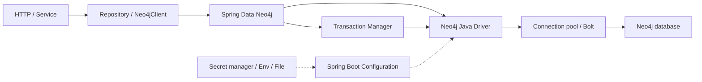
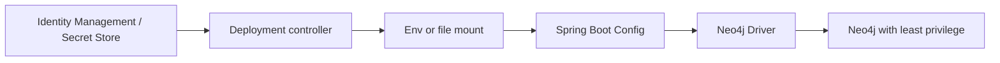

# Configuring Connections in Spring Boot and Managing Secrets with Spring Data Neo4j

## 1. Objectives and Scope

Neo4j stores data using the **property graph** model: applications read and write nodes, relationships, and properties using Cypher. In Java projects, **Spring Data Neo4j (SDN)** handles entity mapping, repository abstraction, and transaction management. However, an application is only secure when it **connects to the right database, with the right permissions, the right encryption configuration, and without exposing credentials**.

This lesson belongs to the **Spring Data Neo4j** chapter of the `DATABASE_ENGINE_GRAPH_NEO4J` module. We focus on the configuration layer, including Spring Boot auto-configuration, the Neo4j Java Driver, connection settings, secret management, pooling, operational checks, and error handling. This serves as the foundation before implementing repositories, entity relationships, indexes/constraints, Cypher queries, or large-scale data processing.

After this lesson, you will be able to:

1. Distinguish the roles of Spring Boot, SDN, and the Java Driver in connecting to Neo4j.
2. Declare the URI, credentials, and database using `application.yml` and environment variables.
3. Choose the Bolt/Neo4j routing URI and TLS mode appropriate for each environment.
4. Avoid hard-coding passwords; use a secret store, Kubernetes Secret, or securely mounted configuration files.
5. Understand how connection pool management, timeouts, access permissions, and credential rotation lifecycles work.
6. Verify connectivity without logging secrets or returning secrets in error APIs.

> **Version scope:** Configuration examples target Spring Boot 3.x, the corresponding Spring Data Neo4j version managed by Spring Boot, Java 17+, and Bolt-enabled Neo4j. Properties and APIs should be verified against documentation for the **exact version** your project uses; Spring Boot/SDN and Neo4j may evolve across releases.

## 2. Connection Architecture: Which Layer Does What?

A data read request typically flows through these components:



| Component | Primary responsibility |
| --- | --- |
| **Spring Boot** | Reads configuration, creates required beans, wires dependencies, and manages lifecycle |
| **Neo4j Java Driver** | Manages Bolt connections, authentication, pooling, routing, and Cypher execution |
| **Spring Data Neo4j** | Graph entity mapping, repositories, `Neo4jClient`, and Spring transaction integration |
| **Neo4j server/cluster** | Authentication, authorization, query execution, storing nodes/relationships/indexes/constraints |
| **Secret source** | Provides credentials at deployment time, separated from source code and build artifacts |

Spring Data Neo4j **is not the Neo4j server** and does not automatically create a database merely because a repository is declared. Passwords are used when the application connects to Neo4j; they do not belong inside entities or business records. Avoid manually creating an extra `Driver` if Spring Boot has already auto-configured one, as doing so can create multiple pools and complicate lifecycle management.

## 3. Adding Dependencies and Selecting Compatible Versions

With Maven and a Spring Boot project that uses appropriate dependency management/BOM, add the starter:

```xml
<dependencies>
    <dependency>
        <groupId>org.springframework.boot</groupId>
        <artifactId>spring-boot-starter-data-neo4j</artifactId>
    </dependency>

    <!-- Optional: health checks and operational metrics -->
    <dependency>
        <groupId>org.springframework.boot</groupId>
        <artifactId>spring-boot-starter-actuator</artifactId>
    </dependency>
</dependencies>
```

`spring-boot-starter-data-neo4j` pulls in the SDN and driver components aligned with Spring Boot's dependency BOM. Do not arbitrarily override the Neo4j Driver or SDN version just to work around a connection error; overriding versions can introduce compatibility mismatches. When an override is genuinely needed, check the compatibility matrix and run integration tests.

In a real application, you can use `Neo4jRepository`, `Neo4jClient`, and the `org.neo4j.driver.Driver` bean as needed. Injecting the Boot-managed driver bean **does not mean** you should manually instantiate a new driver.

## 4. Minimal Configuration via `application.yml`

An easily auditable deployment keeps **non-secret** configuration and secret references in the config file while placing actual secret values in the runtime environment.

```yaml
spring:
  application:
    name: graph-service

  neo4j:
    uri: ${NEO4J_URI}
    authentication:
      username: ${NEO4J_USERNAME}
      password: ${NEO4J_PASSWORD}

  data:
    neo4j:
      database: ${NEO4J_DATABASE}
```

These are the key properties:

| Spring Boot property | Role | Example **non-secret** value |
| --- | --- | --- |
| `spring.neo4j.uri` | Address and connection/routing method for Neo4j | `bolt://localhost:7687` for local development |
| `spring.neo4j.authentication.username` | Authorized account username | `graph_app` |
| `spring.neo4j.authentication.password` | Account password/authentication credential | **Do not put real values in files** |
| `spring.data.neo4j.database` | Target database for SDN | `neo4j`, or an authorized database name |

Correspondingly, the deployment environment must supply `NEO4J_URI`, `NEO4J_USERNAME`, `NEO4J_PASSWORD`, and `NEO4J_DATABASE` before Spring Boot starts the application.

**Never use default password fallbacks** in placeholders like `${NEO4J_PASSWORD:password123}`. If a secret variable is missing, the application should fail startup clearly and safely rather than silently falling back to a hardcoded password.

### 4.1. Note on Property Paths

Do not confuse `spring.neo4j.uri` with `spring.data.neo4j.database`. The `spring.neo4j` namespace mainly configures **the driver and connectivity**, whereas `spring.data.neo4j` configures **Spring Data Neo4j** behavior, including the target database.

If the database is not specified, the driver/SDN may rely on the account's default database or server configuration. A clearer practice in multi-database applications is to **explicitly declare the target database**; this also prevents surprises when an account has different default databases across test and production environments.

### 4.2. Two Ways to Pass Environment Variables into Spring Boot

The example above uses **custom-named variables** like `NEO4J_PASSWORD` referenced via `${...}` placeholders.

Spring Boot also supports *relaxed binding*: instead of placeholders, the environment can pass the corresponding property names directly as:

```text
SPRING_NEO4J_URI
SPRING_NEO4J_AUTHENTICATION_USERNAME
SPRING_NEO4J_AUTHENTICATION_PASSWORD
SPRING_DATA_NEO4J_DATABASE
```

When using this second approach, you do not need to re-declare all placeholders in `application.yml`. Avoid mixing both mechanisms with different values without understanding configuration precedence; in particular, environment variables or command-line arguments can override values in YAML according to Spring Boot's rules.

## 5. URI, Routing, Bolt, and TLS

The Neo4j Java Driver communicates over the Bolt protocol. The **URI scheme** controls routing and transport security:

| Sample URI | Typical meaning | Recommendation |
| --- | --- | --- |
| `bolt://localhost:7687` | Direct Bolt connection, common for local development | Only use without TLS in trusted test environments |
| `neo4j://host:7687` | Neo4j routing scheme; driver can discover suitable servers | Use per server/cluster architecture; does not imply TLS |
| `neo4j+s://host:7687` | Routing with TLS and verified certificates | Suitable for services with TLS and trusted CAs |
| `bolt+s://host:7687` | Direct connection with TLS and verified certificates | Suitable for direct Bolt endpoints requiring TLS |
| `neo4j+ssc://host:7687` | Encrypted connection accepting self-signed certificates per driver rules | Consider only in controlled dev/test environments |

`host` in the table is a placeholder; replace it with a valid DNS name in deployment. Choose the scheme based on how the Neo4j server is deployed: single instance vs. cluster, whether routing is supported, and your TLS policy.

### 5.1. Why TLS Alone Is Not Enough

An encrypted connection that **does not verify server identity** can still be vulnerable to man-in-the-middle attacks in certain scenarios. In production, prioritize configurations that verify the certificate chain and hostname; manage CAs/certificates according to organizational policy.

Do not use `+ssc` as a "quick fix" for certificate errors in production. When `neo4j+s://` fails, inspect the CA, certificate expiration, DNS names, and network path first.

### 5.2. Routing Is Different from a Single Reachable TCP Port

In routing mode, the driver receives address information from Neo4j and then connects to other cluster members. Successfully reaching the seed URI **does not prove** that all server-advertised addresses are reachable from the application's network.

If `ServiceUnavailableException` or routing table errors occur, check DNS, firewalls, ports, advertised addresses, cluster configuration, and connectivity to actual cluster members. Do not use an application code change to mask an infrastructure issue.

## 6. Managing Configuration by Environment

A project typically has at least **local**, **test/staging**, and **production** environments. These environments should never share credentials or databases unless explicitly intended.

### 6.1. Separation of Responsibilities

| Type of information | Can it be committed to the repository? | Appropriate storage location |
| --- | --- | --- |
| Application name, non-sensitive pool settings | Yes | `application.yml`, profile YAML |
| Internal URI / database name | Depends on infrastructure sensitivity | ConfigMap / config service / environment variables |
| Application username | Depends on security policy; should vary by environment | Deployment config / secret store |
| Passwords, tokens, private keys, auth material | **No** | Secret manager, secret mount, secret provisioning system |
| Neo4j administrator password | **Never place in application config** | Dedicated admin secret vault |

**Local example:** the Spring Boot application runs on a developer's laptop and Neo4j runs at `localhost:7687`. The developer sets `NEO4J_URI=bolt://localhost:7687`, `NEO4J_DATABASE=neo4j`, and a test account **with permissions restricted to the test database**. The password is supplied via IDE secret settings, a local secret manager, or an input method that does not persist into shell history.

If using `application-local.yml`, include only non-secret configuration:

```yaml
spring:
  config:
    activate:
      on-profile: local
  neo4j:
    pool:
      max-connection-pool-size: 10
```

Keep credential configuration uniform via environment variables. Do not create `application-prod.yml` containing a production password and rely solely on `.gitignore` for protection: the file may already exist in Git history, build artifacts, logs, or backups.

### 6.2. Configuration Precedence and Override Risks

Spring Boot loads from multiple property sources such as YAML files, environment variables, command-line arguments, and external config servers. Precedence must be clearly understood:

- An environment variable can override a property in `application.yml`.
- A startup argument can also alter the URI/database if permitted.
- Active profiles can load additional configuration files.
- An application using both secret files and environment variables must define **which source is the authoritative source of truth**.

Do not print the entire `Environment` or dump bean configurations to logs just to "inspect config." Endpoints like `/actuator/env` and `/actuator/configprops` can expose sensitive metadata if not properly secured; by default, restrict or disable external exposure.

## 7. Secret Managers, Kubernetes Secrets, and File Mounts

### 7.1. A Secret Manager Is a Provisioning Source, Not a Static File

A production design typically follows this flow:



The secret provider may be a cloud secret manager, Vault, or an enterprise-approved solution. Spring Boot can consume secrets via environment variables, file mounts, or dedicated config integrations. The specific tool does not change the rule: **secrets live outside the repository and access to them is auditable**.

### 7.2. Kubernetes: Reference Secrets, Never Write Passwords in Manifests

Example `env` section inside a Kubernetes Deployment container:

```yaml
env:
  - name: NEO4J_URI
    value: "neo4j+s://db.example.com:7687"
  - name: NEO4J_DATABASE
    value: "neo4j"
  - name: NEO4J_USERNAME
    valueFrom:
      secretKeyRef:
        name: graph-app-credentials
        key: username
  - name: NEO4J_PASSWORD
    valueFrom:
      secretKeyRef:
        name: graph-app-credentials
        key: password
```

This is an **illustrative manifest snippet**, not a complete Deployment. The Kubernetes `Secret` named `graph-app-credentials` must be provisioned beforehand through an administrative workflow. Data in Kubernetes Secrets is **Base64-encoded for representation**, but Base64 **is not encryption**. Enforce RBAC, API/etcd access controls, encryption at rest where appropriate, minimal namespace permissions, and auditing.

Values injected into environment variables can be read by diagnostic/process inspection tools or privileged container management systems. For stricter security requirements, evaluate **file mounts with restricted read permissions** or short-lived credential integrations based on your threat model.

### 7.3. Spring Boot Config Tree with Secret Mounts

Spring Boot supports reading configuration from a **config tree**: each filename represents a property key, and the file content is its value. To use a **file mount** variant instead of `NEO4J_PASSWORD`, configure:

```yaml
spring:
  config:
    import: "configtree:/run/secrets/neo4j/"
  neo4j:
    uri: ${NEO4J_URI}
  data:
    neo4j:
      database: ${NEO4J_DATABASE}
```

Suppose the mounted directory contains these files (where each filename is the property path):

```text
/run/secrets/neo4j/
    spring.neo4j.authentication.username
    spring.neo4j.authentication.password
```

**Do not commit the contents of these two files to documentation or repositories.** This supplies username/password directly via property sources without declaring a password placeholder in `application.yml`.

Because `configtree:` **does not have an `optional:` prefix**, startup will fail if the required mount is missing rather than silently skipping it. This behavior is well suited for production environments where secrets must be present. Note that this is an **alternative approach** to the `NEO4J_USERNAME`/`NEO4J_PASSWORD` pattern in Section 4, not a directive to load both simultaneously.

**Operational note:** Updating a secret file inside a container does not mean the Java Driver and connection pool immediately pick up the new credentials. Verify actual refresh behavior or perform a controlled rolling restart / credential version swap.

## 8. Neo4j Authorization: One Appropriate Identity per Application

The account used by an application should be a **service identity**, not a personal administrator account. In Neo4j, permissions can be granted by database, role, and operation; granularity depends on the edition/version and security configuration.

Authorization principles:

1. **Separate administrators from applications.** Do not use the default `neo4j`/administrator account in production services simply to avoid designing roles.
2. **Grant access only to required databases.** A service configured for `billing` must not be able to read the `hr` database unless explicitly required by business rules.
3. **Separate read and write privileges when appropriate.** A reporting application does not need permission to create/delete nodes or execute write procedures.
4. **Restrict schema/admin operations.** Creating indexes/constraints and managing users/roles should belong to dedicated migration/admin workflows rather than granting full privileges to routine application accounts.
5. **Control procedures and functions.** Calling APOC, GDS, or user-defined procedures may require dedicated permissions; do not grant unrestricted privileges just to silence a query error.

For example, an application that only reads `:Service` nodes and `DEPENDS_ON` relationships should not have `DELETE` or `CREATE` privileges. An ingestion job can use a separate account granted write access to a single database with an appropriate scope or lifetime.

**Do not confuse tenants with databases:** filtering by `tenantId` in Cypher is application-level logic, not equivalent to security isolation at the Neo4j layer. In multi-tenant products, the backend must bind the tenant from the authenticated user identity, test queries thoroughly, and evaluate appropriate isolation architectures.

## 9. Managing Connection Pools, Timeouts, and Load

The driver typically maintains a **connection pool** to reuse connections instead of opening a new socket for every query. Pool tuning affects both performance and connection load on Neo4j.

An optional example for Spring Boot 3.x:

```yaml
spring:
  neo4j:
    pool:
      max-connection-pool-size: 30
      connection-acquisition-timeout: 30s
```

Where:

- `max-connection-pool-size` caps the number of connections in the pool according to the driver's connection management; it is **not** an absolute system-wide concurrency limit for all queries.
- `connection-acquisition-timeout` governs how long a caller waits to borrow a connection from the pool. It is **distinct from** network connection timeouts and transaction timeouts.
- The values 30 and 30 seconds are **examples only**, not universal optimal settings for every application.

| Scenario | What to distinguish |
| --- | --- |
| Cannot connect to host/port | DNS, network, TLS, connect timeout |
| Waiting too long to obtain a connection | Busy pool, concurrent load, connection acquisition timeout |
| Cypher query runs slowly | Query plan, indexes, relationship fan-out, transaction timeout |
| Reading/writing many connected nodes | Batch size, row count, lock duration, intermediate rows |
| Cluster with multiple servers | Routing, advertised addresses, pools/connections per server |

If an application runs multiple replicas, **total connections can scale with the number of replicas** and routing targets. Increasing pool size may only push more work onto Neo4j; it will not guarantee lower latency if the server is already saturated on CPU, RAM, disk, or lock contention.

When tuning, measure API `p50/p95/p99` latency, query execution time, pool wait time, retries, timeouts, active/idle connections, and Neo4j server resources. For heavy Cypher queries, use `EXPLAIN`/`PROFILE` on test data to inspect index seeks, scans, sorts, and intermediate row counts. **Never log passwords in parameters while debugging pools.**

## 10. Checking Connectivity in Code Without Exposing Secrets

Spring Boot creates the driver bean from configuration; therefore Java code should inject `Driver` instead of calling `GraphDatabase.driver(...)` on every request.

Java 17+ example executing a read-only Cypher check:

```java
import org.neo4j.driver.Driver;
import org.neo4j.driver.Session;
import org.neo4j.driver.SessionConfig;
import org.springframework.beans.factory.annotation.Value;
import org.springframework.stereotype.Service;

@Service
public class Neo4jConnectivityProbe {
    private final Driver driver;
    private final String database;

    public Neo4jConnectivityProbe(
        Driver driver,
        @Value("${spring.data.neo4j.database}") String database
    ) {
        this.driver = driver;
        this.database = database;
    }

    public boolean checkRead() {
        try (Session session =
                 driver.session(SessionConfig.forDatabase(database))) {
            int value = session.executeRead(tx ->
                tx.run("RETURN 1 AS ok")
                  .single()
                  .get("ok")
                  .asInt()
            );
            return value == 1;
        }
    }
}
```

Key points:

- Injecting the Boot-managed `Driver` bean reuses the connection pool.
- Explicitly select the **target database** using `SessionConfig.forDatabase(...)` rather than relying on an implicit default.
- `executeRead` uses a read transaction and does not modify the graph.
- `RETURN 1 AS ok` proves a trivial query can execute; it **does not prove** the account has sufficient `MATCH`, `CREATE`, or `MERGE` privileges for business operations.
- Never log `password`, authentication tokens, or full driver configuration. When reporting errors, expose only non-sensitive error codes and correlation IDs.

This is an **internal service**, not a public API. If you expose a health endpoint, protect it according to authentication, network, and rate-limiting policies. Avoid returning raw driver errors, internal server hostnames, or stack traces to end users.

### 10.1. Repositories and Transactions in SDN

When using `Neo4jRepository` or `Neo4jClient`, operations go through the Spring Boot-managed driver configuration. With Spring's `@Transactional`, the transaction manager coordinates transaction boundaries for SDN operations.

Do not create two separate connections/drivers inside the same service and assume they will automatically join **one** Spring transaction. If you mix direct Java Driver operations with SDN in a single unit of work, you must understand actual session and transaction semantics; prefer a unified access pattern or a deliberately designed coordination flow.

A successful `save(...)` call does not mean indexes/constraints already exist. Creating unique constraints and appropriate indexes belongs in migrations or controlled deployment steps; when queries slow down, inspect execution plans rather than tweaking connection strings.

## 11. Monitoring with Spring Boot Actuator

If `spring-boot-starter-actuator` is included, enable only the required endpoints and minimize the attack surface:

```yaml
management:
  endpoints:
    web:
      exposure:
        include: health,info
  endpoint:
    health:
      show-details: never
```

Depending on configuration and available beans, Spring Boot Actuator can provide a Neo4j health indicator. Verify `/actuator/health` in practice after starting the application. **Do not treat a health status of `UP` as proof of sufficient data permissions or correctness of all repositories**; health checks typically validate only basic connectivity or a simple query.

Keep these concerns separate:

- **Liveness:** whether the process is running and responsive; it should not trigger continuous restarts just because Neo4j is temporarily unreachable.
- **Readiness:** whether the application can currently serve traffic that depends on Neo4j; database availability can be factored in by design.
- **Business check:** querying the right database, schema, and permissions using the actual service identity; this can be run as a dedicated post-deployment verification.

Do not expose `/actuator/env`, `/actuator/configprops`, heap dumps, or debug logs that may contain sensitive data to the Internet. If you need to verify configuration presence, report only **present/absent**, URI scheme, and permitted environment names; never print credentials.

## 12. Password Rotation and Handling Secret Exposure

A well-operated system not only protects secrets at deployment time, but also supports **rotation** and revocation.

### 12.1. Controlled Rotation Workflow

A credential rotation cycle typically includes:

1. **Preparation:** identify the application account, database/roles, and impact on replicas and pools; prepare a rollback plan.
2. **Provision new credentials:** as supported by the platform, create a new least-privilege credential/identity rather than immediately invalidating the active account.
3. **Update secret source:** update the managed secret store / Kubernetes Secret / mount to the new credential; keep the overlap window where both old and new credentials are valid as short as feasible.
4. **Apply to application:** use a verified refresh mechanism or a controlled rollout/restart so drivers and pools adopt the new credential.
5. **Verify:** confirm TLS connections, target database, authorized read/write queries, health/readiness, and error paths all succeed.
6. **Revoke old credential:** once no active workloads use the old credential, revoke its access and inspect logs/audit trails.

Do not assume that updating an environment variable in a deployment system immediately updates the value inside a running JVM. Do not assume a connection pool automatically switches passwords simply because a mounted secret file's contents changed.

### 12.2. When Password Exposure Is Suspected

- Assess the blast radius: Git history, CI logs, build artifacts, secret stores, shell history, application logs, and dashboards.
- Revoke or rotate affected credentials promptly per incident response procedures.
- Check whether privileges were abused; review audit logs, anomalous queries, connection origins, and access timestamps.
- Remove or isolate unnecessary copies while adhering to evidence preservation requirements.
- **Do not merely delete the line containing the password in a new commit** and assume the old secret is safe: the value may still reside in history or other copies.

Urgency and exact steps depend on the credential's privilege level and organizational policy. An application account with read-only access to one database has a different impact radius from a system-wide administrator credential.

## 13. Systematic Connection Troubleshooting

Before editing `application.yml`, classify the failure by layer:

| Symptom | Likely cause | Safe way to verify |
| --- | --- | --- |
| Startup fails to resolve `NEO4J_PASSWORD` | Secret not injected, wrong variable name, or wrong profile | Check the **presence** of the env var/mount without printing its value |
| Authentication failed | Wrong username/password, locked or revoked account | Verify identity and secret store; test with controlled credentials |
| DNS / connection refused / timeout | Wrong host/port, firewall, DNS, or server down | Verify network connectivity and deployment endpoints |
| TLS handshake / certificate failure | Untrusted CA, hostname mismatch, expired certificate | Inspect certificates and trust chain; never disable verification in prod |
| Routing table unavailable | Server advertised unreachable addresses or cluster misconfiguration | Check routing/advertised addresses and application networking |
| Database does not exist / unavailable | Wrong `spring.data.neo4j.database` or DB offline | Check database state under granted permissions |
| Forbidden / permission denied | User lacks permission on database/label/operation/procedure | Compare actual roles with required business permissions |
| Connection acquisition timeout | Pool held too long, excessive load, or stalled queries | Measure active connections, latency, query plans, and concurrency |
| Only writes fail while reads succeed | Read-only account or missing write/schema permissions | Inspect roles and failing Cypher; do not blindly escalate to admin |
| Failures after secret rotation | Pod/JVM still holds old credential or pool not refreshed | Check rollout status and active secret version |

### 13.1. An Effective Verification Sequence

1. Verify the application is running with the right profile and **database name**.
2. Inspect **non-sensitive** values such as URI scheme and host/port within permitted logging rules.
3. Confirm the secret is provisioned and the account is active in the identity system.
4. Check DNS, firewall, TLS, routing, and Neo4j availability.
5. Run a **small read query** against the target database using the application's actual account.
6. Test a business operation in a test environment to verify permissions, indexes/constraints, and transactions.
7. If failures stem from load, measure pool metrics, p95/p99 latency, concurrent query counts, `EXPLAIN`/`PROFILE`, and Neo4j resources.

Do not "fix" an authentication failure by switching to an admin account. Do not "fix" a TLS error by changing `neo4j+s://` to `neo4j+ssc://` in production.

## 14. Testing Configuration Without Putting Real Secrets in Tests

Different testing tiers serve different purposes:

| Test tier | What to verify | Appropriate environment |
| --- | --- | --- |
| Unit test | Config-handling beans do not log secrets; parameter validation | No real Neo4j server required |
| Integration test | SDN mapping, database selection, Cypher, transactions | Dedicated test Neo4j, e.g., via Testcontainers |
| Staging smoke test | Real DNS, TLS, routing, identity, permissions, and pooling | Staging infrastructure with staging credentials |
| Production smoke check | Health/readiness and a low-impact query | Post-deployment, with strict permission and logging controls |

In integration tests, spin up an **isolated** test database/container with test-only credentials. For example, Spring Boot supports several ways to supply dynamic properties for Testcontainers depending on version, such as `@DynamicPropertySource` or service connection integration where appropriate. Passing tests against `bolt://localhost` does not prove that `neo4j+s://`, trust chains, or production routing are correctly configured.

Negative testing is equally important:

- Omit `NEO4J_PASSWORD` and confirm the application **does not use a fallback password**.
- Provide an invalid database name and verify the application fails safely.
- Assign a read-only role, attempt a write operation, and confirm it is rejected.
- Use an untrusted TLS certificate in staging and verify the application does not silently downgrade security.
- Simulate temporary Neo4j unavailability, measure retry and readiness behavior, and prevent infinite retries across all layers.
- Inspect logs and responses to ensure no passwords, credential-bearing URIs, tokens, or internal stack traces leak.

## 15. Practice Exercises with Suggested Solutions

### Exercise 1: Classifying Secret Information

A teammate wants to commit the following lines into `application-prod.yml`:

```yaml
spring:
  neo4j:
    uri: "neo4j+s://db.example.com:7687"
    authentication:
      username: "graph_app"
      password: "example-production-password"
```

**Question:** Which line is the most dangerous? How should the configuration be fixed?

**Hint:** Never commit real production passwords to Git. The string `example-production-password` here is an illustrative placeholder, **not a usable secret**. Change it to `password: ${NEO4J_PASSWORD}` and supply the real value from an appropriate secret source. Also consider externalizing the username/URI if organizational policy treats them as sensitive.

### Exercise 2: Choosing a Connection Scheme

Application A runs on a laptop connecting to a local test Neo4j instance. Application B runs on Kubernetes connecting to a Neo4j server with a trusted CA-signed certificate. Application C connects to a routed cluster.

**Hint:** A can use `bolt://localhost:7687` in a trusted local environment; B should use `bolt+s://` or `neo4j+s://` depending on architecture; C needs an appropriate routing URI, typically `neo4j+s://` when TLS is required. Never decide based solely on hostname without checking server configuration.

### Exercise 3: A Service Fails to Connect Despite a Correct URI

Spring Boot reports that `NEO4J_PASSWORD` is unresolved. In Kubernetes, the `Secret` exists, but the `Deployment` references the wrong key.

**Hint:** Check `secretKeyRef.name`, `secretKeyRef.key`, namespace, RBAC permissions, and rollout status. Do not print secret contents using unauthorized diagnostic commands. After fixing the reference, re-run the smoke test.

### Exercise 4: Distinguishing Connection Pools from Query Timeouts

An application has a pool of 30 connections. When many concurrent requests run queries that expand large relationship fan-outs, `connection acquisition timeout` occurs. Will increasing the pool to 200 definitely solve the problem?

**Hint:** No. The pool may be exhausted because queries hold connections for too long; increasing the pool size can overload Neo4j even further. Measure query plans, row counts, latency, and active connections; optimize Cypher, indexes, and concurrency/batch limits before justifying a pool increase.

### Exercise 5: Designing Rotation

The operations team updated a Kubernetes Secret, but the application containers are still running with the old credentials.

**Hint:** Changing Secret data does not update environment variables in already-running processes; a controlled rollout/restart or a tested refresh mechanism is required. Verify that new instances use the new credentials before revoking the old ones.

### Exercise 6: Verifying Least-Privilege Permissions

An application only returns a list of `:Service` nodes and `DEPENDS_ON` paths. A team member proposes granting administrator privileges to avoid transaction errors.

**Hint:** Never grant admin rights just for read queries. Identify the required database and read permissions, grant them via roles appropriate to your edition/version, and run actual read queries with the application account. If a query fails, read the specific permission error instead of escalating to full privileges.

## 16. Pre-deployment Checklist

- [ ] Compatible Spring Boot/SDN/Java Driver versions are managed via a verified BOM.
- [ ] Bolt/routing URI and scheme match the target environment.
- [ ] In production, TLS is enabled with certificate and hostname verification per policy.
- [ ] `spring.data.neo4j.database` points explicitly to the right database rather than relying on an accidental default.
- [ ] Username/password are never hard-coded in Git, container images, CI logs, or command-line arguments.
- [ ] Secrets are provisioned from a trusted source with RBAC/auditing and a rotation plan.
- [ ] Application accounts follow least privilege; administrator accounts are never used for routine workloads.
- [ ] Profile configuration, property precedence, and secret sources do not conflict.
- [ ] Driver and connection pool are managed by Spring Boot without creating extra unnecessary pools.
- [ ] Pool sizes, timeouts, and retries are tuned against realistic traffic and Cypher workloads.
- [ ] Health/readiness endpoints and logs do not leak passwords or sensitive configuration.
- [ ] Failure modes (missing secret, wrong password, wrong database, TLS failure, connection loss) have been tested.
- [ ] Staging/test accounts are isolated and have zero access to production.
- [ ] Rollback, old credential revocation, and secret exposure response procedures are in place.

## Conclusion

With Spring Data Neo4j, secure connectivity starts with **configuring the right source, the right database, and the right permissions**. Spring Boot creates and manages the Java Driver via `spring.neo4j.*`, while `spring.data.neo4j.database` specifies the database used by SDN. The URI and TLS settings govern how the application communicates with Neo4j; **secret managers, environment variables, or config trees** keep credentials out of source code; and least privilege, rotation, pooling, testing, and monitoring keep the application reliable in production. Every connection failure should be diagnosed at the proper layer—never resolved by disabling TLS or escalating an account to administrator.

### References

- [Spring Boot Reference — Data, Neo4j](https://docs.spring.io/spring-boot/reference/data/nosql.html#data.nosql.neo4j)
- [Spring Boot Reference — Externalized Configuration](https://docs.spring.io/spring-boot/reference/features/external-config.html)
- [Spring Data Neo4j — Reference Documentation](https://docs.spring.io/spring-data/neo4j/reference/)
- [Neo4j Java Driver — Connect to the database](https://neo4j.com/docs/java-manual/current/connect/)
- [Neo4j Java Driver — Advanced connection information](https://neo4j.com/docs/java-manual/current/connect-advanced/)
- [Neo4j Operations Manual — Security](https://neo4j.com/docs/operations-manual/current/security/)
