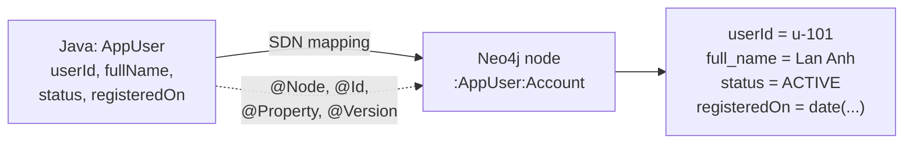

# Mapping Nodes, Labels, Identifiers, and Entity Properties in Spring Data Neo4j

## 1. From Property Graph to Java Objects

In **Neo4j**, data is organized as a **property graph**: a node has one or more *labels*, *properties* are key–value pairs, and relationships connect nodes with a type, direction, and their own properties. In a Java application, **Spring Data Neo4j (SDN)** provides **object mapping** to represent nodes as Java classes, Java fields as properties, and object references as relationships.

Example of a node in the database:

```cypher
CREATE (u:AppUser:Account {
  userId: 'u-101',
  full_name: 'Lan Anh',
  status: 'ACTIVE',
  registeredOn: date('2026-10-01')
})
RETURN u;
```

We want the corresponding Java class to be named `AppUser`, with a stable ID `userId`, a display name `fullName`, and a date `registeredOn`. However, the property name in Neo4j is `full_name`, which differs from the Java field `fullName`; the node also carries **two labels**, `AppUser` and `Account`. SDN resolves these differences through annotations.

Conceptual mapping diagram:



Key annotations covered in this lesson:

| Annotation | Placed on | Purpose |
| --- | --- | --- |
| `@Node` | Class | Marks a class as mapped to a node and configures its labels |
| `@Id` | Field | Selects the field used to identify the **Java entity** |
| `@GeneratedValue` | Alongside `@Id` | Configures automatic ID generation |
| `@Property` | Field | Maps a Java field name to a different property name in Neo4j |
| `@DynamicLabels` | `Collection<String>` field | Maps labels that can be added or removed at runtime |
| `@CompositeProperty` | `Map` field | Flattens key-value pairs into multiple properties sharing a prefix |
| `@Version` | `Long` field | Manages versioning for optimistic locking and new-entity detection with business IDs |
| `@Transient` | Field | Excludes the field from database persistence (from Spring Data Commons) |
| `@ReadOnlyProperty` | Field | Reads the value from the database but does not write it when saving the entity |

**Goal:** clearly understand which Java class corresponds to which node, which labels are always attached, which ID provides stable lookups, which properties are actually stored, and what happens when calling `repository.save(...)`.

## 2. Minimal Spring Boot Project Setup

Assume a Java application with Spring Boot, Spring Data Neo4j, and a running Neo4j server. With Maven, you typically use the Spring Boot–managed starter:

```xml
<dependency>
    <groupId>org.springframework.boot</groupId>
    <artifactId>spring-boot-starter-data-neo4j</artifactId>
</dependency>
```

Example `application.yml` configuration:

```yaml
spring:
  neo4j:
    uri: neo4j://localhost:7687
    authentication:
      username: neo4j
      password: ${NEO4J_PASSWORD}
  data:
    neo4j:
      database: neo4j
```

`NEO4J_PASSWORD` is an environment variable used only for configuration illustration. In real environments, use an appropriate secret manager/security configuration. Never commit real passwords to Git or public documentation.

The Java examples use the following imports:

```java
import org.springframework.data.neo4j.core.schema.Node;
import org.springframework.data.neo4j.core.schema.Id;
import org.springframework.data.neo4j.core.schema.GeneratedValue;
import org.springframework.data.neo4j.core.schema.Property;
import org.springframework.data.neo4j.core.schema.DynamicLabels;
import org.springframework.data.neo4j.core.schema.CompositeProperty;
import org.springframework.data.annotation.Version;
```

These are **Spring Data Neo4j and Spring Data Commons** annotations. Do not use JPA annotations like `@Entity`, `@Table`, `@Column`, or `jakarta.persistence.Id` out of habit to declare node mappings; those carry different semantics.

The references in this lesson target modern Spring Data Neo4j; when implementing, use starter versions compatible with your Spring Boot, Java, and Neo4j versions. Do not mix legacy Neo4j-OGM library examples with current SDN.

## 3. `@Node`: Mapping a Class to a Node and Defining Labels

### 3.1. Single Default or Explicit Label

```java
@Node
public class Product {
    @Id
    private String sku;
}
```

When only `@Node` is written, the **class name** typically becomes the primary label—in this example, `:Product`. To avoid coupling to the Java class name during refactoring:

```java
@Node("Product")
public class CatalogItem {
    @Id
    private String sku;
}
```

The `CatalogItem` class still maps to `:Product` nodes. Labels are case-sensitive: `:Product` and `:product` are two distinct names in Cypher.

**Why does the primary label matter?** When a repository reads `CatalogItem`, SDN uses the class metadata to match nodes bearing the primary label. Secondary labels can serve for classification; the **primary label** must clearly identify the entity set managed by the class.

### 3.2. A Node with Multiple Static Labels

Neo4j allows a node to carry multiple labels:

```cypher
MATCH (u:AppUser {userId: 'u-101'})
SET u:Account;
```

In Java, configure:

```java
@Node(primaryLabel = "AppUser", labels = {"Account"})
public class AppUser {
    @Id
    private String userId;
}
```

`AppUser` is the **primary label**; `Account` is an additional label. You can also declare `@Node(labels = {"AppUser", "Account"})`, in which case the **first** element in the array is treated as the primary label.

Reading or writing a node through a repository for this class relies on locating the node via the primary label. When saving the entity, SDN ensures all statically configured labels are present. Do not assume that adding another label creates a duplicate node: a node remains **a single graph entity**.

### 3.3. Does Renaming a Java Class Mean Changing the Schema?

If you use `@Node` without arguments and rename `Product` to `InventoryItem`, the default label **can change from `Product` to `InventoryItem`**. This may cause the repository to query a different set of nodes than before.

Once a database is in operation:

- Specify label names explicitly using `@Node("Product")` or `primaryLabel`.
- If you genuinely intend to rename a label in Neo4j, design a **Cypher migration** and verify compatibility; simply editing the annotation does not automatically migrate existing nodes to the new label.
- Re-check indexes, constraints, manual queries, and application APIs that depend on that label.

### 3.4. Class Inheritance and Multiple Node Types

With Java class hierarchies, `@Node` **is not inherited automatically** like a plain configuration marker. SDN supports polymorphic mapping using abstract superclasses annotated with `@Node` and concrete subclasses with specific labels, but each type must be explicitly declared and its metadata verified.

For instance, having both `Customer` and `Employee` represent users does not mean they can arbitrarily share a primary label without designing type-resolution rules. For simpler domains, prefer one class mapping to one clear primary label; use polymorphic mapping only when queries truly require it.

## 4. `@Id`: Choosing a Stable Entity Identifier

### 4.1. Business IDs and Auto-Generated Keys Are Not the Same

`@Id` tells SDN **which field identifies an entity** for creation, lookup, and updates. There are three typical options (plus UUID generation):

| Declaration | Stored in Neo4j | Best suited for | Limitations |
| --- | --- | --- | --- |
| `@Id String userId` | `userId` property on node | Stable business key from source systems | Must enforce uniqueness and new-entity detection |
| `@Id @GeneratedValue Long id` | Neo4j internal numeric ID, not a regular property | Demos or short-lived internal objects | Internal IDs should not serve as long-lived external keys; may change or be reused |
| `@Id @GeneratedValue String id` | Neo4j `elementId`, not a regular property | Cases where SDN manages internal identity on Neo4j 5+ | `elementId` is also not a durable business ID across imports/backups/migrations |
| `@Id @GeneratedValue(UUIDStringGenerator.class) String id` | String UUID property generated by SDN and stored on node | Application-side surrogate ID | Requires uniqueness constraint, retry rules, and source coordination |

**Practical rule:** objects referenced by APIs, events, data imports, or external systems should have a **stable business key or surrogate key** independent of Neo4j's internal ID. Never store a database's numeric ID or `elementId` and assume it stays constant across environments, imports, and database lifecycles.

### 4.2. Application-Assigned Business ID

```java
@Node("AppUser")
public class AppUser {
    @Id
    private String userId;

    @Version
    private Long version;

    private String fullName;

    public AppUser() {}

    public AppUser(String userId, String fullName) {
        this.userId = userId;
        this.fullName = fullName;
    }

    public String getUserId() { return userId; }
    public Long getVersion() { return version; }
    public String getFullName() { return fullName; }
    public void setFullName(String fullName) {
        this.fullName = fullName;
    }
}
```

Corresponding node:

```text
(:AppUser {
  userId: 'u-101',
  fullName: 'Lan',
  version: 0
})
```

`userId` is a property managed via `@Id`. It **does not automatically become a Neo4j uniqueness constraint** merely because the annotation appears in Java. Create the constraint via migration:

```cypher
CREATE CONSTRAINT app_user_user_id_unique IF NOT EXISTS
FOR (u:AppUser)
REQUIRE u.userId IS UNIQUE;
```

The constraint prevents two concurrent transactions from creating two `:AppUser` nodes with the same `userId`. It also typically creates a backing index for ID lookups. `IF NOT EXISTS` supports re-running migrations when the matching constraint already exists, though you should still verify the actual schema.

**Why is `@Version` present?** When `userId` is assigned at construction time, SDN cannot simply check `userId != null` to tell whether an entity is new. For application-assigned business IDs, current SDN documentation recommends/requires a `@Version` field to distinguish new entities from existing ones and to enable optimistic locking. Leave `Long version = null` for a new entity; SDN manages its value on save. **Never increment or modify `version` manually in business code.**

The `@Version` field is distinct from a source system's version. If the source sends `sourceVersion`, store it as a separate property with explicit comparison rules; do not overload `@Version` for both purposes.

### 4.3. Neo4j-Assigned IDs: Long and elementId

```java
@Node("TemporaryJob")
public class TemporaryJob {
    @Id
    @GeneratedValue
    private Long id;

    private String status;

    public TemporaryJob() {}

    public TemporaryJob(String status) {
        this.status = status;
    }

    public Long getId() { return id; }
    public String getStatus() { return status; }
}
```

Before saving, `id == null`. After `repository.save(...)`, SDN assigns the internal Neo4j ID. Using `Long` instead of primitive `long` makes `null` clearly represent "ID not yet assigned."

On Neo4j 5+, a `String` field annotated with `@Id @GeneratedValue` can map to the node's `elementId` by default; this is likewise **not** a string property stored on the graph. If you need a durable string property, use an application-side generator or a business ID.

### 4.4. Surrogate String ID Generated by SDN

```java
import org.springframework.data.neo4j.core.schema.GeneratedValue.UUIDStringGenerator;
import org.springframework.data.neo4j.core.schema.GeneratedValue;
import org.springframework.data.neo4j.core.schema.Id;
import org.springframework.data.neo4j.core.schema.Node;

@Node("ImportRun")
public class ImportRun {
    @Id
    @GeneratedValue(UUIDStringGenerator.class)
    private String runId;

    private String state;

    public ImportRun() {}

    public ImportRun(String state) {
        this.state = state;
    }

    public String getRunId() { return runId; }
    public String getState() { return state; }
}
```

`UUIDStringGenerator` generates a UUID on the application side and stores it as a **string property** on the node, unlike the internal ID mechanism used by bare `@GeneratedValue`. In multi-instance deployments, you still need uniqueness protection in the database:

```cypher
CREATE CONSTRAINT import_run_id_unique IF NOT EXISTS
FOR (r:ImportRun)
REQUIRE r.runId IS UNIQUE;
```

You can supply a custom `IdGenerator` via `@GeneratedValue(generatorClass = ...)` or `generatorRef = "beanName"`. Never generate keys from an in-memory per-instance counter, as duplicates can occur after restarts or across multiple instances.

### 4.5. When Does Changing an ID Affect Existing Data?

Changing `@Id` from `userId` to `email` is not just a Java refactoring. It changes how SDN identifies nodes, which can alter queries, create new nodes, or miss existing records during saves. Before changing an ID:

1. Audit all existing nodes for duplicate or missing keys.
2. Pick a new key that is truly immutable and unique.
3. Create constraints/indexes and execute data migrations in Cypher.
4. Update mappings, repositories, APIs, and data importers together in a coordinated rollout.
5. Run read–write tests against migrated data, especially around retries and concurrent updates.

## 5. `@Property`: When Java Fields Differ from Neo4j Property Names

### 5.1. Default Same-Name Mapping

If you declare:

```java
@Node("Product")
public class Product {
    @Id
    private String sku;

    private String name;
    private Long inventoryCount;
}
```

SDN maps `sku`, `name`, and `inventoryCount` to properties with the **same names**. If an existing graph uses `stock_quantity` instead of `inventoryCount`:

```java
@Property("stock_quantity")
private Long inventoryCount;
```

On read, SDN populates `inventoryCount` from the `stock_quantity` property. On write, the field value is persisted under `stock_quantity`. Hand-written Cypher queries must use the **database property name**, such as `p.stock_quantity`, whereas repository derived queries still use the **Java field name** in method signatures.

Example:

```cypher
MATCH (p:Product {sku: 'sku-001'})
RETURN p.name, p.stock_quantity;
```

Renaming the Java field while keeping `@Property("stock_quantity")` may require no data migration. Conversely, changing the annotation value from `stock_quantity` to `inventoryCount` causes SDN to read a different property, requiring a migration if the existing graph still uses the older name.

### 5.2. Java and Neo4j Data Types

Neo4j properties do not store arbitrary Java objects. SDN converts a supported set of types:

| Java field | Typical Neo4j type | Notes |
| --- | --- | --- |
| `String` | `STRING` | Distinguish `null` from empty string |
| `Boolean` | `BOOLEAN` | Use wrapper `Boolean` if "unset" must be represented |
| `Long`/`Integer` | `INTEGER` | Cypher integers are 64-bit signed; check Java range limits |
| `Double` | `FLOAT` | Do not use for exact monetary amounts |
| `LocalDate` | `DATE` | Contains no time or timezone |
| `LocalDateTime` | `LOCAL DATETIME` | Contains no timezone information |
| `ZonedDateTime` | `ZONED DATETIME` / Neo4j `DateTime` | Use when an instant with timezone is needed |
| `List<String>`/`String[]` | Homogeneous list of supported values | Neo4j properties cannot store lists of arbitrary maps/nodes |
| `Enum` | Usually converted to `STRING` | Watch out for impacts when renaming enum constants |
| `UUID` | Usually converted to `STRING` | Do not confuse UUIDs with internal node IDs |

Neo4j does not support storing an arbitrary `Map<String, Object>` or deeply nested JSON tree as a **single** property. When you need to store such data, choose one of these approaches:

- Flatten fields into separate properties.
- Use `@CompositeProperty` with a flat prefixed map.
- Model nested structures as nodes and relationships if you need to query across links.
- Serialize to a JSON string using a custom converter when appropriate, accepting the inability to index/query individual fields directly.

Avoid `double` for prices or percentages requiring exact arithmetic. For `BigDecimal`, check the conversion strategy supported by SDN; in many versions it is stored as a string rather than a Cypher `FLOAT`.

### 5.3. `@Transient` and `@ReadOnlyProperty`

A domain class may hold fields used only for computation or populated by external systems:

```java
import org.springframework.data.annotation.Transient;
import org.springframework.data.annotation.ReadOnlyProperty;

@Node("Product")
public class ProductReadModel {
    @Id
    private String sku;

    private Long inventoryCount;

    @Transient
    private boolean selectedInUi;

    @ReadOnlyProperty
    private Long legacyScore;
}
```

- `@Transient`: ignores `selectedInUi` during database mapping, suitable for transient UI state or derived business calculations.
- `@ReadOnlyProperty`: reads `legacyScore` from the graph without writing it back on SDN saves. Ideal for properties maintained by external pipelines.

In this example, the class maps to `@Node("Product")` with ID field `sku`. This is only a **mapping slice**; production code still needs appropriate constructors and accessors.

**Note on external data:** if a Cypher or GDS pipeline updates `legacyScore`, avoid mapping it as a read-write field on an entity frequently saved by a repository; otherwise you risk unintended overwrites.

## 6. `@CompositeProperty`: One Java Map into Multiple Node Properties

### 6.1. Flat Prefixed Map

Suppose each user has flexible source attributes:

```java
import java.util.HashMap;
import java.util.Map;
import org.springframework.data.neo4j.core.schema.CompositeProperty;

@CompositeProperty(prefix = "meta", delimiter = "_")
private Map<String, Object> metadata = new HashMap<>();
```

When the Java map contains:

```java
metadata.put("source", "crm");
metadata.put("region", "apac");
metadata.put("level", 3L);
```

Neo4j stores them as **separate properties**:

```text
(:AppUser {
  meta_source: 'crm',
  meta_region: 'apac',
  meta_level: 3
})
```

`prefix = "meta"` and `delimiter = "_"` help avoid collisions with fixed properties. When reading back, SDN collects properties matching the prefix into `metadata`. If unconfigured, the default prefix is the **Java field name** and the default delimiter is a dot (e.g., `metadata.source`).

Because Neo4j property names can contain dots, manual Cypher queries must escape them with backticks:

```cypher
MATCH (u:AppUser {userId: 'u-101'})
RETURN u.`metadata.source` AS source;
```

**Important limitation:** `@CompositeProperty` works with values convertible to supported Neo4j property types; **nested maps are not supported directly** by the default converter. Avoid storing `Map<String, Map<String, Object>>` without a custom converter or alternative graph modeling.

### 6.2. When Should You Avoid Composite Properties?

If metadata contains hundreds of arbitrary user-supplied keys, it can:

- Proliferate a huge number of distinct property names, complicating schema and index governance.
- Collide with static property names if prefixes/delimiters are inconsistent.
- Make type enforcement and per-field access control difficult.

For metadata with a stable schema, explicit Java fields are usually easier to maintain. For multi-level connected data, nodes and relationships fit better than a flat map.

## 7. `@DynamicLabels`: Additional Labels Changed at Runtime

### 7.1. Static vs. Dynamic Labels

Static labels are declared on `@Node` and remain fixed per class. If individual users also receive runtime classification labels such as `:Premium` or `:BetaTester`, SDN provides `@DynamicLabels`:

```java
import java.util.HashSet;
import java.util.Set;
import org.springframework.data.neo4j.core.schema.DynamicLabels;

@DynamicLabels
private Set<String> extraLabels = new HashSet<>();
```

On an entity with `@Node(primaryLabel = "AppUser", labels = {"Account"})`, if `extraLabels = {"Premium"}`, the node can carry:

```text
(:AppUser:Account:Premium {userId: 'u-101'})
```

When reading a node, SDN collects labels **other than the configured static labels** into the collection. When saving an entity with `@DynamicLabels`, SDN treats the combined **static + dynamic** label set on the object as the authoritative set to write to the graph.

### 7.2. Warning When Multiple Applications Add Labels

Suppose another service adds `:FraudReview` to a user, while an `AppUser` entity already loaded earlier holds `extraLabels = {"Premium"}`. When the SDN service saves that entity, `:FraudReview` risks **being removed** because it is absent from the object's current label set.

Therefore:

- Only use `@DynamicLabels` when that service **owns the entire set of dynamic labels** on the node.
- If labels are managed by multiple independent pipelines, consider keeping labels static and using dedicated properties (such as `riskStatus`), or using targeted Cypher `SET u:FraudReview` in controlled transactions.
- Never turn arbitrary user input into label names without whitelist/domain validation. Labels are part of the query schema, not free-form text fields.

**Do not use dynamic labels to replace every frequently changing status.** A property like `status = 'ACTIVE'` is usually far more appropriate than `:Active_2026_11_25` when values change often and need time-based reporting.

## 8. Complete Entity Example: Combining Labels, ID, and Properties

The following example is a **standalone Java class usable as a starting point** in an SDN project. To avoid confusion with partial same-named snippets above, focus on this complete version during practice.

```java
import java.time.LocalDate;
import java.util.HashMap;
import java.util.HashSet;
import java.util.Map;
import java.util.Set;

import org.springframework.data.annotation.Version;
import org.springframework.data.neo4j.core.schema.CompositeProperty;
import org.springframework.data.neo4j.core.schema.DynamicLabels;
import org.springframework.data.neo4j.core.schema.Id;
import org.springframework.data.neo4j.core.schema.Node;
import org.springframework.data.neo4j.core.schema.Property;

@Node(primaryLabel = "AppUser", labels = {"Account"})
public class AppUser {

    @Id
    private String userId;

    @Version
    private Long version;

    @Property("full_name")
    private String fullName;

    private String status;
    private LocalDate registeredOn;

    @DynamicLabels
    private Set<String> extraLabels = new HashSet<>();

    @CompositeProperty(prefix = "meta", delimiter = "_")
    private Map<String, Object> metadata = new HashMap<>();

    public AppUser() {
    }

    public AppUser(String userId, String fullName, String status) {
        this.userId = userId;
        this.fullName = fullName;
        this.status = status;
    }

    public String getUserId() { return userId; }
    public Long getVersion() { return version; }
    public String getFullName() { return fullName; }
    public String getStatus() { return status; }
    public LocalDate getRegisteredOn() { return registeredOn; }
    public Set<String> getExtraLabels() { return extraLabels; }
    public Map<String, Object> getMetadata() { return metadata; }

    public void setFullName(String fullName) {
        this.fullName = fullName;
    }

    public void setStatus(String status) {
        this.status = status;
    }

    public void setRegisteredOn(LocalDate registeredOn) {
        this.registeredOn = registeredOn;
    }
}
```

**Field-by-field breakdown:**

| Java | Neo4j after save | Notes |
| --- | --- | --- |
| `@Node(primaryLabel="AppUser", labels={"Account"})` | `:AppUser:Account` | Two static labels, with `AppUser` as primary |
| `userId` + `@Id` | `userId: 'u-101'` | Application-supplied business key with uniqueness constraint |
| `version` + `@Version` | `version` managed by SDN | Detects new entities and prevents stale overwrites |
| `fullName` + `@Property("full_name")` | `full_name: 'Lan Anh'` | Java field and Neo4j property use different names |
| `status` | `status: 'ACTIVE'` | Name stays identical |
| `registeredOn` | `registeredOn: date(...)` | `LocalDate` maps to Neo4j DATE |
| `extraLabels` | e.g., adds `:Premium` | Label collection, not stored as a list property |
| `metadata` with `@CompositeProperty` | `meta_source`, `meta_region` | Multiple properties expanded from the map |

### 8.1. Repository and Simple Queries

```java
import java.util.Optional;
import org.springframework.data.neo4j.repository.Neo4jRepository;
import org.springframework.data.neo4j.repository.query.Query;
import org.springframework.data.repository.query.Param;

public interface AppUserRepository
        extends Neo4jRepository<AppUser, String> {

    // Spring Data derived query uses Java field names.
    Optional<AppUser> findByFullName(String fullName);

    @Query("""
        MATCH (u:AppUser {userId: $userId})
        RETURN u
        """)
    Optional<AppUser> findExactlyByUserId(@Param("userId") String userId);
}
```

`Neo4jRepository<AppUser, String>` uses `String` because `@Id userId` is a string. `findById("u-101")` is built in; `findByFullName("Lan Anh")` uses the Java field name in the method signature, and SDN translates it via mapping metadata to query Neo4j property `full_name`.

If you write `@Query` manually, you are responsible for using the actual Cypher/Neo4j names (here `u.userId` and `u.full_name`). When you only need simple entity lookups by ID or property, prefer repository methods over hand-written Cypher.

### 8.2. Saving and Updating in a Transactional Service

```java
import java.time.LocalDate;
import org.springframework.stereotype.Service;
import org.springframework.transaction.annotation.Transactional;

@Service
public class AppUserService {
    private final AppUserRepository repository;

    public AppUserService(AppUserRepository repository) {
        this.repository = repository;
    }

    @Transactional
    public AppUser createExampleUser() {
        AppUser user = new AppUser("u-101", "Lan", "ACTIVE");
        user.setRegisteredOn(LocalDate.of(2026, 10, 1));
        user.getExtraLabels().add("Premium");
        user.getMetadata().put("source", "crm");
        user.getMetadata().put("region", "apac");

        return repository.save(user);
    }

    @Transactional
    public AppUser renameUser(String userId, String name) {
        AppUser user = repository.findById(userId)
            .orElseThrow(() ->
                new IllegalArgumentException("Not found: " + userId));
        user.setFullName(name);
        return repository.save(user);
    }
}
```

When `createExampleUser()` is invoked through the Spring proxy, persistence runs inside a Spring-managed transaction. **This walkthrough assumes `u-101` does not yet exist.** With a business ID and a null `@Version`, do not call `createExampleUser()` again to update an existing user: load it with `findById(...)` and mutate the existing instance as shown in `renameUser(...)`.

If two transactions both read `version = v` and both modify it, one transaction commits first and increments the version, while the other fails with `OptimisticLockingFailureException`. The standard response is to report the conflict or reload the latest state and decide whether to retry **per business rules**. Never increment the version field manually to bypass the check.

### 8.3. Inspecting the Actual Graph After Saving

After the creation transaction commits successfully:

```cypher
MATCH (u:AppUser {userId: 'u-101'})
RETURN
  labels(u) AS labels,
  u.userId AS userId,
  u.full_name AS fullName,
  u.status AS status,
  u.registeredOn AS registeredOn,
  u.version AS version,
  u.meta_source AS source,
  u.meta_region AS region;
```

On a test database with the constraint in place and no prior `u-101`, the result should show static labels `AppUser`/`Account`, dynamic label `Premium`, and all properties under their expected names. **Do not rely on element order** inside `labels(u)` when asserting.

If you run `MATCH (u:AppUser:Account {userId: 'u-101'}) RETURN u`, it matches the exact same node; multi-labeling does not duplicate entities.

## 9. Designing Schema, Indexes, and Constraints Alongside Mappings

SDN annotations describe how **Java objects are mapped**; the Neo4j schema determines which constraints are actually enforced by the database.

For example, a user-serving database may need:

```cypher
CREATE CONSTRAINT app_user_id_unique IF NOT EXISTS
FOR (u:AppUser)
REQUIRE u.userId IS UNIQUE;
```

```cypher
CREATE RANGE INDEX app_user_name_idx IF NOT EXISTS
FOR (u:AppUser)
ON (u.full_name);
```

The first protects identity; the second supports filtering/sorting queries on `full_name` when the planner finds it beneficial. To inspect them:

```cypher
SHOW CONSTRAINTS;
SHOW INDEXES;
```

**Do not assume** SDN's `@Id` creates a uniqueness constraint on startup; manage schema via proper migrations/DDL. Do not target `:Account` in the ID constraint if business rules require uniqueness on `:AppUser`: the label specified in a constraint defines the exact set of constrained nodes.

Additionally:

- Do not create an index on `fullName` if Neo4j stores the property as `full_name`.
- `@CompositeProperty` keys like `meta_source` may need their own index on `u.meta_source` if queried frequently.
- `@DynamicLabels` introduces runtime labels; too many uncontrolled label names complicate modeling and index management.
- Use `EXPLAIN`/`PROFILE` to verify the query planner benefits from an index; indexes add write overhead.

## 10. Common Pitfalls

| Symptom | Why it happens | How to inspect or fix |
| --- | --- | --- |
| `repository.findById(...)` cannot find the node | Wrong primary label, ID field, database, or ID property | Check `@Node`, `@Id`, and run manual `MATCH` in the right database |
| Renaming a Java class makes data "disappear" | Default label changes with the class name | Use explicit `@Node("StableLabel")` or plan a label migration |
| Graph has `full_name` but Java reads `fullName = null` | Missing `@Property("full_name")` | Declare the property name mapping |
| Using `@Id` but database still gets duplicate IDs | Annotation is not a Neo4j constraint | Create a uniqueness constraint in the database |
| Pre-populated business ID causes wrong save behavior | SDN cannot distinguish new vs. existing entity | Add `@Version Long`; check SDN's newness rules |
| `@GeneratedValue Long` exposed as a long-lived public API ID | Internal IDs are not guaranteed stable across database lifecycles | Use a business ID or UUID property |
| Label added by another service vanishes on save | `@DynamicLabels` overwrites labels with the entity's static + dynamic set | Use only when one service owns labels; otherwise use targeted Cypher/properties |
| Nested map fails to save as expected | Neo4j properties cannot hold arbitrary nested maps | Use `@CompositeProperty` for flat maps, converters, or graph modeling |
| `meta_source` cannot be read via `u.metadata.source` | Composite map is flattened into individual properties | Reference `u.meta_source` in Cypher |
| Concurrent updates throw `OptimisticLockingFailureException` | Stale entity version | Reload and handle conflict; never edit version manually |
| Using `jakarta.persistence.Id` on an SDN entity | Confusing JPA and SDN metadata | Import `org.springframework.data.neo4j.core.schema.Id` or Spring Data Commons `Id` |
| Changing `@Property` hides existing data | Graph properties were not migrated | Keep the old name or run a Cypher migration |
| Saving an entity pulls in unexpected relationships | Object mapping follows declared relationships in the model | Check relationship directions and bound the managed graph |

### 10.1. Avoid Mapping the Entire Graph as One Object Graph

SDN lets `@Relationship` link Java entities to other entities, for example:

```java
import java.util.HashSet;
import java.util.Set;
import org.springframework.data.neo4j.core.schema.Relationship;

@Relationship(type = "FOLLOWS", direction = Relationship.Direction.OUTGOING)
private Set<AppUser> follows = new HashSet<>();
```

The snippet above is **a single field that could be added to an entity**, not a standalone class. Because this lesson focuses on mapping **nodes, labels, IDs, and properties**, relationships are mentioned only for contrast:

- Suitable scalar/map fields usually become **node properties**.
- Fields with `@Relationship` represent **edges connecting nodes**, not JSON properties.
- Relationships with their own properties require `@RelationshipProperties`, `@TargetNode`, and `@RelationshipId` per SDN guidance.
- Overly broad bidirectional relationship mappings can cause repositories to load huge numbers of nodes and edges for a single object; not every edge in the graph needs to be mapped in the Java model.

## 11. Step-by-Step Practice Lab

On a **test Neo4j database**, complete the following steps:

1. Create a uniqueness constraint for `AppUser.userId` and verify it with `SHOW CONSTRAINTS`.
2. Create the complete `AppUser` class from Section 8, along with its repository and service. Create `u-101` with `fullName = "Lan"`, dynamic label `Premium`, and metadata entries.
3. After the save commits, run Cypher to inspect `labels(u)`, `userId`, `full_name`, `meta_source`, `meta_region`, and `version`. Explain why there is no `extraLabels` list property on the node.
4. Call `renameUser("u-101", "Lan Anh")`, reload in a new transaction, and verify the SDN-managed `version` incremented.
5. In a separate transaction, add the `:FraudReview` label via Cypher; discuss what happens if you then save a previously loaded `AppUser` entity carrying stale `@DynamicLabels`.
6. Declare an `ImportRun` class using `UUIDStringGenerator`; save two instances and compare the generated ID property with the node's internal ID.
7. Add `@Property("stock_quantity")` to a `Product` entity, query it via repository, and verify with Cypher which property name is stored in Neo4j.
8. Attempt to map a nested map in `metadata` and explain why `@CompositeProperty`'s default converter is unsuitable. Choose an alternative modeling approach.

Check your understanding:

- When should `@Id String userId` be preferred over `@Id @GeneratedValue Long id`?
- If `@Id` is present, do you still need a Neo4j constraint?
- Why is `@Version` important when a business ID already has a value before the first save?
- What is the difference between `@Node(labels = ...)` and `@DynamicLabels`?
- How should a Java field `fullName` and a Neo4j property `full_name` be mapped?

**Completion criteria:** the learner can define an SDN entity with explicit labels, choose an appropriate ID strategy and constraint, map property names and types accurately, use dynamic labels and composite properties safely when needed, and verify persisted state with Cypher after the transaction.

## Official References

- [Spring Data Neo4j — Metadata-based Mapping](https://docs.spring.io/spring-data/neo4j/reference/object-mapping/metadata-based-mapping.html): `@Node`, primary/secondary labels, `@Id`, `@Version`, `@Property`, and `@DynamicLabels`.
- [Spring Data Neo4j — Handling and provisioning of unique IDs](https://docs.spring.io/spring-data/neo4j/reference/object-mapping/mapping-ids.html): internal IDs, `elementId`, UUID generators, and business keys.
- [Spring Data Neo4j — Conversions](https://docs.spring.io/spring-data/neo4j/reference/appendix/conversions.html): supported property types, `@CompositeProperty`, and converters.
- [Spring Data Neo4j — Repositories](https://docs.spring.io/spring-data/neo4j/reference/repositories.html): repositories, query methods, and domain-type query execution.
- [Spring Data Neo4j — Neo4jTransactionManager](https://docs.spring.io/spring-data/neo4j/reference/api/java/org/springframework/data/neo4j/core/transaction/Neo4jTransactionManager.html): transaction management and commit/rollback behavior with graphs.
- [Neo4j Cypher Manual — Constraints](https://neo4j.com/docs/cypher-manual/current/constraints/): unique property constraints, schema, and interaction with indexes.
