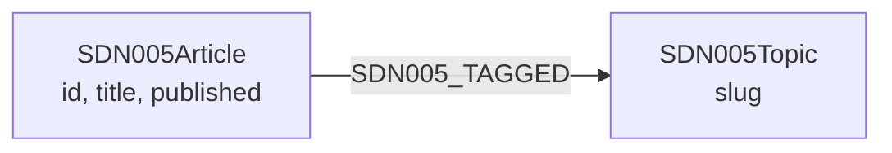

# Repositories, Derived Queries, and Custom Cypher Queries

## 1. From the Graph Model to the Java Data Access Layer

**Spring Data Neo4j (SDN)** maps nodes, relationships, and properties of a Neo4j **property graph** onto Java classes. Once an entity is mapped, the application can use `Neo4jRepository` for common operations; Spring Data can **derive queries** from method names or run **declarative Cypher** via `@Query`. When results do not cleanly match an entity, `Neo4jClient` provides custom mapping into DTOs.

Three common access patterns:

| Access approach | Strengths | Best suited for |
|---|---|---|
| **Built-in repository / derived queries** | Minimal code, strong typing, repository CRUD support | Reading/writing aggregates and simple property filtering |
| **Repository + `@Query`** | Explicit `MATCH`, relationships, paths, and aggregations while still calling through a repository | Clear graph queries you still want exposed on a repository |
| **`Neo4jClient` + custom Cypher** | Full control over the query and how each `Record` is mapped | Lightweight DTOs, analytics, single-property patches, controlled dynamic queries |

**The choice is not just about short vs. long queries.** When an entity connects to many other nodes, loading incomplete relationship data and then calling `save()` can cause unintended side effects on the portion of the graph managed by SDN. Always distinguish **reading a complete aggregate** from **reading a projection slice for display**.

This lesson belongs to the **Spring Data Neo4j** chapter in the `DATABASE_ENGINE_GRAPH_NEO4J` module. It builds on Cypher, nodes/relationships, indexes/constraints, and the Java Driver, connecting those concepts to repositories, transactions, and Spring application operations.

### After this lesson, you will be able to

1. Declare `@Node`, `@Id`, `@Relationship`, and repositories matching your graph model.
2. Create derived queries from method names such as `findByTitleContaining` and `findByPublishedTrue`.
3. Write `@Query` with parameters like `$slug` to filter by relationships and understand how to return **enough data to hydrate the aggregate**.
4. Use `Neo4jClient` to read DTOs or update single properties without loading or saving the entire graph.
5. Paginate, verify results, manage transactions, and recognize N+1 issues, missing relationships, and row multiplication.

## 2. Project Setup and Sample Data

Suppose a learning platform stores articles and topics:



An article can belong to multiple topics, and a topic can be referenced by multiple articles. `Article` acts as the aggregate root in this example, while `Topic` is the node referenced via the relationship.

### 2.1. Spring Configuration

For an imperative (synchronous) Spring Boot application using Spring Data Neo4j, add the starter:

```xml
<dependency>
    <groupId>org.springframework.boot</groupId>
    <artifactId>spring-boot-starter-data-neo4j</artifactId>
</dependency>
```

Example `application.yml` for a practice database:

```yaml
spring:
  neo4j:
    uri: bolt://localhost:7687
    authentication:
      username: neo4j
      password: ${NEO4J_PASSWORD}
```

`NEO4J_PASSWORD` is only a placeholder referencing an environment variable; never store real passwords in source files. Java, Spring Boot, Spring Data Neo4j, and Neo4j Driver versions should come from **the version BOM managed by Spring Boot**; do not arbitrarily pin a driver version mismatched with the running framework. With multi-database Neo4j, configure the target database per project environment.

The Java examples below use Java 17+ syntax (text blocks/records) and modern Spring Boot SDN APIs. These are hands-on examples; configure real dependencies and connections in your actual project.

### 2.2. Creating Sample Data and Constraints

Run write statements only on a **practice database**. The `SDN005` prefix prevents collisions with data from other lessons:

```cypher
CREATE CONSTRAINT sdn005_article_id IF NOT EXISTS
FOR (a:SDN005Article)
REQUIRE a.id IS UNIQUE;
```

```cypher
CREATE CONSTRAINT sdn005_topic_slug IF NOT EXISTS
FOR (t:SDN005Topic)
REQUIRE t.slug IS UNIQUE;
```

```cypher
UNWIND [
  {id: 'art-001', title: 'Learning Neo4j with Cypher', published: true},
  {id: 'art-002', title: 'Spring Data Neo4j', published: true},
  {id: 'art-003', title: 'Optimizing Cypher', published: false},
  {id: 'art-004', title: 'Java Driver', published: true}
] AS row
MERGE (a:SDN005Article {id: row.id})
SET a.title = row.title, a.published = row.published;
```

```cypher
UNWIND ['neo4j', 'spring', 'java'] AS slug
MERGE (:SDN005Topic {slug: slug});
```

```cypher
UNWIND [
  {article: 'art-001', topic: 'neo4j'},
  {article: 'art-002', topic: 'spring'},
  {article: 'art-002', topic: 'neo4j'},
  {article: 'art-003', topic: 'neo4j'},
  {article: 'art-004', topic: 'java'}
] AS row
MATCH (a:SDN005Article {id: row.article})
MATCH (t:SDN005Topic {slug: row.topic})
MERGE (a)-[:SDN005_TAGGED]->(t);
```

Verify the dataset:

```cypher
MATCH (a:SDN005Article)
OPTIONAL MATCH (a)-[:SDN005_TAGGED]->(t:SDN005Topic)
RETURN a.id AS id, a.title AS title,
       a.published AS published,
       collect(t.slug) AS topics
ORDER BY id;
```

| ID | Title | Published | Topics (order not guaranteed) |
|---|---|---|---|
| `art-001` | Learning Neo4j with Cypher | `true` | `neo4j` |
| `art-002` | Spring Data Neo4j | `true` | `spring, neo4j` |
| `art-003` | Optimizing Cypher | `false` | `neo4j` |
| `art-004` | Java Driver | `true` | `java` |

The row count is **4**, even though `art-002` has two relationships. When querying across relationships, `MATCH` can produce one row per edge, so use `DISTINCT` or aggregation whenever one row per article is required.

## 3. Mapping Nodes and Relationships with Annotations

### 3.1. Article Entity

In a file `Article.java`:

```java
import java.util.ArrayList;
import java.util.List;
import org.springframework.data.annotation.Id;
import org.springframework.data.neo4j.core.schema.Node;
import org.springframework.data.neo4j.core.schema.Relationship;

@Node("SDN005Article")
public class Article {
    @Id
    private String id;

    private String title;
    private boolean published;

    @Relationship(
        type = "SDN005_TAGGED",
        direction = Relationship.Direction.OUTGOING
    )
    private List<Topic> topics = new ArrayList<>();

    protected Article() {
        // For Spring Data mapping.
    }

    public Article(String id, String title, boolean published) {
        this.id = id;
        this.title = title;
        this.published = published;
    }

    public String getId() { return id; }
    public String getTitle() { return title; }
    public boolean isPublished() { return published; }
    public List<Topic> getTopics() { return topics; }
}
```

`@Node("SDN005Article")` binds the Java class to nodes labeled `SDN005Article`; `@Id` selects the entity key; `@Relationship` describes the link type and direction. In this example, the ID is a business-system string without `@GeneratedValue`. Another project may use UUID/surrogate IDs, provided it aligns consistently with schema, constraints, and import logic.

### 3.2. Topic Entity

In a file `Topic.java`:

```java
import org.springframework.data.annotation.Id;
import org.springframework.data.neo4j.core.schema.Node;

@Node("SDN005Topic")
public class Topic {
    @Id
    private String slug;

    protected Topic() {}

    public Topic(String slug) {
        this.slug = slug;
    }

    public String getSlug() { return slug; }
}
```

Pay attention to these key semantics:

- `id` or `slug` must remain stable over the entity's lifecycle. If two sources could collide on the same key, design a namespace or composite key before mapping.
- `@Id` in SDN marks identity for the mapper; **it does not automatically create a uniqueness constraint in Neo4j** across all environments. Manage constraints explicitly via migrations/schema scripts.
- `@Relationship` is not equivalent to a relational foreign key. It represents a graph edge; modifying or removing edges must stay consistent with aggregate boundaries.
- If a relationship carries properties like `since` or `weight`, use `@RelationshipProperties` with `@TargetNode` instead of assuming a Java collection of nodes captures edge data.
- With **pre-assigned** IDs and `save()`, make sure you understand your SDN version's new-entity detection mechanism. In production applications, design `@Version`/optimistic locking or an appropriate persistence strategy. The main examples below focus on **reads** and intentional Cypher updates.

## 4. Repository: Derived Queries from Method Names

For the root entity `Article`, define the repository interface:

```java
import java.util.List;
import org.springframework.data.domain.Page;
import org.springframework.data.domain.Pageable;
import org.springframework.data.neo4j.repository.Neo4jRepository;

public interface ArticleRepository
        extends Neo4jRepository<Article, String> {

    List<Article> findByTitleContaining(String fragment);

    List<Article> findByPublishedTrue();

    Page<Article> findByPublishedTrue(Pageable pageable);
}
```

`Neo4jRepository<Article, String>` provides standard operations such as `findById`, `findAll`, `save`, and `deleteById`. Method names are parsed by Spring Data to generate queries for common property filters.

| Method | Meaning | Result on sample data |
|---|---|---|
| `findById("art-002")` | Exact lookup by node key | `art-002` |
| `findByTitleContaining("Neo4j")` | Title contains substring `Neo4j` | `art-001`, `art-002` |
| `findByPublishedTrue()` | `published = true` | `art-001`, `art-002`, `art-004` |
| `findByPublishedTrue(pageable)` | Fetches one page of published nodes | Depends on page number, size, and sort order |

`Containing` corresponds to substring filtering like Cypher `CONTAINS`, which is **different** from full-text search with tokenization and relevance scoring. For localized text or case-insensitive requirements, explicitly define search behavior and indexes before choosing derived method names.

### 4.1. Calling the Repository from a Service

```java
import java.util.List;
import org.springframework.stereotype.Service;
import org.springframework.transaction.annotation.Transactional;

@Service
public class ArticleReadService {
    private final ArticleRepository repository;

    public ArticleReadService(ArticleRepository repository) {
        this.repository = repository;
    }

    @Transactional(readOnly = true)
    public List<Article> findPublished() {
        return repository.findByPublishedTrue();
    }

    @Transactional(readOnly = true)
    public List<Article> findTitleContaining(String fragment) {
        return repository.findByTitleContaining(fragment);
    }
}
```

Remember:

1. `@Transactional(readOnly = true)` defines a read transaction boundary at the service layer; it does not replace authorization, timeouts, or query predicates.
2. Repositories return **mapped entities**, including relationships if the SDN query loads them; returning full entities directly over REST can expose unintended fields or serialize massive graphs. Use DTOs when the result is only for display.
3. Derived method names fit **property filters** well. For multi-hop patterns, multiple relationship types, aggregations, or predicates on related nodes, `@Query` or `Neo4jClient` is much clearer.

## 5. `@Query`: Explicitly Writing Cypher in a Repository

When business logic asks for "published articles tagged with topic `neo4j`," the graph pattern is no longer a simple property filter on `Article`. Write `@Query` to express the traversal condition:

```cypher
MATCH (a:SDN005Article)-[:SDN005_TAGGED]->
      (tag:SDN005Topic {slug: 'neo4j'})
WHERE a.published = true
RETURN DISTINCT a.id AS id
ORDER BY id;
```

Result: `art-001` and `art-002`. Two issues arise if you try to map this query directly to `Article`:

- `RETURN a.id` returns only a scalar, **not the full node** needed by the mapper to build `Article`.
- `RETURN a` returns the root node, but **does not return the relationships** needed to populate `topics`. Calling `save()` later on an entity loaded without its links risks deleting or corrupting edges managed by SDN.

### 5.1. Returning the Root Node and All Required Relationships

Declare the repository with `@Query` as follows:

```java
import java.util.List;
import org.springframework.data.neo4j.repository.Neo4jRepository;
import org.springframework.data.neo4j.repository.query.Query;
import org.springframework.data.repository.query.Param;

public interface ArticleGraphRepository
        extends Neo4jRepository<Article, String> {

    @Query("""
        MATCH (a:SDN005Article)
              -[:SDN005_TAGGED]->(:SDN005Topic {slug: $slug})
        WHERE a.published = true
        WITH DISTINCT a
        OPTIONAL MATCH (a)-[r:SDN005_TAGGED]->(t:SDN005Topic)
        RETURN a, collect(r), collect(t)
        ORDER BY a.id
        """)
    List<Article> findPublishedByTopic(@Param("slug") String slug);

    @Query("""
        MATCH (a:SDN005Article)
              -[:SDN005_TAGGED]->(:SDN005Topic {slug: $slug})
        WHERE a.published = true
        RETURN count(DISTINCT a)
        """)
    long countPublishedByTopic(@Param("slug") String slug);
}
```

With `slug = "neo4j"`:

- `findPublishedByTopic` returns **two entities**, `art-001` and `art-002`; notably, `art-002` retains both topics `neo4j` and `spring`.
- `countPublishedByTopic` returns `2`.
- `WITH DISTINCT a` produces a single row per **matching article** before expanding all relationships to hydrate.
- `OPTIONAL MATCH` ensures the subsequent read step preserves the article even if no extra relationships exist; `collect(r)`/`collect(t)` include edges and target nodes in the result so SDN can populate `topics`.

**Separate filtering the root set from loading relationships:** first use a `MATCH` branch to **select articles matching the topic**, then expand **all `SDN005_TAGGED` edges of each selected article**. Returning only edges matching `$slug` would map a two-topic article as if it had only one topic. In applications with multiple relationship types, return every part of the aggregate that subsequent save logic depends on.

The query above intentionally illustrates a single relationship type. For more complex graphs, consider **read-only DTOs** or multi-step queries to avoid Cartesian row multiplication when loading multiple one-to-many collections at once.

### 5.2. Use Parameters Instead of String Concatenation

`@Param("slug")` binds the Java parameter to Cypher's `$slug`. Even if the input is `neo4j' ...` or contains quotes, Spring Data passes it strictly as a **data value**, never as executable query syntax.

Do not do this:

```java
// Avoid: concatenating user strings into Cypher syntax.
String unsafe = "MATCH (t:SDN005Topic {slug: '" + slug + "'}) RETURN t";
```

Parameters apply to **values**; for dynamic structural elements such as label names, relationship types, or `ORDER BY` clauses, use parameterization supported by your Cypher version or an explicit allowlist—never concatenate untrusted input directly.

### 5.3. Returning Aggregated Results Without an Entity Graph

A query returning only a count should return `long`/`Long` instead of hydrating a `List<Article>` just to call `.size()` in Java:

```cypher
MATCH (a:SDN005Article)-[:SDN005_TAGGED]->
      (t:SDN005Topic {slug: 'neo4j'})
WHERE a.published = true
RETURN count(DISTINCT a) AS total;
```

Expected `total = 2`. `DISTINCT` is used because multiple paths or edges can reach the same article, whereas the question asks for **distinct articles**. For multi-column reports or complex DTO projections, `Neo4jClient` generally offers clearer control over reading each `Record`.

## 6. `Neo4jClient`: Custom Cypher and DTO Mapping

When a screen only needs `id` and `title`, there is no need to load the full `Article` entity and its relationships. Use `Neo4jClient` to read records by column name:

```java
public record ArticleCard(String id, String title) {}
```

In the service:

```java
import java.util.Collection;
import org.springframework.data.neo4j.core.Neo4jClient;
import org.springframework.stereotype.Service;
import org.springframework.transaction.annotation.Transactional;

@Service
public class ArticleCardService {
    private final Neo4jClient client;

    public ArticleCardService(Neo4jClient client) {
        this.client = client;
    }

    @Transactional(readOnly = true)
    public Collection<ArticleCard> cardsByTitle(String fragment) {
        return client.query("""
                MATCH (a:SDN005Article)
                WHERE a.published = true
                  AND a.title CONTAINS $fragment
                RETURN a.id AS id, a.title AS title
                ORDER BY id
                """)
            .bind(fragment).to("fragment")
            .fetchAs(ArticleCard.class)
            .mappedBy((typeSystem, record) ->
                new ArticleCard(
                    record.get("id").asString(),
                    record.get("title").asString()
                )
            )
            .all();
    }
}
```

With `fragment = "Neo4j"`, the service returns two `ArticleCard` records: `art-001` and `art-002`. It never traverses `SDN005_TAGGED` or instantiates `Topic` objects. Here:

- `query(...)` sends an explicit Cypher query.
- `bind(fragment).to("fragment")` binds `$fragment`.
- `fetchAs(...).mappedBy(...)` controls how each `Record` becomes a DTO.
- `all()` collects all results into a `Collection`, suitable when record counts are bounded and fit in memory. For large datasets, apply **pagination/limits** and measure cost.

### 6.1. Updating a Single Property Intentionally

Suppose an API is only allowed to change an article's **title**. Loading the article without `topics` and calling `save(article)` to update `title` risks altering relationships during aggregate persistence. A direct Cypher update has a much clearer, verifiable mutation scope:

```java
import java.util.Map;
import org.springframework.data.neo4j.core.Neo4jClient;
import org.springframework.stereotype.Service;
import org.springframework.transaction.annotation.Transactional;

@Service
public class ArticleWriteService {
    private final Neo4jClient client;

    public ArticleWriteService(Neo4jClient client) {
        this.client = client;
    }

    @Transactional
    public boolean rename(String id, String newTitle) {
        return client.query("""
                MATCH (a:SDN005Article {id: $id})
                SET a.title = $newTitle
                RETURN a.id AS id
                """)
            .bindAll(Map.of("id", id, "newTitle", newTitle))
            .fetchAs(String.class)
            .mappedBy((typeSystem, record) ->
                record.get("id").asString()
            )
            .one()
            .isPresent();
    }
}
```

For example, calling `rename("art-001", "Neo4j and Cypher Fundamentals")` updates `title` while leaving all relationships untouched. The boolean return value indicates whether a node with that ID was found. A production API should validate the title, enforce update permissions, emit required audit logs, and align concurrency rules.

**Limitation:** `SET a.title = ...` does not automatically activate SDN entity optimistic locking. If two requests can update the same data concurrently, consider `@Version` on the entity or a version predicate in Cypher (`WHERE a.version = $expectedVersion` and incrementing version in the same transaction). If multiple write paths touch the same aggregate, keep versioning rules consistent across all of them.

## 7. Pagination, Sorting, and Avoiding Row Multiplication

### 7.1. Pagination via Repository

Simple property-based repository methods can return `Page<Article>`:

```java
import org.springframework.data.domain.Page;
import org.springframework.data.domain.PageRequest;
import org.springframework.data.domain.Sort;

Page<Article> firstPage = repository.findByPublishedTrue(
    PageRequest.of(0, 2, Sort.by(Sort.Direction.ASC, "id"))
);
```

In the fixture, three articles have `published = true`, so page 0 (size 2) returns `art-001` and `art-002`, with total elements `3`. Use a deterministic `Sort` (such as key `id`) so pagination order is consistent.

### 7.2. With Custom Cypher, Paginate Root Nodes First

If you expand relationships before `SKIP/LIMIT`, an article with many tags produces multiple rows and skews page sizes across articles. The proper sequence is to paginate **articles** first and then load relationships:

```cypher
MATCH (a:SDN005Article)
WHERE a.published = true
WITH a
ORDER BY a.id
SKIP $offset
LIMIT $pageSize
OPTIONAL MATCH (a)-[r:SDN005_TAGGED]->(t:SDN005Topic)
RETURN a, collect(r), collect(t)
ORDER BY a.id;
```

With `offset = 0` and `pageSize = 2`, the query returns **two articles**, even when the total number of relationship rows exceeds two. In the application, validate `offset >= 0`, bound `pageSize` within API limits, and paginate over a stable sort key.

If using `@Query` returning `Page<T>`, verify how your current Spring Data version handles `Pageable`, `countQuery`, and pagination parameters. **Do not assume** that passing `Pageable` to a custom `@Query` will automatically inject `SKIP/LIMIT` correctly for every Cypher query involving aggregations and multiple relationships.

### 7.3. Index Lookups Do Not Automatically Mean Fast Queries

You can create a TEXT index for substring predicates if that is a frequent workload:

```cypher
CREATE TEXT INDEX sdn005_article_title_text IF NOT EXISTS
FOR (a:SDN005Article)
ON (a.title);
```

Inspect the query plan:

```cypher
EXPLAIN
MATCH (a:SDN005Article)
WHERE a.title CONTAINS 'Neo4j'
RETURN a.id AS id, a.title AS title;
```

The planner may choose the TEXT index or a label scan depending on node count, statistics, and selectivity. If results must be ranked by textual relevance, that requires **full-text/vector search**, not `findByTitleContaining`.

## 8. Transactions, Saving, and Relationship Ownership

Key distinctions when choosing a repository operation:

| Scenario | Choice | Why |
|---|---|---|
| Saving a complete aggregate loaded and owned by the service | `repository.save(article)` | Mapper has complete node/relationship state to persist |
| Changing a single property from an event/patch | Cypher `MATCH ... SET ...` via `Neo4jClient` | Bounds the change scope and avoids deleting edges due to partial loading |
| Reading a DTO for an API | `Neo4jClient` or appropriate projection | Avoids loading an oversized graph |
| Key lookups and simple field filters | Derived query method | Concise, readable, and maintainable |
| Traversing specific relationships, collecting nodes and edges | `@Query` | Controls graph pattern and mapped result shape |

In a Spring service, `@Transactional` can span multiple repository or `Neo4jClient` calls inside one transaction. However:

- Never hold a transaction open across external HTTP calls, user prompts, or slow data streams.
- If an event updates multiple nodes and relationships, ensure all atomic operations execute within the same transaction.
- `save()` does not inherently carry **PATCH** semantics; for aggregates with relationships, understand exactly what SDN loads and saves in your version.
- Do not mix reads and writes from multiple sources onto the same properties/relationships without clear ownership rules.
- For systems that must prevent lost updates, use `@Version`/optimistic locking or explicit concurrency controls; an ID uniqueness constraint alone does not prevent conflicting updates.

### 8.1. Warning on Partial Mapping

Consider this query:

```cypher
MATCH (a:SDN005Article)-[:SDN005_TAGGED]->
      (t:SDN005Topic {slug: 'neo4j'})
RETURN a, t;
```

It **does not return the article's other relationships**: `art-002` has two tags, yet only the `neo4j` tag appears in the result. If you map that result into an `Article` with `topics` and then save it as a full aggregate, the persisted relationships may no longer match the source graph. Distinguish clearly between:

1. **The filtered article set** — used to select root nodes.
2. **Each article's full relationship set to map** — used to hydrate the aggregate accurately.
3. **A read-only DTO** — never intended to be passed to `save()` as a full graph.

The `@Query` pattern in Section 5 solves this in two stages by filtering articles first and then running `OPTIONAL MATCH` to load tags; with multiple collections or cyclic relationships, design the query for the specific graph shape and test thoroughly against multi-edge data.

## 9. Verifying Results and Integration Testing

### 9.1. Direct Verification with Cypher

On the unmodified fixture (before running the `rename` example in Section 6), the following verification query confirms node count, `published` flags, and edge counts:

```cypher
MATCH (a:SDN005Article)
OPTIONAL MATCH (a)-[:SDN005_TAGGED]->(t:SDN005Topic)
WITH a, count(t) AS tagCount
WITH collect({
  id: a.id,
  published: a.published,
  tagCount: tagCount
}) AS actual
RETURN size(actual) = 4
   AND any(x IN actual WHERE
       x.id = 'art-001' AND x.published = true AND x.tagCount = 1)
   AND any(x IN actual WHERE
       x.id = 'art-002' AND x.published = true AND x.tagCount = 2)
   AND any(x IN actual WHERE
       x.id = 'art-003' AND x.published = false AND x.tagCount = 1)
   AND any(x IN actual WHERE
       x.id = 'art-004' AND x.published = true AND x.tagCount = 1)
   AS passed;
```

Expected: `passed = true`. When running the Java API, also verify these invariants:

- `findByTitleContaining("Neo4j")` returns `art-001` and `art-002`.
- `findPublishedByTopic("neo4j")` returns `art-001` and `art-002`; `art-002` still has **two tags**.
- `countPublishedByTopic("neo4j")` returns `2`.
- `cardsByTitle("Neo4j")` returns two DTOs with matching IDs and titles.
- After renaming an article, its relationship count **remains unchanged**.

### 9.2. Testing Repositories Against a Real Neo4j Instance

`@DataNeo4jTest` supports repository and mapping tests with Spring Test; to verify traversals and constraints, run against a **real Neo4j instance** in the test environment, such as a container configured with a compatible version.

```java
import static org.assertj.core.api.Assertions.assertThat;

import org.junit.jupiter.api.Test;
import org.springframework.beans.factory.annotation.Autowired;
import org.springframework.boot.test.autoconfigure.data.neo4j.DataNeo4jTest;

@DataNeo4jTest
class ArticleRepositoryTest {
    @Autowired
    ArticleRepository repository;

    @Test
    void findsArticleTitlesContainingNeo4j() {
        // Fixture containing art-001 ... art-004 must be loaded before the test.
        assertThat(repository.findByTitleContaining("Neo4j"))
            .extracting(Article::getId)
            .containsExactlyInAnyOrder("art-001", "art-002");
    }
}
```

This snippet illustrates a meaningful check; add isolated fixture setup/cleanup per test suite. Never merely mock a repository and claim `@Query` is verified: mocks do not execute Cypher, and they do not verify relationship mapping, transactions, or constraints.

## 10. Common Design Mistakes

### 10.1. Treating Repositories Like JPA and Assuming Relationships Are Foreign Keys

Neo4j stores relationships directly rather than foreign-key columns. For multi-hop graphs or relationships with properties, model properly with `@Relationship`/`@RelationshipProperties`. Specifically, `save()` on an aggregate can modify edges managed by the mapper.

### 10.2. Using Overly Complex Method Names to Express Graph Traversals

A derived method filtering one or two simple fields is readable, but for dynamic relationships, multi-hop traversals, aggregations, or filters across related nodes, an explicit `@Query` lets reviewers inspect relationship direction and predicates directly in Cypher. Do not assume every Java property path translates into arbitrary SDN joins.

### 10.3. Returning a Node Without Enough Relationships and Calling `save()`

`RETURN a` or returning only a subset of relationships builds an entity representing **a partial slice**, not the full aggregate. Use a read-only DTO projection, or update the query to load all managed edges before attempting to save.

### 10.4. Multiplying Rows Before `LIMIT`

`MATCH (a)-[:SDN005_TAGGED]->(t) RETURN a LIMIT 2` can return two rows from the same article. Paginate **root nodes** using `WITH DISTINCT a ORDER BY ... SKIP/LIMIT` before expanding collections.

### 10.5. Returning the Entire Entity Graph over REST

Reading a node with thousands of relationships can create huge payloads, slow down mapping, and leak unintended data. Define DTOs/projections exposing only required fields and enforce result limits.

### 10.6. Ignoring Parameters and Transactions

Concatenating raw input into Cypher creates injection risks and hurts query plan caching; updating multiple entities outside a single transaction can leave the graph in a partial state. Always bind `$param` values and define clear transaction boundaries in services.

### 10.7. Testing Only with Single-Tag Sample Data

If every article in your fixture has only one relationship, queries that load incomplete relationships can appear to pass. This lesson intentionally gives `art-002` **two tags** to expose partial mapping and pagination bugs.

## 11. Practice Exercises

1. **Derived query:** add `findByTitleStartingWith(String prefix)`, predict the returned IDs for prefix `"Spring"`, and verify the result. Contrast this with full-text search.
2. **Repository and pagination:** call `findByPublishedTrue(PageRequest.of(0, 2, Sort.by("id")))`. Verify the first page has two articles, the second page has one, and `totalElements = 3`.
3. **Custom `@Query`:** modify `findPublishedByTopic` to also filter by title substring `$fragment`. Test with topic `neo4j` and keyword `Neo4j`, ensuring `art-002` still has two topics after mapping.
4. **Aggregation:** add a repository method returning the article count for a slug. Why is `count(DISTINCT a)` useful when a query traverses multiple relationships?
5. **DTO:** create an `ArticleCard` containing only `id` and `title` using `Neo4jClient`. Compare result size against returning full `Article`/`Topic` graphs as tag counts grow.
6. **Scoped update:** invoke `rename` and verify `title` changes while `SDN005_TAGGED` edges and `id` stay intact. Test a nonexistent ID and verify it returns `false`.
7. **Graph pagination:** write a query that paginates 2 articles **before** loading tags. Compare it with applying `LIMIT 2` after expanding relationships.
8. **Concurrency design:** propose how to use `@Version` or a Cypher version predicate so two concurrent requests updating the same article cannot silently overwrite each other. Explain why an ID uniqueness constraint alone is insufficient.
9. **Integration testing:** using `@DataNeo4jTest`/Testcontainers, prove that loading `art-002` returns both tags and that `art-003` is excluded when filtering for published articles. Do not substitute mocks for a real database in this mapping test.

**Completion criteria:** the learner can correctly configure `@Node`, `@Id`, and `@Relationship`, distinguish derived queries from `@Query` and `Neo4jClient`, use parameters safely, choose entities vs. DTOs appropriately, and avoid unintended relationship mutations caused by saving partially loaded graphs.

### Cleaning Up Practice Data

Execute only on the learning database containing this lesson's `SDN005` data; `DETACH DELETE` also removes relationships attached to the nodes:

```cypher
MATCH (a:SDN005Article)
DETACH DELETE a;
```

```cypher
MATCH (t:SDN005Topic)
DETACH DELETE t;
```

```cypher
DROP INDEX sdn005_article_title_text IF EXISTS;
```

```cypher
DROP CONSTRAINT sdn005_article_id IF EXISTS;
```

```cypher
DROP CONSTRAINT sdn005_topic_slug IF EXISTS;
```

## 12. References

- [Spring Data Neo4j Reference — Object mapping](https://docs.spring.io/spring-data/neo4j/reference/object-mapping.html): `@Node`, `@Id`, `@Relationship`, entity mapping.
- [Spring Data Neo4j Reference — Repositories](https://docs.spring.io/spring-data/neo4j/reference/repositories.html): repository interfaces, derived queries, pagination.
- [Spring Data Neo4j Reference — Custom queries](https://docs.spring.io/spring-data/neo4j/reference/repositories/custom-queries.html): `@Query`, node and relationship mapping.
- [Spring Data Neo4j Reference — Neo4jClient](https://docs.spring.io/spring-data/neo4j/reference/neo4j-client.html): executing custom Cypher and mapping records.
- [Neo4j Cypher Manual — MATCH](https://neo4j.com/docs/cypher-manual/current/clauses/match/): graph and relationship patterns; `OPTIONAL MATCH` and row multiplication.
- [Neo4j Cypher Manual — Execution plans](https://neo4j.com/docs/cypher-manual/current/planning-and-tuning/execution-plans/): `EXPLAIN`/`PROFILE`, index seeks/scans, and cardinality.
