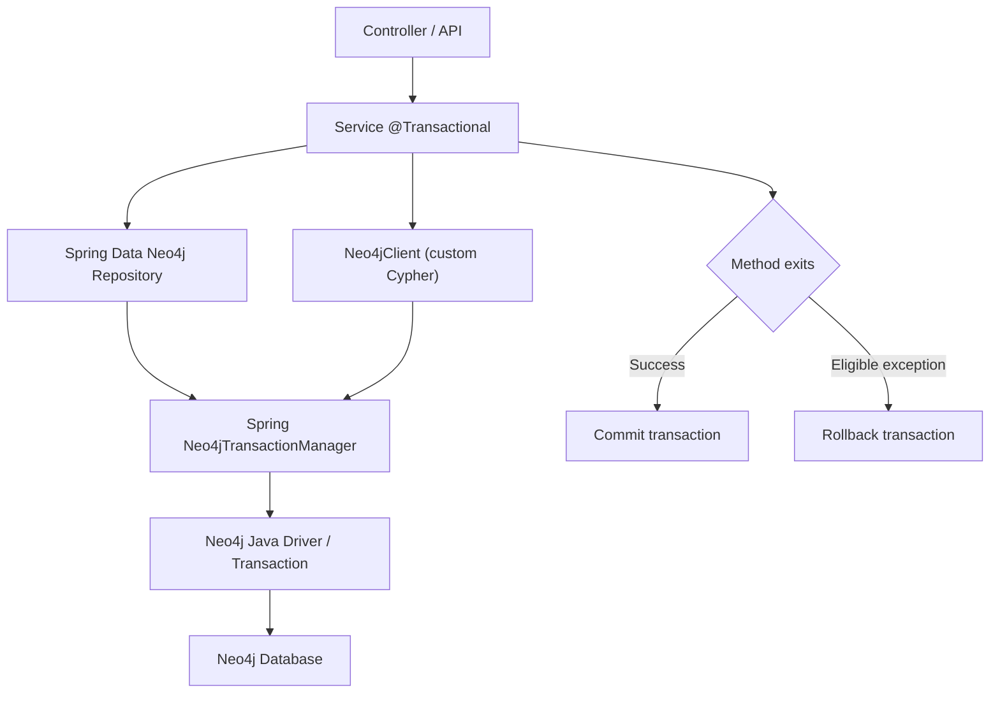
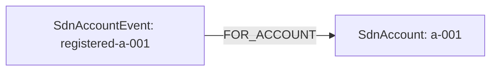
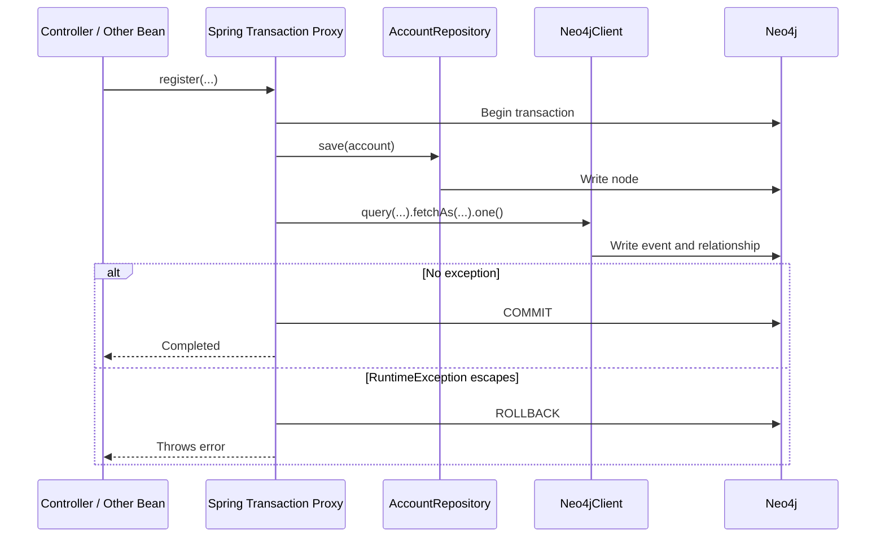

# `@Transactional` Boundaries and Coordinating with `Neo4jClient` in Spring Data Neo4j

In a **Spring Data Neo4j (SDN)** application, a single business operation may combine a **repository** to persist entities and **`Neo4jClient`** to execute custom Cypher. For example, during account registration, the application creates a `:SdnAccount` node, then creates a `:SdnAccountEvent` node and a `:FOR_ACCOUNT` relationship. If the second step fails, the business flow expects **both changes to roll back**.

**`@Transactional`** defines commit and rollback boundaries at the Spring layer. For the annotation to actually work as intended, you must understand **which transaction manager** handles it, whether calls pass through Spring's transaction proxy, and whether the repository and `Neo4jClient` operate against **the same database and the same transaction mechanism**.

This lesson belongs to the **Spring Data Neo4j** chapter in the **DATABASE_ENGINE_GRAPH_NEO4J** module. It connects the **property graph** model, **Cypher** queries, the **Neo4j Java Driver**, and Spring transactions to build consistent connected-data operations.

## 1. Where Does the Transaction Live When Using Spring Data Neo4j?

Neo4j supports native database transactions. Spring Data Neo4j layers Spring transaction integration on top so multiple repository and `Neo4jClient` calls can execute within a single Spring-managed transaction.



This diagram illustrates **the properly configured case with one Neo4j transaction manager and a Spring-managed invocation**. Calling the Java Driver directly via its own `driver.session()` or running a separate JDBC/JPA transaction **does not automatically join the Neo4j transaction** merely by appearing in the same service method.

Each component has a distinct role:

| Component | Function |
| --- | --- |
| `@Transactional` | Declares transaction boundaries and rules for a method or class |
| `Neo4jTransactionManager` | Integrates Neo4j transactions with Spring's imperative transaction infrastructure |
| `Neo4jRepository` | API for working with SDN-mapped entity graphs |
| `Neo4jClient` | API for running custom Cypher, binding parameters, and mapping results |
| Neo4j Java Driver | Sends Cypher and transaction commands to Neo4j over managed connections |
| Neo4j Database | Executes, commits, or rolls back node, relationship, and property changes |

The **business boundary** normally belongs on a **service method**, because a single business action often comprises multiple repository and Cypher calls rather than a single save.

## 2. When Should You Use `@Transactional`?

Consider an account registration workflow:

1. Save the `:SdnAccount` node via a repository.
2. Record a `:SdnAccountEvent` node.
3. Create the `(event)-[:FOR_ACCOUNT]->(account)` relationship.
4. Confirm success only when **all three** steps succeed.

If all three run inside the **same Neo4j transaction**, they commit together. If each runs in its own separate transaction, the saved account remains committed even if creating the event fails.

| Workload type | Put in one transaction? | Reason |
| --- | --- | --- |
| Saving an account and linking its audit event | **Yes**, when part of one atomic business unit | Prevents half-written state |
| Reading across several repositories for a consistent business calculation | **Often worth considering** a read transaction | Establishes a clear read scope |
| Reading a huge report and calling an external HTTP service | **Avoid holding a transaction open across external calls** | Long transactions hold resources and increase latency |
| Writing to Neo4j and sending an email | The email itself is **not** part of the Neo4j transaction | Database rollback cannot unsend an email |
| Writing to Neo4j and another database simultaneously | Not atomic by default | Requires cross-system consistency patterns |

`@Transactional` is not a magic wrapper that rolls back "all side effects in Java." It governs transactions only for **resources managed by the participating transaction manager**.

## 3. Setting Up the Illustrative Graph

We use an account node and an event node to observe commit and rollback behavior:



In real deployments, define constraints for business keys:

```cypher
CREATE CONSTRAINT sdn_account_id_unique IF NOT EXISTS
FOR (a:SdnAccount)
REQUIRE a.accountId IS UNIQUE;
```

```cypher
CREATE CONSTRAINT sdn_account_event_id_unique IF NOT EXISTS
FOR (e:SdnAccountEvent)
REQUIRE e.eventId IS UNIQUE;
```

Run these statements on a **practice database** before running the service. They are schema operations requiring appropriate privileges and must not be executed on every request. Constraints enforce uniqueness and support key lookups; they **do not replace** business transaction boundaries.

### 3.1. SDN-Mapped Entity

Example Java entity for the `SdnAccount` node:

```java
import org.springframework.data.annotation.Id;
import org.springframework.data.neo4j.core.schema.Node;

@Node("SdnAccount")
public class Account {
    @Id
    private String accountId;
    private String displayName;

    public Account() {
        // For Spring Data mapping.
    }

    public Account(String accountId, String displayName) {
        this.accountId = accountId;
        this.displayName = displayName;
    }

    public String getAccountId() {
        return accountId;
    }

    public String getDisplayName() {
        return displayName;
    }

    public void setAccountId(String accountId) {
        this.accountId = accountId;
    }

    public void setDisplayName(String displayName) {
        this.displayName = displayName;
    }
}
```

`@Node("SdnAccount")` maps the entity to the node label. `@Id` designates `accountId` as the business identifier in SDN. Do not confuse `@Id` on an entity with automatic creation of a Neo4j **uniqueness constraint**; the constraint was created explicitly above.

### 3.2. Repository

```java
import org.springframework.data.neo4j.repository.Neo4jRepository;

public interface AccountRepository
        extends Neo4jRepository<Account, String> {
}
```

The repository provides methods such as `save(...)` and `findById(...)`. When invoked inside a properly Spring-managed transaction, these calls participate in that transaction.

## 4. Combining a Repository and `Neo4jClient` in the Same Service

`Neo4jClient` is Spring Data Neo4j's API for executing **custom Cypher**, binding parameters, and mapping results. It is ideal when querying specialized relationships or performing targeted graph updates that are awkward as single repository methods.

Example service executing both operations within a single transaction:

```java
import org.springframework.data.neo4j.core.Neo4jClient;
import org.springframework.stereotype.Service;
import org.springframework.transaction.annotation.Transactional;

import java.util.Objects;

@Service
public class AccountRegistrationService {

    private final AccountRepository repository;
    private final Neo4jClient neo4jClient;

    public AccountRegistrationService(
            AccountRepository repository,
            Neo4jClient neo4jClient) {
        this.repository = repository;
        this.neo4jClient = neo4jClient;
    }

    @Transactional
    public void register(
            String accountId,
            String displayName,
            boolean simulateFailure) {

        Objects.requireNonNull(accountId, "accountId");
        Objects.requireNonNull(displayName, "displayName");

        // Step 1: SDN Repository writes the SdnAccount node.
        repository.save(new Account(accountId, displayName));

        // Step 2: Neo4jClient creates the event and relationship.
        long linked = neo4jClient.query("""
                MATCH (a:SdnAccount {accountId: $accountId})
                MERGE (e:SdnAccountEvent {eventId: $eventId})
                ON CREATE SET e.kind = 'REGISTERED',
                              e.createdAt = datetime()
                MERGE (e)-[:FOR_ACCOUNT]->(a)
                RETURN count(e) AS linked
                """)
            .bind(accountId).to("accountId")
            .bind("registered-" + accountId).to("eventId")
            .fetchAs(Long.class)
            .mappedBy((typeSystem, record) ->
                record.get("linked").asLong()
            )
            .one()
            .orElseThrow();

        if (linked != 1) {
            throw new IllegalStateException("Cannot link audit event");
        }

        // Used to verify rollback against a practice database.
        if (simulateFailure) {
            throw new IllegalStateException("Demo rollback");
        }
    }
}
```

Assumptions required for this example to behave properly:

- `AccountRepository` and `Neo4jClient` come from the **same SDN context**.
- Spring has configured **`Neo4jTransactionManager`** (imperative), and `@Transactional` resolves to that manager.
- `register(...)` is called by **another bean through the Spring proxy**, not via an internal self-call bypassing the interceptor.
- Both components target the **same Neo4j database** within the active transaction context.

Here, the service never calls `commit()` directly. Spring opens a transaction before entering the method and commits when it returns normally. If `IllegalStateException` escapes the method, Spring rolls back the transaction according to default rollback rules.

### 4.1. Two Invocations to Verify Behavior

Successful run:

```java
accountRegistrationService.register("a-001", "An", false);
```

Check the database:

```cypher
MATCH (a:SdnAccount {accountId: 'a-001'})
OPTIONAL MATCH (e:SdnAccountEvent)-[:FOR_ACCOUNT]->(a)
RETURN a.accountId AS accountId,
       a.displayName AS name,
       collect(e.eventId) AS eventIds;
```

Expect the account node and event `registered-a-001`.

Intentional failure run on a **fresh** ID:

```java
accountRegistrationService.register("a-rollback", "Test", true);
```

If the transaction is managed properly, the method throws an exception and **commits neither change** from this run. Verify:

```cypher
OPTIONAL MATCH (a:SdnAccount {accountId: 'a-rollback'})
OPTIONAL MATCH (e:SdnAccountEvent {eventId: 'registered-a-rollback'})
RETURN a IS NOT NULL AS accountExists,
       e IS NOT NULL AS eventExists;
```

Expected result: `accountExists = false` and `eventExists = false`. If either exists, check whether the repository or `Neo4jClient` executed outside the transaction, targeted a different database, or left committed data from an earlier run.

**Distinction:** rollback undoes only changes from **the failed transaction itself**. It never deletes nodes or events committed in earlier transactions.

## 5. Default Mechanics of `@Transactional`

In Spring's standard imperative model, annotation attributes configure propagation, isolation, read-only hints, and rollback rules.

| Attribute | Default or meaning | When to customize |
| --- | --- | --- |
| `propagation` | `REQUIRED`: join an existing transaction or start a new one | When business logic explicitly requires an independent transaction |
| `readOnly` | `false` | Read queries can declare `true` to signal intent |
| `rollbackFor` | Rolls back on `RuntimeException` and `Error` by default | When rollback is required on checked exceptions |
| `noRollbackFor` | Skips rollback for specified exception types | Needs deliberate business justification; avoid overuse |
| `transactionManager` / `value` | Selects transaction manager by bean name/qualifier | Applications with multiple transaction managers |
| `timeout` | Transaction-layer timeout if supported | Prevents business flows from holding transactions too long |

Not every attribute—especially **isolation** or **timeout**—behaves identically across all transaction managers. Verify what Neo4j and your Spring Data Neo4j version support rather than blindly applying JDBC/JPA assumptions.

### 5.1. Runtime Exceptions Trigger Rollback

```java
@Transactional
public void updateAndReject() {
    repository.save(new Account("a-002", "Binh"));
    throw new IllegalStateException("Business validation failed");
}
```

`IllegalStateException` is a `RuntimeException`. If it **escapes the Spring-intercepted method boundary**, the transaction is marked for rollback and node `a-002` is not committed.

### 5.2. Checked Exceptions Do Not Roll Back by Default

```java
@Transactional(rollbackFor = Exception.class)
public void updateAndValidate() throws Exception {
    repository.save(new Account("a-003", "Chi"));
    throw new Exception("External validation failed");
}
```

`rollbackFor = Exception.class` explicitly requests rollback when a checked exception escapes. Without it, default Spring rollback rules usually **do not roll back** on checked `Exception` types unless overridden globally.

### 5.3. Catching and Swallowing Exceptions Can Cause a Commit

```java
@Transactional
public void incorrectFlow() {
    repository.save(new Account("a-004", "Dung"));

    try {
        validateExternalCondition();
    } catch (IllegalStateException ex) {
        // Wrong if business logic requires rollback:
        // merely logging and exiting the method as if it succeeded.
        logValidationFailure(ex);
    }
}
```

If an exception is caught internally and **never reaches the transaction interceptor**, the method returns normally and Spring may commit. Either **rethrow the exception** or explicitly mark the transaction rollback-only when rethrowing is not possible. Also note that an exception thrown inside a nested transactional component may have already marked the outer transaction rollback-only, causing commit to fail with `UnexpectedRollbackException`; never guess outcome solely from the presence of a `try/catch`.

## 6. `Neo4jClient`: Parameterized Queries and Data Mapping

The `Neo4jClient` fluent API differs from the low-level Neo4j Java Driver, even though both execute Cypher on Neo4j. Typical operations include:

- `query(cypher)`: specifies the Cypher statement.
- `bind(value).to("name")` or `bindAll(map)`: binds parameters to `$name`.
- `fetch().all()/one()`: retrieves rows as maps when appropriate.
- `fetchAs(Type.class).mappedBy(...)`: transforms each record into a custom DTO or Java value.
- `run()`: executes a statement when result rows are not needed.

Example reading a DTO:

```java
public record AccountView(
    String accountId,
    String displayName
) {}
```

```java
import org.springframework.data.neo4j.core.Neo4jClient;
import java.util.Optional;

public class AccountLookup {
    private final Neo4jClient neo4jClient;

    public AccountLookup(Neo4jClient neo4jClient) {
        this.neo4jClient = neo4jClient;
    }

    public Optional<AccountView> find(String accountId) {
        return neo4jClient.query("""
                MATCH (a:SdnAccount {accountId: $id})
                RETURN a.accountId AS id,
                       a.displayName AS name
                """)
            .bind(accountId).to("id")
            .fetchAs(AccountView.class)
            .mappedBy((typeSystem, record) ->
                new AccountView(
                    record.get("id").asString(),
                    record.get("name").asString()
                )
            )
            .one();
    }
}
```

`fetchAs(...).mappedBy(...)` maps the aliased return columns into `AccountView`. The keys `id` and `name` inside `record.get(...)` are **returned column aliases**, distinct from parameter name `$id` even when they happen to share the same spelling.

If a query returns multiple rows, use `all()` with appropriate bounds. If no account matches, `one()` returns `Optional.empty()`; if a query expecting a single record returns more than one row, investigate duplicate data or filter predicates.

### 6.1. Update Queries Without Returning Records

```java
neo4jClient.query("""
        MATCH (a:SdnAccount {accountId: $id})
        SET a.displayName = $name
        """)
    .bind(accountId).to("id")
    .bind(displayName).to("name")
    .run();
```

This runs the Cypher update. If `MATCH` finds no account, the statement still succeeds technically while **updating zero nodes**. Whenever business rules require the entity to exist, `RETURN` the key or matched count to distinguish "updated" from "target missing."

### 6.2. Returning Small, Schema-Clear Payloads

```cypher
MATCH (a:SdnAccount {accountId: $id})
RETURN a.accountId AS id,
       a.displayName AS name;
```

Projecting only required properties with stable aliases makes mappers far easier to maintain than returning entire `node` objects and unpacking properties in controllers.

### 6.3. Why Parameter Binding Matters

Wrong:

```java
String unsafe = "MATCH (a:SdnAccount {accountId:'"
        + accountId + "'}) RETURN a";
```

Right:

```java
neo4jClient.query("""
    MATCH (a:SdnAccount {accountId: $id})
    RETURN a.accountId AS id
    """)
    .bind(accountId).to("id")
    .fetchAs(String.class)
    .mappedBy((typeSystem, record) ->
        record.get("id").asString()
    )
    .one();
```

Parameters prevent user input from turning into Cypher syntax and preserve proper types. For dynamic structural elements such as labels, relationship types, or sort fields, rely on version-appropriate Cypher features or strict allowlists—**never concatenate untrusted input into Cypher fragments**.

## 7. Why Might Two Calls Not Share the Same Transaction?

Distinguish between call patterns that look similar on the surface:

### 7.1. Repository and `Neo4jClient` Inside a `@Transactional` Service

```java
@Transactional
public void updateTogether() {
    repository.save(account);
    neo4jClient.query("MATCH ... SET ...").run();
}
```

With the **same Spring transaction manager and the same database**, both operations run inside the **same transaction**. This is the recommended pattern for a single business unit of work.

### 7.2. Two Independent Calls Without an Enclosing Boundary

```java
repository.save(account);
neo4jClient.query("MATCH ... SET ...").run();
```

Without an enclosing transaction from the caller, the two calls **do not share a single transaction**. The first call can commit before the second call fails.

### 7.3. Opening a Separate Java Driver Session

```java
try (var session = driver.session()) {
    session.run("CREATE (:SdnDiagnostic {message:'ok'})")
           .consume();
}
```

A `Session` opened directly from the Java Driver **does not automatically join SDN's Spring transaction**. Even if placed inside a `@Transactional` method, never assume rolling back the repository will undo the `SdnDiagnostic` node committed in that separate session.

**Do not mix different data-access paths within one business operation unless you understand the transaction boundaries.** When custom Cypher is needed, prefer SDN-integrated `Neo4jClient` or design a single explicitly coordinated transaction mechanism.

## 8. Cases Where `@Transactional` Does Not Apply as Expected

### 8.1. Self-Invocation: Calling a Method on the Same Object

```java
@Service
public class WrongRegistrationService {

    public void handleRequest() {
        saveWithTransaction(); // Direct this.saveWithTransaction() call.
    }

    @Transactional
    public void saveWithTransaction() {
        // repository.save(...);
        // neo4jClient.query(...).run();
    }
}
```

Under **Spring's default proxy-based AOP**, an internal call on the same bean **bypasses the proxy**, so `@Transactional` on `saveWithTransaction()` does not start a transaction. The clean fix is to put `@Transactional` on the public service method invoked through the proxy by another bean, or extract the transactional method into a separate service bean.

Similar issues occur when `@Transactional` is placed on methods that the proxy mechanism cannot intercept (such as certain `private` or `final` methods, depending on proxy configuration).

### 8.2. Applications with Multiple Transaction Managers

Suppose an application uses both **JPA/JDBC** and **Neo4j**. When multiple transaction manager beans exist without explicit disambiguation, `@Transactional` may pick the wrong manager or fail resolution.

When the Neo4j transaction manager is registered under a known bean name, specify it explicitly:

```java
@Transactional(transactionManager = "neo4jTransactionManager")
public void updateGraph() {
    // SDN operations must use the proper Neo4j transaction manager.
}
```

**`"neo4jTransactionManager"` here is an illustrative bean name**: use it only if your application actually defines that bean/qualifier. Never assume every Spring Boot project automatically uses the exact same bean name. Specify the transaction manager explicitly and inspect configuration whenever multiple data sources coexist.

A JPA transaction and a Neo4j transaction are never atomic together merely because both execute inside one Java method. Use outbox patterns, sagas, compensating actions, or proper synchronization architectures if cross-system consistency is required.

### 8.3. Unintentionally Changing Propagation

`@Transactional` defaults to `Propagation.REQUIRED`, joining an active transaction if present. With `REQUIRES_NEW`, the inner method can start an **independent transaction** (when properly intercepted and supported by the manager).

```java
@Transactional(propagation = Propagation.REQUIRES_NEW)
public void auditSeparately() {
    // Can commit independently of the outer calling transaction.
}
```

Once `auditSeparately()` commits, rolling back the outer transaction **does not undo** this independent transaction. Do not use `REQUIRES_NEW` casually just to "avoid rollback"; it alters business semantics and increases connection/lock demand.

### 8.4. Mixing Reactive and Imperative Models

This lesson uses **imperative** `Neo4jClient` and `Neo4jTransactionManager`. Reactive applications use **`ReactiveNeo4jClient`**, **`ReactiveNeo4jTransactionManager`**, and transactions bound to the **Reactor context** rather than imperative thread-local state.

Returning `Mono`/`Flux` from a method and calling `subscribe()` outside the reactive chain breaks transaction boundaries and error handling. For reactive SDN applications, apply proper reactive transaction management instead of porting imperative code by merely changing return types.

## 9. Reading Data and `readOnly = true`

A read-only service method can declare:

```java
@Transactional(readOnly = true)
public Optional<AccountView> findForDisplay(String id) {
    return neo4jClient.query("""
            MATCH (a:SdnAccount {accountId: $id})
            RETURN a.accountId AS id,
                   a.displayName AS name
            """)
        .bind(id).to("id")
        .fetchAs(AccountView.class)
        .mappedBy((typeSystem, record) ->
            new AccountView(
                record.get("id").asString(),
                record.get("name").asString()
            )
        )
        .one();
}
```

`readOnly = true` communicates read-only intent and allows the transaction infrastructure/driver to optimize routing or access mode accordingly. **Do not treat this as a security authorization control**: actual write restrictions must be enforced via Neo4j roles and privileges.

If a service both reads and writes within a single business unit, do not place `readOnly = true` at the class level and forget to override it on write methods.

**Materialize results inside the transaction:** `Neo4jClient.fetchAs(...).one()/all()` materializes results into Java objects before returning. If using lazy or streaming styles, understand session/transaction lifetimes and never consume an unfinished stream after resources close.

## 10. Repository `save()` vs. Custom Cypher: Avoiding Unintended Graph Updates

SDN graph mapping is not a SQL `UPDATE` touching a single column. Depending on the entity and mapped relationships, `save()` may synchronize the relationships managed by that entity. If custom Cypher previously created relationships that are unmapped or missing from the Java object, make sure you understand the mapping strategy before calling `save(entity)`.

For example:

- The `Account` entity maps only `accountId` and `displayName`: the repository manages account properties.
- Cypher via `Neo4jClient` creates event nodes and `FOR_ACCOUNT` edges unmapped in `Account`.
- If `Account` is later expanded to map an `events` collection or other relationships, saving the aggregate can affect whichever relationships the entity manages.

Therefore:

1. **Clearly define which parts of the graph belong to repositories** vs. custom Cypher.
2. Never assume `save()` always acts as a "relationship-safe partial patch."
3. Use explicit `MATCH ... SET property` Cypher when updating a single property on a large graph.
4. Whenever sharing endpoints across multiple relationship writers, test entity saves after any mapping change—especially for collection relationships.
5. Keep **business keys** and constraints consistent across repositories and custom Cypher.

Correct mapping determines **what data gets written**; transactions determine **whether all those changes commit or roll back together**. Both are essential.

## 11. Exception Behavior, Retries, and Side Effects Outside Neo4j

### 11.1. `@Transactional` Does Not Automatically Retry Failures

Spring handles commit and rollback according to transaction rules; `@Transactional` **does not automatically re-execute a method** on transient Neo4j errors. If retries are required, configure an explicit retry policy and component deliberately.

By contrast, **Neo4j Java Driver managed transactions** via `session.executeWrite(...)` include built-in retries for certain transient retryable errors. That is a different API and scope; do not conflate driver-managed retry semantics with every Spring repository or `Neo4jClient` call.

### 11.2. HTTP Calls and Emails Do Not Roll Back with the Graph

Pattern to avoid:

```java
@Transactional
public void registerAndEmail(String id) {
    repository.save(new Account(id, "User"));
    emailService.sendWelcome(id);  // Once sent, the email cannot be recalled.
    throw new IllegalStateException("Fail after sending email");
}
```

Neo4j data rolls back, yet the sent email cannot be undone. Common solutions:

- Persist an **outbox/event node** in Neo4j inside the same transaction as the business data.
- Run a separate worker to read committed events and send emails/messages.
- Track delivery state, retries, and idempotency to avoid duplicate sends.

Spring also offers `@TransactionalEventListener(phase = TransactionPhase.AFTER_COMMIT)` to run handlers **after commit** when appropriate. Even then, an in-process post-commit callback is not durable if the process crashes; use an **outbox** or equivalent pattern for critical deliveries.

### 11.3. A Commit Can Succeed Even If the Client Never Receives Confirmation

If a network failure strikes right at commit time, the application may not know whether Neo4j committed. Never blindly retry a bare `CREATE` without a business key, as that can create duplicate records.

Use stable business keys, unique constraints, and idempotent operations. In our example, `eventId = 'registered-' + accountId` identifies an already-created event on replay. If the domain allows multiple valid registrations for the same account, generate a distinct event ID per **business attempt** rather than relying on this simplified demo string.

## 12. Common Pitfalls When Combining Repositories and `Neo4jClient`

| Symptom | Possible cause | How to inspect |
| --- | --- | --- |
| Repository saved, `Neo4jClient` failed, yet node remained | Calls were not in the same transaction or first call committed early | Check service `@Transactional`, transaction manager, and database |
| `@Transactional` present on method but no rollback | Self-invocation or call bypassed proxy | Trace the actual call path across Spring beans |
| Checked exception thrown yet data committed | Missing `rollbackFor` configuration | Check exception type against rollback rules |
| Exception caught and method returned normally, committing data | Exception was swallowed before reaching transaction interceptor | Rethrow or mark rollback-only if appropriate |
| Write method ran under JPA manager | Multiple transaction managers, wrong one picked | Specify the Neo4j transaction manager bean explicitly |
| Separate `driver.session()` did not roll back with repository | Independent session/transaction | Use `Neo4jClient` or a single properly coordinated transaction |
| `Neo4jClient` returned `Optional.empty()` | `MATCH` found no node or query returned 0 rows | Check key, parameters, column aliases, and fixture data |
| Entity `save()` altered relationships unexpectedly | Relationship mapping scope did not match existing graph | Inspect relationship mappings and aggregate save logic |
| API slow due to long transaction | Reading massive subgraphs, external network calls, holding locks | Shorten transactions; move non-DB I/O outside |
| Retry produced duplicate nodes/events | Missing business key, constraint, or idempotency | Check identifiers and counts after replay |

The goal of debugging is to pinpoint **the commit point** and **resource boundaries**, not merely verify that `@Transactional` appears in a Java file.

## 13. Procedure for Verifying Transaction Boundaries

On a practice database:

1. **Verify data source alignment:** repository and `Neo4jClient` must target the same Neo4j database and the same imperative transaction manager.
2. **Create constraints** for `SdnAccount.accountId` and `SdnAccountEvent.eventId` before running the service.
3. **Test the happy path:** call `register("a-001", "An", false)` and confirm the account node, event node, and relationship all exist.
4. **Test rollback:** call `register("a-rollback", "Test", true)` from another bean and confirm **no** data from the failed call exists.
5. **Test missing node:** adjust Cypher so `MATCH` misses and verify the method detects zero rows and raises the expected domain error.
6. **Test checked exceptions:** verify `rollbackFor` settings to observe why transactions commit or roll back.
7. **Test controlled self-invocation:** compare invoking through the Spring proxy vs. calling within the same bean.
8. **Check multi-manager environments:** verify which transaction manager bean `@Transactional` actually resolves.

Never run intentional failure tests against production data. Test results depend on the service bean being managed **by Spring**, calls passing **through the proxy**, and operations sharing the **same Neo4j transaction**.

### Success Commit Flow vs. Rollback Flow



This diagram illustrates logical transaction flow, not exact network round trips or driver batching behavior.

## 14. Self-Check Questions

**Q1.** A `@Transactional` service calls `accountRepository.save(...)` and then `neo4jClient.query(...).run()`. What conditions ensure both operations roll back together?

<details>
<summary>Suggested answer</summary>

Both must run inside an active Spring-managed Neo4j transaction: the call enters through the transaction interceptor, `@Transactional` resolves the right Neo4j transaction manager, and both repository and `Neo4jClient` share the same transaction context and target database. When an eligible rollback exception escapes, both uncommitted changes are rolled back.

</details>

**Q2.** Why might `@Transactional` on `saveWithTransaction()` fail to activate when `handleRequest()` in the same bean calls it?

<details>
<summary>Suggested answer</summary>

In standard Spring proxy mode, self-invocation bypasses the transaction proxy. The annotation on the internally called method is not intercepted. Place the transaction boundary on the service method invoked through the proxy, or extract the method into another bean.

</details>

**Q3.** If a `@Transactional` method throws a checked `Exception`, is rollback guaranteed?

<details>
<summary>Suggested answer</summary>

No. Under default Spring rules, rollback occurs when `RuntimeException` or `Error` escapes; checked exceptions do not roll back unless `rollbackFor` or a global rollback policy is configured.

</details>

**Q4.** Can you replace `Neo4jClient` with a manually opened `driver.session()` inside a service and still expect Spring to roll everything back?

<details>
<summary>Suggested answer</summary>

Not by default. A manually created Java Driver `Session` does not automatically join Spring Data's managed Neo4j transaction. Use SDN-integrated mechanisms or explicitly coordinate boundaries instead of relying on code placement inside the same Java method.

</details>

**Q5.** `Neo4jClient.query(...).run()` finishes cleanly, yet `MATCH` found no node. Can you report the update as successful?

<details>
<summary>Suggested answer</summary>

Not automatically. A query updating 0 rows can complete without throwing errors. When business rules require the node to exist, return the matched count or confirming property, check the result, and raise an appropriate error before commit.

</details>

**Q6.** Why does writing an account in Neo4j and sending an email inside the same `@Transactional` method fail to guarantee email rollback if a later error is thrown?

<details>
<summary>Suggested answer</summary>

The Neo4j transaction manager only controls Neo4j changes; an already-sent email is an external side effect. Use post-commit event listeners where appropriate, or an outbox/idempotency pattern for high reliability.

</details>

**Q7.** A bean uses `@Transactional(readOnly = true)` to read accounts. Does this guarantee the Neo4j database user lacks write permissions?

<details>
<summary>Suggested answer</summary>

No. `readOnly` is a Spring-layer transaction attribute that may influence routing or optimizations, not a substitute for Neo4j roles and privileges. Enforce write restrictions at the database security layer.

</details>

## Key Takeaways

- **Place `@Transactional` on services** to cover a cohesive business unit spanning repositories and `Neo4jClient`.
- **Same Neo4j transaction manager, same database, and proxy-intercepted invocation** are essential for operations to commit and roll back together.
- **Runtime exceptions roll back by default; checked exceptions typically require `rollbackFor`**; swallowing exceptions can trigger unintended commits.
- **`Neo4jClient`** provides `query`, `bind`, `fetchAs`, `mappedBy`, and `run` for running Cypher and mapping DTOs within SDN's context.
- **Manually opened Driver sessions, JPA transactions, or emails** do not automatically join Spring-managed Neo4j transactions.
- **`@Transactional` does not automatically retry failures**, provide distributed atomicity, or replace constraints and idempotency.
- To be certain of behavior, test both **successful commits and intentional rollbacks** against a practice database.

### References

- [Spring Data Neo4j — Reference documentation](https://docs.spring.io/spring-data/neo4j/reference/)
- [Spring Framework — Declarative transaction management](https://docs.spring.io/spring-framework/reference/data-access/transaction/declarative.html)
- [Spring Framework — Using @Transactional](https://docs.spring.io/spring-framework/reference/data-access/transaction/declarative/annotations.html)
- [Spring Framework — Rolling back a declarative transaction](https://docs.spring.io/spring-framework/reference/data-access/transaction/declarative/rolling-back.html)
- [Neo4j Java Driver — Transactions](https://neo4j.com/docs/java-manual/current/transactions/)
- [Neo4j Cypher — MERGE](https://neo4j.com/docs/cypher-manual/current/clauses/merge/)
