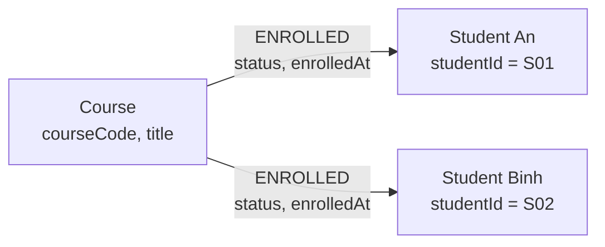

# Saving Object Graphs, Updating Relationships, and Preventing Unintended Writes in Spring Data Neo4j

When using Spring Data Neo4j (SDN), `repository.save(entity)` looks like saving a single Java object. However, one object in an application can represent **many nodes and relationships** in Neo4j. Consequently, `save()` can affect the **entire mapped object graph**, not merely update one property on a single node.

The most common failure mode: the application loads an entity with **only a subset of its relationships**, modifies a small field such as `title`, and calls `save()`. If the relationship collection is missing entries, SDN can synchronize the database's relationship set to match what is present in the Java object and **delete edges that are no longer represented**. This behavior is critical to understand before deploying any system.

This lesson belongs to the **Spring Data Neo4j** chapter of the `DATABASE_ENGINE_GRAPH_NEO4J` module: using property graphs, Cypher, nodes, relationships, indexes, constraints, and the Java Driver to build applications with Neo4j. The focus is on **write boundaries**, **intentional relationship updates**, and **protecting the graph from unintended mutations** when using repositories, entity mappings, or Cypher.

> **Principle:** Only use `save()` to synchronize an object graph when the application truly **owns and holds the complete scope of that graph**. When you only need to update one property or one edge, prefer a Cypher statement with a **narrow, explicit write scope** inside a clear transaction.

## 1. An Object Graph Differs from a Table Row

In Spring Data JPA, developers often picture an object as a single table row. In Neo4j, an entity annotated with `@Node` represents a node, yet it can hold `@Relationship` fields linking to **other entities**. A single save call can traverse those mapped relationships.

Example in a training platform:



A `CourseNode` object has an `enrollments` collection containing two `EnrollmentRel` objects. Each `EnrollmentRel` in turn holds a `StudentNode`. That is the JVM **object graph**; in Neo4j, it corresponds to one course node, two student nodes, and two relationships.

When updating the course title, the intended domain outcome is:

```text
Before: C101.title = "Introductory Cypher"
        C101 ─ENROLLED→ S01
        C101 ─ENROLLED→ S02

After:  C101.title = "Basic Cypher"
        C101 ─ENROLLED→ S01
        C101 ─ENROLLED→ S02
```

However, if Java holds only `enrollments = [S01]` and saves it back as the complete owned graph, the edge to `S02` can be dropped. You must always know **whether an object represents the full graph or a partial projection**.

## 2. Comparing Write Paths in SDN

| Write approach | Typical operation scope | When it fits | Primary risk |
| --- | --- | --- | --- |
| `Neo4jRepository.save(entity)` | Persists root node and related graph per mapping metadata | Creating/saving an aggregate when the application owns the full relationship set | Overwriting or deleting relationships absent from the model |
| `Neo4jTemplate.save(entity)` / `Neo4jOperations.save(entity)` | Same object-mapping persistence group | Fine-grained persistence control in the service layer | Same as repository `save()` |
| `Neo4jOperations.saveAs(...)` (where supported) | Persists according to a chosen projection/predicate | Writing a scoped graph slice when the API is well understood | Returned entity may be partially hydrated; passing it to full `save` risks data loss |
| `Neo4jClient.query(...).run()` | Explicit Cypher modifying only what the statement targets | Updating a single property, adding/removing a single relationship | Author must explicitly enforce business rules, versioning, and query scope |
| Neo4j Java Driver with Cypher | Explicit Cypher through the driver | Batching, low-level integration, or specialized procedures | Must manage transactions and Spring coordination properly |

Spring Data Neo4j documentation notes that `save()` can generate **multiple statements** to bring the database graph into alignment with the object graph. For mapped relationships, SDN can delete and recreate edges that need synchronization; never assume `save()` compiles down to a single isolated `SET n.title = ...`.

Note: exact generated Cypher depends on **SDN version, mapping metadata, and how the entity was loaded**. Never rely on a specific internal statement sequence as a stable contract.

## 3. Declaring `@Node`, `@Id`, and `@Relationship`

The following examples illustrate standard mapping APIs in modern Spring Data Neo4j (7.x/8.x). Choose compatible Spring Boot, SDN, and JDK versions according to your BOM and documentation; **never** mix legacy Neo4j-OGM annotations with modern SDN.

### 3.1. `StudentNode` Entity

```java
import org.springframework.data.neo4j.core.schema.Id;
import org.springframework.data.neo4j.core.schema.Node;
import org.springframework.data.annotation.Version;

@Node("SdnDemoStudent")
public class StudentNode {

    @Id
    private String studentId;

    @Version
    private Long version;

    private String name;

    protected StudentNode() {}

    public StudentNode(String studentId, String name) {
        this.studentId = studentId;
        this.name = name;
    }

    public String getStudentId() {
        return studentId;
    }

    public String getName() {
        return name;
    }
}
```

`@Node("SdnDemoStudent")` sets the label in Neo4j. `@Id` chooses the business key `studentId`; `@Version` enables optimistic locking and helps SDN distinguish new entities from existing ones when using business-assigned IDs. **Never modify `version` manually in repository save paths.**

### 3.2. Relationship Properties

The `ENROLLED` relationship carries enrollment status and enrollment date:

```java
import java.time.LocalDate;
import org.springframework.data.neo4j.core.schema.RelationshipId;
import org.springframework.data.neo4j.core.schema.RelationshipProperties;
import org.springframework.data.neo4j.core.schema.TargetNode;

@RelationshipProperties
public class EnrollmentRel {

    @RelationshipId
    private Long id;

    @TargetNode
    private StudentNode student;

    private String status;
    private LocalDate enrolledAt;

    protected EnrollmentRel() {}

    public EnrollmentRel(
            StudentNode student, String status, LocalDate enrolledAt) {
        this.student = student;
        this.status = status;
        this.enrolledAt = enrolledAt;
    }

    public StudentNode getStudent() {
        return student;
    }

    public String getStatus() {
        return status;
    }
}
```

`@TargetNode` points to the node at the far end of the relationship; `@RelationshipId` holds the relationship's internal ID so SDN can track it during mapping and saving. **Do not treat this ID as a durable business key or manually assign an arbitrary internal ID.** If an enrollment has an external source identifier, model a dedicated key property and constraint.

### 3.3. `CourseNode` Entity

```java
import java.util.ArrayList;
import java.util.List;
import org.springframework.data.annotation.Version;
import org.springframework.data.neo4j.core.schema.Id;
import org.springframework.data.neo4j.core.schema.Node;
import org.springframework.data.neo4j.core.schema.Relationship;

@Node("SdnDemoCourse")
public class CourseNode {

    @Id
    private String courseCode;

    @Version
    private Long version;

    private String title;

    @Relationship(
        type = "SDN_DEMO_ENROLLED",
        direction = Relationship.Direction.OUTGOING
    )
    private List<EnrollmentRel> enrollments = new ArrayList<>();

    protected CourseNode() {}

    public CourseNode(String courseCode, String title) {
        this.courseCode = courseCode;
        this.title = title;
    }

    public void rename(String title) {
        this.title = title;
    }

    public List<EnrollmentRel> getEnrollments() {
        return enrollments;
    }

    public String getCourseCode() {
        return courseCode;
    }

    public String getTitle() {
        return title;
    }
}
```

In this example, the relationship is mapped **unidirectionally** from `CourseNode` to `StudentNode`. Unidirectional mappings reduce the risk of pulling overly broad graphs or loops when classes point back to one another. Do not add bidirectional mappings merely for occasional navigation convenience.

The classes in these three snippets belong in **three separate Java files** in a real project; they are separated here for readability. The examples include only fields, constructors, and getters needed for this lesson rather than a full application domain model.

## 4. Minimal Dependency and Schema Configuration

With Spring Boot, use the BOM/parent-managed starter:

```xml
<dependency>
    <groupId>org.springframework.boot</groupId>
    <artifactId>spring-boot-starter-data-neo4j</artifactId>
</dependency>
```

Example connection configuration for a development environment:

```yaml
spring:
  neo4j:
    uri: ${NEO4J_URI:bolt://localhost:7687}
    authentication:
      username: ${NEO4J_USERNAME:neo4j}
      password: ${NEO4J_PASSWORD}
  data:
    neo4j:
      database: ${NEO4J_DATABASE:neo4j}
```

Exact property names and versions depend on your Spring Boot release; production configurations must source passwords from a secret store and use appropriate URIs and TLS.

Create constraints for both business keys on your **test database** before calling `save()`:

```cypher
CREATE CONSTRAINT sdn_demo_course_key IF NOT EXISTS
FOR (c:SdnDemoCourse)
REQUIRE c.courseCode IS UNIQUE;
```

```cypher
CREATE CONSTRAINT sdn_demo_student_key IF NOT EXISTS
FOR (s:SdnDemoStudent)
REQUIRE s.studentId IS UNIQUE;
```

Uniqueness constraints prevent duplicate nodes sharing the same key, but they do not automatically guarantee **at most one `ENROLLED` relationship between a Course and a Student**. When uniqueness is required at the relationship level, define a relationship key, appropriate constraint, or concurrency guard separately.

## 5. Setting Up a Two-Relationship Graph

On the test database, seed the illustrative dataset once:

```cypher
MERGE (c:SdnDemoCourse {courseCode: 'C101'})
ON CREATE SET c.title = 'Introductory Cypher', c.version = 0
MERGE (a:SdnDemoStudent {studentId: 'S01'})
ON CREATE SET a.name = 'An', a.version = 0
MERGE (b:SdnDemoStudent {studentId: 'S02'})
ON CREATE SET b.name = 'Binh', b.version = 0
MERGE (c)-[r1:SDN_DEMO_ENROLLED]->(a)
ON CREATE SET r1.status = 'ACTIVE', r1.enrolledAt = date('2026-01-10')
MERGE (c)-[r2:SDN_DEMO_ENROLLED]->(b)
ON CREATE SET r2.status = 'ACTIVE', r2.enrolledAt = date('2026-01-11');
```

Because `Long` `@Version` fields are declared in Java, the direct Cypher seed initializes `version = 0` to mimic an entity persisted by SDN for the first time. In real projects, let SDN manage version values rather than setting them manually in normal application updates.

Verification query:

```cypher
MATCH (c:SdnDemoCourse {courseCode: 'C101'})
OPTIONAL MATCH (c)-[r:SDN_DEMO_ENROLLED]->(s:SdnDemoStudent)
RETURN c.courseCode AS courseCode,
       c.title AS title,
       count(r) AS relationshipCount,
       collect(s.studentId) AS studentIds;
```

Expect `relationshipCount = 2` and `studentIds` containing `S01` and `S02` (order is not guaranteed unless sorted prior to aggregation). This serves as the invariant when **changing only `title`**.

## 6. `Repository.save()`: Saving a Graph, Not Just One Field

Repository declaration:

```java
import org.springframework.data.neo4j.repository.Neo4jRepository;

public interface CourseRepository
        extends Neo4jRepository<CourseNode, String> {
}
```

When you genuinely intend to **replace the entire relationship set**, load the full Course, update its collection, and save:

```java
import java.util.List;
import org.springframework.stereotype.Service;
import org.springframework.transaction.annotation.Transactional;

@Service
public class CourseGraphService {

    private final CourseRepository courses;

    public CourseGraphService(CourseRepository courses) {
        this.courses = courses;
    }

    @Transactional
    public void removeAllEnrollments(String courseCode) {
        CourseNode course = courses.findById(courseCode)
            .orElseThrow();

        // Business requirement is truly to delete all ENROLLED edges from the course.
        course.getEnrollments().clear();

        courses.save(course);
    }
}
```

This operation carries **strong domain semantics**: saving an empty collection represents a graph state with zero enrollments, deleting existing `SDN_DEMO_ENROLLED` relationships. It is the wrong API when the requirement is merely updating the course name.

Deleting the relationship itself does not delete the `Student` node at the other end. Removing nodes or managing enrollment lifecycles requires its own explicit design.

**Warning:** the Cypher SDN emits under `save()` depends on mapping metadata and library release. SDN documentation explains that relationships are synchronized against the Java model and warns against loading and saving incomplete *subgraphs* because edges can be lost. Never assume SDN has JPA-style field-level dirty checking that updates only the single field you mutated.

## 7. Anti-Pattern: Treating a Partial Entity as a Full Entity

Suppose an API endpoint only needs the course title. A custom query might fetch only the root node:

```java
import java.util.Optional;
import org.springframework.data.neo4j.repository.Neo4jRepository;
import org.springframework.data.neo4j.repository.query.Query;
import org.springframework.data.repository.query.Param;

public interface CourseRepository
        extends Neo4jRepository<CourseNode, String> {

    @Query("""
        MATCH (c:SdnDemoCourse {courseCode: $code})
        RETURN c
        """)
    Optional<CourseNode> findOnlyRoot(@Param("code") String code);
}
```

If SDN maps `CourseNode` from a result containing only `c`, the `enrollments` collection **is not hydrated with existing edges**. The following code is dangerous:

```java
CourseNode partial = courses.findOnlyRoot("C101").orElseThrow();
partial.rename("Basic Cypher");

// DO NOT DO THIS: partial lacks full knowledge of relationships.
courses.save(partial);
```

You cannot conclude this is safe simply because Java code never called `clear()`. An object missing its relationships is not equivalent to a fully loaded entity whose relationships remained untouched. Because SDN treats absent mapped relationships as the state to synchronize, saving can delete existing relationships in Neo4j.

### 7.1. Only Reading a Few Fields? Return a DTO

If the query's purpose is a lightweight read, return a projection or DTO—**do not** turn it into an entity passed to `save()`:

```java
public interface CourseSummary {
    String getCourseCode();
    String getTitle();
}
```

A repository projection or `Neo4jClient` service should feed only read APIs. **Never pass a read DTO back into `repository.save(...)`**. DTOs used for update endpoints should be translated into **scoped mutation commands**, not replacement graph objects.

### 7.2. Request Payloads Do Not Mean "Leave Relationships Unchanged" via an Empty Collection

Suppose an HTTP PATCH sends only:

```json
{
  "title": "Basic Cypher"
}
```

If a mapper instantiates a fresh `CourseNode` with `enrollments = []` and calls `save()`, an omitted field in the client request can be interpreted as an **empty relationship set**. In many designs, a missing `@Version` can also trick SDN into treating the entity as new, triggering uniqueness errors or creating a duplicate node instead of updating. **Never use "copy DTO onto a new entity and call `save`" as a generic PATCH handler.**

Distinguish three request payload states:

| Request payload | Intended semantics to enforce |
| --- | --- |
| `enrollments` field omitted | Leave relationships untouched |
| `enrollments: []` present | May mean "remove all relationships," only if the endpoint permits it |
| List of student IDs present | May mean replace the list or add incrementally; define a clear API contract |

Never let JSON binding defaults implicitly decide relationship deletions. Design explicit commands such as `renameCourse`, `enrollStudent`, `withdrawStudent`, or `replaceEnrollments`.

## 8. Updating a Single Property: Use Narrow-Scope Cypher

When you only need to change the title, the following Cypher query **never touches relationships**, avoiding any edge synchronization:

```cypher
MATCH (c:SdnDemoCourse {courseCode: $code})
SET c.title = $title
RETURN count(c) AS changed;
```

Execute via `Neo4jClient` inside a Spring service:

```java
import java.util.Map;
import org.springframework.data.neo4j.core.Neo4jClient;
import org.springframework.stereotype.Service;
import org.springframework.transaction.annotation.Transactional;

@Service
public class CourseCommands {

    private final Neo4jClient client;

    public CourseCommands(Neo4jClient client) {
        this.client = client;
    }

    @Transactional
    public void renameOnly(String code, String title) {
        Map<String, Object> row = client.query("""
            MATCH (c:SdnDemoCourse {courseCode: $code})
            SET c.title = $title
            RETURN count(c) AS changed
            """)
            .bind(code).to("code")
            .bind(title).to("title")
            .fetch().one().orElseThrow();

        long changed = ((Number) row.get("changed")).longValue();
        if (changed != 1) {
            throw new IllegalArgumentException("Unknown course: " + code);
        }
    }
}
```

Here there is no `MATCH`/`DELETE`/`MERGE` on `SDN_DEMO_ENROLLED`, so updating the title **neither loads nor rewrites the enrollment list**. Place `@Transactional` at the service boundary around the business operation.

**However:** this Cypher query **does not automatically check or increment SDN's `@Version`**. If an application mixes this query with `repository.save()` on flows that concurrently edit `Course`, lost updates or mismatched optimistic-lock semantics can happen. Unify the concurrency strategy for the aggregate.

### 8.1. Conditional Update with Version Check

If the application uses `@Version` on property `version`, one Cypher pattern checks the expected version and increments it atomically:

```cypher
MATCH (c:SdnDemoCourse {courseCode: $code})
WHERE c.version = $expectedVersion
SET c.title = $title,
    c.version = c.version + 1
RETURN count(c) AS updated;
```

`updated = 0` means either the node was not found or the version had already changed; distinguish those cases when necessary and **reload** the entity before deciding whether to retry. Never accept an arbitrary version supplied blindly by a user: derive it from read state and your concurrency policy.

This manual pattern requires knowing exactly how your current SDN version maps `@Version`; do not mix conflicting version conventions on the same node.

## 9. Adding One Relationship Without Rewriting the Entire Object Graph

If the domain action is "enroll student S02 into course C101," target just the two nodes and one relationship type in Cypher:

```cypher
MATCH (c:SdnDemoCourse {courseCode: $courseCode})
MATCH (s:SdnDemoStudent {studentId: $studentId})
MERGE (c)-[r:SDN_DEMO_ENROLLED]->(s)
ON CREATE SET r.status = 'ACTIVE',
              r.enrolledAt = date()
RETURN count(r) AS matched;
```

Key considerations:

- `MATCH` locates both nodes by business key **before** creating an edge. If either Course or Student is missing, no relationship is created and `count(r)` is 0.
- `MERGE (c)-[r:TYPE]->(s)` matches an existing relationship of that type between the **two bound nodes** and creates one only if absent.
- `ON CREATE SET` does not alter an existing enrollment's status. If the domain requires reactivating a withdrawn enrollment, build a dedicated command with explicit state transitions.
- `MERGE` is not an absolute constraint preventing parallel edges under all race conditions. If each Course–Student pair can have only one enrollment, pair it with a business enrollment key, an appropriate relationship constraint, or concurrency controls.

Service example using `Neo4jClient` and checking the result:

```java
import java.util.Map;
import org.springframework.data.neo4j.core.Neo4jClient;
import org.springframework.stereotype.Service;
import org.springframework.transaction.annotation.Transactional;

@Service
public class EnrollmentCommands {

    private final Neo4jClient client;

    public EnrollmentCommands(Neo4jClient client) {
        this.client = client;
    }

    @Transactional
    public void enroll(String courseCode, String studentId) {
        Map<String, Object> row = client.query("""
            MATCH (c:SdnDemoCourse {courseCode: $courseCode})
            MATCH (s:SdnDemoStudent {studentId: $studentId})
            MERGE (c)-[r:SDN_DEMO_ENROLLED]->(s)
            ON CREATE SET r.status = 'ACTIVE',
                          r.enrolledAt = date()
            RETURN count(r) AS matched
            """)
            .bind(courseCode).to("courseCode")
            .bind(studentId).to("studentId")
            .fetch().one().orElseThrow();

        long matched = ((Number) row.get("matched")).longValue();
        if (matched != 1) {
            throw new IllegalStateException(
                "Missing endpoint or duplicate enrollment");
        }
    }
}
```

If duplicate edges already exist between the same two nodes, `matched` exceeds 1; the example throws to roll back the transaction rather than **blindly deleting or picking one edge**. In multi-tenant systems, `MATCH` must also filter by `tenantId`/scope key to avoid linking across tenants.

If you also want to protect Course's `@Version`, define how the version increments or how concurrent link changes are guarded. A **transaction** guarantees atomic commit/rollback of its own statements, but it **does not** by itself prevent all race conditions or duplicate relationships.

## 10. Deleting or Changing Relationships Within the Right Scope

When withdrawing S02 from C101, **delete the relationship**, not the Student node:

```cypher
MATCH (c:SdnDemoCourse {courseCode: $courseCode})
      -[r:SDN_DEMO_ENROLLED]->
      (s:SdnDemoStudent {studentId: $studentId})
DELETE r;
```

Comparing scopes:

| Statement | Outcome |
| --- | --- |
| `DELETE r` | Deletes the matched relationship; keeps Course and Student nodes |
| `DETACH DELETE s` | Deletes the Student node and all its relationships: **wrong** for withdrawing from one course |
| `MATCH (c)-[r:SDN_DEMO_ENROLLED]->() DELETE r` | Deletes **all** enrollments of the Course; use only when truly intended |
| `course.getEnrollments().clear(); save(course)` | Synchronizes the graph from an empty collection; risks wiping many relationships if misused |

If enrollments carry historical data such as grades, completion dates, or certificates, deleting the edge discards domain history. Alternatives include **setting `status = 'WITHDRAWN'`** while keeping the relationship, or modeling `Enrollment` as a separate node with its own lifecycle. Decide this before designing the API.

Reassigning a relationship from Student A to Student B is not merely adding edge B. If the rule is "a Course has one instructor," **remove the old edge and create the new edge** in the same transaction. If the rule is "a Course has many students," adding a new edge does not mean removing existing ones.

## 11. Updating via Repository When You Truly Mean to Replace the Relationship Set

Repository `save` remains very useful when the subgraph belongs to a small aggregate, is fully loaded, and the caller owns the entire relationship list.

Adding an enrollment through Java objects:

```java
import java.time.LocalDate;
import org.springframework.stereotype.Service;
import org.springframework.transaction.annotation.Transactional;

@Service
public class EnrollmentGraphService {

    private final CourseRepository courses;
    private final StudentRepository students;

    public EnrollmentGraphService(
            CourseRepository courses, StudentRepository students) {
        this.courses = courses;
        this.students = students;
    }

    @Transactional
    public void enrollViaGraph(String courseCode, String studentId) {
        CourseNode course = courses.findById(courseCode).orElseThrow();
        StudentNode student = students.findById(studentId).orElseThrow();

        boolean exists = course.getEnrollments().stream()
            .anyMatch(r -> r.getStudent().getStudentId().equals(studentId));

        if (!exists) {
            course.getEnrollments().add(new EnrollmentRel(
                student, "ACTIVE", LocalDate.now()));
            courses.save(course);
        }
    }
}
```

With the Student repository:

```java
import org.springframework.data.neo4j.repository.Neo4jRepository;

public interface StudentRepository
        extends Neo4jRepository<StudentNode, String> {
}
```

**Conditions for this approach to be safe:** `courses.findById` must load **the exact relationship set owned by the service**; never pass an entity retrieved from a partial custom query, an edge-omitting projection, or an overly broad relationship graph. During `save(course)`, SDN may also persist mapped related entities, not just the newly added edge.

Therefore:

- **Small, fully loaded graph within one aggregate:** mutating the Java object and saving can be expressive and clean.
- **One edge in a large graph or multiple writers:** explicit Cypher provides tighter control over write scope.
- **State transitions with complex rules:** design dedicated command services and verify pre/post-transaction invariants.
- **Never mix both approaches without unifying versioning/locking:** a full-graph `save` using stale data can overwrite narrow Cypher updates.

## 12. `@ReadOnlyProperty` Sets a Boundary Against Writing Relationships

Spring Data Neo4j supports `@ReadOnlyProperty` for properties or relationships that are hydrated on read but **excluded from writes** via object mapping. If a screen reads the student list while mutations go through `Neo4jClient`, configure the mapping as:

```java
import java.util.ArrayList;
import java.util.List;
import org.springframework.data.annotation.ReadOnlyProperty;
import org.springframework.data.neo4j.core.schema.Relationship;

// Placed in CourseNode, replacing the writable enrollments field:
@ReadOnlyProperty
@Relationship(
    type = "SDN_DEMO_ENROLLED",
    direction = Relationship.Direction.OUTGOING
)
private List<EnrollmentRel> enrollments = new ArrayList<>();
```

This **replaces the field**—do not add a second field of the same type to the class in Section 3. With this setting, `save(course)` **cannot be used to add or remove `SDN_DEMO_ENROLLED`**; the service must manage edges separately, such as via explicit Cypher.

`@ReadOnlyProperty` is not a Neo4j security boundary: it controls only mapping persistence behavior. Custom Cypher can still write data if the database user has privileges. Enforce database permissions, input validation, and command rules independently.

SDN documentation also notes that when a relationship is marked read-only, related entities **are not automatically persisted through that collection** unless referenced and saved elsewhere.

## 13. `saveAs` and Write Projections: Useful, Yet Bounded

Modern Spring Data Neo4j releases include `Neo4jOperations.saveAs(...)` or projection/predicate-based save variants. These let you specify **the subgraph slice permitted to be written**, rather than always saving the entire mapped graph:

```text
save(fullEntity)            → entire graph portion under save mapping
saveAs(entity, projection)  → portion defined by the projection
Neo4jClient.query(...)      → the exact Cypher clauses written
```

Even so, do not treat `saveAs(...)` as "foolproof":

- To persist properties of related entities, include the corresponding associations in the write projection.
- The returned entity may be **partially hydrated**; passing it later into a full `save(...)` risks losing relationships or properties.
- APIs and overloads vary across releases; check the Javadoc for your exact Spring Data Neo4j version.
- For updates touching a single field or edge, a short Cypher statement is often easier to audit than a complex write projection.

Avoid `saveAs` until your team has tests verifying precisely which nodes and relationships it touches.

## 14. Optimistic Locking and Concurrency When Editing Graphs

When two users edit Course C101 simultaneously:

```text
T1 reads Course version = 3
T2 reads Course version = 3
T1 updates title, saves → version = 4
T2 updates ENROLLED list and saves version = 3 → conflict
```

With `@Version`, Spring Data Neo4j detects stale updates via optimistic locking and throws `OptimisticLockingFailureException` (or the corresponding Spring-translated exception). This prevents many **lost update** scenarios.

Understand the boundaries, however:

- `@Version` protects update paths that follow SDN's version mechanism; **hand-written Cypher does not automatically increment `version`**.
- If custom Cypher updates a relationship without touching Course's version, another transaction holding an older Course entity may remain unaware of the relationship change.
- Uniqueness constraints on node IDs prevent **duplicate nodes**, not lost updates across an aggregate.
- Explicit locking or relationship key constraints may be needed when concurrent workers modify the same edge type.

When a conflict occurs, **reload the latest graph**, reapply the business operation if still valid, and retry with bounded attempts. Never bypass version checks by copying a stale version into a DTO to "force it through."

## 15. Large Graphs Demand Explicit Boundaries

One node can link to thousands of others, which in turn link onward. Unchecked bidirectional mappings cause SDN queries to read far more nodes and relationships than intended and expand the subgraph considered during saves.

```text
Course ─ENROLLED→ Student ─FRIEND_OF→ Student ─ENROLLED_IN→ Course...
          ↑                   ↑                   ↑
    many branches        many branches         cycles
```

To keep object graphs manageable:

1. **Choose aggregate roots carefully:** does `Course` truly own all `Enrollment` records, or does it merely link to an independently managed entity?
2. **Limit writable mappings:** do not declare every Neo4j relationship inside one Java class just because the edge exists in the database.
3. **Separate read models from write models:** search/reporting APIs use DTOs/projections, while write commands use fully loaded aggregates or narrow Cypher.
4. **Never assume JPA-style lazy loading:** SDN generates graph queries for mapped structures; monitor query counts, graph size, and hydration time.
5. **Separate property updates from topology updates:** renaming a Course should never load and rewrite thousands of enrollments.
6. **Clarify relationship ownership:** if multiple services modify the same edge type, define transaction, locking, concurrency, and audit policies.

An entity with 100,000 relationships is not a Java collection suited for load–modify–save whenever a `title` string changes. Use narrow-scope Cypher or re-aggregate the model.

## 16. Pre- and Post-Update Reconciliation

Never stop at checking HTTP 200 or that `repository.save` threw no exception. Measure **both what must change and what must remain untouched**.

Before renaming:

```cypher
MATCH (c:SdnDemoCourse {courseCode: 'C101'})
OPTIONAL MATCH (c)-[r:SDN_DEMO_ENROLLED]->(s:SdnDemoStudent)
RETURN c.title AS title,
       c.version AS version,
       count(r) AS relationshipCount,
       collect(s.studentId) AS studentIds;
```

After renaming:

- `title` must equal the new value.
- `relationshipCount` must still equal **2**.
- The set `studentIds` must still be **{S01, S02}**.
- If the operation uses versioning, `version` must increment per policy; if narrow Cypher intentionally skips or increments version, verify that behavior and align the design.

If an operation intentionally withdraws S02 from the course, the edge count must drop from **2 to 1**, while node `SdnDemoStudent {studentId:'S02'}` remains intact. Verify separately:

```cypher
MATCH (s:SdnDemoStudent {studentId: 'S02'})
RETURN count(s) AS stillExists;
```

Expected result: **1** (on the sample dataset). If `DETACH DELETE s` had been used instead of `DELETE r`, this check would catch the bug.

When testing on production-like graphs, also verify that no edges outside the target Course/Student scope were modified—especially when sharing relationship types across multiple tenants.

## 17. Test Matrix for Preventing Unintended Writes

| Scenario | Operation | Safe expectation |
| --- | --- | --- |
| Title update | Update `title` only | `ENROLLED` count and targets remain unchanged |
| PATCH form omits `enrollments` | Update a scalar field | Does not interpret omission as deleting all relationships |
| Form requests clearing all enrollments | Dedicated authorized command | Deletes only scoped relationships; keeps Student nodes |
| Re-enrolling already enrolled S03 | Repeated enroll command | Does not duplicate relationships per policy |
| Withdrawing S02 enrollment | `DELETE r` with exact Course+Student keys | Does not delete Course or Student |
| Partial custom query | Load root without full relationships, edit title | Must not save incomplete graph via `save()` |
| Two concurrent transactions edit | Optimistic version/concurrency | Conflict is detected and handled |
| Same code in two tenants | Match keys including tenant | Never links or deletes across tenant boundaries |
| Student deleted in source system | History/retention policy | Does not blindly `DETACH DELETE` when history is needed |
| Relationship with properties | Change `status`/`enrolledAt` | Does not drop properties by recreating edges incorrectly |

**Integration tests** must run against real Neo4j or Testcontainers matching your server and SDN versions. Unit tests that only mock repositories cannot verify the queries SDN actually generates.

For tests against a real database, isolate setup, assertions, and cleanup in a dedicated test environment. Never run relationship-deletion examples on production data.

## 18. Checklist When Designing Graph Write APIs

Before merging changes involving `save()` or relationships, ask:

1. **How was the saved object loaded?** Full repository load or a partial property query?
2. **Does an omitted relationship field mean "unchanged" or "delete"?** Do the API and DTO distinguish the two?
3. **Who owns this relationship set?** Does the root aggregate own replacing the entire list, or should commands add/remove individual edges?
4. **Is `@Version` configured?** When using business `@Id` keys, does it align with SDN's newness detection and optimistic locking?
5. **Are business keys and constraints in place?** Without them, load/edit/save cycles can duplicate records or link wrong nodes.
6. **Does the edge carry properties?** Are `@RelationshipProperties`, `@TargetNode`, and `@RelationshipId` configured accurately?
7. **Is there a narrower Cypher query?** If only one property or edge changes, is saving the whole graph necessary?
8. **Do tests prove no unintended writes occurred?** Compare edge counts, target node sets, versions, and properties before and after.
9. **Do concurrent writers touch the same graph?** Unify transaction, versioning, locking, and retry policies.
10. **Is the loaded graph too wide?** Check collection sizes, query counts, and database/Driver costs.

### Self-Check Questions

**Q1.** Why can `repository.save(course)` modify relationships even if code only called `course.rename(...)`?

**Q2.** If a PATCH endpoint omits the `enrollments` field, why should you not map the request into `new CourseNode(...)` and call `save` as a full entity?

**Q3.** When should `@ReadOnlyProperty` be placed on a `@Relationship`? How does that affect persisting relationships through the repository?

**Q4.** What is the difference between `DELETE r` and `DETACH DELETE student` when withdrawing an enrollment?

**Q5.** Why does `MATCH ... SET c.title = ...` avoid touching `ENROLLED` edges yet require attention regarding `@Version`?

**Q6.** If two workers concurrently `MERGE` a relationship between the same Course–Student pair, why are constraints/locking still needed when business rules forbid parallel edges?

**Suggested answers:** (1) `save()` can synchronize the mapped graph from the Java object rather than updating only one field. (2) A missing field in a request must not be treated as an empty collection. (3) When the relationship is read-only in the entity and written via separate commands; repository `save` will not persist edges via that field. (4) One deletes only the edge; the other deletes the node and every adjacent edge. (5) Hand-written Cypher does not automatically manage SDN's `@Version`. (6) `MERGE` does not fully replace domain constraints and concurrency controls in every race scenario.

## References

- [Spring Data Neo4j — Metadata-based Mapping](https://docs.spring.io/spring-data/neo4j/reference/object-mapping/metadata-based-mapping.html): `@Node`, `@Id`, `@Version`, `@Relationship`, `@RelationshipProperties`, and `@ReadOnlyProperty`.
- [Spring Data Neo4j — Query creation](https://docs.spring.io/spring-data/neo4j/reference/appendix/query-creation.html): describes how SDN generates queries when loading and saving graphs, and warns against saving incomplete subgraphs.
- [Spring Data Neo4j — Neo4jClient](https://docs.spring.io/spring-data/neo4j/reference/appendix/neo4j-client.html): writing explicit Cypher and binding parameters in Spring.
- [Spring Data Neo4j — Neo4jOperations API](https://docs.spring.io/spring-data/neo4j/reference/api/java/org/springframework/data/neo4j/core/Neo4jOperations.html): `save()`, `saveAs()`, and selecting persistence scope.
- [Neo4j Cypher Manual — MERGE](https://neo4j.com/docs/cypher-manual/current/clauses/merge/): matching/creating relationships with bound keys.
- [Neo4j Cypher Manual — Constraints](https://neo4j.com/docs/cypher-manual/current/constraints/): designing uniqueness and data validity rules.

**Key takeaway:** `save(entity)` in Spring Data Neo4j **persists a mapped object graph**, not a single property update. Calling `save` on an entity loaded without all its relationships can **delete edges unexpectedly**. Define clear graph write boundaries, protect relationships with proper mappings and transactions, use narrow Cypher for targeted edits, and **reconcile edges that must remain intact**.
