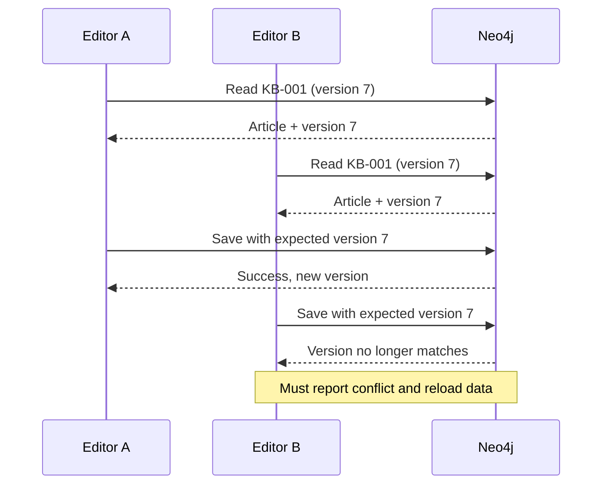
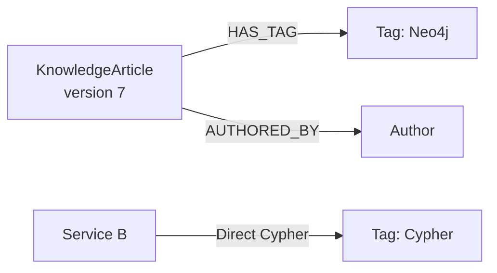

# Optimistic Locking and Handling Concurrent Updates in Usage

In a **Spring Data Neo4j (SDN)** application, multiple users or workers can read and modify the same node in the **property graph**. Without concurrency controls, a later request can silently **overwrite an earlier request's changes**. **Optimistic locking** uses a version property—typically declared with `@Version`—to detect when a record has changed since the application read it.

This lesson belongs to the **Spring Data Neo4j** chapter of the `DATABASE_ENGINE_GRAPH_NEO4J` module, focusing on optimistic locking with node entities, Spring Data repositories, transactions, update APIs, and contention handling across concurrent writes. It also explains the limits of `@Version` when **relationships** are involved, when using **Cypher/Java Driver** directly, and when retries are appropriate. Examples target modern Spring Data Neo4j (Spring Boot 3 / corresponding Spring Data Neo4j); verify exact library versions before applying.

> **Core principle:** `@Version` helps **detect** that a record was updated between read and save; it **does not automatically merge** conflicting edits, nor does it protect every write path if another path bypasses the version check.

## 1. Why Do We Need Optimistic Locking?

Suppose a learning platform stores a node:

```cypher
(:KnowledgeArticle {
  articleId: 'KB-001',
  title: 'Optimizing Cypher',
  body: 'Current content...',
  version: 7
})
```

Two editors open the edit page at the same time:

| Time | Editor A | Editor B | State in Neo4j |
| --- | --- | --- | --- |
| T1 | Reads article at version `7` | | `title = Optimizing Cypher`, `version = 7` |
| T2 | | Reads same article at version `7` | Unchanged |
| T3 | Edits title, saves successfully | | `version` advances to a new version |
| T4 | | Submits content based on version `7` | Record has already changed |
| T5 | | Unchecked overwrite would erase A's edit | Risk of *lost update* |

A **lost update** occurs when two actors start from the same old state and one actor's write overwrites the other's changes. In a property graph, this affects not only `title` or `body`, but also updates to relationships like `:HAS_TAG`, `:ASSIGNED_TO`, or `:PLACED`.

### 1.1. Sequence of Events



**Optimistic locking** lets processes read without holding exclusive locks while users edit. On save, the system checks the observed version. If the current version differs from the expected version, the update is rejected so the user or application logic can resolve the conflict.

### 1.2. Comparison with Pessimistic Locking

| Characteristic | Optimistic locking | Pessimistic locking |
| --- | --- | --- |
| Core idea | Holds no exclusive lock across read/think time; checks version on write | Locks resources during the operation to block concurrent writes |
| Best suited for | Read-heavy workloads with low contention | Operations requiring strict serialization |
| Under contention | Detects conflict; notify, reload, or retry | May wait on locks, time out, or deadlock |
| Overhead | Managing and comparing versions | Acquiring/holding locks within transactions |
| Long form editing UX | Well suited because no lock is held while typing | Should never hold lock transactions open while users think |

**Neo4j still uses internal database write locks.** `@Version` in Spring Data Neo4j is an **application-model version check**; it does not mean the database stops using physical locks or transactions.

## 2. Meaning of `@Version` in Spring Data Neo4j

In Spring Data, `@Version` marks a property used for **optimistic concurrency control**. When an entity is saved through Spring Data Neo4j's managed persistence, the framework checks the version value to detect whether persisted state still matches what was read, and manages/updates the version on a successful save.

Example entity:

```java
import org.springframework.data.annotation.Id;
import org.springframework.data.annotation.Version;
import org.springframework.data.neo4j.core.schema.Node;

@Node("KnowledgeArticle")
public class KnowledgeArticle {

    @Id
    private String articleId;

    private String title;
    private String body;

    @Version
    private Long version;

    protected KnowledgeArticle() {
        // For data mapping.
    }

    public KnowledgeArticle(String articleId, String title, String body) {
        this.articleId = articleId;
        this.title = title;
        this.body = body;
    }

    public String getArticleId() {
        return articleId;
    }

    public String getTitle() {
        return title;
    }

    public String getBody() {
        return body;
    }

    public Long getVersion() {
        return version;
    }

    public void setTitle(String title) {
        this.title = title;
    }

    public void setBody(String body) {
        this.body = body;
    }
}
```

In this template:

- `@Node("KnowledgeArticle")` maps the class to nodes labeled `KnowledgeArticle`.
- `@Id` designates the **business identifier** `articleId`; never use `elementId()` as a long-term application key.
- `@Version` marks `version` so Spring Data Neo4j checks concurrent updates.
- `Long` is a boxed type that can remain `null` when creating a **new entity**; after saving, the framework manages the version value.
- The application **must not manually increment or assign `version`** before calling `repository.save(...)`. The version must reflect what the entity actually read.

Using `Long` clearly distinguishes a new entity without a version from an already persisted entity; detecting "new entity" status with application-assigned `@Id` keys requires care. Using primitive `long` can alter newness detection semantics. For this example, **leaving `version = null` on new objects** is clean and explicit.

### 2.1. Version Is Not a Timestamp

| Field | Purpose |
| --- | --- |
| `version` | Detects concurrent updates of an entity via version management |
| `updatedAt` | Records business or modification timestamp |
| `createdAt` | Records creation timestamp |
| `sourceVersion` | Version from an upstream/CDC system with its own semantics |

Do not arbitrarily use `updatedAt` written by different machines as a conflict version: timestamp resolution, clock skew, and backfills can mislead comparisons. `@Version` belongs specifically to Spring Data Neo4j's entity persistence lifecycle; it does not replace CDC or upstream synchronization versions.

### 2.2. Business Keys Still Need Constraints

`@Id` declares identity in the Java model. For the database to enforce uniqueness at storage level, define the corresponding Cypher constraint:

```cypher
CREATE CONSTRAINT knowledge_article_id_unique IF NOT EXISTS
FOR (a:KnowledgeArticle)
REQUIRE a.articleId IS UNIQUE;
```

**Unique constraints** prevent multiple nodes from sharing the same `articleId`; **optimistic locking** prevents overwriting a modified entity. Both mechanisms solve **different problems**. Before creating constraints on an existing database, verify there are no duplicate keys and confirm schema privileges.

## 3. Setting Up the Repository and Service

With Spring Boot dependency management, add the starter:

```xml
<dependency>
    <groupId>org.springframework.boot</groupId>
    <artifactId>spring-boot-starter-data-neo4j</artifactId>
</dependency>
```

Manage the Spring Boot version through an appropriate parent POM or BOM. Basic application configuration can pull values from environment variables:

```yaml
spring:
  neo4j:
    uri: ${NEO4J_URI}
    authentication:
      username: ${NEO4J_USER}
      password: ${NEO4J_PASSWORD}
```

This is Spring Boot application configuration, not Neo4j server configuration. Target database and pool settings should match your Spring Boot/Spring Data release. In production, never commit real passwords to source control.

Create the repository:

```java
import org.springframework.data.neo4j.repository.Neo4jRepository;

public interface KnowledgeArticleRepository
        extends Neo4jRepository<KnowledgeArticle, String> {
}
```

`findById` and `save` are implemented by Spring Data Neo4j. To keep this walkthrough clear, we start with an entity containing only scalar properties; when relationships to other entities are mapped, saving aggregates introduces additional rules (see Section 9).

### 3.1. Creating a New Article

```java
KnowledgeArticle article = new KnowledgeArticle(
    "KB-001", "Optimizing Cypher", "Initial content..."
);
KnowledgeArticle stored = repository.save(article);
System.out.println(stored.getVersion());
```

This is a **one-time seed step** in test/staging. Do not re-run creation code on an existing `articleId` and treat it as a valid update; the application must clearly separate **create** and **update**.

The exact initial value of `version` is managed by the framework's versioning rules; **never hardcode assumptions** in business logic that it always starts at one fixed number.

## 4. How Optimistic Locking Works on `save`

Suppose at some point an entity is read from Neo4j with `version = 7`. When a process saves that entity:

1. Spring Data Neo4j locates the node by its mapped identifier.
2. Optimistic locking compares the object's **expected version** against stored state.
3. If they match, the update is written and the version is updated per framework rules.
4. If they no longer match, the save is rejected with an optimistic locking error instead of silently overwriting.

In Spring applications, this failure is typically thrown as `org.springframework.dao.OptimisticLockingFailureException` or a suitable subclass. When the transaction fails, all operations inside that transaction must **roll back** per transaction management policy.

> Do not assume the exact Cypher emitted by SDN stays identical across every release. `@Version` is a **mapping/concurrency contract**; use `EXPLAIN`/`PROFILE` in test environments when you need to inspect generated queries, rather than coupling business logic to undocumented internal Cypher strings.

### 4.1. Simulating Two Stale Copies

Assume `KB-001` already exists. We intentionally load two objects from **the same initial state**:

```java
KnowledgeArticle copyA = repository.findById("KB-001")
    .orElseThrow();

KnowledgeArticle copyB = repository.findById("KB-001")
    .orElseThrow();

// A saves successfully first.
copyA.setTitle("Optimizing Cypher with Indexes");
repository.save(copyA);

// B still holds the version read before A's change.
copyB.setTitle("How to Read Cypher Execution Plans");
repository.save(copyB);  // Expected to be rejected due to stale version.
```

Here, **the final `save(copyB)` must be handled as a conflict**—never return HTTP 200 and silently overwrite A's edit. This is a sequential simulation of stale copies; a true concurrency test runs two separate transactions synchronized with a barrier to create the same race.

### 4.2. Errors May Surface During Save or Commit

Depending on transaction configuration, the failure can be raised during `save` or when completing/committing the transaction. Therefore:

- Place the transaction boundary at the **service layer**.
- Let the exception escape the transaction so Spring rolls back cleanly.
- Handle conflict responses in the **API layer outside** the transaction.
- Never catch the exception and keep using the stale entity inside the same transaction.

## 5. Designing a Safe Update API

For frontend applications, enabling `@Version` on the server alone **is not enough** to protect long-form edits if the server reloads the latest database state before saving without knowing which version the client originally saw.

For example:

1. The frontend opens the article at version `7`.
2. Someone else edits the article, advancing the server to a new version.
3. The older frontend submits a new title.
4. The backend loads the latest node, applies the requested title, and calls save.

If the backend does not check the version the frontend observed, it can **validate and overwrite using stale client input** simply because the newly loaded backend entity carries the latest version.

### 5.1. Requiring `expectedVersion` in Update Requests

Example payload:

```json
{
  "title": "Optimizing Cypher with Indexes",
  "body": "Updated content...",
  "expectedVersion": 7
}
```

The service loads the entity, **checks the version the user originally read**, then updates and saves inside one transaction. If another transaction slips in a write after that check, `@Version` still catches the conflict at persistence time.

Simple DTO definitions:

```java
public record EditArticleRequest(
    String title,
    String body,
    Long expectedVersion
) {}

public record ArticleView(
    String articleId,
    String title,
    String body,
    Long version
) {}
```

Service:

```java
import java.util.Objects;

import org.springframework.stereotype.Service;
import org.springframework.transaction.annotation.Transactional;

@Service
public class KnowledgeArticleService {

    private final KnowledgeArticleRepository repository;

    public KnowledgeArticleService(
            KnowledgeArticleRepository repository) {
        this.repository = repository;
    }

    @Transactional
    public ArticleView edit(String articleId,
                            EditArticleRequest request) {

        if (request.expectedVersion() == null) {
            throw new IllegalArgumentException(
                "expectedVersion is required");
        }

        KnowledgeArticle article = repository.findById(articleId)
            .orElseThrow(() ->
                new ArticleNotFoundException(articleId));

        // Detect a client form based on stale data.
        if (!Objects.equals(
                article.getVersion(), request.expectedVersion())) {
            throw new ArticleVersionConflictException(articleId);
        }

        article.setTitle(request.title());
        article.setBody(request.body());

        // @Version protects if another transaction writes in between.
        KnowledgeArticle saved = repository.save(article);

        return new ArticleView(
            saved.getArticleId(),
            saved.getTitle(),
            saved.getBody(),
            saved.getVersion()
        );
    }
}
```

`ArticleNotFoundException` and `ArticleVersionConflictException` are project-defined domain exceptions, e.g., extending `RuntimeException`. They are distinct from the framework's `OptimisticLockingFailureException`.

**Key point:** The entire sequence **read → check `expectedVersion` → mutate → `save`** executes inside **one transaction**. Checking `clientVersion` catches stale forms; `@Version` protects the remaining race window between backend read and write. Never annotate this update path with `@Transactional(readOnly = true)`.

### 5.2. Returning Proper HTTP Responses to Clients

For REST APIs passing `expectedVersion` in the request body:

| Scenario | Typical HTTP status | Behavior |
| --- | --- | --- |
| Article does not exist | `404 Not Found` | Do not implicitly create a new node |
| `expectedVersion` missing/invalid type | `400 Bad Request` | Require client to send a valid value |
| `expectedVersion` is stale | `409 Conflict` | Return error; client reloads and resolves |
| `@Version` detects concurrent update | `409 Conflict` | Never return a false success |
| Valid update | `200 OK` or `204 No Content` | If returning a body, include the new version |

If the API uses standard HTTP `ETag` and `If-Match` **conditional requests**, a failed precondition is typically expressed with **`412 Precondition Failed`**; do not arbitrarily mix `409` for `expectedVersion` payloads with `412` for HTTP precondition headers.

One way to map exceptions in Spring MVC:

```java
import org.springframework.dao.OptimisticLockingFailureException;
import org.springframework.http.HttpStatus;
import org.springframework.http.ResponseEntity;
import org.springframework.web.bind.annotation.ExceptionHandler;
import org.springframework.web.bind.annotation.RestControllerAdvice;

@RestControllerAdvice
public class ArticleConflictAdvice {

    @ExceptionHandler({
        ArticleVersionConflictException.class,
        OptimisticLockingFailureException.class
    })
    public ResponseEntity<String> onConflict(RuntimeException ex) {
        return ResponseEntity.status(HttpStatus.CONFLICT)
            .body("Article was modified; reload before saving.");
    }
}
```

Domain exceptions can be defined as:

```java
public class ArticleVersionConflictException extends RuntimeException {
    public ArticleVersionConflictException(String id) {
        super("Stale article version: " + id);
    }
}

public class ArticleNotFoundException extends RuntimeException {
    public ArticleNotFoundException(String id) {
        super("Article not found: " + id);
    }
}
```

Production code should also map `404` for `ArticleNotFoundException`, validate input fields, return structured error DTOs with stable error codes, and log safely without exposing sensitive data. Never leak full Neo4j stack traces to clients.

### 5.3. User Experience on Conflict

When receiving `409`, the frontend can:

1. Preserve the user's unsaved draft.
2. Fetch the latest version from the server along with the new `version`.
3. Show a diff between the user's draft and the persisted version.
4. Let the user **merge manually**, discard the draft, or reapply relevant changes.
5. Submit a new request carrying the updated `expectedVersion`.

**Never automatically overwrite the current server version** just because a conflict occurred. In document-editing UIs, blind retries turn optimistic locking back into a lost update in another guise.

## 6. Transactions and Conflict-Handling Boundaries

Spring Data Neo4j operates within Spring-managed transactions. For the service in Section 5:

```text
Begin transaction
  -> findById
  -> compare client expectedVersion
  -> modify entity
  -> repository.save
  -> commit
If any step fails
  -> rollback
```

Transaction atomicity prevents "half-written" states when a step within the same transaction fails. However, it **never means** a transaction stays open across the minutes a user spends editing a form: the backend keeps the transaction bounded to **one brief update request**.

### 6.1. Why Not Catch and Retry Inside the Same Transaction?

Avoid this pattern:

```java
// Illustrates an anti-pattern only; do not use in production.
@Transactional
public void unsafeRetry(String id) {
    try {
        repository.save(repository.findById(id).orElseThrow());
    } catch (OptimisticLockingFailureException ex) {
        // Do not assume the same transaction can be reused after failure.
        repository.save(repository.findById(id).orElseThrow());
    }
}
```

Once optimistic locking fails, the transaction may already be marked **rollback-only**, or persistence/driver state may no longer be valid for reuse. Retries must execute the **entire operation in a fresh transaction**, reload the latest data, re-evaluate business invariants, and recompute the update.

### 6.2. When Should You Retry vs. Return a Conflict?

| Use case | Auto-retry? | Reason |
| --- | --- | --- |
| User editing title or body from an old draft | Usually **no** | User must decide how to merge changes |
| Idempotent background state-transition job | Yes, bounded attempts | Can reload current version and reapply as designed |
| Decrementing inventory quantity | Yes, if re-checking stock each attempt | Must preserve non-negative stock invariant and deduplicate requests |
| Money transfer or non-idempotent external action | Never retry blindly | Risk of double execution outside Neo4j transaction |
| Sync event with `eventId` | Yes, with deduplication/idempotency | Replays must not duplicate records or edges |

Conditions for safe retries: the operation has **clear semantics against the latest state**, has **bounded attempts**, and controls all **external side effects outside Neo4j**.

## 7. Example: Bounded Retries with Fresh Transactions

When reserving inventory, we must re-check remaining stock before every update. Entity:

```java
import org.springframework.data.annotation.Id;
import org.springframework.data.annotation.Version;
import org.springframework.data.neo4j.core.schema.Node;

@Node("InventoryItem")
public class InventoryItem {
    @Id
    private String sku;

    @Version
    private Long version;

    private long available;

    protected InventoryItem() {}

    public InventoryItem(String sku, long available) {
        this.sku = sku;
        this.available = available;
    }

    public long getAvailable() {
        return available;
    }

    public void decreaseOne() {
        if (available <= 0) {
            throw new IllegalStateException("Out of stock");
        }
        available--;
    }
}
```

Repository:

```java
import org.springframework.data.neo4j.repository.Neo4jRepository;

public interface InventoryRepository
        extends Neo4jRepository<InventoryItem, String> {
}
```

Use `TransactionTemplate` so **each attempt runs in its own transaction**, catching conflicts **outside** the transaction boundary:

```java
import org.springframework.dao.OptimisticLockingFailureException;
import org.springframework.stereotype.Service;
import org.springframework.transaction.support.TransactionTemplate;

@Service
public class InventoryReservationService {

    private final InventoryRepository repository;
    private final TransactionTemplate transactionTemplate;

    public InventoryReservationService(
            InventoryRepository repository,
            TransactionTemplate transactionTemplate) {
        this.repository = repository;
        this.transactionTemplate = transactionTemplate;
    }

    public boolean reserveOne(String sku) {
        final int maxAttempts = 3;

        for (int attempt = 1; attempt <= maxAttempts; attempt++) {
            try {
                return Boolean.TRUE.equals(
                    transactionTemplate.execute(status -> {
                        InventoryItem item = repository.findById(sku)
                            .orElseThrow();

                        if (item.getAvailable() <= 0) {
                            return false;
                        }

                        item.decreaseOne();
                        repository.save(item);
                        return true;
                    })
                );
            } catch (OptimisticLockingFailureException ex) {
                if (attempt == maxAttempts) {
                    throw ex;
                }
                // Next attempt reloads the entity in a new transaction.
                // Production code should add bounded backoff/jitter.
            }
        }

        throw new IllegalStateException("Unreachable");
    }
}
```

**Conditions for this example:**

- `TransactionTemplate` must be wired to the application's Neo4j transaction manager. Called outside an existing transaction, each `execute` starts a new transaction; if invoked from within an outer transaction, check **propagation** so it does not inadvertently join the outer transaction.
- Catching conflicts outside `transactionTemplate.execute(...)` ensures each retry reads the latest committed version after the prior transaction rolled back.
- Non-negative `available` is the **invariant** re-verified on every retry.
- This example addresses **contention between competing updates**, not duplicate delivery of the same **business request**. If a client retries a reservation after the server committed but the response was lost, use a dedicated `reservationId`/idempotency key so stock is never deducted twice.

Under heavy contention, even three retries can still fail. Never increase retries infinitely: add backoff/jitter, monitor conflict rates, and consider alternative update models if many workers contend on one hot node.

## 8. Distinguishing Conflict Types: Version Conflicts vs. Transaction Failures

Not every concurrent write error is an optimistic locking conflict.

| Error or symptom | Likely meaning | How to handle |
| --- | --- | --- |
| `OptimisticLockingFailureException` | Entity saved against a stale version | Return `409` or conditionally retry |
| Transient transaction error / deadlock | Multiple transactions contended on locks or transient infrastructure issue | Apply proper retry policy; never reuse the failed transaction |
| Unique constraint violation | Concurrent creates used the same key, or data violated constraint | Check creation/matching logic and idempotency |
| `NotFound` / deleted entity | Target no longer exists in database | Return `404`, conflict, or deletion rule per API contract |
| Validation error | Invalid input payload | Return `400`; do not auto-retry |
| Timeout | Slow transaction, lock wait, network issue, or overload | Investigate root cause; never assume write rolled back |

**Important:** a timeout or network error **does not prove** the transaction rolled back. The server may have committed while the client missed the response. For side-effecting operations, design request-level **idempotency** and reconciliation rather than relying solely on `@Version`.

## 9. Limitations of `@Version` in Property Graphs

A Spring Data Neo4j entity often connects to many nodes and relationships. Optimistic locking on **one root node** does not automatically lock the entire surrounding graph across every write path.

### 9.1. Relationship Changes from Another Write Path

Suppose:



If Service A saves root `KnowledgeArticle` via a `@Version` repository while Service B adds a `HAS_TAG` edge via **direct Cypher**, Service B does not automatically check or increment `KnowledgeArticle.version`. Service A can remain unaware that a relationship changed outside its model.

Therefore:

- Define **aggregate boundaries**: which nodes and relationships belong to a single business consistency unit.
- Route updates to the same aggregate through **a consistent concurrency strategy**.
- When repositories save aggregates containing relationship collections, **never construct an empty or partially loaded entity and call `save`** without understanding SDN's relationship sync rules; you risk deleting or replacing unrepresented links.
- When updating a single edge via dedicated Cypher, explicitly design version checks and transaction boundaries instead of assuming root `@Version` protects it automatically.

### 9.2. Direct Cypher Queries Do Not Automatically Respect `@Version`

Example:

```cypher
MATCH (a:KnowledgeArticle {articleId: $articleId})
SET a.title = $title
RETURN a.articleId AS articleId;
```

If another Java Driver client, an ETL job, or a custom `@Query` runs this statement, it **neither checks nor increments `version`**. It can overwrite content held in memory by an SDN entity while leaving `@Version` unchanged, hiding the out-of-band edit from the next save.

To coordinate multiple writers:

1. **Centralize updates through services/repositories** enforcing the same version rules whenever possible.
2. When direct Cypher is unavoidable, explicitly enforce **`expectedVersion`**, controlled version increments, and mismatch handling.
3. Verify the **atomicity/serialization** of the version check and write under real contention; a casually written `MATCH WHERE version = ... SET ...` is not guaranteed to be a race-free compare-and-swap under every execution plan.
4. Run real multi-transaction concurrency tests rather than only sequential tests.
5. With non-compliant external writers, never claim `@Version` alone protects all data.

### 9.3. `@Version` Does Not Enforce Multi-Node Business Invariants

For example, suppose each order can belong to only one placing customer:

```cypher
(c:Customer)-[:PLACED]->(o:Order)
```

Having `@Version` on `Customer` and `Order` **does not prevent** two different customers from both creating `PLACED` edges to the same order if services update relationships independently. Enforce domain invariants via update design, checks on existing edges, transactions, and appropriate locking/concurrency controls.

Optimistic locking is **one building block**, not a replacement for constraints, transactions, identity keys, or graph-wide validation.

## 10. Using `@Version` Across CRUD Operations

### 10.1. Create

A new `KnowledgeArticle` has an application-assigned `articleId` and an unset `version`; `repository.save` persists the entity. Protect the business key with a unique constraint in Neo4j to prevent two processes from creating duplicate IDs.

If two requests simultaneously create `KB-001`, the outcome may be a constraint violation or an entity-state detection error depending on timing. **Optimistic locking does not replace unique constraints for creates.**

### 10.2. Read

`repository.findById(id)` loads the entity along with its current version. The API returns `version` so clients can send it back on updates. Avoid caching mutable entities for long periods without accounting for staleness.

### 10.3. Update

Read existing entity → verify client `expectedVersion` → apply permitted property/relationship changes → `save` → return new version. If `save` fails due to a stale version, the transaction must roll back and the client needs a clear conflict resolution flow.

### 10.4. Delete

Deletion is also a concurrent operation: one user may be editing while another deletes. Define the API contract:

- If deletion is conditioned on the client's version, verify that version inside the transaction.
- Never assume every `deleteById` or Cypher `DETACH DELETE` automatically checks optimistic locks identically to `save`.
- When history matters, prefer **soft delete** using a status property on a versioned entity instead of physical deletion.
- Deleting a node with `DETACH DELETE` removes attached relationships as well; understand data ownership and retention obligations.

## 11. Testing Optimistic Locking

Tests must prove **correct final state**, not merely that an exception was thrown.

### 11.1. Basic Test: Stale Entity

After creating `KB-001`, read twice to obtain two separate instances:

```java
KnowledgeArticle first = repository.findById("KB-001")
    .orElseThrow();
KnowledgeArticle stale = repository.findById("KB-001")
    .orElseThrow();

first.setTitle("Version A");
repository.save(first);

stale.setTitle("Version B");

// Expect OptimisticLockingFailureException or an appropriate subclass.
repository.save(stale);
```

Run the two reads and two saves in **independent transactions** or managed repository calls so a shared persistence context does not mask the stale state. Also assert:

- Final `title` is `Version A`.
- `version` incremented after saving A.
- Saving B did not unexpectedly succeed.

### 11.2. Real Two-Worker Concurrency Test

To verify behavior under true concurrency:

1. Two independent threads/transactions read `KB-001` at the same version.
2. Synchronize with a barrier after the read step so both attempt writes from the same snapshot.
3. Have both transactions save different values.
4. Assert only one update succeeds (or one receives a conflict and handles it properly).
5. Verify the final state and version number after all transactions finish.

Never hold transactions open artificially in production to reproduce races. Use a **test database** and tightly manage test resources.

### 11.3. End-to-End API Test Matrix

| Scenario | Outcome to verify |
| --- | --- |
| Client sends current version, no intervening edits | Succeeds and returns new version |
| Client sends stale version | `409 Conflict`, persisted content untouched |
| Two concurrent update requests with same version | No silent overwrite; one conflicts or is handled deterministically |
| Client omits `expectedVersion` | `400` per API contract |
| Entity already deleted | `404` or domain conflict, never silently recreated |
| Direct Cypher writer modifies entity | Test catches any bypassing write path |
| Inventory retry when out of stock | `available` never goes negative |
| Replayed reservation request | Stock is not deducted twice when idempotency key is present |

### 11.4. Avoid Sleep-Based Concurrency Tests

`Thread.sleep` introduces flaky races: tests can pass accidentally due to scheduler timing rather than working version checks. For concurrency tests, coordinate read/save timing with barriers/latches, isolate transactions, and clean up test data afterward.

## 12. Performance Tuning and Monitoring Conflicts

Optimistic locking prevents lost updates, but in workloads where many writers hammer **one hot node**, conflict rates can climb high.

Useful metrics:

| Metric | What to watch |
| --- | --- |
| Optimistic conflicts / sec | How many saves are rejected due to stale versions? |
| Conflict rate of total updates | Is the workload experiencing excessive contention? |
| Retries per operation | Do requests need multiple reloads before succeeding? |
| Retries exhausted | How many requests still fail after max attempts? |
| Transaction latency p50/p95/p99 | Does read–write–commit latency rise under load? |
| DB Hits, index usage | Are key lookups scanning too many nodes? |
| Lock waits / deadlocks | Is there Neo4j resource contention beyond optimistic conflicts? |
| User-facing `409` responses | Are users frequently forced to reload and merge? |

Practical mitigations:

- **Keep transactions short**; avoid slow network calls inside transactions whenever possible.
- **Split aggregates along business boundaries** when a single node becomes too hot and operations are truly independent—without breaking invariants.
- **Index/constrain business keys** for fast, predictable node lookups.
- **Never retry every conflict blindly**; distinguish human edits from automatically recomputable updates.
- **Bound retries and add backoff/jitter** to prevent synchronized retry storms across workers.
- **Measure before and after** with logs, metrics, and transaction tracing rather than assuming `@Version` is always free or always costly.

### 12.1. Execution Plans Do Not Replace Concurrency Testing

`EXPLAIN` and `PROFILE` reveal Cypher plans, `Rows`, and `DB Hits`, but **a single `PROFILE` run cannot prove an update flow is race-safe**. Run multi-transaction concurrency tests and inspect commit/rollback outcomes.

**Safety note:** `PROFILE` executes write queries for real, so never run it to "preview" a `SET`/`MERGE` statement in production without controlled change management. Use `EXPLAIN` when you only need the plan.

## 13. Common Misconceptions

| Claim | Reality |
| --- | --- |
| "With `@Transactional`, lost updates cannot happen." | Transactions provide atomicity, not automatic protection for stale forms or stale reads across requests. |
| "`@Version` makes every concurrent update succeed." | No; it **detects conflicts and rejects** stale writes. |
| "A conflict means the database failed." | Not necessarily; it often means data-protection rules worked as designed. |
| "Retrying means reloading and writing back the old payload unchanged." | That can wipe out newer changes; retry only with safe recomputation or merge rules. |
| "With `@Version`, unique constraints are unnecessary." | False; duplicate ID creation and stale updates are separate problems. |
| "Direct Cypher updates still auto-increment `@Version`." | False; Java annotations do not execute inside Cypher that bypasses mapping. |
| "Version on the root automatically protects all relationships." | Not guaranteed if another writer modifies edges outside the shared check. |
| "Every optimistic locking exception should return HTTP 500." | Usually a domain conflict mapped to `409` or `412` per API contract. |
| "A failed transaction can simply retry inside the same transaction." | Avoid; retries require a fresh transaction boundary and reloading state. |
| "Retrying means side effects outside Neo4j run exactly once." | No; idempotency keys/outbox or proper orchestration are required. |

## 14. Practice Exercises

### Exercise 1 — Identifying Lost Updates

Article `KB-001` is at `version = 7`. Both A and B read it. A saves first, then B attempts to save from the old draft. Without version checking, whose changes can be lost? With `@Version`, what outcome should B receive and how should the frontend respond?

*Reference check:* A's edit can be overwritten by B if unchecked. With optimistic locking, B is rejected and must reload/merge; never return a false success.

### Exercise 2 — Writing a Versioned Entity

Declare `@Node("KnowledgeArticle")` with `articleId`, `title`, `body`, and `@Version Long version`. Explain why you should not initialize `version = 0` in the creation constructor and why you should not manually increment `version` before each `repository.save(...)`.

### Exercise 3 — Building an Edit Content API

Design a DTO containing `expectedVersion`, a `@Transactional` service, and checks for:

- Article does not exist → `404`.
- `expectedVersion` missing → `400`.
- `expectedVersion` mismatch → `409`.
- Valid update → save via repository and return the new version.

Explain why **both the client `expectedVersion` check and `@Version`** on save are needed.

### Exercise 4 — Conditional Retry

Two workers both try to reserve stock for a SKU with `available = 1`. Each reads the balance and attempts to decrement by one. Design a retry loop using **fresh transactions**, reloading the balance each attempt and ensuring the final count never goes negative. If the client resends the exact same request after the server already committed, what extra field prevents deducting stock twice?

### Exercise 5 — Bypassing via Cypher

A batch job runs:

```cypher
MATCH (a:KnowledgeArticle {articleId: $id})
SET a.title = $title;
```

Meanwhile, the web service uses Spring Data `@Version`. Point out why the batch job bypasses optimistic locking and propose an architectural rule so all writers follow the same versioning policy.

### Exercise 6 — Graph Relationship Conflict

A adds `(:KnowledgeArticle)-[:HAS_TAG]->(:Tag)` through a repository, while B modifies that relationship via a separate `@Query` Cypher statement. `@Version` exists only on the Article node. Which update scenarios can escape the repository's version check? Describe how to define sensible aggregate and transaction boundaries.

### Exercise 7 — Concurrency Test

Draft a test plan with two independent transactions, a barrier after reading the same version, two different title updates, and an assertion that one conflict is detected. Why are tests relying solely on `Thread.sleep` unreliable?

### Exercise 8 — Distinguishing Error Types

Classify and propose handling for: `OptimisticLockingFailureException`, unique constraint violation, entity not found, network timeout, transaction deadlock, and validation error. Which cases should never be auto-retried?

## Key Takeaways

**Optimistic locking in Spring Data Neo4j** uses `@Version` to detect changes occurring between when an entity is read and when it is saved. For user-facing edit APIs, accept **`expectedVersion`** from the client, validate it in the service, run `repository.save` inside a transaction, and return a **conflict** rather than silently overwriting.

When retrying, **catch exceptions outside the transaction**, start a fresh transaction, reload state, and re-check business invariants; never retry infinitely and never ignore idempotency. When a model spans multiple nodes/relationships or multiple write paths via Java Driver/direct Cypher, enforce a **consistent update contract across the entire aggregate**: `@Version` on one entity cannot automatically guard mutations made outside the persistence path it manages.
