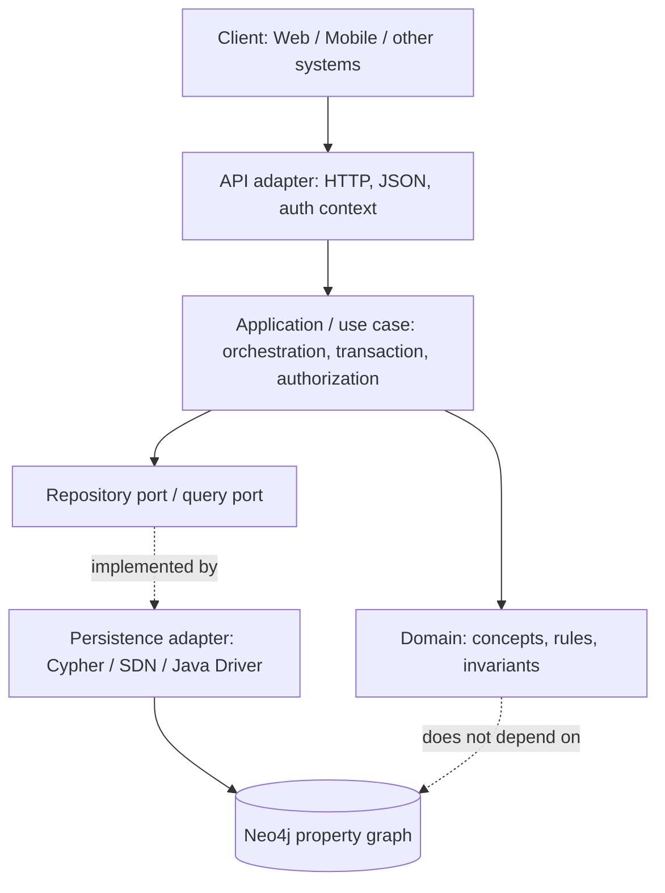
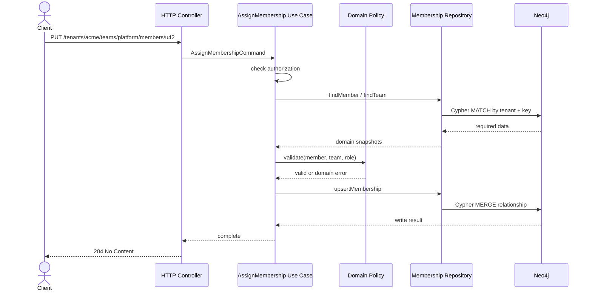

# Separating Responsibilities Between the Domain Model, Data Access Layer, and API in a Neo4j Application

## 1. Why Does a Graph Application Need Clear Architectural Boundaries?

In Neo4j, a **property graph** represents entities as *nodes*, relationships as *relationships*, and their information as *properties*. Cypher enables querying relationships and paths, while the **Neo4j Java Driver** or **Spring Data Neo4j** allows Java applications to interact with the database. These capabilities are powerful, yet they also make it easy for developers to cram all logic into a single layer: an HTTP controller directly executes Cypher, decides business rules on its own, and returns nodes and relationships to the outside.

That approach typically creates three problems:

1. **Business logic gets locked into infrastructure**: renaming a Neo4j label, changing how a relationship is stored, or switching the Driver can force changes to business logic.
2. **Hard to protect invariants**: rules about which teams a person may join, which roles are valid, or which data is allowed to be viewed end up scattered across controllers and queries.
3. **The API inadvertently exposes the graph structure**: responses depend on labels, properties, internal IDs, or hop counts, making versioning difficult and risking the exposure of data that should not be returned.

This lesson belongs to the **Application Design** chapter of the `DATABASE_ENGINE_GRAPH_NEO4J` module, focusing on **separating responsibilities between the domain model, application layer, data access layer, and API**. The content applies when building services that use Neo4j to model connected data, execute Cypher queries, enforce constraints/indexes, handle transactions, and tune path traversals.

### After This Lesson, You Will Be Able To

- Distinguish **domain rules** from **property graph storage** and the **HTTP contract**.
- Design *use cases*, repository ports, and persistence adapters with clear boundaries.
- Structure transactions, authorization checks, and error handling for a relationship update command.
- Design read query DTOs without returning Driver objects or internal entities directly.
- Choose between the **Java Driver**, **Spring Data Neo4j**, and custom Cypher while keeping the architecture stable.
- Avoid N+1 queries, uncontrolled fan-out, identity confusion, and concurrency bugs.

## 2. The Four Core Responsibilities of an Application



| Part | Answers the Question | Should Contain | Should Not Contain |
| --- | --- | --- | --- |
| **Domain model** | "What does the business allow?" | Entities, value objects, behavior, invariants, domain errors | HTTP statuses, Cypher, Driver `Record` |
| **Application service / use case** | "In what sequence is a business request executed?" | Policy orchestration, authorization, transaction boundaries, calling ports | JSON serialization, specific labels/types/indexes unless necessary |
| **Persistence adapter** | "How do we read/write the required data from Neo4j?" | Cypher, mapping, labels, relationship direction, index-aware queries, DB technical handling | Deciding user permissions solely from the controller; business rules hidden completely inside queries |
| **API adapter** | "How does the client communicate with the system?" | HTTP routes, request validation, identity authentication, DTOs, HTTP status codes, error responses | Opening a Session and executing business rules directly |

This is an organization close to **hexagonal architecture / ports and adapters** or **clean architecture**. It is not strictly necessary to split into four independent Maven modules; what matters is **dependency direction and decision ownership**.

### Key Dependency Rules

- Domain **knows nothing about** controllers, Spring MVC, Spring Data Neo4j, or the Neo4j Driver.
- The API knows the use case contract, but does not directly infer logic from nodes/relationships.
- Application knows the read/write interfaces (*ports*), without needing to know the adapter's Cypher code.
- Adapters implement ports using specific technologies; changing data access mechanisms does not require rewriting domain policies.

**Not every piece of logic belongs in the domain.** Pagination, field selection for display, orchestration, retries, and handling multi-page results can be responsibilities of the application or adapter. The domain should only hold business knowledge that must remain stable when changing the interface or infrastructure.

## 3. Running Example: Members Belonging to Project Teams

Suppose an internal platform manages members and teams, separated by organization (*tenant*):

```text
(:AppMember {
  tenantId,
  memberId,
  displayName,
  active
})
   -[:MEMBER_OF {
       membershipKey,
       role
     }]->
(:AppTeam {
  tenantId,
  teamId,
  title,
  active
})
```

Business rules for this example:

1. A member may only be assigned to a team in the **same tenant**.
2. Only an **active member** may be added to an **active team**.
3. Valid current roles are only `MEMBER` or `LEAD`.
4. For each `(tenantId, memberId, teamId)` tuple, there is at most one current membership.
5. Resending the same role-assignment request must have an **idempotent** result: do not duplicate the relationship.
6. The caller must be **authorized** to modify members of the corresponding tenant and team.

These are rules imposed by the business, **not inherent properties of Neo4j**. Another graph might require historical multiple team memberships; in that case, the key and relationship model must change.

### 3.1. Business Identity Differs from Internal Identity

The application identifies a member by `tenantId` and `memberId`, and a team by `tenantId` and `teamId`. Do not use internal node IDs in the API as durable keys across environments or after re-importing data.

For example:

- API: `/v1/tenants/acme/teams/platform/members/u42`.
- Domain: `MemberId("u42")`, `TeamId("platform")`, and `TenantId("acme")`.
- Graph: node `(:AppMember {tenantId: 'acme', memberId: 'u42'})`.

Avoid mistakenly assuming a `memberId` is always **globally unique** if in reality it is only unique **within each tenant**.

### 3.2. Responsibility Diagram for a Request



A **transaction** must encompass the steps that require consistency. However, because Neo4j defaults to *read committed* isolation, merely placing multiple queries in the same transaction **does not automatically guarantee that all multi-node rules are serialized**; section 10 explains this further.

## 4. Domain Model: Behavior and Invariants, Not a Mirror of the Graph

### 4.1. Value Objects and Valid Cases

A value object is used to protect identifier semantics:

```java
package example.membership.domain;

public record TenantId(String value) {
    public TenantId {
        if (value == null || !value.matches("[a-z0-9-]{1,48}")) {
            throw new IllegalArgumentException("Invalid tenantId");
        }
    }
}

public record MemberId(String value) {
    public MemberId {
        if (value == null || !value.matches("[a-zA-Z0-9_-]{1,64}")) {
            throw new IllegalArgumentException("Invalid memberId");
        }
    }
}

public record TeamId(String value) {
    public TeamId {
        if (value == null || !value.matches("[a-zA-Z0-9_-]{1,64}")) {
            throw new IllegalArgumentException("Invalid teamId");
        }
    }
}

public enum MembershipRole {
    MEMBER, LEAD
}
```

*These types are split into separate Java files matching their public type names in real usage.* Restricting characters in the example helps clarify the ID contract and avoid ambiguity when concatenating keys; real applications must choose rules based on enterprise data.

Value objects **do not contain** `@Node`, `@Relationship`, `@JsonProperty`, or `org.neo4j.driver.Value`. They protect domain semantics, not storage technology details.

### 4.2. Domain Snapshots and Domain Policy

It is not necessary to load the entire graph into memory just to check two `active` conditions:

```java
package example.membership.domain;

public record MemberSnapshot(
    TenantId tenantId,
    MemberId memberId,
    boolean active
) {}

public record TeamSnapshot(
    TenantId tenantId,
    TeamId teamId,
    boolean active
) {}

public final class MembershipPolicy {
    public void ensureAssignable(
            MemberSnapshot member,
            TeamSnapshot team,
            MembershipRole role) {
        if (!member.tenantId().equals(team.tenantId())) {
            throw new DomainConflict("Cross-tenant membership");
        }
        if (!member.active()) {
            throw new DomainConflict("Member is inactive");
        }
        if (!team.active()) {
            throw new DomainConflict("Team is inactive");
        }
        if (role == null) {
            throw new IllegalArgumentException("Role is required");
        }
    }
}
```

`DomainConflict` is a domain exception defined by the application; it is not a built-in JDK type. The domain policy answers **whether assignment is allowed**, does not open a connection, and does not return HTTP 409.

Note: the two snapshots are simply the data sufficient for the current use case. In more complex problems, the domain may use aggregates, behavioral entities, or domain services. **Not every Neo4j node has to correspond to a Java domain entity**, and not every relationship has to appear as a collection inside an entity.

### 4.3. Who Owns the "Same Tenant" Rule?

Distinguish clearly:

- **Domain** decides "membership must not connect across tenants."
- **Application** ensures the caller has permission on the target tenant before acting.
- **Persistence** constrains both nodes by `tenantId` in Cypher to avoid selecting the wrong node.
- **API** receives the tenant from the route, but does not treat the route itself as proof that the caller is permitted to access that tenant.

An important condition can appear in **multiple layers with different roles**. Re-checking the tenant in the query is not "redundant logic duplication" if it ensures query accuracy and scopes data access; just keep the **business definition consistent**.

## 5. Application Layer: Orchestrating a Use Case

A *command* expresses intent, not a JSON request:

```java
package example.membership.application;

import example.membership.domain.*;

public record AssignMembershipCommand(
    TenantId tenantId,
    TeamId teamId,
    MemberId memberId,
    MembershipRole role,
    String actorId
) {}
```

The port connecting the application with storage capabilities:

```java
package example.membership.application;

import java.util.Optional;
import example.membership.domain.*;

public interface MembershipStore {
    Optional<MemberSnapshot> findMember(
        TenantId tenantId, MemberId memberId);

    Optional<TeamSnapshot> findTeam(
        TenantId tenantId, TeamId teamId);

    void upsertMembership(
        TenantId tenantId,
        MemberId memberId,
        TeamId teamId,
        MembershipRole role);
}
```

The application can also use a `TenantAuthorization` interface to access the current authorization mechanism (tokens, ACLs, policy servers), instead of placing permission decisions in the controller or hardcoding them inside the repository.

### 5.1. Orchestration Service

```java
package example.membership.application;

import org.springframework.stereotype.Service;
import org.springframework.transaction.annotation.Transactional;
import example.membership.domain.*;

@Service
public final class AssignMembershipService {
    private final MembershipStore store;
    private final TenantAuthorization authorization;
    private final MembershipPolicy policy;

    public AssignMembershipService(
            MembershipStore store,
            TenantAuthorization authorization,
            MembershipPolicy policy) {
        this.store = store;
        this.authorization = authorization;
        this.policy = policy;
    }

    @Transactional
    public void assign(AssignMembershipCommand command) {
        authorization.requireManageTeam(
            command.actorId(),
            command.tenantId(),
            command.teamId()
        );

        MemberSnapshot member = store.findMember(
            command.tenantId(), command.memberId()
        ).orElseThrow(() -> new NotFound("Member not found"));

        TeamSnapshot team = store.findTeam(
            command.tenantId(), command.teamId()
        ).orElseThrow(() -> new NotFound("Team not found"));

        policy.ensureAssignable(member, team, command.role());

        store.upsertMembership(
            command.tenantId(), command.memberId(),
            command.teamId(), command.role()
        );
    }
}
```

In this example, `TenantAuthorization`, `NotFound`, and `DomainConflict` are application abstractions/exceptions; they must be defined separately. `MembershipPolicy` needs to be registered as a bean or created via DI configuration. The code snippets are separated by role to demonstrate architecture, not as a single Java file to paste into an IDE and compile immediately.

**Meaning of `@Transactional`:** When the service is called through a Spring proxy and the system has an appropriate Neo4j transaction manager, repository commands participate in the same transaction. Do not rely on the annotation if invoking internal methods via `this.assign(...)`, instantiating the service with `new` outside Spring, or misconfiguring the transaction manager.

### 5.2. Where Is the Transaction Boundary?

For the "assign member to team" request, the business scope is:

```text
begin transaction
  -> load member and team
  -> check rules
  -> MERGE membership
commit or rollback
```

Do not let the controller open a transaction and call arbitrary multiple services. Do not wrap a transaction around work such as sending emails, waiting for file uploads, or awaiting network requests to external systems.

If using only the **Java Driver** without a Spring transaction manager, you can structure the use case through an adapter that provides a **transactional unit of work** and runs via `session.executeWrite(...)`. The key requirement is that **all steps needing a shared transaction must use the same transaction context**, rather than each port call opening an independent session/transaction.

### 5.3. Separate Commands and Queries When Beneficial

A **write** use case decides whether the graph may be modified. A **read** use case may simply return a projection/DTO for the UI. It is not mandatory to build a full domain aggregate for every list page.

For example:

- `AssignMembershipCommand`: uses policy and transaction, updates the relationship.
- `ListTeamMembersQuery`: fetches members in the team with limit and ordering, returning `TeamMemberView`.

This is **lightweight CQRS** thinking: separating read/write responsibilities as needed, **without necessarily** implementing event sourcing or two separate databases.

## 6. Data Access Layer: Turning Ports into Accurate Cypher

### 6.1. Schema and Constraints Matching Domain Keys

Create constraints matching the example on Neo4j 5.x:

```cypher
CREATE CONSTRAINT app_member_unique IF NOT EXISTS
FOR (m:AppMember)
REQUIRE (m.tenantId, m.memberId) IS UNIQUE;

CREATE CONSTRAINT app_team_unique IF NOT EXISTS
FOR (t:AppTeam)
REQUIRE (t.tenantId, t.teamId) IS UNIQUE;

CREATE CONSTRAINT membership_key_unique IF NOT EXISTS
FOR ()-[r:MEMBER_OF]-()
REQUIRE r.membershipKey IS UNIQUE;
```

**Explanation:**

- Unique constraints on nodes protect the tenant + member/team identifier pairs.
- The constraint on `MEMBER_OF.membershipKey` helps prevent creating multiple relationships with the same key when two concurrent writers contend.
- Neo4j stores relationships **with direction**; queries must consistently use `(member)-[:MEMBER_OF]->(team)`.
- Constraints **do not automatically enforce all multi-node invariants**. They do not prove two nodes share the same tenant, do not check `active`, and unique property constraints do not prevent relationships that lack the property.

If the application uses a version/edition that does not support this syntax or constraint type, consult the documentation and design equivalent data protection. Do not simply drop constraints just to make the app run without considering race conditions.

### 6.2. Sample Data to Try

```cypher
MERGE (m:AppMember {tenantId: 'acme', memberId: 'u42'})
SET m.displayName = 'An',
    m.active = true;

MERGE (t:AppTeam {tenantId: 'acme', teamId: 'platform'})
SET t.title = 'Platform',
    t.active = true;
```

Test the upsert operation using parameters:

```cypher
MATCH (m:AppMember {
  tenantId: $tenantId,
  memberId: $memberId
})
MATCH (t:AppTeam {
  tenantId: $tenantId,
  teamId: $teamId
})
MERGE (m)-[r:MEMBER_OF {
  membershipKey: $membershipKey
}]->(t)
SET r.role = $role
RETURN count(r) AS updatedCount;
```

The `$membershipKey` value is generated stably for the same tenant–member–team tuple, such as `"acme|u42|platform"`. In this example, the ID character rule **disallows the `|` delimiter**, preventing key collisions when concatenating. For arbitrary identifiers, length-encoding/escaping or a canonical event key is required.

When another transaction has already created a relationship with the same key but attached to the **wrong endpoints**, the uniqueness constraint may cause `MERGE` to fail. That signals an integrity error and **should not be handled by overwriting or automatically deleting the relationship**.

### 6.3. Repository Ports Do Not Return `Node` or `Record`

The Neo4j adapter can read only the required fields:

```cypher
MATCH (m:AppMember {
  tenantId: $tenantId,
  memberId: $memberId
})
RETURN m.tenantId AS tenantId,
       m.memberId AS memberId,
       m.active AS active;
```

```cypher
MATCH (t:AppTeam {
  tenantId: $tenantId,
  teamId: $teamId
})
RETURN t.tenantId AS tenantId,
       t.teamId AS teamId,
       t.active AS active;
```

The adapter maps these columns into `MemberSnapshot` and `TeamSnapshot`. The application does not need to know whether Cypher uses `MATCH`, a composite index seek, or Java Driver `Record.get("active")` to retrieve the data.

**Do not return `org.neo4j.driver.Record` or `Node` from a port**: those are Driver-dependent objects that can leak graph structure into the domain, cause mapping errors, and make writing tests without a database harder.

### 6.4. Adapter Example Using Spring Data Neo4j `Neo4jClient`

`Neo4jClient` is useful when custom Cypher is needed while still participating in Spring Data Neo4j's transaction mechanism:

```java
package example.membership.persistence;

import java.util.Map;
import java.util.Optional;
import org.springframework.data.neo4j.core.Neo4jClient;
import org.springframework.stereotype.Repository;
import example.membership.application.MembershipStore;
import example.membership.domain.*;

@Repository
public final class CypherMembershipStore implements MembershipStore {
    private final Neo4jClient client;

    public CypherMembershipStore(Neo4jClient client) {
        this.client = client;
    }

    @Override
    public Optional<MemberSnapshot> findMember(
            TenantId tenantId, MemberId memberId) {
        return client.query("""
            MATCH (m:AppMember {
              tenantId: $tenantId, memberId: $memberId
            })
            RETURN m.tenantId AS tenantId,
                   m.memberId AS memberId,
                   m.active AS active
            """)
            .bindAll(Map.of(
                "tenantId", tenantId.value(),
                "memberId", memberId.value()))
            .fetchAs(MemberSnapshot.class)
            .mappedBy((typeSystem, record) ->
                new MemberSnapshot(
                    new TenantId(record.get("tenantId").asString()),
                    new MemberId(record.get("memberId").asString()),
                    record.get("active").asBoolean()))
            .one();
    }

    @Override
    public Optional<TeamSnapshot> findTeam(
            TenantId tenantId, TeamId teamId) {
        return client.query("""
            MATCH (t:AppTeam {
              tenantId: $tenantId, teamId: $teamId
            })
            RETURN t.tenantId AS tenantId,
                   t.teamId AS teamId,
                   t.active AS active
            """)
            .bindAll(Map.of(
                "tenantId", tenantId.value(),
                "teamId", teamId.value()))
            .fetchAs(TeamSnapshot.class)
            .mappedBy((typeSystem, record) ->
                new TeamSnapshot(
                    new TenantId(record.get("tenantId").asString()),
                    new TeamId(record.get("teamId").asString()),
                    record.get("active").asBoolean()))
            .one();
    }

    @Override
    public void upsertMembership(
            TenantId tenantId, MemberId memberId,
            TeamId teamId, MembershipRole role) {
        String key = tenantId.value() + "|"
                   + memberId.value() + "|"
                   + teamId.value();

        long matches = client.query("""
            MATCH (m:AppMember {
              tenantId: $tenantId, memberId: $memberId
            })
            MATCH (t:AppTeam {
              tenantId: $tenantId, teamId: $teamId
            })
            MERGE (m)-[r:MEMBER_OF {membershipKey: $key}]->(t)
            SET r.role = $role
            RETURN count(r) AS affected
            """)
            .bindAll(Map.of(
                "tenantId", tenantId.value(),
                "memberId", memberId.value(),
                "teamId", teamId.value(),
                "key", key,
                "role", role.name()))
            .fetchAs(Long.class)
            .mappedBy((typeSystem, record) ->
                record.get("affected").asLong())
            .one()
            .orElse(0L);

        if (matches != 1L) {
            throw new IllegalStateException(
                "Membership endpoints changed or are missing");
        }
    }
}
```

Here:

- Cypher queries always filter nodes by **tenant + identifier**, preventing cross-organization data mismatches.
- Inputs are passed via `bindAll` as **parameters**; IDs or roles are never concatenated into the Cypher string.
- `MERGE` uses a stable relationship key to support retry/idempotency.
- The adapter checks the affected count so it does not silently report success if endpoints disappeared.
- `@Transactional` on the service ensures `Neo4jClient` operations participate in the Spring-managed transaction, **when** configuration and proxy invocation are correct.

The example assumes `active` is present and is a Boolean. If legacy data may lack the property, explicit mapping/validation rules are needed instead of calling `asBoolean()` on `null`.

**Scope of the adapter:** `IllegalStateException` above only reports an unexpected state in persistence; the application layer can map it to an appropriate conflict/error. The adapter should not return HTTP codes directly or log all sensitive parameters.

### 6.5. When to Use the Java Driver Directly?

If the application does not use Spring Data Neo4j, the adapter can implement `MembershipStore` using `org.neo4j.driver.Driver`. In that case, use managed transactions properly:

```java
try (var session = driver.session(
        org.neo4j.driver.SessionConfig.forDatabase("neo4j"))) {
    var outcome = session.executeWrite(tx -> {
        // Read member, read team, check domain policy, and write relationship
        // within the same tx.run(...), without creating a new Session midway.
        return resultOfUseCase;
    });
}
```

This is a **lifecycle outline**, not a standalone compilable method (variables and policies must be defined). It emphasizes that the callback may be retried when encountering eligible transient errors. Avoid calling a payment gateway or sending emails inside the callback unless an **idempotency** mechanism exists for side effects.

Do not mix Spring Data Neo4j `@Transactional` with ad-hoc separate Session/managed transactions via the Driver inside the same use case while assuming they share one transaction. Choose a consistent transaction mechanism or configure proper integration.

## 7. API Layer: Stable Contract Without Exposing Neo4j Structure

### 7.1. Resource-Oriented Endpoints and Idempotency

For setting the current role of a member in a team:

```http
PUT /v1/tenants/acme/teams/platform/members/u42
Content-Type: application/json

{"role":"LEAD"}
```

A successful response can be **`204 No Content`**. Using `PUT` instead of an arbitrary creation `POST` reflects the intent of **setting the state** of a resource with a stable URI. Sending the same request multiple times should not create duplicate `MEMBER_OF` relationships.

DTO and controller example:

```java
package example.membership.api;

import jakarta.validation.Valid;
import jakarta.validation.constraints.NotNull;
import java.security.Principal;
import org.springframework.http.HttpStatus;
import org.springframework.web.bind.annotation.*;
import example.membership.application.*;
import example.membership.domain.*;

public record AssignMembershipRequest(
    @NotNull MembershipRole role
) {}

@RestController
@RequestMapping("/v1/tenants/{tenantId}/teams/{teamId}/members")
public final class MembershipController {
    private final AssignMembershipService useCase;

    public MembershipController(AssignMembershipService useCase) {
        this.useCase = useCase;
    }

    @PutMapping("/{memberId}")
    @ResponseStatus(HttpStatus.NO_CONTENT)
    public void assign(
            @PathVariable String tenantId,
            @PathVariable String teamId,
            @PathVariable String memberId,
            @Valid @RequestBody AssignMembershipRequest body,
            Principal principal) {

        useCase.assign(new AssignMembershipCommand(
            new TenantId(tenantId),
            new TeamId(teamId),
            new MemberId(memberId),
            body.role(),
            principal.getName()
        ));
    }
}
```

*The two public types in the example must be placed in separate Java files.* `Principal` only holds the identity issued by the authentication mechanism; the application must still check the **actor's authorization for the tenant/team** at the use case layer. Never trust that the client passing `tenantId = 'acme'` is sufficient permission to modify that tenant.

### 7.2. What Data Should the API Return?

Responses should contain only the contract the client needs:

```json
{
  "teamId": "platform",
  "members": [
    {"memberId": "u42", "displayName": "An", "role": "LEAD"}
  ],
  "nextCursor": null
}
```

Do not return directly:

- Internal Neo4j node/relationship IDs.
- Label lists and all internal properties, especially sensitive information.
- `org.neo4j.driver.Record`, `Node`, `Relationship`, or graph entities auto-serialized by the framework.
- A recursive object tree `member -> teams -> members -> teams` that risks cycles or huge payloads.

DTOs are defined by **API needs**, not "serialize everything verbatim from the database." A new field in Neo4j does not automatically become a public API field.

### 7.3. Intentional Error Mapping

| Situation | Domain/Application Identification | Common HTTP Status |
| --- | --- | --- |
| Invalid `role` or malformed ID syntax | Validation error | `400 Bad Request` |
| No member/team within the visible tenant scope | Not found | `404 Not Found` |
| Inactive member/team, rule violation | Domain conflict | `409 Conflict`, or a defined business error code |
| Unauthenticated caller | Authentication layer | `401 Unauthorized` |
| Authenticated but lacking permission to perform action | Authorization | `403 Forbidden`; for sensitive data, `404` may be intentionally returned to avoid existence probing |
| Database unavailable, timeout exceeded | Infrastructure failure | `503 Service Unavailable` or a 5xx status matching the contract |

The controller or `@RestControllerAdvice` is responsible for **translating exceptions into responses**. The domain does not throw `ResponseStatusException`, and persistence does not construct HTTP bodies. For public APIs, JSON Problem Details following current HTTP standards can be used, including a stable `code` and `traceId` without exposing internal Cypher.

## 8. Reading Data: Query Models Differ from Write Aggregates

### 8.1. A Single Query for Listing Members

The endpoint `GET /v1/tenants/acme/teams/platform/members?limit=50` needs a list of people and roles, without loading the entire team graph.

```cypher
MATCH (t:AppTeam {tenantId: $tenantId, teamId: $teamId})
MATCH (m:AppMember)-[r:MEMBER_OF]->(t)
WHERE m.tenantId = $tenantId
  AND ($afterId IS NULL OR m.memberId > $afterId)
RETURN m.memberId AS memberId,
       m.displayName AS displayName,
       r.role AS role
ORDER BY memberId
LIMIT $limit;
```

Characteristics:

- Finds `AppTeam` by the index/constraint-backed key pair.
- Traverses only `MEMBER_OF` relationships in the proper direction.
- Does not return full nodes when the API only needs three columns.
- `limit` is validated with an upper bound at the API/application layer.
- `memberId` is a stable key within the tenant; `afterId` illustrates cursor pagination.

**Note:** The `$afterId IS NULL OR ...` syntax is flexible, but an `OR` expression may cause a different index plan than a single predicate. For high-volume queries, consider creating two query variants (with/without cursor) and checking with `PROFILE`. Paginating across multiple transactions **does not guarantee a consistent snapshot** if members or relationships change concurrently.

### 8.2. Avoiding N+1 Queries

Anti-pattern:

```text
GET /teams
  1 query fetches 100 teams
  100 queries sequentially fetch members for each team
  => 101 round trips to Neo4j
```

If the screen only needs each team's `memberCount`, aggregate directly:

```cypher
MATCH (t:AppTeam {tenantId: $tenantId})
OPTIONAL MATCH (m:AppMember)-[:MEMBER_OF]->(t)
WHERE m.tenantId = $tenantId
RETURN t.teamId AS teamId,
       t.title AS title,
       count(m) AS memberCount
ORDER BY teamId
LIMIT $limit;
```

`OPTIONAL MATCH` preserves teams without members, and `count(m)` ignores `null` so it can return `0`. If duplicate relationships or patterns could produce duplicate rows, consider `count(DISTINCT m)` according to the required counting semantics.

When multiple one-to-many relationship branches (members, tasks, documents) are needed on the same team, **joining all of them in a single query is not always optimal** because branches can multiply row counts. Separate subqueries per branch or a CQRS read model can be used to avoid accumulating Cartesian products.

### 8.3. Path Queries Are a Different Kind of API

If a client asks "are two members connected through teams within at most four steps?", the application must clearly define:

- Which relationship types are allowed to participate in traversal?
- Can traversal go against relationship direction?
- What is the maximum hop limit?
- Is only a Boolean, a single path, or multiple paths needed?
- Is crossing into another tenant allowed?

Do not put `MATCH p = (m)-[*]-(n) RETURN p` into a `GET /members/{id}` endpoint and serialize the entire graph. Unbounded-depth patterns can generate an enormous number of paths and leak data outside authorization boundaries.

Example checking a direct person–team relationship:

```cypher
MATCH (m:AppMember {tenantId: $tenantId, memberId: $memberId})
MATCH (t:AppTeam {tenantId: $tenantId, teamId: $teamId})
RETURN EXISTS {
  MATCH (m)-[:MEMBER_OF]->(t)
} AS isMember;
```

This is a read model returning a Boolean, without needing to construct a full aggregate or return paths.

## 9. Should Every Relationship Be Mapped as a Collection in a Java Entity?

**Spring Data Neo4j** supports mapping nodes and relationships into Java objects. For example, `@Node("AppMember")` and `@Relationship(type = "MEMBER_OF", direction = OUTGOING)` can fit an application manipulating a **small aggregate**:

```java
@Node("AppMember")
public class MemberNode {
    @Id
    private String id;

    @Property("displayName")
    private String displayName;

    @Relationship(
        type = "MEMBER_OF",
        direction = Relationship.Direction.OUTGOING)
    private Set<TeamNode> teams = new HashSet<>();
}
```

This is a **mapping structure** example, not a complete entity with full constructors, imports, and the lesson's composite key mapping. With a real composite key `(tenantId, memberId)`, one cannot assume a single `@Id String id` is equivalent to a composite constraint; identity mapping must be designed consistently.

### When Direct Mapping Is Useful

- Small aggregates with clearly bounded relationship scope.
- The number of nodes/relationships loaded in a single use case is bounded.
- Moderate CRUD code that does not require multi-branch queries or deep graph traversal.

### When to Prefer Custom Cypher / Projections

- A person has tens of thousands of relationships.
- The API needs paginated lists selecting only a few properties.
- Queries involve multiple filters, aggregations, paths, or multi-hop traversals.
- You do not want every `save()` operation to risk affecting aggregate relationships via framework persistence mechanics.
- You need explicit control over every clause and want to inspect `EXPLAIN`/`PROFILE` plans.

**Be especially cautious with partially loaded aggregates.** Spring Data Neo4j's relationship write behavior depends on mapping, version, and the saved entity scope. Do not assume that calling `save(member)` only changes a single property when the object holds an incomplete relationship collection. For updating a specific edge, Cypher can make the intent much clearer.

## 10. Transactions, Race Conditions, and Consistency

### 10.1. A Shared Transaction Is Necessary but Not Sufficient

In the `assign()` example, the application reads `member.active` and `team.active` before creating the relationship. Another transaction could concurrently **deactivate the team** after the read but before the first transaction commits.

Neo4j defaults to **read committed** isolation; we must not assume that simply having `@Transactional` keeps conditions observed at read time valid until commit.

To protect critical **concurrent invariants**, you must:

1. Identify the exact rule and the involved nodes/relationships.
2. Ensure related write paths follow the same update protocol, such as locking a shared resource before checking and writing.
3. Leverage unique constraints for identifiers and membership keys.
4. Handle constraint/lock/deadlock errors with bounded retries or by returning an appropriate conflict.
5. Test with two independent sessions, not just sequential single-threaded tests.

For instance, you can **lock a guard node** by updating a property under a consistent protocol across all use cases capable of changing team or membership status, then re-read the condition and perform the write. The locking approach must rely on Neo4j mechanisms appropriate to your version and must never hold locks while waiting on external I/O outside the database.

### 10.2. `MERGE` Does Not Replace Constraints

`MERGE (m)-[:MEMBER_OF]->(t)` expresses "create if it does not exist," yet under concurrent writers, `MERGE` alone should not be treated as a universal solution for all race conditions. A unique constraint on the business key provides database-level uniqueness protection; combine it with controlled retries and conflict resolution.

For requirements that record multiple historical team memberships, the current relationship key `tenant|member|team` is no longer sufficient. An event/interval model or a separate `Membership` entity with a stable event ID is needed instead of accidentally merging away history.

### 10.3. Transactions and Side Effects Outside Neo4j

For example, if a write command succeeds and then sending an email fails: the database transaction and the email system **are not an automatic distributed transaction**.

One approach is the **transactional outbox**: within the same Neo4j transaction, write an outbox event with a unique ID; a worker reads the event and sends the email idempotently. Detailed design depends on infrastructure and delivery guarantees. Never send emails directly inside a `session.executeWrite(...)` callback if that callback may be retried.

## 11. Performance and Security Are Cross-Cutting Responsibilities

### 11.1. Who Decides Indexes and Queries?

- **Domain** defines unique keys and invariants, such as tenant + member ID.
- **Persistence** translates those requirements into constraints/indexes and Cypher using the right labels/types/properties.
- **Application** establishes use case limits, such as at most 100 members per page.
- **API** prevents clients from sending an unbounded `limit` or arbitrary Cypher fragments.

When a query is slow, use `EXPLAIN`/`PROFILE` to inspect index seeks, cardinality, relationship fan-out, `Sort`, `Distinct`, and intermediate row counts. Do not optimize by pushing business logic down into an untestable query without verifying both **correctness and performance**.

### 11.2. Authorization Is More Than Syntax Validation

Validation such as non-empty `memberId` is a syntactic check. Authorization asks **does this actor have permission to modify the team or read tenant data?** These are two distinct concerns.

In a multi-tenant model:

- Determine the tenant from the **verified authentication context and permissions**.
- Include the `tenantId` predicate in every relevant query to prevent cross-tenant access.
- Be careful with traversal queries because paths can pass through nodes/relationships outside the tenant scope if unconstrained.
- Never return errors containing internal Cypher, tokens, connection details, or unauthorized properties.
- Separate read and write privileges for application accounts when feasible, according to deployment architecture.

Adding `WHERE tenantId = ...` in the repository is an important defense-in-depth layer, but it **does not replace** explicit authorization policies and security testing.

### 11.3. Do Not Leak Technical Details into the API Contract

If the database switches from `MEMBER_OF` to a `Membership` node to store history, the `PUT .../members/u42` API and `assign` use case can remain unchanged as long as the business semantics stay the same. This is the practical payoff of not exposing the graph model as the API contract.

## 12. Testing Strategy Across Boundaries

| Test Level | What to Verify | How to Implement |
| --- | --- | --- |
| **Domain unit test** | Reject cross-tenant assignment, inactive member/team, null role | Construct snapshots/value objects, call policy, **no Neo4j needed** |
| **Application test** | Sequence authorize → load → validate → save; error mapping | Fake/mock ports; verify no writes occur when unauthorized |
| **Persistence integration test** | Cypher, constraints, direction, parameter binding, `null` mapping, uniqueness | Neo4j test database/Testcontainers with matching version |
| **HTTP test** | Request body, 204/400/404/409/403, JSON contract | Spring MVC test, fake use case |
| **Concurrency test** | Two requests concurrently creating/removing membership or deactivating team | Two real transactions/sessions, barrier to trigger race |
| **Performance test** | Large pages, N+1, multi-hop traversal | Representative data, `PROFILE`, P95/P99, resource bounds |

### 12.1. Domain Unit Test

```java
@Test
void rejectsCrossTenantMembership() {
    MembershipPolicy policy = new MembershipPolicy();
    var member = new MemberSnapshot(
        new TenantId("acme"), new MemberId("u42"), true);
    var team = new TeamSnapshot(
        new TenantId("other"), new TeamId("platform"), true);

    assertThrows(DomainConflict.class, () ->
        policy.ensureAssignable(
            member, team, MembershipRole.MEMBER));
}
```

Domain tests do not need `@SpringBootTest` or a database connection. JUnit/exception imports are omitted to focus on the meaning of the test.

### 12.2. Repository Integration Test

At a minimum, verify:

- Two tenants sharing the same `memberId` remain two distinct people.
- The `findMember` query does not return data from another tenant.
- Calling `upsertMembership` twice with the same key creates only one relationship.
- The relationship has the right direction `AppMember -> AppTeam`.
- The constraint throws an error when attempting to create another relationship with the same `membershipKey`.
- When a transaction fails, partial changes are not committed.
- If the actor lacks permission, the application **performs no writes**.

For Spring Data Neo4j, Testcontainers Neo4j is a common choice for testing real Cypher and mapping; avoid replacing all tests with mocks because mocks do not verify queries, indexes/constraints, or transaction behavior.

## 13. Anti-Patterns and Fixes

| Anti-Pattern | Why It Is Problematic | Proper Organization |
| --- | --- | --- |
| Controller contains `MATCH`/`MERGE` and checks roles directly | HTTP, business logic, and infrastructure are tangled | Controller only converts request to command and invokes use case |
| Domain entity holds `org.neo4j.driver.Record` | Domain depends on Driver | Adapter maps to domain model or read DTO |
| API returns full `@Node` and relationship collections | Schema leakage, serialization cycles, huge payloads | Dedicated DTOs selecting only needed fields |
| Repository decides whether the actor has permission | Permissions are hard to audit and depend on hidden tokens | Application/auth policy decides; adapter adds defensive predicates |
| `@Transactional` placed on every method without clear boundaries | Opens long-lived or fragmented transactions | Place on write use cases; verify actual participation |
| Every repository method opens an independent session | Steps are no longer atomic | One transaction context per use case; unify transaction technology |
| Loading all relationships for a list page | High RAM usage and large fan-out | Cypher read model with `ORDER BY`/`LIMIT` |
| Java loop issuing separate queries per node | N+1 round-trips | Aggregation query, `UNWIND`, batching, or appropriate subqueries |
| Relying only on `MERGE` without constraints | Risk of duplicates under concurrent writes | Unique constraint + retry/conflict handling |
| Using internal node ID as public ID | Not durable and exposes DB internals | Stable business keys |
| All graph modifications go through `save(aggregate)` | Relationships may be hard to control when aggregate is partially loaded | Use targeted edge-update queries when needed |
| Allowing clients to pass Cypher or arbitrary labels/types | Security risk and hard to bound queries | Typed use-case API, parameters, and allowlists |
| Returning HTTP 500 for all domain errors | Client cannot handle errors properly | Map domain errors → HTTP codes and stable error codes |

## 14. Guided Practice Exercises

### Exercise 1. Layering Responsibilities

Given the following tasks: check that `role` is `LEAD` or `MEMBER`; read `AppMember.active`; map JSON body; check if the actor is authorized to assign to the team; `MERGE` the relationship; return `409` if the team is inactive.

**Hint:** The domain defines valid roles and active rules; persistence reads properties and runs `MERGE`; the application orchestrates policy/authorization; the API receives JSON and translates domain conflicts into 409. Checking valid roles can also be done in the API for early feedback, but domain rules must not rely solely on API validation.

### Exercise 2. Refactoring an Overloaded Controller

A controller directly executes:

```java
@PutMapping("/{memberId}")
void assign(@PathVariable String memberId) {
    // driver.session(), MATCH member/team, check active,
    // MERGE relationship, catch exceptions directly and return 409...
}
```

**Task:** Propose a minimum of three interfaces/classes to separate responsibilities.

**Suggested Answer:** `MembershipController` receives/validates the request; `AssignMembershipService` executes the use case, transaction, and authorization; `MembershipStore` acts as the port and `CypherMembershipStore` as the adapter. The domain includes `MembershipPolicy` to enforce invariants.

### Exercise 3. Designing a Read Query to Avoid N+1

A management page needs the names of 50 teams and the member count of each team. Why can calling `findMembers(teamId)` 50 times be slow even if every query uses an index?

**Suggested Answer:** 50 round-trips, 50 connection acquisitions/queries/deserializations, increasing latency. Create a read model that aggregates in a single pass with tenant filtering and team limit, or use batching/subqueries, then measure with `PROFILE`.

### Exercise 4. Multi-Node Invariant Under Concurrent Load

Transaction A reads the team as active and prepares to create a membership. Transaction B deactivates the team and commits. Does A's `@Transactional` automatically guarantee that the membership will not be created after the team becomes inactive?

**Suggested Answer:** Not by default. You must design a shared locking/synchronization protocol, verify tenant scoping, apply appropriate constraints, and write concurrency tests. Read committed is not equivalent to serializable.

### Exercise 5. API Data vs. Domain Model

The client requests a list of members and roles, without needing `membershipKey`, `active`, labels, or node IDs. Should you return the raw `AppMember` entity or a DTO?

**Suggested Answer:** A DTO containing `memberId`, `displayName`, and `role`. The API contract can remain intact when changing how relationships are stored; this avoids leaking internal data or returning oversized payloads.

### Exercise 6. Designing for Multiple Historical Team Memberships

If a member leaves a team and rejoins three times, does `membershipKey = tenantId|memberId|teamId` still represent the full history? Which parts need to change?

**Suggested Answer:** No. The domain must define a *membership episode* or event with its own identity and validity period. Persistence chooses a `Membership` node model or relationships with an event key; the API can add a history endpoint without forcing changes to all APIs that only view current memberships.

## 15. Pre-Production Design Checklist

- [ ] Domain uses **business keys** and has invariant unit tests; zero dependency on API/Neo4j.
- [ ] Application service clearly represents a **use case** and transaction boundary.
- [ ] Authorization is based on an authenticated actor, tenant, and real resource.
- [ ] Repository ports do not return Driver objects or HTTP DTOs.
- [ ] Persistence adapters use Cypher parameters and consistent labels/types/relationship directions.
- [ ] Unique constraints/indexes match business keys, including multi-tenant scoping.
- [ ] A strategy exists for handling concurrent writes, constraint violations, deadlocks, and retries.
- [ ] API returns only required fields, never serializing the whole graph or internal IDs.
- [ ] Read models bound results, have deterministic ordering, and avoid N+1 queries.
- [ ] Path queries specify types/directions/hop limits and enforce tenant scope.
- [ ] `@Transactional` / Driver managed transactions genuinely cover all steps requiring atomicity.
- [ ] Integration tests run against real Neo4j, covering nulls, relationships, and concurrency.
- [ ] Observability is in place: request ID, latency, errors, and non-sensitive transaction info.
- [ ] When upgrading SDN/Driver/Neo4j versions, APIs, mapping, and transaction behavior are verified.

## 16. Summary

When building a Neo4j application, the **domain model** must be responsible for *business meaning and invariants*; the **application service** orchestrates use cases, permissions, and transactions; the **persistence adapter** turns data needs into Cypher, indexes/constraints, and result mapping; and the **API adapter** maintains a stable communication contract that is easy to authorize and version.

Do not equate **every node with a Java entity**, **every relationship with a fully loaded collection**, or **every query with a REST endpoint**. Neo4j's strength lies in modeling and querying connected data; good architecture harnesses that strength while preserving responsibility boundaries, correctness under concurrent writes, traversal performance, and the flexibility to evolve the API for product needs.

### References

- [Neo4j Cypher Manual – MATCH](https://neo4j.com/docs/cypher-manual/current/clauses/match/)
- [Neo4j Cypher Manual – MERGE](https://neo4j.com/docs/cypher-manual/current/clauses/merge/)
- [Neo4j Cypher Manual – Constraints](https://neo4j.com/docs/cypher-manual/current/constraints/)
- [Neo4j Spring Data Neo4j Reference](https://docs.spring.io/spring-data/neo4j/reference/)
- [Neo4j Java Driver Manual – Transactions](https://neo4j.com/docs/java-manual/current/transactions/)
- [Neo4j Cypher Manual – Query tuning](https://neo4j.com/docs/cypher-manual/current/planning-and-tuning/)
