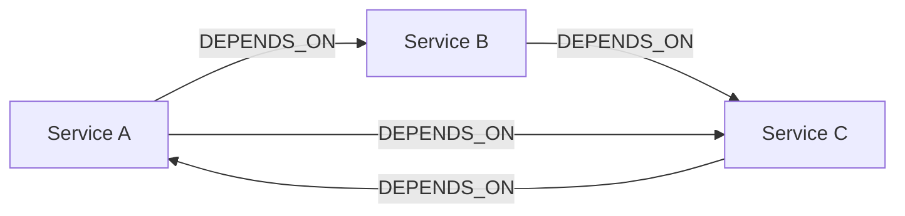

# Converting Graph Results into DTOs Without Creating Circular References in Neo4j

## 1. Learning Objectives

In Neo4j's **property graph**, a node can connect to many other nodes via relationships; a node can appear in multiple paths and the graph may contain cycles. This capability is essential for modeling dependency graphs, social networks, recommendations, or supply chains. However, if you pass raw application graph objects directly into a JSON serializer, bidirectional relationships can cause **infinite recursion**, generate huge payloads, or expose data that must not be returned.

This lesson belongs to the **Application Design** chapter of the `DATABASE_ENGINE_GRAPH_NEO4J` module. The focus is not on how to define Spring Data Neo4j (SDN) entities, but on **designing the read/write data boundary between Neo4j and the API**: retrieving just the necessary information via Cypher, mapping into finitely structured DTOs, protecting identifiers and access rights, and validating the JSON output.

After this lesson, you will be able to:

1. Distinguish **graph cycles**, **Java object reference cycles**, and **duplicate entities across multiple paths**.
2. Choose between flat/single-level DTOs, ID-referenced DTOs, or `nodes + edges` structures for a specific screen.
3. Write `RETURN` clauses and **map projections** in Cypher to read only the required properties.
4. Convert results from **Neo4j Java Driver** and **Spring Data Neo4j / Neo4jClient** into DTOs without serializing graph entities directly.
5. Control depth, fan-out, row counts, duplicate data, tenant permissions, and response size.
6. Write tests proving the response is finite, preserves cycles accurately, and drops no critical relationships.

> **Version scope:** Cypher examples use standard Neo4j 5 syntax. Java examples target Java 17+, Neo4j Java Driver 5.x, and the `Neo4jClient` API of Spring Data Neo4j releases aligned with Spring Boot 3.x. Mapping behavior may vary across versions: check documentation and run integration tests against your actual library stack.

## 2. Three Problems Often Lumped Together as "Circular References"

### 2.1. Cycles in the Graph Are Valid Data

Suppose three services have **dependency** relationships:



The path `A → B → C → A` is a **cycle**. Neo4j stores and queries it normally. It only becomes an application-layer problem when we try to convert each service into an object holding a complete list of its dependency service objects, and keep expanding without bound.

### 2.2. Circular References in Java Objects Are a Serialization Problem

Illustrative object model, **not** complete entity code:

```java
class ServiceEntity {
    String id;
    List<ServiceEntity> dependencies;
}

// Illustration after objects have been linked:
// a.dependencies = [b, c]
// b.dependencies = [c]
// c.dependencies = [a]
```

If Jackson or another serializer traverses `dependencies` by serializing **entire child objects**, it walks `a → b → c → a → ...` with no business-level stopping condition. Depending on configuration, this results in a recursion/stack overflow error, self-reference detection failure, or an abnormally large payload.

**Not every repeated link is a cycle:** a diamond graph `A → B → D` and `A → C → D` shares node `D` without having a cycle. If the DTO nests object `D` twice, JSON duplicates data even without infinite recursion. Therefore, both **cycles and duplicates** must be managed.

### 2.3. Cypher Can Also Multiply Rows Across Multiple Paths

`MATCH (a)-[:DEPENDS_ON*1..3]->(b)` returns **matching paths**, not a deduplicated list of unique `b` nodes by default. The same destination can be reached via multiple routes and appear in multiple rows. If each row is turned into a separate node DTO, the client sees duplicate IDs.

**Three separate issues to solve:**

| Problem | Symptom | Solution |
| --- | --- | --- |
| Object reference cycle | Serializer loops indefinitely | Never serialize graph entities directly; use finite DTOs |
| Duplicate nodes/edges across paths | Response contains multiple objects with same ID | Group by business key, `DISTINCT`, or map/set by ID |
| Graph traversal expansion | Too many nodes/relationships or paths | Bound depth, fan-out, candidate set, and response size |

## 3. Choosing the DTO Shape by Use Case

A DTO (*Data Transfer Object*) is the **API data contract**, not obligated to mirror the database entity structure. Three shapes are common.

### 3.1. Flat DTO for List Screens

```json
{
  "id": "A",
  "name": "API Gateway",
  "dependencyCount": 2
}
```

Benefits: compact, easy to cache, easy to paginate, contains no references to other node objects. Suitable for service lists and search pages. `dependencyCount` is computed inside the query, avoiding loading all relationships into Java.

### 3.2. Single-Level DTO for Detail Pages

```json
{
  "id": "A",
  "name": "API Gateway",
  "dependencies": [
    {"id": "B", "name": "Authentication"},
    {"id": "C", "name": "Database"}
  ]
}
```

Each `dependencies` item is merely a **summary** containing `id` and `name`. It **has no `dependencies` property of its own**, so it cannot loop back to `A` through further object expansion. The client can invoke the detail endpoint for `B` if the user actually asks for it.

### 3.3. Normalized Graph DTO for Diagram Views

When the application needs to **preserve both cycles and edges**, do not force the graph into a tree:

```json
{
  "rootId": "A",
  "nodes": [
    {"id": "A", "name": "API Gateway"},
    {"id": "B", "name": "Authentication"},
    {"id": "C", "name": "Database"}
  ],
  "edges": [
    {"fromId": "A", "toId": "B"},
    {"fromId": "B", "toId": "C"},
    {"fromId": "C", "toId": "A"},
    {"fromId": "A", "toId": "C"}
  ],
  "truncated": false
}
```

This is a **two-finite-arrays** structure, not a recursively nested object tree. The cycle remains intact in the data: the client draws the arrow from `C` back to `A` by ID. Node `A` appears only once in `nodes`; relationships are represented in `edges`.

| UI | Recommended Shape | Reason |
| --- | --- | --- |
| Paginated list | Flat DTO | Minimal properties, no unnecessary graph expansion |
| Single service detail page | Single-level DTO | Sufficient neighbor info, zero recursion |
| Dependency visualization canvas | `nodes + edges` | Preserves cycles and shared nodes |
| Path report | Path DTO with ID list and edges | Preserves exact path order, can include cost/hops |
| Mandatory tree view | Depth-bounded DTO with ID references | Presents as a tree while explicitly marking truncated edges/cycles |

**There is no single best DTO for every API.** Choose based on the screen and business logic: does the client need full node properties, relationship properties, path ordering, or just list hints?

## 4. Setting Up a Practice Graph with a Cycle

This lesson uses the `:DtoService` label and `:DTO_DEPENDS_ON` relationship to avoid mixing with application graphs. Run the write statements below only in a practice database.

Create a constraint on the business identifier **scoped to tenant**:

```cypher
CREATE CONSTRAINT dto_service_tenant_id_unique IF NOT EXISTS
FOR (s:DtoService)
REQUIRE (s.tenantId, s.id) IS UNIQUE;
```

Create nodes:

```cypher
UNWIND [
  {id: 'A', name: 'API Gateway'},
  {id: 'B', name: 'Authentication'},
  {id: 'C', name: 'Database'}
] AS row
MERGE (s:DtoService {tenantId: 'T1', id: row.id})
SET s.name = row.name;
```

Create four directed relationships:

```cypher
UNWIND [
  {from: 'A', to: 'B'},
  {from: 'B', to: 'C'},
  {from: 'C', to: 'A'},
  {from: 'A', to: 'C'}
] AS link
MATCH (source:DtoService {tenantId: 'T1', id: link.from})
MATCH (target:DtoService {tenantId: 'T1', id: link.to})
MERGE (source)-[:DTO_DEPENDS_ON]->(target);
```

Verify the graph:

```cypher
MATCH (source:DtoService {tenantId: 'T1'})
      -[:DTO_DEPENDS_ON]->
      (target:DtoService {tenantId: 'T1'})
WHERE source.id IN ['A', 'B', 'C']
  AND target.id IN ['A', 'B', 'C']
RETURN source.id AS fromId, target.id AS toId
ORDER BY fromId, toId;
```

On a clean demo graph, the four endpoint pairs are `A → B`, `A → C`, `B → C`, `C → A`. `MERGE` lets you re-run the example without duplicating existing relationship patterns; it does not enforce a rule of **only one relationship per pair** if another write path uses `CREATE`. To distinguish parallel relationships, the API needs a business ID for each relationship.

## 5. Never Return Neo4j Entities or Paths Directly

An SDN entity might contain:

```text
ServiceEntity A
  ├── dependencies: [ServiceEntity B, ServiceEntity C]
  └── ...
ServiceEntity B
  └── dependencies: [ServiceEntity C]
ServiceEntity C
  └── dependencies: [ServiceEntity A]
```

Writing a conceptual controller like:

```java
// Not an API example to copy:
// @GetMapping("/services/{id}")
// public ServiceEntity get(String id) {
//     return repository.findById(id).orElseThrow();
// }
```

leads to three categories of risk:

1. **Cyclic structure or duplicate data:** the serializer may traverse relationships repeatedly, potentially producing massive JSON.
2. **Leaking fields outside the API contract:** entities contain technical properties, internal data, operational flags, or backend-only fields.
3. **Coupling to graph mapping state:** the repository may return a partial structure based on fetch depth while the client assumes it received the whole graph.

Jackson annotations such as `@JsonIgnore`, `@JsonManagedReference`/`@JsonBackReference`, or `@JsonIdentityInfo` can address **a specific serialization pattern**. However:

- `@JsonManagedReference`/`@JsonBackReference` fits clear parent–child hierarchies better than arbitrary multi-directional graph models.
- `@JsonIdentityInfo` replaces repeated objects with ID references per configuration; clients must understand this contract, and data/permission limits still apply.
- `@JsonIgnore` can break cycles by **dropping edges that actually need to be displayed**.

**Recommended default:** entities serve storage/querying, DTOs serve the API; convert via a controlled mapper/assembler at the service layer.

## 6. Approach 1 — Cypher Map Projection for a Single-Level DTO

### 6.1. Fetch Only Needed Properties

Query fetching `A`'s direct dependencies while keeping the source row when a service has no dependencies:

```cypher
MATCH (s:DtoService {tenantId: $tenantId, id: $serviceId})
OPTIONAL MATCH (s)-[:DTO_DEPENDS_ON]->
               (d:DtoService {tenantId: $tenantId})
WITH s, collect(DISTINCT d{.id, .name}) AS dependencies
RETURN s.id AS id,
       s.name AS name,
       dependencies AS dependencies;
```

With `tenantId = 'T1'` and `serviceId = 'A'`, the output structure corresponds to:

```json
{
  "id": "A",
  "name": "API Gateway",
  "dependencies": [
    {"id": "B", "name": "Authentication"},
    {"id": "C", "name": "Database"}
  ]
}
```

Explanation:

- `MATCH` locates the root service by its tenant-scoped business key.
- `OPTIONAL MATCH` retains the service even if no dependencies are found; when `d` is `null`, the map projection `d{...}` is also `null` and `collect` skips it, yielding an empty list.
- `d{.id, .name}` is a **map projection**: containing only the two requested fields, without pulling `d`'s full entity or relationships.
- `collect(DISTINCT ...)` deduplicates **maps with identical content**. If two distinct nodes carry duplicate data due to a modeling/constraint bug, inspect keys rather than using `DISTINCT` to hide bad data.
- The query can still return many dependencies. To paginate large fan-out, use a dedicated list endpoint with `ORDER BY`/`LIMIT` and a cursor rather than calling unbounded `collect`.

**Ordering note:** never rely on incidental ordering in a collection built by `collect`. If the UI needs dependencies sorted by ID or name, sort rows appropriately before collecting or sort the DTOs in the backend and inspect the query plan.

### 6.2. Reading via Spring Data Neo4j `Neo4jClient`

Two DTO records (Java 17+). In a real Java project, each `public record` must reside in **its own `.java` file** matching the class name; they are shown together below for structural comparison:

```java
import java.util.List;

public record DependencySummaryDto(String id, String name) {}

public record ServiceDetailsDto(
    String id,
    String name,
    List<DependencySummaryDto> dependencies
) {}
```

A service using `Neo4jClient` and an explicit mapper:

```java
import java.util.List;
import java.util.Map;
import java.util.Optional;
import org.springframework.data.neo4j.core.Neo4jClient;
import org.springframework.stereotype.Service;

@Service
public class ServiceDetailsReader {
    private final Neo4jClient client;

    public ServiceDetailsReader(Neo4jClient client) {
        this.client = client;
    }

    public Optional<ServiceDetailsDto> find(
        String tenantId, String serviceId
    ) {
        String cypher = """
            MATCH (s:DtoService {
              tenantId: $tenantId, id: $serviceId
            })
            OPTIONAL MATCH (s)-[:DTO_DEPENDS_ON]->
                           (d:DtoService {tenantId: $tenantId})
            WITH s, collect(DISTINCT d{.id, .name}) AS deps
            RETURN s.id AS id, s.name AS name, deps
            """;

        return client.query(cypher)
            .bind(tenantId).to("tenantId")
            .bind(serviceId).to("serviceId")
            .fetchAs(ServiceDetailsDto.class)
            .mappedBy((typeSystem, record) -> {
                List<DependencySummaryDto> dependencies =
                    record.get("deps").asList(value -> {
                        Map<String, Object> item = value.asMap();
                        return new DependencySummaryDto(
                            (String) item.get("id"),
                            (String) item.get("name")
                        );
                    });

                return new ServiceDetailsDto(
                    record.get("id").asString(),
                    record.get("name").asString(),
                    List.copyOf(dependencies)
                );
            })
            .one();
    }
}
```

This is an **explicit read model**: the DTO holds no `ServiceEntity`, `Node`, `Relationship`, or driver result cursor. An empty `Optional` when the root service does not exist allows the service/controller to map it to HTTP 404 per the API contract instead of returning a blank object implying success.

The `name` fields in the example are assumed non-null. With real data, define how missing properties are handled: enforce appropriate constraints when your edition/version supports them, validate at ingestion, or allow `null` in the DTO per contract. Never call `asString()` unchecked on potentially `null` values.

### 6.3. Do Not Let the Graph Dictate the Response Contract

An entity might acquire properties like `internalAccessToken`, `adminNotes`, or a `HAS_CREDENTIAL` relationship. Running `RETURN s` and auto-serializing can leak unintended data. Explicitly list allowed properties in `RETURN`/map projections and return only defined DTOs.

Filtering `tenantId` in the query is **one defense layer**, not a replacement for service-level authorization checks. The backend must resolve the tenant from authenticated identity rather than accepting an arbitrary client-editable `tenantId`.

## 7. Approach 2 — Graph DTO with Node and Edge Lists

When rendering relationship diagrams, a single-level DTO is insufficient because users also want to see `B → C` and `C → A`. Returning **normalized** graph data consisting of unique nodes and ID-referenced edges preserves cycles without creating object reference cycles.

### 7.1. Normalizing by Business Identifier

Java definitions (place each `public record` in its own `.java` file in production):

```java
import java.util.List;

public record ServiceNodeDto(String id, String name) {}
public record DependencyEdgeDto(String fromId, String toId) {}
public record ServiceGraphDto(
    String rootId,
    List<ServiceNodeDto> nodes,
    List<DependencyEdgeDto> edges,
    boolean truncated
) {}
```

**Response invariants:**

1. Each `node.id` appears **at most once** in `nodes`.
2. Every `edge.fromId` and `edge.toId` references a node present in `nodes`.
3. With the demo data, each `(fromId, toId)` pair represents one relationship per the business model. If parallel edges are allowed, `DependencyEdgeDto` needs a `dependencyId` or business relationship ID key.
4. `truncated = true` when the result is **partial** due to read limits; the client must not interpret it as the complete graph.
5. The API serializes no entity objects inside `nodes` or `edges`.

### 7.2. Querying Bounded Paths and Extracting Nodes and Edges

The example below is for small/test graphs only. It queries paths of length **0–2 hops** starting from `A`, then projects them into maps:

```cypher
MATCH (root:DtoService {tenantId: $tenantId, id: $rootId})
MATCH p = (root)-[:DTO_DEPENDS_ON*0..2]->(last:DtoService)
WHERE all(n IN nodes(p) WHERE n.tenantId = $tenantId)
WITH p, [n IN nodes(p) | n.id] AS pathIds
ORDER BY length(p), pathIds
RETURN
  [n IN nodes(p) | {id: n.id, name: n.name}] AS nodeDtos,
  [r IN relationships(p) |
    {fromId: startNode(r).id, toId: endNode(r).id}
  ] AS edgeDtos
LIMIT $fetchSize;
```

Key details to understand:

- `*0..2` bounds depth and includes the **zero-length path** at the root node. Thus, if a service exists with no dependencies, one path row is still returned with the root node and an empty edge list.
- `all(n IN nodes(p) WHERE ...)` excludes paths containing nodes from another tenant. However, the query may still traverse candidates before filtering; multi-tenant systems need proper authorization and traversal design rather than relying solely on `WHERE` as a complete security boundary.
- `nodeDtos` holds decoupled maps; `edgeDtos` holds endpoint IDs matching the **actual relationship direction** via `startNode`/`endNode`.
- **A node can repeat across multiple path rows.** The backend must deduplicate by `id`; edges must be deduplicated by the appropriate relationship identifier/semantics.
- `LIMIT $fetchSize` caps **the number of returned path rows**, not the guarantee that only that many paths were traversed or nodes touched during pattern matching. On high-fan-out graphs, add extra filters and operational limits.

To observe the full cycle `A → B → C → A` within **a single path covering all three edges**, at least three hops must be allowed. Even so, a `nodes + edges` DTO can represent cycle edges coming from **different paths**; never infer from `maxDepth` that every edge in the graph has been collected.

### 7.3. Java Driver: Deduplicating by ID and Storing Edges as References

The example below consumes the Cypher output from section 7.2. To detect truncation cleanly, the backend fetches at most `maxPaths` path rows plus one extra row to determine whether truncation occurred:

```java
import java.util.Comparator;
import java.util.LinkedHashMap;
import java.util.LinkedHashSet;
import java.util.List;
import java.util.Map;
import java.util.Optional;
import java.util.Set;
import org.neo4j.driver.Driver;
import org.neo4j.driver.Record;
import org.neo4j.driver.Session;
import org.neo4j.driver.SessionConfig;

public final class ServiceGraphReader {
    private static final String CYPHER = """
        MATCH (root:DtoService {
          tenantId: $tenantId, id: $rootId
        })
        MATCH p = (root)-[:DTO_DEPENDS_ON*0..2]->(last:DtoService)
        WHERE all(n IN nodes(p) WHERE n.tenantId = $tenantId)
        WITH p, [n IN nodes(p) | n.id] AS pathIds
        ORDER BY length(p), pathIds
        RETURN
          [n IN nodes(p) |
            {id: n.id, name: n.name}] AS nodeDtos,
          [r IN relationships(p) |
            {fromId: startNode(r).id, toId: endNode(r).id}
          ] AS edgeDtos
        LIMIT $fetchSize
        """;

    public static Optional<ServiceGraphDto> load(
        Driver driver, String tenantId, String rootId, int maxPaths
    ) {
        if (tenantId == null || tenantId.isBlank()
            || rootId == null || rootId.isBlank()
            || maxPaths < 1 || maxPaths > 1000) {
            throw new IllegalArgumentException("Invalid request");
        }

        Map<String, Object> params = Map.of(
            "tenantId", tenantId,
            "rootId", rootId,
            "fetchSize", maxPaths + 1
        );

        try (Session session =
                 driver.session(SessionConfig.forDatabase("neo4j"))) {
            return session.executeRead(tx -> {
                List<Record> rows = tx.run(CYPHER, params).list();
                if (rows.isEmpty()) {
                    return Optional.empty();
                }

                boolean truncated = rows.size() > maxPaths;
                List<Record> accepted = rows.subList(
                    0, Math.min(rows.size(), maxPaths)
                );
                Map<String, ServiceNodeDto> nodes =
                    new LinkedHashMap<>();
                Set<DependencyEdgeDto> edges =
                    new LinkedHashSet<>();

                for (Record row : accepted) {
                    for (Map<String, Object> node :
                         row.get("nodeDtos").asList(v -> v.asMap())) {
                        String id = (String) node.get("id");
                        nodes.putIfAbsent(id, new ServiceNodeDto(
                            id, (String) node.get("name")
                        ));
                    }
                    for (Map<String, Object> edge :
                         row.get("edgeDtos").asList(v -> v.asMap())) {
                        edges.add(new DependencyEdgeDto(
                            (String) edge.get("fromId"),
                            (String) edge.get("toId")
                        ));
                    }
                }

                List<ServiceNodeDto> sortedNodes =
                    nodes.values().stream()
                        .sorted(Comparator.comparing(
                            ServiceNodeDto::id))
                        .toList();
                List<DependencyEdgeDto> sortedEdges =
                    edges.stream()
                        .sorted(Comparator
                            .comparing(DependencyEdgeDto::fromId)
                            .thenComparing(DependencyEdgeDto::toId))
                        .toList();

                return Optional.of(new ServiceGraphDto(
                    rootId, sortedNodes, sortedEdges, truncated
                ));
            });
        }
    }
}
```

This example demonstrates **deduplication** and **reference by ID**, not a production full-graph API. `LinkedHashMap` prevents adding a node with the same ID twice; `Set` prevents adding an edge with the same endpoint pair twice. Every `Record`, `Value`, and connection lives strictly within the read scope, leaving independent Java values inside the DTO.

Adjustments needed for production:

- Never take `tenantId` from an unverified client parameter.
- If relationships carry properties such as `dependencyKind` or `validFrom`, or multiple edges connect the same two nodes, extend `DependencyEdgeDto` with the **edge business key**. `Set<(fromId,toId)>` intentionally collapses parallel edges; it does not fit every model.
- `maxPaths + 1` only determines whether more paths exist for this specific query; it **does not** prove the whole graph at other depths or untraversed edges was covered.
- When `truncated = true`, the DTO may represent only a partial structure; the UI must indicate "incomplete load" and offer interactive expansion.
- On large graphs, cap node/edge counts and per-node fan-out, preferring a **paginated neighbor endpoint** over enumerating all fixed-depth paths.

## 8. Preserving Paths When Business Logic Requires Order

A normalized `nodes + edges` DTO works well for rendering whole diagrams, yet sometimes the API returns **one selected path**—such as a dependency chain from API to database. In that case, ordering is part of the business meaning:

```json
{
  "startId": "A",
  "endId": "C",
  "nodeIds": ["A", "B", "C"],
  "hops": 2
}
```

Cypher:

```cypher
MATCH p = (start:DtoService {tenantId: $tenantId, id: $startId})
          -[:DTO_DEPENDS_ON*1..3]->
          (target:DtoService {tenantId: $tenantId, id: $targetId})
WHERE all(n IN nodes(p) WHERE n.tenantId = $tenantId)
RETURN
  [n IN nodes(p) | n.id] AS nodeIds,
  length(p) AS hops
ORDER BY hops ASC, nodeIds ASC
LIMIT 1;
```

This returns **one of the lowest-hop paths** within length 1–3 matching the pattern, tie-broken by `nodeIds`. Do not treat this as optimal latency or business cost without appropriate weights and algorithms. Variable-length path queries can be costly; on large graphs, design strict bounds and evaluate shortest-path/GDS options as needed.

**Difference:** `nodeIds` JSON describes a single ordered path and may repeat IDs if traversal semantics allow; a `nodes + edges` DTO is a **graph subset** where each node appears only once. The two formats do not completely replace each other.

## 9. When a Tree Is Mandatory: Bound Depth and Track Visited Nodes

Many UIs use tree views because they are easy to browse. For graphs containing cycles, a tree is **a lossy representation**.

### 9.1. Unconditional Recursion Cannot Be Used

This conceptual function is unsafe:

```java
TreeDto toTree(ServiceEntity entity) {
    return new TreeDto(
        entity.getId(),
        entity.getDependencies().stream()
            .map(this::toTree) // No stopping condition
            .toList()
    );
}
```

With `A → B → C → A`, calling `toTree(A)` runs forever once data is loaded as linked objects. On very wide graphs, even **without cycles** it can produce oversized JSON.

### 9.2. Designing Reference Nodes When Encountering an ID Again

One DTO option:

```json
{
  "id": "A",
  "children": [
    {
      "id": "B",
      "children": [
        {
          "id": "C",
          "children": [
            {"refId": "A", "reason": "cycle"}
          ]
        }
      ]
    },
    {"refId": "C", "reason": "already-included"}
  ],
  "truncated": false
}
```

Here `refId` is a **string value reference**, not a Java object pointing back to an ancestor. The client can display an "already shown" marker instead of recursing.

To build such a structure, distinguish:

1. `ancestors` along the **current path** to detect a **cycle** when returning to an ancestor.
2. `alreadyIncluded` across the **entire response** if avoiding duplicating a node appearing in multiple branches.
3. `remainingDepth` and `maxChildren` to block unbounded expansion or massive fan-out.

Using a **single** global `visited` set and skipping every edge to already-seen nodes can drop edges in diamond graphs. To preserve all edges, it is better to emit **`nodes + edges`** and build the tree purely at the presentation layer.

## 10. Bounding Expansion and Performance on Large Graphs

Switching from entities to DTOs does not automatically solve query cost. A graph with average branching factor `b` traversed to depth `d` can have path counts growing rapidly, approaching `b^d` in wide-branching cases before deduplication.

| Measure | What It Controls | Limitation to Remember |
| --- | --- | --- |
| Return only needed properties | Per-node size in JSON | Does not reduce number of matched nodes |
| `LIMIT` on neighbor query | Returned rows per call | Depending on plan, may still scan many candidates |
| Bound hop count | Traversal depth | Fan-out can still be huge |
| Service-level `maxNodes`/`maxEdges` | Final DTO size | Query itself must also avoid fetching too much |
| Keyset/cursor pagination on node list | Avoids loading huge row sets and supports continuation | Requires deterministic order and tie-breaker |
| `DISTINCT` / map by ID | Duplicate nodes/edges in output | Carries cost and does not fix corrupt source data |
| Load each branch on user expansion | Spreads load on demand | Requires authorization, caching, and UI state policies |

### 10.1. Watch Out for N+1

An easy mistake:

```text
1 query: fetch 100 services
100 queries: fetch dependencies for each service individually
Many more queries: fetch dependencies of each dependency
```

This is a variant of the **N+1 query** problem. For list screens, return flat DTOs; when related details are needed, consider batching by a bounded ID set rather than calling unbounded `collect` on the whole graph.

### 10.2. Paginate Before Expanding Relationships

For example, select **20 services** first, and only then count dependencies for those services:

```cypher
MATCH (s:DtoService {tenantId: $tenantId})
WHERE s.id IS NOT NULL
WITH s
ORDER BY s.id ASC
LIMIT $pageSize
OPTIONAL MATCH (s)-[r:DTO_DEPENDS_ON]->
               (d:DtoService {tenantId: $tenantId})
WITH s, count(r) AS dependencyCount
RETURN s.id AS id,
       s.name AS name,
       dependencyCount
ORDER BY id ASC;
```

The node set is bounded **before** expanding relationships. For subsequent pages, use keyset pagination on `s.id` or `SKIP` as required, always with deterministic ordering. This query can still traverse many relationships across the 20 selected nodes; measure fan-out and run `EXPLAIN`/`PROFILE` on test data.

### 10.3. Stability When Data Changes

Between two graph-expansion requests, a relationship may be added, removed, or have properties modified. A DTO is not by default an **atomic snapshot of the user's entire session**. If a consistent report export is required, plan a snapshot/versioning strategy or collect data within an appropriate transaction scope; a response containing `rootId` and `truncated` does not guarantee invariance over time.

## 11. Identifiers, Security, and Tenant Isolation

### 11.1. Use Business Keys Instead of Technical IDs

In the example, `id` is a business property unique **within a tenant** via the `(tenantId, id)` constraint. Do not use `id(node)` or `elementId(node)` as long-lived API identifiers: those are Neo4j technical identifiers with lifecycle constraints not equivalent to stable product business keys.

In a multi-tenant graph, if exporting data across multiple tenants in one response is permitted, a bare `id` string can collide. In that case, the DTO identifier must distinguish tenants, such as `{tenantId, id}` or a properly constrained global public ID. Never merge two nodes from different tenants just because both have `id = 'A'`.

### 11.2. Control Nodes, Edges, and Paths Alike

- Filter root nodes by tenant/permissions and verify the tenant of expanded nodes.
- Never return an edge pointing to a node the client is not authorized to see. If an edge is filtered out, ensure the DTO contains no dangling references to the hidden node.
- Never return secret properties or internal nodes via `RETURN n` or `RETURN p` with indiscriminate serialization.
- Use parameters like `$tenantId`, `$rootId`, `$pageSize`; never concatenate user IDs into Cypher strings.
- Consider database/role permissions alongside application-layer checks; a tenant filter in Cypher does not replace the entire authorization mechanism.

Do not assume hiding node names while still exposing edge counts, IDs, or paths is always safe. In sensitive models, even the topology itself is data that must be authorized.

## 12. Testing: Verifying JSON Terminates and Matches the Graph

Test at least the following scenarios:

| Scenario | Expected Outcome |
| --- | --- |
| `A → B → C → A` | Serializes cleanly without infinite nesting; edge `C → A` remains present when within query scope |
| `A → B → D` and `A → C → D` | Node `D` appears once in `nodes`, all edges remain intact |
| Node with no dependencies | Single-level DTO has `dependencies: []`, not a fake empty object |
| Node with 10,000 dependencies | Endpoint enforces bounds and pagination metadata without huge JSON |
| Node not found | HTTP 404 or missing result per contract, not a fabricated graph |
| Edge into another tenant | Forbidden node/edge never exposed; test intermediate nodes too |
| Missing `name` property | Mapping obeys nullable contract or raises controlled error |
| Parallel relationships between two nodes | Edges are not lost if business logic distinguishes them by ID |
| Result has multiple paths sharing nodes | Nodes are not duplicated in DTO; `truncated` is set if cut off |
| Multiple requests while graph mutates | Never assume two loads share the same snapshot |

### 12.1. Verifying JSON Structure in Java

Example using Jackson once `ServiceGraphDto dto` is produced by the service and mapper in a test:

```java
ObjectMapper mapper = new ObjectMapper();
String json = mapper.writeValueAsString(dto);
JsonNode document = mapper.readTree(json);

assert document.get("nodes").isArray();
assert document.get("edges").isArray();
assert document.get("rootId").asText().equals("A");
assert document.get("nodes").size() <= 100;
```

In automated tests, use JUnit/AssertJ assertions instead of relying on the JVM `assert` keyword (which can be disabled unless `-ea` is set). More importantly, assert **node ID sets**, **edge sets**, duplicate counts, and serialization duration; checking only "no exception thrown" does not prove business data was preserved.

### 12.2. Verify the Same Graph at Three Levels

1. **Cypher:** verify node counts, relationships, directions, and matched paths.
2. **DTO:** verify node list has no duplicate IDs, edges reference valid nodes, and no entity objects are embedded.
3. **JSON/API:** verify finite payload, stable schema, zero cross-tenant leakage, response size, and truncation behavior.

If Cypher is right but the DTO is wrong, the bug usually lies in the mapper or deduplication rules. If the DTO is right but JSON is wrong, inspect Jackson annotations, record/list conversion, or serialization rules. If Cypher itself returns the wrong graph, adding `@JsonIgnore` will not fix the query problem.

## 13. Common Mistakes

| Mistake | Consequence | Fix |
| --- | --- | --- |
| Returning SDN entities straight from controller | Reference cycles, leaked properties, mapping-coupled payloads | API-specific DTOs |
| Nesting every dependency inside child dependencies | Builds recursive object graphs | Single-level DTO or `nodes + edges` |
| Using `@JsonIgnore` to "break cycles" on all relations | Drops relationships needed by UI | Design ID-based references |
| Seeing `DISTINCT` and assuming cycle risk is gone | Only deduplicates identical rows/maps, does not alter object structure | Decouple DTOs from entities |
| Using `visited` and skipping already-seen nodes | Drops edges in diamond graphs | Keep edges separate, or emit ref nodes |
| Unbounded variable-length traversal | Path explosion or timeouts | Bound hops, fan-out, payload, and permissions |
| Using `LIMIT 20` after multi-edge expansion | 20 rows may represent just a few nodes | Select nodes before expanding |
| Using technical IDs as long-term API IDs | Tied to database lifecycle | Stable business keys |
| Deduplicating nodes by ID alone in multi-tenant setups | Mixes data from two tenants | Composite key with tenant or global ID |
| Deduplicating edges by endpoint pair when parallel edges exist | Loses parallel relationships | Use relationship business IDs |
| Reading all data then trimming the response | Wastes memory and Neo4j resources | Bound the query and paginate reads |
| Ignoring `truncated` | Client assumes graph is complete | Surface limits and provide continuation mechanism |

## 14. Practice Exercises

### Exercise 1 — Predicting a Cycle Error

Java entities have `A.dependsOn = [B]`, `B.dependsOn = [C]`, and `C.dependsOn = [A]`. If a controller returns `A` and the serializer expands all `dependsOn`, what goes wrong?

**Suggested Answer:** the reference path `A → B → C → A` has no stopping condition when serializing nested objects. Do not delete the cycle from Neo4j; switch to an ID-referenced DTO or return only one level.

### Exercise 2 — Designing a Schema for a Canvas

For the graph `A → B`, `A → C`, `B → C`, `C → A`, construct JSON with three nodes and four edges, without nesting nodes inside edges.

**Hint:** use `nodes: [{id:'A'}, {id:'B'}, {id:'C'}]` and `edges: [{fromId:'A',toId:'B'}, ...]`. Each edge references IDs; the cycle remains visible via the `C → A` arrow.

### Exercise 3 — Fixing Cypher

Query:

```cypher
MATCH (s:DtoService {tenantId: $tenantId, id: $serviceId})
MATCH (s)-[:DTO_DEPENDS_ON]->(d:DtoService)
RETURN s, d;
```

Rewrite it to return **ID and name** of the service along with single-level dependencies without returning raw nodes, while preserving services that have no dependencies.

**Suggested Answer:** use `OPTIONAL MATCH`, filter `d`'s tenant, then `collect(DISTINCT d{.id, .name})` and `RETURN s.id, s.name, dependencies` as shown in section 6.

### Exercise 4 — Parallel Relationships

The graph has two relationships from `A` to `B`: one runtime dependency and one deployment dependency. The DTO only has `fromId` and `toId` and the backend uses a `Set`. What gets lost?

**Hint:** both relationships collapse into one because the endpoint pair is identical. The DTO needs a discriminator/business ID field for the relationship; both query and mapper must preserve that distinction.

### Exercise 5 — Checking Bounds

The API sets `maxDepth = 2` and `LIMIT 100` on the path query. Can we guarantee the response includes every dependency within two hops?

**Hint:** no. `LIMIT` can truncate paths, and graph fan-out can be large. You need `truncated`, an appropriate data source, entity limits, and controlled expansion/pagination.

### Exercise 6 — Planning Business Tests

Design a test suite for an endpoint returning a tenant's graph, covering cycles, diamond shapes, zero edges, cross-tenant edges, a node missing `name`, and multiple parallel relationships.

**Hint:** assert across Cypher, DTO, and JSON; verify response size, no duplicate nodes, no dangling edge endpoints, no cross-tenant data leakage, null handling rules, and `truncated` behavior.

## 15. Checklist for Exposing Graph DTOs in an API

- [ ] DTOs are defined per use case; never serialize entities or driver objects directly.
- [ ] Clearly chose flat DTO, single-level DTO, path DTO, or `nodes + edges`.
- [ ] Graph cycles are preserved using IDs/edges without creating object reference cycles.
- [ ] Node keys are stable business IDs, scoped by tenant when needed.
- [ ] Edges carry appropriate keys if parallel relationships carry meaning.
- [ ] Cypher returns only fields the API is permitted to publish.
- [ ] Nodes/relationships are filtered by authorization, not solely by client parameters.
- [ ] `null`, missing nodes, and empty lists are handled explicitly.
- [ ] Bounds exist for depth, row count, node count, edge count, and payload size.
- [ ] Truncated data sets `truncated` and provides a continuation mechanism.
- [ ] Mapper deduplicates by exact identifier without dropping edges.
- [ ] Fan-out, N+1, and paginating before expansion have been considered.
- [ ] Tested with cycles, shared nodes, parallel edges, and cross-tenant edges.
- [ ] Measured with `EXPLAIN`/`PROFILE` and verified actual JSON at the API layer.

## Conclusion

A **graph containing cycles** is normal data in Neo4j; problems arise when the API layer tries to represent that graph using **unbounded nested objects**. A sustainable design defines DTO boundaries around the use case, selects only needed properties in Cypher, and returns **ID references** rather than recursive object references. Use single-level DTOs for detail screens, and **normalized node and edge lists** for dependency diagrams to preserve both cycles and shared nodes. Combining traversal bounds, pagination, business keys, tenant authorization, and JSON tests keeps the API both data-accurate and stable in performance and security as the graph grows.

### References

- [Neo4j Cypher Manual — Map expressions](https://neo4j.com/docs/cypher-manual/current/expressions/map-expressions/)
- [Neo4j Cypher Manual — Variable-length patterns](https://neo4j.com/docs/cypher-manual/current/patterns/variable-length-patterns/)
- [Neo4j Cypher Manual — Execution plans](https://neo4j.com/docs/cypher-manual/current/planning-and-tuning/execution-plans/)
- [Neo4j Java Driver Manual](https://neo4j.com/docs/java-manual/current/)
- [Spring Data Neo4j Reference](https://docs.spring.io/spring-data/neo4j/reference/)
