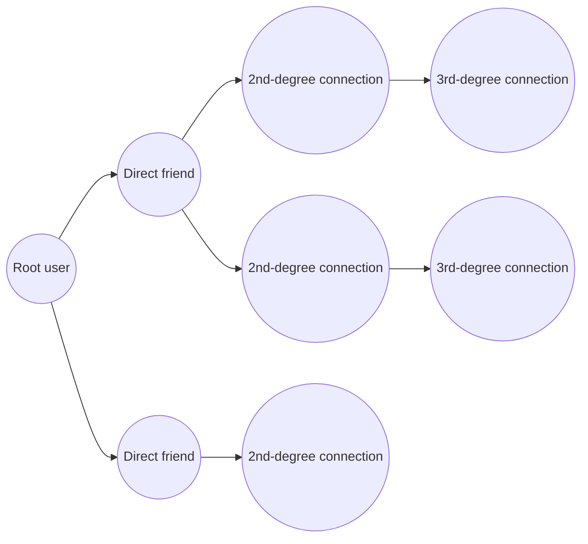
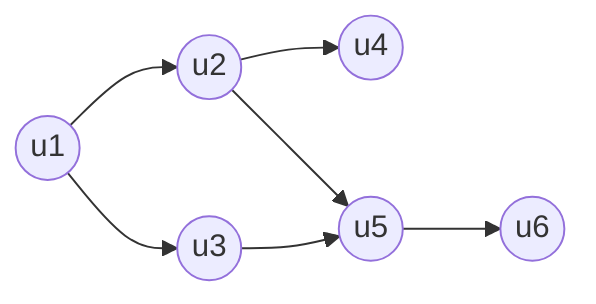

# Bounding Traversal Depth, Row Counts, and Execution Time from User Input in Neo4j

An API that lets users explore relationships in Neo4j often accepts parameters like "show connections up to how many hops away," "how many results to display," and "how long to wait for the query." If the application passes these numbers straight into Cypher unchecked, a seemingly small request can traverse millions of paths, build huge intermediate result sets, or hold transactions open far too long.

This lesson belongs to the **Application Design** chapter of the **DATABASE_ENGINE_GRAPH_NEO4J** module. In a property graph application using Cypher, **Neo4j Java Driver**, or **Spring Data Neo4j**, you must design a **per-request resource budget**: traversal depth, returned row count, execution time, and accompanying limits such as concurrency and user data scope.

Objectives after this lesson:

- Distinguish **relationship depth**, **result row count**, and **transaction duration**.
- Understand why `LIMIT` does not automatically bound all graph traversal work.
- Choose **allowlisted depth bounds**, parameterize data, validate `limit`, and enforce tenant scope.
- Configure **transaction timeout** in the Neo4j Java Driver and understand its boundary relative to API/Spring timeouts.
- Read `EXPLAIN`/`PROFILE` to spot `Expand`, `Sort`, or `Distinct` steps causing row explosions.
- Design APIs testable against extreme inputs and high-degree hub nodes.

## 1. Why Can User-Driven Traversal Be Dangerous?

Suppose an "indirect connection recommendations" feature queries the graph:



Increasing depth by one hop can expand candidate paths **very rapidly**. In an illustrative tree where each node has roughly 10 edges to new branches, candidate path counts at each level can look like:

| Max Depth | Candidate Paths in a Branching-Factor-10 Tree |
| --- | ---: |
| 1 | 10 |
| 2 | 10 + 100 = 110 |
| 3 | 10 + 100 + 1,000 = 1,110 |
| 4 | 10 + 100 + 1,000 + 10,000 = 11,110 |

This is only an **intuitive illustration of combinatorial explosion**, not an exact Neo4j cost forecast. Real graphs contain cycles, multiple paths to the same node, skewed degree distributions, and non-repeating-relationship rules within a path. Even so, the trend shows why `depth = 4` can involve vastly more work than `depth = 2`.

**Never treat `depth`, `limit`, and `timeout` as three names for the same bound.**

| Bound | Directly Controls | Does Not Guarantee |
| --- | --- | --- |
| **Depth** | Maximum relationships along a matched path | Does not guarantee few paths/rows; a hub can produce massive paths within 2 hops |
| **Row count** (`LIMIT`) | Rows emitted at the point `LIMIT` is applied | Does not guarantee the engine only expanded, filtered, or sorted that many rows |
| **Transaction timeout** | Duration a transaction may run under the configured timeout mechanism | Does not replace validation, rate limiting, memory protection, or end-to-end API timeouts |
| **Request/concurrency limit** | How many requests run concurrently | Does not make an individual query cheap |

A safe API applies **multiple layers**, not just appending `LIMIT 10` at the end of a Cypher query.

## 2. Input Contract: Sensible Defaults and Hard Caps

Suppose the application exposes a conceptual endpoint:

```text
GET /network/members/{memberId}/connections?depth=2&limit=20
```

Illustrative backend design:

| Input Field | Default | Accepted Values | Policy |
| --- | ---: | --- | --- |
| `depth` | 2 | 1, 2, or 3 | **Reject** values outside the allowlist; disallow arbitrary-depth queries |
| `limit` | 20 | Integer 1–50 | Reject 0, negative numbers, oversized values, and invalid types |
| `memberId` | None | Valid ID string within user's authorized scope | Validate and pass as parameter `$memberId` |
| `tenantId` | From authenticated identity | An authorized tenant | **Never trust** client-supplied tenant without authentication/authorization |
| Transaction time | Decided by application server | e.g., 2 seconds | Never let clients request "unlimited" |

The numbers **1–3**, **1–50**, and **2 seconds** are a **sample policy for illustration**, not optimal limits for every graph. Derive yours from latency SLOs, real data, and load testing.

There are two strategies when a client requests beyond the cap:

1. **Reject explicitly** (e.g., HTTP 400) returning the valid range, preventing the client from mistakenly thinking it received complete results.
2. **Clamp to the maximum** and record `effectiveLimit` in the response if the API contract permits.

In this lesson we choose **reject**, keeping rules transparent and easy to test.

## 3. Creating Sample Property Graph Data

We build a small graph with label `:SafeMember`, key `tenantId + memberId`, and directed relationship `:FOLLOWS`:



From `u1`:

- Within **1 hop**: `u2`, `u3`.
- Within **2 hops** (including hop 1): adds `u4`, `u5`.
- Within **3 hops**: adds `u6`.

Run the following statements in a **test database**.

### 3.1. Business-Key Constraint

```cypher
CREATE CONSTRAINT safe_member_tenant_id_unique IF NOT EXISTS
FOR (m:SafeMember)
REQUIRE (m.tenantId, m.memberId) IS UNIQUE;
```

The composite uniqueness constraint protects the key pair and speeds up root-node lookup. Note: a constraint does not replace application-layer tenant authorization, nor does it guarantee every `SafeMember` node carries all required properties without corresponding data rules.

### 3.2. Sample Nodes

```cypher
UNWIND [
  {id: 'u1', name: 'An'},
  {id: 'u2', name: 'Binh'},
  {id: 'u3', name: 'Chi'},
  {id: 'u4', name: 'Dung'},
  {id: 'u5', name: 'Em'},
  {id: 'u6', name: 'Giang'}
] AS row
MERGE (m:SafeMember {tenantId: 'acme', memberId: row.id})
SET m.displayName = row.name;
```

### 3.3. Sample Relationships

```cypher
UNWIND [
  ['u1', 'u2'],
  ['u1', 'u3'],
  ['u2', 'u4'],
  ['u2', 'u5'],
  ['u3', 'u5'],
  ['u5', 'u6']
] AS pair
MATCH (a:SafeMember {tenantId: 'acme', memberId: pair[0]})
MATCH (b:SafeMember {tenantId: 'acme', memberId: pair[1]})
MERGE (a)-[:FOLLOWS]->(b);
```

Verify the data:

```cypher
MATCH (a:SafeMember {tenantId: 'acme'})-[:FOLLOWS]->
      (b:SafeMember {tenantId: 'acme'})
RETURN a.memberId AS fromMember, b.memberId AS toMember
ORDER BY fromMember, toMember;
```

The baseline dataset has **6 nodes** and **6 relationships**. Traversal output can contain the same node via **multiple distinct paths**: for instance, `u5` is reachable from `u1` via `u2` or `u3`.

## 4. Bounding Depth Directly in the Query Pattern

Query finding people connected within at most **2 relationships**:

```cypher
MATCH p = (root:SafeMember {
    tenantId: $tenantId,
    memberId: $memberId
})-[:FOLLOWS*1..2]->(other:SafeMember)
WHERE all(n IN nodes(p) WHERE n.tenantId = $tenantId)
  AND other.memberId <> root.memberId
RETURN DISTINCT other.memberId AS memberId,
                other.displayName AS displayName
ORDER BY memberId ASC
LIMIT $limit;
```

Reading each part:

- `*1..2` bounds paths to **1 to 2 relationships**; no arbitrary depth is allowed.
- Arrow `->` enforces `FOLLOWS` direction from the root person to followed people.
- `all(n IN nodes(p) WHERE n.tenantId = $tenantId)` checks that **intermediate nodes too** belong to the requested tenant; filtering only the target node is insufficient for this rule.
- `RETURN DISTINCT` collapses duplicate rows with the same `memberId` and `displayName` in the output, since `u5` has two paths.
- `ORDER BY` makes output ordering predictable; `LIMIT` caps the number of rows **returned**.

With `tenantId = 'acme'`, `memberId = 'u1'`, and `limit = 50`, the logical result is `u2`, `u3`, `u4`, `u5`. Allowing `*1..3` adds `u6`.

### Why Not Interpolate Client Depth Directly into Syntax?

Never construct Cypher from an unchecked string:

```java
// Do not do this: rawDepth comes from the client.
String unsafe = "MATCH p = (a:SafeMember)-[:FOLLOWS*1.."
    + rawDepth + "]->(b:SafeMember) RETURN p";
```

Depth is part of **pattern syntax** and you should not assume a `$depth` parameter can be placed into `*1..N` across all versions/syntax forms. A common, auditable approach is an **allowlist** of statically bounded query patterns:

```text
depth = 1  →  *1..1
depth = 2  →  *1..2
depth = 3  →  *1..3
outside 1–3 →  reject
```

If a Cypher version or extension procedure supports dynamic depth configuration, **still validate and cap it server-side** before binding parameters. Features like the APOC path expander can be chosen if actually installed and permitted in your environment, but never assume a plugin is present in every Neo4j deployment.

### Depth Does Not Equal Unique Node Count

A `MATCH p` query can produce multiple **paths** reaching the same node:

```cypher
MATCH p = (:SafeMember {tenantId: 'acme', memberId: 'u1'})
          -[:FOLLOWS*1..3]->(target:SafeMember)
RETURN target.memberId AS target,
       length(p) AS hops,
       [n IN nodes(p) | n.memberId] AS route
ORDER BY target, hops;
```

If only a user list is needed, `DISTINCT` is sensible. If **enumerating all paths** is required, cost can be huge, so carefully review product utility, stricter bounds, and behavior on cycle-heavy graphs.

## 5. `LIMIT` Is Not a "Brake" on Graph Traversal

Consider:

```cypher
MATCH p = (root:SafeMember {tenantId: $tenantId, memberId: $memberId})
          -[:FOLLOWS*1..3]->(target:SafeMember)
RETURN DISTINCT target.memberId AS memberId
ORDER BY memberId
LIMIT 10;
```

Even though it returns at most 10 rows, the engine may still have to:

1. Traverse many paths up to depth 3.
2. Generate many intermediate rows across different paths.
3. Deduplicate via `DISTINCT`.
4. Sort the result set by `memberId`.
5. Finally emit 10 rows.

Neo4j has an optimizer and different runtimes; `LIMIT` is sometimes pushed down or enables early termination in **certain plans**. Yet **there is no universal guarantee** that `LIMIT 10` makes traversal cost only 10 nodes of work.

| Query Shape | What the Bound Actually Controls | Remaining Risk |
| --- | --- | --- |
| `MATCH ... RETURN ... LIMIT 10` | Final returned rows | May traverse many paths before producing results |
| `MATCH ... RETURN DISTINCT ... LIMIT 10` | Distinct returned rows | May have to deduplicate a huge set |
| `MATCH ... ORDER BY ... LIMIT 10` | Top 10 after sort | May have to inspect many candidates |
| `MATCH ... WITH ... LIMIT 10 MATCH ...` | **Intermediate rows before the second MATCH** | Subsequent expansion can still produce many rows |
| `MATCH p = ...*1..2` | Depth up to 2 | A two-hop hub can still generate huge path counts |

Therefore, **all three mechanisms**—`*1..N`, `LIMIT`, and transaction timeout—must be used **together**, supplemented when needed by budgets on seed count, target/relationship count, or concurrency.

### Be Careful Placing `LIMIT` Before Expansion

Example:

```cypher
MATCH (seed:SafeMember {tenantId: $tenantId})
WITH seed ORDER BY seed.memberId LIMIT 10
MATCH (seed)-[:FOLLOWS]->(other:SafeMember)
RETURN seed.memberId, other.memberId;
```

This statement only picks the **first 10 seeds** to expand; it does not cap the returned relationships at 10. If any seed has 10,000 edges, the output can still be huge. Moreover, it **changes business semantics**: it no longer traverses from all seeds, only from 10 ordered seeds.

Apply an intermediate-step limit only when discarding other seeds matches product requirements.

## 6. Designing Deterministic Pagination

For potentially large lists, pagination is far better than letting clients request tens of thousands of rows at once.

### 6.1. Cursor Pagination Over a Node Set

Example querying `SafeMember` within a tenant using stable, ordered `memberId`:

```cypher
MATCH (m:SafeMember {tenantId: $tenantId})
WHERE m.memberId > $afterId
RETURN m.memberId AS memberId,
       m.displayName AS displayName
ORDER BY memberId ASC
LIMIT $pageSize;
```

Suppose `afterId = 'u3'` and `pageSize = 2`; on the sample dataset the result is `u4`, `u5`. For the first page, the application can use a query variant without the cursor predicate or choose a valid lower-bound starting value per the ID format.

**Points to remember:**

- `ORDER BY` should rely on a **stable, unique key** within the query scope.
- A matching unique constraint/index on `tenantId` and `memberId` supports efficient seeks; verify with `EXPLAIN`/`PROFILE`.
- `SKIP` with large offsets may have to skip huge numbers of rows before returning results; keyset/cursor pagination is usually preferable on large sets.
- Generate cursors server-side or validate cursor payloads; never let users tamper with a cursor to pivot into another tenant.
- Data mutations between calls can cause subsequent pages to differ from initial state. Cursors **do not create a multi-request snapshot**.

**Paginating nodes** does not automatically make **enumerating all paths** cheap. For traversals, budget graph work and structure output as target nodes, neighborhoods, or clearly bounded paths.

### 6.2. Why Can `COUNT(*)` Be Expensive?

APIs often ask for both `items` and `totalCount`. Computing the total by traversing all paths and applying `DISTINCT` can cost substantial work even when a page only fetches 20 people.

Do not assume every graph API needs an exact `totalCount`. Consider returning `hasNextPage` (fetching one extra row in an already bounded query), approximate counts, or separate background stats jobs when product requirements allow.

## 7. Transaction Timeout: Server-Side Execution Limit

Even with `depth <= 3` and `limit <= 50`, a node with millions of relationships can make a query slow. **Transaction timeout** is the next line of defense.

In the **Neo4j Java Driver**, pass a `TransactionConfig` to managed transactions:

```java
import java.time.Duration;

import org.neo4j.driver.TransactionConfig;

TransactionConfig txConfig = TransactionConfig.builder()
    .withTimeout(Duration.ofSeconds(2))
    .build();
```

In execution:

```java
try (Session session =
         driver.session(SessionConfig.forDatabase("neo4j"))) {

    List<String> ids = session.executeRead(
        tx -> tx.run("""
                MATCH (m:SafeMember {tenantId: $tenantId})
                RETURN m.memberId AS memberId
                ORDER BY memberId
                LIMIT $limit
                """, Map.of(
                    "tenantId", "acme",
                    "limit", 20
                ))
            .list(record ->
                record.get("memberId").asString()
            ),
        txConfig
    );
}
```

`withTimeout(Duration.ofSeconds(2))` is a **server-side transaction time limit**, not a promise that the API responds within 2 wall-clock seconds on the client. Connection setup, pool wait, managed transaction retries, and work outside the database can still stretch request duration.

When a transaction exceeds the limit, Neo4j marks it for **termination**, causing subsequent operations to fail/roll back. Detection and termination completion timing depend on server internals; never treat timeout as a millisecond-exact hard CPU cutoff.

### Global Timeout vs. Per-Transaction Timeout

In modern Neo4j releases, `db.transaction.timeout` sets the server-wide default transaction timeout. With appropriate permissions, inspect it via:

```cypher
SHOW SETTINGS
YIELD name, value
WHERE name = 'db.transaction.timeout'
RETURN name, value;
```

Notes:

- Viewing/altering settings depends on version, edition, and admin privileges.
- Never change the **server-wide** timeout just to work around one endpoint; it can break legitimate ETL jobs, long maintenance operations, or admin queries.
- Per-transaction timeouts fit endpoint-specific policies better when supported by driver and deployment.
- Check precedence between server configuration and driver-supplied timeouts for your **exact version**.

### Distinguishing Three Kinds of Timeouts

| Timeout Layer | Example | What It Acts On |
| --- | --- | --- |
| **Neo4j transaction timeout** | `TransactionConfig.withTimeout(...)` | Server marks overdue transaction for termination/rollback |
| **HTTP/API layer timeout** | Request processing limit in gateway/service | Stops hanging requests for the client; does not guarantee immediate rollback of an in-flight DB query |
| **Network/driver timeout** | Connection acquisition, retry deadline, or network read timeout per config | Protects connections/calls; not identical to server Cypher execution time |

If the gateway times out and aborts the request, never **assume** the Neo4j transaction stopped instantaneously. Proper protection requires configuring timeouts at the **transaction layer** along with explicit error/cancellation handling in the application.

## 8. End-to-End Java Driver Example: Depth, Rows, Timeout

The service below enforces three layers of bounds. `tenantId` must originate from an **authorized authentication context**, never trusting user-chosen tenant values. Code uses **Java 17+** (text blocks, switch expressions, records).

```java
import java.time.Duration;
import java.util.List;
import java.util.Map;
import java.util.Objects;

import org.neo4j.driver.Driver;
import org.neo4j.driver.Session;
import org.neo4j.driver.SessionConfig;
import org.neo4j.driver.TransactionConfig;

public final class SafeGraphQueryService {

    private static final int MAX_DEPTH = 3;
    private static final int MAX_ROWS = 50;

    private static final TransactionConfig QUERY_BUDGET =
        TransactionConfig.builder()
            .withTimeout(Duration.ofSeconds(2))
            .build();

    private final Driver driver;
    private final String database;

    public SafeGraphQueryService(Driver driver, String database) {
        this.driver = Objects.requireNonNull(driver);
        this.database = Objects.requireNonNull(database);
    }

    public record MemberView(String memberId, String displayName) {}

    public List<MemberView> connections(
            String authorizedTenantId,
            String startMemberId,
            int depth,
            int limit) {

        if (authorizedTenantId == null || authorizedTenantId.isBlank()
                || startMemberId == null || startMemberId.isBlank()) {
            throw new IllegalArgumentException("Missing identity");
        }
        if (depth < 1 || depth > MAX_DEPTH) {
            throw new IllegalArgumentException("Depth must be 1..3");
        }
        if (limit < 1 || limit > MAX_ROWS) {
            throw new IllegalArgumentException("Limit must be 1..50");
        }

        // Only interpolate fixed tokens selected by the SERVER.
        // Never concatenate raw depth strings sent by the client.
        String boundedPattern = switch (depth) {
            case 1 -> "*1..1";
            case 2 -> "*1..2";
            case 3 -> "*1..3";
            default -> throw new IllegalArgumentException("Invalid depth");
        };

        String cypher = """
            MATCH p = (root:SafeMember {
                tenantId: $tenantId,
                memberId: $memberId
            })-[:FOLLOWS%s]->(other:SafeMember)
            WHERE all(n IN nodes(p) WHERE n.tenantId = $tenantId)
              AND other.memberId <> root.memberId
            RETURN DISTINCT other.memberId AS memberId,
                            other.displayName AS displayName
            ORDER BY memberId ASC
            LIMIT $limit
            """.formatted(boundedPattern);

        Map<String, Object> params = Map.of(
            "tenantId", authorizedTenantId,
            "memberId", startMemberId,
            "limit", limit
        );

        try (Session session = driver.session(
                SessionConfig.forDatabase(database))) {

            return session.executeRead(tx ->
                tx.run(cypher, params).list(record ->
                    new MemberView(
                        record.get("memberId").asString(),
                        record.get("displayName").asString()
                    )
                ),
                QUERY_BUDGET
            );
        }
    }
}
```

**Explanation of defense layers:**

1. **Validation:** rejects `depth > 3`, `limit > 50`, and blank IDs before querying.
2. **Syntax allowlist:** only three server-defined `*1..N` strings exist; arbitrary Cypher fragments cannot be injected.
3. **Data parameters:** `tenantId`, `memberId`, and `limit` are bound into Cypher, never concatenated as literals.
4. **Tenant scope:** root and every node on the path are checked for the same tenant; still, **authorization must be enforced at the application layer and database privileges**, not only via query predicates.
5. **Row cap:** `LIMIT $limit` caps returned DTO count.
6. **Transaction timeout:** `executeRead(..., QUERY_BUDGET)` asks Neo4j to enforce a time budget on the transaction.
7. **Result lifecycle:** `list(mapper)` converts records into DTOs **inside the callback**, before closing the session.

**What this example does not guarantee:** Cypher can still generate many paths before `DISTINCT`/`LIMIT`, and a large hub can still be very expensive before hitting timeout. Production needs load testing, rate limits, concurrency limits, and suitable model constraints.

### Why Not Use a Large-Depth Cypher Pattern and Filter `length(p) <= $depth`?

Example to avoid for user-controlled bounds:

```cypher
MATCH p = (root:SafeMember)-[:FOLLOWS*1..10]->(other:SafeMember)
WHERE length(p) <= $depth
RETURN other.memberId;
```

Even if the client sends `depth = 2`, the query pattern allows expansion **up to 10 hops** before evaluating the filter (predicate pushdown depends on the planner). This can cause huge wasted work. Always **bound depth directly in the traversal pattern** or use a traversal API with native depth bounds that are properly validated.

## 9. With Spring Data Neo4j: Where Do Transactions and Timeouts Go?

In a **Spring Data Neo4j** application, you can define a repository/`Neo4jClient` interface and a business-layer service. Example:

```java
import org.springframework.data.neo4j.core.Neo4jClient;
import org.springframework.stereotype.Service;
import org.springframework.transaction.annotation.Transactional;

import java.util.List;

@Service
public class GraphConnectionReadService {

    private final Neo4jClient neo4jClient;

    public GraphConnectionReadService(Neo4jClient neo4jClient) {
        this.neo4jClient = neo4jClient;
    }

    @Transactional(readOnly = true, timeout = 3)
    public List<String> directConnections(
            String authorizedTenantId,
            String memberId,
            int limit) {

        if (limit < 1 || limit > 50) {
            throw new IllegalArgumentException("Invalid limit");
        }

        return neo4jClient.query("""
                MATCH (root:SafeMember {
                    tenantId: $tenantId, memberId: $memberId
                })-[:FOLLOWS]->(other:SafeMember {
                    tenantId: $tenantId
                })
                RETURN DISTINCT other.memberId AS memberId
                ORDER BY memberId
                LIMIT $limit
                """)
            .bind(authorizedTenantId).to("tenantId")
            .bind(memberId).to("memberId")
            .bind(limit).to("limit")
            .fetchAs(String.class)
            .mappedBy((typeSystem, record) ->
                record.get("memberId").asString()
            )
            .all()
            .stream()
            .toList();
    }
}
```

Points to consider:

- `@Transactional(readOnly = true, timeout = 3)` expresses the Spring transaction boundary; **actual timeout enforcement** must be verified with `Neo4jTransactionManager`, your configuration, and your running SDN version.
- If the method is invoked **from within the same bean** (self-invocation) bypassing the Spring proxy, the annotation may not apply.
- If the method **joins an existing transaction**, the inner method's timeout does not automatically override or start a fresh timeout. Understand propagation and manager behavior.
- `readOnly = true` does not replace security privileges; the Neo4j account still needs least-privilege permissions.
- `all()` materializes results; use it only when row counts are already bounded and query cost is acceptable.
- This example inspects only **one hop**; if multiple hops are required, choose depth-bounded queries like the Java Driver section rather than turning input into free-form Cypher strings.

**Distinction:** a Spring-managed transaction does not automatically encompass an independently opened `Driver Session`. If mixing both APIs, design transaction ownership explicitly.

## 10. Better Strategies When the Graph Has Huge Hubs

Even bounding `depth = 2` can be heavy if the root node has 500,000 relationships. Consider adjusting the **product contract** and **query model**, not just raising timeouts.

### 10.1. Start with Specific Queries and Selective Filters

A query with explicit labels and relationship types:

```cypher
MATCH (root:SafeMember {
    tenantId: $tenantId,
    memberId: $memberId
})-[:FOLLOWS]->(other:SafeMember)
WHERE other.tenantId = $tenantId
  AND other.active = true
RETURN other.memberId AS memberId
ORDER BY memberId
LIMIT $limit;
```

If the application only needs direct neighbors, **do not run `*1..3`** and filter back down to one hop. Filtering on `active`, tenant, and appropriate keys can shrink emitted rows; still, on huge hubs, inspect the plan to see whether the engine traverses many relationships before filtering.

### 10.2. Avoid Returning All Paths When Only Target Nodes Are Needed

`RETURN p` can transmit node/relationship lists across many routes, inflating payloads and duplicating entries. If the business only wants "connected people," return IDs and needed properties:

```cypher
RETURN DISTINCT other.memberId AS memberId
ORDER BY memberId
LIMIT $limit;
```

If the product needs **one representative path** to explain a recommendation, define path selection criteria (e.g., fewest hops) and an appropriate algorithm; never return the full path set by default.

### 10.3. Service-Level Resource Limits

Under high concurrency, aggregate load can climb even when every individual request obeys its cap:

- **Rate limits** per user/tenant and per endpoint.
- **Concurrency limits** for heavy traversal operations.
- **Request timeouts** at the API layer paired with **Neo4j transaction timeouts**.
- **Response byte caps** or serialization size limits, not just record counts.
- **Seed count limits** in fan-out queries starting from a list of users.
- **Circuit breakers / load shedding** when the database is slow or overloaded.
- For heavy analytics, offload to **managed** async jobs returning status rather than holding an HTTP request open; this is application architecture, not a built-in Cypher feature.

These controls reinforce one another. For instance, an API with 10 concurrency slots can reject the 11th request instead of spawning another transaction.

## 11. Verifying Execution Plans Instead of Guessing from Syntax

### `EXPLAIN`: Inspect Plan Without Executing

```cypher
EXPLAIN
MATCH p = (root:SafeMember {
    tenantId: 'acme',
    memberId: 'u1'
})-[:FOLLOWS*1..3]->(other:SafeMember)
WHERE all(n IN nodes(p) WHERE n.tenantId = 'acme')
RETURN DISTINCT other.memberId AS memberId
ORDER BY memberId
LIMIT 20;
```

### `PROFILE`: Execute and Measure

```cypher
PROFILE
MATCH p = (root:SafeMember {
    tenantId: 'acme',
    memberId: 'u1'
})-[:FOLLOWS*1..3]->(other:SafeMember)
WHERE all(n IN nodes(p) WHERE n.tenantId = 'acme')
RETURN DISTINCT other.memberId AS memberId
ORDER BY memberId
LIMIT 20;
```

What to inspect in the plan:

| Operator or Metric | What to Check |
| --- | --- |
| `NodeIndexSeek` / `NodeUniqueIndexSeek` | Is the root located via a sufficiently selective key? |
| `VarLengthExpand` / equivalent relationship traversal operator | How many rows are produced before the final limit? |
| `Filter` | Is it discarding many paths *after* already traversing them? |
| `Distinct` / `EagerAggregation` | Is deduplication consuming heavy memory and processing many rows? |
| `Sort` / `Top` | Does sorting have to inspect many candidates? |
| `Estimated Rows` vs. `Rows` | Are planner estimates wildly off on hub nodes? |
| `DB Hits` | Engine data-access volume; not equivalent to physical disk reads |
| `Memory` and elapsed time | Depending on runtime/version, indicates operator memory pressure |

**`PROFILE` executes the query.** When testing write queries, it actually mutates the graph; for this lesson use read queries against a practice database. On tiny sample datasets, plans may use label scans instead of indexes; never draw performance conclusions from six nodes.

### Adversarial Datasets to Test

A test graph with moderate total nodes yet containing a very high-degree **hub** (say 100,000 relationships) exposes traversal risks clearly. In test environments, construct representative data and observe `Rows` growth across `depth`, while **never creating overload graphs on production**.

## 12. Distinguishing Depth Bounds from Shortest Path and GDS

Some APIs find paths connecting two accounts. Distinguish clearly:

- **Depth-bounded traversal** `*1..3`: evaluates paths matching the pattern within 1–3 hops; returning all paths can yield huge result sets.
- **Shortest path by hop count**: a different problem with dedicated Cypher shortest-path syntax and search mechanics.
- **Lowest total-weight path**: requires properties like `cost` or `duration`, often suited to **Neo4j Graph Data Science** algorithms in supported environments.

Using a shortest-path operator **does not exempt** you from input validation, data-scope checks, latency budgets, or graph correctness. With GDS, projections have their own lifecycle and memory budget; never create a fresh projection arbitrarily per request.

If the product only asks "are two people connected within at most 3 hops?", a **boolean or single representative path** contract fits far better than returning all paths. Query choice must be validated on real workloads instead of writing `RETURN p LIMIT 1` and assuming it means "best path."

## 13. Security: Resource Limits Do Not Replace Authorization

A client might alter `memberId` to query someone else's account or another tenant. Even with `LIMIT 20` and a 2-second timeout, a query can still leak data if authorization is wrong.

Principles:

1. **Derive `tenantId` from authenticated identity**, never trusting client query parameters blindly.
2. **Verify access to the root node** and the scope of nodes/edges the user may view.
3. In multi-tenant graphs, consider **relationship and label modeling** that avoids unauthorized cross-tenant links; `all(n IN nodes(p)...)` is an extra check, not a complete authorization system.
4. Use **parameter binding** for values; when selecting labels, relationship types, or sort fields, use an **allowlist** and officially supported Cypher constructs.
5. **Avoid returning Neo4j internal IDs** needlessly; use business keys and designed DTOs.
6. Avoid logging queries with personal data, sensitive parameters, or full paths.
7. Application database accounts should follow **least privilege**, avoiding write permissions for read-only APIs.

A graph API must be safe regarding both **authorized data visibility** and **allowable resource consumption**. These two goals complement each other and do not substitute for one another.

## 14. Designing API Responses for Limits and Timeouts

Never return partial data and silently label it as complete.

| Scenario | Recommended Response Design | Reason |
| --- | --- | --- |
| `depth` outside 1–3 | HTTP 400 with code `INVALID_DEPTH` and valid range | Invalid request per contract |
| `limit` = 0 or over 50 | HTTP 400 with `INVALID_LIMIT` | Prevents unbounded or oversized requests |
| Unauthorized to view member | HTTP 403 or 404 per resource-disclosure policy | Avoids exposing unauthorized resources |
| Neo4j transaction times out | Consistent service error code (e.g., 503/504 by failure source and gateway), retryable per policy | Distinguishes timeout from empty results |
| No valid connections found | HTTP 200 with `items: []` when query succeeds | Valid business result, not a timeout error |
| Next page available | Return `nextCursor`, `effectiveLimit` if contract supports | Enables controlled continuation |

Never send raw Neo4j stack traces to clients. Internal logs should record correlation ID, duration, query type, effective depth/limit, and error status while avoiding sensitive data.

If a timeout occurs during a write operation, the application must also distinguish **"committed successfully but response lost."** Idempotency and business keys are additional responsibilities; an HTTP retry must never be assumed safe blindly.

## 15. Pre-Release Test Matrix

On the sample graph, the table below shows **expected logical behavior**:

| `memberId` | `depth` | `limit` | Expected Result |
| --- | ---: | ---: | --- |
| `u1` | 1 | 50 | `u2`, `u3` |
| `u1` | 2 | 50 | `u2`, `u3`, `u4`, `u5` |
| `u1` | 3 | 50 | `u2`, `u3`, `u4`, `u5`, `u6` |
| `u1` | 3 | 2 | At most 2 records by `ORDER BY memberId`: `u2`, `u3` |
| `u1` | 0 | 20 | Rejected before querying |
| `u1` | 99 | 20 | Rejected before querying |
| `u1` | 2 | 0 | Rejected before querying |
| `u1` | 2 | 1000 | Rejected before querying |
| ID outside authorized tenant | 2 | 20 | Returns no unauthorized data; handled per authorization contract |

Additional load tests on large graphs:

- **Very high-degree nodes** and many paths converging on a single node.
- **Cyclic patterns** to observe rapid path growth.
- **Concurrent requests** from single and multiple tenants.
- **Deliberate timeouts** on slow queries in test environments; verify HTTP error, logging, and resource release.
- **Very large results** to expose serialization/memory pressure.
- **Data skew**: fast averages while one user cohort is very slow.
- **Invalid parameters**: strings instead of numbers, negatives, decimals, `null`, unauthorized tenants.

Measurements should capture p95/p99 latency, timed-out transactions, DB Hits, memory, intermediate row counts, connection pool wait time, and policy rejection rates—never just the **final row count**.

## 16. Self-Check Questions

**Question 1.** A query has `MATCH p = ...*1..5` and `RETURN p LIMIT 10`. Can we guarantee Neo4j traverses at most 10 paths?

<details>
<summary>Suggested Answer</summary>

No. `LIMIT 10` bounds returned rows at the point it is applied. The planner may still generate and process many paths beforehand, especially with `DISTINCT`, `ORDER BY`, or filters. You need depth bounds, timeouts, and `PROFILE` verification.

</details>

**Question 2.** Client input specifies `depth = 500`. Should the backend substitute `*1..500` into Cypher and rely on a 2-second timeout?

<details>
<summary>Suggested Answer</summary>

No. Out-of-policy values must be rejected or normalized per the API contract. In this example only 1, 2, and 3 are allowed; traversal syntax tokens are chosen from a server-side allowlist. Timeout is only an extra safety net.

</details>

**Question 3.** Is `depth = 2` guaranteed to be fast for every root node?

<details>
<summary>Suggested Answer</summary>

No. A hub can have hundreds of thousands of relationships at the very first hop. Two hops can produce massive path counts. Measure on skewed data and consider filters, concurrency limits, or query/product model adjustments when needed.

</details>

**Question 4.** In the Java Driver, does `TransactionConfig.withTimeout(Duration.ofSeconds(2))` guarantee the HTTP request finishes within 2 seconds?

<details>
<summary>Suggested Answer</summary>

No. Transaction timeout bounds server-side transaction execution. Connection pool waits, network latency, retries, mapping, and response serialization can extend request time. Add request timeouts and appropriate error handling.

</details>

**Question 5.** Why can `RETURN DISTINCT other.memberId ORDER BY memberId LIMIT 20` still require substantial memory?

<details>
<summary>Suggested Answer</summary>

The engine may have to traverse many paths, deduplicate IDs, and sort many candidates before taking 20 rows. Having only 20 final rows does not mean only 20 intermediate rows were processed.

</details>

**Question 6.** Does `@Transactional(timeout = 3)` on a Spring service always enforce the timeout if the method is called from another method in the same bean?

<details>
<summary>Suggested Answer</summary>

Not necessarily. In standard proxy mode, self-invocation can bypass the transaction interceptor. Additionally, the transaction manager must support timeouts, and propagation/existing transaction rules apply. Verify empirically.

</details>

**Question 7.** If the client sends `tenantId = 'other-company'` and `limit = 5`, is the 5-row cap enough to protect others' data?

<details>
<summary>Suggested Answer</summary>

No. `LIMIT` only bounds returned rows, not authorization. Tenant must be derived or verified from user identity and node/path access permissions. Even one unauthorized row is a security breach.

</details>

**Question 8.** Why is `ORDER BY` on a stable key needed when paginating a graph?

<details>
<summary>Suggested Answer</summary>

Without deterministic ordering, pages can duplicate or skip records across calls. `ORDER BY` on a stable, unique key with validated cursors makes pagination consistent, even though it does not create a cross-request snapshot.

</details>

## Takeaways

- **Depth, row count, and execution time are three distinct budgets**: combine them rather than expecting one limit to protect the entire query.
- **Bound traversal directly in the pattern** using allowed depths; never concatenate raw input into Cypher syntax.
- **`LIMIT` controls returned rows, without guaranteeing bounded prior traversal, sorting, or distinct work**.
- **Neo4j Java Driver** supports `TransactionConfig.withTimeout(...)`; applications still need request/network timeouts and error handling.
- **Spring Data Neo4j** provides `@Transactional(timeout=...)`, but verify transaction manager support, proxies, and propagation.
- **Tenant scope and access permissions** must be enforced independently, not via resource caps alone.
- **Use `EXPLAIN`/`PROFILE` on realistic data and hub cohorts**, evaluating `Rows`, `DB Hits`, memory, and latency.
- **Design explicit API contracts** for invalid inputs, timeouts, empty results, pagination, and retries.

### References

- [Neo4j Cypher Manual — Variable-length patterns](https://neo4j.com/docs/cypher-manual/current/patterns/variable-length-patterns/)
- [Neo4j Cypher Manual — LIMIT](https://neo4j.com/docs/cypher-manual/current/clauses/limit/)
- [Neo4j Cypher Manual — Execution plans and query tuning](https://neo4j.com/docs/cypher-manual/current/planning-and-tuning/query-tuning/)
- [Neo4j Java Driver Manual — Transactions](https://neo4j.com/docs/java-manual/current/transactions/)
- [Neo4j Operations Manual — Configuration settings](https://neo4j.com/docs/operations-manual/current/configuration/configuration-settings/)
- [Spring Data Neo4j — Reference](https://docs.spring.io/spring-data/neo4j/reference/)
- [Spring Framework — Declarative transaction management](https://docs.spring.io/spring-framework/reference/data-access/transaction/declarative.html)
