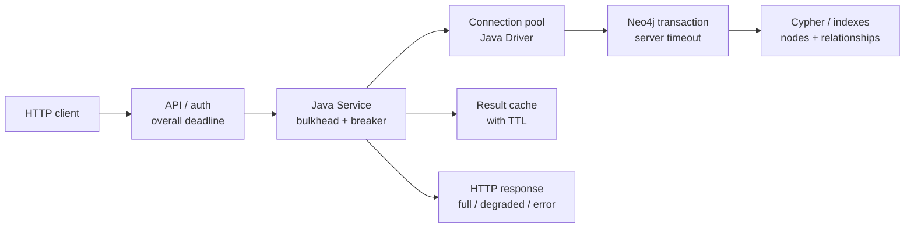
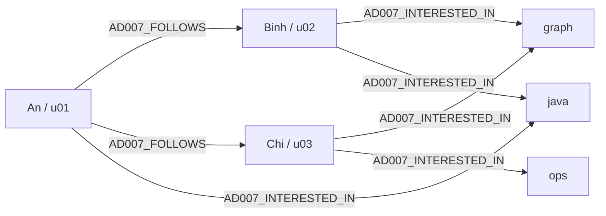

# Error Handling, Timeouts, Request Cancellation, and Service Degradation

## 1. Design Mindset: Even a Correct Query Can Make an Application Unavailable

In a Neo4j application, an API request may pass through authentication, **Java Driver** connection handling, Cypher execution over a **property graph**, node/relationship-to-DTO mapping, and HTTP serialization. If just one stage fails—a dropped Bolt connection, resource contention, a slow query, or a client closing its connection—the entire user experience can degrade.

Consider a **topic recommendations from friends' network** feature: the query traverses from the user via `FOLLOWS` relationships to other people, and then to `Topic` nodes. When Neo4j responds slowly, the application must decide whether to **wait, retry, cancel, return cached results with a warning, or return an error**. The right answer differs between a *non-essential* recommendation widget and a *critical* permission or payment write operation.

This topic belongs to the **Application Design** chapter of the `DATABASE_ENGINE_GRAPH_NEO4J` module. The techniques below connect graph modeling, indexes, `EXPLAIN`/`PROFILE`, the Java Driver, and Spring Data Neo4j with production fault and resource management.

### Learning Outcomes

After this lesson, you will be able to:

1. Classify Neo4j/Java Driver errors into input errors, fixable bugs, transient errors, and ambiguous commit-status errors.
2. Design a **time budget** spanning HTTP down to the connection pool, transaction, and retries; avoid confusing timeouts with request cancellation.
3. Manage the lifecycle of `Driver`, `Session`, `Result`, and transactions when requests are canceled or expire.
4. Apply bounded retries, idempotency, circuit breakers, bulkheads, and load shedding appropriately.
5. Design **graceful degradation** while controlling freshness, authorization, and correctness.
6. Test scenarios where Neo4j is slow or disconnected without causing duplicate updates or resource leaks.

## 2. Dependency Map and Error Boundaries



Some errors appear **before** Neo4j executes any Cypher (for example, connection pool acquisition timeouts). Others occur **after** the transaction has committed but before the application receives the acknowledgment. For that reason, never write a blanket `catch (Exception e)` and blindly retry the whole operation.

### 2.1. Classify Errors Before Deciding How to Handle Them

| Category | Example | Do | Do Not |
|---|---|---|---|
| **Input / business** | Empty user ID, `limit` too large, unauthorized | Return appropriate client error; do not send Cypher | Retry the same input or substitute another user's cached data |
| **Invalid config / query** | Bad Cypher, missing procedure, mismatched schema/constraint | Log error, fix application/deployment | Silently swallow code bugs with fallback or retry infinitely |
| **Transient error** | Neo4j unavailable, stale routing/session, temporary contention | Driver bounded retry; optional fallback for non-critical reads | Stack unbounded multi-layer retries |
| **Timeouts** | Pool wait, long-running transaction, expired HTTP deadline | Stop starting new work, release resources, classify timeout source | Let expired requests keep holding pool connections |
| **Uncertain write state** | Connection lost after sending commit before ACK | Query by operation ID, design idempotency/reconciliation | Resend balance increments, deductions, or keyless record creation |
| **Systemic overload** | Pool exhaustion, rising p99, saturated CPU/heap | Cap concurrency/queues, load shedding, breakers | Raise timeouts and retries to pile on even more load |

In the Java Driver, exceptions include `ClientException`, `TransientException`, `ServiceUnavailableException`, and `SessionExpiredException`. In current versions, retryable exceptions typically implement the marker interface `RetryableException`; error details can include Neo4j error codes and GQLSTATUS. **Do not classify errors solely by matching message text**, since exact messages and codes can evolve across versions.

Note: a "timeout" error does not always share the same exception class across all layers. Timeouts at the HTTP gateway, connection pool, and inside Neo4j are **distinct failures**. Tag logs/metrics with the failure origin before choosing a fallback or retry.

## 3. Setting Up a Sample Graph to Reproduce Scenarios

We use a topic recommendation feature: from a user, find people they follow, and count topics those people are interested in.



All labels and relationships use the `AD007` prefix; **run create/delete statements only in a practice database**.

### 3.1. Identity Constraints

```cypher
CREATE CONSTRAINT ad007_user_id IF NOT EXISTS
FOR (u:AD007User)
REQUIRE u.id IS UNIQUE;
```

```cypher
CREATE CONSTRAINT ad007_topic_slug IF NOT EXISTS
FOR (t:AD007Topic)
REQUIRE t.slug IS UNIQUE;
```

Constraints support stable key lookups and reduce duplicate-node risk across ingestion sessions. Still, `UNIQUE` does not replace application-level validation of ID values.

### 3.2. Nodes and Relationships

```cypher
UNWIND [
  {id: 'u01', name: 'An'},
  {id: 'u02', name: 'Binh'},
  {id: 'u03', name: 'Chi'},
  {id: 'u04', name: 'Dung'}
] AS item
MERGE (u:AD007User {id: item.id})
SET u.name = item.name;
```

```cypher
UNWIND ['graph', 'java', 'ops'] AS slug
MERGE (:AD007Topic {slug: slug});
```

```cypher
UNWIND [
  {source: 'u01', target: 'u02'},
  {source: 'u01', target: 'u03'}
] AS item
MATCH (a:AD007User {id: item.source})
MATCH (b:AD007User {id: item.target})
MERGE (a)-[:AD007_FOLLOWS]->(b);
```

```cypher
UNWIND [
  {userId: 'u01', slug: 'java'},
  {userId: 'u02', slug: 'graph'},
  {userId: 'u02', slug: 'java'},
  {userId: 'u03', slug: 'graph'},
  {userId: 'u03', slug: 'ops'}
] AS item
MATCH (u:AD007User {id: item.userId})
MATCH (t:AD007Topic {slug: item.slug})
MERGE (u)-[:AD007_INTERESTED_IN]->(t);
```

### 3.3. "Full" Query vs. Simpler Query

Recommendation query from followed friends:

```cypher
MATCH (me:AD007User {id: $userId})
      -[:AD007_FOLLOWS]->(friend:AD007User)
      -[:AD007_INTERESTED_IN]->(topic:AD007Topic)
WITH topic, count(DISTINCT friend) AS interestedFriends
RETURN topic.slug AS slug, interestedFriends
ORDER BY interestedFriends DESC, slug
LIMIT $limit;
```

With `$userId = 'u01'` and `$limit = 3`, the output is:

| slug | interestedFriends |
|---|---:|
| `graph` | 2 |
| `java` | 1 |
| `ops` | 1 |

For `u04`, the query returns **0 rows** even though the user exists because no matching relationships exist: this is a valid result, not a backend error. A non-existent ID also yields 0 rows in this pattern; if the API contract must distinguish `404 Not Found` from an empty recommendation list, check user existence **after authentication/authorization** rather than inferring it from recommendation count.

A lighter query with fewer traversals (when Neo4j is **still up**, yet the personalized query is too costly):

```cypher
MATCH (me:AD007User {id: $userId})
      -[:AD007_INTERESTED_IN]->(topic:AD007Topic)
RETURN topic.slug AS slug
ORDER BY slug
LIMIT $limit;
```

For `u01`, the simpler query returns `java`. **This is a different kind of recommendation**, not an equivalent result set to the first query; the API must distinguish `recommendationMode`. If Neo4j is **completely disconnected**, even the simpler query cannot run: fallback must then rely on precomputed cache/alternate services or return an error.

Verify the fixture:

```cypher
MATCH (u:AD007User)
WITH count(u) AS users
MATCH (t:AD007Topic)
WITH users, count(t) AS topics
MATCH (:AD007User)-[f:AD007_FOLLOWS]->(:AD007User)
WITH users, topics, count(f) AS follows
MATCH (:AD007User)-[i:AD007_INTERESTED_IN]->(:AD007Topic)
RETURN users = 4 AND topics = 3
       AND follows = 2 AND count(i) = 5 AS passed;
```

On an isolated fixture, `passed = true`. This verifies data setup, **not** latency benchmarking or fault injection.

## 4. Designing Timeouts Around a Shared Deadline

An API can have multiple timeouts. They govern different wait stages, not interchangeable substitutes.

| Layer | Purpose | Example Configuration Location |
|---|---|---|
| **HTTP/request deadline** | Maximum time client/API waits for a result | Gateway, web framework, request context |
| **Concurrency/queue timeout** | Avoid holding requests waiting on slots/bulkheads too long | Semaphore, bounded queue |
| **Connection timeout** | Limit TCP/TLS/Bolt connection establishment | Driver `Config.withConnectionTimeout` |
| **Connection acquisition timeout** | Limit waiting for an available connection from pool/routing | Driver `Config.withConnectionAcquisitionTimeout` |
| **Transaction timeout** | Instruct Neo4j to terminate overdue transactions | `TransactionConfig.withTimeout` |
| **Retry budget** | Cap time the driver spends retrying transient errors | `Config.withMaxTransactionRetryTime` |
| **Fallback/cache deadline** | Prevent cache/backup calls from dragging past deadline | Dedicated cache/client timeout |

### 4.1. Example 1,200 ms Budget

Suppose the recommendation feature has an **overall 1,200 ms deadline** at the API. A hypothetical policy:

- Pass input validation, authorization, and bulkhead checks before calling the DB.
- Wait at most **around 200 ms** to acquire a connection.
- Set each read transaction timeout to **450 ms**.
- Let the driver retry within a finite budget (e.g., max **300 ms** per configuration; this value does not automatically equal the request deadline).
- Reserve remaining time for DTO mapping, fallback cache, and HTTP response.

**Do not naively add timeouts together to guarantee a deadline.** Connection setup, retries, and transactions can run multiple times or span different phases; a 450 ms transaction timeout does not automatically cap multiple retries to 450 ms total. The API layer must track **remaining time** and refuse to start new work when insufficient budget remains. In the blocking Java Driver, never assume a web framework deadline instantly interrupts every blocking call in progress.

A budget calculation rule:

```text
remaining = requestDeadline - monotonicNow
dbBudget  = min(configuredDbBudget, remaining - safetyMargin)

If dbBudget <= 0:
    do not issue a new query
    choose a valid fallback or return a deadline error
```

Measure elapsed time using a monotonic clock (such as `System.nanoTime()`) rather than wall-clock system time for duration comparisons. Wall-clock timestamps are for recording `asOf`/audit metadata, whereas `nanoTime()` is suited for measuring intervals.

### 4.2. Driver and Transaction Configuration

Java Driver example using the synchronous API:

```java
import java.time.Duration;
import java.util.Map;
import java.util.concurrent.TimeUnit;
import org.neo4j.driver.AccessMode;
import org.neo4j.driver.Config;
import org.neo4j.driver.Driver;
import org.neo4j.driver.GraphDatabase;
import org.neo4j.driver.SessionConfig;
import org.neo4j.driver.TransactionConfig;

Config config = Config.builder()
    .withConnectionTimeout(150, TimeUnit.MILLISECONDS)
    .withConnectionAcquisitionTimeout(200, TimeUnit.MILLISECONDS)
    .withMaxTransactionRetryTime(300, TimeUnit.MILLISECONDS)
    .build();

// uri and authToken are loaded from secure application configuration.
Driver driver = GraphDatabase.driver(uri, authToken, config);

SessionConfig sessionConfig = SessionConfig.builder()
    .withDatabase("neo4j")
    .withDefaultAccessMode(AccessMode.READ)
    .build();

TransactionConfig txConfig = TransactionConfig.builder()
    .withTimeout(Duration.ofMillis(450))
    .withMetadata(Map.of("feature", "topic-recommendations"))
    .build();
```

This example shows **configuration knobs**, not universal recommendations for every network. `Driver` should be reused across the application lifecycle; `Session` is opened per unit of work and closed via `try-with-resources`. Never place usernames, tokens, queries containing PII, or user-supplied values into transaction metadata.

**Critical detail:** `TransactionConfig.withTimeout` bounds the server-side transaction; it does not automatically cap pool waits, network latency, result mapping, or client-side retry loops. `withMaxTransactionRetryTime` caps managed transaction retries, yet the application must still enforce the overall deadline.

## 5. Classified Java Driver Error Handling

### 5.1. Retryable Errors vs. Fail-Fast Errors

The Java Driver documentation distinguishes retryable exceptions via `RetryableException`. Common classes include `TransientException`, `ServiceUnavailableException`, and `SessionExpiredException`. However, **"retryable" does not mean "should always be retried"**:

- If the client canceled or the deadline is nearly exhausted, do not retry.
- If the query is a write and commit outcome is ambiguous, idempotency must exist before replaying.
- If the service is already overloaded, retries can exhaust the pool faster.
- If the error is a `ClientException` from bad Cypher, missing schema, or invalid operations, retrying the same query will not help.

Managed transactions via `Session.executeRead` / `executeWrite` **automatically retry** transient errors within the configured budget. Do not stack three retry layers (controller + service + driver) without accounting for total attempts and jitter. Retryable callbacks can re-execute, so **never send emails, acknowledge queues, increment external counters, or make non-idempotent HTTP requests inside the callback**.

### 5.2. Read Example with Explicit Cache Fallback

The Java snippet below is a **synchronous service pattern**: querying the graph is primary, and upon a *retryable* driver failure after driver retries are exhausted, it falls back to a cached snapshot **with freshness checks**. Types are declared inline to keep the example self-contained; the controller layer maps application exceptions to HTTP statuses.

```java
import java.time.Duration;
import java.time.Instant;
import java.util.List;
import java.util.Map;
import java.util.Optional;
import org.neo4j.driver.AccessMode;
import org.neo4j.driver.Driver;
import org.neo4j.driver.SessionConfig;
import org.neo4j.driver.TransactionConfig;
import org.neo4j.driver.exceptions.Neo4jException;
import org.neo4j.driver.exceptions.RetryableException;

public final class TopicRecommendationService {
    public record TopicScore(String slug, long interestedFriends) {}
    public record Snapshot(List<TopicScore> items, Instant asOf) {}
    public record Reply(
        List<TopicScore> items, boolean degraded,
        String source, Instant asOf
    ) {}

    public interface SnapshotCache {
        Optional<Snapshot> findRecent(String userId, Duration maxAge);
    }

    public static final class RecommendationUnavailableException
            extends RuntimeException {
        public RecommendationUnavailableException(Throwable cause) {
            super("Recommendation dependency unavailable", cause);
        }
    }

    private static final String CYPHER = """
        MATCH (me:AD007User {id: $userId})
              -[:AD007_FOLLOWS]->(friend:AD007User)
              -[:AD007_INTERESTED_IN]->(topic:AD007Topic)
        WITH topic, count(DISTINCT friend) AS interestedFriends
        RETURN topic.slug AS slug, interestedFriends
        ORDER BY interestedFriends DESC, slug
        LIMIT $limit
        """;

    private final Driver driver;
    private final SnapshotCache cache;

    public TopicRecommendationService(
            Driver driver, SnapshotCache cache) {
        this.driver = driver;
        this.cache = cache;
    }

    public Reply recommend(String userId, int limit) {
        if (userId == null || userId.isBlank()
                || limit < 1 || limit > 20) {
            throw new IllegalArgumentException("Invalid request");
        }

        var sessionConfig = SessionConfig.builder()
            .withDatabase("neo4j")
            .withDefaultAccessMode(AccessMode.READ)
            .build();
        var txConfig = TransactionConfig.builder()
            .withTimeout(Duration.ofMillis(450))
            .withMetadata(Map.of("feature", "topic-recommendations"))
            .build();

        try (var session = driver.session(sessionConfig)) {
            List<TopicScore> items = session.executeRead(tx ->
                tx.run(CYPHER, Map.of("userId", userId, "limit", limit))
                  .list(row -> new TopicScore(
                      row.get("slug").asString(),
                      row.get("interestedFriends").asLong()
                  )),
                txConfig
            );
            return new Reply(items, false, "neo4j", Instant.now());
        } catch (Neo4jException failure) {
            if (!(failure instanceof RetryableException)) {
                throw failure; // Do not mask Cypher/permission/schema errors.
            }
            return cache.findRecent(userId, Duration.ofMinutes(2))
                .map(s -> new Reply(
                    List.copyOf(s.items()), true, "cache", s.asOf()
                ))
                .orElseThrow(
                    () -> new RecommendationUnavailableException(failure)
                );
        }
    }
}
```

This example **does not implement HTTP deadline checks**, circuit breakers, or cache authorization; those belong in the caller layer and cache implementation. In production, cache keys must include **tenant, authorization scope, and policy version** when outputs depend on them, with bounded snapshot sizes and retention. Never serve user A's cached data to user B.

For timeout errors not marked `RetryableException` in a given driver/server version, classification policy must inspect **error type, code, origin layer, and request safety**. Do not widen `catch` to swallow all errors just to serve cache. Likewise, **an empty list because a user has no graph links is a valid result**, not a signal that Neo4j failed triggering fallback.

### 5.3. How Should Errors Appear Over HTTP?

| Scenario | Suggested HTTP Status | Notes |
|---|---|---|
| Invalid input | `400 Bad Request` | Do not open a transaction |
| Unauthenticated / unauthorized | `401` / `403` | Never serve cached data to bypass permissions |
| Quota exceeded via proactive service limit | `429 Too Many Requests` | Can include reasonable `Retry-After` |
| DB unavailable with no safe fallback | `503 Service Unavailable` | Application may send `Retry-After` if appropriate |
| Gateway/caller waited too long on backend | `504 Gateway Timeout` where gateway semantics apply | Do not use 504 for arbitrary internal errors |
| Optional feature degraded under control | `200 OK` + `degraded` metadata | Cached data must still be fresh enough and authorized |

Never force every Neo4j failure into `500`; equally, never turn configuration or syntax bugs into fake `200` responses. For critical write endpoints, HTTP status codes cannot replace **querying commit status** via an operation key.

## 6. Request Cancellation: Canceling on the Client Does Not Mean Stopping the Server Query

Scenario: a user navigates away or closes the HTTP connection while Neo4j is traversing multiple hops. The system must distinguish:

1. **Client stops waiting**: the HTTP request is canceled.
2. **Application stops spawning new work**: stop retrying or launching secondary queries.
3. **Driver stops emitting records to the consumer**: a reactive subscription/stream can be canceled.
4. **Neo4j terminates the transaction**: a server-side action, typically enforced via transaction timeout or supported transaction-termination commands.

These layers **do not automatically align**. Per the Java Driver Reactive API, canceling record streaming can immediately stop delivering new records to the subscriber **but does not necessarily abort the running query on the server**. Thus, **stream `cancel()` does not replace `TransactionConfig.withTimeout`**.

### 6.1. Designing a Safe Lifecycle

```text
Request starts
  ├─ verify request still has time budget and is authenticated
  ├─ acquire concurrency slot (with timeout)
  ├─ open dedicated Session, run read transaction with timeout
  ├─ consume Result while transaction/session remains open
  ├─ if client cancels: halt remaining work, do not retry
  └─ finally / resource cleanup: close Session, release slot
```

With the **blocking driver**, use `try-with-resources` to guarantee `Session` closure whenever control leaves scope. Never assume calling `Thread.interrupt()` from a web framework will **immediately interrupt** every socket wait, Bolt read, or server-side computation. If your design ties queries to a `Future` or virtual thread, test the **actual cancellation behavior** of your running driver and framework, not merely that the HTTP response stopped.

With **reactive workflows**, tie session creation and closure to subscription lifecycle (e.g., the Java Driver's `Flux.usingWhen` pattern); never pre-open sessions before a subscriber exists. Never share one session across multiple concurrent request publishers. On subscriber cancellation, handle cleanup signals, transaction timeouts, and server resource monitoring.

### 6.2. Writes and Ambiguous Commit Status

Suppose a `POST /follow` request runs a transaction:

```text
Application               Neo4j
   | -- COMMIT ----------> |
   |                       | commit succeeds
   X  (connection drops)   |
   |                       |
   | ACK never received    |
```

The application **cannot conclude the transaction rolled back** just because no ACK arrived. If the write endpoint re-runs the same operation without a stable key, it can create duplicate relationships or double-increment metrics. You need a client- or workflow-supplied **idempotency key**, uniqueness constraints, and post-retry lookup/reconciliation.

Example managing an ID for a follow request:

```cypher
CREATE CONSTRAINT ad007_follow_operation_id IF NOT EXISTS
FOR (op:AD007FollowOperation)
REQUIRE op.id IS UNIQUE;
```

```cypher
MATCH (source:AD007User {id: $sourceId})
MATCH (target:AD007User {id: $targetId})
WHERE source <> target
MERGE (op:AD007FollowOperation {id: $operationId})
ON CREATE SET op.sourceId = $sourceId,
              op.targetId = $targetId
WITH source, target, op
WHERE op.sourceId = $sourceId
  AND op.targetId = $targetId
MERGE (source)-[:AD007_FOLLOWS]->(target)
RETURN op.id AS operationId;
```

**Preconditions:** replays with the same `operationId` must carry the same `sourceId` and `targetId`; if the same key arrives with a different payload, **report conflict** rather than returning success. `MERGE` plus the uniqueness constraint on **operation ID** prevents creating two operation nodes; they **do not automatically prove relationship uniqueness under two concurrent transactions on the same endpoint pair**. Under parallel write load, serialize by pair key or add appropriate mechanisms/constraints, and stress-test write races.

To query status after an ACK failure:

```cypher
MATCH (op:AD007FollowOperation {id: $operationId})
RETURN op.sourceId AS sourceId,
       op.targetId AS targetId;
```

If returned, the operation committed; if absent, still account for causal visibility, routing, lag, and consistent read policies. Never implement "not found immediately = definitely never committed" in a distributed environment without proper verification design. Driver bookmarks/causal consistency can help for read-your-own-writes across a cluster.

## 7. Retries Must Be Bounded and Must Not Cause Query Storms

### 7.1. Retry in the Right Place

`executeRead` and `executeWrite` are where the Driver retries transactions on transient errors. At the service layer, add retries only for a clear reason and while **deadline** remains—such as recovering from a failover. Never write manual retry loops around queries inside a transaction callback.

Operational rules:

- Retry only when **the error is retryable and the operation is safe to repeat**.
- Bound both **total duration** and **attempt count**; prefer backoff with jitter for any custom retry loop.
- Never retry constraint, validation, syntax, or authorization failures.
- Never retry after caller cancellation, exhausted budget, or when a circuit breaker is open.
- Monitor actual retry counts; retries can amplify load on an already overloaded Neo4j cluster.

### 7.2. Prevent Multi-Layer Retry Amplification

```text
HTTP gateway retry: 3 attempts
  × API service retry: 3 attempts
  × Java Driver retry: multiple attempts within budget
  = backend query volume can multiply dramatically
```

If every layer retries independently, one external request can trigger a storm of inner attempts. Pick **one deadline-aware retry orchestration layer**, while tuning the Driver's internal retry budget accordingly. For non-idempotent write requests, prevent gateways from retrying without an operation ID.

## 8. Controlled Service Degradation

**Graceful degradation** preserves partial useful functionality when a dependency is unhealthy—it does **not** mean silently substituting wrong data for right data.

### 8.1. Fallback Decision Table

| Request | Valid Fallback | What Not to Do |
|---|---|---|
| Non-essential topic recommendations | Short-lived cached data with `asOf`/`degraded=true`; or hide widget | Display another user's/tenant's/unauthorized cache |
| Advanced search too slow while DB is healthy | Shallower query with fewer relationships; mark mode clearly | Keep firing the same heavy query when already overloaded |
| Order detail page needing point-in-time figures | Return dependency error or explicitly labeled snapshot if business allows | Present stale payment status as live |
| Changing access rights or authenticating | **Fail closed**, never rely on untrusted cache | Bypass authorization policy because Neo4j is slow |
| Financial writes / balance adjustments | Preserve idempotency and query transaction state | Fake success or apply credit/debit twice |

Sample response for an optional recommendation feature:

```json
{
  "topics": [
    {"slug": "graph", "interestedFriends": 2},
    {"slug": "java", "interestedFriends": 1}
  ],
  "degraded": true,
  "source": "cache",
  "asOf": "2026-10-10T09:30:00Z"
}
```

This is an **illustrative** response structure, not a live snapshot generated from the fixture. Exposing `source`, `asOf`, and `degraded` tells the UI it may be rendering older data. If cache TTL has expired or authorization cannot be proven, do not serve it as fallback.

### 8.2. Circuit Breakers, Bulkheads, and Load Shedding

| Mechanism | Goal | Policy Example |
|---|---|---|
| **Circuit breaker** | Stop calling backend during sustained high failure rates | Open when error rate exceeds threshold after enough samples; allow limited probes (*half-open*) after cooldown |
| **Bulkhead** | Prevent one query class from exhausting all connections/threads | Allow at most N concurrent recommendation requests; isolate budgets from critical operations |
| **Bounded queue** | Prevent unbounded backlog accumulation | Small queue, short queue timeout |
| **Load shedding** | Fail fast once capacity is exhausted | Return `429`/`503` by cause; never open a transaction |
| **Short-TTL cache** | Keep UI responsive when read paths lag | Business-aligned TTL, tenant- and permission-namespaced |
| **Reduced query depth** | Cut hops and intermediate row counts | 1-hop instead of multi-hop, small `LIMIT`, signal degraded quality |

Monitor p95/p99 latency, error rate, saturation, pool wait time, and breaker open counts. Adding more worker threads to "fix" an exhausted pool often just sends more queries to Neo4j and slows everything down further. It is far more effective to **shed/limit load before acquiring connections** and reduce per-request query cost.

## 9. Do Not Lose Performance at the Cypher Layer

Even well-tuned timeouts will trigger continuously if Cypher generates too many rows. Specifically for graph data:

- Anchor on selective nodes with indexes/constraints, avoiding `AllNodesScan` when keys exist.
- Bound hop counts and path expansion width; avoid unbounded traversals in HTTP endpoints.
- Use `RETURN` with only needed columns and `LIMIT` with deterministic `ORDER BY`, instead of returning full nodes/relationships.
- Avoid row multiplication across multiple `OPTIONAL MATCH` clauses before aggregation; check `PROFILE` and cardinality.
- Stream large exports row-by-row, without holding transactions indefinitely when clients read slowly.
- With Spring Data Neo4j, prefer DTOs and `Neo4jClient` for lightweight reads rather than hydrating massive relationship aggregates and serializing everything.

`EXPLAIN` example (without executing) to verify the planner starts at `AD007User(id)` and expands edges:

```cypher
EXPLAIN
MATCH (me:AD007User {id: 'u01'})
      -[:AD007_FOLLOWS]->(friend:AD007User)
      -[:AD007_INTERESTED_IN]->(topic:AD007Topic)
WITH topic, count(DISTINCT friend) AS interestedFriends
RETURN topic.slug AS slug, interestedFriends
ORDER BY interestedFriends DESC, slug
LIMIT 3;
```

With `PROFILE` on a **practice read database**, inspect `Rows`, `DB Hits`, and expansion/sorting cost. Never assume an index makes the entire query optimal, because a high-degree hub can still fan out thousands of rows. Nor does a trailing `LIMIT 3` guarantee only three paths were processed before aggregation.

## 10. Observability and Diagnostics in Production

### 10.1. Minimum Timing Layers to Measure

| Metric / Log | Why It Is Needed |
|---|---|
| `http.request.duration` p50/p95/p99, status | How long users wait and what the API returns |
| `neo4j.query.duration` and record count | Query execution and result transfer cost |
| `neo4j.pool.acquire.duration`, active/waiting connections | Detect pool exhaustion or queuing |
| `neo4j.transaction.timeout.count`, retry count | Distinguish true timeouts from retry storms |
| `degraded_response.count` by source/mode | Count fallback responses to avoid masking operational faults |
| `circuit_breaker.state`, rejected requests | Verify load controls are protecting vs. over-rejecting |
| CPU, heap/GC, page cache, disk I/O | Locate bottlenecks on Neo4j and app hosts |
| **Commit uncertainty** and reconciliation results | Surface writes needing lookup after ACK loss |

Metric names are **dashboard design suggestions**, not all metrics emitted by default by Neo4j/Driver. Wire OpenTelemetry/Micrometer or your stack's monitoring tools and verify actual instrumented metrics.

### 10.2. Safe Logging and Tracing

Attach static metadata to transactions to aid diagnostics:

```java
TransactionConfig config = TransactionConfig.builder()
    .withTimeout(Duration.ofMillis(450))
    .withMetadata(Map.of(
        "service", "learning-api",
        "feature", "recommendations"
    ))
    .build();
```

In logs, record at minimum: operation/request ID, feature, success/failure status, error classification, duration, retry count, fallback mode, and a PII-free trace ID. **Never log passwords, Bolt tokens, full Cypher with sensitive parameters, or plaintext usernames** unnecessarily. Server query logs, HTTP logs, and application logs must all comply with retention/access policies.

Neo4j provides operational tools to inspect running transactions/queries; when a canceled request leaves DB work running, operators should correlate transaction metadata with logs. Actively terminating transactions on the server is an administrative action affecting in-flight work, not something to trigger automatically on every HTTP disconnect.

## 11. Resilience Test Scenarios

Fault tolerance cannot be verified solely by unit tests mocking `Neo4jRepository`. Write integration tests against real Neo4j and **inject faults at the exact layer** (network, pool, server, HTTP). Suggested matrix:

| Scenario | Controlled Simulation | Expected Behavior |
|---|---|---|
| Valid query, valid data | Neo4j Testcontainer with `AD007` fixture | `u01` receives `graph=2, java=1, ops=1` |
| Invalid input | `limit = 0` or blank ID | Blocked before DB; validation error returned |
| Transient Neo4j disconnect | Network proxy isolating Bolt during test | Bounded retries, valid cache or `503`, session closed |
| Query slower than transaction timeout | Test dataset/load generating latency, tight timeout | Fails within policy bounds; no unbounded retries |
| Pool exhausted | Small pool limit with controlled long-held transactions | Measurable rejections/timeouts; no hung requests |
| Client cancels HTTP request | Client aborts mid-stream while reading many records | Stops starting new work; driver resources cleaned up per design |
| Expired cache TTL | Inject stale or wrong-tenant snapshot | Cache rejected; error/fail closed |
| Syntax/schema error | Mutate test query to invalid Cypher | Never turns into fake success; never retries endlessly |
| Lost commit ACK | Drop connection at commit acknowledgment in chaos test | Lookup by operation ID, safe replay |
| Concurrent failures across tenants | Mixed load triggering circuit breaker | Critical tenants/features are not starved |

**Evaluating test outcomes** must verify graph state after failures, not just HTTP status codes. For writes, assert node/relationship counts, uniqueness, version/idempotency keys, and that retries created no duplicate external side effects. For reads, verify fallback responses never leak unauthorized data.

### 11.1. Budget Scenario and Quick Check

Suppose the request deadline is 1,200 ms; right before calling Neo4j, only 90 ms remain and the safety margin is 100 ms:

```text
dbBudget = min(450 ms, 90 ms - 100 ms)
         = -10 ms
```

**Right decision:** do not start a new transaction; if valid cache exists, return a response with `degraded=true`, otherwise return a deadline/dependency error. Never start a 450 ms transaction hoping the gateway will "clean everything up."

## 12. Pre-Deployment Design Checklist

1. **API contract:** is the endpoint a non-critical read or a strict write; how much staleness is allowed?
2. **Timeouts/budget:** overall deadline, pool acquire, transaction, retry, fallback, and safety margin designed?
3. **Error classification:** validation/auth/syntax never retried; transient errors bounded-retried; uncertain commits reconciled?
4. **Cancellation:** session/transaction/result scoped properly; client disconnects do not leak unbounded server work?
5. **Load limits:** bulkheads, small queues, breakers, and load shedding tested under realistic load?
6. **Fallback:** includes TTL, source, timestamp, tenant/permissions, and restricted to degradable features?
7. **Correctness:** uniqueness constraints, idempotency keys, and pre/post-failure node/relationship counts verified?
8. **Observability:** p95/p99, pool wait, retries, timeouts, fallback counts, and HTTP-to-DB traces in place?
9. **Rollout:** kill switches/config to disable fallback or tighten concurrency if metrics degrade?

### Self-Practice Exercises

1. **Error classification.** Given five cases—bad Cypher, unauthorized access, transient Neo4j network drop, query timeout, missing commit ACK—choose retry/fallback/fail-fast and justify each.
2. **Timeout budget.** Design an 800 ms deadline covering pool, transaction, retries, serialization, and margin. Write the guard blocking new queries when only 60 ms remain.
3. **Graph fixture.** Create `AD007User`/`AD007Topic` and run the recommendation query for `u01`. Explain why `graph` gets `interestedFriends=2`, while `u04` validly receives an empty list.
4. **Fallback check.** Simulate a cache with two snapshots for `u01`: 30 seconds old and 10 minutes old, with a 2-minute TTL. Which snapshot may be returned, and what metadata must the response include?
5. **Cancellation lifecycle.** Sketch the timeline when an HTTP client disconnects mid-traversal. Distinguish stopping record delivery, Java cleanup, and server transaction termination.
6. **Retries and writes.** Design `POST /follow` with `operationId`, create its constraint, and prove calling the same operation ID twice does not create two operation nodes. Separately test race conditions when concurrent transactions create the edge.
7. **Load shedding.** An API allows at most 20 concurrent recommendation requests; the 21st arrives while the pool is busy. Choose a queue/bulkhead early-rejection strategy and matching HTTP status.
8. **Empirical measurement.** Using a Neo4j Testcontainer and network proxy, measure p50/p95/p99, error rate, retry count, and degraded responses when injecting 100–500 ms network latency.
9. **Reading plans.** Run `EXPLAIN`/`PROFILE` on the recommendation query; inspect index seeks and where rows multiply across relationships. Demonstrate why a trailing `LIMIT` does not always make a query cheap.

### Cleaning Up Practice Data

**Run only in a test database.** Delete the lesson's nodes first, then drop the constraints; `DETACH DELETE` also removes attached relationships.

```cypher
MATCH (op:AD007FollowOperation)
DETACH DELETE op;
```

```cypher
MATCH (u:AD007User)
DETACH DELETE u;
```

```cypher
MATCH (t:AD007Topic)
DETACH DELETE t;
```

```cypher
DROP CONSTRAINT ad007_follow_operation_id IF EXISTS;
```

```cypher
DROP CONSTRAINT ad007_user_id IF EXISTS;
```

```cypher
DROP CONSTRAINT ad007_topic_slug IF EXISTS;
```

## 13. References

- [Neo4j Java Driver Manual — Transactions](https://neo4j.com/docs/java-manual/current/transactions/): managed transactions, retries, `TransactionConfig.withTimeout`, and transaction metadata.
- [Neo4j Java Driver API — RetryableException](https://neo4j.com/docs/api/java-driver/current/org.neo4j.driver/org/neo4j/driver/exceptions/RetryableException.html): classification of retryable errors.
- [Neo4j Java Driver API — Neo4jException](https://neo4j.com/docs/api/java-driver/current/org.neo4j.driver/org/neo4j/driver/exceptions/Neo4jException.html): error codes and details.
- [Neo4j Java Driver API — Config.ConfigBuilder](https://neo4j.com/docs/api/java-driver/current/org.neo4j.driver/org/neo4j/driver/Config.ConfigBuilder.html): connection/pool timeouts and retry budgets.
- [Neo4j Java Driver Manual — Reactive streams](https://neo4j.com/docs/java-manual/current/reactive/): demand, subscription management, and session lifecycle.
- [Neo4j Java Driver API — ReactiveResult](https://neo4j.com/docs/api/java-driver/current/org.neo4j.driver/org/neo4j/driver/reactive/ReactiveResult.html): effects and limits of canceling record streaming.
- [Neo4j Cypher Manual — Execution plans](https://neo4j.com/docs/cypher-manual/current/planning-and-tuning/execution-plans/): `EXPLAIN`, `PROFILE`, `Rows`, and `DB Hits`.
