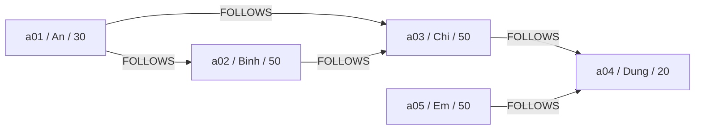

# Testing Cypher with Expected Results and Deterministic Ordering in Neo4j

## 1. Why can a "working" Cypher query still fail tests?

Neo4j stores data in a **property graph** model: nodes have labels and properties, and relationships have types, directions, and properties. Cypher describes **the graph pattern to query** and how to return results; the engine decides the execution plan based on indexes, statistics, version, and current data.

In Java applications using the Neo4j Java Driver or Spring Data Neo4j (SDN), there are three levels to verify:

1. **Query executes cleanly:** valid syntax, no exceptions, transaction completes.
2. **Business-correct results:** row counts, IDs, properties, data types, edge counts, relationship directions, and uniqueness are all accurate.
3. **Deterministic ordering:** if order matters, the query must have a complete `ORDER BY`, typically requiring a **unique** secondary key as a *tie-breaker*.

For example, a "Top users by score" endpoint might return the four right users yet swap the order of two tied users between runs. A test comparing lists by order will intermittently pass and fail (*flaky test*). Conversely, changing the assertion to a set can mask a real bug if the API **promises to return an ordered list**.

**Foundational rule:** Neo4j guarantees row ordering only when the Cypher query uses `ORDER BY`. Never infer ordering from the order of `CREATE`, `UNWIND`, `MATCH`, `collect()`, node IDs, index order, or incidental output in Neo4j Browser.

## 2. Designing a repeatable test case

A good Cypher test must specify upfront:

| Component | Required question | Example |
| --- | --- | --- |
| Input data (*fixture*) | What graph exists before execution? | 5 `:CypherTestAccount` nodes, 5 `:FOLLOWS` relationships |
| Query | Which Cypher statement and exact parameters? | `WHERE u.active = true` |
| Expected data | Which IDs, values, types, and row counts? | `a02, a05, a01, a04` |
| Ordering | Is the result an **ordered list** or an **unordered set**? | `score DESC, accountId ASC` |
| Transaction boundary | Does the test read before or after commit? Does it roll back? | Read in a new transaction |
| Isolation | Can another test modify the data? | Dedicated database/container |
| Error checking | What is expected for invalid input or missing data? | Empty list, `null`, or exception |

Prefer **business keys** like `accountId` over `id(n)` or `elementId(n)` when comparing results. Internal IDs can change when a database is rebuilt, imported, or reallocated; tests relying on them become coupled to infrastructure details.

When comparing records, check both **value and type**: `42` (INTEGER), `42.0` (FLOAT), and `'42'` (STRING) are not the same value at the application layer.

## 3. Creating fixed data for the examples

All statements in this section are **for a test database only**; never run fixture-deletion queries on a shared database containing real data. The label `CypherTestAccount` is chosen specifically to avoid colliding with real domain labels.

### 3.1. Uniqueness constraint

```cypher
CREATE CONSTRAINT cypher_test_account_id IF NOT EXISTS
FOR (u:CypherTestAccount)
REQUIRE u.accountId IS UNIQUE;
```

The constraint ensures no two `CypherTestAccount` nodes share the same `accountId` and supports fast lookups. It does not replace verifying that the test seeds the expected row count and relationships.

### 3.2. Cleaning old data in a test-only database

```cypher
MATCH (u:CypherTestAccount)
DETACH DELETE u;
```

`DETACH DELETE` also deletes relationships attached to the node. Only perform this operation in a **database/container owned by the test**. For parallel tests, give each test an independent database or a separate namespace rather than letting one test delete another test's data.

### 3.3. Node fixture

```cypher
UNWIND [
  {id: 'a01', name: 'An',   score: 30, active: true},
  {id: 'a02', name: 'Binh', score: 50, active: true},
  {id: 'a03', name: 'Chi',  score: 50, active: false},
  {id: 'a04', name: 'Dung', score: 20, active: true},
  {id: 'a05', name: 'Em',   score: 50, active: true}
] AS row
CREATE (u:CypherTestAccount {
  accountId: row.id,
  name: row.name,
  score: row.score,
  active: row.active
});
```

After commit, the baseline fixture contains:

| accountId | name | score | active |
| --- | --- | ---: | --- |
| `a01` | An | 30 | true |
| `a02` | Binh | 50 | true |
| `a03` | Chi | 50 | false |
| `a04` | Dung | 20 | true |
| `a05` | Em | 50 | true |

### 3.4. Relationship fixture

```cypher
UNWIND [
  {from: 'a01', to: 'a02'},
  {from: 'a01', to: 'a03'},
  {from: 'a02', to: 'a03'},
  {from: 'a03', to: 'a04'},
  {from: 'a05', to: 'a04'}
] AS link
MATCH (source:CypherTestAccount {accountId: link.from})
MATCH (target:CypherTestAccount {accountId: link.to})
CREATE (source)-[:FOLLOWS]->(target);
```

Graph diagram:



Verification queries for the setup step:

```cypher
MATCH (u:CypherTestAccount)
RETURN count(u) AS accounts;
```

Expected: `accounts = 5`.

```cypher
MATCH (:CypherTestAccount)-[r:FOLLOWS]->(:CypherTestAccount)
RETURN count(r) AS relationships;
```

Expected: `relationships = 5`. Both checks should run **after the fixture creation statements have committed**. If data setup fails, the test should **fail immediately in setup** rather than continuing with an undefined state.

## 4. The most important rule: `ORDER BY`

### 4.1. A query without `ORDER BY` makes no ordering guarantee

```cypher
MATCH (u:CypherTestAccount)
RETURN u.accountId AS id;
```

The query may return the right five IDs, but their order depends on the query plan, indexes, runtime, and data state. Even if the first run returns `a01, a02, a03, a04, a05`, that is **not a Cypher contract**.

A list assertion like:

```java
assertEquals(
    List.of("a01", "a02", "a03", "a04", "a05"),
    actualIds
);
```

is inappropriate for an unordered query. If the business logic only cares which IDs exist, compare sets **along with a no-duplicates check**; if the business logic requires a sorted list, fix the **query**, not just the assertion.

### 4.2. Adding a complete `ORDER BY`

```cypher
MATCH (u:CypherTestAccount)
WHERE u.active = true
RETURN u.accountId AS id, u.score AS score
ORDER BY score DESC, id ASC;
```

Result **in exact order**:

| Position | id | score |
| ---: | --- | ---: |
| 1 | `a02` | 50 |
| 2 | `a05` | 50 |
| 3 | `a01` | 30 |
| 4 | `a04` | 20 |

Here `a02` and `a05` both have `score = 50`. `id ASC` is a unique secondary key, so those two rows **cannot swap positions** on a score tie.

### 4.3. `ORDER BY score DESC` can still be non-deterministic

```cypher
MATCH (u:CypherTestAccount)
WHERE u.active = true
RETURN u.accountId AS id, u.score AS score
ORDER BY score DESC;
```

This query guarantees the 50-point group appears before 30 and 20, but it does **not** guarantee `a02` always precedes `a05`. Two rows with equal sort keys can swap places.

In particular, this is a serious bug for pagination: pages can skip or duplicate rows across page fetches when tied items have an unstable order.

Practical rule:

> If the caller cares about exact ordering or uses `SKIP`/`LIMIT`, sort by the required business fields and append a **final unique key**, such as `ORDER BY u.score DESC, u.accountId ASC`.

When a key can be `null`, define an explicit rule for null placement and secondary keys; do not let correctness depend on implicit null handling if business rules require otherwise.

### 4.4. `ORDER BY` with `WITH` and `RETURN`

To return the final list in order, place `ORDER BY` on the clause producing the final result:

```cypher
MATCH (u:CypherTestAccount)
WITH u
WHERE u.active
RETURN u.accountId AS id
ORDER BY id ASC;
```

With `collect()`, `ORDER BY` on `WITH` has a specific role: it guarantees row order fed into the **immediately following clause**, allowing you to control the order of collected elements:

```cypher
MATCH (u:CypherTestAccount)
WHERE u.active
WITH u
ORDER BY u.score DESC, u.accountId ASC
RETURN collect(u.accountId) AS orderedIds;
```

Expected list: `['a02', 'a05', 'a01', 'a04']`. Do not assume `collect(u.accountId)` follows ID order just because an index exists or nodes were created in that order.

### 4.5. `UNWIND` does not guarantee row order

```cypher
UNWIND [3, 1, 2] AS value
RETURN value;
```

There is no guarantee the result will always stay `3, 1, 2`. To sort ascending:

```cypher
UNWIND [3, 1, 2] AS value
RETURN value
ORDER BY value ASC;
```

Expected: `1, 2, 3`. If you need to preserve the **original** order of elements even with duplicate values, carry a **position index** and use `ORDER BY index`; `ORDER BY value` cannot distinguish duplicate values.

## 5. Testing pagination with `SKIP` and `LIMIT`

### 5.1. Verifying exact page boundaries

```cypher
MATCH (u:CypherTestAccount)
WHERE u.active
RETURN u.accountId AS id, u.score AS score
ORDER BY score DESC, id ASC
SKIP 1
LIMIT 2;
```

From the ordered list `['a02', 'a05', 'a01', 'a04']`, skipping the first element and taking the next two yields:

```text
['a05', 'a01']
```

The test must assert **exactly 2 rows**, exact IDs, and exact order—not merely that the result contains `a05`. With `SKIP 4 LIMIT 2`, the result is empty; with `SKIP 3 LIMIT 2`, only one row `a04` remains.

### 5.2. Stable ordering alone does not solve data changes between pages

`ORDER BY score DESC, accountId ASC` makes ordering deterministic for **the same data snapshot**. However, if a user's score changes between two HTTP requests, `SKIP` can still yield duplicates or skipped rows even though both Cypher queries are valid.

In systems with concurrent writes, you should:

- Consider **keyset/cursor pagination** using the chosen sort tuple, e.g., (`score`, `accountId`).
- Pass the last key tuple from the previous page into the next page and apply comparisons matching the sort direction.
- Clarify snapshot/freshness requirements; a cursor does not automatically guarantee an immutable snapshot while data is being mutated.

Example of the next page after key (`50`, `'a02'`):

```cypher
MATCH (u:CypherTestAccount)
WHERE u.active
  AND (
    u.score < $lastScore
    OR (u.score = $lastScore AND u.accountId > $lastId)
  )
RETURN u.accountId AS id, u.score AS score
ORDER BY score DESC, id ASC
LIMIT $pageSize;
```

With `lastScore = 50`, `lastId = 'a02'`, and `pageSize = 2` on the fixture, the result is `a05` then `a01`. This assumes **non-null** sort keys and a unique ID; if additional sort fields or different directions are added, the cursor predicate must be adjusted accordingly.

## 6. Testing cardinality: sets, lists, and multisets are not the same

### 6.1. Cypher can return duplicate rows

```cypher
MATCH (u:CypherTestAccount)-[:FOLLOWS]->(v:CypherTestAccount)
RETURN v.accountId AS followedId
ORDER BY followedId;
```

The fixture has five relationships. Node `a03` receives edges from `a01` and `a02`, while `a04` receives edges from `a03` and `a05`. The result is:

```text
['a02', 'a03', 'a03', 'a04', 'a04']
```

There are **5** rows, even though there are only **3** distinct target users. If the test converts the list to a set:

```java
Set<String> followedIds = new HashSet<>(actualIds);
```

it discards the fact that two IDs appeared multiple times. Therefore:

| Business requirement | Appropriate assertion |
| --- | --- |
| Ordered Top-N list | Compare `List` to `List`, checking both values and order |
| Set of IDs, no duplicates | Compare `Set` **and** assert row count equals set size |
| Count paths/relationships to each node | Compare an `id -> count` map or multiset |
| Total relationship count | Compare `count(r)` and relationship type/direction |
| Reading a single entity by unique key | Assert exactly one record with expected properties/types |

### 6.2. `DISTINCT` changes semantics

```cypher
MATCH (:CypherTestAccount)-[:FOLLOWS]->(v:CypherTestAccount)
RETURN DISTINCT v.accountId AS followedId
ORDER BY followedId ASC;
```

Expected result: `['a02', 'a03', 'a04']`, **3 rows**. Never change a relationship-counting query to use `DISTINCT` just to make a test easier to compare: deduplication can hide bugs or alter business semantics.

### 6.3. `count(*)` vs. `count(value)` with nulls

```cypher
MATCH (u:CypherTestAccount {accountId: 'a04'})
OPTIONAL MATCH (u)-[:FOLLOWS]->(v)
RETURN count(*) AS rows,
       count(v) AS followedAccounts;
```

Because `a04` has no outgoing `FOLLOWS` relationships:

- `OPTIONAL MATCH` still preserves **one row** with `v = null`.
- `count(*) = 1` counts all rows.
- `count(v) = 0` because `count(expression)` ignores nulls.

A test checking only `count(*)` would wrongly conclude that `a04` follows one person. Always pick the count expression that matches what you intend to verify.

## 7. Testing relationships, edge direction, and paths

### 7.1. Relationship direction is part of the expected result

```cypher
MATCH (u:CypherTestAccount {accountId: 'a01'})
      -[:FOLLOWS]->(friend:CypherTestAccount)
RETURN friend.accountId AS id
ORDER BY id ASC;
```

Expected list: `['a02', 'a03']`. Flipping the direction to `(u)<-[:FOLLOWS]-(friend)` produces a **different** result because `a01` has no incoming edges in the fixture. Removing the arrow with `-[:FOLLOWS]-` also produces different results for nodes that have both incoming and outgoing edges.

Thus tests verify:

1. Correct relationship type.
2. Correct direction.
3. Correct endpoint IDs.
4. Correct relationship count (especially in graphs allowing multiple edges of the same type between two nodes).

### 7.2. Paths may share the same destination yet differ in route

From `a01`, there are two `FOLLOWS` paths of length 2:

- `a01 -> a02 -> a03`.
- `a01 -> a03 -> a04`.

Tests should not compare only the final node when the requirement is "all paths of length 2":

```cypher
MATCH p = (start:CypherTestAccount {accountId: 'a01'})
          -[:FOLLOWS*2]->(finish:CypherTestAccount)
WITH [n IN nodes(p) | n.accountId] AS route
RETURN route
ORDER BY route[1] ASC, route[2] ASC;
```

Expected list:

```text
[
  ['a01', 'a02', 'a03'],
  ['a01', 'a03', 'a04']
]
```

If you need to compare routes regardless of order, normalize them as **sequences of business IDs** instead of comparing driver `Path`/`Node` objects by internal ID. When multiple paths share the same sort key, add a per-route tie-breaker or a stable canonical string representation of the route.

### 7.3. Shortest paths can have multiple valid solutions

A graph can have multiple shortest paths of the same length. If the business logic only requires the **shortest length**, tests should assert only the length and valid endpoints rather than guessing which path Neo4j will pick when no unique selection rule exists.

If the business logic requires returning one representative path in a deterministic order, write a query that enumerates valid candidates, defines an **explicit tie-breaking criterion**, and selects with `ORDER BY ... LIMIT 1`. Do not expect `shortestPath`, query plans, or relationship creation order to act as a domain tie-breaker.

## 8. Expected results must account for nulls, types, and boundary values

### 8.1. Missing property and `null`

```cypher
MATCH (u:CypherTestAccount {accountId: 'a01'})
RETURN u.alias AS alias;
```

The fixture has no `alias` property, so `alias = null`; `RETURN` still yields **one record** because node `a01` exists.

Contrast with:

```cypher
MATCH (u:CypherTestAccount {accountId: 'missing-id'})
RETURN u.alias AS alias;
```

No node matches, so the result has **zero records**. These are two distinct cases:

| Case | Record count | Value |
| --- | ---: | --- |
| Node exists but lacks property | 1 | `null` |
| No node matches `MATCH` | 0 | No value to read |
| `OPTIONAL MATCH` does not match | Typically preserves prior row | Optional branch column is `null` |

In the Java Driver, `single()` requires exactly one record, while `list()` can return an empty list. Use `record.get("alias").isNull()` to check for null. Do not call `asString()` on null and treat the resulting exception as the expected behavior.

### 8.2. Comparing numbers and types

```cypher
MATCH (u:CypherTestAccount)
WHERE u.accountId = 'a01'
RETURN u.score AS score, u.active AS active;
```

Expected: `score` is a Cypher `INTEGER` with value `30`, and `active` is `BOOLEAN true`. The Java Driver reads:

```java
Record row = result.single();
assertEquals(30L, row.get("score").asLong());
assertTrue(row.get("active").asBoolean());
```

In this example, `Record` is `org.neo4j.driver.Record`; `assertEquals`/`assertTrue` are JUnit assertions. Note that `30L` has type `long`, matching the `asLong()` API.

### 8.3. Floating-point numbers, dates/times, and generated values

- For computed floating-point values, use an error *tolerance* instead of bit-for-bit equality, e.g. `assertEquals(expected, actual, 1e-9)`.
- For fixed dates like `date('2026-11-25')`, compare `LocalDate`; avoid generating `date()` dynamically in tests that expect invariant results.
- For `datetime()`, `randomUUID()`, or random values, do not assert an **exact literal value** when the query intentionally generates dynamic values. Instead, verify format, time range, non-nullness, or inject fixed/mocked values via parameters.
- For strings, Neo4j compares order using Cypher's rules; do not assume Vietnamese collation works the way your application expects. If domain-specific ordering is needed (e.g., accented Vietnamese sorting), normalize an explicit **sort key** in the application.

## 9. Java test suite with JUnit 5, Neo4j Java Driver, and Testcontainers

For Cypher integration tests, a **real Neo4j database in a container** reflects the parser, transactions, indexes, and graph semantics far more accurately than mocking repositories or mocking `Record`.

The example uses the Testcontainers **1.x** API (package `org.testcontainers.containers.Neo4jContainer`) with JUnit 5 and the Java Driver. In Testcontainers 2.x, the Neo4jContainer module/package may differ, so choose imports matching your installed dependency version. The `neo4j:5.26` image is just an **example pinned version**, not a mandatory version; CI should select a Neo4j version compatible with your real application.

Required test dependencies include: JUnit Jupiter, Testcontainers Neo4j, Testcontainers JUnit Jupiter, and Neo4j Java Driver. In Spring Boot applications, many versions are managed by a BOM/starter; do not mix incompatible major versions.

### 9.1. Complete test verifying sorting, pagination, relationships, and rollback

```java
import static org.junit.jupiter.api.Assertions.*;

import java.util.List;
import java.util.Map;

import org.junit.jupiter.api.AfterAll;
import org.junit.jupiter.api.BeforeAll;
import org.junit.jupiter.api.BeforeEach;
import org.junit.jupiter.api.Test;
import org.neo4j.driver.AuthTokens;
import org.neo4j.driver.Driver;
import org.neo4j.driver.GraphDatabase;
import org.neo4j.driver.Record;
import org.neo4j.driver.Session;
import org.neo4j.driver.SessionConfig;
import org.neo4j.driver.Transaction;
import org.testcontainers.containers.Neo4jContainer;
import org.testcontainers.junit.jupiter.Container;
import org.testcontainers.junit.jupiter.Testcontainers;

@Testcontainers
class CypherDeterministicQueryTest {

    @Container
    static final Neo4jContainer<?> neo4j =
        new Neo4jContainer<>("neo4j:5.26")
            .withAdminPassword("integration-test-password");

    static Driver driver;

    private Session session() {
        return driver.session(SessionConfig.forDatabase("neo4j"));
    }

    @BeforeAll
    static void connectAndCreateSchema() {
        driver = GraphDatabase.driver(
            neo4j.getBoltUrl(),
            AuthTokens.basic("neo4j", "integration-test-password")
        );
        try (Session s = driver.session()) {
            s.run("""
                CREATE CONSTRAINT cypher_test_account_id IF NOT EXISTS
                FOR (u:CypherTestAccount)
                REQUIRE u.accountId IS UNIQUE
                """).consume();
        }
    }

    @AfterAll
    static void closeDriver() {
        if (driver != null) driver.close();
        // @Testcontainers manages the container lifecycle automatically.
    }

    @BeforeEach
    void seedGraph() {
        try (Session s = session()) {
            // Safe only because this container is dedicated to this test.
            s.run("""
                MATCH (u:CypherTestAccount)
                DETACH DELETE u
                """).consume();

            s.run("""
                UNWIND $rows AS row
                CREATE (:CypherTestAccount {
                  accountId: row.id,
                  name: row.name,
                  score: row.score,
                  active: row.active
                })
                """, Map.of("rows", List.of(
                    Map.of("id", "a01", "name", "An",
                           "score", 30, "active", true),
                    Map.of("id", "a02", "name", "Binh",
                           "score", 50, "active", true),
                    Map.of("id", "a03", "name", "Chi",
                           "score", 50, "active", false),
                    Map.of("id", "a04", "name", "Dung",
                           "score", 20, "active", true),
                    Map.of("id", "a05", "name", "Em",
                           "score", 50, "active", true)
                ))).consume();

            s.run("""
                UNWIND $links AS link
                MATCH (a:CypherTestAccount {accountId: link.fromId})
                MATCH (b:CypherTestAccount {accountId: link.toId})
                CREATE (a)-[:FOLLOWS]->(b)
                """, Map.of("links", List.of(
                    Map.of("fromId", "a01", "toId", "a02"),
                    Map.of("fromId", "a01", "toId", "a03"),
                    Map.of("fromId", "a02", "toId", "a03"),
                    Map.of("fromId", "a03", "toId", "a04"),
                    Map.of("fromId", "a05", "toId", "a04")
                ))).consume();
        }
    }

    @Test
    void shouldSortByScoreThenUniqueId() {
        try (Session s = session()) {
            List<Record> records = s.run("""
                MATCH (u:CypherTestAccount)
                WHERE u.active = true
                RETURN u.accountId AS id, u.score AS score
                ORDER BY score DESC, id ASC
                """).list();

            List<String> actualIds = records.stream()
                .map(row -> row.get("id").asString())
                .toList();
            List<Long> actualScores = records.stream()
                .map(row -> row.get("score").asLong())
                .toList();

            assertEquals(
                List.of("a02", "a05", "a01", "a04"),
                actualIds
            );
            assertEquals(List.of(50L, 50L, 30L, 20L),
                         actualScores);
        }
    }

    @Test
    void shouldReturnDeterministicPage() {
        try (Session s = session()) {
            List<String> ids = s.run("""
                MATCH (u:CypherTestAccount)
                WHERE u.active
                RETURN u.accountId AS id, u.score AS score
                ORDER BY score DESC, id ASC
                SKIP 1 LIMIT 2
                """)
                .list(row -> row.get("id").asString());

            assertEquals(List.of("a05", "a01"), ids);
        }
    }

    @Test
    void shouldReadOutgoingRelationshipsInOrder() {
        try (Session s = session()) {
            List<String> ids = s.run("""
                MATCH (:CypherTestAccount {accountId: $id})
                      -[:FOLLOWS]->(friend:CypherTestAccount)
                RETURN friend.accountId AS id
                ORDER BY id
                """, Map.of("id", "a01"))
                .list(row -> row.get("id").asString());

            assertEquals(List.of("a02", "a03"), ids);
        }
    }

    @Test
    void shouldDistinguishOptionalRowFromMatchedNodes() {
        try (Session s = session()) {
            Record r = s.run("""
                MATCH (u:CypherTestAccount {accountId: 'a04'})
                OPTIONAL MATCH (u)-[:FOLLOWS]->(friend)
                RETURN count(*) AS totalRows,
                       count(friend) AS matches
                """).single();

            assertEquals(1L, r.get("totalRows").asLong());
            assertEquals(0L, r.get("matches").asLong());
        }
    }

    @Test
    void shouldNotPersistRolledBackChanges() {
        try (Session s = session()) {
            try (Transaction tx = s.beginTransaction()) {
                tx.run("""
                    CREATE (:CypherTestAccount {
                      accountId: 'rollback-only',
                      name: 'Temporary',
                      score: 0,
                      active: false
                    })
                    """).consume();

                tx.rollback();
            }

            long remaining = s.run("""
                MATCH (u:CypherTestAccount {
                  accountId: 'rollback-only'
                })
                RETURN count(u) AS total
                """).single().get("total").asLong();

            assertEquals(0L, remaining);
        }
    }
}
```

**Why does this approach make expected results deterministic?**

- Each test starts from **a fixture it prepares**, independent of stale developer data.
- Queries requiring ordering include `ORDER BY` with an ID tie-breaker.
- Tests use `List<Record>` and `List<String>` to preserve actual order rather than converting to a set before comparing.
- Setup calls `consume()` to ensure implicit transactions complete before the test reads.
- The rollback test explicitly re-reads in a separate transaction after aborting the first transaction.

**Limitation of this example:** it shares one container across tests and resets data in `@BeforeEach`. Do not enable parallel execution for these test methods without changing the isolation strategy. In CI, consider a container per class, a separate database per test (if your edition supports it), or namespaced data. Using Docker/Testcontainers requires the test machine to have a container runtime available.

### 9.2. Why shouldn't you mock Neo4j when testing Cypher?

Mocking `Neo4jRepository` is useful when unit-testing **database-independent business logic**, but it fails to catch:

- Cypher syntax errors, wrong aliases, or misspelled labels/types/properties.
- The planner or engine returning unexpected record counts from the graph.
- Side effects of `OPTIONAL MATCH`, `count(*)`, `DISTINCT`, and `ORDER BY`.
- Uniqueness constraints, rollback behavior, and relationship direction.

Therefore, Cypher tests should be **integration tests against real Neo4j**, while mocks belong in the service layer to isolate logic branches that do not require graph access.

## 10. Testing write queries, commit, rollback, and idempotency

### 10.1. A successful write query must verify post-commit state

Example updating a user's score:

```cypher
MATCH (u:CypherTestAccount {accountId: $id})
SET u.score = $score
RETURN u.accountId AS id, u.score AS newScore;
```

In the Java Driver, wrap the write operation in a managed transaction:

```java
try (Session s = driver.session(
        SessionConfig.forDatabase("neo4j"))) {
    s.executeWrite(tx -> {
        tx.run("""
            MATCH (u:CypherTestAccount {accountId: $id})
            SET u.score = $score
            """, Map.of("id", "a01", "score", 99)
        ).consume();
        return null;
    });

    long storedScore = s.executeRead(tx ->
        tx.run("""
            MATCH (u:CypherTestAccount {accountId: $id})
            RETURN u.score AS score
            """, Map.of("id", "a01"))
        .single()
        .get("score")
        .asLong()
    );

    assertEquals(99L, storedScore);
}
```

Note that `MATCH ... SET ...` **can succeed without modifying any node** if `id` does not exist. Therefore, tests should verify before/after records, check the matched node count, or inspect `RETURN`/summary counters together with a post-commit read query.

### 10.2. `MERGE` and idempotency must be tested

```cypher
MERGE (u:CypherTestAccount {accountId: 'a06'})
ON CREATE SET u.name = 'NewUser', u.score = 0, u.active = true
RETURN u.accountId AS id;
```

Run twice and verify:

```cypher
MATCH (u:CypherTestAccount {accountId: 'a06'})
RETURN count(u) AS matches;
```

Expected: `matches = 1`, not 2. However, `MERGE` only guarantees semantics for the matched pattern; under concurrent transactions, you need a **uniqueness constraint** on `accountId`. For relationships, `MERGE (a)-[:FOLLOWS]->(b)` can prevent recreating the same edge pattern in a test context, whereas domains allowing multiple independent `FOLLOWS` events require their own distinguishing key.

### 10.3. Counters do not replace data assertions

The Java Driver provides `ResultSummary.counters()` to inspect created/deleted nodes/relationships and properties set. This can supplement test coverage, but:

- `propertiesSet()` counts engine-level property assignments, not the number of business entities that actually changed.
- Re-running the same query can produce different counters even when the **final state** is right (e.g., a second `MERGE` creates no node).
- Counters for a statement inside an explicit transaction **do not guarantee the outer transaction has committed**.

Always verify data with a read query **after the write transaction has committed** before declaring the test passed.

### 10.4. Rollback and retry

An explicit transaction `beginTransaction()` allows rolling back all uncommitted statements within it. Managed transactions `executeWrite(...)` may retry the callback on transient errors, so callback code must be **idempotent** and avoid external non-rollbackable side effects (such as sending emails or calling payment systems).

A rollback test should make an easily identifiable change inside the transaction, call `rollback()`, and re-read after the transaction closes. Do not run the read query inside the same uncommitted transaction and treat the visible data as proof of durable persistence.

## 11. Spring Data Neo4j integration: testing mapping and custom queries

In Spring Boot, `@DataNeo4jTest` creates a **slice test** for Spring Data Neo4j components; how the datasource/Driver is configured for a container depends on Spring Boot and your test setup. The goal is to test real repositories against a test database, not just mocks.

Example repository:

```java
import java.util.List;
import org.springframework.data.neo4j.repository.Neo4jRepository;
import org.springframework.data.neo4j.repository.query.Query;
import org.springframework.data.repository.query.Param;

public interface TestAccountRepository
        extends Neo4jRepository<TestAccount, String> {

    @Query("""
        MATCH (u:CypherTestAccount)
        WHERE u.active = true
        RETURN u
        ORDER BY u.score DESC, u.accountId ASC
        """)
    List<TestAccount> findActiveSorted();

    @Query("""
        MATCH (u:CypherTestAccount {accountId: $id})
        RETURN u
        """)
    TestAccount findSingle(@Param("id") String id);
}
```

Example entity:

```java
import org.springframework.data.annotation.Version;
import org.springframework.data.neo4j.core.schema.Id;
import org.springframework.data.neo4j.core.schema.Node;

@Node("CypherTestAccount")
public class TestAccount {
    @Id
    private String accountId;

    @Version
    private Long version;

    private String name;
    private Integer score;
    private Boolean active;

    public String getAccountId() { return accountId; }
    public String getName() { return name; }
    public Integer getScore() { return score; }
    public Boolean getActive() { return active; }
}
```

In a repository test using a properly configured container/Driver:

```java
List<TestAccount> users = repository.findActiveSorted();
List<String> ids = users.stream()
    .map(TestAccount::getAccountId)
    .toList();
assertEquals(List.of("a02", "a05", "a01", "a04"), ids);
```

**Caution:** when mapping entities via SDN, `RETURN u` returns nodes for the converter to build entities. If the entity has `@Relationship` fields, custom queries must return the components required for those relationships according to SDN rules; do not assume `RETURN u` automatically fetches all relationships. In this example, the class only has simple properties, so returning relationship graphs is unnecessary.

If a test needs to verify **raw Cypher records** rather than entity mapping, use `Neo4jClient` or the Java Driver directly to avoid conflating query bugs with mapping bugs. With `@DataNeo4jTest`, do not assume tests automatically roll back all changes across every configuration or version; verify the transaction manager and test/container setup, and use an isolated test database.

## 12. Common causes of flaky tests

| Symptom | Cause | Fix |
| --- | --- | --- |
| Sorting test passes intermittently | Query lacks `ORDER BY` | Add `ORDER BY` as required |
| Users with equal scores swap positions | Sort key is not unique | Add `accountId` or unique tie-breaker key |
| Page 2 contains an ID from page 1 | Data mutated between requests or incomplete sort keys | Use total ordering; consider cursor/snapshot |
| `Set` comparison passes despite duplicates | Multiplicity information lost | Assert count, list, or multiset |
| `count(*)` equals 1 with no neighbor | `OPTIONAL MATCH` keeps a null row | Use `count(neighbor)` |
| Test depends on node creation order | Engine does not guarantee scan order | Use `ORDER BY` and business IDs |
| `collect()` has unexpected order | Input was not sorted right before aggregation | `WITH ... ORDER BY ... RETURN collect(...)` |
| Test using `id(n)` differs across machines | Internal IDs allocated differently | Compare `accountId` |
| Test reads a record that actually rolled back | Read occurred inside the write transaction | Re-read after commit in a new transaction |
| Random failures under parallel runs | Another test deleted/modified shared fixture | Independent container/DB or per-test namespace |
| DateTime assertion fails by timezone | Relied on system clock or mismatched timezone parsing | Use fixed timestamps and check timezone |
| Comparing floats with `==` | Floating-point precision error | Use a tolerance |
| Works on small data, fails on larger data | Only tested the happy path | Add empty, multi-branch, duplicate, and pagination boundary cases |
| Only mocks repository; real query is broken | Cypher never executed against Neo4j | Maintain at least one integration test on real DB |
| Asserts exact `PROFILE` plan | Query planner changes across versions/statistics | Test semantics; run benchmarks/plan checks separately if needed |

## 13. Strategy for organizing tests in a project

### 13.1. Three-layer separation

**Layer 1 — Pure Java logic unit tests.** Test service filtering conditions, input/output DTO conversions, parameter validation, and pagination logic. Repositories can be mocked at this layer.

**Layer 2 — Cypher/SDN integration tests.** Run real Neo4j with fixed fixtures; verify nodes/relationships, query results, sorting, nulls, aggregations, and transactions/constraints. This is the core focus of this lesson.

**Layer 3 — Performance/regression tests.** Run on representative-scale data using `EXPLAIN`/`PROFILE`, comparing latency, DB Hits, and peak memory against appropriate thresholds. Do not mix hard timing assertions into regular integration tests that must remain stable across varied CI runners.

### 13.2. Read tests: baseline cases

| Scenario | Expected outcome |
| --- | --- |
| Find `accountId = a01` | One node, `name = An`, `score = 30`, `active = true` |
| Find `accountId = missing` | Zero records |
| Find all active | Exactly 4 accounts |
| Sort active by score/ID | `a02, a05, a01, a04` |
| `SKIP 1 LIMIT 2` | `a05, a01` |
| Who does `a01` follow? | `a02, a03` in the right direction |
| Who does `a04` follow? | No neighbors; `count(friend)=0` |
| Count distinct followed nodes | 3 |
| Count all `FOLLOWS` edges | 5 |
| Two-hop paths from `a01` | Two routes listed in Section 7 |

### 13.3. Write tests: baseline cases

| Scenario | Expected outcome |
| --- | --- |
| `CREATE` node with new ID | Node count increases after commit |
| `MERGE` same ID twice | Does not create duplicate node if constraint and query are right |
| Attempt duplicate ID with `CREATE` | Constraint rejects the violating transaction |
| `SET` a property | Property matches expected value after commit |
| `SET` for nonexistent ID | No node updated; verified via count/record |
| `DELETE` relationship | Type/direction count decreases accordingly |
| Rollback transaction containing `CREATE` | No new node remains |
| Managed transaction retried | No unintended external side effects outside the DB |

### 13.4. What never to rely on

- Return order without `ORDER BY`.
- Order among rows sharing the same sort key.
- Internal IDs, record creation timestamps, or auto-generated node positions.
- Absolute execution time on shared-resource CI environments.
- Specific operators in the query plan when the test only checks correctness.
- Transaction/rollback behavior **assumed** from a framework without verification.

## 14. Practice exercises

On a dedicated test database/container, complete the following tasks:

1. Create the fixture of 5 `CypherTestAccount` nodes and 5 `FOLLOWS` relationships as in Section 3. Verify the uniqueness constraint and total node/edge counts.
2. Write a test for `MATCH ... RETURN` **without `ORDER BY`**; explain why comparing against a fixed list is invalid.
3. Add `ORDER BY score DESC, accountId ASC`. Assert exact output `a02, a05, a01, a04`. Remove `accountId ASC` and explain the flakiness risk.
4. Test `SKIP 1 LIMIT 2` and boundary cases `SKIP 3` and `SKIP 4`.
5. Verify total `FOLLOWS` relationships (5), distinct destinations (3), and two-hop routes from `a01` (2 routes).
6. Try `OPTIONAL MATCH` on `a04`, comparing `count(*)` with `count(friend)`; then contrast with a `MATCH` that finds no node.
7. Use JUnit 5 + Java Driver to test one committed `SET` and one rolled-back `CREATE`; re-read in a separate transaction.
8. Create two transactions attempting to write the same `accountId` while the uniqueness constraint is active; verify the database prevents duplicate nodes and exceptions are handled properly.
9. Extract the top-user query into a custom SDN repository; verify ID, score, active mapping, and list order.
10. Re-run the entire suite multiple times and (with proper isolation) in parallel mode; identify and eliminate any shared-data dependencies.

**Completion criteria:** the learner can build a small yet representative fixture, define expected rows and ordering, use `ORDER BY` with a unique secondary key, distinguish null/0 records/duplicates, write read–write integration tests against real Neo4j, and verify data after commit or rollback.

## Official references

- [Neo4j Cypher Manual — ORDER BY](https://neo4j.com/docs/cypher-manual/current/clauses/order-by/): ordering guarantees, multiple sort keys, and `ORDER BY` placement.
- [Neo4j Cypher Manual — SKIP](https://neo4j.com/docs/cypher-manual/current/clauses/skip/): skipping leading rows in results.
- [Neo4j Cypher Manual — LIMIT](https://neo4j.com/docs/cypher-manual/current/clauses/limit/): limiting row counts and ordering considerations.
- [Neo4j Cypher Manual — UNWIND](https://neo4j.com/docs/cypher-manual/current/clauses/unwind/): expanding lists into rows and lack of ordering guarantees.
- [Neo4j Cypher Manual — Aggregating functions](https://neo4j.com/docs/cypher-manual/current/functions/aggregating/): `count(*)`, `count(value)`, `collect()`, and nulls.
- [Neo4j Cypher Manual — OPTIONAL MATCH](https://neo4j.com/docs/cypher-manual/current/clauses/optional-match/): result rows and nulls when patterns do not match.
- [Neo4j Java Driver Manual — Run your own transactions](https://neo4j.com/docs/java-manual/current/transactions/): `session.run`, `executeRead`/`executeWrite`, commit, and rollback.
- [Testcontainers — Neo4j module](https://java.testcontainers.org/modules/databases/neo4j/): launching a Neo4j container in integration tests.
- [Spring Data Neo4j Reference — Testing](https://docs.spring.io/spring-data/neo4j/reference/testing.html): testing repositories and mapping with Neo4j.
