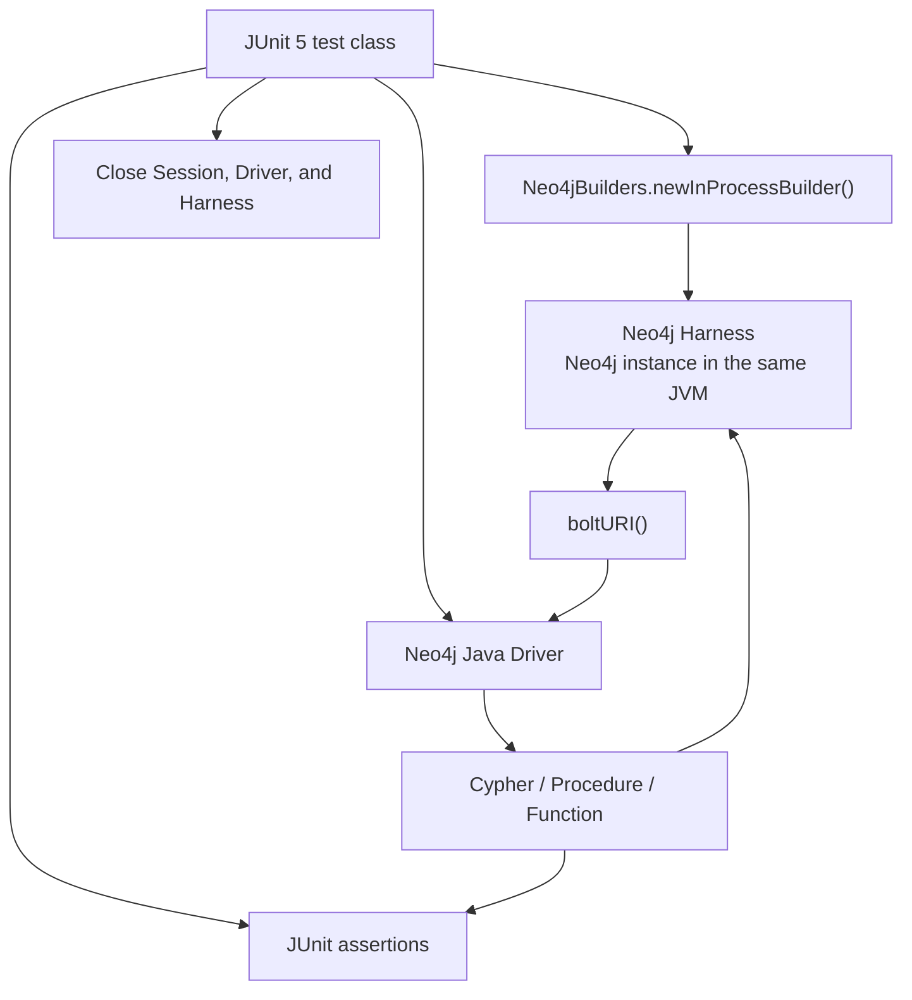

# Neo4j Harness and Its Appropriate Scope for In-Process Testing

When a Java application works with Neo4j, many bugs only surface when Cypher actually runs against a real database: wrong relationship direction, `MERGE` failing to match the right key, `OPTIONAL MATCH` dropping data, missing constraints, or custom procedures behaving unexpectedly. Mocking the Java Driver can verify that code invokes driver methods, but it **does not actually execute Cypher on the Neo4j engine**.

**Neo4j Test Harness** (often shortened to **Neo4j Harness**) is a testing library that starts a Neo4j instance **right inside the test's JVM process**, configures a test database, loads sample data, and executes queries through the Neo4j Java Driver. It is especially useful for testing **Cypher, procedures, user-defined functions, relationships, and schema** against a real Neo4j engine without provisioning a separate server for each test run.

This lesson belongs to the **Testing** chapter of the **DATABASE_ENGINE_GRAPH_NEO4J** module, where Neo4j is used to model property graphs, query nodes, relationships, and paths with Cypher, manage indexes/constraints, import data, tune queries, and integrate with the Java Driver/Spring Data Neo4j. The focus is on understanding **what Harness can do, when to use it, and which test types it cannot replace**.

After this lesson, you will be able to:

- Distinguish between unit tests, in-process integration tests, Testcontainers integration tests, and production-like environment tests.
- Start and shut down Neo4j Harness with JUnit 5, connecting via the Bolt URI exposed by Harness.
- Write tests verifying nodes, relationship directions, transaction rollbacks, and constraints using real Cypher.
- Register custom procedures/functions for testing via `withProcedure()` or `withFunction()`.
- Use Harness with Spring Data Neo4j `@DataNeo4jTest` where appropriate.
- Design fixtures, isolate tests, manage versions, and recognize limitations around clustering, plugins, networking, timing, and load.

> **Version note:** Examples target the modern Neo4j Harness API across Neo4j 5.x/2025.x/2026.x, Java 17+, and JUnit Jupiter. Choose a `neo4j-harness` version compatible with your project's Neo4j server and Java Driver. `Neo4jBuilders.newInProcessBuilder()` is the modern API; legacy `Neo4jRule` or `TestServerBuilders` APIs from very old Neo4j docs should not be copied into new projects.

## 1. Where does Harness fit in the testing pyramid?

Differentiate testing layers based on **what is actually being verified**.

| Test type | Real database? | Best suited for verifying | Main limitations |
| --- | --- | --- | --- |
| **Pure Java unit test** | No | Business rules, input validation, standalone functions | Does not verify Cypher execution |
| **Unit test with mocked Driver/repository** | No | Method calls, error-handling branches, object contracts | Mocks may return data unlike real Neo4j |
| **In-process Neo4j Harness** | Yes, runs in the same JVM | Cypher, constraints, transactions, procedures/functions, basic mapping | Environment differs from production cluster/server |
| **Neo4j via Testcontainers** | Yes, in a separate container | Driver, configuration, network communication, deployment-like server compatibility | Requires container runtime; heavier startup and resource usage in many cases |
| **Staging integration/E2E tests** | Yes, deployed system | Security, TLS, clustering, routing, auxiliary services, operations | More expensive; requires orchestration and suitable test data |
| **Load/performance tests** | Yes, representative system | Throughput, latency, memory, lock contention | Harness does not provide production-representative conditions |

Key distinction: **"in-process" does not mean simulating Neo4j with a few Java collections**. Harness launches **a real Neo4j instance** inside the same JVM. This engine executes Cypher and transactions just like a real database, though the operational context is simplified.

### Why is testing Cypher with mocks insufficient?

Suppose a service contains the following code:

```java
String cypher = """
    MATCH (c:Customer {customerId: $id})-[:PLACED]->(o:Order)
    RETURN count(o) AS orderCount
    """;
```

A mocked `Session.run()` returning `orderCount=2` can keep a unit test green even if the Cypher has the wrong `:PLACED` direction. **Harness executes the real Cypher query**, so if the sample data records `Customer -[:PLACED]-> Order` while the query accidentally reverses the arrow, the result differs from expectations and the test fails.

## 2. Architecture of a Harness-based test



Harness provides an `org.neo4j.harness.Neo4j` object to manage the instance lifecycle; `boltURI()` returns the connection URI. The Java Driver connects to this URI and executes statements just as it would against a standard Neo4j server.

Initialization example:

```java
Neo4j neo4j = Neo4jBuilders.newInProcessBuilder()
    .withDisabledServer()
    .build();

Driver driver = GraphDatabase.driver(neo4j.boltURI());
```

`withDisabledServer()` **disables the unnecessary HTTP server in tests**—it does not disable all communication or Bolt: you still connect via `boltURI()`. The method name can be misleading; remember it simply suppresses the HTTP server component during tests.

### Where does the data live?

The instance managed by Harness is intended for testing and has its own lifecycle. Do not treat it as a production database or long-term storage. Some configurations use temporary working/data directories; **in-process does not mean every byte stays purely in RAM with zero disk usage**.

Because it shares the JVM, the Neo4j libraries and test code share classpath, memory, Java version, CPU resources, and class loading. This makes logic testing convenient, which is also why Harness **does not accurately reflect the performance of a standalone Neo4j server**.

## 3. Configuring test dependencies

Example Gradle configuration:

```gradle
dependencies {
    implementation 'org.neo4j.driver:neo4j-java-driver:DRIVER_VERSION'

    testImplementation 'org.neo4j.test:neo4j-harness:NEO4J_VERSION'
    testImplementation 'org.junit.jupiter:junit-jupiter:JUNIT_VERSION'
}

test {
    useJUnitPlatform()
}
```

The strings `NEO4J_VERSION`, `DRIVER_VERSION`, and `JUNIT_VERSION` are **placeholders to be replaced with actual versions**, not valid literals to copy directly. In Spring Boot applications, use the appropriate dependency management/BOM to prevent conflicts.

Corresponding Maven dependency for Harness:

```xml
<dependency>
    <groupId>org.neo4j.test</groupId>
    <artifactId>neo4j-harness</artifactId>
    <version>NEO4J_VERSION</version>
    <scope>test</scope>
</dependency>
```

**Do not blindly pick the Harness version to match the Java Driver version.** The two artifacts have separate release schedules and compatibility matrices. Check the Neo4j version used by your application, review changelogs, and verify on your chosen CI environment.

In some projects, the Spring Boot starter already provides the runtime driver and `starter-test` provides JUnit. Avoid duplicate declarations or forcing mismatched versions that cause classpath conflicts. If Harness startup throws `NoSuchMethodError`, dependency errors, or classloader issues, inspect the dependency tree before debugging your Cypher tests.

## 4. Complete example: JUnit 5 + Harness + Neo4j Driver

This is an **in-process integration test** example with three goals: creating data, verifying relationship direction, and testing transaction rollback. It starts **a fresh Harness per test method**, prioritizing data isolation for clarity.

```java
import static org.junit.jupiter.api.Assertions.assertEquals;

import java.util.Map;

import org.junit.jupiter.api.AfterEach;
import org.junit.jupiter.api.BeforeEach;
import org.junit.jupiter.api.Test;

import org.neo4j.driver.Driver;
import org.neo4j.driver.GraphDatabase;
import org.neo4j.driver.Session;
import org.neo4j.driver.Transaction;

import org.neo4j.harness.Neo4j;
import org.neo4j.harness.Neo4jBuilders;

class CustomerOrderHarnessTest {

    private Neo4j neo4j;
    private Driver driver;

    @BeforeEach
    void startDatabase() {
        neo4j = Neo4jBuilders.newInProcessBuilder()
                .withDisabledServer()
                .build();

        driver = GraphDatabase.driver(neo4j.boltURI());
    }

    @AfterEach
    void stopDatabase() {
        if (driver != null) {
            driver.close();
        }
        if (neo4j != null) {
            neo4j.close();
        }
    }

    @Test
    void createsRelationshipInExpectedDirection() {
        try (Session session = driver.session()) {
            session.run("""
                CREATE (:Customer {customerId: 'C-101'})
                       -[:PLACED]->
                       (:Order {orderId: 'O-901'})
                """).consume();

            long forward = session.run("""
                MATCH (:Customer {customerId: $customerId})
                      -[:PLACED]->
                      (:Order {orderId: $orderId})
                RETURN count(*) AS n
                """, Map.of(
                    "customerId", "C-101",
                    "orderId", "O-901"
                )).single().get("n").asLong();

            long reverse = session.run("""
                MATCH (:Order {orderId: $orderId})
                      -[:PLACED]->
                      (:Customer {customerId: $customerId})
                RETURN count(*) AS n
                """, Map.of(
                    "customerId", "C-101",
                    "orderId", "O-901"
                )).single().get("n").asLong();

            assertEquals(1L, forward);
            assertEquals(0L, reverse);
        }
    }

    @Test
    void rollbackDoesNotPersistNewNode() {
        try (Session session = driver.session()) {
            try (Transaction tx = session.beginTransaction()) {
                tx.run("""
                    CREATE (:Customer {customerId: 'C-ROLLBACK'})
                    """).consume();
                tx.rollback();
            }

            long afterRollback = session.run("""
                MATCH (c:Customer {customerId: 'C-ROLLBACK'})
                RETURN count(c) AS n
                """).single().get("n").asLong();

            assertEquals(0L, afterRollback);
        }
    }
}
```

### What does this test actually verify?

- **Harness runs a real database:** `CREATE` persists nodes and edges according to Cypher semantics, and `MATCH` retrieves them.
- **Relationship direction is verified:** `Customer -[:PLACED]-> Order` yields 1, while the reverse direction of the same relationship type yields 0.
- **Rollback is verified:** the transaction creates a node and calls `rollback()`, so no `C-ROLLBACK` node remains afterward.
- **Parameterized queries:** `customerId` and `orderId` are passed as parameters rather than concatenated into Cypher strings.
- **Resource cleanup:** `Session`, `Driver`, and Harness are closed to avoid resource leaks.

This test does not prove that a REST API or full Spring service works end-to-end. It validates **specific Neo4j behaviors** executed through the Driver—which is precisely Harness's sweet spot.

## 5. Testing indexes, constraints, and `MERGE` semantics

Neo4j schema is central to correctness: if a business key is not unique, a node-creation query can silently introduce duplicate data. Harness lets you test constraints with real Cypher rather than mocks.

### 5.1. Testing idempotent `MERGE` re-runs

Suppose the model uses customer key `customerId`. Create a uniqueness constraint:

```cypher
CREATE CONSTRAINT customer_id_unique IF NOT EXISTS
FOR (c:Customer)
REQUIRE c.customerId IS UNIQUE;
```

Attempt to ingest the same key twice:

```cypher
UNWIND ['C-101', 'C-101'] AS key
MERGE (c:Customer {customerId: key})
SET c.name = 'Mai';
```

Verify:

```cypher
MATCH (c:Customer {customerId: 'C-101'})
RETURN count(c) AS customerCount;
```

Expected result: `customerCount = 1`. This verifies that repeating the same business key does not create two nodes.

Note: `MERGE` does not automatically make **every** operation idempotent. Statements like `SET c.count = c.count + 1` or creating unkeyed event relationships can still mutate data on each run. Tests must specify the exact expected behavior.

### 5.2. Testing that constraints reject duplicate keys

Assume the constraint above exists, and then execute:

```cypher
CREATE (:Customer {customerId: 'C-101'});
```

when node `C-101` already exists. Neo4j must reject the duplicate creation. In Java tests, use JUnit `assertThrows` to verify that the statement raises an error, rather than merely checking that a mock method was invoked.

Illustrative logic:

```java
import static org.junit.jupiter.api.Assertions.assertThrows;
import org.neo4j.driver.exceptions.Neo4jException;

assertThrows(Neo4jException.class, () -> {
    try (Session session = driver.session()) {
        session.run("""
            CREATE (:Customer {customerId: 'C-101'})
            """).consume();
    }
});
```

This snippet assumes the test already created the **constraint** and the **existing node with that key**. You should also assert the post-error state: the number of nodes with key `C-101` remains 1, and the failed transaction left no partial data behind.

**Never assume indexes or constraints exist automatically in Harness.** If production uses schema migrations, the test should apply those migrations or build the exact schema required for the scenario under test.

## 6. Test isolation: one instance per test or shared?

There are two common strategies.

### 6.1. One Harness per test method

As in Section 4: use `@BeforeEach` to start and `@AfterEach` to stop.

**Pros:** effortless test independence; nodes, relationships, indexes, and constraints from one test never leak into a fresh instance. If a test fails mid-way, the next test still starts clean.

**Cons:** starting Neo4j for every test method carries overhead. Across hundreds of tests, total runtime can grow noticeably.

### 6.2. Sharing a Harness per test class

You can create one Harness in `@BeforeAll` and close it in `@AfterAll`, while each `@BeforeEach` seeds the fixture and `@AfterEach` cleans data deterministically.

Lifecycle sketch:

```java
@BeforeAll
static void setUpHarness() {
    neo4j = Neo4jBuilders.newInProcessBuilder()
        .withDisabledServer()
        .build();
    driver = GraphDatabase.driver(neo4j.boltURI());
}

@AfterEach
void cleanGraph() {
    try (Session session = driver.session()) {
        session.run("MATCH (n) DETACH DELETE n").consume();
    }
}

@AfterAll
static void closeHarness() {
    driver.close();
    neo4j.close();
}
```

This second snippet is a **lifecycle pattern** assuming `neo4j` and `driver` are declared static fields; it is not a standalone class.

Things to watch carefully:

- `MATCH (n) DETACH DELETE n` clears **graph data in the test database**, but **does not drop indexes or constraints**. If a test modifies schema, clean up the schema accordingly or start a fresh instance.
- Tests running in parallel against the **same database** can delete each other's data. With JUnit parallel execution, isolate instances/databases or disable parallel execution for test classes sharing a Harness.
- Fixtures should be self-contained with test-specific keys/labels; never read from or write to a production database.
- Avoid depending on test-method execution order. `@Test` ordering is not a contract for passing data from one test to another.

### Can you rely on Spring `@Transactional` to roll back every test?

Not entirely. In Spring `@DataNeo4jTest`, imperative tests typically run inside a transaction that rolls back when the test ends, **however** queries sent through **a separate Driver/session not participating in the Spring transaction** will not roll back automatically with the test transaction. Schema operations, asynchronous tasks, and reactive transactions also require separate handling.

Verify whether every statement runs in **the same transaction**, rather than assuming "called inside the same JUnit method means everything rolls back together".

## 7. Fixtures: small but intentional datasets

A fixture is a graph prepared before running a test. Instead of generating thousands of random nodes, a small targeted graph exposes specific mistakes.

Example for testing **distinct node counting**:

```cypher
CREATE (c:Customer {customerId: 'C-101'})
CREATE (o1:Order {orderId: 'O-901', amountMinor: 100})
CREATE (o2:Order {orderId: 'O-902', amountMinor: 100})
CREATE (t1:Ticket {ticketId: 'T-1'})
CREATE (t2:Ticket {ticketId: 'T-2'})
CREATE (c)-[:PLACED]->(o1)
CREATE (c)-[:PLACED]->(o2)
CREATE (c)-[:OPENED]->(t1)
CREATE (c)-[:OPENED]->(t2);
```

This fixture intentionally gives **two orders the exact same amount** to catch bugs like `sum(DISTINCT o.amountMinor)`. A query joining orders and tickets on the same customer can also produce a 2 × 2 = 4-row Cartesian product and double-count the monetary total.

Tests should verify business results:

| Condition | Expected result |
| --- | --- |
| Distinct order count | 2 |
| Total amount | 200 |
| Distinct ticket count | 2 |
| When there are no tickets | Total amount is still 200 |
| When another Order has the same amount | Total increases per **order**, not per distinct monetary value |

This is far stronger than a test asserting only "the query throws no exception", since a query can succeed while computing the wrong aggregation.

### How should fixtures be loaded?

You can create fixtures using `session.run(...).consume()` before each test. Harness also supports configuring fixtures during builder construction in certain APIs/versions, such as `withFixture(...)`. When using it, verify data-loading order and the exact API of your Harness version.

**A rule more important than syntax:** every test must explicitly establish its input data and never depend on leftovers from previous tests.

## 8. Testing custom procedures and functions

A use case where Harness shines is testing **Neo4j custom procedures or user-defined functions** deployed inside the database. You do not need to package a plugin JAR and launch an external server for every run; Harness can register the class directly.

Minimal custom function:

```java
import java.util.Locale;
import org.neo4j.procedure.Name;
import org.neo4j.procedure.UserFunction;

public class NormalizeCodeFunction {

    @UserFunction(name = "example.normalizeCode")
    public String normalize(@Name("input") String input) {
        if (input == null) {
            return null;
        }
        return input.trim().toUpperCase(Locale.ROOT);
    }
}
```

Starting Harness with the registered function:

```java
Neo4j neo4j = Neo4jBuilders.newInProcessBuilder()
    .withDisabledServer()
    .withFunction(NormalizeCodeFunction.class)
    .build();

try (Driver driver = GraphDatabase.driver(neo4j.boltURI());
     Session session = driver.session()) {
    String value = session.run("""
        RETURN example.normalizeCode(' ab-12 ') AS normalized
        """).single().get("normalized").asString();

    assertEquals("AB-12", value);
} finally {
    neo4j.close();
}
```

This example uses `@UserFunction` and `@Name` from the Neo4j Java API. Place the function class on the test classpath with the matching version and register it before calling `build()`.

For procedures (which return a stream of records), the builder provides:

```java
Neo4j neo4j = Neo4jBuilders.newInProcessBuilder()
    .withDisabledServer()
    .withProcedure(MyProcedure.class)
    .build();
```

`MyProcedure` represents your project's real procedure class annotated with `@Procedure`, **not a built-in Neo4j class name**. Your test then calls `CALL example.myProcedure(...) YIELD ...` from Cypher and asserts the output.

### What should you test in procedures/functions?

- Valid, invalid, and null arguments.
- Correct registered name, namespace, and input/output types.
- Behavior on an empty graph, a single node, and multiple relationships.
- Correct relationship direction and type when the procedure traverses the graph.
- Transaction mode: READ/WRITE/SCHEMA matching allowed operations.
- Expected handling when nodes are missing or types mismatch.

Harness tests the function inside a real database, making it superior to calling the Java method `normalize()` directly when you need to verify **registration, Cypher function invocation, and type conversion**.

## 9. Integrating Spring Data Neo4j with `@DataNeo4jTest`

If your application uses Spring Data Neo4j, you can test repositories and mapping with `@DataNeo4jTest`. This annotation provides a **test slice** for Neo4j repositories, templates/clients, and transaction infrastructure, but it **does not start a Neo4j database by itself**. Harness is one way to supply a database to the slice test.

Illustrative example:

```java
import static org.junit.jupiter.api.Assertions.assertEquals;

import org.junit.jupiter.api.AfterAll;
import org.junit.jupiter.api.BeforeAll;
import org.junit.jupiter.api.Test;
import org.neo4j.harness.Neo4j;
import org.neo4j.harness.Neo4jBuilders;

import org.springframework.beans.factory.annotation.Autowired;
import org.springframework.boot.test.autoconfigure.data.neo4j.DataNeo4jTest;
import org.springframework.data.neo4j.core.Neo4jClient;
import org.springframework.test.context.DynamicPropertyRegistry;
import org.springframework.test.context.DynamicPropertySource;

@DataNeo4jTest
class Neo4jRepositorySliceHarnessTest {

    private static Neo4j embeddedNeo4j;

    @BeforeAll
    static void startNeo4j() {
        embeddedNeo4j = Neo4jBuilders.newInProcessBuilder()
            .withDisabledServer()
            .build();
    }

    @DynamicPropertySource
    static void neo4jProperties(DynamicPropertyRegistry registry) {
        registry.add("spring.neo4j.uri", embeddedNeo4j::boltURI);
        registry.add(
            "spring.neo4j.authentication.username", () -> "neo4j"
        );
        registry.add(
            "spring.neo4j.authentication.password", () -> null
        );
    }

    @AfterAll
    static void stopNeo4j() {
        embeddedNeo4j.close();
    }

    @Test
    void readsEmptyGraph(@Autowired Neo4jClient client) {
        Long count = client.query("""
                MATCH (n) RETURN count(n) AS n
                """)
            .fetchAs(Long.class)
            .one()
            .orElseThrow();

        assertEquals(0L, count);
    }
}
```

This example follows the integration pattern documented by Spring Data Neo4j. Depending on your Spring Boot version, the `@DataNeo4jTest` package path or dependency setup may differ; check the corresponding documentation.

### Key points to understand

- `@DataNeo4jTest` **is not Harness itself**. It bootstraps the Spring context slice for Neo4j testing.
- `@DynamicPropertySource` points Spring's driver to Harness's **dynamic Bolt URI**.
- A test slice is not a full `@SpringBootTest`: services or beans outside the slice may not be loaded.
- To test repository entity mapping, use real entities/repositories and assert the persisted graph via Cypher afterward.
- For **reactive repositories**, transaction participation and rollback differ from imperative tests; use `TransactionalOperator` or reactive test patterns rather than relying on default imperative `@Transactional` rollback.

**Avoid testing SDN solely with `@MockBean` or mocked repositories** when you need to verify relationship mapping, because mocks never create real nodes or edges.

## 10. Harness does not fully represent production environments

This is the most critical part of choosing the right tool. Harness is valuable, yet it **cannot replace all integration tests**.

| Dimension | In-JVM Harness | Testcontainers / isolated environment |
| --- | --- | --- |
| Database engine | Real Neo4j | Real Neo4j |
| Lifecycle | Embedded in the test JVM | Separate container/process |
| Docker required | Not needed for typical Harness tests | Typically requires a container runtime |
| Testing Cypher/constraints/transactions | Suitable | Suitable |
| Testing procedures/functions | Very convenient via direct class registration | Requires packaging/configuring plugins accordingly |
| Testing real network/TLS/auth | Does not fully reflect deployment configuration | Can be configured closer to production |
| Testing clustering/failover/routing | Should not rely on single-instance Harness | Requires a real cluster or suitable simulation environment |
| Testing backup/restore, disk, OS resources | Not fully representative | Isolated environment is more appropriate |
| Testing APOC/GDS/real plugins | Only if added and registered properly; not bundled automatically | Can build images/plugins matching production |
| Latency/throughput benchmarking | **Not reliable as a production benchmark** | Still requires representative data, load, and infrastructure |
| Testing container orchestration | No | Can verify Docker/container setup, though not full staging |
| Process isolation | Shared JVM | Separate process/container |

### Tests that belong in Testcontainers or staging

- TLS, certificates, authentication, and authorization matching production configuration.
- `neo4j://` routing, cluster members, failover, and causal consistency across multiple instances.
- Flaky networks, connection pool recovery on server restart, DNS, and real timeouts.
- Server-specific configurations, JAR-deployed plugins, GDS/APOC, and exact production versions/editions.
- Backup/restore, version upgrades, storage sizing, and durability across restarts.
- Performance testing with large datasets, concurrency, lock contention, and memory pressure.
- Full end-to-end flows spanning REST/APIs, message queues, CDC, payment gateways, or email services.

Because Harness shares the JVM, never **equate Harness execution speed with standalone Neo4j server speed on another host**, or infer cluster behavior from an embedded single instance.

## 11. Practicing rollback and transaction boundaries

A common semantic requirement to test is: if a transaction performs multiple writes and fails before commit, none of its changes may persist.

Example:

```java
try (Session session = driver.session()) {
    try (Transaction tx = session.beginTransaction()) {
        tx.run("""
            CREATE (:Customer {customerId: 'C-101'})
            """).consume();

        tx.run("""
            CREATE (:Order {orderId: 'O-901'})
            """).consume();

        tx.rollback();
    }

    long count = session.run("""
        MATCH (n)
        RETURN count(n) AS n
        """).single().get("n").asLong();

    assertEquals(0L, count);
}
```

This example assumes the test database is **empty before running**. If another test created data, asserting `count(n)=0` loses meaning. Assert by the specific node keys created by the test or use an isolated Harness.

**Crucial distinction:**

- If a transaction has not committed and calls rollback, its uncommitted writes vanish.
- If an operation ran in a different transaction that **already committed**, rolling back the current transaction does not undo it.
- If the client disconnects while the server is committing, the client may not know the outcome: this local test **does not reproduce** ambiguous commit failures caused by network/cluster partitions.

Questions around HTTP request cancellation, failover, or cross-process retries require a more isolated integration environment.

## 12. Testing invalid data and edge cases

A test with just one node A and one relationship rarely catches real-world bugs. Include representative cases for these scenarios:

| Scenario | Test achievable with Harness | Bug caught |
| --- | --- | --- |
| Missing source/target | `MATCH` returns empty when key does not exist | Accidental node creation or missing-case crash |
| Two nodes with the same key | Constraint rejects duplicate | Missing or misconfigured key constraint |
| Wrong relationship direction | Correctly directed query returns 0 instead of 1 | Inverted Cypher/SDN direction |
| Two parallel relationships | `count(*)` differs from `count(DISTINCT n)` | Double-counting entities |
| `OPTIONAL MATCH` with no target | Root node is preserved with null target variable | Rows dropped due to misplaced `WHERE` filter |
| Two orders with equal amount | Sum aggregates by order, not `DISTINCT amount` | Wrong aggregation |
| Missing/null property | `coalesce()`, `CASE`, and comparisons behave as expected | Wrong defaults and null semantics |
| Multiple routes to the same destination | `count(path)` differs from `count(DISTINCT destination)` | Confusing paths with nodes |
| Replayed event | `MERGE` does not duplicate by key | Missing idempotency |
| Transaction rollback | New node does not exist after rollback | Broken transaction boundary |
| Invalid procedure arguments | Neo4j raises real error | Wrong type or registration |

For sensitive scenarios like personal data, use **synthetic** IDs and names—never copy real production data into test fixtures or CI logs.

## 13. Testing procedures and controlling the classpath

Unlike an application merely issuing Cypher, procedures and functions execute **inside the Neo4j process**, so issues can stem from kernel APIs, annotations, or classpath conflicts. Harness excels at catching these early:

- Is the class registered at startup?
- Is the procedure namespace correct?
- Does Neo4j convert Cypher arguments to the expected Java types?
- Are result public fields using types supported by the procedure API?
- Does a READ-mode procedure accidentally attempt a write operation?
- Are streams and transaction resources closed properly?
- Are exceptions translated into appropriate Cypher errors?

To test **real plugin JAR packaging**, loading the plugin in a standalone Neo4j instance with the actual plugins directory and production security settings may be an essential follow-up step. Direct class registration in Harness **does not verify** JAR assembly or server configuration.

### Do not confuse procedure tests with Java unit tests

Calling `NormalizeCodeFunction.normalize("ab")` directly tests the Java logic of the method. Only running:

```cypher
RETURN example.normalizeCode(' ab ') AS normalized;
```

on Harness after `withFunction(...)` verifies **function registration, Cypher naming, and argument/result type conversion**. That is where Harness adds unique value.

## 14. Managing cost, CI, and parallel tests

### 14.1. Startup cost

Neo4j Harness initializes a full database engine, so even without Docker it incurs startup time and memory overhead. Starting a fresh instance per `@Test` yields clean isolation; sharing one instance across tests can be faster but requires disciplined data and schema cleanup.

You can split tests into two suites:

- **Harness integration tests:** run frequently, small datasets, independent, verifying Cypher/schema/procedures.
- **Container/staging integration tests:** run in CI pipelines or pre-release, verifying deployment topology and cross-service interactions.

Avoid forcing everything into one suite if runtime slows down CI feedback or sacrifices necessary coverage.

### 14.2. Parallel execution

When JUnit executes tests concurrently:

- Do not share one database and run `DETACH DELETE` in `@AfterEach`, or test A can wipe out test B's nodes.
- Use separate instances or strict, deterministic data partitioning/isolation.
- Monitor JVM/CI RAM: multiple embedded Neo4j instances running simultaneously can exhaust memory.
- Avoid sharing a store working directory across multiple instances.

### 14.3. Spotting flaky tests

Signs of a *flaky test*:

- Passes only when run in isolation.
- Execution order changes the outcome.
- Results depend on an omitted `ORDER BY`.
- Asserts exact millisecond timestamps derived from current wall-clock time.
- Reads concurrently from one connection before another connection commits.
- Another process mutates the shared graph/fixture simultaneously.

Prefer fixing flakiness by **isolating state and enforcing deterministic ordering/assertions**, rather than masking race conditions with `Thread.sleep()`.

## 15. Common misconceptions

| Misconception | Reality |
| --- | --- |
| "Harness only fakes Neo4j with mocks." | It runs a real Neo4j engine inside the JVM |
| "In-process means zero I/O or disk usage." | The JVM may still use files/resources depending on configuration and lifecycle |
| "`withDisabledServer()` disables Bolt." | It disables only the unnecessary HTTP server; `boltURI()` still works |
| "`@DataNeo4jTest` starts a Neo4j instance by itself." | The test slice needs a database supplied separately, such as Harness or Testcontainers |
| "With `@Transactional`, every query in the test auto-rolls back." | Only operations participating in that transaction roll back with it |
| "Sharing Harness and deleting nodes leaves everything clean." | Constraints/indexes may persist; other state must be managed |
| "Harness doesn't need schema testing." | Schema is part of real behavior and should be tested |
| "Checking that a query doesn't error is enough." | A query can succeed with the wrong direction, count, or sum |
| "Harness replaces cluster/chaos testing." | Isolated environments and real clusters are still required |
| "If Harness is fast, production will be fast." | Timing, memory, and networking differ fundamentally |
| "Registering a function via `withFunction` tests JAR deployment." | It tests class registration and function behavior, not packaging |
| "Bigger test fixtures are always more reliable." | Small, targeted fixtures catch logic bugs better; load testing is a separate problem |

## 16. Workflow for choosing the right test level

Before writing a test, ask:

1. **What is the success criterion?** Node count, relationship direction, uniqueness, rollback, or throughput?
2. **Is a real Neo4j engine needed?** If checking pure Java rules, a unit test is usually enough.
3. **Is a production-like server needed?** For Cypher/procedures/basic mapping, Harness fits; for networking/TLS/clustering, use Testcontainers or staging.
4. **Which versions and plugins are required?** Neo4j engine, driver, SDN, and APOC/GDS must align per the compatibility matrix.
5. **What is the smallest fixture that exposes bugs?** Cover edge direction, duplicates, nulls, orphans, and negative cases.
6. **How is state cleaned up?** Fresh instance, transaction rollback, or controlled cleanup.
7. **What outcomes are asserted?** Not just "no exception thrown"; assert properties, direction, counts, and persisted database state.
8. **What tests are still needed beyond Harness?** Migrations, plugin JARs, security, clustering, networking, load, and external integrations.

### Quick selection matrix

| Testing question | First appropriate level |
| --- | --- |
| Does a Java code-normalization helper work? | Unit test |
| Does a Cypher query match `:FOLLOWS` in the right direction? | **Harness** |
| Does `MERGE` preserve uniqueness on re-import? | **Harness**, then concurrency tests if multiple writers exist |
| Can Cypher invoke procedure `example.normalizeCode`? | **Harness** |
| Does Spring Data Neo4j map `@RelationshipProperties` right? | `@DataNeo4jTest` + **Harness** |
| Does Neo4j run with deployment auth/TLS config? | Testcontainers/staging |
| Does the driver handle restarts, routing, and cluster failover? | Appropriate multi-instance environment |
| Is the query fast with 100 million relationships? | Performance test with representative data/infrastructure |
| When Kafka drops, does CDC replay idempotently? | Multi-service integration/E2E test |

## 17. Practice exercises

**Exercise 1 — Configuring Harness.** Write a JUnit 5 class with `@BeforeEach` creating `Neo4jBuilders.newInProcessBuilder()`, and `@AfterEach` closing both Driver and Harness. Explain why both must be closed.

**Exercise 2 — Verifying relationship direction.** Create `(A:User)-[:FOLLOWS]->(B:User)`. Write two queries testing forward and reverse directions; assert 1 and 0 respectively.

**Exercise 3 — Constraints and re-ingestion.** Create a uniqueness constraint on `User.userId`, run `MERGE` with the same ID twice, and check node count. Then attempt a duplicate `CREATE` and assert the exception.

**Exercise 4 — Transaction rollback.** Inside a transaction, create an `:Order` node and a connecting edge, then call `rollback()`; verify neither node nor edge exists afterward.

**Exercise 5 — Procedures/functions.** Write a `@UserFunction(name="example.upperTrim")` that trims and uppercases a string. Register it with `withFunction` and invoke it from Cypher via Harness.

**Exercise 6 — Composite fixture testing.** A Customer has two Orders with `amountMinor=100` and two Tickets. Demonstrate that `sum(DISTINCT o.amountMinor)` returns the wrong business total, then write a query that aggregates by order first.

**Exercise 7 — Spring Data Neo4j.** Write a `@DataNeo4jTest` with `@DynamicPropertySource` pointing to Harness's `boltURI()`; save an entity with a relationship and verify via Cypher.

**Exercise 8 — Testing scope.** A system must verify Neo4j cluster failover, TLS, and `p99` latency at 1,000 requests/s. Why is Harness insufficient to draw conclusions here? Propose supplementary testing layers.

### Checklist for Harness tests

- [ ] Select a Harness version compatible with your project's Neo4j/driver and Java versions.
- [ ] Never point Harness tests at a real production database.
- [ ] Give each test an explicit fixture, independent of execution order.
- [ ] Verify required schema/indexes/constraints.
- [ ] Assert **values and graph semantics**, not merely "query succeeded".
- [ ] Cover missing nodes, inverted directions, duplicates, nulls, and rollbacks.
- [ ] Close Session/Driver/Harness after use.
- [ ] Never run tests in parallel if they wipe shared data.
- [ ] For Spring tests, know which transactions/rollbacks and connections actually participate.
- [ ] Never treat Harness latency measurements as production SLOs.
- [ ] Maintain Testcontainers/staging tests for networking, clustering, plugins, and real configurations.
- [ ] Monitor memory usage, test runtime, and flaky tests in CI.

## 18. Reference documentation

Official resources to verify syntax and limitations on **your project's version**:

- [Neo4j Java Reference — User-defined procedures and functions](https://neo4j.com/docs/java-reference/current/extending-neo4j/user-defined-procedures-functions/): JUnit 5 examples with Harness, `withProcedure()`, and `withFunction()`.
- [Neo4j Java Reference — Setting up a plugin project](https://neo4j.com/docs/java-reference/current/extending-neo4j/project-setup/): declaring the `org.neo4j.test:neo4j-harness` dependency.
- [Spring Data Neo4j — Testing with Spring Boot](https://docs.spring.io/spring-data/neo4j/reference/testing/testing-with-spring-boot.html): `@DataNeo4jTest`, Harness, Testcontainers, and `@DynamicPropertySource`.
- [Neo4j Java Driver Manual — Transactions](https://neo4j.com/docs/java-manual/current/transactions/): Sessions, transactions, commit, rollback, and retries.
- [Neo4j Cypher Manual](https://neo4j.com/docs/cypher-manual/current/): Cypher, `MATCH`, `MERGE`, `OPTIONAL MATCH`, and constraints.

**Key takeaway:** Neo4j Harness lets you test **real Neo4j inside the same Java process**, making it a strong choice for validating Cypher, nodes/relationships, constraints, transactions, and extensions/procedures. Use it as a **lean, controlled integration-testing layer**—not as a substitute for full networking, clustering, security, plugin deployment, or production performance testing.
