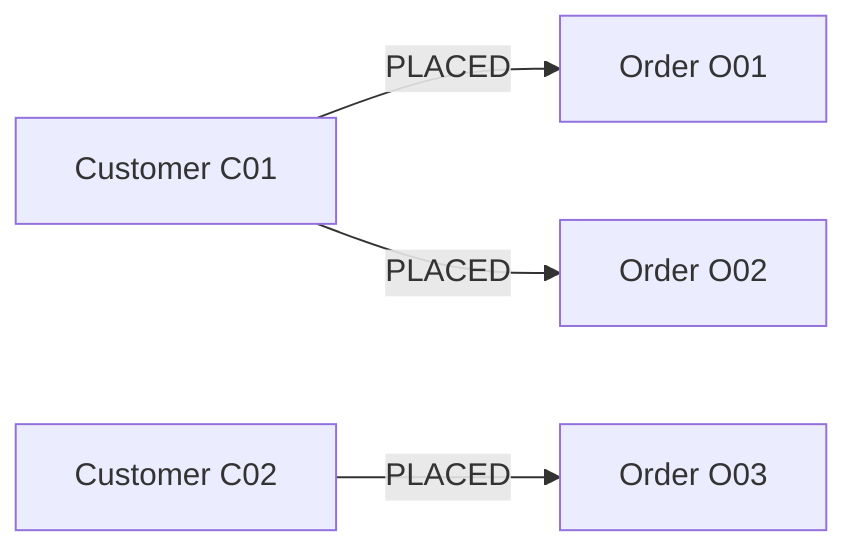
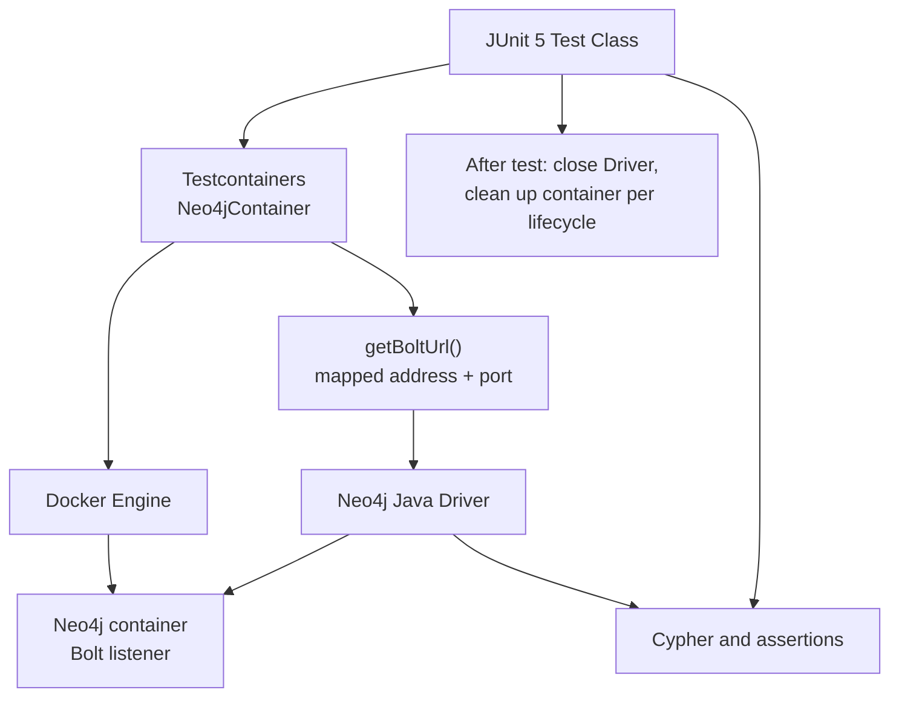
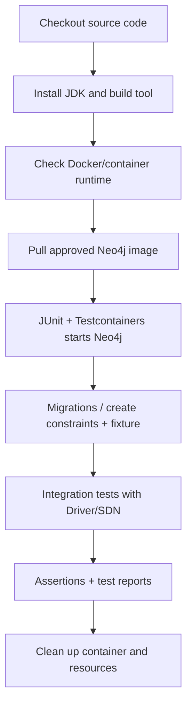

# Testcontainers for Integration Testing with a Neo4j Server

A Java method can construct a valid **Cypher** string yet still fail when executed against Neo4j: wrong label names, missing indexes or constraints, reversed relationship directions, wrong property types, transactions failing to roll back as expected, or **Spring Data Neo4j** mappings not matching actual database records. Mocking repositories or mocking the Java Driver cannot fully uncover these issues.

**Testcontainers** enables Java tests to start a **real Neo4j server inside a Docker container** with its lifecycle orchestrated by JUnit. The application connects to the test server over Bolt just as it connects to Neo4j in deployed environments. This lets you verify **property graph** logic, **nodes**, **relationships**, **constraints**, **indexes**, **transactions**, and the behavior of the **Neo4j Java Driver** or **Spring Data Neo4j** against an isolated database.

This lesson belongs to the **Testing** chapter of the **DATABASE_ENGINE_GRAPH_NEO4J** module, focusing on setting up and using Testcontainers to write **repeatable integration tests**, rather than merely testing Java objects in memory.

## 1. Why do we need integration tests with a real Neo4j server?

Suppose an application manages customers and orders stored as a graph:



Application query:

```cypher
MATCH (c:Customer {customerId: $customerId})
      -[:PLACED]->(o:Order)
RETURN o.orderId AS orderId
ORDER BY orderId;
```

A unit test checking only that a mocked `Neo4jRepository` returns `O01` and `O02` does not prove the Cypher query can actually run. Integration tests against a real server can verify:

- Nodes carry the `Customer` and `Order` labels, and relationships have the right `PLACED` type.
- Direction `(Customer)-[:PLACED]->(Order)` matches the real data model.
- `$customerId` is bound and mapped with the expected type.
- The uniqueness constraint on `customerId` is enforced by the database.
- `MERGE` statements can be re-run without creating unintended duplicate relationships.
- Transactions create, update, and commit/roll back within the proper boundaries.
- Spring Data Neo4j repositories persist and load real entities.

### 1.1. Comparing test levels

| Test level | Data used | Real Neo4j server? | Typically used to verify |
| --- | --- | --- | --- |
| **Unit test** | Mocks/stubs and Java objects | No | Business branching, validation, calculations, pure Java mapping |
| **Integration test with Testcontainers** | Neo4j database in a container | **Yes** | Cypher, schema, Driver, repositories, transactions, graph topology |
| **End-to-end test** | Multiple components running together | Possibly | API → service → database flows and integrated systems |
| **Performance/load test** | Large datasets and representative load | Yes | Latency, throughput, contention, query plans, and scalability |

**Testcontainers does not replace load testing.** A small Neo4j container spun up in CI does not represent a multi-node cluster, production memory/page cache, or a database holding hundreds of millions of relationships.

## 2. Test architecture

When JUnit runs, the Testcontainers extension starts Neo4j from a Docker image. The container exposes the Bolt port so the Java Driver connects through a **dynamically mapped port**.



Key differences compared to local development configuration:

- Do not hard-code `bolt://localhost:7687` inside tests.
- Obtain the endpoint exposed by Testcontainers via `getBoltUrl()`; the port on the test host may **differ from 7687**.
- Use a separate test password; never reuse production credentials.
- After tests finish, the container is cleaned up, preventing leftover garbage data across CI runs.

### 2.1. Prerequisites to run

The developer workstation or CI runner needs:

1. The project's JDK and build tool (Maven/Gradle).
2. **Docker Engine or a compatible container runtime supported by Testcontainers**, running with permissions for the test user to interact with it.
3. Access to pull an approved Neo4j Docker image or a pre-cached image in the registry/cache.
4. Sufficient CPU/RAM for both the test JVM and the Neo4j JVM inside the container.
5. Valid network routing from the test JVM to the container's mapped port.
6. Security/CI policies permitting container lifecycle operations and cleanup mechanisms.

If CI runs on a runner where containers are disallowed (such as certain restricted sandboxes), **Testcontainers integration tests cannot be treated like unit tests that run everywhere**. In that case, provision an appropriate runner or a dedicated isolated Neo4j test environment with proper data cleanup.

## 3. Dependencies and versions

The examples below target **Testcontainers 1.20.x**, **JUnit Jupiter 5**, and **Neo4j Java Driver 5.x**, using the Neo4j image `neo4j:5.26`. This is an **illustrative combination** to explain the API—not a requirement that all projects pin these exact versions.

In Maven, you can use the Testcontainers BOM to keep module versions aligned:

```xml
<dependencyManagement>
    <dependencies>
        <dependency>
            <groupId>org.testcontainers</groupId>
            <artifactId>testcontainers-bom</artifactId>
            <version>${testcontainers.version}</version>
            <type>pom</type>
            <scope>import</scope>
        </dependency>
    </dependencies>
</dependencyManagement>

<dependencies>
    <!-- Neo4j Java Driver used in application and tests -->
    <dependency>
        <groupId>org.neo4j.driver</groupId>
        <artifactId>neo4j-java-driver</artifactId>
        <version>${neo4j.driver.version}</version>
    </dependency>

    <!-- Neo4j container module -->
    <dependency>
        <groupId>org.testcontainers</groupId>
        <artifactId>neo4j</artifactId>
        <scope>test</scope>
    </dependency>

    <!-- Testcontainers JUnit 5 extension -->
    <dependency>
        <groupId>org.testcontainers</groupId>
        <artifactId>junit-jupiter</artifactId>
        <scope>test</scope>
    </dependency>

    <!-- If JUnit Jupiter is not already provided by framework/BOM -->
    <dependency>
        <groupId>org.junit.jupiter</groupId>
        <artifactId>junit-jupiter</artifactId>
        <scope>test</scope>
    </dependency>
</dependencies>
```

Both `testcontainers.version` and `neo4j.driver.version` must be set to **real, compatible versions** in your POM or dependency management system. If Spring Boot already manages one or more of these dependencies, inspect the BOM to avoid version conflicts.

> **Caution when upgrading:** In newer Testcontainers major releases, the group/module or package containing `Neo4jContainer` may change. For example, `org.testcontainers.containers.Neo4jContainer` in this lesson applies to the 1.x API line described here; when moving to another major version, consult the API docs for your version instead of copying imports blindly.

### 3.1. Choosing a Docker image intentionally

Declaring:

```java
new Neo4jContainer<>("neo4j:5.26")
```

pins the test environment to a specific Neo4j release line rather than `latest`. However, a tag like `5.26` does not necessarily lock individual patch versions or digests. When strict reproducibility is required, pin a **patch tag or image digest** approved by the testing team.

Test against a Neo4j version close to production in **major/minor release, Cypher version, schema behavior, and plugins**. If the application uses APOC or other procedures, provision them explicitly in your test setup; never assume production plugins are bundled automatically.

## 4. Starting `Neo4jContainer` with JUnit 5

Two key annotations:

- `@Testcontainers`: enables the Testcontainers extension for a JUnit Jupiter class.
- `@Container`: marks a container field managed by the extension.

Minimal example:

```java
import org.junit.jupiter.api.Test;
import org.testcontainers.containers.Neo4jContainer;
import org.testcontainers.junit.jupiter.Container;
import org.testcontainers.junit.jupiter.Testcontainers;

import static org.junit.jupiter.api.Assertions.assertTrue;

@Testcontainers
class Neo4jContainerSmokeTest {

    @Container
    static final Neo4jContainer<?> neo4j =
        new Neo4jContainer<>("neo4j:5.26")
            .withAdminPassword("test-only-password");

    @Test
    void containerStarts() {
        assertTrue(neo4j.isRunning());
        assertTrue(neo4j.getBoltUrl().startsWith("bolt://"));
    }
}
```

Making the field `static` starts the container **once for the entire test class** and stops it at the end of the class lifecycle. With a non-static container managed per test method, startup cost is much higher, though isolation differs. Choose a sharing strategy based on test requirements and startup cost.

**The password above is strictly for an isolated test container**, not a recommendation for production passwords. Never connect to a real database using test credentials.

### 4.1. Why use `getBoltUrl()` instead of `localhost`?

At runtime:

```java
String boltUrl = neo4j.getBoltUrl();
String password = neo4j.getAdminPassword();
```

`boltUrl` is the endpoint from the test JVM's perspective, including the Docker-mapped host and port. Hard-coding port `7687` on the host can cause tests to fail or accidentally connect to a different local Neo4j instance. Testcontainers handles port mapping for you—always use the endpoint it provides.

## 5. Complete integration test with the Neo4j Java Driver

The following example illustrates tests running against real Neo4j:

1. Testcontainers starts Neo4j.
2. `@BeforeAll` creates the Java Driver and uniqueness constraint.
3. `@BeforeEach` cleans **test data inside the dedicated container**.
4. A test uses Cypher to create a customer, order, and relationship.
5. It reads the data back with a real query and checks `assertEquals`.
6. Another test verifies the unique constraint and rollback behavior.
7. `@AfterAll` closes the Java Driver.

```java
import java.util.Map;

import org.junit.jupiter.api.AfterAll;
import org.junit.jupiter.api.BeforeAll;
import org.junit.jupiter.api.BeforeEach;
import org.junit.jupiter.api.Test;

import org.neo4j.driver.AuthTokens;
import org.neo4j.driver.Driver;
import org.neo4j.driver.GraphDatabase;
import org.neo4j.driver.Session;
import org.neo4j.driver.exceptions.ClientException;

import org.testcontainers.containers.Neo4jContainer;
import org.testcontainers.junit.jupiter.Container;
import org.testcontainers.junit.jupiter.Testcontainers;

import static org.junit.jupiter.api.Assertions.assertEquals;
import static org.junit.jupiter.api.Assertions.assertThrows;

@Testcontainers
class Neo4jDriverIntegrationTest {

    @Container
    static final Neo4jContainer<?> neo4j =
        new Neo4jContainer<>("neo4j:5.26")
            .withAdminPassword("test-only-password");

    private static Driver driver;

    @BeforeAll
    static void connectAndCreateSchema() {
        driver = GraphDatabase.driver(
            neo4j.getBoltUrl(),
            AuthTokens.basic("neo4j", neo4j.getAdminPassword())
        );
        driver.verifyConnectivity();

        try (Session session = driver.session()) {
            session.executeWrite(tx -> {
                tx.run("""
                    CREATE CONSTRAINT customer_id_unique IF NOT EXISTS
                    FOR (c:Customer)
                    REQUIRE c.customerId IS UNIQUE
                    """).consume();
                return null;
            });
        }
    }

    @BeforeEach
    void resetTestData() {
        try (Session session = driver.session()) {
            session.executeWrite(tx -> {
                // Only use on an isolated test DB.
                tx.run("MATCH (n) DETACH DELETE n").consume();
                return null;
            });
        }
    }

    @Test
    void writesAndReadsRelationship() {
        try (Session session = driver.session()) {
            session.executeWrite(tx -> {
                tx.run("""
                    MERGE (c:Customer {customerId: $cid})
                    SET c.name = $name
                    MERGE (o:Order {orderId: $oid})
                    MERGE (c)-[:PLACED]->(o)
                    """, Map.of(
                        "cid", "C01", "name", "An", "oid", "O01"
                    )).consume();
                return null;
            });

            long count = session.executeRead(tx ->
                tx.run("""
                    MATCH (c:Customer {customerId: $id})
                          -[:PLACED]->(o:Order)
                    RETURN count(o) AS total
                    """, Map.of("id", "C01"))
                    .single()
                    .get("total")
                    .asLong()
            );

            assertEquals(1L, count);
        }
    }

    @Test
    void enforcesUniqueConstraintAndRollsBack() {
        try (Session session = driver.session()) {
            assertThrows(ClientException.class, () ->
                session.executeWrite(tx -> {
                    tx.run("""
                        CREATE (:Customer {customerId: 'C01'})
                        """).consume();
                    tx.run("""
                        CREATE (:Customer {customerId: 'C01'})
                        """).consume();
                    return null;
                })
            );

            long count = session.executeRead(tx ->
                tx.run("""
                    MATCH (c:Customer {customerId: 'C01'})
                    RETURN count(c) AS total
                    """).single().get("total").asLong()
            );

            // Entire transaction rolled back; no partial record remains.
            assertEquals(0L, count);
        }
    }

    @AfterAll
    static void closeDriver() {
        if (driver != null) {
            driver.close();
        }
    }
}
```

### 5.1. What these two tests actually prove

**`writesAndReadsRelationship`** validates several layers at once:

- The Driver can establish a Bolt connection to the Neo4j container.
- Cypher `MERGE` creates both nodes and the relationship.
- The pattern `(:Customer)-[:PLACED]->(:Order)` has the expected direction.
- Parameters `$cid`/`$oid`/`$name` bind properly.
- A subsequent read sees the committed data.

**`enforcesUniqueConstraintAndRollsBack`** verifies that the database rejects two nodes sharing the same key and rolls back the failing transaction, leaving no half-committed `C01` node behind.

These are **integration tests**, not unit tests of `Map.of` or `assertEquals`.

### 5.2. Why delete data in `@BeforeEach`?

Because the static container is shared across **all tests in the class**, data written by test A would affect test B if left uncleaned. `@BeforeEach` deletes nodes before each test to establish a clean starting point.

However:

- `MATCH (n) DETACH DELETE n` **deletes all nodes and relationships** in the target database; it is valid only in a test container owned exclusively by the test suite.
- Deleting nodes **does not drop schema constraints or indexes**; that is intentional here because the tests rely on the constraint created in `@BeforeAll`.
- If tests share **one container and run in parallel**, `@BeforeEach` in one test can wipe out another test's data. Never use this pattern when parallel execution is enabled for tests sharing a database.
- For larger suites, choose separate databases, separate containers, distinct data namespaces, or class-level fixtures—depending on requirements and your Neo4j edition's multi-database support.

### 5.3. Why shouldn't you replace all tests with `@Transactional` rollback?

In Spring or Java Driver suites, some tests rely on transaction rollback to avoid persisting writes. However, that only covers **operations actually executing within that transaction**. If a test invokes a service that opens its own transaction, uses another Driver, or calls auto-committing procedures, rolling back the test method's transaction **will not undo** changes outside that boundary.

Choose an isolation strategy you can verify:

- Rollback within the same transaction when specifically testing transaction behavior.
- Explicit fixture cleanup when multiple independent transactions commit.
- Separate containers/databases when strong cross-class isolation is needed.
- Never share a Neo4j database between tests and production.

## 6. Testing idempotency of `MERGE`

A data-sync job or retryable ingestion API may run the same Cypher multiple times. If the model permits **only one `PLACED` relationship between a Customer–Order pair**, tests should verify that node and edge counts do not grow unexpectedly.

```cypher
MERGE (c:Customer {customerId: $customerId})
MERGE (o:Order {orderId: $orderId})
MERGE (c)-[:PLACED]->(o);
```

The test can run this statement **twice**, then query:

```cypher
MATCH (c:Customer {customerId: 'C01'})
      -[r:PLACED]->(o:Order {orderId: 'O01'})
RETURN count(r) AS placedCount;
```

Expected: `placedCount = 1` for sequential writes with no pre-existing duplicate edges. If concurrent workers can ingest the same key simultaneously, add concurrency tests and appropriate constraints: `MERGE` alone does not prove all concurrent write paths are safe from duplicates.

## 7. Testing transaction commit and rollback

Integration tests should distinguish:

- **Commit:** after the transaction completes, a new session can read the written data.
- **Rollback:** uncommitted changes inside the transaction are discarded and invisible to subsequent reads.
- **Failure mid-transaction:** operations in the same transaction are not partially persisted.

Explicit transaction example with the Java Driver:

```java
import org.neo4j.driver.Session;
import org.neo4j.driver.Transaction;

try (Session session = driver.session()) {
    try (Transaction tx = session.beginTransaction()) {
        tx.run("""
            CREATE (:Customer {customerId: 'TEMP-01'})
            """).consume();

        tx.rollback();
    }

    long count = session.executeRead(tx ->
        tx.run("""
            MATCH (c:Customer {customerId: 'TEMP-01'})
            RETURN count(c) AS n
            """).single().get("n").asLong()
    );

    assertEquals(0L, count);
}
```

This snippet illustrates transaction rollback on a **test database**. Never run it against production data, where dummy records could be committed accidentally if transaction settings or target datasources are misconfigured.

**Write queries prefixed with `PROFILE` still execute for real.** If profiling a write plan in tests, track carefully where transactions commit or roll back. With `EXPLAIN`, the server builds the plan without executing writes, making it safer when you only want to inspect the plan.

## 8. Testing Spring Data Neo4j with Testcontainers

When an application uses **Spring Boot + Spring Data Neo4j**, we want to verify not only that the Driver can run Cypher, but also that **entity mapping**, repositories, transactions, and Spring configuration actually point to the container.

Two common approaches:

- `@DynamicPropertySource` to inject the container's URI, username, and password into the Spring `Environment`.
- `@ServiceConnection` if your Spring Boot version supports Testcontainers integration and includes the corresponding dependency.

To avoid relying on version-specific auto-detection, the primary example uses **`@DynamicPropertySource`**.

### 8.1. Sample entity and repository

The `Customer` entity has business key `customerId` and property `name`. Here `@Version` lets Spring Data Neo4j track lifecycle for application-assigned `@Id` entities and provides optimistic locking.

```java
import org.springframework.data.annotation.Id;
import org.springframework.data.annotation.Version;
import org.springframework.data.neo4j.core.schema.Node;

@Node("Customer")
public class Customer {

    @Id
    private String customerId;

    @Version
    private Long version;

    private String name;

    protected Customer() {}

    public Customer(String customerId, String name) {
        this.customerId = customerId;
        this.name = name;
    }

    public String getCustomerId() {
        return customerId;
    }

    public String getName() {
        return name;
    }

    public Long getVersion() {
        return version;
    }
}
```

Repository:

```java
import org.springframework.data.neo4j.repository.Neo4jRepository;

public interface CustomerRepository
        extends Neo4jRepository<Customer, String> {
}
```

With Spring Boot, projects typically include `spring-boot-starter-data-neo4j`, `spring-boot-starter-test`, and Testcontainers Neo4j/JUnit Jupiter dependencies. Ensure component/entity/repository scanning is configured so Spring discovers these types.

### 8.2. Slice test with `@DataNeo4jTest`

```java
import org.junit.jupiter.api.BeforeEach;
import org.junit.jupiter.api.Test;

import org.springframework.beans.factory.annotation.Autowired;
import org.springframework.boot.test.autoconfigure.data.neo4j.DataNeo4jTest;
import org.springframework.test.context.DynamicPropertyRegistry;
import org.springframework.test.context.DynamicPropertySource;

import org.testcontainers.containers.Neo4jContainer;
import org.testcontainers.junit.jupiter.Container;
import org.testcontainers.junit.jupiter.Testcontainers;

import static org.junit.jupiter.api.Assertions.assertEquals;
import static org.junit.jupiter.api.Assertions.assertTrue;

@DataNeo4jTest
@Testcontainers
class CustomerRepositoryIntegrationTest {

    @Container
    static final Neo4jContainer<?> neo4j =
        new Neo4jContainer<>("neo4j:5.26")
            .withAdminPassword("test-only-password");

    @DynamicPropertySource
    static void registerNeo4jProperties(
            DynamicPropertyRegistry registry) {

        registry.add("spring.neo4j.uri", neo4j::getBoltUrl);
        registry.add(
            "spring.neo4j.authentication.username", () -> "neo4j");
        registry.add(
            "spring.neo4j.authentication.password",
            neo4j::getAdminPassword);
    }

    @Autowired
    CustomerRepository repository;

    @BeforeEach
    void clearCustomers() {
        // Delete data only inside the isolated test database.
        repository.deleteAll();
    }

    @Test
    void savesAndReadsCustomer() {
        repository.save(new Customer("C01", "An"));

        var customer = repository.findById("C01");

        assertTrue(customer.isPresent());
        assertEquals("An", customer.orElseThrow().getName());
    }
}
```

This test **saves and reloads nodes through the real repository**, with the Driver connected to the Neo4j container. `@DataNeo4jTest` loads only Spring Data Neo4j components rather than the entire web application; use `@SpringBootTest` when you need to test services, controllers, and additional beans.

### 8.3. Why is `@DynamicPropertySource` required?

Testcontainers maps the Bolt port dynamically. Consequently, static config like:

```yaml
spring:
  neo4j:
    uri: bolt://localhost:7687
```

can cause tests to connect to a local dev Neo4j instance by mistake or fail when CI assigns another port. `@DynamicPropertySource` solves this by **registering dynamic suppliers for the container's URI and credentials** when Spring builds the `ApplicationContext`.

If your project uses multiple databases or a custom database name, configure the target database according to your **Spring Boot / Spring Data Neo4j version**. Never assume the default home database matches production.

### 8.4. The `@ServiceConnection` option

Spring Boot 3.1+ supports connecting Testcontainers via `@ServiceConnection` (requiring `spring-boot-testcontainers` and container support). In such environments, a declaration variant looks like:

```java
@Container
@ServiceConnection
static final Neo4jContainer<?> neo4j =
    new Neo4jContainer<>("neo4j:5.26")
        .withAdminPassword("test-only-password");
```

This is an **alternative** to manually registering connection properties—do not blindly combine both in every test. Verify the import `org.springframework.boot.testcontainers.service.connection.ServiceConnection`, dependencies, and connection-details generation in your Spring Boot version. When in doubt, `@DynamicPropertySource` is more explicit.

## 9. Managing lifecycle and test execution speed

Starting a separate Neo4j JVM per test method can be slow. Testcontainers supports different lifecycle scopes:

| Strategy | Pros | Risks / trade-offs |
| --- | --- | --- |
| Static `@Container` per class | Easy to write; starts once per class | Tests within the class must isolate their own data |
| Separate container per test | Strong isolation | Higher startup time and resource usage |
| One shared container across classes | Can reduce startup overhead | Harder to coordinate lifecycle, state, and parallel tests |
| Separate database/namespace on shared container | Separates data without new containers | Depends on Neo4j edition features and admin privileges |
| Pre-existing remote test environment | No Docker needed on runner | Hard to guarantee clean data, version, permissions, and isolation |

### 9.1. Cleaning data and schema

There are two kinds of state:

- **Data:** nodes, relationships, properties, test records.
- **Schema:** indexes, constraints, and other schema configurations.

If `@BeforeEach` only runs `DETACH DELETE` on all nodes, **constraints and indexes remain**. That is advantageous when every test in the class shares the same schema. However, when tests verify **schema creation or dropping**, prepare a dedicated schema reset strategy or run in an independent container/database.

Never delete all nodes in a shared database if tests execute concurrently. Also, never assume `@Transactional` isolates operations running outside Spring's transaction (such as manual Java Driver sessions/transactions).

### 9.2. Avoid container reuse in CI when determinism is required

Testcontainers offers container-reuse capabilities in some local development workflows. However, **never enable reuse by default in CI** when tests must start from a clean state and tear down afterward. Keeping an old container alive can cause tests to depend on leftover data or schema from a prior run.

A good integration test must pass in **any execution order**, without relying on another test having seeded fixtures beforehand.

### 9.3. Do not run parallel tests on an unisolated shared database

If JUnit executes two tests that both modify `C01` in the same Neo4j container, tests can fail due to race conditions unrelated to application logic. When enabling parallel test execution:

1. Use a separate container or database per test or independent test group.
2. Or use strictly disjoint data keys/namespaces.
3. Or disable parallelism for test classes that share state.
4. For intentional concurrency tests, coordinate ordering with barriers/latches and separate transactions.

**Unintentional interference between parallel tests** is a bug in the test suite, not necessarily a bug in Neo4j.

## 10. Writing business-meaningful fixtures

Fixtures should be **small, clear, and representative**. When testing Customer–Order relationships, create only the exact nodes and edges the test requires.

```cypher
CREATE (c1:Customer {customerId: 'C01', name: 'An'})
CREATE (c2:Customer {customerId: 'C02', name: 'Bình'})
CREATE (o1:Order {orderId: 'O01'})
CREATE (o2:Order {orderId: 'O02'})
CREATE (c1)-[:PLACED]->(o1)
CREATE (c1)-[:PLACED]->(o2);
```

On this dataset:

```cypher
MATCH (c:Customer {customerId: 'C01'})-[:PLACED]->(o:Order)
RETURN o.orderId AS orderId
ORDER BY orderId;
```

returns **O01, O02**; running the same pattern with `customerId = 'C02'` returns **no orders**.

Tests should also cover boundary cases:

- Node not found.
- Node exists with no relationships.
- Two unconnected nodes even if their names/codes look similar.
- One node with multiple relationships of the same type.
- Required properties missing or `null`.
- Violated constraints.
- Data containing Unicode/Vietnamese characters, dates, and numbers.
- Re-running `MERGE` to verify no duplicate nodes/edges are created.

**Do not assert only total counts** if the requirement checks relationship direction or type. For example, counting all `PLACED` edges could equal 2 even if both point to the wrong customer; assert the exact start–end pairs required by business rules.

## 11. Testing schema: constraints and indexes

A major benefit of integration tests is verifying that **Neo4j enforces the schema**, not just inspecting migration files.

Example constraint:

```cypher
CREATE CONSTRAINT customer_id_unique IF NOT EXISTS
FOR (c:Customer)
REQUIRE c.customerId IS UNIQUE;
```

Subsequently, attempting to `CREATE` two nodes with the same key in the same transaction will be rejected. This test is essential because a Java `@Id` annotation does not replace database-level enforcement of a **unique constraint**.

Inspect schema status via Cypher:

```cypher
SHOW CONSTRAINTS
YIELD name, type
RETURN name, type
ORDER BY name;
```

For indexes:

```cypher
SHOW INDEXES
YIELD name, type, state
RETURN name, type, state
ORDER BY name;
```

Wait for indexes to reach `ONLINE` state when a test relies on an index to evaluate query plans. **Never check only that an index name exists** and immediately assume every query uses it.

### 11.1. Inspecting `EXPLAIN` or `PROFILE`

With a larger dataset and an index on `Customer.customerId`, you can run:

```cypher
EXPLAIN
MATCH (c:Customer {customerId: $id})
RETURN c.name AS name;
```

`EXPLAIN` builds the execution plan without running data reads or writes. `PROFILE` executes the query and measures `Rows` and `DB Hits` when supported by the runtime, aiding performance analysis.

**Do not write brittle tests requiring every Neo4j version to choose one exact operator name**, because the planner may alter strategies based on data volume, indexes, statistics, and version. Testing schema and business outputs is more stable; plan/performance tests should use representative data and controlled verification.

## 12. Testing concurrency and optimistic locking

Spring Data Neo4j can use `@Version` to detect **stale entity** updates. A test backed by real Neo4j is ideal for reproducing two transactions reading the same version and attempting conflicting writes.

Recommended test flow:

1. Create a `KnowledgeArticle` node with a fixed business key.
2. Open two independent transactions/sessions that both read the node and its current version.
3. Use a **barrier** (such as `CountDownLatch`/`CyclicBarrier`) to synchronize both threads right after the read step.
4. Let one transaction commit an update.
5. Have the second transaction attempt to save its stale copy.
6. Verify the conflict is detected, the second update does not silently overwrite the first, and final data matches policy.

Do not rely on `Thread.sleep` to manufacture a race condition: thread scheduling varies across CI runners. In multi-threaded transaction tests, enforce wait timeouts and always close sessions/drivers even if an assertion fails.

**Note:** If another write path uses raw Cypher without checking or incrementing the version property, the repository's `@Version` cannot automatically protect that path. Integration tests should exercise the actual write paths present in your architecture, not just `repository.save` in isolation.

## 13. Testcontainers and CI/CD

For CI, the goal is to automatically run tests against real Neo4j with a **controlled version and reproducible environment**.

A typical CI pipeline:



Common command in a Maven project configured with JUnit 5:

```bash
mvn test
```

If a project splits integration tests into a separate phase, the command and plugin differ—such as Maven Failsafe with `integration-test`/`verify`. Do not assume a file named `*IT.java` runs under Maven Surefire without checking your project's test inclusion rules and test engine setup.

### 13.1. CI operational risks to handle

| Issue | Symptom | Mitigation |
| --- | --- | --- |
| Missing Docker runtime | Testcontainers cannot find a Docker environment | Use runners provisioned with Docker or a compatible container backend |
| Cannot pull image | Timeouts, denied access, DNS, or registry rate limits | Verify network/registry credentials; pin approved images |
| Insufficient RAM/CPU | Neo4j starts very slowly or container gets OOM-killed | Provision adequate resources; reduce parallelism |
| Neo4j image differs from production | Incompatible Cypher, procedures, or schema | Pin and test against the target deployment versions |
| Tests accidentally hit local Neo4j | Results depend on developer workstation | Always use `getBoltUrl()`; never hard-code URIs |
| Container retains stale state | Test passes only when run after another test | Explicit fixtures, cleanup, avoid uncontrolled reuse |
| Parallel tests interfere | Flaky errors, missing nodes/edges | Separate DB/container or disable parallelism |
| Occasional startup timeouts | Slow CI or resource contention | Check Docker/Neo4j logs; wait properly for readiness |
| Missing migrations in tests | Production has indexes/constraints absent in tests | Run migrations/schema setup matching the application |
| Skipping integration tests in pipeline | Cypher bugs surface only after deployment | Establish a clear CI stage and monitor test results |

Never disable container cleanup or weaken CI security policies just to push a test past an environment failure. Fix container runtime permissions and resource limits properly.

## 14. Debugging failing tests

When a test fails, isolate which layer failed:

1. **Container startup:** Is Docker running, can the image be pulled, and does Neo4j have enough resources?
2. **Driver connection:** Did you use `getBoltUrl()`, does the password match `getAdminPassword()`, and is the Bolt scheme right?
3. **Spring config:** Was `@DynamicPropertySource` applied, and does any config override the URI or database name?
4. **Schema:** Were constraints/indexes created inside the container, and did all migrations run?
5. **Fixture:** Did the test create the expected nodes/relationships, or did another test wipe them?
6. **Transaction:** Did `commit` finish before the verification read? Did `rollback` revert changes as expected?
7. **Assertions:** Do assertions verify direction, edge type, and exact values rather than just total counts?

When needed, inspect container logs and Driver exceptions via your Testcontainers/JUnit version's logging facilities. **Never print production passwords or real sensitive data into test logs.**

Commonly misinterpreted symptoms:

- `verifyConnectivity()` succeeds yet Cypher fails: may be due to syntax, privileges, database name, or schema—not necessarily networking.
- `MATCH` returns empty right after `CREATE`: data may sit in an uncommitted transaction, another database, or an inverted pattern direction.
- Tests count nodes accurately but miss edges: relationship creation may have been silently skipped because a `MATCH` on one endpoint found nothing.
- Unique constraint errors appear only in the full suite even though the test passes alone: another test left duplicate data behind.
- Fast on laptop, slow in CI: Docker runtime, image caching, page cache, and CPU/RAM differ.

## 15. Designing a maintainable long-term integration test suite

An effective test suite organizes tests by **business risk**, rather than mirroring arbitrary helper methods:

| Group | Example tests to include |
| --- | --- |
| **Connectivity** | Driver receives Testcontainers URI/credentials; `RETURN 1` succeeds |
| **Mapping** | `@Node`, `@Id`, `@Relationship` persist and deserialize cleanly |
| **Cypher** | Parameter binding, relationship direction, path queries, aggregations |
| **Schema** | Unique constraints reject duplicates; indexes/constraints are present |
| **CRUD & transactions** | Commit and rollback; updates avoid creating duplicates |
| **Concurrency** | `@Version` or version conditions reject stale updates |
| **Data integration** | Idempotent `MERGE`, missing-endpoint handling, soft deletes |
| **Regression** | Past bug scenarios preserved as fixtures and assertions |

Authoring principles:

- **Every test has explicit input data** and explicit expected results.
- **No dependence on test order**, hostname, fixed ports, or local dev data.
- **Do not mock what you need Neo4j to verify**; mock only out-of-scope external services like email or payment providers when appropriate.
- **Pin image versions** tightly enough for reproducible results.
- **Keep fixtures small**, reserving large datasets for dedicated performance test suites.
- **Close Sessions and Drivers** cleanly per lifecycle; let Testcontainers manage the container.
- **Control parallel tests** and define an explicit cleanup strategy.
- **Separate fast unit tests from heavier integration tests**, while ensuring CI executes integration tests at the proper stage.

## 16. Practice exercises

### Exercise 1 — Starting Neo4j in JUnit

Write a `@Testcontainers` class using a static `@Container Neo4jContainer<?>` with a pinned Neo4j image and a test-only password. In a `@Test` method, assert that the container is running and `getBoltUrl()` returns a Bolt endpoint. Why should `localhost:7687` never be hard-coded?

### Exercise 2 — Testing Customer–Order relationships

Create `Customer C01` and `Order O01` using the Java Driver, link them with `PLACED`, and run `MATCH (c:Customer)-[:PLACED]->(o:Order)`. Assert the exact `C01/O01` pair; temporarily flip the edge direction to confirm the test catches the bug.

### Exercise 3 — Enforcing constraints for real

Create a unique constraint on `Customer.customerId`. Inside one transaction, attempt to `CREATE` two Customers with ID `C01`. Expect the database to reject it and leave no partial record behind. Why cannot a unit test mocking the repository prove this?

### Exercise 4 — Idempotency

Run `MERGE` twice to create the same customer, order, and `PLACED` edge. Count nodes and relationships after each run. When is `MERGE` on a node pair insufficient to distinguish multiple relationship events sharing the same endpoints?

### Exercise 5 — Spring Data Neo4j

Create a `@Node Customer` with `@Id` and `@Version`, along with `CustomerRepository`. Use `@DataNeo4jTest` and `@DynamicPropertySource` to connect the repository to `Neo4jContainer`. Test that `save` followed by `findById` returns the expected `name`.

### Exercise 6 — Transaction rollback

Execute a `CREATE` statement inside `session.beginTransaction()`, then call `rollback()` and use a new read transaction to count nodes. Why is relying on a test method's rollback insufficient if the code under test opens a separate transaction?

### Exercise 7 — Isolation under parallel execution

Two tests share one static container. Test A creates `C01`, while Test B runs `MATCH (n) DETACH DELETE n` in `@BeforeEach`. What can happen if JUnit runs both tests in parallel? Propose two measurable isolation strategies.

### Exercise 8 — CI without Docker

A pipeline fails with "Could not find a valid Docker environment" before running any Cypher. Distinguish an infrastructure issue from an application bug, propose an appropriate runner/container backend, and list the details to include in a report for operations.

### Exercise 9 — Pre-release test plan

List the key integration tests for a Neo4j service using **Java Driver, Spring Data Neo4j, unique constraints, `@Version`, and `MERGE` ingestion**. Choose at least one failure test and one success test for each functional area.

## Key takeaways

**Testcontainers enables testing Java code against a real Neo4j server**, rather than relying solely on mocks or inspecting Cypher strings. `@Testcontainers`/`@Container` manage container lifecycles, while `getBoltUrl()` and `getAdminPassword()` provide test connection details. Combine them with the **Neo4j Java Driver** or **Spring Data Neo4j** `@DynamicPropertySource` to verify queries, entity mapping, constraints, transactions, and relationships.

A solid integration test requires **an explicit image version, an available Docker runtime, managed data and schema, order independence, and business-accurate assertions**. Keep test environments isolated, never run wipe-all queries on shared databases, and remember that correctness testing is distinct from performance benchmarking on production-scale data.
