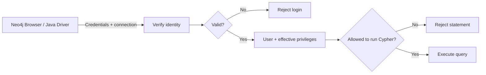
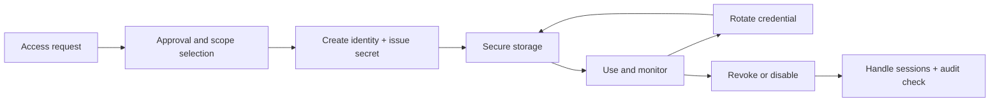

# Authentication, Account Management, and Credential Lifecycle in Neo4j

For a system using **Neo4j** to store a property graph, a syntactically valid Cypher query can still be rejected if the connecting account is invalid or lacks execution privileges. Conversely, a service granted an overly broad administrative account can delete data, alter the schema, or read sensitive information beyond what it needs. Therefore, security design begins with three questions: **who is accessing**, **what are they allowed to do**, and **how are credentials provisioned, used, rotated, and revoked**.

This lesson belongs to the **Security** chapter of the **DATABASE_ENGINE_GRAPH_NEO4J** module, connecting to **Cypher** queries, the **node/relationship** model, **Neo4j Java Driver**, and **Spring Data Neo4j**. The focus is on **authentication**, native account management, and credential lifecycle. Access control (**authorization**) is introduced to the extent needed to avoid confusing it with authentication.

After this lesson, you will be able to:

- Distinguish login failures from missing-privilege errors.
- Describe native authentication, LDAP/OIDC/SSO integration options, and the differences between Community, Enterprise, and Aura.
- Identify the role of the `system` database in account management.
- Use `SHOW CURRENT USER`, `SHOW USERS`, `CREATE USER`, `ALTER USER`, and `DROP USER` following a safe workflow.
- Design a password/secret lifecycle for interactive users and application accounts.
- Connect from Java/SDN without hard-coding passwords, with TLS and a rotation procedure.
- Plan recovery when admin access is lost or credentials are suspected to be compromised.

> **Practice conditions:** Commands to create, alter, and drop users require appropriate administrative privileges and can affect login capability. Run them only on test systems or authorized environments. Exact syntax and features also depend on the Neo4j version, edition, and service tier; do not run examples verbatim on production.

## 1. How does authentication differ from authorization?

| Concept | Question | Example |
| --- | --- | --- |
| **Authentication** | Who is the connecting identity? | `report_reader` provides valid credentials when opening a Bolt connection |
| **Authorization** | What can that identity do? | `report_reader` has `MATCH` privileges but cannot `DELETE` |
| **Credential management** | How are identifying secrets issued, stored, rotated, and revoked? | Native passwords, IdP credentials, secret manager |
| **Audit** | Are there failed logins or abnormal privilege changes? | Monitoring login failures and role changes |



A user can **log in successfully** yet still lack permission to create nodes, delete relationships, or run `SHOW USERS`. That is an authorization issue, not a wrong password. Similarly, an application adding `WHERE tenantId = $tenantId` to a query does not replace user authentication and verification of the authorized tenant.

## 2. Authentication options in Neo4j

### 2.1. Native authentication

With **native authentication**, Neo4j manages accounts and authentication data within system data in the **`system` database**. Authorized administrators can create, alter, or drop users using Cypher administration commands. Native users can also change their own password following an allowed procedure.

Identity verification steps:

1. The client connects via Bolt/driver and sends the configured authentication scheme.
2. Neo4j verifies the identity.
3. Upon success, the DBMS applies the privileges appropriate to the user and database.
4. The query executes if permitted; otherwise, an authorization error is returned.

**Do not create `(:User {password: ...})` nodes yourself to replace Neo4j native user management.** Application nodes and DBMS identities serve separate purposes; storing plaintext passwords in the property graph introduces additional risk.

### 2.2. LDAP, OIDC, and SSO

In supporting editions and service tiers, Neo4j can integrate with **LDAP**, **OpenID Connect (OIDC)**, or centralized sign-on systems. In that setup:

- An **Identity Provider (IdP)** can manage passwords, MFA, employment status, and login policies.
- Neo4j applies the authentication mechanism and privilege mappings according to the corresponding configuration.
- LDAP/OIDC user passwords generally cannot be changed using **native** password-change commands.
- Identities must be revoked at the **IdP** when an employee leaves, rather than merely deleting a native record in Neo4j.

Do not assume every environment has identical SSO/MFA capabilities. Always verify the version, edition, identity provider, and service tier in use.

### 2.3. Differences between Community, Enterprise, and Aura

| Environment | Points to verify |
| --- | --- |
| **Community Edition** | Supports managing native users, but **lacks the fine-grained role/privilege mechanisms of Enterprise**. Users hold administrative privileges under the Community model; naming a user `readonly` does not grant read-only permissions. |
| **Enterprise Edition** | Supports role-based access control and auth provider/account status options depending on the version. |
| **Neo4j Aura** | Managed service; user creation, SSO integration, and account recovery capabilities depend on the tier. Do not assume access to edit `neo4j.conf` or run `neo4j-admin` on the host. |

**Common mistake:** Creating a user named `only_read` on Community, passing its credentials to a reporting application, and believing it cannot write to the graph. **An account name is not an authorization policy.**

## 3. Initial authentication setup and network protection

For **self-managed** Neo4j, a common setting is:

```properties
# neo4j.conf, illustrating authentication enabled state:
dbms.security.auth_enabled=true
```

Authentication is typically enabled by default in current Neo4j releases. **Do not set it to `false` on a system accessible remotely** just because an application fails to log in.

### 3.1. Initial password of the `neo4j` account

A fresh self-managed installation usually includes the native user `neo4j`. If no password was set beforehand, the default password may be `neo4j` and must be changed on the first login. In real systems, configure a strong, environment-specific credential right during initialization.

Before **the first database startup**, you can use the tool:

```text
neo4j-admin dbms set-initial-password <NEW_SECRET>
```

This is a **syntax illustration**, not a secret to copy into production. The `--require-password-change` option may force the user to change the temporary password on first login, depending on the version's syntax.

**Important:** `set-initial-password` is for **initial setup**, not a general-purpose rescue command to reset an admin on an already-running DBMS. Passing a real password on the command line can leave traces in shell history or be captured by monitoring tools; use a secure secret-input method according to operational procedures.

### 3.2. TLS cannot be replaced by a strong password

Authentication and connection encryption are two separate layers. When connecting from an application over a network, prefer TLS and server certificate verification; the Java Driver typically uses a URI such as:

```text
neo4j+s://graph.example.internal
```

A `bolt://localhost` connection may suit exercises on an isolated local machine, but it is not the default choice for public networks. When TLS fails, fix the hostname, certificate, trust chain, or endpoint—**do not downgrade security to bypass warnings**.

## 4. Viewing the current identity and user list

User administration commands execute in the context of the **`system` database**. When connecting over Bolt, applicable administration commands are typically routed by Neo4j to `system`. In some tools, the administrator needs to select the appropriate database; consult the interface in use.

### 4.1. Viewing the logged-in user

```cypher
SHOW CURRENT USER;
```

This command reveals which account the application or user is actually connected as. Returned metadata can include roles, password-change-required flags, or status; some fields do not apply on Community or external auth.

### 4.2. Viewing the user list

```cypher
SHOW USERS;
```

Example selecting columns related to the account lifecycle:

```cypher
SHOW USERS
YIELD user, roles, passwordChangeRequired, suspended
RETURN user, roles, passwordChangeRequired, suspended
ORDER BY user;
```

| Column | Meaning |
| --- | --- |
| `user` | Username, case-sensitive |
| `roles` | Assigned native roles; may be `null` in Community |
| `passwordChangeRequired` | Whether the native user is forced to change password on next login |
| `suspended` | Suspended status, depending on edition and provider |

Do not expose user/role lists on public APIs. This metadata requires appropriate administrative/view privileges; knowing usernames and roles is also valuable to an attacker.

## 5. Provisioning a native user with a temporary password

An administrator supplies a strong password via the `$temporaryPassword` parameter from a secure client:

```cypher
CREATE USER training_reader IF NOT EXISTS
SET PASSWORD $temporaryPassword
CHANGE REQUIRED;
```

Key points to understand:

1. `$temporaryPassword` is a **Cypher parameter**. Never write real passwords directly in documentation, query logs, or source code.
2. `IF NOT EXISTS` prevents an error if the username already exists, but it **does not reset the password** of the existing user.
3. `CHANGE REQUIRED` suits **interactive users** who need to replace the temporary password issued to them.
4. A new user is not automatically granted "read privileges" just because its name contains `reader`.
5. Account creation and privilege administration must be separated from daily business APIs.

Do not overuse `CREATE OR REPLACE USER`: replacing can drop the old account and recreate it, impacting state and associated privileges.

### 5.1. Role-based authorization on Enterprise

In Neo4j Enterprise, an authorized administrator can grant the `reader` role:

```cypher
GRANT ROLE reader TO training_reader;
```

Verify:

```cypher
SHOW USER training_reader PRIVILEGES;
```

The `reader` role is a built-in role with read scope as defined by Neo4j configuration. If access must be restricted to a subset of the graph or a specific tenant, more specialized roles/privileges may be needed. **Community has no equivalent RBAC**, so do not assume the same role-management statements apply there.

## 6. Self-service native password change

A logged-in native user can change their password when they know the old value:

```cypher
ALTER CURRENT USER
SET PASSWORD FROM $oldPassword TO $newPassword;
```

Unlike an admin reset, this command requires the user to know the old password. A sound workflow:

1. Connect over a protected channel.
2. Collect the old and new passwords without logging them.
3. Validate against the organization's password policy.
4. Execute the password-change command.
5. Verify the new credential logs in successfully.
6. For accounts used by applications, update the secret store and all relevant instances.

This command **does not change LDAP/OIDC passwords** if the identity is managed by an external IdP.

### 6.1. Minimum password length policy

Some self-managed Neo4j versions provide settings such as:

```properties
# Illustrating an organization-chosen policy:
dbms.security.auth_minimum_password_length=12
```

The number **12** is only a sample policy, not a universal default across all environments. Service passwords should be random, sufficiently strong, and **unique per environment**. Minimum length does not replace a secret manager, TLS, least privilege, and monitoring.

## 7. Admin reset and password-change-required flag

If a native user forgets their password, an authorized admin can set a new temporary password:

```cypher
ALTER USER training_reader
SET PASSWORD $newTemporaryPassword
CHANGE REQUIRED;
```

To simply require a password change on the next login:

```cypher
ALTER USER training_reader
SET PASSWORD CHANGE REQUIRED;
```

For **non-interactive service accounts**, the `CHANGE REQUIRED` flag can prevent the application from logging in normally. During a service rotation workflow, administrators can use:

```cypher
ALTER USER app_ingest
SET PASSWORD $newServicePassword
CHANGE NOT REQUIRED;
```

The command above assumes `app_ingest` already exists. `CHANGE NOT REQUIRED` only indicates that an interactive change is not needed on the next login; it does **not** mean the secret is exempt from rotation or can be used indefinitely.

If `ALTER USER` is denied, check the user-management privileges of the executing account. Never grant admin privileges to an application just to bypass an administrative error.

## 8. Suspending and dropping accounts

In **Neo4j Enterprise**, a native user can be placed in a suspended state:

```cypher
ALTER USER training_reader
SET STATUS SUSPENDED;
```

When restoring per an approved procedure:

```cypher
ALTER USER training_reader
SET STATUS ACTIVE;
```

Notes:

- This is an edition-dependent status feature.
- With an external auth provider, login capability and the effect of suspension also depend on the IdP and configuration.
- Do not assume this operation **automatically terminates all open sessions/transactions**.
- Privileges and status must also be managed at the IdP when offboarding employees or external systems.

Dropping a user:

```cypher
DROP USER training_reader IF EXISTS;
```

**Neo4j documentation notes that dropping a user does not automatically terminate active connections, sessions, transactions, or running queries.** If emergency access termination is required, you must also inspect/terminate open sessions and isolate access sources using the DBMS's capabilities.

`DROP USER` does not delete business nodes, does not remove password copies in CI/CD, and does not revoke tokens or credentials in other identity systems.

## 9. Credential lifecycle

A credential should not be a password string created once and forgotten. Every user needs an **owner**, privilege scope, validity period, and revocation procedure.



| Stage | Interactive user | Service account |
| --- | --- | --- |
| **Request** | Job role, datasets needing access | Service owner, environment, endpoint |
| **Provisioning** | Native user or SSO; temporary password may require change | Dedicated account, automated secret, least privilege |
| **Storage** | Organization-approved password manager/IdP | Secret manager/vault; avoid hard-coding or Git |
| **Usage** | Neo4j Browser, Cypher Shell, admin tools | Java Driver, Spring Data Neo4j, ETL, or connectors |
| **Rotation** | Change password or update at IdP | Synchronize DBMS password, secret store, Driver/pool |
| **Revocation** | Offboarding, role change, security request | Stop old jobs, revoke secret, handle active sessions |
| **Audit** | Review history and remaining privileges | Inspect auth failures, owner, and active jobs |

### Distinguishing human users and service accounts

- **Interactive users** can be required to change their password right after first login; SSO/MFA is worth considering when supported by the platform/edition.
- **Service accounts** run unattended, so they must have automated secret injection and rotation workflows. An interactive password-change flag can cause the service to lose connectivity.
- **Admin or break-glass accounts** are strictly for administration/recovery, with rigorous approval, secret storage, and monitoring. Never use them for normal APIs.

Sharing a single `neo4j` user across read-only APIs, import jobs, and administration amplifies the blast radius if the secret leaks, complicates investigations, and forces every component to change passwords simultaneously. **Separate identities by function** and apply least privilege on supporting editions.

## 10. Secret rotation in continuously running applications

Changing a password in Neo4j without updating application configuration can cause new connections to be rejected. **Rotation** requires coordinating the database, credential store, applications, and active connections.

### 10.1. Steps for a service user

1. **Identify dependencies:** which user, which services, how many instances, jobs, and connectors use it.
2. **Generate a new secret** in a secure vault with appropriate versioning and access permissions.
3. **Schedule the change** according to the driver's authentication-refresh capability and acceptable downtime window.
4. **Execute `ALTER USER ... SET PASSWORD`** over a protected administrative channel.
5. **Update applications/Drivers** so new connections use the new secret.
6. **Verify access** with a minimal query, then validate required business operations.
7. **Inspect old sessions**, authentication errors, and any instances not yet updated.
8. **Revoke the old secret** in the vault, CI/CD, deployment configs, and unneeded copies; record change logs without plaintext secrets.

A native user usually has only one current password. Changing it on the DBMS before all instances adopt the new secret can create a **brief error window**. Do not promise zero downtime merely because the application has retries.

### 10.2. Transitioning to a new user

When a controlled cutover is needed, you can create a replacement service account:

```text
app_ingest_v1  -> currently processing
      |
      +-----> create app_ingest_v2
                   |
                   +-----> grant least privilege
                   +-----> test connection and queries
                   +-----> switch instances incrementally to v2
                   +-----> verify operation / audit
                   +-----> end v1 dependencies
                   +-----> revoke v1 + old sessions
```

Tightly govern the overlap window while both users exist; verify the new permissions are no broader than necessary. This approach reduces dependence on changing a single user's password, though it does not by itself handle existing connections.

### 10.3. Drivers and connection pools do not swap credentials automatically

The **Neo4j Java Driver** typically lives for the lifetime of the application and maintains a connection pool. Updating a secret in a vault **does not automatically** make an already-initialized Driver pick up the new secret.

Depending on driver version and configuration, the application can use a supported **authentication manager / credential rotation** mechanism, or create a **new Driver** with the new credentials, verify connectivity, shift traffic, and close the old Driver after in-flight requests finish.

Do not create a new Driver per HTTP request just to "always read the latest password"; that design defeats pooling and adds overhead. Never share a single `Session` across concurrent threads.

**Changing a password or suspending a user does not immediately terminate all active transactions.** Have a plan to inspect/terminate sessions, queries, or connections when emergency revocation is genuinely needed.

## 11. Neo4j Java Driver: avoiding hard-coded credentials

The Java example below reads configuration from the environment, suitable for illustrating a simple connection program. In real systems, use a secret manager and secure secret-delivery mechanism; environment variables can also leak via debuggers, crash dumps, or misconfigured admin interfaces.

```java
import java.util.Objects;

import org.neo4j.driver.AuthTokens;
import org.neo4j.driver.Driver;
import org.neo4j.driver.GraphDatabase;
import org.neo4j.driver.Session;
import org.neo4j.driver.SessionConfig;

public final class Neo4jConnectivityCheck {

    public static void main(String[] args) {
        String uri = Objects.requireNonNull(
            System.getenv("NEO4J_URI"), "Missing NEO4J_URI");
        String username = Objects.requireNonNull(
            System.getenv("NEO4J_USERNAME"), "Missing NEO4J_USERNAME");
        String password = Objects.requireNonNull(
            System.getenv("NEO4J_PASSWORD"), "Missing NEO4J_PASSWORD");

        try (Driver driver = GraphDatabase.driver(
                uri, AuthTokens.basic(username, password))) {

            driver.verifyConnectivity();

            try (Session session =
                     driver.session(SessionConfig.forDatabase("neo4j"))) {
                long ok = session.executeRead(tx ->
                    tx.run("RETURN 1 AS ok")
                      .single()
                      .get("ok")
                      .asLong()
                );

                System.out.println("Connected: " + (ok == 1));
            }
        }
    }
}
```

**Explanation:**

- `AuthTokens.basic(username, password)` provides credentials for **basic native authentication**.
- `driver.verifyConnectivity()` catches connectivity or authentication issues early.
- `RETURN 1 AS ok` tests a basic query; it **does not prove** the user has sufficient privileges to run all business queries.
- `"neo4j"` is an illustrative database name; multi-database deployments must specify the exact database granted access.
- `Driver` in the example closes when `main` finishes. In a web application, manage `Driver` as a reusable component and close it on shutdown.
- Never log `password`, auth tokens, or full configuration maps containing secrets when exceptions occur.

When using a remote connection URI, prefer appropriate TLS/certificate verification, such as `neo4j+s://` with valid certificates. Whether the user can read or write the graph is a separate layer from `verifyConnectivity()` succeeding.

## 12. Spring Data Neo4j and secret configuration

With **Spring Boot and Spring Data Neo4j**, connection settings are typically configured via properties such as `spring.neo4j.uri`, `spring.neo4j.authentication.username`, and `spring.neo4j.authentication.password`.

A sample `application.yml` using environment placeholders (containing no real secrets):

```yaml
spring:
  neo4j:
    uri: ${NEO4J_URI}
    authentication:
      username: ${NEO4J_USERNAME}
      password: ${NEO4J_PASSWORD}
```

This is **Spring property placeholder** syntax: values must be injected from environment variables or an appropriate secret manager. Do not replace placeholders with real passwords and commit the config file to Git; verify that variables are provided at application startup.

Remember:

- `@Transactional` defines transaction boundaries; it **does not grant login privileges or refresh credentials**.
- `Neo4jClient` and repositories use the configured Driver and transaction manager.
- When a secret changes, check the **lifecycle of the Driver bean and connection pool**, rather than just updating the secret outside the process and assuming it took effect.
- With multiple profiles, separate URI, username, password, and database per environment.
- Accounts running migrations or schema changes do not need to be the same account serving normal requests.

## 13. Classifying errors instead of resetting passwords by habit

| Symptom | Possible cause | Right check |
| --- | --- | --- |
| `Unauthorized` / authentication failure | Wrong user/password, auth provider, stale secret | Verify user, secret version, and provider; do not log plaintext |
| Warning to change password | `passwordChangeRequired` is enabled | Complete password change or reset through proper flow |
| Login succeeds, but `CREATE` is denied | Missing write privilege or edition lacks requested privilege | Check roles/privileges; do not blindly change password |
| Cannot run `SHOW USERS` | Missing privilege to view/manage users | Use an authorized admin account |
| App still fails after password change | Driver/pool still holds old auth token | Check secret refresh, AuthManager, or new Driver |
| Certificate/TLS error | Hostname, CA chain, expired certificate | Fix endpoint/trust chain; do not disable TLS checks |
| SSO user cannot sign in | IdP, mapping, or external account status | Check IdP and auth provider configuration |
| Old queries remain after suspend/drop | Existing sessions/transactions | Inspect open sessions and use appropriate terminate tools |
| Repeated login failures | Stale service using old password or brute-force scan | Verify connection source, rate limiting, and alerts |

### Monitoring without leaking secrets

Signals worth collecting include: failed login counts, user/role changes, services still on old secrets, rarely used accounts, orphaned users without owners, unusual client addresses, and access activity of privileged accounts.

**Never write plaintext passwords, private keys, tokens, or credential copies** into logs for monitoring. Access to audit logs must itself be restricted.

## 14. Losing admin access: recovery must be isolated

There are two cases:

1. **Another valid admin still exists:** use that user to run `ALTER USER ... SET PASSWORD` and verify privileges.
2. **No admin path remains:** follow the **official recovery procedure** for your Neo4j version, edition, configuration, and topology.

For **self-managed** deployments, recovery instructions may require stopping Neo4j, isolating network connectivity, and **temporarily disabling authentication during a controlled recovery window**, then restoring the account and re-enabling auth.

This is a **high-risk emergency operation**:

- Never set `dbms.security.auth_enabled=false` on a database still reachable from the Internet or untrusted networks.
- If recovery must run with auth disabled, restrict connections to loopback or equivalent isolation per the documentation.
- Do not apply a single-instance procedure to a cluster without consulting the corresponding topology guide.
- Re-enable authentication, test admin access, rotate temporary credentials, and verify security **before** restoring traffic.
- For **Aura**, use the recovery mechanism provided by the service; do not assume you can edit files or run `neo4j-admin`.

`neo4j-admin dbms set-initial-password` is **not** a general admin-reset command for an already-running database. Clearly distinguish initial setup from recovery.

## 15. Handling a compromised credential incident

If a service user's secret is suspected to be compromised, coordinate across the user, applications, and active sessions:

1. Identify the account, its privileges, and all systems using the credential.
2. Restrict access using supported mechanisms; for Enterprise native users, suspension may be used per policy.
3. Create a replacement secret or identity and roll it out to application instances.
4. Inspect and terminate existing sessions/transactions/connections when emergency revocation is needed.
5. Review audit trails and inspect graph or schema changes that might have been affected.
6. Revoke copies of the old secret in vaults, CI/CD, configs, jobs, and unneeded backups.
7. Monitor auth failures post-rotation and tighten least-privilege controls.

Native Neo4j includes settings to help handle repeated failed logins, such as `dbms.security.auth_lock_time`, though exact configuration and values must follow version documentation and organizational policy. **Brute-force protection cannot rely on lockout alone**; TLS, network segmentation, rate limiting, and monitoring are also required.

## 16. Pre-production checklist

| Item | Question to answer |
| --- | --- |
| **Dedicated users** | Does each service have a distinct identity and clear owner? |
| **Edition/tier** | Does the edition support the required level of RBAC? |
| **Least privilege** | Is a read-only API accidentally using an admin account? |
| **Secret storage** | Are any credentials stored in Git, images, or build artifacts? |
| **TLS** | Have the URI, certificate, and hostname been verified? |
| **Rotation** | Is there a runbook to rotate passwords and refresh the Driver/pool? |
| **Onboarding** | Do new users receive proper privileges and change temporary passwords when needed? |
| **Offboarding** | Are accounts revoked in Neo4j/IdP and active sessions handled? |
| **Recovery** | Is there a way to recover admin access without exposing anonymous access? |
| **Audit** | Are failed logins, high-privilege accounts, and role changes detected? |
| **Testing** | Have wrong password, wrong role, broken TLS, and credential rotation been tested? |

For multi-tenant systems, an authenticated user still requires **authorization checks on specific data**. A user who logs in successfully is not automatically allowed to view all nodes and relationships belonging to every customer.

## 17. Self-check exercises

**Question 1.** On Neo4j Community, is creating an account named `analytics_readonly` enough to guarantee it cannot delete nodes?

<details>
<summary>Suggested answer</summary>

No. Community lacks the fine-grained roles/privileges of Enterprise. A username does not determine permissions. You must choose an edition and architecture suited to database access-restriction requirements.

</details>

**Question 2.** A Java account can log in, but `CREATE (o:Order)` is rejected. Should you investigate authentication or authorization?

<details>
<summary>Suggested answer</summary>

Prioritize authorization because the identity has already been authenticated. Check graph write privileges, roles, target database, and edition. Changing the password does not grant privileges.

</details>

**Question 3.** When provisioning a native user for an employee using Browser, why should you consider `CHANGE REQUIRED`?

<details>
<summary>Suggested answer</summary>

It forces the recipient to replace the temporary password at login, reducing the window during which a secret known to the provisioner is used. Non-interactive service accounts need a different strategy because this flag can block automated connections.

</details>

**Question 4.** Why is changing `app_ingest`'s password in Neo4j insufficient to make running Java Driver instances use the new secret?

<details>
<summary>Suggested answer</summary>

The Driver and its connection pool may retain the old token. You must update the secret source and either refresh the AuthManager or create a new Driver via a version-supported mechanism, verify connectivity, and shift traffic.

</details>

**Question 5.** Does `DROP USER training_reader` guarantee termination of all active sessions and transactions?

<details>
<summary>Suggested answer</summary>

No. Neo4j documentation explicitly states that dropping a user does not automatically terminate all associated connections, sessions, transactions, and queries. Emergency revocation workflows must handle those sessions separately.

</details>

**Question 6.** If you lose the last admin on Neo4j Aura, should you use `neo4j-admin dbms set-initial-password` and edit `neo4j.conf`?

<details>
<summary>Suggested answer</summary>

No. Aura is a managed service, so you do not have default host access to edit config files or run admin tools. Use the service's official recovery process. For self-managed deployments, recovery must isolate the network if authentication has to be temporarily disabled.

</details>

**Question 7.** What problems arise from using the admin `neo4j` user for APIs, ETL jobs, and administrators alike?

<details>
<summary>Suggested answer</summary>

Overly broad privileges, difficult auditing, difficult rotation, and a single leaked secret can compromise the entire system. Separate users per service, apply least privilege, and manage secrets independently.

</details>

**Question 8.** Does Spring Data Neo4j's `@Transactional` automatically provide TLS, MFA, or credential lifecycle management?

<details>
<summary>Suggested answer</summary>

No. `@Transactional` manages data transactions. TLS, authentication providers, RBAC, MFA, and secret rotation are separate security mechanisms.

</details>

## Key takeaways

- **Authentication** verifies identity; **authorization** controls operations on the graph and DBMS.
- Native users are managed via Cypher administration commands in the **`system`** context; LDAP/OIDC/SSO follow a separate credential lifecycle via the IdP.
- **Community differs from Enterprise in RBAC**; an account name is not a privilege policy.
- Separate workflows for **initial password**, **self-service password change**, **admin reset**, and **admin recovery**.
- **Credential lifecycle** spans provisioning, storage, usage, rotation, revocation, and audit. Interactive users differ from service accounts.
- **Updating a secret in a vault does not automatically make the Driver use it**; protect remote connections with TLS.
- **Suspending or dropping a user should not be treated as the sole step to stop all open sessions**.
- Never disable authentication on a remotely accessible system to resolve a lost-admin incident.

### References

- [Neo4j Operations Manual — Manage users](https://neo4j.com/docs/operations-manual/current/authentication-authorization/manage-users/)
- [Neo4j Operations Manual — Authentication and authorization](https://neo4j.com/docs/operations-manual/current/authentication-authorization/)
- [Neo4j Operations Manual — Built-in roles and privileges](https://neo4j.com/docs/operations-manual/current/authentication-authorization/built-in-roles/)
- [Neo4j Operations Manual — Manage roles](https://neo4j.com/docs/operations-manual/current/authentication-authorization/manage-roles/)
- [Neo4j Operations Manual — Set an initial password](https://neo4j.com/docs/operations-manual/current/configuration/set-initial-password/)
- [Neo4j Operations Manual — Recover admin user and password](https://neo4j.com/docs/operations-manual/current/authentication-authorization/password-and-user-recovery/)
- [Neo4j Java Driver Manual — Connect](https://neo4j.com/docs/java-manual/current/connect/)
- [Spring Data Neo4j Reference](https://docs.spring.io/spring-data/neo4j/reference/)
