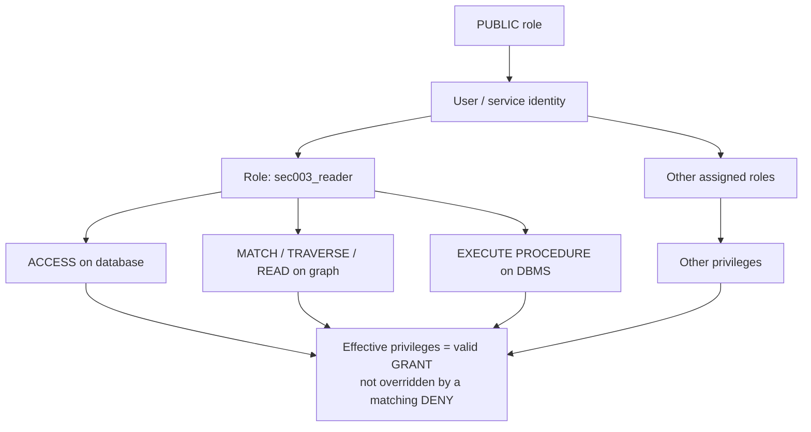
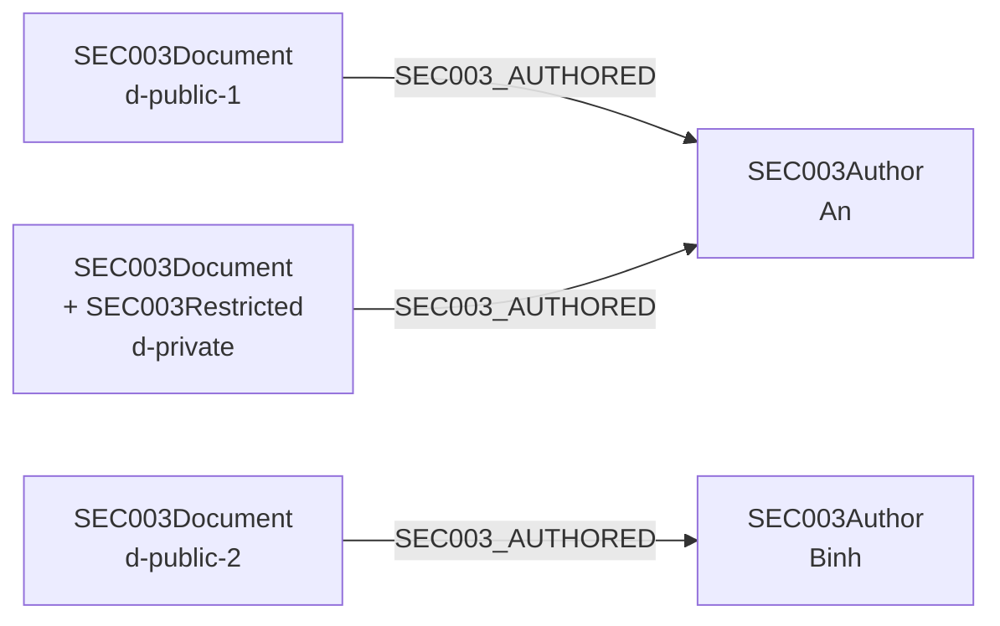

# Restricting Read, Write, Administrative, and Procedure Execution Privileges

## 1. The security challenge in Neo4j applications

Neo4j stores data using the **property graph** model: nodes have labels and properties, while relationships have types, directions, and properties. When an application uses Cypher, Java Driver, or Spring Data Neo4j, a `MATCH` query can traverse multiple entities, read sensitive properties, and uncover links between objects that should not be visible.

For example, a technical documentation portal has three user groups:

- **Viewers:** may view public documents, titles, and authors; must not view internal notes.
- **Editors:** may edit document titles within their assigned scope, but must not create/delete nodes, modify confidential properties, or administer the database.
- **Operations staff:** need to inspect indexes/constraints and system health, without needing to read all document contents.

Neo4j provides **role-based access control (RBAC)** on supporting editions/services, allowing privileges to be assigned by **role** across databases, graphs, labeled nodes, typed relationships, properties, and administrative operations. In particular, *procedure execution* privileges do not mean *graph read/write* privileges, and *boosted execution* is a highly sensitive capability.

This lesson belongs to the **Security** chapter of the `DATABASE_ENGINE_GRAPH_NEO4J` module. Its content connects directly to nodes/relationships, indexes/constraints, Cypher queries, Java Driver, Spring Data Neo4j, APOC, and graph system operations.

**After this lesson, you will be able to:**

1. Explain the difference between **authentication** and **authorization**.
2. Design roles following the **least privilege** principle, distinguishing `GRANT`, `DENY`, and `REVOKE`.
3. Grant precise read privileges using `TRAVERSE`, `READ`, and `MATCH` on nodes, relationships, and properties.
4. Restrict updates with `SET PROPERTY` and creations/deletions with `CREATE`/`DELETE`, distinguishing them from graph-wide `WRITE`.
5. Separate database/DBMS administrative privileges from application data privileges.
6. Control `EXECUTE PROCEDURE`, `EXECUTE BOOSTED PROCEDURE`, UDFs, and the impact of the `PUBLIC` role.
7. Build realistic privilege tests using non-admin accounts and plan privilege revocation.

> **Version scope:** Detailed RBAC syntax applies to **Neo4j Enterprise Edition** and Neo4j Aura tiers that support the corresponding capabilities; do not assume Neo4j Community Edition has the same role management system. Some extended capabilities (such as property-based policies, external authentication, or newer rule types) depend on version and edition. The administrative commands below are illustrative for supporting versions; always check `SHOW SUPPORTED PRIVILEGES` and the documentation for your exact version before deploying.

## 2. Authorization model: user, role, privilege, and scope



| Scope | Example | Meaning |
|---|---|---|
| **DBMS** | `EXECUTE PROCEDURE`, user/role/database management | DBMS-level privileges, not tied to a single graph |
| **Database** | `ACCESS`, `SHOW INDEX`, `INDEX MANAGEMENT` | Database access and schema/database management tasks |
| **Graph** | `TRAVERSE`, `READ`, `MATCH`, `WRITE` | Find, read, or mutate graph elements inside a database |
| **Node/relationship** | `NODES SEC003Document`, `RELATIONSHIPS SEC003_AUTHORED` | Scope restricted by node label or relationship type |
| **Property** | `READ {title}`, `SET PROPERTY {title}` | Restrict which fields can be viewed/edited on matching elements |

In `ON GRAPH neo4j` statements, the name `neo4j` identifies the graph corresponding to the `neo4j` database in standard deployments. If your actual database has a different name, replace it in **both database-level and graph-level statements**.

### 2.1. GRANT, DENY, and REVOKE are not synonyms

- `GRANT`: adds a privilege to a role.
- `DENY`: establishes an explicit **prohibition**; when overlapping in scope with a granted privilege, `DENY` takes precedence. This is especially important when a user holds **multiple roles**.
- `REVOKE GRANT ...`: removes the **granted** portion; does not remove any `DENY`.
- `REVOKE DENY ...`: removes the **denied** portion; does not automatically add a `GRANT`.
- `REVOKE ...` without `GRANT`/`DENY`: may remove both related types; prefer explicit variants for clear auditing.

Examples:

```cypher
GRANT MATCH {title} ON GRAPH neo4j NODES SEC003Document
TO sec003_reader;
```

```cypher
DENY READ {internalNote} ON GRAPH neo4j NODES SEC003Document
TO sec003_reader;
```

```cypher
REVOKE DENY READ {internalNote} ON GRAPH neo4j
NODES SEC003Document FROM sec003_reader;
```

These three statements illustrate **syntax**, not a recommended sequence to run all at once right now; in the hands-on section we will build a consistent privilege set. Running `REVOKE DENY` only removes the prohibition; it does not mean the user automatically gains permission to read `internalNote`.

**Very important:** Without appropriate read privileges, the graph may **appear smaller** because unreachable nodes/relationships are omitted. When attempting to write to unauthorized data, Neo4j usually **throws a permission error**. Therefore, a query returning `0 rows` does not always prove data does not exist; it may be hidden by RBAC.

### 2.2. Rules for the PUBLIC role

Every user belongs to the `PUBLIC` role; this membership cannot be revoked like a normal role. Under default configurations described in Neo4j Enterprise documentation, `PUBLIC` may be granted `ACCESS ON HOME DATABASE`, `EXECUTE PROCEDURE *`, function execution privileges, and `LOAD`. **Each deployment must inspect effective privileges** rather than assuming a newly created role represents a user's entire privilege set.

```cypher
SHOW ROLE PUBLIC PRIVILEGES AS COMMANDS;
```

This command is especially important when designing a **procedure allowlist**. If `PUBLIC` still holds `GRANT EXECUTE PROCEDURE *`, merely granting `EXECUTE PROCEDURE db.labels` to `sec003_reader` **does not forbid other procedures**. You may need a targeted `DENY` on that role, or an organization-wide `PUBLIC` policy change after fully evaluating the impact on all accounts.

## 3. Preparing demo data

We use three documents: two public documents and one with an additional `SEC003Restricted` label. Authors are separate nodes linked by a directed relationship.



All data-creation statements in this section must run **under an admin / fixture-setup account** on the practice database. Never use `sec003_reader` to grant itself privileges or create source data.

### 3.1. Creating constraints and nodes

```cypher
CREATE CONSTRAINT sec003_document_id IF NOT EXISTS
FOR (d:SEC003Document)
REQUIRE d.id IS UNIQUE;
```

```cypher
CREATE CONSTRAINT sec003_author_id IF NOT EXISTS
FOR (a:SEC003Author)
REQUIRE a.id IS UNIQUE;
```

```cypher
UNWIND [
  {id: 'a-an', name: 'An'},
  {id: 'a-binh', name: 'Binh'}
] AS row
MERGE (a:SEC003Author {id: row.id})
SET a.name = row.name;
```

```cypher
UNWIND [
  {
    id: 'd-public-1',
    title: 'Introduction to Cypher',
    classification: 'PUBLIC',
    internalNote: 'for editorial use only'
  },
  {
    id: 'd-public-2',
    title: 'Practical Java Driver',
    classification: 'PUBLIC',
    internalNote: 'internal update schedule'
  },
  {
    id: 'd-private',
    title: 'Internal plan',
    classification: 'RESTRICTED',
    internalNote: 'do not publish'
  }
] AS row
MERGE (d:SEC003Document {id: row.id})
SET d.title = row.title,
    d.classification = row.classification,
    d.internalNote = row.internalNote;
```

```cypher
MATCH (d:SEC003Document {id: 'd-private'})
SET d:SEC003Restricted;
```

```cypher
UNWIND [
  {docId: 'd-public-1', authorId: 'a-an'},
  {docId: 'd-public-2', authorId: 'a-binh'},
  {docId: 'd-private', authorId: 'a-an'}
] AS row
MATCH (d:SEC003Document {id: row.docId})
MATCH (a:SEC003Author {id: row.authorId})
MERGE (d)-[:SEC003_AUTHORED]->(a);
```

Verify using the **practice environment's admin account**:

```cypher
MATCH (d:SEC003Document)-[:SEC003_AUTHORED]->(a:SEC003Author)
RETURN d.id AS documentId,
       d.title AS title,
       d.classification AS classification,
       d.internalNote AS internalNote,
       a.name AS author
ORDER BY documentId;
```

Expect **3 rows**, where `d-private` carries the `SEC003Restricted` label. An account limited to public reads will **not** see all three rows once the role in section 4 is applied.

## 4. Restricting read privileges: ACCESS, TRAVERSE, READ, and MATCH

In Neo4j Enterprise, basic read privileges are divided as follows:

| Privilege | Allows | Do not infer |
|---|---|---|
| `ACCESS ON DATABASE neo4j` | Enter the specified database | Does not grant node traversal, property reads, or writes |
| `TRAVERSE ... NODES/RELATIONSHIPS` | Find/traverse matching elements | Does not grant reading all properties |
| `READ {property} ...` | Read specified fields **on reachable elements** | Does not let you find nodes if `TRAVERSE` is missing |
| `MATCH {property} ...` | Combines `TRAVERSE` and `READ` for matching elements | Does not grant modifying nodes/relationships |

### 4.1. Creating a minimal role

**Switch to the `system` database** to run user/role/privilege administration commands. Over Bolt, some admin commands are routed automatically to `system`; explicitly select the administration database in your tool as appropriate. Run only as an admin or an account with sufficient role-management privileges.

```cypher
CREATE ROLE sec003_reader IF NOT EXISTS;
```

```cypher
GRANT ACCESS ON DATABASE neo4j TO sec003_reader;
```

Allow finding documents and reading only the three display properties:

```cypher
GRANT MATCH {id, title, classification}
ON GRAPH neo4j NODES SEC003Document TO sec003_reader;
```

```cypher
GRANT MATCH {name}
ON GRAPH neo4j NODES SEC003Author TO sec003_reader;
```

Allow traversing the authorship relationship without granting read access to all relationship properties:

```cypher
GRANT TRAVERSE
ON GRAPH neo4j RELATIONSHIPS SEC003_AUTHORED
TO sec003_reader;
```

Block nodes labeled as restricted, even when they also carry `SEC003Document`:

```cypher
DENY TRAVERSE
ON GRAPH neo4j NODES SEC003Restricted
TO sec003_reader;
```

Explicitly block internal notes in case another role unintentionally grants broad read access:

```cypher
DENY READ {internalNote}
ON GRAPH neo4j NODES SEC003Document
TO sec003_reader;
```

**Why combine GRANT and DENY?** `GRANT MATCH` on the general label reveals the two public nodes; `DENY TRAVERSE` on `SEC003Restricted` prevents traversing sensitive nodes that carry both labels. `DENY READ {internalNote}` protects the sensitive property; if the user is also assigned another broad read role, the matching deny still takes precedence.

### 4.2. Testing with a real identity

Once **administrators** create the test user `sec003_viewer` via an approved authentication method (passwords/secrets omitted from documentation), assign the role:

```cypher
GRANT ROLE sec003_reader TO sec003_viewer;
```

Reconnect **as `sec003_viewer`**, select the `neo4j` database, and run:

```cypher
MATCH (d:SEC003Document)-[:SEC003_AUTHORED]->(a:SEC003Author)
RETURN d.id AS documentId,
       d.title AS title,
       d.classification AS classification,
       a.name AS author
ORDER BY documentId;
```

When the test account has **only** `sec003_reader` and audited `PUBLIC` defaults, **expected output**:

| documentId | title | classification | author |
|---|---|---|---|
| `d-public-1` | Introduction to Cypher | PUBLIC | An |
| `d-public-2` | Practical Java Driver | PUBLIC | Binh |

`d-private` is not shown because there is no effective `TRAVERSE` privilege on that node. For queries reading `d.internalNote`, the property value is restricted by read privileges; **do not conclude from null or missing properties that source data does not exist**.

**Negative test** with `sec003_viewer`:

```cypher
MATCH (d:SEC003Document {id: 'd-private'})
RETURN d.title AS title;
```

Expect **0 rows** because the node is hidden, which differs from a query error. Separately test queries returning paths, relationships, and metadata, since alternative traversal paths can leak data if a role is overly broad.

### 4.3. Limitations of label-based authorization

The privileges above control access by **node label, relationship type, and property name**, not by evaluating `classification = 'PUBLIC'` to decide access. If an ingester forgets to apply `SEC003Restricted` to a confidential document, a label-based deny rule **will not apply**.

In deployments supporting **property-based access control**, Neo4j can also support `FOR (n:Label) WHERE ...` rules. However, `DENY` rules whose predicate fails to match due to null or missing fields can *fail open* when a broad `GRANT` exists. For sensitive data:

- Prefer **granting only the allowed scope**; do not rely solely on a `DENY` rule over an easily omitted property.
- Ensure ingestion/update pipelines **enforce labels/classifications** before publishing data.
- Test missing, null, misspelled classifications, and **multi-label** cases.
- For strict isolation requirements, consider **separate databases** or partitioned data architectures; UI-only filtering is not a security control.

## 5. Write privileges: do not grant graph-wide WRITE if only one field needs editing

`GRANT WRITE ON GRAPH neo4j` is a very broad write privilege covering graph write operations per effective permissions. It **cannot be scoped directly to a single label** under the same `WRITE` syntax. When only titles need editing, grant `SET PROPERTY` for the specific property and node label.

| Write privilege | Primary effect | When to grant |
|---|---|---|
| `SET PROPERTY {title} ... NODES SEC003Document` | Modify the `title` property | Editors updating titles |
| `CREATE ... NODES Label` | Create nodes with allowed label | Ingestion jobs with matching keys/constraints |
| `DELETE ... RELATIONSHIPS Type` / `NODES Label` | Delete relationships/nodes within scope | Controlled, approved tasks |
| `SET LABEL` / `REMOVE LABEL` | Modify node labels | Very sensitive because labels govern read access |
| `MERGE {property}` | Combines match/create/set within scope | Ingestion with clear identity contracts |
| `WRITE ON GRAPH neo4j` | Broad write access across the graph | Only roles truly requiring general write rights |

### 5.1. Editor role restricted to editing titles

Run on `system` as admin:

```cypher
CREATE ROLE sec003_editor IF NOT EXISTS;
```

```cypher
GRANT ACCESS ON DATABASE neo4j TO sec003_editor;
```

```cypher
GRANT MATCH {id, title, classification}
ON GRAPH neo4j NODES SEC003Document TO sec003_editor;
```

```cypher
DENY TRAVERSE ON GRAPH neo4j NODES SEC003Restricted
TO sec003_editor;
```

```cypher
GRANT SET PROPERTY {title}
ON GRAPH neo4j NODES SEC003Document
TO sec003_editor;
```

In this exercise, do **not** grant `CREATE`, `DELETE`, `SET LABEL`, `REMOVE LABEL`, `WRITE`, or DBMS admin privileges to this role. With a separately created test user `sec003_editor_user` holding only the intended roles:

```cypher
GRANT ROLE sec003_editor TO sec003_editor_user;
```

Connect as `sec003_editor_user` on `neo4j`:

```cypher
MATCH (d:SEC003Document {id: 'd-public-1'})
SET d.title = 'Introduction to Cypher - revised'
RETURN d.id AS id, d.title AS title;
```

Expect **success**. Test an out-of-scope write:

```cypher
MATCH (d:SEC003Document {id: 'd-public-1'})
SET d.internalNote = 'overwrite'
RETURN d.id;
```

Expect **rejection** because `SET PROPERTY {internalNote}` is not granted. Likewise, `CREATE (:SEC003Document {id: 'd-new'})` lacks `CREATE` and must be blocked. Trying on `d-private` may match nothing because it is **hidden** by `DENY TRAVERSE`.

**Operational note:** `SET PROPERTY` on a new property name not yet in the database may require the **CREATE NEW PROPERTY NAME** privilege. The fixture data already has `title`, so editing titles does not need to create a new property token. Granting privileges to create new label names, relationship type names, or property names must be controlled separately and not given by default to read accounts.

### 5.2. DELETE, DETACH DELETE, and relationship boundaries

Neo4j may disallow `DETACH DELETE` if the account cannot see or lacks permission to delete all relationships connected to the node. That is a **design constraint to examine**, not a bug to fix by granting unrestricted `WRITE`.

A valid delete must be checked against:

1. Can the target node/relationship be traversed?
2. Does the account have permission to delete that element?
3. Must `DETACH DELETE` also delete relationships the account is not allowed to see or modify?
4. Is the data within the service's ownership scope?

For cleanup, snapshots, or ingestion, use a dedicated principal with transactions and audit logs. Never give normal read users bulk-delete rights merely to simplify an API.

## 6. Separating administrative privileges from application privileges

**Database administration** and **DBMS** privileges differ from graph read/write privileges. An API service that only needs `MATCH`/`SET` normally does **not** need to create databases, manage users, alter roles, or modify schemas.

| Scope | Example privileges | Tasks | Typical account |
|---|---|---|---|
| Graph data | `MATCH`, `SET PROPERTY`, `CREATE`/`DELETE` | Read and update nodes/relationships | Service user |
| Database schema | `SHOW INDEX`, `SHOW CONSTRAINT` | Inspect indexes/constraints | Schema observer |
| Advanced database schema | `INDEX MANAGEMENT`, `CONSTRAINT MANAGEMENT` | Create/drop/alter schema | Dedicated migration/DBA |
| Database operations | `START`, `STOP`, transaction management | Operate databases, terminate transactions | Controlled operations role |
| DBMS | Create/alter users, roles, manage databases/privileges | Administer identities and system | Security administrator |

### 6.1. Viewing schema only, without schema management

On `system`, create a role for schema observation:

```cypher
CREATE ROLE sec003_schema_observer IF NOT EXISTS;
```

```cypher
GRANT ACCESS ON DATABASE neo4j TO sec003_schema_observer;
```

```cypher
GRANT SHOW INDEX ON DATABASE neo4j TO sec003_schema_observer;
```

```cypher
GRANT SHOW CONSTRAINT ON DATABASE neo4j
TO sec003_schema_observer;
```

Once assigned the role, an authorized user can run on database `neo4j`:

```cypher
SHOW INDEXES
YIELD name, type, state, labelsOrTypes, properties
RETURN name, type, state, labelsOrTypes, properties
ORDER BY name;
```

```cypher
SHOW CONSTRAINTS
YIELD name, type, labelsOrTypes, properties
RETURN name, type, labelsOrTypes, properties
ORDER BY name;
```

Having `SHOW` privileges alone does not grant `CREATE INDEX`, `DROP INDEX`, `CREATE CONSTRAINT`, user/role management, or reading graph contents. **Data and metadata can have different security requirements**: if schema or index names expose sensitive information, evaluate `SHOW` privileges as well.

### 6.2. When migrations must manage indexes

A dedicated migration pipeline may need:

```cypher
GRANT INDEX MANAGEMENT ON DATABASE neo4j
TO sec003_migration;
```

The statement above illustrates a **broad index-group privilege**; do not run it if the role has not been created or approved. Create a dedicated migration role, grant time-bound or change-approved privileges, and revoke afterward. Never grant this privilege to `sec003_reader` or `sec003_editor` just to silence errors when an app auto-creates schema.

**Distinguish schema privileges from data privileges:** an account with `SHOW INDEX` cannot automatically view property values in the graph; an account with `MATCH` cannot automatically create uniqueness constraints. In production, schema migrations should run inside a change-controlled deployment workflow.

## 7. Restricting EXECUTE PROCEDURE and UDF privileges

Neo4j and extensions such as **APOC** provide various procedures and functions: from metadata lookup and graph traversal to import/export and external HTTP calls. Graph read privileges do not substitute for procedure execution privileges; conversely, permission to call a procedure does not automatically bypass internal graph restrictions.

### 7.1. Distinguishing EXECUTE, BOOSTED, and admin procedure privileges

| Privilege | Meaning | Risk level |
|---|---|---|
| `EXECUTE PROCEDURE name` | Permits calling procedures matching name/glob | Evaluate procedure behavior and related data privileges |
| `EXECUTE BOOSTED PROCEDURE name` | Permits running procedure with **elevated** privileges | High: can bypass normal read/write limits inside the procedure |
| `EXECUTE ADMIN PROCEDURES` | Permits admin-flagged procedures | Very high; only for approved roles |
| `EXECUTE USER DEFINED FUNCTION name` | Permits calling UDFs | Evaluate function and potential data exposure |
| `EXECUTE BOOSTED USER DEFINED FUNCTION name` | Permits UDF execution with elevated privileges | High; do not grant broadly |

**EXECUTE BOOSTED alone is not enough to call a procedure**: `EXECUTE PROCEDURE` is also required. Conversely, `EXECUTE PROCEDURE` without `BOOSTED` normally runs with the caller's existing privileges, depending on the procedure's semantics. Admin-flagged procedures carry special conditions; never grant a broad privilege to fix an error on a single procedure.

Example grant statements—**use only after checking `PUBLIC` privileges** and verifying the procedure exists:

```cypher
GRANT EXECUTE PROCEDURE db.labels ON DBMS TO sec003_reader;
```

Example blocking a procedure family that can access external data (if APOC is installed and names match):

```cypher
DENY EXECUTE PROCEDURE apoc.load.* ON DBMS
TO sec003_reader;
```

Example controlling privilege elevation:

```cypher
DENY EXECUTE BOOSTED PROCEDURE * ON DBMS
TO sec003_reader;
```

These commands do not require APOC to be installed when privileges are assigned, though the privilege matters once a matching procedure exists. **Do not** issue an overly broad `DENY` and then try to `GRANT` exceptions in the same scope expecting `GRANT` to override `DENY`: the matching `DENY` still wins.

### 7.2. The default PUBLIC grant for EXECUTE *

Common pitfall: Neo4j may come with `GRANT EXECUTE PROCEDURE * ON DBMS TO PUBLIC`. In that case:

- Merely granting `GRANT EXECUTE PROCEDURE db.labels` to a service role **does not** make other procedures denied.
- You can add `DENY EXECUTE PROCEDURE ...` on specific roles to block unwanted procedures, but you must review **every** newly installed procedure later.
- To enforce a **true system-wide allowlist**, consider **revoking the wildcard privilege from PUBLIC**, assessing impact across all users/jobs, and **re-granting** narrow privileges to authorized roles; this is a very wide-impact administrative change.

Example revocation syntax *for policy analysis*—**do not run on a shared system without an audit and rollback plan**:

```cypher
REVOKE GRANT EXECUTE PROCEDURE * ON DBMS FROM PUBLIC;
```

After this change, accounts that relied on `PUBLIC` to run required procedures may stop working. Before applying it, export `SHOW ROLE PUBLIC PRIVILEGES AS COMMANDS`, build a procedure dependency matrix per workload, test on staging, and prepare replacement grants. Check `EXECUTE FUNCTION`, `LOAD`, `BOOSTED`, and other roles as well, not just one wildcard line.

### 7.3. Availability differs from execution privilege

To view procedures installed on the server:

```cypher
SHOW PROCEDURES
YIELD name, mode
WHERE name STARTS WITH 'apoc.'
RETURN name, mode
ORDER BY name
LIMIT 50;
```

`SHOW PROCEDURES` requires appropriate metadata privileges depending on configuration and version. **A listed procedure does not mean the user is allowed to call it or that it is harmless**; conversely, an "Unknown procedure" error can stem from a missing plugin, incompatible version, or environment limits, not only RBAC.

If a procedure interacts with URLs or files, `EXECUTE` privileges do not bypass **network restrictions, import/export paths, procedure settings, or OS policies**. For APOC Extended or custom plugins, control plugin provenance, verify versions, and grant execute privileges strictly as needed.

## 8. Effective privileges across multiple roles and how to audit

A user can belong to `sec003_reader`, a team role, and `PUBLIC` simultaneously. Effective privileges result from combining all applicable grants and denies. **Never** inspect a single role and conclude the user has or lacks a privilege.

### 8.1. Inspecting role privileges

Run on `system` with an account holding privilege-view rights:

```cypher
SHOW ROLE sec003_reader PRIVILEGES AS COMMANDS;
```

```cypher
SHOW ROLE sec003_editor PRIVILEGES AS COMMANDS;
```

```cypher
SHOW ROLE PUBLIC PRIVILEGES AS COMMANDS;
```

In supporting versions, `SHOW SUPPORTED PRIVILEGES` lists grantable/deniable privilege types:

```cypher
SHOW SUPPORTED PRIVILEGES;
```

Inspect effective privileges of the **currently logged-in account**:

```cypher
SHOW USER PRIVILEGES;
```

Some external authentication environments (LDAP/OIDC) impose limits on `SHOW USER otherUser PRIVILEGES`; checking the current user is often more reliable for testing. Names, scopes, and displayed columns vary by version.

### 8.2. Testing matrix with real accounts

Do not use an admin connection and assume the reader/editor role "works." You must **log in as each individual user** and verify they hold no extra roles granting unintended privileges.

| Test case | Reader | Editor | Schema observer |
|---|---|---|---|
| Read `d-public-1.title` | Allowed | Allowed | Not by default |
| Read `d-private.title` | Hidden | Hidden | Not by default |
| Read `internalNote` | Not allowed | Not granted by default | Not by default |
| `SET d.title` on public document | Denied | Allowed | Denied |
| `SET d.internalNote` | Denied | Denied | Denied |
| `CREATE`/`DELETE` node | Denied | Denied | Denied |
| `SHOW INDEXES` / `SHOW CONSTRAINTS` | Not by default | Not by default | Allowed |
| Manage users/roles, call admin procedures | Denied | Denied | Denied |

The matrix shows **expected privileges assuming test users hold only their designed roles and an audited `PUBLIC` role**. If a user also holds `admin`, results will differ; always verify memberships, effective privileges, and every `DENY`.

### 8.3. Mandatory negative test cases

1. Nodes carrying both an allowed label and a denied label (`SEC003Document:SEC003Restricted`).
2. Queries returning only IDs, queries reading forbidden properties, queries returning nodes, and queries traversing relationships to forbidden nodes.
3. `MATCH` returning 0 rows due to hidden data vs. `SET` rejected with an error; never confuse the two.
4. User holding two roles where one `GRANT`s and the other `DENY`s the same target.
5. Functions/procedures allowed by `PUBLIC` vs. procedure families denied by a dedicated role.
6. Attempting to write a property key not yet present in the DB or alter security labels without name/label privileges.
7. Attempting `DETACH DELETE` on a node with restricted relationships.
8. Reviewing service code to ensure no admin account is accidentally passed into a connection pool.

## 9. Integrating with Java Driver and Spring Data Neo4j

**Authorization must be enforced inside Neo4j via an appropriately scoped connection identity**, not merely via `WHERE` clauses in Cypher or `@PreAuthorize` in services. Application-layer security remains necessary for API authentication and business logic, but cannot replace database access restrictions.

### 9.1. Java Driver using a least-privileged service identity

```java
import java.util.Map;
import org.neo4j.driver.AccessMode;
import org.neo4j.driver.AuthTokens;
import org.neo4j.driver.Driver;
import org.neo4j.driver.GraphDatabase;
import org.neo4j.driver.SessionConfig;

String uri = System.getenv("NEO4J_URI");
String user = System.getenv("NEO4J_READER_USER");
String password = System.getenv("NEO4J_READER_PASSWORD");

// Environment variables/secrets must be securely provisioned at runtime.
// The Driver uses a service identity assigned sec003_reader.
try (Driver driver = GraphDatabase.driver(
         uri, AuthTokens.basic(user, password))) {
    SessionConfig config = SessionConfig.builder()
        .withDatabase("neo4j")
        .withDefaultAccessMode(AccessMode.READ)
        .build();

    try (var session = driver.session(config)) {
        var rows = session.executeRead(tx ->
            tx.run("""
                MATCH (d:SEC003Document)
                      -[:SEC003_AUTHORED]->(a:SEC003Author)
                RETURN d.id AS id, d.title AS title, a.name AS author
                ORDER BY id
                """, Map.of())
              .list(record -> Map.of(
                  "id", record.get("id").asString(),
                  "title", record.get("title").asString(),
                  "author", record.get("author").asString()
              ))
        );
        rows.forEach(System.out::println);
    }
}
```

In a test environment with Section 4 roles applied, the expected output is the two public documents. Creating and closing the Driver in one snippet keeps the standalone example clear; **in real services, reuse the Driver** across the application lifecycle.

**Important note:** `AccessMode.READ` in `SessionConfig` is a routing/session-type hint, **not an authorization control replacing RBAC**. If the service connects as admin, using READ mode does not turn admin into a read-only user. Effective privileges still come from the Neo4j-authenticated principal/roles.

### 9.2. Spring Data Neo4j and DB identities

In Spring Data Neo4j, `@Transactional(readOnly = true)` provides read-only transaction semantics at the framework level; it **does not revoke write privileges** if the Neo4j principal has `WRITE`. Repository `save()`, `@Query`, and `Neo4jClient` all use the configured connection; if that connection has admin rights, an application bug can still impact the graph.

Design guidelines:

- Use separate identities for **read services**, **write services**, and **migration/operations** following least privilege; never share an admin account.
- Store secrets in a secret manager, enforce rotation, and use TLS encryption as appropriate for the deployment.
- Use query parameters, never concatenate untrusted input into Cypher; never rely on DB privileges as a substitute for API tenant/user authorization.
- Limit returned data via DTOs/projections to reduce accidental exposure of properties.
- Run permission tests with drivers/repositories connecting as **accounts holding only the role under test**.

In **multi-tenant** applications, a service account reading across tenants can bypass tenant filters if a query has a bug. When strict tenant isolation is mandatory, evaluate database-per-tenant, graph-scoped privileges, and additional partitioning policies; do not assume `WHERE tenantId = $tenantId` alone satisfies every threat model.

## 10. Privilege lifecycle management workflow

### 10.1. Designing before running GRANT

| Step | Action | Required evidence |
|---|---|---|
| 1 | Classify data: public, internal, sensitive | Every node/property has an owner and classification |
| 2 | Group principals by function | No shared account across all services |
| 3 | Draft `read / edit / create / delete / schema / procedure` matrix | Approved least-privilege target |
| 4 | Inspect `PUBLIC` and built-in roles | No accidental broad wildcard privileges |
| 5 | Create roles and narrow allowlist-first grants | `SHOW ROLE ... PRIVILEGES AS COMMANDS` |
| 6 | Run positive and negative tests with real users | Hidden nodes, blocked properties, rejected writes |
| 7 | Roll out via controlled changes | Change ticket, staging verification, rollback plan |
| 8 | Monitor access, audit, and review periodically | No unexpected admin or procedure privileges |

### 10.2. Revoking privileges and cleaning up roles

`REVOKE` must target the exact grant/deny type. For example, when the editor role should no longer edit titles:

```cypher
REVOKE GRANT SET PROPERTY {title}
ON GRAPH neo4j NODES SEC003Document
FROM sec003_editor;
```

If you need to remove the deny rule on `internalNote` in a test environment:

```cypher
REVOKE DENY READ {internalNote}
ON GRAPH neo4j NODES SEC003Document
FROM sec003_reader;
```

The following statement **should not be used to remove a single deny rule** because it can affect both `GRANT` and `DENY` of that type:

```cypher
// Broad syntax illustration only; DO NOT run as default cleanup:
// REVOKE READ {internalNote} ON GRAPH neo4j
// NODES SEC003Document FROM sec003_reader;
```

To remove role memberships granted specifically to practice users:

```cypher
REVOKE ROLE sec003_reader FROM sec003_viewer;
```

```cypher
REVOKE ROLE sec003_editor FROM sec003_editor_user;
```

Only once you are certain no application depends on the roles and approval is granted:

```cypher
DROP ROLE sec003_reader IF EXISTS;
```

```cypher
DROP ROLE sec003_editor IF EXISTS;
```

```cypher
DROP ROLE sec003_schema_observer IF EXISTS;
```

Never drop a role used outside the lab just because the name matches. Never drop `PUBLIC` or system administration roles. If you modified `PUBLIC` privileges during testing, restore them from your **pre-change backup record**, not by guessing defaults.

## 11. Self-study questions and exercises

1. **Read authorization:** if you only grant `READ {title}` without `TRAVERSE` on `SEC003Document`, will a query searching for documents behave as expected? Why?
2. **Multi-label data:** node `d-private` has two labels. When a role has `GRANT MATCH` on the general label but `DENY TRAVERSE` on the sensitive label, what does `MATCH` return?
3. **Field-level edit limits:** create a role with only `SET PROPERTY {title}`. Attempt to update `title`, update `internalNote`, and create a new node; classify successes and failures.
4. **Two roles:** a user has role `A` granting broad reads and role `B` denying `internalNote`. Explain the effective privileges and the effect of `REVOKE DENY`.
5. **Admin privileges:** design a role allowed to `SHOW INDEX` but not `CREATE INDEX` or `CREATE USER`. Why should dashboards not use the `admin` role?
6. **Procedures and PUBLIC:** run `SHOW ROLE PUBLIC PRIVILEGES AS COMMANDS` in a test environment. Why is `GRANT EXECUTE PROCEDURE db.labels` on a reader role insufficient to establish an allowlist?
7. **BOOSTED:** distinguish `EXECUTE PROCEDURE` from `EXECUTE BOOSTED PROCEDURE`. What data-exposure risks arise when a procedure runs with elevated privileges?
8. **Data ingestion:** design a role for a job that only needs to create `SEC003Document` nodes and set `id/title`. List the read/write, new-property-name, and constraint privileges to consider; avoid granting graph-wide `WRITE` by default.
9. **Java applications:** explain why `SessionConfig.withDefaultAccessMode(READ)` or `@Transactional(readOnly = true)` does not replace a read-only Neo4j account.
10. **Security regression testing:** after adding a new relationship type from `SEC003Document` to a sensitive node, what traversal test cases will you add to ensure viewers cannot infer information?

**Exit checklist:** confirm test users hold only appropriate roles; reader returns only the two public documents; editor updates `title` but not `internalNote`; schema observer views only metadata; sensitive procedures cannot be executed; no service accidentally uses an admin account.

### 11.1. Cleaning up practice graph data

Run these commands **only in the learning database** using a principal granted delete privileges. Roles/privileges must be cleaned up separately following Section 10.

```cypher
MATCH (d:SEC003Document)
DETACH DELETE d;
```

```cypher
MATCH (a:SEC003Author)
DETACH DELETE a;
```

```cypher
DROP CONSTRAINT sec003_document_id IF EXISTS;
```

```cypher
DROP CONSTRAINT sec003_author_id IF EXISTS;
```

## 12. References

- [Neo4j Operations Manual — Authentication and authorization](https://neo4j.com/docs/operations-manual/current/authentication-authorization/): authentication, roles, and RBAC scope.
- [Neo4j Operations Manual — Role-based access control](https://neo4j.com/docs/operations-manual/current/authentication-authorization/manage-privileges/): `GRANT`, `DENY`, `REVOKE`, `SHOW PRIVILEGES`, and effective privileges.
- [Neo4j Operations Manual — Read privileges](https://neo4j.com/docs/operations-manual/current/authentication-authorization/privileges-reads/): `TRAVERSE`, `READ`, `MATCH`, and property restrictions.
- [Neo4j Operations Manual — Write privileges](https://neo4j.com/docs/operations-manual/current/authentication-authorization/privileges-writes/): `CREATE`, `DELETE`, `SET PROPERTY`, `MERGE`, `WRITE`.
- [Neo4j Operations Manual — DBMS EXECUTE privileges](https://neo4j.com/docs/operations-manual/current/authentication-authorization/dbms-administration/dbms-execute-privileges/): procedure/function and boosted execution.
- [Neo4j Operations Manual — Built-in roles](https://neo4j.com/docs/operations-manual/current/authentication-authorization/built-in-roles/): `PUBLIC`, `reader`, `editor`, `admin` roles.
- [Neo4j Operations Manual — Property-based access control](https://neo4j.com/docs/operations-manual/current/authentication-authorization/property-based-access-control/): property-based policies and predicate limits.
- [Neo4j Operations Manual — Fine-grained access control](https://neo4j.com/docs/operations-manual/current/tutorial/access-control/): hands-on tutorial for label, relationship, and property privileges.
- [Neo4j Java Driver Manual](https://neo4j.com/docs/java-manual/current/): using DB identities, `SessionConfig`, and parameterized queries.
