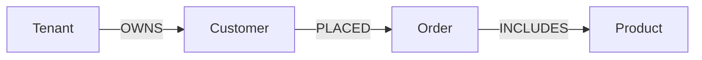

# Preventing Cypher Injection with Parameters and Controlled Dynamic Elements

When an application accepts a customer ID, search term, product list, or filter selection from a user and concatenates it directly into a **Cypher** statement, data can be misinterpreted as **query syntax**. An attacker can attempt to alter filter conditions, broaden read scope, call unintended procedures, or mutate data. This is the **Cypher injection** risk.

In the **Security** chapter of the **DATABASE_ENGINE_GRAPH_NEO4J** module, the core defense is **separating syntax from data values using parameters** (`$parameter`), while **strictly controlling components that must be dynamic**, such as node labels, relationship types, property names, sort directions, and structural Cypher clauses. This lesson applies to property graph queries, Neo4j Java Driver, Spring Data Neo4j, APOC procedures, and application APIs.

> **Design rule:** *User-supplied values go into the parameter map; query structure comes from application-controlled templates or tokens.* Parameterization is essential, yet **it does not replace authentication, authorization, tenant isolation, and procedure controls**.

## 1. Where does Cypher injection happen?

Neo4j stores data as nodes, relationships, and properties. A sales system might use this model:



Example valid query:

```cypher
MATCH (c:Customer {customerId: $customerId})
      -[:PLACED]->(o:Order)
RETURN o.orderId AS orderId
ORDER BY orderId;
```

Here `$customerId` is **a value**, sent separately from the Cypher query text. Even if the user enters a string containing quotes, brackets, newlines, or Cypher-like keywords, Neo4j receives it strictly as **parameter data** rather than new syntax fragments.

### 1.1. Dangerous anti-pattern: string concatenation

Java example **to avoid**:

```java
// Unsafe: id is inserted directly into Cypher syntax.
String cypher =
    "MATCH (c:Customer {customerId: '" + customerId + "'}) " +
    "RETURN c.name AS name";
```

If `customerId` contains single quotes or Cypher syntax fragments, the resulting statement can have its meaning altered. This is **code/data confusion**: input meant to be data is treated by the parser as part of the program.

**Correct pattern:**

```java
String cypher = """
    MATCH (c:Customer {customerId: $customerId})
    RETURN c.name AS name
    """;

Map<String, Object> params =
    Map.of("customerId", customerId);
```

The application sends **two separate parts** to the Driver: a fixed Cypher string and a map of values. Do not wrap `$customerId` in quotes inside the Cypher text: the Driver is responsible for transmitting the proper type and value.

### 1.2. Injection goes beyond data deletion statements

Risks appear in many forms:

| Target of unintended manipulation | Business consequence |
| --- | --- |
| Altering `WHERE` conditions | Reading more records than the user is permitted to see |
| Changing labels or relationship types | Accessing entity types outside the API's intended scope |
| Appending extra query clauses or procedure calls | Side effects outside the designed execution flow |
| Altering `ORDER BY`, `SKIP`, or `LIMIT` | Returning wrong data, heavy queries, or bypassing limits |
| Turning input into updated property names | Modifying sensitive fields such as roles, status, or tenant |
| Uncontrolled URL or file source names | Risks of accessing internal services or out-of-scope files |

Distinguish **Cypher injection** from **valid syntax with missing access-control logic**. For example, a fully parameterized Cypher query can still return another tenant's orders if the application forgets the tenant filter. Injection prevention and authorization are **two complementary defense layers**.

## 2. Parameterization turns input into values, not syntax

A Cypher parameter begins with `$`. Applications can pass strings, numbers, booleans, lists, maps, dates, or temporal values as supported by the Driver API.

Example query:

```cypher
MATCH (c:Customer)-[:PLACED]->(o:Order)
WHERE c.customerId = $customerId
  AND o.createdAt >= $startDate
  AND o.createdAt < $endDate
RETURN o.orderId AS orderId,
       o.totalAmount AS totalAmount
ORDER BY o.createdAt DESC, o.orderId
LIMIT $limit;
```

Parameters:

| Name | Appropriate type | Meaning |
| --- | --- | --- |
| `$customerId` | String | Business key to look up |
| `$startDate` | Date | Start date, inclusive |
| `$endDate` | Date | End date, exclusive |
| `$limit` | Integer | Maximum number of rows to return |

In Java, `LocalDate` can be encoded by the Driver into the matching Neo4j date type. Never concatenate dates, numbers, or IDs into Cypher strings "for simplicity."

### 2.1. Do not use manual escaping instead of parameter binding

Several input-handling habits are often mistaken for safety:

- Replacing every single quote with two single quotes.
- Stripping words like `MATCH`, `DELETE`, or `CALL` from strings.
- Escaping a few characters and wrapping in backticks.
- Enforcing an alphanumeric-only regex across **all** input fields.

These techniques are **not substitutes for parameterization**. They easily miss query-language edge cases or break across versions; moreover, legitimate data can contain quotes—such as people's names, descriptions, or hyphenated codes.

**Validation** is still necessary, but to enforce **business contracts**: ID lengths, numeric ranges, date formats, enum choices, and collection sizes. Validation should never serve as a band-aid for Cypher built by string concatenation.

### 2.2. Null values and empty lists must have clear semantics

Query:

```cypher
MATCH (c:Customer)
WHERE c.customerId = $customerId
RETURN c.customerId AS customerId;
```

When `$customerId = null`, the comparison does not turn into "return all customers." In Cypher, expressions involving `null` generally do not evaluate to `true` and are filtered out by `WHERE`.

Similarly:

```cypher
MATCH (c:Customer)
WHERE c.customerId IN $customerIds
RETURN c.customerId AS customerId;
```

With `$customerIds = []`, the result is empty. Do not assume an empty list means "ignore filter" unless explicitly required by business rules.

At the API layer, decide explicitly:

1. Which fields are required and which are optional.
2. What `null` and empty lists mean.
3. Whether a separate template is needed for unfiltered mode.
4. The maximum scope allowed when no filter is supplied.

## 3. Separating query structure from user input

Parameters work in **value expression positions**, not as arbitrary replacements for full Cypher syntax.

Distinguish clearly:

| Element | Pass as a value parameter? | How to design |
| --- | --- | --- |
| Customer ID, name, search term | Yes | `c.customerId = $customerId` |
| Date, amount, status | Yes | `o.createdAt >= $startDate` |
| List of IDs | Yes | `c.customerId IN $ids` or `UNWIND $ids` |
| Pagination limits and offsets | Yes, where syntax allows and numbers are validated | `SKIP $skip LIMIT $limit` |
| Dynamic node label | Depends on version/dynamic label syntax; cannot directly replace static label | Official dynamic syntax or template allowlist |
| Dynamic relationship type | Depends on version/dynamic type syntax | Official dynamic syntax or template allowlist |
| Property name to read/write | Some syntax supports dynamic access, but must be restricted | Field allowlist; prevent mass assignment |
| `ASC` / `DESC` or full `ORDER BY` | Cannot swap syntax keywords via string parameters | Select template or clause from allowlist |
| `MATCH` / `WHERE` / `CALL` fragments | No | Build controlled static structures |

**Syntactically valid input does not mean business-authorized input.** For example, a dynamic label like `AdminAccount` may be a valid Neo4j label, yet a product-search API must never permit querying it.

## 4. First dynamic element: node labels

A generic API may let callers choose which entity type to search: `Customer`, `Order`, or `Product`. The **incorrect** pattern inserts the request label via string interpolation:

```java
// Unsafe: label is inserted directly into Cypher structure.
String cypher = "MATCH (n:" + label + ") RETURN n LIMIT 20";
```

Left unchecked, input can alter the statement's meaning. When dynamic labels are required, there are two strategies.

### 4.1. Strategy A: a fixed set of templates

Java example:

```java
public enum SearchKind {
    CUSTOMER,
    ORDER,
    PRODUCT
}

public static String findQuery(SearchKind kind) {
    return switch (kind) {
        case CUSTOMER -> """
            MATCH (n:Customer)
            RETURN n LIMIT $limit
            """;
        case ORDER -> """
            MATCH (n:Order)
            RETURN n LIMIT $limit
            """;
        case PRODUCT -> """
            MATCH (n:Product)
            RETURN n LIMIT $limit
            """;
    };
}
```

The application **parses and validates** the input string into `SearchKind` before selecting a template. Users cannot pass an arbitrary label or raw Cypher into `findQuery`.

Advantages:

- Query templates are easy to review, inspect with `EXPLAIN`, and scope with read privileges.
- Does not depend on newer Neo4j dynamic syntax.
- Allows tailored filters per node type; e.g., `Customer` requires tenant scope while `Product` requires published status.

Limitation: template count grows as entity types increase. That is an acceptable cost when it keeps query structure and access control explicit.

### 4.2. Strategy B: dynamic label syntax when supported by the version

Starting in **Neo4j 5.26**, Cypher supports dynamic node labels and relationship types via the `$(...)` expression. Dynamic label example:

```cypher
MATCH (n:$($label))
RETURN n
LIMIT $limit;
```

Parameters might be:

```json
{
  "label": "Customer",
  "limit": 20
}
```

This is **intentional dynamic label syntax**, distinct from invalid `MATCH (n:$label)` or arbitrary string concatenation. The `$label` value is handled as a label token under Neo4j's supported syntax rules, not as raw Cypher spliced into the parser.

**However:**

1. Confirm your Neo4j version actually supports this syntax.
2. The API must still **allowlist** permitted labels; never let users query arbitrary node types.
3. Combine with authorization rules, tenant checks, and label-appropriate filters.
4. Execution plans and token/index lookup behavior for dynamic labels can vary by version. Check `EXPLAIN`/`PROFILE` on a real system.

**Dynamic parameterization controls syntax, not business access authorization.**

## 5. Second dynamic element: relationship types and traversal direction

In a graph, changing the relationship type can completely alter business meaning:

- `(:Customer)-[:PLACED]->(:Order)`: customer placed an order.
- `(:Employee)-[:APPROVED]->(:Order)`: employee approved an order.
- `(:User)-[:ADMIN_OF]->(:Tenant)`: administrative role.

To let users choose a relationship from a valid list, use a **template allowlist** or dynamic relationship type syntax in supporting versions:

```cypher
MATCH (a)-[r:$($relationshipType)]->(b)
WHERE a.entityId = $sourceId
RETURN b.entityId AS targetId
LIMIT $limit;
```

This example only illustrates syntax in an environment supporting dynamic relationship types; it is not a complete production endpoint. Constrain `$relationshipType` via an enum/allowlist and **never expose arbitrary access to all nodes** via a generic ID without tenant checks.

### 5.1. Relationship direction is part of query structure

A string parameter cannot turn `(a)-[:PLACED]->(b)` into `(a)<-[:PLACED]-(b)`. Traversal direction is a **business rule** and must select between static queries when both directions genuinely exist.

Examples:

```cypher
// Template 1: find orders placed by a customer
MATCH (c:Customer {customerId: $customerId})-[:PLACED]->(o:Order)
RETURN o.orderId AS orderId;
```

```cypher
// Template 2: find the customer who placed an order
MATCH (c:Customer)-[:PLACED]->(o:Order {orderId: $orderId})
RETURN c.customerId AS customerId;
```

Never build an "any direction, any relationship type" API merely because it seems convenient to code. The more generic the API, the harder it is to enforce privileges and traversal depth limits.

## 6. Third dynamic element: property names and sorting

### 6.1. Why does ORDER BY $sortKey not behave as expected?

Example:

```cypher
MATCH (c:Customer)
RETURN c.customerId AS customerId, c.name AS name
ORDER BY $sortKey;
```

If `$sortKey = 'name'`, that is a **constant string across all rows**, not the `c.name` property token. It does not turn into `ORDER BY c.name`.

Safe approach: select **one of the approved templates**.

```java
public enum CustomerSort {
    NAME_ASC,
    NAME_DESC,
    ID_ASC
}

public static String customerOrderBy(CustomerSort sort) {
    return switch (sort) {
        case NAME_ASC -> "ORDER BY c.name ASC, c.customerId ASC";
        case NAME_DESC -> "ORDER BY c.name DESC, c.customerId ASC";
        case ID_ASC -> "ORDER BY c.customerId ASC";
    };
}
```

When assembling a query with an `ORDER BY` clause like above, **append only strings produced by an application-defined enum**, never raw input from URLs or query strings. Another option is maintaining three complete query templates for maximum review clarity.

### 6.2. Dynamic property reads differ from injecting field names into syntax

Cypher allows accessing map/node properties via dynamic key lookup in appropriate contexts:

```cypher
MATCH (c:Customer {customerId: $customerId})
RETURN c[$propertyKey] AS value;
```

For example, `$propertyKey = 'name'` reads the `name` property. However, syntax **supporting** a dynamic key does not mean the API may expose every property such as `email`, `internalNote`, or `riskFlag`. Enforce an allowlist aligned with **roles and public fields**, e.g., permitting only `name` and `segment`.

Performance consideration: dynamic property lookups and dynamic filter predicates **may not use indexes the same way static property predicates do** across all versions. For critical queries, explicit templates with `c.customerId`, `c.email`, or `c.segment` are usually easier to optimize.

### 6.3. Never bulk-assign a request map directly onto a node

Dangerous example of **mass assignment**:

```cypher
MATCH (c:Customer {customerId: $customerId})
SET c += $requestBody
RETURN c;
```

`SET c += $requestBody` can update **every key in the map**, including fields the client must never alter if the app accepts an overly broad body. For instance, a user meant only to update their display name could send `role`, `tenantId`, or `approved`.

Safer approach:

```cypher
MATCH (c:Customer {
  tenantId: $tenantId,
  customerId: $customerId
})
SET c.displayName = $displayName,
    c.phoneNumber = $phoneNumber
RETURN c.customerId AS customerId,
       c.displayName AS displayName;
```

The API layer must validate both fields according to business policy. **Never use client-sent property name strings in an unrestricted SET**, even where dynamic property SET syntax is supported by your Neo4j version.

## 7. Java Driver: a safe query from end to end

Suppose an application exposes an endpoint to look up a customer's orders. Only authenticated users may read data for their **current tenant**. Neo4j model:

```cypher
(:Customer {
  tenantId: 'TENANT-A',
  customerId: 'C01',
  displayName: 'An'
})-[:PLACED]->(:Order {
  tenantId: 'TENANT-A',
  orderId: 'O01',
  createdAt: date('2026-11-01')
})
```

Key design in a test database can use a composite constraint:

```cypher
CREATE CONSTRAINT customer_tenant_key IF NOT EXISTS
FOR (c:Customer)
REQUIRE (c.tenantId, c.customerId) IS UNIQUE;
```

This distinguishes two customers sharing the same `customerId` across different tenants and accelerates key lookups. **The constraint enforces uniqueness**, whereas tenant filters and access permissions govern which data a user can read.

### 7.1. Java service using a parameter map

Example with Neo4j Java Driver 5.x API:

```java
import java.util.List;
import java.util.Map;
import org.neo4j.driver.Driver;
import org.neo4j.driver.Session;
import org.neo4j.driver.SessionConfig;

public final class OrderSearchService {

    private static final String FIND_ORDERS = """
        MATCH (c:Customer {
          tenantId: $tenantId,
          customerId: $customerId
        })-[:PLACED]->(o:Order)
        WHERE o.tenantId = $tenantId
        RETURN o.orderId AS orderId
        ORDER BY orderId
        LIMIT $limit
        """;

    private final Driver driver;
    private final String databaseName;

    public OrderSearchService(Driver driver, String databaseName) {
        this.driver = driver;
        this.databaseName = databaseName;
    }

    public List<String> findOrderIds(
            String tenantIdFromIdentity,
            String customerId,
            int requestedLimit) {

        if (tenantIdFromIdentity == null ||
                tenantIdFromIdentity.isBlank()) {
            throw new IllegalArgumentException("Missing tenant context");
        }

        if (customerId == null || customerId.isBlank() ||
                customerId.length() > 128) {
            throw new IllegalArgumentException("Invalid customerId");
        }

        if (requestedLimit < 1 || requestedLimit > 100) {
            throw new IllegalArgumentException("Invalid limit");
        }

        Map<String, Object> params = Map.of(
            "tenantId", tenantIdFromIdentity,
            "customerId", customerId,
            "limit", requestedLimit
        );

        try (Session session = driver.session(
                SessionConfig.forDatabase(databaseName))) {
            return session.executeRead(tx ->
                tx.run(FIND_ORDERS, params)
                  .list(row -> row.get("orderId").asString())
            );
        }
    }
}
```

Here:

1. `FIND_ORDERS` is a **static Cypher string**, independent of `customerId` contents.
2. `params` binds values separately.
3. `tenantIdFromIdentity` **must originate from a server-verified login session/token**, never accepted unchecked from a client-chosen field.
4. `requestedLimit` is bounded between 1 and 100 to prevent the endpoint from accidentally returning excessive data.
5. `Driver` is **reused** across the application, while `Session` is short-lived.
6. `ORDER BY` is fixed structure, never client-injected.

**Authorization note:** This example shows only the tenant predicate in Cypher. Production systems also need privilege policies per resource type and action, and must audit all other query paths that could bypass the filter.

### 7.2. How parameterization differs from concatenation

| Pattern | Outcome |
| --- | --- |
| `"... customerId: '" + input + "' ..."` | Input enters Cypher syntax; injection risk |
| `"customerId: $customerId"` with `Map.of("customerId", input)` | Input is treated strictly as a value |
| `"MATCH (n:" + label + ")"` with request label | Uncontrolled dynamic structure |
| Enum-selected static templates or valid dynamic syntax + allowlist | Keeps structure and allowed scope explicit |

A secondary benefit is that stable query templates improve Neo4j's opportunity to **reuse query planning**. Yet **security does not depend on cache hits**: even if the query cache is cleared, parameters remain data.

## 8. Spring Data Neo4j: repositories do not exempt you from input controls

Spring Data Neo4j (SDN) handles entity mapping and repository declarations, yet custom queries can still become unsafe if developers concatenate input into Cypher text.

### 8.1. Static @Query with @Param

Repository example:

```java
import java.util.List;
import org.springframework.data.neo4j.repository.Neo4jRepository;
import org.springframework.data.neo4j.repository.query.Query;
import org.springframework.data.repository.query.Param;

public interface OrderRepository
        extends Neo4jRepository<Order, String> {

    @Query("""
        MATCH (c:Customer {
          tenantId: $tenantId,
          customerId: $customerId
        })-[:PLACED]->(o:Order)
        WHERE o.tenantId = $tenantId
        RETURN o
        ORDER BY o.orderId
        """)
    List<Order> findVisibleOrders(
        @Param("tenantId") String tenantId,
        @Param("customerId") String customerId
    );
}
```

This snippet assumes `Order` is a properly mapped `@Node` entity with an appropriate `@Id` and that `RETURN o` returns the fields SDN needs to hydrate the entity. In applications with complex relationships/aggregates, verify mapping and query results carefully.

**Parameters `$tenantId` and `$customerId` are bound**, not concatenated into `@Query` via Java string building. The service layer must still:

- Verify identity and access permissions.
- Obtain tenant context from a trusted source.
- Validate inputs and cap result sizes.
- Audit other repository methods for consistent policy enforcement.
- Use proper transactions for updates.

### 8.2. @Query does not automatically make every query safe

For instance, a "query builder" taking an entire `WHERE` string from an HTTP body and concatenating it into Cypher before calling `Neo4jClient` still carries injection risk. **The framework name is not a security boundary**; what matters is how the final query is constructed.

When diverse filtering is needed, design a set of templates driven by enum choices or use **Spring Data repository methods** with explicit predicates, rather than accepting raw Cypher fragments from clients.

## 9. Dynamic queries: practical allowlist techniques

An endpoint may need sorting by `name` or `createdAt`, ascending or descending. A clear pattern maps inputs to predefined enums.

```java
public enum OrderSort {
    NEWEST,
    OLDEST,
    ORDER_ID
}

public static String orderByClause(OrderSort sort) {
    return switch (sort) {
        case NEWEST -> "ORDER BY o.createdAt DESC, o.orderId ASC";
        case OLDEST -> "ORDER BY o.createdAt ASC, o.orderId ASC";
        case ORDER_ID -> "ORDER BY o.orderId ASC";
    };
}
```

When a query requires an optional clause:

```java
String cypher = """
    MATCH (c:Customer {
      tenantId: $tenantId,
      customerId: $customerId
    })-[:PLACED]->(o:Order)
    WHERE o.tenantId = $tenantId
    RETURN o.orderId AS orderId, o.createdAt AS createdAt
    """ + orderByClause(sort) + "\nLIMIT $limit";
```

Here only **program-defined constant strings** are appended, never raw input. Still, to avoid hard-to-read code and limit risk as requirements grow, you can maintain **three complete query templates**. Either way, test every valid combination.

### 9.1. When to choose templates over dynamic tokens

| Requirement | Usually sensible choice |
| --- | --- |
| Only 2–5 sort options | Enum and fixed templates |
| Multiple labels with distinct policies per label | Dedicated query per entity type |
| Internal API swapping relationships within a small allowlist | Dynamic syntax if version supports; still check permissions |
| Performance-critical query sensitive to indexes | Static templates with explicit predicates |
| Multiple optional filters | Predicates built from a ruleset, or use-case-specific templates |
| Input supplies an entire Cypher statement | **Never** allow direct execution on normal business endpoints |

Never expose an arbitrary "Cypher console" in an end-user API just because the database has authentication. Dedicated admin tools require completely separate authorization and auditing.

## 10. Parameter binding does not replace authorization

A fully parameterized query can still suffer **unauthorized access** if business filters are omitted.

Example:

```cypher
// Parameterized, yet tenant scope is missing!
MATCH (c:Customer {customerId: $customerId})-[:PLACED]->(o:Order)
RETURN o.orderId AS orderId;
```

If `customerId` is unique only **within each tenant**, this query can match records belonging to another tenant. Restrict via composite keys or tenant predicates:

```cypher
MATCH (c:Customer {
  tenantId: $tenantId,
  customerId: $customerId
})-[:PLACED]->(o:Order)
WHERE o.tenantId = $tenantId
RETURN o.orderId AS orderId;
```

Keep in mind:

- `$tenantId` comes from a **verified identity**, not an unchecked query param.
- Tenant isolation in Neo4j may also require separate databases, roles/privileges, or additional application controls depending on architecture.
- A tenant check on one branch does not guarantee all relationships were created cleanly: preserve invariants ensuring Customer and Order belong to the same tenant.
- If another procedure or service runs an unfiltered path, exposure persists.

### 10.1. Principle of least privilege

Use a dedicated Neo4j account for the application service:

1. Grant access only to required databases.
2. Separate read-only, data-write, and schema-admin accounts as needed.
3. Never use an admin account for routine search requests.
4. Do not grant execution rights to sensitive procedures or file/network access unless required.
5. Track effective privileges according to Neo4j edition, version, and authorization model.

If injection occurs in some code path, **least privilege** limits the blast radius. However, it never makes an unsafe query builder safe.

## 11. APOC and dynamic Cypher execution

Some APOC procedures execute Cypher queries supplied as **strings** or ingest data from URLs/files. While helpful for administration or integration, they introduce additional security boundaries.

One pattern to avoid is building a Cypher string by interpolating input and passing that string to a dynamic Cypher procedure. **Routing an unsafely constructed string through APOC does not make it safe.**

Guidelines:

- Avoid dynamic Cypher-string execution procedures on user-controlled request paths.
- Where necessary, keep query templates fixed and pass parameters via the procedure's official parameter API.
- Enforce allowlists for labels, relationship types, updatable fields, and permitted procedures.
- Grant procedure execution following **least privilege**.
- For procedures loading JSON/CSV from URIs, restrict source URLs, DNS/network targets, file paths, payload sizes, and secrets—preventing SSRF or out-of-scope file reads.
- Never let clients pick arbitrary procedure names or submit arbitrary Cypher blocks.

Enabling APOC file import/export is a **server-side configuration decision**, not something solved by lightweight frontend validation. Any API accepting untrusted input must account for **DB privileges**, **environment settings**, and **procedure behavior**.

## 12. Safety boundaries when mutating data

Injection protection is not only for `MATCH`. `CREATE`, `MERGE`, `SET`, and `DELETE` must also parameterize values:

```cypher
MERGE (c:Customer {
  tenantId: $tenantId,
  customerId: $customerId
})
ON CREATE SET c.createdAt = datetime()
SET c.displayName = $displayName,
    c.segment = $segment
RETURN c.customerId AS customerId;
```

For example:

- `$displayName` containing quotes remains **a string**.
- `$segment` must belong to a valid segment list if constrained by the app.
- `$customerId` must satisfy format and length checks to protect data integrity.
- `$tenantId` must come from a trusted identity source.

For bulk updates or deletes, never accept raw filter clauses from users:

```cypher
// Safe deletion scope example: both business key and tenant are bound.
MATCH (c:Customer {
  tenantId: $tenantId,
  customerId: $customerId
})
SET c.active = false
RETURN c.customerId AS customerId;
```

In real systems, whether **soft deletion** is appropriate depends on business and legal obligations. This example emphasizes query scoping; it does not replace checking authorization to deactivate a customer.

### 12.1. Guarding against dynamic SET and role tampering

Even if a Neo4j version supports `SET n[$key] = $value`, do not build an "update any property" API without an allowlist. Fields requiring protection often include:

- `role`, `isAdmin`, `approved`;
- `tenantId`, `ownerId`;
- `sourceVersion`, `version`, or optimistic-locking fields;
- `createdAt`, `deletedAt`, or audit statuses;
- Business keys identifying the node.

For sensitive fields, use **dedicated use cases** with verified authentication/authorization and explicit update logic. Never run `SET n += $requestBody` over unfiltered client payloads.

## 13. Safe query execution also requires preventing resource abuse

A query free of injection can still be abused to exhaust resources if an API allows unbounded parameters or overly broad patterns.

Example:

```cypher
MATCH (c:Customer {tenantId: $tenantId})
      -[:CONNECTED_TO*1..5]->(other)
RETURN other
LIMIT $limit;
```

A variable-length path `*1..5` can expand a huge number of relationships before output is capped, depending on node degrees and the planner. **A trailing `LIMIT` is not an absolute cap on all work done by earlier operators.**

Mitigations:

- Bound starting nodes by tenant and indexed key.
- Fix traversal depth per business rule; never construct hop counts or patterns from arbitrary user input.
- Cap `limit`, `skip`, list sizes, and string lengths.
- Index/constrain lookup keys and verify plans with `EXPLAIN`/`PROFILE`.
- Configure request timeouts, transaction timeouts, and rate limits at appropriate layers.
- Monitor `Rows`, `DB Hits`, latency, and database load, especially for graph traversals.

**Never use `PROFILE` to preview a write query in production**: `PROFILE` executes the write portions of the Cypher statement. Use `EXPLAIN` when you only want the plan without modifying data.

## 14. Testing against Cypher injection

Tests should prove **inputs always remain values** and the API **never exceeds its privilege scope**, not merely that the query string contains `$`.

### 14.1. Special-character input test suite

For `customerId`, test inputs such as:

| Input | Guarantee to verify |
| --- | --- |
| `C01` | Returns the authorized customer |
| `O'Reilly` | Single quote is treated as data, does not break syntax |
| `C01;C02` | Semicolon remains data |
| `C01\nC02` | Newline does not introduce a new clause |
| `C01"test` | Double quote does not alter query structure |
| Unicode / Vietnamese strings | Handled according to API normalization and validation rules |
| Very long strings | Rejected by length limits before causing load |
| `null` or empty string | Handled per input contract, never accidentally returning all records |

You do not need to send destructive payloads against a shared environment to test this. **Integration tests should run against Neo4j Testcontainers or a dedicated database** with controlled fixtures and restricted privileges.

### 14.2. Java Driver test against real Neo4j

Assume the test has a Driver connected to a running `Neo4jContainer`. Seed a fixture:

```cypher
CREATE (:Customer {
  tenantId: 'TENANT-A',
  customerId: 'C01',
  displayName: 'An'
});
```

A test can run a fixed query:

```java
String query = """
    MATCH (c:Customer {
      tenantId: $tenantId,
      customerId: $customerId
    })
    RETURN count(c) AS total
    """;

try (var session = driver.session()) {
    long count = session.executeRead(tx ->
        tx.run(query, Map.of(
            "tenantId", "TENANT-A",
            "customerId", "O'Reilly"
        )).single().get("total").asLong()
    );

    assertEquals(0L, count);
}
```

This is a **normal** check: a string with a single quote causes no Cypher error and is compared strictly as a value against `customerId`. Additional tests should verify `TENANT-B` cannot view TENANT-A data and `OrderSort` rejects invalid choices.

### 14.3. Testing dynamic components and authorization

Recommended test list:

1. `SearchKind.CUSTOMER` selects only the `Customer` template.
2. Labels outside the allowlist are rejected **before** querying.
3. Invalid `sortKey` values fail validation.
4. Over-limit `requestedLimit` values are rejected.
5. A tenant A user cannot pass tenant B to view another tenant's data.
6. Profile-update APIs reject maps containing `role` or `tenantId`.
7. The service's database account holds no unnecessary administrative privileges.
8. No normal endpoint allows executing arbitrary APOC procedures or raw Cypher strings.

For write paths, use a test database and assert **node/relationship counts, modified properties, and transaction rollbacks**. Do not check only HTTP status codes if unintended writes might have occurred.

## 15. Observability, logging, and error handling

In operations, monitor:

| Signal | Meaning |
| --- | --- |
| Requests with query structures outside the template catalog | Possible uncontrolled Cypher-building code path |
| Spike in Cypher syntax errors on user-input endpoints | Review query builders and validation |
| High volume of rejections for non-allowlisted fields/labels | Client bug, contract drift, or probing behavior |
| Sudden spike in `DB Hits` or latency | Broad queries or resource abuse |
| Unusual label/relationship access | Review privileges and business intent |
| Sensitive procedure calls outside standard flows | Audit permissions and application activity |

**Never log raw untrusted input** if it might contain personal data or secrets. For diagnostics, log metadata such as request ID, template name, predicate count, error category, and policy-redacted identity—never expose passwords, tokens, or sensitive payloads.

Error classification:

- **400 Bad Request:** malformed input, non-allowlisted field, invalid `limit`.
- **401 Unauthorized:** unauthenticated.
- **403 Forbidden:** identity lacks permission for the operation.
- **404 Not Found:** resource absent or withheld per policy.
- **429 Too Many Requests:** rate limit exceeded.
- **500 Server Error:** unexpected server failure; never return raw Cypher, query plans, or internal stack traces to callers.

## 16. Pre-production security checklist for queries

1. Are **all external values** bound via parameters?
2. Is there any remaining Java string concatenation, template substitution, or Cypher assembly from raw input?
3. Do all **dynamic structural parts** use allowlists/templates or official Neo4j dynamic syntax?
4. When using dynamic labels/types, does the API restrict which data types users can access?
5. Is `SET n += $body` or dynamic property updating used anywhere without filtering sensitive fields?
6. Are tenant and resource ownership derived/verified from authenticated identity?
7. Does the service's Neo4j account enforce **least privilege** and proper database scope?
8. Are APOC procedures, file paths, and remote URLs properly restricted?
9. Are row counts, traversal depth, request duration, and input sizes bounded?
10. Are there integration tests against **real Neo4j** covering quotes, Unicode, invalid labels/sorts, cross-tenant access, and write paths?
11. Are secrets, sensitive inputs, and query structures kept out of external responses and logs?
12. Are rejected requests, heavy queries, and anomalous access monitored and investigated?

## 17. Practice exercises

### Exercise 1 — Converting concatenation to parameters

Rewrite:

```java
String cypher =
    "MATCH (c:Customer {customerId: '" + customerId + "'}) RETURN c";
```

into a static query template with `Map.of("customerId", customerId)`. Explain why `O'Reilly` no longer alters query syntax.

### Exercise 2 — Controlling dynamic labels

An API lets callers pick `Customer` or `Product`. Design a `SearchKind` enum, select the matching static query, and reject other labels. If you want to use `MATCH (n:$($label))`, what checks are needed for **Neo4j version, allowlist, and access permissions**?

### Exercise 3 — Dynamic sorting

A client sends `sort=name_desc`. Why does `ORDER BY $sort` fail to sort by name? Write an enum accepting only `NAME_ASC`, `NAME_DESC`, and `ID_ASC`, returning predefined `ORDER BY` clauses.

### Exercise 4 — Mass assignment

A customer-name update endpoint uses `SET c += $requestBody`. If the request body also includes `tenantId` or `role`, what is the risk? Rewrite it to update only `displayName` and `phoneNumber`.

### Exercise 5 — Tenant isolation

The same code `C01` exists in both TENANT-A and TENANT-B. Write a query looking up orders by both `tenantId` and `customerId`, and add a composite key constraint. Explain why `tenantId` must come from authenticated identity rather than a client-supplied field.

### Exercise 6 — Testing special inputs

Using Neo4j Testcontainers, create a `Customer C01`; send `O'Reilly`, `C01;C02`, and multi-character Unicode strings as parameters. Expected outcome: the query behaves strictly as a data comparison without changing schema or record counts.

### Exercise 7 — Dynamic relationships and graph traversal

An API needs to look up `PLACED` or `FOLLOWS`. Choose either a template allowlist or dynamic relationship type syntax if supported by your version. Why is restricting the relationship type **not enough** if queries can still start from any node or traverse too deeply?

### Exercise 8 — APOC privileges

A standard text-search service has privileges to run dynamic Cypher procedures and read arbitrary URLs. State the risks and propose how to separate privileges, restrict URLs, and disable unnecessary procedures.

### Exercise 9 — Reviewing an API

An API receives JSON containing `label`, `whereClause`, `orderBy`, `limit`, and `tenantId`, and concatenates all five into one Cypher statement. Identify which fields can be parameters, which must be removed or turned into enums/templates, and which tenant value must come from the authentication layer.

## Key takeaways

**Cypher injection** happens when untrusted data enters **query syntax** instead of being passed as **values**. In Neo4j, pass IDs, dates, strings, lists, and limits via `$parameter` using the Java Driver / Spring Data Neo4j parameter map. For labels, relationship types, property names, or `ORDER BY`, use **templates/allowlists**; use dynamic token syntax only when your version supports it and access rights are enforced.

Protecting graph data also requires **tenant isolation, authorization, least privilege, resource bounds, APOC controls, and integration tests**. Parameterization stops data from being interpreted as commands, yet only a consistent design across every read and write path prevents both privilege escalation and improper mutations.
