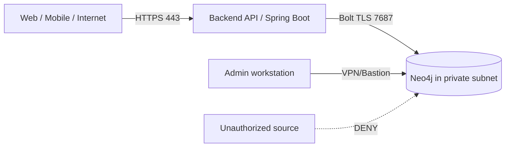
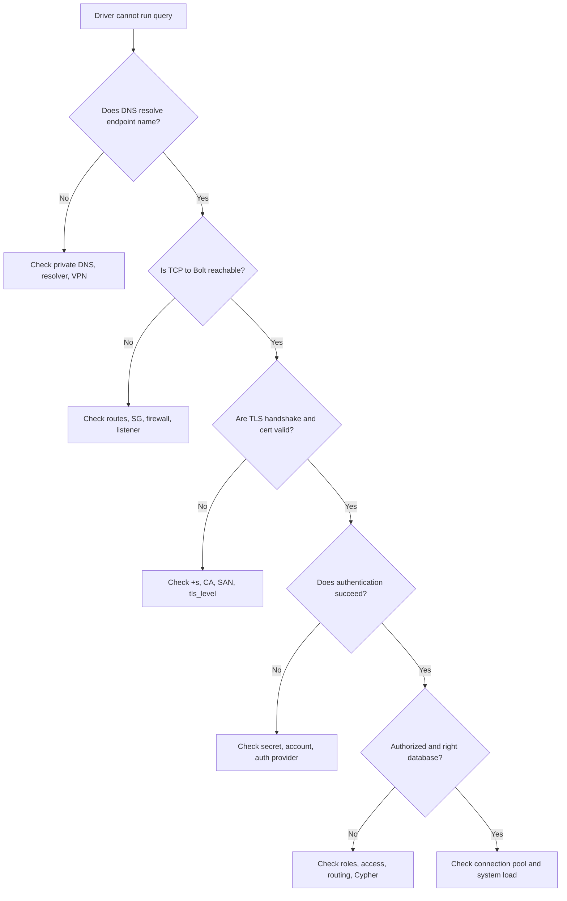

# Network Restrictions, Public Ports, and Application Access in Neo4j

## 1. The problem: applications need to connect, the Internet does not need database access

Neo4j stores a **property graph** of nodes, relationships, labels, and properties; Java or Spring Data Neo4j applications use Cypher via the Neo4j Driver to read and write data. However, the **network path** to Neo4j is an independent security boundary from a database account's node read/write privileges.

In a user- and project-management service, traffic typically follows this path:



End users call the backend API under the application's authentication/authorization policy; **only the backend connects to Neo4j**, typically over Bolt. Putting database credentials directly into JavaScript or a mobile app allows users to extract credentials and access the database outside permitted business APIs.

Lesson objectives:

1. Distinguish client ports, internal cluster ports, backup, metrics, and ports that **must not be public**.
2. Understand how `listen_address`, `advertised_address`, and firewalls differ.
3. Enable Bolt TLS and connect using the proper URI from Java Driver/Spring Data Neo4j.
4. Restrict network paths across VMs, Docker, Kubernetes, clusters, and Aura.
5. Diagnose failures layer by layer—**DNS → TCP → TLS → authentication → authorization → Cypher**—without over-privileging accounts to fix errors.

**Principle:** open only the needed connectors, to the right sources, over encrypted channels, with least-privileged accounts. Private networking, TLS, passwords, and RBAC are complementary layers; none replaces the others.

## 2. Classifying Neo4j ports

The default ports below are published in the Neo4j Operations Manual for current releases; in deployments, **actual ports can vary** based on configuration, version, edition, or enabled/disabled services.

| TCP Port | Connector or service | Used by | Recommended policy |
| ---: | --- | --- | --- |
| **7687** | Bolt | Java Driver, Spring Data Neo4j, cypher-shell, Browser for Cypher execution | Only authorized backends and clients; require TLS |
| **7474** | HTTP | Unencrypted Neo4j Browser/HTTP API connector | Disable in production when unused; never public |
| **7473** | HTTPS | Browser and HTTP API over TLS | Only admin networks/HTTPS clients that genuinely need it |
| **6000** | Cluster internal | Inter-member communication and replication | Only between cluster servers; never public |
| **7000** | Cluster RAFT | RAFT communication | Only between cluster members |
| **7688** | Cluster routing connector | Internal routing when enabled | Cluster network only |
| **6362** | Backup | Online backups | Backup hosts only |
| **2004** | Prometheus metrics | Monitoring collector when enabled | Monitoring only |
| **2003** | Graphite metrics | Monitoring collector when enabled | Monitoring only |

Under current self-managed Neo4j defaults, Bolt is enabled with `server.bolt.tls_level` defaulting to `DISABLED`; HTTP is enabled while HTTPS is usually disabled. The default listen address is `localhost`—**do not** assume a port listed in the table is listening on the Internet.

**Version note:** starting in Neo4j 2025.01, cluster port `5000` seen in older documentation is no longer used; check the port table for your running Neo4j version.

### Questions to answer before opening any port

- Which component actually **initiates the connection**? Backend, DBA, monitoring, or cluster member?
- Which source IPs/subnets/namespaces are allowed, and which machines are **not** allowed?
- Does the service require TLS, authentication, specific privileges, and how are certificates trusted?
- Does DNS/NAT/proxy/load balancer alter the address seen by the application?
- Can the **connector be disabled** rather than merely blocked by a firewall?

On production servers where only the backend reads/writes over Bolt, the HTTP/HTTPS Browser connector may be unnecessary. For DBAs, administer via VPN, bastion, or a private access path instead of exposing Browser to the Internet.

## 3. Three easily confused layers: enabling connectors, binding interfaces, and allowing sources

| Layer | Example | Practical meaning |
| --- | --- | --- |
| Enable | `server.bolt.enabled=true` | Neo4j is permitted to start the Bolt listener |
| Listen | `server.bolt.listen_address=0.0.0.0:7687` | The process binds all **IPv4** interfaces on the host/container |
| Firewall/allowlist | Only `10.20.10.0/24` to TCP `7687` | Only backends in that subnet can connect |

### 3.1. `listen_address`: where does Neo4j accept connections?

In `neo4j.conf` on a self-managed server:

```properties
# Example when the application and Neo4j run on the same host.
server.bolt.enabled=true
server.bolt.listen_address=127.0.0.1:7687
```

`127.0.0.1` is the loopback interface of the **machine/container running Neo4j**. From another container, `localhost` does not reach the Neo4j container. If the backend runs on another host in a private network, the server must bind an appropriate interface, e.g.:

```properties
# Apply only once inbound traffic is restricted by a firewall/SG.
server.bolt.listen_address=0.0.0.0:7687
```

`0.0.0.0` is **not** an address for applications to connect to, and **does not mean "internal only."** If the VM/container is exposed to the Internet, every interface can receive traffic. For IPv6 control, configure IPv6 bindings and firewalls accordingly (e.g., listen syntax `[::]:7687`).

Avoid changing `server.default_listen_address=0.0.0.0` when you only need Bolt: that default setting can affect other connectors. Prefer setting `server.bolt.listen_address` explicitly so HTTP/cluster/backup ports are not exposed inadvertently.

### 3.2. `advertised_address`: which address does Neo4j direct clients to?

`advertised_address` is the hostname/IP and port Neo4j advertises to clients in metadata/routing:

```properties
server.bolt.listen_address=0.0.0.0:7687
server.bolt.advertised_address=graph.internal.example:7687
```

Here the listener binds all internal interfaces, while the Driver uses DNS `graph.internal.example` to locate the endpoint. That DNS name must resolve and be reachable from **the client's environment**.

Two classic mistakes:

- Setting `advertised_address=localhost:7687` on the Neo4j server while the app runs elsewhere: the Driver may attempt to connect to **the app host's own localhost**.
- Setting cluster advertised addresses reachable only between members while Java Drivers in an application subnet cannot reach them: initial seed connection works, then routing to another member fails.

**`advertised_address` is not a firewall**, grants no permissions, and does not replace TLS hostname validation. It simply tells clients where to find the endpoint.

### 3.3. A selection matrix

| Environment | Listen address | Advertised address |
| --- | --- | --- |
| Single-host local demo | `127.0.0.1:7687` | `localhost:7687` |
| Database VM in private subnet | Private IP or `0.0.0.0:7687` with SG | Internal DNS reachable from backend |
| Docker/Compose | Container interface reachable on Docker network | Endpoint hostname matching actual client |
| Neo4j cluster | Each member's interface | Each member's hostname reachable from routing clients |
| Neo4j Aura | Managed service | Aura-provided URI; do not edit `neo4j.conf` |

## 4. Configuring Bolt TLS for self-managed Neo4j

### 4.1. Target deployment model

Assume a backend in a private subnet connects to `graph.internal.example:7687`; the firewall **only** allows inbound traffic from backend sources. DBAs have issued a valid certificate for that DNS name, installed the appropriate CA on clients, and protected the private key on the filesystem.

Sample `neo4j.conf` for a server needing only Bolt:

```properties
server.bolt.enabled=true
server.bolt.listen_address=0.0.0.0:7687
server.bolt.advertised_address=graph.internal.example:7687

# Direct HTTP/HTTPS APIs are not needed.
server.http.enabled=false
server.https.enabled=false

# Require encryption for all Bolt connections.
server.bolt.tls_level=REQUIRED
dbms.ssl.policy.bolt.enabled=true
dbms.ssl.policy.bolt.base_directory=certificates/bolt
dbms.ssl.policy.bolt.private_key=private.key
dbms.ssl.policy.bolt.public_certificate=public.crt
dbms.ssl.policy.bolt.client_auth=NONE
```

This is an **illustrative template**, not commands to apply in production without preparing certificates. Neo4j requires valid directories, certificate/private key files, and file permissions; certificates must have accurate hostnames (SANs) and be trusted by the Java Driver. In multi-node clusters, each member needs its own matching certificate and advertised address.

`dbms.ssl.policy.bolt.client_auth=NONE` means **mTLS client certificates** are not required in this example; it does **not** disable Neo4j username/password authentication. If your enterprise mandates mTLS, configure client certificates and trusted CAs per documentation and test separately.

Do not leave `server.bolt.tls_level=OPTIONAL` as a production default: that mode accepts **both encrypted and unencrypted connections**. When encryption is mandatory, choose `REQUIRED` and fix incompatible clients—never relax to `OPTIONAL` on errors.

### 4.2. If Neo4j Browser is needed over HTTPS

Neo4j Browser loads over HTTP(S) yet uses **Bolt** to run Cypher. DBA workstations may need paths to **both HTTPS port 7473 and Bolt 7687**:

```properties
server.http.enabled=false
server.https.enabled=true
server.https.listen_address=0.0.0.0:7473

dbms.ssl.policy.https.enabled=true
dbms.ssl.policy.https.base_directory=certificates/https
dbms.ssl.policy.https.private_key=private.key
dbms.ssl.policy.https.public_certificate=public.crt
```

Pair this with Bolt TLS and allow `7473` only from admin networks/VPNs. If using a reverse proxy/Ingress for HTTPS, verify forwarding rules and the Browser → Bolt path; standard HTTP proxies do not automatically tunnel raw Bolt TCP.

Never expose `7474` to untrusted networks: the HTTP connector is unencrypted. If Neo4j Browser and the HTTP Query API are unused, **disabling both HTTP and HTTPS** shrinks the network surface.

## 5. Firewalls, Security Groups, and subnet architecture

```text
Internet
   |
   | HTTPS 443
   v
API Gateway / Web LB
   |
   v
Private backend subnet
   | TCP 7687 over TLS only
   v
Private Neo4j subnet
   | cluster ports -> valid peers only
   | backup port   -> valid backup host only
   | metrics       -> valid collector only
   X Direct Internet-to-database
```

Illustrative **inbound** rules with sample CIDRs (do not copy verbatim into other environments):

| Source | Destination | Rule |
| --- | --- | --- |
| Backend in `10.20.10.0/24` | Neo4j `7687/TCP` | ALLOW |
| DBA VPN/bastion | Neo4j `7687/TCP`; `7473` if Browser is used | Controlled ALLOW |
| Neo4j peer servers | `6000/7000/7688` per topology | Internal ALLOW |
| Backup service | `6362/TCP` | Internal ALLOW |
| Monitoring collector | `2004/TCP` if metrics enabled | Internal ALLOW |
| All other sources | Neo4j ports | DENY |

In cloud environments, audit routes, host firewalls, Security Groups/NSGs, public IPs, load balancers, and backend egress policies together. A VM with only a private IP whose SG allows the entire VPC can still be attacked by a compromised internal workload.

**Do not check ports alone:** assign each service a dedicated Neo4j account with least privilege. A backend reading specific nodes/relationships must not use a DBMS-wide admin account. DBAs, write workers, and monitoring should each have matching identities/roles. Network allowlists do not replace Neo4j RBAC, and vice versa.

### 5.1. Public ports and internal ports are not the same

A **listening** port is not public if firewalls/routing block external access. Conversely, a container port with no public IP inside the container **can still become public** if the Docker host, a Kubernetes Service, or a load balancer forwards to it. Inventory completely:

1. Which ports Neo4j actually binds.
2. Container host-port mappings and Kubernetes Services/Ingresses.
3. Load balancers, public endpoints, DNS, and NAT.
4. Ingress rules: which sources can reach the port?
5. Egress rules: can the app reach the DB and DNS?
6. Is the TLS certificate valid for the client's hostname?
7. Which hostnames does the cluster routing table return?

Never treat `advertised_address` as a network barrier. Never open `0.0.0.0/0` to "test temporarily" in production and forget to remove it.

## 6. Accessing with Neo4j Java Driver: URIs, routing, and TLS

### 6.1. URI table

| URI scheme | Routing | Encryption and verification level |
| --- | --- | --- |
| `neo4j+s://` | Yes | Full TLS and certificate verification; suited for clusters/Aura/production |
| `bolt+s://` | No, direct single server | Full TLS and certificate verification |
| `neo4j://` | Yes | Unencrypted; controlled lab environments only |
| `bolt://` | No | Unencrypted; local/special cases only |
| `neo4j+ssc://` | Yes | TLS trusting self-signed certs; **never use to bypass cert verification errors in production** |
| `bolt+ssc://` | No | Same, for direct connections |

With `neo4j+s://`, the Driver fetches a **routing table** from the server; in a cluster, it may open connections to other **advertised addresses**. Not just the initial seed URI, but every member the Driver needs must be reachable, resolve in DNS, and present a valid certificate. With `bolt+s://`, the client targets one server without automatic routing/failover like `neo4j+s`.

When the server requires TLS, pick the right URI from the start. Never swap `+s` for `+ssc` to hide CA/SAN errors; fix the trust store, DNS, or certificate.

### 6.2. Java Driver example verifying real connectivity

Environment variables:

```text
NEO4J_URI=neo4j+s://graph.internal.example:7687
NEO4J_USERNAME=app_reader
NEO4J_PASSWORD=<provisioned via secrets manager>
```

Synchronous Java code:

```java
import org.neo4j.driver.AuthTokens;
import org.neo4j.driver.Driver;
import org.neo4j.driver.GraphDatabase;
import org.neo4j.driver.Session;
import org.neo4j.driver.SessionConfig;

public final class Neo4jNetworkCheck {
    public static void main(String[] args) {
        String uri = requireEnv("NEO4J_URI");
        String username = requireEnv("NEO4J_USERNAME");
        String password = requireEnv("NEO4J_PASSWORD");

        try (Driver driver = GraphDatabase.driver(
                uri, AuthTokens.basic(username, password))) {
            // Creating Driver may not open connections immediately.
            driver.verifyConnectivity();

            try (Session session = driver.session(
                    SessionConfig.forDatabase("neo4j"))) {
                long result = session.executeRead(tx ->
                    tx.run("RETURN 1 AS ok")
                      .single().get("ok").asLong()
                );
                if (result != 1L) {
                    throw new IllegalStateException(
                        "Neo4j health query failed"
                    );
                }
                System.out.println("Bolt TLS and Cypher operational");
            }
        }
    }

    private static String requireEnv(String name) {
        String value = System.getenv(name);
        if (value == null || value.isBlank()) {
            throw new IllegalStateException(
                "Missing configuration variable: " + name
            );
        }
        return value;
    }
}
```

`verifyConnectivity()` verifies connectivity early; instantiating `Driver` alone does not prove sockets/TLS work. In real backends, `Driver` is thread-safe and expensive to construct: reuse it as a bean/singleton with its **connection pool** instead of creating a new Driver per HTTP request. `Session` and transactions should be short-lived; never share a mutable session across threads.

A `RETURN 1` check only proves the account can run Cypher; it **does not** prove the account holds permissions to read/write the labels, relationships, or database required by business logic. Never print passwords or access tokens to logs.

### 6.3. Spring Boot and Spring Data Neo4j

With Spring Boot managing the Driver, pull URIs and credentials from the environment:

```yaml
spring:
  neo4j:
    uri: ${NEO4J_URI}
    authentication:
      username: ${NEO4J_USERNAME}
      password: ${NEO4J_PASSWORD}
  data:
    neo4j:
      database: neo4j
```

In the example, `${NEO4J_URI}`, `${NEO4J_USERNAME}`, and `${NEO4J_PASSWORD}` use Spring placeholders resolved from environment variables or secrets in real deployments. When using an internal CA, configure the Java trust store properly; never use `+ssc` to skip server identity checks. Spring Data Neo4j accesses Bolt through the Java Driver, and mappers/repositories also require read/write privileges on the target database.

**Never connect directly to Neo4j from a frontend:** client-side credentials can be extracted. The proper flow is user → backend API with authorization → Driver with dedicated service account → Neo4j.

## 7. Neo4j ports in Docker/Compose

### 7.1. Local demo published only to host loopback

```bash
# Local practice only; TLS is not configured here.
docker run --rm --name neo4j-local \
  -p 127.0.0.1:7687:7687 \
  -p 127.0.0.1:7474:7474 \
  -e NEO4J_AUTH=neo4j/local-lab-only-change-this \
  neo4j:5.26
```

Port mapping `127.0.0.1:HOSTPORT:CONTAINERPORT` binds only on host loopback. Contrast that with:

```bash
# ILLUSTRATIVE syntax only—do NOT use casually on hosts with public NICs.
docker run -p 7687:7687 -p 7474:7474 ...
```

The second publish form often exposes ports on all host interfaces depending on Docker daemon/firewall rules; enforce strict ingress controls. The password in the example is strictly for labs and must never be used on real servers; shell history and Compose files can leak secrets.

With Docker Compose, when **only backend containers on the same Docker network** access Neo4j, omit `ports:` and use internal Docker service DNS. When DBAs need access from outside the host, prefer VPN/bastion or loopback-only binding. Inside the container, set a listen address compatible with the network, while restricting host port publishing remains an additional layer.

Never assume a container port is private or public without checking host NAT/publishing and cloud Security Groups. Also never use `localhost` inside a backend container to reach a separate Neo4j container.

## 8. Kubernetes: Services and NetworkPolicies

### 8.1. Internal Services first; public LBs only with approved justification

- Use a Kubernetes **ClusterIP** `Service` for Neo4j when only in-cluster applications need access.
- Avoid `NodePort` or public `LoadBalancer` for Bolt unless protected external access is genuinely required.
- For Neo4j clusters, each member's advertised hostname and certificate must be reachable and valid for routing Drivers.
- Standard HTTP Ingresses do **not** replace TCP forwarding for Bolt.

Example NetworkPolicy for Neo4j and a backend in the **same namespace** with pod labels `app: neo4j` and `app: backend`:

```yaml
apiVersion: networking.k8s.io/v1
kind: NetworkPolicy
metadata:
  name: neo4j-allow-backend-bolt
spec:
  podSelector:
    matchLabels:
      app: neo4j
  policyTypes:
    - Ingress
  ingress:
    - from:
        - podSelector:
            matchLabels:
              app: backend
      ports:
        - protocol: TCP
          port: 7687
```

**Sample limitations:**

- Only takes effect when the CNI plugin enforces NetworkPolicies.
- If the backend runs in another namespace, combine `namespaceSelector` and `podSelector` appropriately.
- If backend egress is restricted, allow egress to Neo4j and required services.
- This is **not** a complete NetworkPolicy for a Neo4j cluster: add peer-to-peer cluster flows, DNS, monitoring, and backup rules per topology.
- Kubernetes Services/NetworkPolicies do not replace TLS, auth, RBAC, secrets, or cloud Security Groups.

## 9. Clusters: never expose internal replication and routing ports

```text
Java/Spring Boot backend
        |
        | Bolt TLS 7687
        v
  Neo4j member A <--- 6000 / 7000 / 7688 ---> Neo4j member B
        \                                  /
         \------ cluster private --------/

Backup host ---- restricted TCP 6362 ---> members
Monitoring ----- restricted metrics ----> members
```

Client traffic uses Bolt (typically `7687`). Ports `6000`, `7000`, and `7688` are internal to the cluster; firewalls must permit traffic only between **designated cluster members**. Specifically, the Neo4j Operations Manual warns that port `6000` can allow unauthenticated replication operations without appropriate cluster SSL, so **never** expose it to external networks.

The SSL policy for Bolt is **separate** from the SSL policies for cluster and backup traffic. If organizational policy requires encrypted/authenticated inter-server channels, configure `cluster` and `backup` SSL policies per documentation—never assume `server.bolt.tls_level=REQUIRED` protects other ports.

With `neo4j+s://`, a query may:

1. Connect to the seed.
2. Receive the routing table from the cluster.
3. Open connections to the member chosen by the driver for read/write mode.

Therefore, **successfully connecting to the seed does not guarantee subsequent transactions will succeed**. Every advertised hostname/port in the routing table must be reachable, resolve in DNS, and pass certificate validation from the application environment. Opening `7687` to only one server while blocking another member breaks routing even when the seed is healthy.

## 10. Neo4j Aura: restricting access via service policies

With **AuraDB**, users do not directly edit `neo4j.conf`, listeners, or server certificates. Applications connect to the URI provided by the **Aura Console**, following the pattern:

```text
neo4j+s://<instance-id>.databases.neo4j.io
```

This is only a **URI pattern**, not a real instance. Never hard-code demo addresses or guess organizational DNS; obtain exact endpoints and authentication settings from the active instance.

### 10.1. IP filtering

On supported Aura tiers, administrators can configure an **IP filter/allowlist** to accept connections only from approved IPs or CIDR ranges:

- If a backend inside a VPC exits to the Internet via a **NAT gateway**, allowlist the **public egress IP** seen by Aura; private pod/VM IPs are not the public source IP on that path.
- IP filters may apply at organization, project, or instance scope per product policy; check scope and inheritance before editing.
- Limits on IP range counts, permissions to edit filters, and availability **vary by tier**, so check docs/console before designing.
- Never configure `0.0.0.0/0` or "All" and consider untrusted sources blocked.

**Important:** per Aura documentation, IP filter edits apply to **new network connections**; already-open connections may not close immediately. Post-change testing should open fresh connections from both an allowed source and a disallowed source. Application connection pools can keep older sockets alive, so plan pool-lifecycle handling when immediate access revocation is required.

### 10.2. Private Endpoints

When traffic must avoid the public Internet, supported Aura tiers and cloud providers offer **Private Endpoints**:

- Applications in a VPC/VNet use the private DNS/endpoint configured per service instructions.
- To enforce **private-only**, disable public traffic following Aura procedures. Enabling a private endpoint while leaving public traffic active **does not automatically** remove the public path.
- Some Aura tools use **indirect access** paths that do not traverse the same private endpoint as the Java Driver. Review direct/indirect tool classifications when compliance requires zero public-Internet traffic.

Do not follow self-managed guides telling you to edit `server.bolt.listen_address` or Docker ports for Aura networking; those apply only to **self-managed** Neo4j.

## 11. Verifying connectivity layer by layer

When an application fails to connect to Neo4j, do not immediately open more ports. Identify **which layer is failing**:



### 11.1. Testing from the application host

The examples below are strictly for testing **authorized endpoints under your administration**; never scan addresses outside your operational scope.

On Linux:

```bash
# DNS seen by the client.
getent hosts graph.internal.example

# TCP reachability; does not prove TLS or login privileges.
nc -vz graph.internal.example 7687

# Inspect TLS certificate for the exact server name.
openssl s_client -connect graph.internal.example:7687 \
  -servername graph.internal.example
```

On Windows PowerShell:

```powershell
Test-NetConnection graph.internal.example -Port 7687
```

On a Linux Neo4j host, inspect listening sockets:

```bash
ss -ltn
```

Never run `curl http://...:7687` to "test Bolt" because Bolt **is not HTTP**. `nc`/`Test-NetConnection` tests TCP only; it does not prove credentials, certificate validity, or query permissions. Pair it with `Driver.verifyConnectivity()` and a verification Cypher query on the target database.

### 11.2. Verifying active Neo4j settings

With permission to view server settings, run Cypher:

```cypher
SHOW SETTINGS YIELD name, value
WHERE name IN [
  'server.bolt.enabled',
  'server.bolt.listen_address',
  'server.bolt.advertised_address',
  'server.bolt.tls_level',
  'server.http.enabled',
  'server.https.enabled'
]
RETURN name, value
ORDER BY name;
```

`SHOW SETTINGS` requires appropriate privileges and varies by Neo4j/Cypher version. **Never** grant admin privileges to a backend just to query settings; ask a DBA to check via admin tooling. Remember that settings loaded at startup can differ from an edited config file awaiting reload/restart.

### 11.3. Troubleshooting table for common failures

| Symptom | Possible causes | How to check |
| --- | --- | --- |
| `Connection refused` | Connector disabled, wrong bound interface, service down | `server.bolt.enabled`, `listen_address`, sockets/listeners |
| `Connection timed out` | Firewall/SG, routing, LB, VPN, NetworkPolicy | Test TCP from the **application host** to the specific endpoint |
| `UnknownHostException` | Broken DNS or missing private zone | Check DNS resolvers and hostname |
| TLS handshake failed | URI incompatible with `tls_level`, missing cert, proxy misconfig | Check URI scheme, SSL policy, and endpoint |
| Certificate/hostname verification failed | Untrusted CA, SAN mismatch, expired cert | Inspect certificate/trust store; **never disable verification** |
| Authentication failure | Wrong username/password, rotated secret, auth provider | Verify credential/rotation without printing secrets |
| Authorization denied | User lacks database/graph privileges | Check roles, query, and target database |
| Seed connects, cluster queries fail | Member in routing table unreachable | Check advertised DNS, firewall, and cert on every member |
| Works locally, fails in Docker/K8s | `localhost` points to wrong namespace, Service/publish differs | Use endpoint matching the network topology |
| Browser loads UI, fails Cypher | HTTPS/HTTP port reachable, Bolt blocked | Check the **browser → Bolt** path |
| IP filter added, old client still works | Connection already open before allowlist update | Test a new connection; recycle old pools/connections |
| High request concurrency times out | Pool exhausted, DB overloaded, slow queries | Inspect metrics, concurrency, timeouts, and queries |

### 11.4. Unsafe "quick fixes"

Never adopt the following just to make an application appear connected:

- Opening ingress `0.0.0.0/0:7687` or publishing all container ports on public host interfaces.
- Downgrading `server.bolt.tls_level=REQUIRED` to `DISABLED` or `OPTIONAL` over untrusted networks.
- Changing production URIs from `neo4j+s` to `neo4j+ssc` to skip CA/hostname checks.
- Creating one shared admin account for all backends and tools.
- Exposing cluster, backup, or metrics ports publicly to test connectivity.
- Disabling database authentication or authorization because the driver throws auth errors.

Every failure has a proper layer for remediation. Changing multiple layers at once obscures root causes and risks shipping insecure configs to production.

## 12. Deploying network changes safely

When changing DNS, advertised addresses, TLS, or firewalls, prepare a **cutover and rollback plan**. A sound sequence:

1. **Inventory:** review all ports/listeners/publishes, app URIs, cluster members, backup traffic, and monitoring.
2. **Finalize target state:** source IPs/subnets, private paths, DNS, TLS scheme, CAs, and required app privileges.
3. **Prepare:** valid unexpired certificates with proper SANs, provisioned secrets, ready client trust stores; validate on staging.
4. **Apply in order:** coordinate firewall, config, and deployment changes in an approved window. Follow rolling-change and quorum guidance for clusters.
5. **Positive tests:** authorized backend connects, `verifyConnectivity()`, and read/write test queries on a test DB or approved operations succeed.
6. **Negative tests:** non-allowlisted sources cannot open **new connections**; cleartext clients are rejected when TLS is required.
7. **Monitor:** connection timeouts, TLS failures, auth failures, pool saturation, latency, and cluster membership.
8. **Recoverability:** retain an administrative path to recover if a firewall accidentally locks out DBAs/backends, without leaving insecure rules long-term.

Avoid changing DNS, Security Groups, passwords, and certificates simultaneously when phased rollouts are possible; phasing isolates failures cleanly. Check whether settings are dynamic or require restarts per your Neo4j version and deployment method.

## 13. Practice choosing configurations and verifying them

### Scenario A: Neo4j and Java running on the same laptop

Neo4j is used solely for coursework:

- Bind or publish `127.0.0.1:7687` on the host.
- Allow local Browser/HTTP if needed; never carry non-TLS configs onto external networks.
- Clarify whether Java runs on the host or inside a container, since `localhost` resolves differently.

**Question:** why can a backend inside Docker Compose not use `localhost:7687` to connect to a separate Neo4j container?

### Scenario B: backend and Neo4j in two private subnets

A Spring Boot backend reads and updates the graph:

- Neo4j needs only Bolt `7687`; disable HTTP/HTTPS web connectors if unused.
- Bind the appropriate interface; set advertised DNS to an internal name clients can resolve.
- Firewalls/SGs permit only approved backend sources; DBAs connect via VPN/bastion.
- TLS `REQUIRED`; Java Driver uses `neo4j+s://...`, valid certificates, and a least-privileged account.

**Question:** what do `listen_address`, `advertised_address`, and Security Groups each solve?

### Scenario C: Neo4j Enterprise cluster

- Client Bolt traffic arrives over the authorized application network.
- Ports `6000/7000/7688` are restricted strictly to cluster members; enable cluster SSL per policy.
- Backups and metrics use dedicated internal paths; no Internet access.
- From the backend, verify DNS/TLS routing to every advertised member.

**Question:** why can `verifyConnectivity()` to the seed succeed while a later read/write transaction still fails?

### Scenario D: AuraDB with a cloud backend

- Use the Aura-provided URI; never manually edit `neo4j.conf`.
- Check whether your tier supports IP filtering or Private Endpoints; if traffic exits via NAT, allowlist the actual public egress IP.
- If private-only is mandated, disable public traffic and review indirect-access tools per docs.
- Test **new connections** from both an allowed source and a denied source.

**Question:** why does updating an IP filter not necessarily drop already-open connections right away?

### Network security acceptance checklist

| Check | Passing criterion |
| --- | --- |
| Public exposure | No public path to database ports without explicit approval |
| Connectors | Only genuinely needed Bolt/HTTPS connectors enabled; HTTP `7474` never public |
| Firewalls | Only apps, DBAs, backups, metrics, and cluster peers permitted by function |
| TLS | App connections use `+s` with valid certs; cleartext rejected when required |
| DNS and routing | Advertised hostnames resolve and are reachable from the right clients |
| Identity | Dedicated runtime accounts; no default admins or hard-coded secrets |
| Application | `verifyConnectivity()` and Cypher on the target database/privileges pass |
| Negative tests | Non-allowlisted clients cannot establish new connections |
| Operations | Plans exist for secret/cert rotation, logs/metrics, and config rollback |

**Completion criteria:** learners can classify client vs. internal ports; explain `listen_address` vs. `advertised_address`; design a network policy opening Bolt only to authorized backends; connect Java/Spring with full TLS verification; and diagnose failures layer by layer without loosening privileges recklessly.

## Official references

- [Neo4j Operations Manual — Configure network connectors](https://neo4j.com/docs/operations-manual/current/configuration/connectors/): Bolt, HTTP, HTTPS, listen, and advertised settings.
- [Neo4j Operations Manual — Ports](https://neo4j.com/docs/operations-manual/current/configuration/ports/): client, cluster, backup, monitoring ports, and protection guidance.
- [Neo4j Operations Manual — SSL framework](https://neo4j.com/docs/operations-manual/current/security/ssl-framework/): TLS configuration and Bolt/HTTPS/cluster/backup certificates.
- [Neo4j Operations Manual — Show configuration settings](https://neo4j.com/docs/operations-manual/current/configuration/show-settings/): viewing active settings.
- [Neo4j Java Driver Manual — Connection](https://neo4j.com/docs/java-manual/current/connect/): Driver creation and `verifyConnectivity()`.
- [Neo4j Java Driver Manual — Advanced connection information](https://neo4j.com/docs/java-manual/current/connect-advanced/): schemes, routing, and TLS.
- [Neo4j Operations Manual — Accessing Neo4j on Kubernetes](https://neo4j.com/docs/operations-manual/current/kubernetes/accessing-neo4j/): Kubernetes Services and access configuration.
- [Neo4j Aura — Secure connections](https://neo4j.com/docs/aura/security/secure-connections/): public/private networking and private endpoints per product.
- [Neo4j Aura — IP filtering](https://neo4j.com/docs/aura/security/ip-filtering/): IP/CIDR allowlists and behavior for new connections.
- [Neo4j Aura — Private Endpoints](https://neo4j.com/docs/aura/security/private-endpoints/): private-only, direct, and indirect access.
