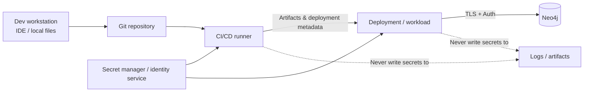
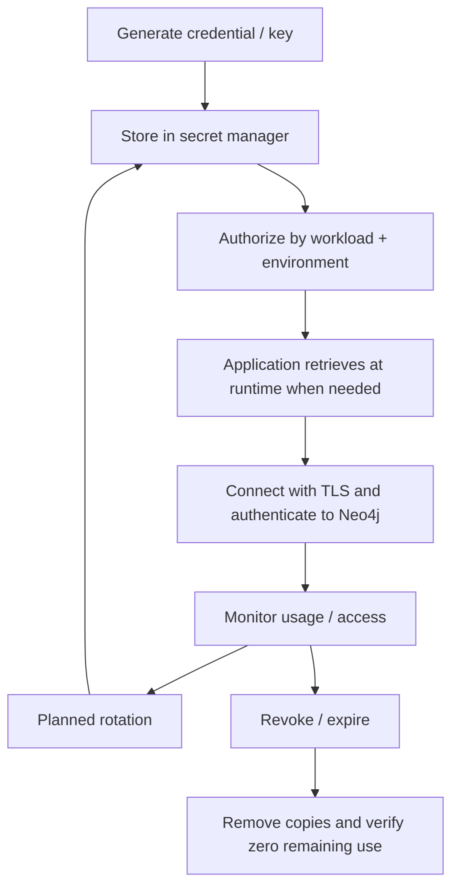

# Managing Secrets for Neo4j Development, CI/CD, and Deployment Environments

An application connecting to Neo4j needs the database address, login identity, and authentication credentials. When running on a local machine, values may come from environment variables; in CI/CD, they come from the platform's secret store; in production, they are typically provisioned through an organization's secret manager and identity policies. If handled inconsistently, a test password can be committed to Git, a pipeline can accidentally receive production access, or a container can leak credentials into logs.

**Secret management** is the process of controlling the **lifecycle** of sensitive information: creation and classification, storage, access authorization, runtime delivery, usage, monitoring, rotation, revocation, and leak response. The goal is not merely "hiding passwords in another file," but ensuring **only the right components and people can use a secret in the right environment, for only as long as needed**.

This lesson belongs to the **Security** chapter of the **DATABASE_ENGINE_GRAPH_NEO4J** module. Within the scope of using Neo4j to model connected data as a property graph, querying nodes/relationships and paths via Cypher, leveraging indexes/constraints, importing data, Java Driver, Spring Data Neo4j, and operating graph systems, this lesson focuses on **credentials, keys, and configuration secrets** from developer workstations through pipelines to runtime.

After this lesson, you will be able to:

- Distinguish **secrets**, ordinary configuration values, and identities/roles used to access Neo4j.
- Design secure secret delivery across **local development**, **CI/CD**, and **deployment environments**.
- Configure **Spring Boot/Spring Data Neo4j** and **Neo4j Java Driver** without hard-coding passwords.
- Understand the roles of **secret managers**, environment variables, secret volumes, TLS, and least privilege.
- Establish workflows for **rotation, revocation, auditing, leak detection, and recovery**.
- Spot practices that look safe on the surface yet still risk exposing secrets.

> **Version scope:** Examples use Neo4j 5 and modern releases, Spring Boot 3.x, Java 17+, and GitHub Actions/Kubernetes as illustrative contexts. Exact setting names, user/role management capabilities, encrypted connection mechanics, and secret-delivery methods must be verified against your actual version, edition, managed service, and deployment platform. All strings and accounts in examples are illustrative; never use them as production credentials.

## 1. What is a secret, and what is not necessarily a secret?

In a Neo4j connection configuration:

| Item | Example | Is it a secret? | How to handle |
| --- | --- | --- | --- |
| Connection URI | `neo4j+s://graph.example.org:7687` | Usually not a secret, though may be internal info | Manage as configuration; never embed credentials in the URI |
| Database name | `neo4j` or `commerce` | Usually not | Manage per environment |
| Technical username | `app_reader` | Not necessarily secret; can be operationally sensitive | Avoid unnecessary disclosure |
| Neo4j password | System-issued value | **Yes** | Secret manager; deliver over controlled channels |
| Related service tokens/API keys | Credentials for cloud/KMS/broker | **Yes** | Provision and rotate independently |
| TLS/mTLS private keys | Client/server private keys | **Yes** | Store in key-protection systems; manage certificate lifecycle |
| Public CA certificates | Root/intermediate CA certificates | Normally not | Control integrity and trust provenance |
| Encryption/application keys | Encryption keys, signing keys | **Yes** | KMS/HSM or dedicated key management |
| Temporary CI tokens | Workload identity tokens / access tokens | **Yes**, even if short-lived | Restrict lifetime, audience, scope, and issuer |

**Not every configuration setting belongs in a secret manager.** For example, `database=commerce` can live in standard config. Conversely, **a password in an environment variable is still a secret**: moving where it is stored does not make it public information.

Also distinguish:

- **Authentication:** how the application proves its identity to Neo4j.
- **Authorization:** what the authenticated user/role may read, write, manage in schema, or administer.
- **Transport security:** protecting data and credentials in transit over the network, typically via TLS.
- **Secret management:** protecting access-granting secrets across their lifecycle, before and after application startup.

A system that guards passwords tightly yet uses an admin account for every service remains high risk.

## 2. Threat model: where can secrets leak?

Consider a Spring Boot application receiving a Neo4j password from CI/CD and running in Kubernetes.



Common leakage surfaces:

1. **Git and commit history:** placing passwords in `application.yml`, `.env`, test fixtures, or docs; deleting them in a later commit does not purge history.
2. **Logs and consoles:** printing full environments, connection strings containing credentials, error payloads with sensitive data, or enabling shell tracing.
3. **CI artifacts/caches:** saving config files containing passwords into build artifacts, caches, or reports.
4. **Overly broad CI permissions:** every branch/PR or every job receives production credentials.
5. **Container environment variables:** readable by same-privilege processes, users with debug/inspect rights, or diagnostic collectors.
6. **Command-line arguments:** values passed directly on CLI can appear in process listings, shell history, or monitoring agents.
7. **Missing/unverified TLS:** credentials and data can be exposed over untrusted networks.
8. **Long-lived shared credentials:** a single leaked secret impacts multiple apps/environments and is hard to revoke individually.
9. **Backups and snapshots:** config files, system dumps, or secret volumes copied to less-protected storage.
10. **Environment mix-ups:** tests or CI accidentally targeting the production database, modifying or deleting real data.

Design so that a minor incident (such as a leaked CI token) **does not automatically grant administrative control over every database**.

## 3. Environment-based secret provisioning matrix

A simple, auditable policy:

| Environment | Recommended credential source | Identity | Access scope |
| --- | --- | --- | --- |
| **Local development** | OS/IDE secret store or uncommitted local file | Dedicated dev user on test database | Only permitted test resources |
| **Unit tests** | No real Neo4j needed; mocks or synthetic data | No production credentials needed | None |
| **Neo4j Harness / Testcontainers** | Ephemeral test credentials or isolated test instance config | Isolated test user | Only the database created for tests |
| **CI integration tests** | CI secret store or workload identity to test service | CI service identity | Test/staging databases only |
| **Staging** | Secret manager, scoped to staging workload | Staging service identity | No access to production |
| **Production** | Secret manager + runtime identity, dynamically/controlledly delivered | Dedicated identity per application | Least privilege on required databases |
| **Admin/migrations** | Dedicated privileged workflow with audit and approval controls | Admin/migration identity | Elevated only within job scope |

**Never share a single password across dev, CI, staging, and production.** If the same credential exists in multiple environments, a compromise on a laptop or build runner can affect real production data.

Separate business read/write privileges from schema and user management privileges. A path-lookup API should never hold `CREATE USER`, `DROP DATABASE`, or unrelated schema privileges.

## 4. Principles for designing the secret lifecycle



Key requirements:

- **Single source of truth:** avoid copying secrets across multiple systems without clear ownership.
- **Minimal scope:** each user holds only the privileges needed for its use case.
- **Environment isolation:** production secrets must never reach developer laptops or arbitrary PRs.
- **No secrets in source/artifacts:** repositories hold only variable names or secret references.
- **Replaceability:** a compromised credential must be rotatable and revocable without destroying data.
- **Traceability:** know who or which workload was granted access, when it was used, and when the credential last changed.
- **Resilience when the secret manager fails:** define how long running apps may retain cached credentials and whether newly starting instances may proceed; never fall back to unsafe default passwords just to "keep running."

A strong secret that is never rotated when staff leave or a workload is compromised **does not meet operational requirements**.

## 5. Local development: keeping secrets out of Git

### 5.1. Separating example files from real values

A repository may include a template `.env.example` containing **no real credentials**:

```dotenv
# .env.example: variable names and placeholder values only
NEO4J_URI=bolt://localhost:7687
NEO4J_DATABASE=neo4j
NEO4J_USERNAME=dev_user
NEO4J_PASSWORD=SET_THIS_LOCALLY
```

A local `.env` or IDE config holds values provided by the developer; that file **must never be committed**. Example `.gitignore` entries:

```gitignore
.env
.env.*
!.env.example
*.pem
*.key
secrets/
```

These patterns are **suggestions** and must be tailored to each repository. Avoid accidentally ignoring public files like `.env.example` or public CA certs; and never assume `.gitignore` protects a secret **already committed earlier**.

**Warning:** `.gitignore` only stops Git from tracking untracked files by default. If a file is already tracked or a secret exists in commit history, adding an ignore pattern **does not erase history**.

### 5.2. Never use production accounts for development

On personal workstations:

- Use local Neo4j, a test instance, or a dev database with restricted privileges.
- Create dedicated dev users instead of sharing production admin accounts.
- Use sufficiently strong passwords and never save them in committed demo scripts.
- Never paste credentials into chats, issues, screenshots, terminal recordings, or public docs.
- Enable debug/tracing only after verifying it does not print tokens, URIs with secrets, or environment variables.
- Securely delete local files and revoke credentials when no longer needed.

**Never put a working password into `.env.example`** just because "it's only dev."

### 5.3. Secret stores beat "files hidden in another folder"

A file outside the repository can still be synced to personal cloud backups, emailed by mistake, or read by malware. OS credential managers, IDE secret stores, or organization-provided secret managers offer far better access control and auditing.

If a local file is unavoidable, restrict read permissions via OS controls and never share the directory across untrusted users.

## 6. Spring Boot and Spring Data Neo4j: receiving credentials at runtime

A Spring Boot app does not need to know which vault stores the password; it only needs a way to **receive the value at deployment runtime**.

Example `application.yml`:

```yaml
spring:
  neo4j:
    uri: ${NEO4J_URI}
    authentication:
      username: ${NEO4J_USERNAME}
      password: ${NEO4J_PASSWORD}
  data:
    neo4j:
      database: ${NEO4J_DATABASE:neo4j}
```

In an actual file, these symbols represent Spring property placeholders:

- `${NEO4J_URI}` resolves the `NEO4J_URI` value at runtime.
- `${NEO4J_USERNAME}` and `${NEO4J_PASSWORD}` are supplied from the environment or a secure config source.
- `${NEO4J_DATABASE:neo4j}` provides a normal default for database name, **never a default for a password**.

Never write:

```yaml
spring:
  neo4j:
    authentication:
      username: neo4j
      password: my-real-production-password
```

into source control. A credential committed to a config file is no safer because it is wrapped in YAML.

### Separating public configuration from secrets

A deployment can manage `NEO4J_URI` and database names via a ConfigMap/config service, and `NEO4J_PASSWORD` via a Secret Manager. For usernames, follow internal policy: they may not strictly be secrets, yet avoiding unnecessary disclosure of technical account names is still wise.

**Never provide fallback defaults for production passwords**, such as expressions meaning "if secret missing, use `password123`." Designs should **fail fast** when a critical environment lacks its secret.

### When configuration gets logged

Some platforms expose configuration properties via Actuator, diagnostic dumps, or runtime admin panels. You must:

- Disable or strictly secure endpoints that expose configuration.
- Ensure password fields are masked/hidden by framework mechanisms.
- Never assume every monitoring agent automatically masks custom variables.
- Never dump all bean properties or the Spring environment into logs.

## 7. Java Driver: building connections without hard-coding passwords

A service using the Neo4j Java Driver can read runtime-supplied credentials:

```java
import org.neo4j.driver.AuthTokens;
import org.neo4j.driver.Driver;
import org.neo4j.driver.GraphDatabase;
import org.neo4j.driver.Session;

public final class Neo4jReadExample {

    private static String requiredEnv(String name) {
        String value = System.getenv(name);
        if (value == null || value.isBlank()) {
            throw new IllegalStateException(
                "Missing required configuration: " + name
            );
        }
        return value;
    }

    public static void main(String[] args) {
        String uri = requiredEnv("NEO4J_URI");
        String user = requiredEnv("NEO4J_USERNAME");
        String password = requiredEnv("NEO4J_PASSWORD");

        try (Driver driver = GraphDatabase.driver(
                uri, AuthTokens.basic(user, password));
             Session session = driver.session()) {

            long total = session.run("""
                MATCH (n)
                RETURN count(n) AS total
                """).single().get("total").asLong();

            System.out.println("Nodes: " + total);
        }
    }
}
```

This example illustrates credential injection. In server applications, `Driver` is lifecycle-managed and reuses its connection pool—**never create a new Driver per HTTP request**. With Spring Data Neo4j, let Spring manage the Driver rather than instantiating extra drivers manually.

**Never log `password`, include passwords in exception messages, or print the full environment.** Immutable Java `String`s cannot be guaranteed to be scrubbed immediately from memory, making it vital to minimize exposure via logs, heap dumps, and debug privileges.

### Cypher parameters differ from secrets

An application can pass `$customerId` as a parameter to prevent string concatenation in Cypher:

```cypher
MATCH (c:Customer {customerId: $customerId})
RETURN c;
```

However, query parameters are **not where database passwords belong** inside `MATCH` statements. Neo4j passwords belong to the **connection authentication** phase, whereas Cypher parameters carry business data. The two serve distinct security purposes.

## 8. Protecting credentials in transit with TLS

Keeping a password safe in a secret manager still leaves it exposed if transmitted over an unprotected network. When Java Driver connects to Neo4j over a network, use TLS and **verify the server certificate** according to your infrastructure.

Example URIs:

| Illustrative URI | General meaning | When to use |
| --- | --- | --- |
| `bolt://localhost:7687` | Direct Bolt connection; encryption depends on driver/server config | Only in evaluated contexts like local/dev |
| `bolt+s://graph.example.org:7687` | Bolt with TLS verifying trusted certificate chain | Direct server with trusted CA certificate |
| `neo4j+s://graph.example.org:7687` | Neo4j routing URI with TLS and CA verification | Systems supporting routing and TLS |
| `bolt+ssc://...` / `neo4j+ssc://...` | TLS for self-signed certs / accepting without standard CA checks | Only with an explicit trust policy; avoid as a production "TLS fix" |

TLS details, trust stores, and scheme behavior depend on Driver/Neo4j versions. **Never disable production certificate verification** to silence configuration errors; install the proper CA/trust chain and verify the certificate hostname instead.

Paths requiring protection:

- Connections from applications to Neo4j.
- Connections from CI runners to test/staging databases over networks.
- Connections between admin/backup tools and the server.
- Client private keys/certificates when using mTLS or additional authentication methods.
- Connections from workloads to the secret manager.

**TLS does not replace Neo4j privileges.** An encrypted connection still carries excessive risk if the app uses an admin account.

## 9. CI/CD: scoping secrets by job and trust level

CI must test and deploy, yet it should not be treated as a "fully trusted developer machine." Pipelines may execute code from pull requests, external dependencies, or contributor-edited scripts.

### 9.1. GitHub Actions example using a secret store

This is an **illustrative workflow** for a test job using a **dedicated CI database**. Secret values live in the CI platform's secret store, never written into repository YAML:

```yaml
name: Neo4j integration tests

on:
  push:
    branches: [main]

permissions:
  contents: read

jobs:
  test:
    runs-on: ubuntu-latest
    env:
      NEO4J_URI: ${{ secrets.NEO4J_CI_URI }}
      NEO4J_USERNAME: ${{ secrets.NEO4J_CI_USERNAME }}
      NEO4J_PASSWORD: ${{ secrets.NEO4J_CI_PASSWORD }}
    steps:
      - uses: actions/checkout@v4
      - uses: actions/setup-java@v4
        with:
          distribution: temurin
          java-version: '21'
      - name: Run tests against dedicated CI Neo4j
        run: ./gradlew test
```

The expressions `${{ secrets.NEO4J_CI_URI }}`, `${{ secrets.NEO4J_CI_USERNAME }}`, and `${{ secrets.NEO4J_CI_PASSWORD }}` reference **GitHub Actions secrets**. Action names and versions should be updated and pinned per your organization's supply-chain policy; this workflow does not provision the CI database itself.

Mandatory conditions for this example to be safe:

- `NEO4J_URI` must point to a **dedicated test database**, never production.
- The CI identity has only the privileges needed to run tests on that database.
- Expose secrets only to authorized workflows/jobs. Never supply production secrets to workflows running untrusted branch/PR code.
- Never run `env`, `printenv`, `set -x`, or dump all environment variables into artifacts.
- Restrict who can edit workflows, secrets, runners, and deployment environments.
- Accounts running migrations/deployments require **different** privileges and approval gates than test jobs.

CI masking reduces risk, yet **it does not guarantee secrets cannot leak**: transformed, re-encoded, or split values may evade masking. Never intentionally print secrets while relying on masking.

### 9.2. Why pull requests must not receive production secrets

A PR can modify build scripts to exfiltrate environment variables to an external endpoint. If CI runs that script with production credentials, anyone able to open a PR could harvest them.

Separate clearly:

1. **PR validation:** uses unit tests and isolated test databases, with no sensitive secrets.
2. **Trusted branch integration:** supplies test/staging credentials only after passing trust gates.
3. **Production deployment:** uses protected environments, approvals, dedicated identities, and minimal deployment privileges.

Never use a production account "to make testing the pipeline easier."

### 9.3. Workload identity over static secrets where possible

Some CI/cloud platforms support **OIDC/workload identity federation**: short-lived jobs authenticate to a secret manager or cloud without storing long-lived cloud access keys in repository settings.

Flow:

```text
Trusted CI job
    |
    | short-lived token, scoped audience / subject
    v
Identity provider / Secret manager
    |
    | authorizes reading specific secret or issues short-lived credential
    v
CI job -> test/staging database
```

**Note:** OIDC can eliminate **long-lived cloud access keys**, yet **it does not automatically turn a Neo4j basic-auth password into an OIDC token**. If Neo4j still uses username/password, CI typically still fetches the password from a secret manager at runtime or uses an authentication mechanism supported by your Neo4j deployment.

## 10. Containers and Kubernetes: delivering secrets to live applications

An application in Kubernetes can receive username/password from a **Secret object provisioned by a secure workflow**, without writing passwords into the Deployment manifest.

Example `containers` section of a Deployment:

```yaml
apiVersion: apps/v1
kind: Deployment
metadata:
  name: graph-api
spec:
  replicas: 2
  selector:
    matchLabels:
      app: graph-api
  template:
    metadata:
      labels:
        app: graph-api
    spec:
      containers:
        - name: app
          image: example.registry/graph-api:approved-tag
          env:
            - name: NEO4J_URI
              value: "neo4j+s://graph.example.org:7687"
            - name: NEO4J_USERNAME
              valueFrom:
                secretKeyRef:
                  name: neo4j-app-credentials
                  key: username
            - name: NEO4J_PASSWORD
              valueFrom:
                secretKeyRef:
                  name: neo4j-app-credentials
                  key: password
```

**Never commit a `Secret` manifest containing `stringData` with real passwords** and assume it is safe because it is a Kubernetes Secret. Values in `data` are only **base64-encoded**, not encrypted. Use a secret manager, External Secrets, CSI driver, or protected Secret creation workflows, paired with RBAC on Secret reads and etcd encryption at rest per cluster policy.

### 10.1. Environment variables vs. secret volumes

Three ways to deliver secrets to a workload:

| Delivery method | Advantages | Limitations |
| --- | --- | --- |
| **Environment variable** from secret reference | Easy Spring Boot/Java Driver integration | Exposed via debug/process env; in-process values do not automatically update when Secret changes |
| **Mounted secret file / volume** | Keeps secrets out of env vars; some providers support file updates | App must read files safely, handle permissions, and refresh; not all mounts update identically |
| **Secret manager SDK / agent** | Central policies, auditing, rotation, short-lived values | Adds runtime dependency; must handle manager unavailability |

No option is immune in every scenario. **A compromised workload able to read its own process memory can access any secret it is authorized to hold.** Thus protect pods, service accounts, nodes, runtimes, networks, and secret-manager access policies together.

### 10.2. When secrets are rotated

If a password is injected via environment variables, updating a Kubernetes Secret generally **does not update environment variables inside already-running processes**. You typically need a workload rollout/restart or an application-supported reload mechanism.

With mounted secret files, file updates depend on volume/provider behavior and whether the app **re-reads the file**. A Java Driver that already built an authentication token from the old password will not automatically adopt the new secret just because a file on disk changed.

Therefore, rotation is more than "changing the value in the secret manager"; you need a **plan to update and verify every application using that credential**.

## 11. Neo4j server bootstrap: initial passwords are not rotation

When deploying Neo4j in containers or fresh environments, you may encounter bootstrap settings such as:

```text
NEO4J_AUTH=neo4j/<initial-password>
```

This is a **bootstrap configuration pattern** common in Neo4j images: the value is used during initial auth setup per the image/version behavior.

Common pitfalls:

- Never put real passwords directly into committed `docker-compose.yml` or shell scripts.
- Never disable authentication (`NEO4J_AUTH=none`) on environments with real data or untrusted networks just for convenience.
- **Changing the bootstrap variable does not change an existing user's password** in a database with a persistent volume. Credentials must be managed via proper Neo4j admin mechanisms.
- The bootstrap/admin account does not need to be the daily application account.
- Rotating a production password requires coordinating the **actual Neo4j user/role**, the secret manager, and the applications—not just editing an external config file.

To initialize local Neo4j for a demo, use a value **strictly for an isolated test machine** and delete test data afterward. Never copy that value to staging or production.

## 12. Principle of Least Privilege: distinct identities for distinct jobs

The secret manager protects the password; **Neo4j privileges** protect data after login. Both layers are necessary.

A recommended privilege matrix:

| Technical identity | Responsibility | Privileges to restrict |
| --- | --- | --- |
| `graph_api_reader` | Query profiles/paths for API | Read only permitted database/resource scope |
| `graph_command_writer` | Perform business mutations | Write only permitted database and operation types |
| `graph_ingest_worker` | Sync nodes/relationships from vetted sources | Data ingestion privileges; no user management |
| `graph_migration_job` | Create constraints/indexes on deployment | Scheduled, approved schema privileges |
| `graph_admin` | Administer accounts, databases, backups | Admin privileges; never default account for APIs |

Support for **custom roles, fine-grained privileges, and administration** depends on Neo4j edition/version or managed service tier. Some fine-grained capabilities are edition-gated, so verify documentation and actual instance capabilities.

### 12.1. Protecting multi-tenant data

Even when an account can read a database, a multi-tenant application must enforce **tenant scoping in queries** or use dedicated data/security isolation architectures.

Example tenant-constrained graph query:

```cypher
MATCH (c:Customer {
  tenantId: $tenantId,
  customerId: $customerId
})-[:PLACED]->(o:Order)
WHERE o.tenantId = $tenantId
RETURN o.orderId AS orderId, o.status AS status
ORDER BY orderId;
```

This is only an **example business filter**, not a guarantee of full application row-level security. `$tenantId` must come from an authenticated/authorized identity, **never trusting a raw `tenantId` string sent in an HTTP body**. Audit other queries and transitive relationships as well to prevent cross-tenant leaks.

### 12.2. Why not use admin for applications?

If a password leaks:

- A read-only account has a far smaller blast radius than one able to drop databases.
- A per-service account can be revoked without halting other services.
- Audits cleanly pinpoint the source of actions.
- Rotation can proceed workload by workload.

**Least privilege limits damage after a leak; it is never a reason to stop protecting secrets.**

## 13. Non-disruptive, verifiable secret rotation

A rotation procedure must clarify **which credentials Neo4j accepts**, **which one applications currently use**, and **when the old one can be revoked**.

### 13.1. Phased rotation using dual technical identities

When two identities can coexist temporarily:

1. **Audit privileges:** identify workloads, databases, roles, and read/write behavior of the current user.
2. **Create replacement identity:** provision a new account/credential with **equivalent minimal privileges**, avoiding accidental privilege creep.
3. **Store in secret manager:** publish the new version and restrict which workloads can retrieve it.
4. **Canary rollout:** configure a subset of instances to use the new credential; verify authentication, queries, and errors.
5. **Full rollout:** update remaining instances/connection pools appropriately.
6. **Verify zero legacy usage:** confirm via audit/telemetry and an approved soak window.
7. **Revoke old user/credential:** disable or drop permissions per admin workflow.
8. **Recovery verification:** confirm no scheduled jobs, cron tasks, or reporting tools still use the old password.

This minimizes downtime, though **not every organization allows duplicating users/roles**. When rotating passwords in place on the same user, carefully coordinate the cutover window because two passwords may not be valid simultaneously.

### 13.2. Rotating a password on the same user

When the system requires a single user:

- Prepare the new password in the secret manager and limit who can view it.
- Choose a password-change method supported by Neo4j or your identity provider.
- Coordinate the password change at the auth source and update all clients.
- Monitor authentication errors during the transition window.
- Expect reconnects/rollouts when Drivers/connection pools cache the old credential.
- Verify the old credential can no longer log in while services running the new credential operate normally.

Never pass real passwords in command-line arguments, terminal history, or runbook documents. When using admin commands accepting password parameters, check the tool's secure input options and prevent secrets from entering logs.

### 13.3. Difference between rotation and revocation

- **Rotation:** planned or scheduled replacement of a secret with a transition process.
- **Revoke:** immediately invalidating an old secret/account, typically urgently upon suspected compromise.
- **Expiration:** credential expires per policy; does not automatically guarantee all clients migrated cleanly.
- **Delete secret reference:** removing a value from a secret store **does not automatically revoke login privileges inside Neo4j**.

That is why you must verify active access in the actual database after revocation, rather than merely checking that a config file changed.

## 14. Responding to signs of a leaked credential

Suppose a developer discovers a staging Neo4j password was pushed to a Git repository. A sound response workflow:

1. **Assess scope:** which database and account does the password belong to, and which commits/logs/artifacts contain it?
2. **Restrict access and revoke/rotate immediately per severity:** do not wait to "clean Git first" before changing the credential.
3. **Review audits:** check for unusual logins, sensitive queries, user/role changes, schema edits, or deletions.
4. **Trace copies:** Git history, forks, caches, CI logs, build artifacts, backups, issues, and documentation.
5. **Prevent recurrence:** update `.gitignore`, secret scanning, pre-commit checks, CI permissions, or provisioning workflows.
6. **Restore/reconcile:** verify data integrity if the credential had write access; preserve evidence per investigation procedures.
7. **Report per policy:** coordinate with security teams under organizational incident rules.

**Deleting the password line in a new commit is not enough.** Data may already be cloned/forked, and Git history retains the secret. Even after rewriting history, treat the secret as **compromised**, rotate/revoke it, and assess impact.

Never paste raw passwords into incident tickets; use a **secret identifier**, affected account, discovery timestamp, and controlled security references.

## 15. Logging, observability, and protecting diagnostic data

Operations teams need to know whether a service can connect to Neo4j, without **ever seeing the password**.

Recommended fields to log:

```json
{
  "event": "neo4j_connection_failure",
  "service": "graph-api",
  "environment": "staging",
  "database": "commerce",
  "credentialRef": "graph-api/staging/current",
  "errorClass": "AuthenticationException",
  "requestId": "req-042"
}
```

This is a **structural illustration**, not a claim that the Neo4j Driver emits this exact log format. `credentialRef` is a non-secret reference identifier designed not to leak sensitive details itself.

Never log:

```text
NEO4J_PASSWORD=<actual-secret>
Authorization: Basic <base64-credentials>
Config dump: all environment variables...
Full connection URL with embedded username/password...
```

**Base64 is not encryption.** A base64-encoded Basic Auth header still exposes raw credentials if written to unprotected logs.

Useful metrics:

| Metric / check | Meaning |
| --- | --- |
| Auth failures by service and environment | Detects stale passwords, misconfigs, or anomalous access |
| Secret manager read failure counts | Assesses risk of startup or renewal failures |
| Credential age and expiration dates | Drives proactive rotation |
| Workloads still on legacy identities | Tracks cutover progress |
| User/role/privilege change audits | Detects privilege escalation and misconfiguration |
| TLS connection failure counts | Expired certificates, wrong trust chains, or network issues |
| Secret scanning alerts | Early detection of credentials in repos/artifacts |

Metrics must never include passwords, tokens, private keys, or full config values as labels/tags.

## 16. Testing secret management

A compliant system relies on more than `.gitignore`; test both **provisioning and consumption of credentials**.

### 16.1. Unit tests

Verify that the application:

- Fails when `NEO4J_PASSWORD` is missing in environments requiring auth.
- Never falls back to defaults like `password123` in production.
- Never logs secret values on misconfiguration.
- Never embeds credentials in exception messages.
- Never treats client-supplied `tenantId` as final authorization.

Mock the **secret source** rather than putting real secrets into unit tests.

### 16.2. Integration tests

With Neo4j Harness / Testcontainers:

- Use **test credentials** or the test instance's isolated auth settings.
- Never point tests at production Neo4j.
- Verify connectivity and read/write operations under assigned users/roles within edition support.
- Verify read-only accounts cannot write when designed as read-only.
- When testing TLS, configure proper test servers/certificates; Harness does not fully replicate production networking/TLS.

### 16.3. CI policy checks

- Secret scanners checking repositories and new commits.
- Verify example files contain no working login values.
- Verify pipelines reference secrets by name/ref with no literal passwords.
- Verify deployment manifests contain no real secret `stringData`.
- Verify PRs cannot run scripts with production credentials.
- Verify revoked credentials genuinely fail to log in on an appropriate test environment.

Never copy production secrets into unit or snapshot tests "to mirror production."

## 17. Common pitfalls

| Mistake | Why it is dangerous | How to fix |
| --- | --- | --- |
| Hard-coding passwords in `application.yml` | Committed/leaked in source and artifacts | Use placeholders backed by runtime secrets |
| Putting real passwords in `.env.example` | Mistaken for dummy examples while actually valid | Keep only variable names and invalid placeholders |
| Adding `.env` to `.gitignore` only after committing | Git history still holds the secret | Rotate/revoke, clean history, audit copies |
| Using `neo4j`/admin for all services | Leaked credential has excessive privileges | Separate app identities with least privilege |
| Sharing passwords across dev and prod | Laptop compromise can impact prod | Separate secrets and accounts per environment |
| Letting every CI workflow read prod secrets | Untrusted PRs/scripts can exfiltrate secrets | Scope by job/environment with approvals |
| Relying on CI masking to stop all leaks | Transformed secrets can bypass masks | Never print/emit secrets in the first place |
| Enabling `set -x` around credential commands | Shell logs print expanded secret values | Disable tracing around sensitive steps |
| Passing passwords via CLI args or URLs | Exposed in process lists, history, and logs | Use secret injection or parameter APIs |
| Treating base64 Kubernetes Secrets as encrypted | Base64 is trivially decoded | KMS/encryption at rest, RBAC, secret manager |
| Updating a Secret without restarting/reloading clients | App keeps using the old password | Plan rollout/refresh and verify connections |
| Changing `NEO4J_AUTH` thinking it rotates DB users | Bootstrap differs from persisted credentials | Manage real credentials inside Neo4j |
| Disabling TLS verification on cert errors | Loses server identity verification | Fix CA/trust chain and hostname |
| Logging full environment for debugging | Can print passwords and tokens | Allowlist log fields and redact |
| Deleting secret from store without revoking DB user | Old credential still logs in | Revoke in Neo4j / identity provider |
| Testing only connectivity without auditing privileges | Service may hold excessive privileges | Verify roles/privileges per use case |

## 18. Reference deployment lifecycle

A workflow from development to production:

| Stage | Action | Exit criterion |
| --- | --- | --- |
| **Design** | Catalog secrets and owner/privilege matrix | Every secret has a service, environment, and policy |
| **Development** | No hard-coding, `.env.example` present, private local secrets | Zero real credentials in source |
| **Build** | Keep secrets out of Docker images, static assets, and caches | Artifacts contain no secrets |
| **CI** | Run tests against dedicated DB with scoped secret store/job trust | Zero prod secrets on untrusted jobs |
| **Staging** | Deliver secrets via manager/ref, verify TLS and RBAC | App runs under staging identity |
| **Production deploy** | Assign proper workload identity, inject at runtime, limit privileges | No default admin account used |
| **Operations** | Monitor auth failures, secret access, audits, certificates | Alerts and audit logs active |
| **Rotation** | Issue new credential, roll out, revoke old | Zero clients still using legacy credential |
| **Incident** | Revoke/rotate, investigate, scrub copies | Blast radius contained; legacy access verified dead |
| **Decommission** | Revoke identity, delete references and backups per policy | Zero orphaned workloads or secrets |

### Pre-deployment checklist

- [ ] No real passwords, tokens, or private keys in source, Docker images, CI artifacts, or committed config files.
- [ ] Appropriate **secret stores** for dev, CI/CD, and runtime with no shared credentials.
- [ ] Every secret has a verified owner, workload identity, environment, and privilege scope.
- [ ] Spring Boot / Java Driver apps receive passwords at runtime with no weak fallbacks.
- [ ] Neo4j enforces TLS/trust policies appropriate to connections; verification is never casually disabled.
- [ ] App users follow least privilege; admin/migration accounts are separate.
- [ ] PRs and untrusted CI jobs never receive production secrets.
- [ ] K8s Secrets, RBAC, encryption at rest, and secret volumes/env vars are governed.
- [ ] Rotation/rollout/reload plans and tests verifying revocation of old credentials exist.
- [ ] Logs, metrics, and diagnostics contain no passwords or tokens.
- [ ] Secret scanning and leaked-credential response procedures are in place.
- [ ] Connectivity, read/write permissions, and auth failures on missing/invalid credentials are tested.

## 19. Self-check exercises

**Exercise 1 — Classification.** Given `NEO4J_URI`, `NEO4J_DATABASE`, `NEO4J_USERNAME`, `NEO4J_PASSWORD`, a TLS private key, and a CA certificate, classify which are secrets, public configs, or environment-sensitive details to limit disclosing.

**Exercise 2 — Spring Boot.** Write an `application.yml` reading the password from an environment variable with no default password. How should the application behave if that variable is missing in production?

**Exercise 3 — Development.** A developer committed `.env` containing a staging password and then added `.env` to `.gitignore`. Explain why that is insufficient and outline the incident-response steps.

**Exercise 4 — CI.** A workflow running on pull requests from untrusted forks has access to production `NEO4J_PASSWORD`. What risks exist, and how should the pipeline be split into trust tiers?

**Exercise 5 — Least privilege.** Design three accounts for a graph-reading API, a relationship-sync worker, and a constraint-migration job. Which account needs schema privileges? Should they share one admin account?

**Exercise 6 — Kubernetes rotation.** A Secret object is updated with a new value, yet Spring Boot pods still authenticate with the old password. Explain why, and design a verifiable cutover workflow.

**Exercise 7 — TLS.** The Neo4j server uses a certificate signed by an internal CA, and the Java Driver reports a trust-chain error. Why is `+ssc` not a production default fix? How should trust be configured?

**Exercise 8 — Revocation.** Operations deleted a secret from the secret manager but forgot to disable the old user in Neo4j. Can the account still log in? How do you prove rotation is complete?

**Exercise 9 — Log review.** A connection error prints the entire environment and the Basic Auth header (base64). Identify the exposed data and replace it with a safer log structure.

## 20. Reference documentation

Always verify against the exact versions of Neo4j, Spring Boot, Java Driver, and deployment platforms in use:

- [Neo4j Operations Manual — Security](https://neo4j.com/docs/operations-manual/current/security/): authentication, authorization, connection security, and database security administration.
- [Neo4j Operations Manual — Authentication and authorization](https://neo4j.com/docs/operations-manual/current/authentication-authorization/): managing identities, privileges, and passwords across supporting versions.
- [Neo4j Java Driver Manual — Connect to the database](https://neo4j.com/docs/java-manual/current/connect/): URIs, authentication, and encrypted connections.
- [Spring Boot Reference — Externalized Configuration](https://docs.spring.io/spring-boot/reference/features/external-config.html): property placeholders, environments, and config sources.
- [Kubernetes Documentation — Secrets](https://kubernetes.io/docs/concepts/configuration/secret/): managing secrets, env vars, and volumes; base64 limits and access controls.
- [GitHub Actions — Using secrets](https://docs.github.com/en/actions/security-for-github-actions/security-guides/using-secrets-in-github-actions): workflow secret scoping and security guidelines.
- [OWASP — Secrets Management Cheat Sheet](https://cheatsheetseries.owasp.org/cheatsheets/Secrets_Management_Cheat_Sheet.html): lifecycle, rotation, auditing, and secret-protection rules.

**Key takeaway:** secret management does not stop at keeping passwords out of code. With Neo4j, you need **separate identities per workload/environment**, **least privilege**, **TLS**, **secret managers with runtime delivery**, plus **rotation, revocation, auditing, and post-incident reconciliation**. When these layers work together, Java/Spring Data Neo4j applications can query the graph without credentials becoming the weak link from development to production.
