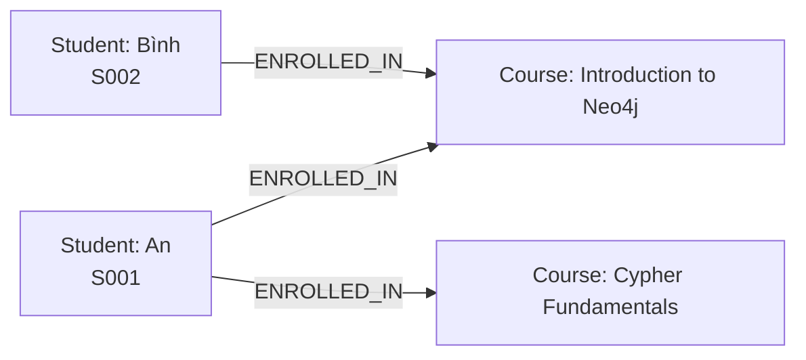

# Neo4j Browser: Running Queries and Viewing Results as Tables or Graphs

> **Chapter:** Developer Tools  
> **Module:** `DATABASE_ENGINE_GRAPH_NEO4J`

## 1. What is Neo4j Browser used for?

In this module, Neo4j is used to model connected data as a **property graph**, query relationships and paths with **Cypher**, and work with nodes, relationships, indexes, constraints, data import, Java Driver, Spring Data Neo4j, and graph system operations. **Neo4j Browser** is an interactive tool for exploring, experimenting with, and directly inspecting data, which is especially useful before putting queries into a Java application.

A property graph consists of:

- **Node (vertex):** an entity, such as `Student` or `Course`.
- **Relationship (directed edge):** a relationship connecting two nodes, such as `(student)-[:ENROLLED_IN]->(course)`.
- **Label and relationship type:** describe the type of node and the type of relationship.
- **Property:** a key-value attribute, such as `studentId`, `name`, or `enrolledAt`.

Browser allows you to write and run Cypher, view structured results in **Table** view, explore nodes and relationships in **Graph** view, read detailed responses in **RAW** view, and inspect the execution plan in **Plan** view when using `EXPLAIN` or `PROFILE`. These are display modes for *query results*; they do not create multiple different copies of the data.

After this lesson, you should be able to do four things: connect to the right database, execute a Cypher query, choose the right display mode for the output, and diagnose common errors when expected results do not appear.

## 2. Opening Browser and Connecting to a Database

### 2.1. Common Access Methods

| Environment | How to Open | What You Need to Know |
| --- | --- | --- |
| Neo4j Server running on a personal machine | Open `http://localhost:7474/browser` if using the default port configuration | The server must be running; the web interface and the database connection are two separate parts. |
| Neo4j AuraDB | Open the **Query** tool from the instance management interface | The Cypher editor and result display are similar to Browser; the layout may vary by version. |
| Standalone Neo4j Browser | Visit `https://browser.neo4j.io/` | Requires configuring a connection to a running instance. |
| Neo4j Desktop | Open the query tool integrated with the project's DBMS/instance | Verify the correct instance before performing write operations. |

In a default local installation, the web address `http://localhost:7474/browser` is different from the Bolt protocol address `bolt://localhost:7687`. Browser uses the appropriate connection details to communicate with the server, typically including the URI, username, password, and database name. For AuraDB, use the secure URI and credentials provided for the instance rather than replacing them with a local address.

### 2.2. Connection Workflow

1. Start the Neo4j instance, then open Browser/Query for that instance.
2. Check the **Connection URL**, username, and credentials; log in according to the environment configuration.
3. Select the correct **database** you are authorized to query. A single DBMS can contain multiple databases; data in one database does not automatically appear in another.
4. Run the following read-only query to confirm the connection:

```cypher
RETURN 'Cypher connection successful' AS thongBao,
       2 + 3 AS ketQua;
```

The expected output is **one table row** with `thongBao` and `ketQua = 5`. No nodes or relationships are returned yet, so there is no graph to render.

If you have permission and need to switch databases, you can enter the following Browser command **in a separate run**:

```text
:use neo4j
```

Here, `neo4j` is just an example database name; replace it with the actual database name. A command starting with `:` is a **Browser UI command**, not a Cypher statement sent verbatim to the server.

## 3. Identifying Workspace Areas

| Component | Role | Typical Action |
| --- | --- | --- |
| **Cypher editor** | Compose Cypher or Browser commands | Enter `MATCH ... RETURN ...` and click the run button or press `Ctrl + Enter` on Windows/Linux, `Cmd + Enter` on macOS. |
| **Result frame** | Display the output of each execution | Switch between **Graph**, **Table**, **RAW**; when appropriate, view **Plan**. |
| **Stream / result list** | Keep recent query result frames | Reopen previous queries, edit, and re-run the result frame. |
| **Sidebar / drawers** | Access graph structure info, saved queries, history, parameters, settings | Explore labels and relationship types; use saved queries. |
| **Settings** | Limit record count, visualized node count, history, and other options | Reduce the number of records when working with large graphs. |

Specific buttons and positions may change across Browser versions, but the workflow remains **write query → run → read result frame → switch display view**.

### 3.1. How is Cypher Different from Browser Commands?

- `MATCH (n) RETURN n LIMIT 10` is **Cypher**. The server executes it and returns records.
- `:help`, `:history`, `:clear`, `:params` are **Browser commands**. Browser handles them to control the UI or configure the query session.
- `:clear` only clears result frames in the UI; it **does not delete** nodes or relationships in the database.
- Conversely, `CREATE`, `MERGE`, `SET`, `DELETE`, `DETACH DELETE` are operations that can **modify data**. Always verify the database and environment before running them.

## 4. Creating a Small Dataset for Practice

The example illustrates an online learning system: students enrolling in courses. We use the labels `BrowserDemoStudent` and `BrowserDemoCourse` to distinguish them from real data. Run the Cypher block below in a **test database**; do not run it on a production database without write permission.

```cypher
MERGE (an:BrowserDemoStudent {studentId: 'S001'})
SET an.name = 'An', an.city = 'Hà Nội'
MERGE (binh:BrowserDemoStudent {studentId: 'S002'})
SET binh.name = 'Bình', binh.city = 'Đà Nẵng'
MERGE (neo4j:BrowserDemoCourse {courseId: 'C-NEO4J'})
SET neo4j.title = 'Introduction to Neo4j'
MERGE (cypher:BrowserDemoCourse {courseId: 'C-CYPHER'})
SET cypher.title = 'Cypher Fundamentals'
MERGE (an)-[e1:ENROLLED_IN]->(neo4j)
SET e1.enrolledAt = date('2026-01-15')
MERGE (an)-[e2:ENROLLED_IN]->(cypher)
SET e2.enrolledAt = date('2026-02-01')
MERGE (binh)-[e3:ENROLLED_IN]->(neo4j)
SET e3.enrolledAt = date('2026-02-02')
RETURN an, e1, neo4j, e2, cypher, binh, e3;
```

In a test database that does not yet contain these elements, the statement creates **2 students, 2 courses, and 3 enrollment relationships**. `MERGE` looks for an existing pattern before creating; re-running the example on data created directly from this lesson will not duplicate those relationships. In a real application, the uniqueness of business keys like `studentId` or `courseId` should be further protected with a **uniqueness constraint**, rather than relying solely on `MERGE`.

Corresponding conceptual diagram:



In the statement above, `RETURN` returns both **nodes** and **relationships**. Therefore, after execution, the result frame can be switched to **Graph** to see circles and connecting lines.

> **Note:** Cypher can return multiple records and each record can contain multiple values. For learning purposes, execute one query block at a time and inspect the result before running the next block.

## 5. Graph Mode: Seeing Nodes and Relationships

### 5.1. Running a Query That Returns Graph Structure

```cypher
MATCH (s:BrowserDemoStudent)-[e:ENROLLED_IN]->(c:BrowserDemoCourse)
RETURN s, e, c
LIMIT 20;
```

Meaning of each part:

1. `MATCH` finds the pattern `(student)-[enrolled_in]->(course)`.
2. `s` and `c` are node variables, `e` is a directed relationship variable.
3. `RETURN s, e, c` sends **both endpoints and the connecting edge** back to Browser.
4. `LIMIT 20` limits the number of **records**, which does not necessarily equal 20 nodes. With the sample dataset, the result has 3 records.

Select the **Graph** icon in the result frame. Browser uses circles for nodes and directed lines for relationships; select a node or relationship to view its labels, type, and properties. Depending on the version, you can drag node positions, zoom in/out, search for elements in the graph frame, or expand a node to explore neighboring connections.

Another approach is to return the entire **path**:

```cypher
MATCH p = (s:BrowserDemoStudent {studentId: 'S001'})
          -[:ENROLLED_IN]->(c:BrowserDemoCourse)
RETURN p;
```

Here, `p` represents the entire matching path, including the start node, relationship, and end node. You can immediately observe that An connects to two courses.

### 5.2. Why Are There No Connecting Lines Even Though MATCH Was Used?

Compare:

```cypher
MATCH (s:BrowserDemoStudent)-[:ENROLLED_IN]->(c:BrowserDemoCourse)
RETURN s.name AS hocVien, c.title AS khoaHoc;
```

The statement **uses the relationship in the search condition**, but only **returns string values**. Browser only has a table with two columns; it cannot construct visual relationships from two name strings. To display a graph, return graph elements (`s`, `e`, `c`) or a path (`p`), for example `RETURN s, e, c`.

If you only return nodes (`RETURN s, c`), return the relationship as well to ensure Browser receives the edge to draw. **Graph is a visualization of the data loaded in the result**, not by default the entire database. Expanding a node, if supported and permitted, can fetch additional neighbors outside the initial result.

### 5.3. Changing Display Labels and Styling

Browser usually chooses a property automatically as the display text on a node. In the Graph/Results overview customization section, you can select the `BrowserDemoStudent` label and change **Caption** to `name`; for `BrowserDemoCourse`, choose `title`. You can also change node colors/sizes and edge colors/thickness. These operations are for **display in Browser** and do not modify the actual properties of the node.

To view or reset the styling configuration, you can use:

```text
:style
```

```text
:style reset
```

On dense graphs, limit the data directly in Cypher using `WHERE` and `LIMIT`, then use zoom/fit-to-screen. Do not increase the visualization limit just to render tens of thousands of nodes on a single screen.

## 6. Table Mode: Reading Records and Metrics

**Table** mode is suitable when a query returns business fields or aggregated values. With the dataset just created:

```cypher
MATCH (s:BrowserDemoStudent)-[e:ENROLLED_IN]->(c:BrowserDemoCourse)
RETURN s.studentId AS maHocVien,
       s.name AS hocVien,
       c.title AS khoaHoc,
       toString(e.enrolledAt) AS ngayGhiDanh
ORDER BY maHocVien, khoaHoc;
```

Expected result:

| maHocVien | hocVien | khoaHoc | ngayGhiDanh |
| --- | --- | --- | --- |
| S001 | An | Cypher Fundamentals | 2026-02-01 |
| S001 | An | Introduction to Neo4j | 2026-01-15 |
| S002 | Bình | Introduction to Neo4j | 2026-02-02 |

`AS` names the columns; `ORDER BY` determines the order; `toString` converts the `DATE` value into a string that is easy to compare in a table. Each row is a record in the query result, **not necessarily a node**.

To count the number of enrollments per course:

```cypher
MATCH (:BrowserDemoStudent)-[e:ENROLLED_IN]->(c:BrowserDemoCourse)
RETURN c.title AS khoaHoc, count(e) AS soLuotGhiDanh
ORDER BY soLuotGhiDanh DESC, khoaHoc;
```

Expected: **Introduction to Neo4j = 2** and **Cypher Fundamentals = 1**. This is scalar/aggregated output, so view it in **Table**; Graph has no nodes or relationships to draw.

Table allows viewing records as rows and columns, searching/filtering within the downloaded results, and exporting **CSV or JSON** depending on the available options. You must distinguish **filtering data in Table** from Cypher's `WHERE`: UI filtering only affects the set of records Browser has already received, whereas `WHERE` changes the set of records that the database queries and returns.

## 7. Using Parameters to Re-run Queries

In practice, a Java Driver or Spring Data Neo4j application needs to change inputs without directly modifying the Cypher string. Browser supports testing queries with **parameters**.

Run the Browser command **separately**:

```text
:param studentId => 'S001'
```

Then run Cypher:

```cypher
MATCH (s:BrowserDemoStudent {studentId: $studentId})
      -[e:ENROLLED_IN]->(c:BrowserDemoCourse)
RETURN s, e, c;
```

The Graph result shows student An and two enrollment edges. Change the value:

```text
:param studentId => 'S002'
```

Re-run the **same Cypher statement**, and the result now shows only Bình and one enrollment edge. The name `$studentId` in Cypher references the parameter set in Browser; it is not a regular Cypher variable `studentId`.

Useful commands:

| Command | Purpose |
| --- | --- |
| `:param ten => 'gia-tri'` | Declare/update a parameter. |
| `:params` | View existing parameters. |
| `:params clear` | Clear parameters in the Browser session. |
| `:history` | Open history of executed queries. |
| `:help` | View help for Browser commands. |
| `:clear` | Clear result frames in the UI. |
| `:use tenDatabase` | Switch the default database for queries, if the account has permission. |

You can configure parameters using the **Parameters drawer** instead of text commands. Parameters help reuse queries and make it convenient to prepare for application code; in real applications, input validation and data access authorization are still required.

## 8. Reading RAW and Query Plans

### 8.1. RAW: Observing Detailed Responses

Select **RAW** when you need to inspect a query's response at a more detailed level than the table/graph UI: the sent statement, server information, and response structure. RAW is useful when checking value types or comparing results with how a client receives data. It is not a graph image and does not replace server logs.

### 8.2. EXPLAIN and PROFILE: First Steps in Cypher Optimization

As data grows, seeing only the correct result is not enough; you should check the **execution plan** to see how the database finds nodes and traverses relationships.

```cypher
EXPLAIN
MATCH (s:BrowserDemoStudent {studentId: 'S001'})
      -[e:ENROLLED_IN]->(c:BrowserDemoCourse)
RETURN s.name AS hocVien, c.title AS khoaHoc;
```

`EXPLAIN` generates the **estimated plan** and **does not execute** the query. Open **Plan** mode to read the operator tree, such as label scans, index usage, or relationship expansion. The specific operators depend on the data, indexes, and Neo4j version.

```cypher
PROFILE
MATCH (s:BrowserDemoStudent {studentId: 'S001'})
      -[e:ENROLLED_IN]->(c:BrowserDemoCourse)
RETURN s.name AS hocVien, c.title AS khoaHoc;
```

`PROFILE` **executes** the query and then provides actual metrics for the plan (such as the number of rows passing through an operator and the number of database hits). Here, the statement is read-only so it is suitable to try. If you apply `PROFILE` to a write statement, the write operation **is still performed**. Therefore, do not use it to "safely preview" a `DELETE` or `MERGE` statement.

After understanding the basic operators, you can continue with indexes, constraints, and query tuning in the advanced lessons of the Neo4j module.

## 9. Exporting, Saving, and Sharing Results

- **Table:** export CSV/JSON for further analysis or data reconciliation, depending on the version and the download button on the result frame.
- **Graph:** export a **PNG** image to insert into notes, documentation, or reports. The image only shows the graph currently displayed in the result frame.
- **Saved Cypher / History:** save frequently used queries and reopen previously run queries, making it convenient to reproduce verification steps.
- **RAW / Plan:** inspect during debugging and query analysis; export capabilities vary by mode and version.

Do not share screenshots containing credentials, personal data, or sensitive information from the database. For reports that need to be reproducible, save the **Cypher statement**, **database/environment name**, **input parameters**, and **execution timestamp**, rather than saving only a Graph image.

## 10. Common Issues and How to Handle Them

| Symptom | Possible Cause | How to Check or Fix |
| --- | --- | --- |
| Cannot connect | Server is not running; wrong URI/port; wrong password; mismatched TLS configuration | Check instance status, Bolt URI, and credentials in the connection settings. |
| Runs successfully but returns **0 rows** | No data matches the pattern; wrong database, label, type, or filter value | Run `MATCH (n:BrowserDemoStudent) RETURN n LIMIT 10`; check the database and case sensitivity. |
| Only Table is visible, cannot enable Graph | `RETURN` only contains numbers or strings, no nodes/relationships/paths | Change to `RETURN s, e, c` or `RETURN p`. |
| Graph has nodes but is missing edges | Relationship was not returned in the result or no matching edge exists | Check `MATCH` and explicitly return `e` in `RETURN s, e, c`. |
| Not seeing the entire graph | Query has `LIMIT` or Browser limits displayed records/nodes | Intentionally bound queries, split by conditions, check Settings; do not infer total DB node count from the image. |
| `ParameterMissing` / missing parameter | `$studentId` not declared or name does not match | Run `:params` then re-set `:param studentId => 'S001'`. |
| `SyntaxError` | Invalid Cypher syntax, missing `)`/`]`, or placing a `:` command inside Cypher | Check the error location in the editor; run Browser commands and Cypher separately. |
| `Permission denied` | User lacks permission on the database or write operation | Verify the correct account, database, and granted privileges; do not switch to a privileged account on your own. |
| Results change after re-running | Data is being updated, or the query lacks `ORDER BY` | For tables needing stable order, specify `ORDER BY`; check data at execution time. |

A short debugging workflow is: **verify connection → verify database → count matching data → check MATCH pattern → check data types in RETURN → choose display mode**.

Example counting query to separate a "no data" error from a "not displaying" error:

```cypher
MATCH (s:BrowserDemoStudent)
RETURN count(s) AS soHocVienDemo;
```

With the initial sample and no duplicate data, `soHocVienDemo = 2`. If the result is 0, check the database and the data creation step again before adjusting the Graph view.

## 11. Self-Check Practice Exercises

On the test database that already contains the dataset from section 4, perform the following tasks.

**Exercise 1 — Lookup Table.** List the student name and courses for `S001`, sorted by course title. Expect **2 rows**. Hint: `WHERE s.studentId = 'S001'`, `RETURN s.name, c.title`, and `ORDER BY c.title`.

**Exercise 2 — Graph.** Display the enrollment relationship of `S002` in Graph view, showing **2 nodes and 1 relationship**. Hint: `RETURN s, e, c` or `RETURN p`.

**Exercise 3 — Aggregation.** Count the number of students enrolled in each course. Expect `Introduction to Neo4j = 2` and `Cypher Fundamentals = 1`. Hint: use `count(e)`; Cypher automatically groups by the non-aggregated fields in `RETURN`.

**Exercise 4 — Parameters.** Declare `:param studentId => 'S001'` and then run a Cypher query containing `$studentId`. Switch to `S002` without changing the Cypher query, and observe the Graph result change.

**Exercise 5 — Execution Plan.** Run `EXPLAIN` and `PROFILE` for the same read-only `MATCH`, distinguishing the estimated plan from execution metrics. No index is needed to complete this exercise.

### Cleaning Up the Sample Dataset When Finished

Only run the snippet below if you **deliberately want to delete** the demo data in the test database. `DETACH DELETE` also deletes relationships attached to the selected nodes; do not run it on a database containing data you need to keep.

```cypher
MATCH (n)
WHERE (n:BrowserDemoStudent AND n.studentId IN ['S001', 'S002'])
   OR (n:BrowserDemoCourse AND n.courseId IN ['C-NEO4J', 'C-CYPHER'])
DETACH DELETE n;
```

This query identifies nodes by **label and example ID**, and does not delete every node in the database. If the example nodes were ever connected to other data, those connecting relationships will also be deleted by `DETACH DELETE`; therefore, restrict practice to an isolated environment.

## 12. Key Takeaways

- **Cypher decides what to query**; **Browser decides how to present that result**.
- Return **scalars/properties** for meaningful tables; return **nodes, relationships, or paths** for visual graphs.
- **Graph/Table/RAW/Plan** are complementary views for exploration, reading data, and query optimization.
- Displayed graph data may be limited by `LIMIT`, record fetch limits, and Browser rendering limits.
- Experimental results in Browser should be reused in applications using **parameterized Cypher**, accompanied by appropriate measurements when optimizing performance.

### Official Documentation for Further Study

- [Neo4j Browser — Overview](https://neo4j.com/docs/browser/)
- [Neo4j Browser — Result frames: Graph, Table, RAW, Plan](https://neo4j.com/docs/browser/operations/result-frames/)
- [Neo4j Browser — Command reference](https://neo4j.com/docs/browser/reference-commands/)
- [Neo4j Browser — Query parameters](https://neo4j.com/docs/browser/operations/query-parameters/)
- [Neo4j Browser — Browser styling](https://neo4j.com/docs/browser/operations/browser-styling/)
