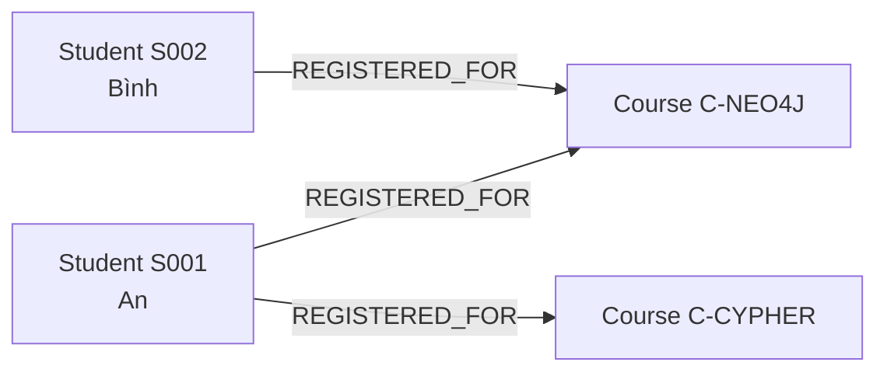

# Cypher Shell: Querying, Passing Parameters, and Executing Scripts

> **Chapter:** Developer Tools  
> **Module:** `DATABASE_ENGINE_GRAPH_NEO4J`  
> **Tool:** `cypher-shell` (Neo4j's command-line interface)

## 1. What Problem Does Cypher Shell Solve?

Neo4j is a **property graph** database: nodes represent entities, relationships represent directed links, labels and relationship types classify structures, and properties store data. Developers use **Cypher** to find nodes, traverse relationships, query paths, create or update data, and inspect performance.

In the Neo4j tool ecosystem, **Cypher Shell** allows connecting to the database and sending Cypher from a terminal. Its strength is that commands can be run **interactively**, **parameterized**, and **read from a file** — well suited for data testing, reproducing bugs, and controlled task automation.

| Tool | Interaction Style | Best-Fit Use Cases |
| --- | --- | --- |
| **Neo4j Browser** | Editor with Graph/Table results and visual controls | Exploring nodes/relationships, viewing paths as diagrams. |
| **Cypher Shell** | Terminal, text/table-formatted output, script execution | Running repeated queries, server-side operations, data checks, pipelines. |
| **Neo4j Java Driver** | API called from Java code | Executing parameterized statements, managing sessions/transactions in applications. |
| **Spring Data Neo4j** | Repositories, object mapping, and data operations from Spring | Developing the graph data access layer in Spring applications. |

Cypher Shell does not draw graphs with nodes and edges like Browser. If you need to render a diagram, use Browser; if you need to record statements to run again on another machine, Cypher Shell is usually more convenient.

**Lesson objectives:** (1) connect to the right Neo4j instance and database; (2) run Cypher in the terminal; (3) use parameters safely; (4) create and run `.cypher` scripts; (5) understand outputs, exit codes, and the limitations of running multiple statements.

## 2. Setting Up the Environment and Finding the cypher-shell Command

### 2.1. Prerequisites

- A running **Neo4j DBMS/instance** and an authorized account.
- A **Cypher Shell** tool compatible with the Neo4j environment; when using a Neo4j Server distribution, the utility is typically located in the `bin` directory.
- Know the **connection URI**, **username**, **database**, and how to obtain the password. Local examples often use `bolt://localhost:7687`, username `neo4j`, database `neo4j`; these are default configuration examples, not valid details for every system.
- An appropriate terminal: Bash/zsh on Linux/macOS, PowerShell on Windows, or a shell inside the container if Neo4j is running via Docker.

Check the utility:

```bash
cypher-shell --version
cypher-shell --help
```

On a machine where Neo4j was installed from a distribution archive, if the command is not in `PATH`, run the tool directly from the `bin` directory (on Windows, this may be `cypher-shell.bat`). Do not confuse the **database connection URI** with the Browser UI URL; for example, `http://localhost:7474/browser` is a web address, whereas `bolt://localhost:7687` is the Bolt protocol address used by Cypher Shell.

If Neo4j is already running in a Docker container, you can open Cypher Shell **inside the container**:

```bash
docker exec -it neo4j cypher-shell -u neo4j -d neo4j
```

`neo4j` after `docker exec -it` is an **assumed container name**, not a mandatory one. Replace it according to your actual environment. When running inside a container, the default connection address may differ from the address a machine outside the container needs to use.

### 2.2. Connecting to the Database

Example of connecting to a local server over Bolt:

```bash
cypher-shell -a "bolt://localhost:7687" -u neo4j -d neo4j
```

Main options:

| Option | Meaning |
| --- | --- |
| `-a`, `--address` | Neo4j URI, for example `bolt://localhost:7687`. |
| `-u`, `--username` | Login username. |
| `-p`, `--password` | Password; avoid passing it directly in commands as it can be exposed via shell history/process lists. |
| `-d`, `--database` | Select the database to execute queries against. |
| `-f`, `--file` | Read and execute statements from a script file. |
| `--param` | Supply Cypher parameter values when starting Shell. |
| `--format` | Choose the output format supported by the current version. |

When `-p` is omitted, Cypher Shell can prompt for the password interactively in the terminal. In pipelines without an interactive terminal, use a secret management mechanism and credential injection appropriate for your deployment version; never hardcode real passwords in source code, documentation, or logs.

For Neo4j AuraDB, the URI typically looks like:

```text
neo4j+s://<instance-id>.databases.neo4j.io
```

`neo4j+s://` is the secure Neo4j connection option with certificate verification. Use the URI provided for the exact instance; do not arbitrarily change it to `bolt://` or disable TLS to bypass configuration errors.

### 2.3. Verifying Connection and Version

Once at the Cypher Shell prompt, run:

```cypher
RETURN 'Cypher Shell is working' AS thongBao,
       2 + 3 AS ketQua;
```

Expect one row with `ketQua = 5`. This is a read-only query and does not require the database to contain any nodes.

To check the Neo4j version from the database (if the account has permission), you can use:

```cypher
CALL dbms.components()
YIELD name, versions
RETURN name, versions;
```

Database names and permission configurations can vary across deployments; verify the environment before performing write operations.

## 3. Running Cypher in Interactive Mode

After connecting successfully, Shell displays a prompt for entering commands. Example:

```cypher
RETURN 'Hello Neo4j' AS loiChao;
```

When writing Cypher in Shell, use a **semicolon `;`** to terminate a statement. For long statements, you can type across multiple lines and place `;` only on the last line:

```cypher
UNWIND [1, 2, 3, 4, 5] AS n
RETURN n,
       n * n AS binhPhuong
ORDER BY n;
```

The result is five rows ordered from 1 to 5. `UNWIND` turns a list into rows; `RETURN` selects columns, `AS` sets aliases, and `ORDER BY` maintains a stable order.

### 3.1. Shell Control Commands vs. Cypher Statements

Cypher Shell has control commands starting with `:`. They are not query syntax sent verbatim to the database.

| Command | Purpose |
| --- | --- |
| `:help` | List help/supported commands in the current version. |
| `:history` | View command history. |
| `:param` and `:params` | Set and view parameters for the current session. |
| `:use tenDatabase` | Switch the current database if the user has permission and the version supports it. |
| `:exit` | Exit the Cypher Shell session. |

A semicolon is not needed at the end of **control commands** like `:help`. Conversely, always end Cypher statements with `;`, especially when preparing to transition from interactive work to scripts.

Try exploring the graph with a read-only query:

```cypher
MATCH (n)
RETURN labels(n) AS nhan,
       count(n) AS soNode
ORDER BY soNode DESC
LIMIT 10;
```

The statement only aggregates node counts by actual label sets in the database you are connected to. `LIMIT 10` limits **10 result rows**, not just scanning 10 nodes.

### 3.2. How Are Results Displayed?

Cypher Shell typically prints rows and columns as text. When `RETURN` includes nodes or relationships, Shell still returns text representations; it does not open a Graph pane. When reports or automated checks are needed, return properties and scalar values:

```cypher
MATCH (n)
RETURN elementId(n) AS maNoiBo,
       labels(n) AS labels
LIMIT 5;
```

`elementId` returns an internal identifier for reference within an appropriate scope; it should not be used as a stable business key. In the business example below, we use dedicated `studentId` and `courseId` properties.

## 4. Preparing a Small Sample Dataset

Practice in a **test database**. The example uses the labels `ShellDemoStudent` and `ShellDemoCourse` to reduce the risk of colliding with real data; the following statements **write data**.

```cypher
MERGE (an:ShellDemoStudent {studentId: 'S001'})
SET an.name = 'An'
MERGE (binh:ShellDemoStudent {studentId: 'S002'})
SET binh.name = 'Bình'
MERGE (neo4j:ShellDemoCourse {courseId: 'C-NEO4J'})
SET neo4j.title = 'Introduction to Neo4j'
MERGE (cypher:ShellDemoCourse {courseId: 'C-CYPHER'})
SET cypher.title = 'Cypher Fundamentals'
MERGE (an)-[r1:REGISTERED_FOR]->(neo4j)
SET r1.registeredAt = date('2026-01-15')
MERGE (an)-[r2:REGISTERED_FOR]->(cypher)
SET r2.registeredAt = date('2026-02-01')
MERGE (binh)-[r3:REGISTERED_FOR]->(neo4j)
SET r3.registeredAt = date('2026-02-02')
RETURN 'Sample data prepared' AS thongBao;
```

This example creates **two students**, **two courses**, and **three `REGISTERED_FOR` relationships** when the database does not yet contain these elements. `MERGE` looks for an existing pattern before creating; re-running it on the demo dataset just created will normally not duplicate the relationships. In real applications or concurrent writes from multiple sessions, create uniqueness constraints for business keys to protect uniqueness; `MERGE` alone does not replace such constraints.

You can verify with a read-only query:

```cypher
MATCH (s:ShellDemoStudent)-[r:REGISTERED_FOR]->(c:ShellDemoCourse)
RETURN s.studentId AS maHocVien,
       s.name AS hocVien,
       c.title AS khoaHoc,
       toString(r.registeredAt) AS ngayDangKy
ORDER BY maHocVien, khoaHoc;
```

Expect three rows:

| maHocVien | hocVien | khoaHoc | ngayDangKy |
| --- | --- | --- | --- |
| S001 | An | Cypher Fundamentals | 2026-02-01 |
| S001 | An | Introduction to Neo4j | 2026-01-15 |
| S002 | Bình | Introduction to Neo4j | 2026-02-02 |

Visualizing the data pattern:



The diagram is only a conceptual illustration in the documentation; in the terminal, commands return a **text table**.

## 5. Passing Parameters in an Interactive Session

### 5.1. Why Are Parameters Needed?

Suppose you need to find courses for each student. Directly replacing `'S001'` with `'S002'` in the Cypher statement works, but easily leads to copying and editing in multiple places. A **Parameter** separates **input values** from **query structure**: one Cypher statement can be used for many student IDs.

In a Cypher Shell session, declare one with:

```text
:param studentId => 'S001'
```

Check the parameters that have been set:

```text
:params
```

Then run Cypher:

```cypher
MATCH (s:ShellDemoStudent {studentId: $studentId})
      -[r:REGISTERED_FOR]->(c:ShellDemoCourse)
RETURN s.name AS hocVien,
       c.title AS khoaHoc,
       r.registeredAt AS ngayDangKy
ORDER BY khoaHoc;
```

`$studentId` is how you **reference** a parameter value from Cypher. The `$` sign is part of Cypher syntax; the `=>` arrow in the `:param` command assigns an expression to a Shell parameter.

Change the input without modifying the query:

```text
:param studentId => 'S002'
```

Re-run the same `MATCH`: the result now contains only Bình's **Introduction to Neo4j** course. This is also how to design Cypher statements for use with **Java Driver** or **Spring Data Neo4j**: pass parameters via the library's API instead of concatenating values into the query string.

### 5.2. Typed Parameters

Parameter values are not limited to strings; they can be numbers, booleans, dates, or lists. Example:

```text
:param minEnrollments => 2
```

```cypher
MATCH (:ShellDemoStudent)-[r:REGISTERED_FOR]->(c:ShellDemoCourse)
WITH c, count(r) AS soLuot
WHERE soLuot >= $minEnrollments
RETURN c.title AS khoaHoc, soLuot
ORDER BY soLuot DESC;
```

Sample result: **Introduction to Neo4j — 2 enrollments**. Change `minEnrollments` to 1 to receive both courses.

To filter by date, pass a Cypher expression corresponding to the date type (depending on the parameter-passing context):

```text
:param fromDate => date('2026-02-01')
```

```cypher
MATCH (s:ShellDemoStudent)-[r:REGISTERED_FOR]->(c:ShellDemoCourse)
WHERE r.registeredAt >= $fromDate
RETURN s.name AS hocVien, c.title AS khoaHoc, r.registeredAt AS ngayDangKy
ORDER BY ngayDangKy, hocVien;
```

The example result has **two registrations** from 2026-02-01 onward. Using the `DATE` type enables true chronological comparison instead of comparing arbitrarily formatted strings.

### 5.3. Common Mistakes When Using Parameters

- Parameter not declared → error reporting missing `$studentId` or `$fromDate`.
- Case mismatch in name → `$studentId` is different from `$StudentId`.
- Writing `'$studentId'` in the query → this is just a **string literal**, not a parameter reference. Write `studentId: $studentId` without quotes.
- Wrong value type → for example, comparing `DATE` against an unconverted string can cause type errors or wrong comparisons. Use `date(...)` when a date type is required.
- Parameters do not turn a piece of text into full Cypher syntax. Use parameters for **data values**; never replace an entire query with user input.

## 6. Passing Parameters from the Command Line at Startup

When you need to run a parameterized query **without entering an interactive session**, use Cypher Shell's `--param` option.

Example of executing a Cypher statement directly on the **Bash/zsh** command line:

```bash
cypher-shell -a "bolt://localhost:7687" -u neo4j -d neo4j \
  --param "studentId => 'S001'" \
  'MATCH (s:ShellDemoStudent {studentId: $studentId}) RETURN s.name AS ten;'
```

In Bash/zsh, the `\` character at the end of a line continues the command. If running **PowerShell**, write it on one line to avoid mixing up line-continuation rules:

```powershell
cypher-shell -a "bolt://localhost:7687" -u neo4j -d neo4j --param "studentId => 'S001'" 'MATCH (s:ShellDemoStudent {studentId: $studentId}) RETURN s.name AS ten;'
```

Important notes on quoting:

- `--param "studentId => 'S001'"` passes a parameter expression containing the string `'S001'`. Put **double quotes** at the terminal layer so the single quotes inside the expression are not stripped.
- Wrap the **Cypher statement in single quotes** so Bash and PowerShell do not expand `$studentId` as a terminal variable. Using double quotes around the entire Cypher statement can cause the terminal to misinterpret the parameter before the query reaches Neo4j.

In PowerShell, wrapping the Cypher statement in single quotes as shown above also prevents PowerShell from interpreting `$studentId` as a terminal variable. If you need a multi-line query or one with many quotes, using a **script file** in the next section is usually easier to maintain.

Do not put `-p matKhauThat` into terminal history just to "run quickly". Depending on the version and environment, Cypher Shell can prompt for the password interactively, or you must configure credentials through a secure channel for automated tasks.

## 7. Writing and Executing .cypher Files

### 7.1. Writing a Multi-Statement Script

Create an example file named `scripts/report-enrollments.cypher` in **your** working directory (this is an **illustrative filename**, not a requirement to create an extra file for the lesson). Contents:

```cypher
// 1. List students
MATCH (s:ShellDemoStudent)
RETURN s.studentId AS maHocVien, s.name AS ten
ORDER BY maHocVien;

// 2. Aggregate registration counts
MATCH (:ShellDemoStudent)-[r:REGISTERED_FOR]->(c:ShellDemoCourse)
RETURN c.courseId AS maKhoaHoc,
       c.title AS khoaHoc,
       count(r) AS soLuot
ORDER BY soLuot DESC, maKhoaHoc;
```

Save the file as **UTF-8**, preferably UTF-8 without BOM to avoid character issues in older command-line tools. Terminate **each Cypher statement with `;`**. `//` is a single-line comment in Cypher; anything after the comment is not processed as a command.

Run the script:

```bash
cypher-shell -a "bolt://localhost:7687" -u neo4j -d neo4j \
  --file "./scripts/report-enrollments.cypher"
```

In PowerShell, you can write it on one line:

```powershell
cypher-shell -a "bolt://localhost:7687" -u neo4j -d neo4j --file ".\scripts\report-enrollments.cypher"
```

The short equivalent option is `-f`. The file path is resolved relative to the **process working directory** if you use a relative path; when running from a different directory, adjust the path or use an absolute path.

### 7.2. Executing a Parameterized Script

Create an illustrative file `scripts/find-student.cypher`:

```cypher
MATCH (s:ShellDemoStudent {studentId: $studentId})
      -[r:REGISTERED_FOR]->(c:ShellDemoCourse)
RETURN s.name AS hocVien, c.title AS khoaHoc
ORDER BY khoaHoc;
```

Run with parameter S001:

```bash
cypher-shell -a "bolt://localhost:7687" -u neo4j -d neo4j \
  --param "studentId => 'S001'" \
  --file "./scripts/find-student.cypher"
```

Switch to S002 simply by changing the `--param` value. This approach is especially suitable when integrating scripts into pipelines: the Cypher file stays stable, while input values are supplied from the runtime configuration.

If your environment or version supports multiple `--param` flags, check `cypher-shell --help` for the exact syntax. This lesson prefers one parameter per example to avoid relying on version-specific details.

### 7.3. Running from Standard Input

In environments supporting stdin, you can pipe Cypher, for example in Bash:

```bash
printf 'RETURN 1 + 1 AS ketQua;\n' | \
  cypher-shell -a "bolt://localhost:7687" -u neo4j -d neo4j
```

Or pipe a file:

```bash
cat "./scripts/report-enrollments.cypher" | \
  cypher-shell -a "bolt://localhost:7687" -u neo4j -d neo4j
```

If the task has no interactive terminal, credentials must be configured via an available secure mechanism; you cannot assume a password prompt will work normally when stdin is being used to read the script. When a file already exists, `--file` is usually clearer because it avoids confusion between stdin data and interactive input.

### 7.4. A Script Is Not Automatically a Single Transaction

**Important point:** A file containing multiple Cypher statements does not automatically guarantee that **the entire file** is committed or rolled back as a single unit. In normal execution, statements are executed sequentially; an earlier statement may have already written data before a later statement fails.

Example:

```cypher
// May succeed in writing data
CREATE (:ShellDemoLog {message: 'step 1'});

// The next statement may fail because the parameter does not exist
RETURN $unknownParameter AS ketQua;
```

Do not rely on the assumption that "an error at the end of the file will automatically cancel all writes at the beginning of the file". When **all-or-nothing** behavior across multiple operations is required, design an explicit transaction using a mechanism supported in your version or move transaction coordination to Neo4j Java Driver. Production update scripts need rollback, idempotency, and error-handling verification before deployment.

## 8. Controlling Output for Automated Scripts

In the terminal, Cypher Shell can display data in various ways depending on the version. Check the actual options:

```bash
cypher-shell --help
```

With a version supporting the `plain` format, try:

```bash
cypher-shell -a "bolt://localhost:7687" -u neo4j -d neo4j \
  --format plain \
  'MATCH (s:ShellDemoStudent) RETURN s.studentId AS id ORDER BY id;'
```

This format is more convenient when passing output to another script, though CLI output is still **tool-formatted text**, not necessarily standards-compliant escaped CSV. If you need reliable data exports, choose an appropriate export tool or use a Neo4j Driver to build properly formatted JSON/CSV.

When using Bash or PowerShell to inspect command results, distinguish:

- **stdout:** query result data or presentation.
- **stderr:** error or diagnostic messages.
- **exit code:** process termination status according to OS conventions.

Bash:

```bash
cypher-shell -a "bolt://localhost:7687" -u neo4j -d neo4j \
  'RETURN 1 AS ok;'
echo $?
```

PowerShell:

```powershell
cypher-shell -a "bolt://localhost:7687" -u neo4j -d neo4j 'RETURN 1 AS ok;'
$LASTEXITCODE
```

Normally, an exit code of **0** means the process finished successfully; a non-zero value means an error occurred. Read the error message further to determine whether it is a connection, authentication, syntax, authorization, or query error.

For reliable automation scripts, establish a convention: **check exit codes, keep diagnostic logs, stop the pipeline when a critical step fails, and validate output data**. If your version provides an option such as `--fail-fast`, read `--help` and choose the appropriate stop behavior rather than assuming all versions behave identically.

## 9. Practical Querying and Data Verification Tasks

### 9.1. Checking Input Data Before Running a Write Script

Before an update operation, run a read-only query to confirm the target node/relationship counts:

```cypher
MATCH (s:ShellDemoStudent)
RETURN count(s) AS soHocVien;
```

On the initial sample dataset, the query returns `soHocVien = 2`. If it differs, verify the **database**, **label**, and data state before proceeding.

### 9.2. Filtering and Aggregating with Parameters

```text
:param minCount => 2
```

```cypher
MATCH (s:ShellDemoStudent)-[:REGISTERED_FOR]->(c:ShellDemoCourse)
WITH c, count(s) AS soHocVien
WHERE soHocVien >= $minCount
RETURN c.courseId AS maKhoaHoc, c.title AS khoaHoc, soHocVien
ORDER BY soHocVien DESC;
```

The sample result includes course `C-NEO4J` with two students. In a real dataset, `count(s)` counts matching rows; if the same student could have multiple enrollment relationships to a single course, use `count(DISTINCT s)` when the business requirement is **distinct students**.

### 9.3. Viewing the Query Plan Directly in the Terminal

Cypher Shell also executes `EXPLAIN` and `PROFILE`:

```cypher
EXPLAIN
MATCH (s:ShellDemoStudent {studentId: 'S001'})
      -[:REGISTERED_FOR]->(c:ShellDemoCourse)
RETURN c.title;
```

`EXPLAIN` builds the plan **without running** the query; `PROFILE` executes the query to collect actual operator metrics. For read-only statements, `PROFILE` is suitable for checking whether a scan or an index is used. If switched to a write statement, **PROFILE also performs the write operation**. Plan details and printed formatting vary by Neo4j version.

### 9.4. Why Not Use One Script for Every Environment?

A script may contain `CREATE`, `MERGE`, `SET`, `DELETE`, or schema changes (indexes/constraints). Running it on the wrong database can have consequences far beyond a read query. For safe operations:

1. Separate read-only scripts from data-modifying scripts.
2. Explicitly specify the target environment and database in `-a` and `-d` invocations.
3. Check preconditions, target record counts, and permissions before writing.
4. Keep scripts in version control so they can be reviewed and reproduced.
5. Design scripts to be intentionally repeatable; use `MERGE` and constraints where appropriate, and never assume every `CREATE` statement is idempotent.

This bridges CLI practice exercises with operations, indexes, constraints, data import, Cypher optimization, Java Driver, and Spring Data Neo4j topics.

## 10. Common Errors

| Symptom | Possible Cause | Resolution |
| --- | --- | --- |
| `cypher-shell: command not found` or command not recognized | Tool not installed or `bin` directory not in `PATH` | Check installation, use the right executable for the OS, test `--version`. |
| `Connection refused` / timeout | DBMS not running, wrong host/port, network or firewall blocking | Check instance, Bolt URI, and network connectivity; distinguish `7474` (HTTP Browser) from `7687` (default Bolt). |
| TLS/SSL or certificate verification error | Mismatched URI scheme or certificate | Use the exact URI provided by the instance, especially for AuraDB; do not arbitrarily disable security. |
| `Authentication failed` | Wrong username/password or locked account | Verify credentials via the authorized admin channel; avoid logging passwords. |
| `Database not found` / `Access denied` | Wrong `-d` or user lacks permissions | Verify existing database name and access privileges. |
| Multi-line command has not executed yet | Missing `;` at the end of the statement | Add a semicolon and submit; check for unclosed parentheses and quotes. |
| Missing parameter `$studentId` | No matching `:param` or `--param` | Use `:params` in interactive sessions, or pass `--param` on command invocation. |
| `$studentId` disappears in Bash/PowerShell | Terminal expanded the variable inside double quotes | Wrap the entire Cypher statement in **single quotes** in the appropriate shell, or use `--file`. |
| File not found | Wrong working directory or wrong `--file` path | Check file location and absolute/relative path. |
| Script runs a few statements then errors | One statement failed; earlier ones may have written | Read the error, identify which step ran, do not assume full-file auto-rollback; design appropriate transactions. |
| Query returns 0 rows | Wrong database/label/type/property/parameter or data not yet created | Run a count query, verify the right database and business key codes. |
| Garbled output with Vietnamese/Unicode characters | Inconsistent file or terminal encoding | Save scripts as UTF-8, check terminal encoding and display font. |

To diagnose effectively, proceed from **CLI utility → URI and authentication → database → Cypher statement → parameters → actual data → exit code and logs**.

## 11. Self-Check Practice Exercises

The exercises below use the `ShellDemoStudent`/`ShellDemoCourse` dataset from section 4; perform them on a test database.

**Exercise 1 — Connection:** run `cypher-shell --version`, connect to the database, and execute `RETURN 10 * 3 AS ketQua;`. Expected result is `30`.

**Exercise 2 — Query with Tabular Output:** write Cypher listing students and courses, sorted by `studentId` and `title`. Expected result is **3 rows**.

**Exercise 3 — Interactive Parameters:** set `:param studentId => 'S001'`, run the query finding courses with `$studentId`. Change to `S002` without altering the Cypher statement; the row count changes from **2** to **1**.

**Exercise 4 — Command-Line Parameters:** invoke `cypher-shell` with `--param "studentId => 'S001'"` and run the query from section 6. Observe the output and test quoting compatible with your terminal.

**Exercise 5 — Script:** write two `MATCH ... RETURN ...;` queries in a `report.cypher` file and run it using `--file`. Explain why a trailing `;` is needed after each statement and when to choose a file over pasting commands directly.

**Exercise 6 — Intentional Error:** in the test database, run a read query using an undeclared parameter, observe the error message; add `:param` and run again. Check the exit code when running in non-interactive mode.

**Exercise 7 — Performance:** use `EXPLAIN` and `PROFILE` on a read query; note the difference between the estimated plan and execution metrics.

### Cleaning Up Sample Data After Practice

Only perform this on a **test database** after confirming the target nodes. First inspect:

```cypher
MATCH (n)
WHERE (n:ShellDemoStudent AND n.studentId IN ['S001', 'S002'])
   OR (n:ShellDemoCourse AND n.courseId IN ['C-NEO4J', 'C-CYPHER'])
RETURN labels(n) AS nhan, properties(n) AS duLieu;
```

After confirming the selected nodes are indeed practice data, you can explicitly delete them:

```cypher
MATCH (n)
WHERE (n:ShellDemoStudent AND n.studentId IN ['S001', 'S002'])
   OR (n:ShellDemoCourse AND n.courseId IN ['C-NEO4J', 'C-CYPHER'])
DETACH DELETE n;
```

`DETACH DELETE` deletes nodes and **all relationships connected to those nodes**. Therefore, do not use it on a shared database if those sample nodes have been linked to other data. If you ran the example creating `ShellDemoLog` in section 7.4, that is a separate label: inspect and handle it separately according to the actual data, rather than using a single query to delete every node in the DB.

## 12. Key Takeaways

- **Cypher Shell** is the command-line tool for interacting with Neo4j over Bolt; suitable for running repeated Cypher queries and automation.
- In interactive sessions, write Cypher and terminate statements with **`;`**; distinguish `:...` control commands from Cypher.
- Use `:param` or `--param` to pass **typed values** to `$tenThamSo`, reducing the need to edit queries directly.
- Use `--file` to run one or more Cypher statements from a UTF-8 file; check the working directory and statement terminators.
- **Do not assume the entire file is a single transaction.** An earlier command may have written data even if a later command fails.
- For automated scripts: protect credentials, verify the database, monitor exit codes and logs, and design for error handling and repeatability.
- Visual graph manipulation belongs in Browser; transaction management in application code should use Neo4j Java Driver or an appropriate data access layer.

## 13. Official References

- [Neo4j — Cypher Shell (Operations Manual)](https://neo4j.com/docs/operations-manual/current/tools/cypher-shell/)
- [Neo4j — Cypher Manual](https://neo4j.com/docs/cypher-manual/current/)
- [Neo4j — Cypher query parameters](https://neo4j.com/docs/cypher-manual/current/syntax/parameters/)
- [Neo4j — Java Driver Manual](https://neo4j.com/docs/java-manual/current/)

Options may vary by Cypher Shell and Neo4j DBMS version; in real deployments, always check `cypher-shell --help` in the target environment to choose the right flags and authentication method.
