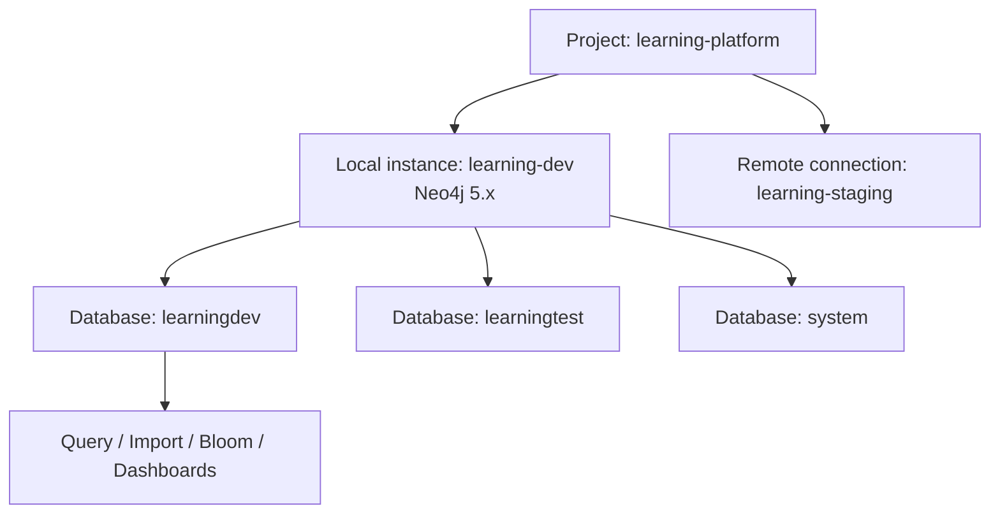
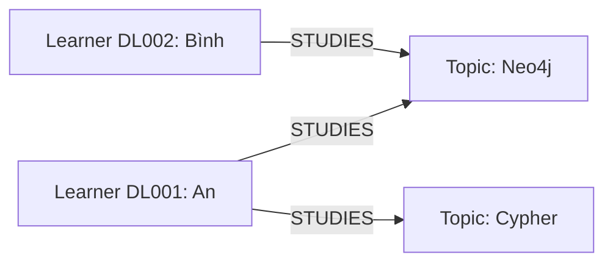

# Neo4j Desktop and How to Organize Your Development Environment

> **Chapter:** Developer Tools  
> **Module:** `DATABASE_ENGINE_GRAPH_NEO4J`  
> **Scope:** Neo4j Desktop 2.x and compatible Neo4j DBMS versions.

## 1. Which Step of the Development Workflow Does Neo4j Desktop Serve?

In this module, Neo4j is used to model connected data as a **property graph**: nodes represent entities, relationships represent directed links, labels/types classify elements, and properties store attributes. Cypher helps query relationships and paths; subsequent topics include indexes, constraints, query optimization, data import, Java Driver, Spring Data Neo4j, and graph database operations.

**Neo4j Desktop** is a developer application that helps create and manage Neo4j DBMSs on a personal machine, connect to remote databases, and use graph analysis and experimentation tools. Desktop is especially useful when learners need to:

- Quickly initialize an isolated database for practice exercises.
- Run Cypher and view nodes and relationships as a graph.
- Experiment with schemas, constraints, indexes, and path queries.
- Import CSV data before connecting a Java/Spring application.
- Track Neo4j versions, install plugins, inspect logs, and export/clone databases.
- Separate experimental data from data used for application testing.

Desktop does not deploy a production system by itself. For applications that need to run continuously for many users, the DBMS is typically operated on a server, Neo4j AuraDB, or separately managed infrastructure.

### Distinguishing Desktop and Related Tools

| Tool | Role | Usage Example |
| --- | --- | --- |
| **Neo4j Desktop** | Manage local instances, databases, projects, and remote connections. | Set up an isolated development environment on a laptop. |
| **Query** in Desktop 2.x | Run Cypher; view Graph, Table, and RAW results. | Inspect relationships between learners and courses. |
| Standalone **Neo4j Browser** | Interactive Cypher UI similar to Query. | Explore a graph via a web UI or standalone app. |
| **Cypher Shell** | Command-line interface for running Cypher, parameters, and scripts. | Run repeated queries from a terminal or pipeline. |
| **Java Driver / Spring Data Neo4j** | Connect to the database from application code. | Implement repositories, parameterized queries, and transactions. |

In **Desktop 2.x**, the built-in query execution tool is named **Query**. Older guides for Desktop 1.x may refer to Browser or use a different UI layout; always check your version when following a tutorial.

## 2. Three Layers to Understand: Project, Instance, and Database

**Project** in Desktop 2.x is a UI grouping for organizing instances. An instance can belong to multiple projects, and deleting a project does not delete the DBMS or graph.

**Instance** represents a Neo4j **DBMS**: including the Neo4j version, connection details, configuration, plugins, logs, and databases. Desktop can create multiple local instances to test different versions or configurations.

**Database** is the unit that holds graph data. A new instance typically has a default user database `neo4j` and a `system` database. With the Enterprise Developer Edition included in Desktop, you can add more user databases; each database keeps separate data, though databases within the same instance still share DBMS configuration and resources.

**Remote connection** stores connection details to a Neo4j Server/AuraDB elsewhere. Desktop manages the connection configuration, while the remote DBMS lifecycle is managed by its respective server/service.



**Note on Desktop 2.3:** according to the instance management documentation, Desktop only allows running **one local instance at a time**. When you Start another local instance, the currently running one will be stopped; you can simultaneously connect to remote instances. This is a limitation of local instance management in Desktop 2.x, not a general limitation of Neo4j when deployed via Docker or another server setup.

Two fixed folders in Desktop 2.x are **All instances** (every instance/connection) and **Unassigned** (not yet attached to a project). Projects are purely for grouping and discovery, **not Git source directories** or security boundaries.

## 3. Installing and Creating Your First Instance

### 3.1. Preparing the Environment

Download Desktop from the [Neo4j Deployment Center](https://neo4j.com/deployment-center/), install the version for your OS, and check machine resources. Desktop 2.x supports managing Neo4j DBMS **version 5.1 and above**; choose a version matching your application's requirements. If you select a version that is not pre-bundled, Desktop may need to download additional assets over the internet.

Desktop includes an **Enterprise Edition Developer License** for development by **a single user on a single machine**. Enterprise capabilities available in this environment do not grant the right to take that developer license into production.

### 3.2. Steps to Create a Sample Environment

Suppose the goal is to create a database for an online learning platform:

1. Open Desktop and create a **Project** named `learning-platform`.
2. Inside the project, click **Create** and create a **local instance** named `learning-dev-neo4j5`.
3. Select the Neo4j version required for the project; set the username/password as instructed.
4. Finish creating the instance and click **Start**.
5. Open **Overview** or the instance card to check the **Connection URI**, status, and actual version.
6. In the **Databases** list, create `learningdev` and `learningtest` (if supported by your account and version).
7. From the running instance, select **Connect → Query**, then choose the `learningdev` database.

Button names or locations may vary across Desktop releases, but the workflow remains **Project → Instance → Start → Database → Query**.

Query to confirm the connection:

```cypher
RETURN 'Neo4j is ready' AS thongBao,
       3 * 7 AS ketQua;
```

Expect one row with `ketQua = 21`. This read-only query does not require any nodes in the database.

### 3.3. System Database vs. Business Databases

| Database | Purpose | Impact |
| --- | --- | --- |
| `system` | Stores administrative metadata, users/roles, and DBMS metadata. | Do not use it to store lesson business graphs. |
| `neo4j` | Default user database in many installations. | Can be used for general practice or skipped if the team uses custom-named databases. |
| `learningdev` | Development data, small seed datasets. | Developers can modify it as needed for their tasks. |
| `learningtest` | Integration test fixtures. | Data must be reproducible for stable tests. |

Two databases in the same instance **isolate data**, but do not create two separate sets of plugins or Neo4j versions. If you need to test different memory settings, plugins, or Neo4j versions, create separate instances.

## 4. Running Cypher in Query and Observing the Graph

In **Tools → Query** (or the **Connect** menu on the instance card), select the instance and database. Then enter and run Cypher. Query provides **Graph** (nodes/relationships), **Table** (rows/columns), and **RAW** (request/response details) result views.

### 4.1. Creating Demo Data in learningdev

Only run the following **data-writing** snippet on a test database. The label names `DesktopDemoLearner` and `DesktopDemoTopic` help distinguish them from real project data.

```cypher
MERGE (an:DesktopDemoLearner {learnerId: 'DL001'})
SET an.name = 'An'
MERGE (binh:DesktopDemoLearner {learnerId: 'DL002'})
SET binh.name = 'Bình'
MERGE (neo4j:DesktopDemoTopic {topicId: 'T-NEO4J'})
SET neo4j.title = 'Neo4j'
MERGE (cypher:DesktopDemoTopic {topicId: 'T-CYPHER'})
SET cypher.title = 'Cypher'
MERGE (an)-[:STUDIES]->(neo4j)
MERGE (an)-[:STUDIES]->(cypher)
MERGE (binh)-[:STUDIES]->(neo4j)
RETURN 'Demo data prepared' AS thongBao;
```

If the database has no conflicting data, the sample contains **2 learners, 2 topics, and 3 relationships**:



`MERGE` looks for an existing pattern before creating; in development datasets with concurrent writers, also use a **uniqueness constraint** on business keys. `MERGE` alone does not replace data constraints.

### 4.2. Graph and Table Serve Two Different Purposes

To view connections:

```cypher
MATCH p = (learner:DesktopDemoLearner)-[:STUDIES]->(topic:DesktopDemoTopic)
RETURN p
LIMIT 20;
```

Select **Graph** to see the two node types and directed `STUDIES` edges. For a tabular report:

```cypher
MATCH (learner:DesktopDemoLearner)-[:STUDIES]->(topic:DesktopDemoTopic)
RETURN learner.learnerId AS maNguoiHoc,
       learner.name AS nguoiHoc,
       topic.title AS chuDe
ORDER BY maNguoiHoc, chuDe;
```

Expected result:

| maNguoiHoc | nguoiHoc | chuDe |
| --- | --- | --- |
| DL001 | An | Cypher |
| DL001 | An | Neo4j |
| DL002 | Bình | Neo4j |

**Do not infer the entire database from a Graph visualization**: `LIMIT 20` bounds the returned records; the UI may also limit how many nodes are drawn. To check the exact total node count, use a counting query:

```cypher
MATCH (learner:DesktopDemoLearner)
RETURN count(learner) AS soNguoiHoc;
```

With the initial dataset, the result is `2`. Note that **Query History** may contain query history across multiple databases/instances: never reopen an old query and run it without checking the active **connection selector**.

## 5. Organizing Development, Test, Staging, and Production

Real environments consist of **databases, data, versions, configuration, credentials, and access permissions**. A project in Desktop merely groups connections and does not automatically create security boundaries.

| Environment | Appropriate Placement | Data | Purpose |
| --- | --- | --- | --- |
| **Local dev** | `learningdev` database in a local instance | Small mock seed | Develop the model, Cypher queries, and test APIs. |
| **Integration test** | `learningtest` or a separate instance when config isolation is needed | Reproducible fixtures | Test repositories, transactions, indexes/constraints. |
| **Staging** | Remote Server/AuraDB | Anonymized data or staging data | Validate behavior close to production. |
| **Production** | Official production Server/AuraDB | Real user data | Serve the application; restrict manual operations. |

One naming layout in Desktop:

```text
All instances
├── Project: learning-platform
│   ├── Local instance: learning-dev-neo4j5
│   │   ├── Database: learningdev
│   │   └── Database: learningtest
│   ├── Remote connection: learning-staging
│   └── Remote connection: learning-prod-readonly
└── Unassigned
    └── (unassigned instances)
```

This is a **conceptual UI layout**, not a real filesystem directory tree. The name `prod-readonly` is just a label: you must use a **read-only account granted on the server** to guarantee writes are impossible. With remote connections, always verify **URI → database → account** before running `MERGE`, `DELETE`, `DROP`, or schema scripts.

### 5.1. When to Separate Databases vs. Separate Instances?

- **Separate databases** when you need two independent graph datasets that can share the same version and plugins, such as `learningdev` and `learningtest`.
- **Separate instances** when you need different Neo4j versions, configurations, plugins, memory settings, or upgrade cycles.
- **Separate infrastructure** when you need to realistically test remote connectivity, access control, scale, availability, or operational requirements.
- **Separate UI projects** when you just want to group instances related to a product; never use them as a data access-control mechanism.

In Desktop 2.x, the same instance can be attached to **multiple projects**. Removing a project does not delete instance data; conversely, **Delete instance** can delete every database inside that instance.

## 6. Managing Source Code and Data Directories

Desktop 2.x focuses on managing instances and tools. You should keep **Cypher scripts, CSV fixtures, modeling docs, and Java code** in a separate repository that can be reviewed with Git.

Suggested project structure:

```text
learning-platform/
├── README.md
├── app/
│   └── (Java / Spring Boot code)
├── neo4j/
│   ├── schema/
│   │   └── 001-constraints.cypher
│   ├── seeds/
│   │   └── 010-dev-seed.cypher
│   ├── queries/
│   │   ├── learner-by-id.cypher
│   │   └── topics-of-learner.cypher
│   ├── fixtures/
│   │   ├── learners.csv
│   │   └── topics.csv
│   └── README.md
└── docs/
    └── graph-model.md
```

*The tree above is only an example repository layout; Desktop does not generate these files automatically.*

| Content Type | Appropriate Management |
| --- | --- |
| Cypher for constraints/indexes, queries, mock seeds | Store in Git, with code review and testing. |
| Small CSV fixtures without sensitive data | Store in Git or a test artifact repository. |
| Neo4j `data/`, transaction logs, cache | Let the DBMS manage them; do not commit to Git or edit manually. |
| Real `.dump`/backup files | Access-controlled backup storage with a retention policy. |
| Passwords, API keys, tokens | Secret manager, environment variables, or secure vault; never commit. |
| Neo4j version, plugins, reproducible config | Document in README/manifest and developer docs. |

### 6.1. Data Path, neo4j.conf, Logs, and Import

Through the instance card, open **Instance folder**, `neo4j.conf`, and `neo4j.log` from the **Open** menu. Neo4j has key storage areas:

- **`conf/`:** holds DBMS configuration; changing settings may require a restart.
- **`data/`:** graph store, transaction logs, and internal data; avoid editing directly.
- **`import/`:** server-side CSV read directory when using `LOAD CSV` with `file:///...`.
- **`plugins/`:** extension libraries, which should be managed via the supported plugin mechanism.
- **`logs/`:** error, performance, and startup diagnostic logs (depending on configuration).

If you want to change the data path of **Desktop 2.x**, the documentation supports the `NEO4J_DESKTOP_DATA_PATH` environment variable. Set it per your OS and restart the application. Changing the environment variable **does not automatically guarantee** that existing databases are migrated to the new location; plan backups and data migration separately.

Desktop does not replace Git, nor does it automatically turn data edits made in Query into project commits.

## 7. Connecting Java Driver and Spring Data Neo4j to a Local Instance

After Starting the local instance, check the actual URI. The default setup is typically `bolt://localhost:7687`; if the port or host changed, use the exact details shown on the instance card.

Example `application-local.yml` configuration for Spring Boot (illustrative only):

```yaml
spring:
  neo4j:
    uri: ${NEO4J_URI:bolt://localhost:7687}
    authentication:
      username: ${NEO4J_USERNAME:neo4j}
      password: ${NEO4J_PASSWORD}
  data:
    neo4j:
      database: ${NEO4J_DATABASE:learningdev}
```

`NEO4J_PASSWORD` should be supplied via an environment variable or appropriate secret store. Explicitly setting `spring.data.neo4j.database` prevents the application from accidentally writing to the default database while you are inspecting `learningdev` in Query.

Shared Cypher used in both Query and the application:

```cypher
MATCH (learner:DesktopDemoLearner {learnerId: $learnerId})
      -[:STUDIES]->(topic:DesktopDemoTopic)
RETURN topic.topicId AS maChuDe, topic.title AS chuDe
ORDER BY chuDe;
```

In Query, set the parameter `learnerId = 'DL001'` via the **Parameters drawer**; in Java Driver, pass the value through the parameters API; in Spring Data Neo4j, use the corresponding query/repository mechanism. **Never concatenate user input directly into the Cypher string**.

Connection verification workflow:

1. The instance is **Started**, and the `learningdev` database has sample data.
2. Run `RETURN 1 AS ok` in Query against `learningdev`.
3. Start the Java/Spring application with the exact URI, username, password, and database.
4. Call a read-only API/repository method with `DL001`; expect two topics returned.
5. If the data differs, verify the URI/database the application uses before modifying Cypher.

If Java runs inside Docker/a VM while Desktop runs on the host machine, `localhost` in Java may refer to the container/VM rather than the host. Configure the appropriate reachable address and network port.

## 8. Using Import and LOAD CSV

In Desktop 2.x, the **Import** tool lets you load CSV files, visually model nodes/relationships, and map data columns to properties and identifier keys. Workflow:

1. Prepare clean CSV files with consistent encoding and clear identifier columns.
2. Open Import under **Tools** and verify the target database.
3. Load the CSV files; create or open a JSON graph model.
4. Map node columns, properties, and relationship join keys.
5. Run the import into a **test** database.
6. Use Query to verify node/relationship counts and check for bad or duplicate data.

Example learner CSV:

```csv
learnerId,name
DL001,An
DL002,Binh
```

Example relationship data (when using a separate CSV):

```csv
learnerId,topicId
DL001,T-NEO4J
DL001,T-CYPHER
DL002,T-NEO4J
```

In Cypher, an alternative is `LOAD CSV`. When `learners.csv` **is placed in the import directory of the running Neo4j DBMS** and configuration allows it:

```cypher
LOAD CSV WITH HEADERS FROM 'file:///learners.csv' AS row
WITH row
WHERE row.learnerId IS NOT NULL AND row.learnerId <> ''
MERGE (learner:DesktopDemoLearner {learnerId: row.learnerId})
SET learner.name = row.name;
```

**Important:** `LOAD CSV` executes on the **database server** side. A CSV file on your laptop does not automatically appear inside a remote database's directory. The Import tool has its own file selection and mapping workflow, distinct from the DBMS-side `file:///` path. When importing large datasets, you need constraints, bad-record checks, a batching strategy, and performance measurements.

## 9. Indexes, Constraints, and Inspecting Query Plans

A reproducible development environment needs both seed data **and schema**. For the learner ID `learnerId`, create a uniqueness constraint in the test database:

```cypher
CREATE CONSTRAINT desktop_demo_learner_id IF NOT EXISTS
FOR (learner:DesktopDemoLearner)
REQUIRE learner.learnerId IS UNIQUE;
```

Similarly for topic:

```cypher
CREATE CONSTRAINT desktop_demo_topic_id IF NOT EXISTS
FOR (topic:DesktopDemoTopic)
REQUIRE topic.topicId IS UNIQUE;
```

If existing data violates uniqueness, constraint creation can fail; clean up data properly before applying it. Constraints reduce the risk of duplicate IDs, and corresponding uniqueness constraints are backed by indexes. Avoid creating duplicate indexes without checking the schema first.

Check the schema (requires appropriate permissions):

```cypher
SHOW CONSTRAINTS
YIELD name, type
RETURN name, type
ORDER BY name;
```

And inspect the plan for finding a learner by ID:

```cypher
EXPLAIN
MATCH (learner:DesktopDemoLearner {learnerId: 'DL001'})
RETURN learner.name;
```

`EXPLAIN` builds the plan **without executing** the query; `PROFILE` **executes** the query to gather statistics. If you use `PROFILE` on a write query, data **is still written**. Compare plans on the same Neo4j version, with the same indexes/constraints, and on realistically sized data rather than relying on results from a few demo nodes.

## 10. Plugins, DBMS Configuration, and Observing Errors

In the local instance management menu, Desktop provides a **Plugins** section to enable supported plugins depending on the DBMS version, such as **APOC**, **Graph Data Science**, **GenAI**, and **Bloom**-related features. Some Enterprise plugins/features may require a separate license.

Steps when a plugin is needed:

1. Identify the purpose of the plugin (import, graph algorithms, semantic/vector, etc.).
2. Check **Neo4j version ↔ plugin version** compatibility.
3. Install/enable it from the instance menu; configure procedure permissions per official documentation if required.
4. Restart the instance when prompted, and verify the plugin works using a read-only query.
5. Document the version and configuration so teammates can reproduce the environment.

Plugins are **DBMS-level** components: two databases in the same instance normally share the same set of plugins and configuration.

### Common Issues

| Symptom | Check First |
| --- | --- |
| Instance fails to Start | Another local instance is running, port conflict, configuration in `neo4j.conf`, and startup logs. |
| Query cannot connect | Whether DBMS has Started, and whether URI/user/password/database are accurate. |
| Java reports `Connection refused` | Actual Bolt host/port; whether the app is running inside Docker/a VM. |
| Plugin procedure not recognized | Matching plugin version, enabled/restarted, procedure execution permissions. |
| Import/LOAD CSV cannot find file | Whether the file is on the client machine or in the DBMS import directory. |
| Query results differ from a teammate's machine | Different database, seed not run, different plugin/version/schema. |
| Old query executed on production | Query History/saved queries are not strictly pinned to a database; verify the connection selector. |

Do not manually edit or delete the `data` directory while the DBMS is running. For configuration edits, read the documentation for your exact version and record necessary changes so the environment stays reproducible.

## 11. Clone, Export, Backup, and Upgrade

| Task | Supported in Desktop 2.x | Points to Note |
| --- | --- | --- |
| **Clone instance** | Create a copy of a local instance. | The source instance must be **Stopped** before cloning. |
| **Export databases** | Export one or more user databases to `.dump`. | Requires **Stopping** the instance; `system` is not exported via this action. |
| **Load database** | Load from supported `.dump`, `.backup`, or `.tar` files. | Requires **Stopping** the instance; verify database name/version. |
| **Upgrade instance** | Upgrade a local Neo4j DBMS to a newer supported version. | Requires **Stopping**; there is no simple downgrade operation after upgrading. |
| **Deploy to Aura** | Transfer a copy of local data to AuraDB. | Check target and permissions; the process may **overwrite target AuraDB data**. |

A `.dump` file of a user database does not transfer all **users/roles/permissions**, because those administrative details belong to the `system` database. When migrating to another instance, those items must be reconfigured.

Before updating a schema or upgrading a version:

1. Verify the local instance, database, and target data.
2. Record current node/relationship statistics and schema as a baseline.
3. Stop the instance if required by the backup/export operation.
4. Create a dump or clone using a supported mechanism.
5. Test restoring the copy in a test environment and verify the data.
6. Apply the change and cross-check again with read-only queries.

A clone on the **same disk** does not replace a long-term backup policy. Critical data should be stored in an access-controlled location with scheduled recovery drills.

## 12. Connecting to Staging and Production from Desktop

Desktop 2.x supports **Remote connections** to Neo4j Server or AuraDB using the corresponding URI, user, and password. Example AuraDB URI format:

```text
neo4j+s://<instance-id>.databases.neo4j.io
```

This is only a format example; you must use the URI provided by the real system. Production connections typically require TLS, VPN, firewall rules, and appropriate access permissions.

Before running Cypher on a remote connection, check:

- **URI:** which server are you talking to?
- **Database:** is this the intended graph?
- **User/role:** is this a read-only account or is writing allowed?
- **Statement:** does it contain `CREATE`, `MERGE`, `SET`, `DELETE`, `DETACH DELETE`, or `DROP`?
- **Purpose:** an investigative query or a reviewed data-modification operation?

Desktop is merely a **client** of the remote DBMS. Use a read-only account for production observation; deploy schema or data changes through a dedicated pipeline or administrative workflow. Naming warnings on connections are helpful, but actual permissions must be enforced on the server.

## 13. A Reproducible Team Development Workflow

Suppose a team builds a course recommendation feature based on relationships between `Learner`, `Course`, and `Topic`:

1. Sync source code; read the README for required Neo4j version and plugins.
2. Create a local instance in Desktop with the matching version and select the `learningdev` database.
3. Apply constraint/index scripts from `neo4j/schema/`.
4. Load small fixtures/seeds from `neo4j/seeds/` and `neo4j/fixtures/`.
5. Use Query to verify path queries and aggregation queries.
6. Run the Java/Spring application with the exact `NEO4J_URI` and `NEO4J_DATABASE`.
7. When changing the model or queries, update code, schema scripts, and tests in the same Git branch.
8. Run tests against `learningtest` with deterministic data fixtures.
9. Review changes and deploy to staging/production using the proper workflow.

Team environments should have documentation listing **DBMS version, plugins, database list, seeds, schema, network configuration, how to reset test data, and how to run tests**. Never include real secrets in documentation.

Common mistakes:

- Splitting into two **Projects** while still sharing the same database and assuming the data is isolated.
- Creating two databases in the same instance while expecting each database to have its own plugins or Neo4j version.
- Committing the database store or real dumps to Git instead of committing schema and seed scripts.
- Putting the production password in a Spring Boot config tracked by Git.
- Only looking at a nice Graph view while ignoring cardinality, duplicate IDs, constraints, and `EXPLAIN`.
- Re-running Cypher from History after switching the connection from dev to staging.
- Upgrading a local instance without a verified export/restore backup.

## 14. Self-Check Practice Exercises

**Exercise 1 — Environment Organization.** Create project `learning-platform` and a local instance. Inside the instance, create `learningdev` and `learningtest`. Explain why these two databases still share the Neo4j version and plugins.

**Exercise 2 — Graph Query.** Select `learningdev`, run the `MERGE` code from section 4, then choose Graph with `RETURN p`. The initial dataset has **4 nodes and 3 relationships**.

**Exercise 3 — Table Query.** Run `MATCH ... RETURN learner.name, topic.title` with `ORDER BY`, verifying **3 rows**. Explain why Graph and Table inspect the same query result rather than creating two separate copies of data.

**Exercise 4 — Isolation Check.** Switch to an unseeded `learningtest` database and run:

```cypher
MATCH (learner:DesktopDemoLearner)
RETURN count(learner) AS soNguoiHoc;
```

Expect the result **0**, even though `learningdev` already has 2 learners. If it differs, verify the active database and seed state.

**Exercise 5 — Constraints and Performance.** Create a uniqueness constraint on `learnerId`, verify with `SHOW CONSTRAINTS`, and observe `EXPLAIN` for the query finding `DL001`. State the role of constraints in data integrity.

**Exercise 6 — Java/Spring Connection.** Configure `spring.neo4j.uri` and `spring.data.neo4j.database` for the local instance, invoke a query with parameter `$learnerId`, and cross-check with Query.

**Exercise 7 — Environment Reproducibility.** Outline what must be committed (scripts, fixtures, README) and what must be kept private (passwords, dumps, store data). Describe how to verify a backup before changing versions.

### Cleaning Up Demo Data

Only clean up in a **test database** and after verifying the exact elements. First:

```cypher
MATCH (n)
WHERE (n:DesktopDemoLearner AND n.learnerId IN ['DL001', 'DL002'])
   OR (n:DesktopDemoTopic AND n.topicId IN ['T-NEO4J', 'T-CYPHER'])
RETURN labels(n) AS nhan, properties(n) AS duLieu;
```

If it is confirmed to be demo data and you deliberately want to delete it:

```cypher
MATCH (n)
WHERE (n:DesktopDemoLearner AND n.learnerId IN ['DL001', 'DL002'])
   OR (n:DesktopDemoTopic AND n.topicId IN ['T-NEO4J', 'T-CYPHER'])
DETACH DELETE n;
```

`DETACH DELETE` also deletes relationships connected to those nodes, even if you later added other relationships. Created constraints do not disappear when nodes are deleted; modifying schema requires separate statements.

## 15. Key Takeaways

- **Projects group instances; instances contain databases; databases contain graphs.** These are three distinct layers when designing a workspace.
- Desktop 2.x provides **Query, Import, Bloom, and Dashboards**; Query is used to execute and verify Cypher.
- Per Desktop 2.3 documentation, only one Desktop-managed local instance runs at a time; connecting to remote DBMSs is a separate case.
- To test different plugins or Neo4j versions, separate instances; to keep different datasets under the same configuration, separate databases.
- Store schema, seeds, queries, and fixtures in Git; keep database stores, passwords, and backups outside the repository.
- In Java/Spring, configure the exact URI/database, pass parameters when querying, and validate results in dev before running on staging/production.
- Test backup/restore before upgrading, and verify URI/database/permissions before performing write operations.

## 16. Official Documentation

- [Neo4j Desktop — Overview](https://neo4j.com/docs/desktop/current/)
- [Neo4j Desktop — Installation](https://neo4j.com/docs/desktop/current/installation/)
- [Neo4j Desktop — Project management](https://neo4j.com/docs/desktop/current/operations/project-management/)
- [Neo4j Desktop — Instance management](https://neo4j.com/docs/desktop/current/operations/instance-management/)
- [Neo4j Desktop — Database management](https://neo4j.com/docs/desktop/current/operations/database-management/)
- [Neo4j Desktop — Connections](https://neo4j.com/docs/desktop/current/operations/connections/)
- [Neo4j Desktop — Query](https://neo4j.com/docs/desktop/current/query/)
- [Neo4j Desktop — Import](https://neo4j.com/docs/desktop/current/import/)
- [Neo4j Desktop — Comparison of 1.x and 2.x](https://neo4j.com/docs/desktop/current/comparison/)
- [Neo4j Java Driver](https://neo4j.com/docs/java-manual/current/)

> **Note:** Menus and limits depend on the Desktop version. This content is based on the **Desktop 2.x** line, specifically the **Desktop 2.3** management documentation; always verify your actual version and matching docs before applying to an operational system.
