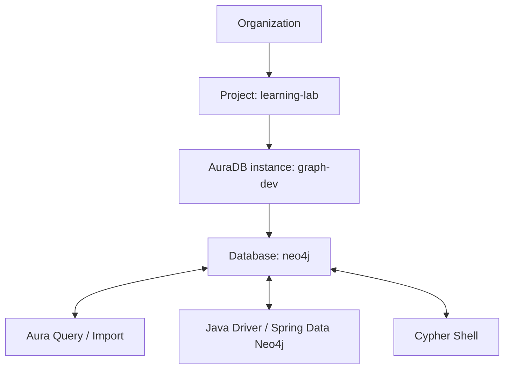
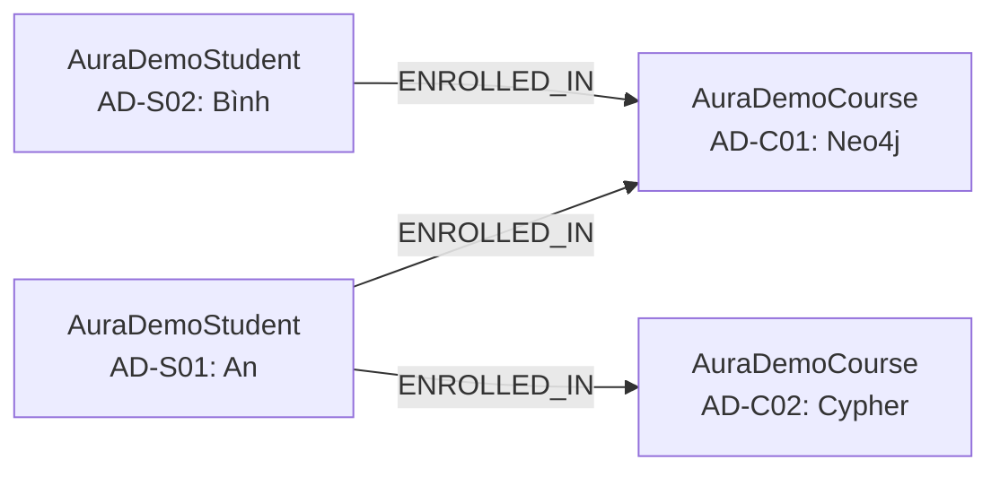

# Neo4j Aura: Creating a Database and Managing Connection Details

> **Chapter:** Developer Tools  
> **Module:** `DATABASE_ENGINE_GRAPH_NEO4J`  
> **Focus:** AuraDB, Aura Console, instance creation, and secure connections from tools and applications.

## 1. Objectives and Usage Context

Neo4j stores data using the **property graph** model, in which **nodes** are entities, **relationships** are directed links, **labels/types** classify elements, and **properties** store attributes. Cypher is used to find relationships, paths, and update the graph. When building real systems, learners also need indexes, constraints, query optimization, data import, Neo4j Java Driver, Spring Data Neo4j, and operational workflows.

**Neo4j Aura** is a cloud-managed graph service operated by Neo4j. Instead of installing servers, configuring disks, applying system updates, and operating the DBMS yourself, developers can create an **AuraDB instance**, connect to it, and focus on the data model and application code.

This lesson focuses on four capabilities:

1. Properly understanding the **Organization → Project → Instance → Database** structure in Aura.
2. Creating and verifying an AuraDB instance ready to execute Cypher.
3. Storing, using, and protecting the **Connection URI**, **username**, **password**, and **database name**.
4. Connecting from Aura Query, Cypher Shell, Java Driver, and Spring Data Neo4j; knowing how to handle connection errors and instance lifecycles.

The lesson examples use mock data. Data-modifying operations should only be tried on an instance/database dedicated to learning or development.

## 2. AuraDB and Components in Aura Console

**AuraDB** is the managed Neo4j graph database service. **AuraDS** serves graph data science workloads as a service; **Aura Graph Analytics** provides graph analytics compute capabilities. When the goal is to store nodes/relationships and use Cypher for Java/Spring applications, start with **AuraDB**.

Go to [Aura Console](https://console.neo4j.io/) to manage your environment. This is the resource administration UI, not the direct connection address for Java Driver.

| Component | Meaning | Question to Answer |
| --- | --- | --- |
| **Organization** | Management space for accounts, users, and resources belonging to an organization. | Which organization are you in? |
| **Project** | Logical grouping of Aura resources, users, and related configuration; created by default upon signup. | Which project does the instance belong to, and who has access? |
| **AuraDB instance** | A DBMS provisioned with resources by Aura; has an ID, URI, status, tier, and version specifications. | Which instance are you connecting to? |
| **Database** | A user graph inside an instance; some tiers support multiple databases. | Which database are you running Cypher against? |
| **Tools / Query** | Interface for running Cypher and visualizing graphs. | Did the query return the expected data? |
| **Connection credentials** | Authentication details for the DBMS; separate from the Aura Console login account. | Where are the database username/password stored? |



**Specifically:** a **Project** name in Aura is a cloud resource group; it is not a source code folder or config file on your laptop. The **Instance** is the object with a connection address; the **database name** specifies the particular graph inside that instance.

### 2.1. Choosing a Tier Based on Needs

The AuraDB tiers currently described by Neo4j include **Free**, **Professional**, **Business Critical**, and **Virtual Dedicated Cloud**. Scale, resource limits, backup capabilities, network controls, SLAs, security features, and billing models vary by tier.

- **Free:** suitable for learning Cypher, testing models, and small demos; subject to auto-pause policies and resource limits.
- **Professional:** suitable for development environments or applications needing additional resources and management features per tier capabilities.
- **Business Critical / Virtual Dedicated Cloud:** serves more advanced operational, availability, and contractual security requirements.

Do not assume a feature is included in a tier solely from its name. For real projects, check the current feature matrix and pricing at [Neo4j Pricing](https://neo4j.com/pricing/) before provisioning paid resources. According to the instance creation documentation, a Free account can create only **one AuraDB Free instance**.

## 3. Creating an Account, Selecting a Project, and Provisioning AuraDB

### 3.1. Prerequisites

You need:

- A registered Aura account with a verified email that can log in.
- Permission to create instances in the intended **project**.
- Selection of **AuraDB**, tier, instance name, cloud region, and resource configuration (supported options depend on tier).
- A secure place to store the password and connection file, such as a password manager or your team's secret vault.
- If using a paid tier: a payment method and cost approval per your project's workflow.

Aura creates a default Organization and Project upon registration. With certain tiers/permissions, you can add new projects; not every Free account has permission to create multiple projects. In the examples below, using the **existing project** is sufficient.

### 3.2. Steps to Create an Instance via the UI

1. Open [https://console.neo4j.io/](https://console.neo4j.io/), log in, and check the **selected Organization/Project**.
2. Select **Create instance** or the option to create an AuraDB from the project.
3. Choose **AuraDB**. Do not choose AuraDS when you only need a Cypher database for an application.
4. Choose a **tier**. For practice, use Free if eligible; for other tiers, select cloud region, capacity, and features as needed.
5. Enter a recognizable name, such as `learning-neo4j-dev`. A readable name helps distinguish environments, but the **instance ID** is the unique identifier assigned by Aura.
6. Review the displayed configuration, terms/billing options (if any), and confirm creation.
7. **As soon as the system generates the connection details, download the credentials file or copy the URI/username/password/database name to a secure location.** The password is shown at creation time and **cannot be viewed again in plain text from Aura Console**.
8. Watch the instance card; once the status turns to **Running**, you can open Query or connect from an application. Readiness time depends on resource provisioning.

Some AuraDB creation screens may offer Graph Analytics or Vector optimization options. These are extended configurations; for learning nodes, relationships, and basic Cypher, prefer a clean instance with the right tier and region that is easy to manage.

### 3.3. How to Confirm You Created the Right Resource

From the **instance card** or **Inspect → Overview**, verify:

| Attribute | Illustrative Example | Purpose |
| --- | --- | --- |
| Instance name | `learning-neo4j-dev` | Helps identify it in the UI. |
| Instance ID | `a1b2c3d4` (hypothetical) | Unique identifier; independent of display name. |
| Tier | `AuraDB Free` | Determines limits and included services. |
| Status | `Running` | The DBMS is ready to accept connections. |
| Connection URI | `neo4j+s://a1b2c3d4.databases.neo4j.io` | Address for drivers/Bolt. |
| Database name | `neo4j` (example) | Selects the database in a session. |

The values above are **illustrative**; when deploying, take the exact values from your real instance. For multi-database instances, specify the target database and verify access permissions.

## 4. Understanding the Credentials File and Connection Details

### 4.1. What Information Is Actually Needed

A credentials file downloaded during instance creation may contain:

- **Connection URI**: address for applications or CLI tools to connect.
- **Username**: database user name, usually `neo4j` on initial setup.
- **Password**: authentication secret **for the database**.
- **Database name**: default database or provided database name.
- **Instance ID** and **Instance name**: for management and cross-referencing.

A common **content template** uses environment variables; all values below are placeholders, **not usable credentials**:

```dotenv
NEO4J_URI=neo4j+s://<your-instance-id>.databases.neo4j.io
NEO4J_USERNAME=neo4j
NEO4J_PASSWORD=<your-password>
NEO4J_DATABASE=neo4j
```

The file may be named something like `Neo4j-<instance-id>-Created-<date>.txt`. Keep the real file only in an access-controlled location; never put it into Git, team chat, bug reports, screenshots, or public artifacts. **The URI is usually not a secret**, though it should be managed with environment metadata to avoid mixing up production addresses; **the password is a secret**.

### 4.2. Distinguishing URL Types and Connection Methods

| Value | Purpose | Note |
| --- | --- | --- |
| `https://console.neo4j.io/` | Log in, create, and administer Aura. | This is **not** a URI for Java Driver. |
| `neo4j+s://<id>.databases.neo4j.io` | Connect to the database over Bolt with TLS and certificate verification; used with Neo4j Driver/Cypher Shell. | Use the URI obtained from the instance; do not edit the scheme to bypass TLS. |
| **Query API URL** shown in Instance details | Send queries over HTTPS via the Neo4j Query API. | Different endpoint/API and authentication from a Bolt session; do not paste this string into a driver expecting Bolt. |
| **Database name** | Select a database inside the instance. | Set explicitly in Java/Spring config, especially on multi-database instances. |

Aura Query can choose a connection mechanism suited to the browser/network, including HTTPS when Bolt is blocked by a firewall; this **does not mean** you can change `neo4j+s://` to `https://` in any Java Driver. The tool/driver must support the corresponding protocol.

### 4.3. Console Credentials Differ from Database Credentials

Logging into Aura Console with email/SSO only authenticates **the resource administrator**. A connection from Java Driver to AuraDB typically uses a **database username/password** or an organization-configured SSO/token approach. These details may also need to be entered when opening Query, Import, or another tool.

If you lose the initial password, **you cannot ask Aura Console to re-display the exact generated password**. Follow a supported recovery process appropriate for your project's admin permissions: have an administrator issue/create new database credentials if supported, or follow Neo4j's recovery/clone instructions. Do not enter your Aura Console account password into the database password field.

## 5. Connecting from Aura Query and Running Your First Cypher

From the instance card choose **Connect → Query**, or open **Query** in Console and use the connection selector to pick the right instance. If the instance has multiple databases, choose the right **database** in the dropdown. When prompted, enter the saved database credentials.

Start with a read-only query:

```cypher
RETURN 'Connected to AuraDB' AS thongBao,
       12 * 2 AS ketQua;
```

Expected result: one row, `ketQua = 24`. No pre-existing data is needed. If this query fails, fix the **connection/instance status** before creating the graph.

### 5.1. Demo Graph Model: Students and Courses

To have data visible in Graph view, create a small dataset with dedicated labels, only on a **test database**:



Data creation statements:

```cypher
MERGE (an:AuraDemoStudent {studentId: 'AD-S01'})
SET an.name = 'An'
MERGE (binh:AuraDemoStudent {studentId: 'AD-S02'})
SET binh.name = 'Bình'
MERGE (neo4j:AuraDemoCourse {courseId: 'AD-C01'})
SET neo4j.title = 'Neo4j'
MERGE (cypher:AuraDemoCourse {courseId: 'AD-C02'})
SET cypher.title = 'Cypher'
MERGE (an)-[:ENROLLED_IN]->(neo4j)
MERGE (an)-[:ENROLLED_IN]->(cypher)
MERGE (binh)-[:ENROLLED_IN]->(neo4j)
RETURN 'Demo created' AS thongBao;
```

Starting from a clean database with the labels above, the result is **4 nodes and 3 relationships**. In this small example, `MERGE` allows re-running normally without creating duplicates; in real applications or concurrent writes, combine it with a **uniqueness constraint** on business keys.

View the graph by returning the full path:

```cypher
MATCH p = (s:AuraDemoStudent)-[:ENROLLED_IN]->(c:AuraDemoCourse)
RETURN p
LIMIT 20;
```

Select **Graph** mode to inspect nodes/relationships. To view as a table:

```cypher
MATCH (s:AuraDemoStudent)-[:ENROLLED_IN]->(c:AuraDemoCourse)
RETURN s.studentId AS maHocVien,
       s.name AS hocVien,
       c.title AS khoaHoc
ORDER BY maHocVien, khoaHoc;
```

Sample result:

| maHocVien | hocVien | khoaHoc |
| --- | --- | --- |
| AD-S01 | An | Cypher |
| AD-S01 | An | Neo4j |
| AD-S02 | Bình | Neo4j |

**Graph, Table, and RAW** are views of query results from **the same database**; switching modes does not create copies of the data. `LIMIT` bounds returned records, so a Graph view cannot replace a full count query.

## 6. Connecting from Cypher Shell

Cypher Shell allows sending Cypher statements from a terminal or CI script. The tool must be compatible with the Neo4j/Aura version; check first with:

```bash
cypher-shell --version
cypher-shell --help
```

Connect using your saved **actual URI**:

```bash
cypher-shell -a "neo4j+s://<your-instance-id>.databases.neo4j.io" \
  -u neo4j -d neo4j
```

The example uses Bash/zsh syntax. If `-p` is omitted in interactive terminal mode, the tool can prompt for the password. Enter the password at the prompt and avoid putting real values into command history or process lists.

After logging in, run:

```cypher
MATCH (s:AuraDemoStudent)
RETURN s.studentId AS studentId, s.name AS ten
ORDER BY studentId;
```

Remember to end statements with `;` in Cypher Shell. In **PowerShell**, write the same command on one line:

```powershell
cypher-shell -a "neo4j+s://<your-instance-id>.databases.neo4j.io" -u neo4j -d neo4j
```

In non-interactive automation without a terminal, the tool cannot prompt for a password by default. Use a secret injection method supported by your runner and Cypher Shell version; avoid placing secrets in commands, log files, or script files inside the repository.

If the instance uses a database name other than `neo4j`, replace the `-d` argument with the **actual name**. A URI may be valid while queries still run against the wrong database if you do not specify it explicitly.

## 7. Connecting Java Driver to AuraDB

Java applications use **Neo4j Java Driver** to manage connection pools, sessions, transactions, and parameterized Cypher. First add the `org.neo4j.driver:neo4j-java-driver` dependency matching your project's Java/Neo4j version (via Maven or Gradle per repository convention).

### 7.1. Providing Credentials via Environment Variables

Create the variables in the application runtime environment from a secret manager or protected credential store:

```dotenv
NEO4J_URI=neo4j+s://<your-instance-id>.databases.neo4j.io
NEO4J_USERNAME=neo4j
NEO4J_PASSWORD=<your-password>
NEO4J_DATABASE=neo4j
```

This is a **documentation template**, not a real credentials file. Neo4j Java Driver **does not automatically read `.env` files** when calling `System.getenv`; environment variables must be exported in the process or loaded via a dedicated configuration library/mechanism.

### 7.2. Complete Java Example: Connectivity Check and Parameterized Query

```java
import java.util.Map;
import org.neo4j.driver.AuthTokens;
import org.neo4j.driver.Driver;
import org.neo4j.driver.GraphDatabase;
import org.neo4j.driver.SessionConfig;

public class AuraConnectionDemo {
    public static void main(String[] args) {
        String uri = System.getenv("NEO4J_URI");
        String username = System.getenv("NEO4J_USERNAME");
        String password = System.getenv("NEO4J_PASSWORD");
        String database = System.getenv("NEO4J_DATABASE");

        if (uri == null || username == null ||
            password == null || database == null) {
            throw new IllegalStateException("Missing Neo4j environment variables");
        }

        try (Driver driver =
                 GraphDatabase.driver(uri, AuthTokens.basic(username, password))) {
            driver.verifyConnectivity();

            try (var session = driver.session(
                    SessionConfig.forDatabase(database))) {
                String title = session.executeRead(tx -> tx.run(
                        "MATCH (c:AuraDemoCourse {courseId: $id}) " +
                        "RETURN c.title AS title",
                        Map.of("id", "AD-C01")
                    ).single().get("title").asString());

                System.out.println("Course: " + title);
            }
        }
    }
}
```

If you ran the data creation snippet in section 5, the output is `Course: Neo4j`. If the data was not created yet, `single()` will fail because there is no record; this is a data error, different from a connection error.

**Technical points:**

- `GraphDatabase.driver(...)` creates a driver, which must be closed when the application shuts down. In server applications, create **one shared Driver** rather than creating a new one per request.
- `driver.verifyConnectivity()` checks that it can connect and authenticate to the instance.
- `SessionConfig.forDatabase(database)` specifies the target database rather than relying on the default choice.
- `session.executeRead(...)` runs a driver-managed read transaction; for updates, use the corresponding write mechanism.
- `$id` receives its value from `Map.of(...)`, avoiding direct string concatenation of user input into Cypher.

In real deployments, add categorized error handling, timeouts, safe logging, and framework-managed driver lifecycle.

## 8. Connecting Spring Data Neo4j / Spring Boot

For Spring Boot using **Spring Data Neo4j**, the URI and credentials are typically configured under `spring.neo4j`, and the database via `spring.data.neo4j.database`.

**Illustrative** `application.yml` example:

```yaml
spring:
  neo4j:
    uri: ${NEO4J_URI}
    authentication:
      username: ${NEO4J_USERNAME}
      password: ${NEO4J_PASSWORD}
  data:
    neo4j:
      database: ${NEO4J_DATABASE:neo4j}
```

If username/password are managed by a secret manager, the framework must be configured to load them properly. Never store AuraDB passwords directly in `application.yml` inside Git.

A Spring Data Neo4j application maps nodes/relationships to domain objects and can implement repositories or custom Cypher. Example business query:

```cypher
MATCH (s:AuraDemoStudent {studentId: $studentId})
      -[:ENROLLED_IN]->(c:AuraDemoCourse)
RETURN c.courseId AS maKhoaHoc, c.title AS khoaHoc
ORDER BY khoaHoc;
```

In Query, enter parameter `studentId = 'AD-S01'` via the parameter configuration UI. In a repository/driver, pass the parameter through the corresponding API; the same Cypher structure can be reused with `AD-S02`.

**Diagnostic order when a Spring connection fails:** check `spring.neo4j.uri`, username/password, database name, instance status, network reachability, and only then inspect repositories and queries.

## 9. Cloud AuraDB and Data Import

Because AuraDB runs in the cloud, **a local file like `C:\data\learners.csv` or `/home/user/learners.csv` on your laptop is not automatically present on the database server's filesystem**. This is an important difference compared to local Neo4j Desktop.

Aura Console includes **Import** to select CSV sources or connect supported data sources, build a graph model, map columns to properties and keys, and run the import. Required features and permissions depend on tier/role; Neo4j Import documentation notes that importing may require project admin or corresponding schema permissions.

Sample CSV import workflow:

1. Prepare `learners.csv` with `studentId` and `name` columns, containing no sensitive data.
2. Open **Import** in Aura Console.
3. Add the source CSV file; inspect headers/preview and encoding.
4. Create node label `AuraDemoStudent`, mapping `studentId` as the key and `name` as a property.
5. Select the right target instance/database, check the preview, and then click **Run import**.
6. After importing, open Query to count nodes and inspect created indexes/constraints.

Sample CSV data:

```csv
studentId,name
AD-S01,An
AD-S02,Binh
```

With direct Cypher `LOAD CSV`, **the URL must be reachable by the server**; on Aura, do not assume a laptop path like `file:///learners.csv` will work:

```cypher
LOAD CSV WITH HEADERS
FROM 'https://example.org/datasets/learners-demo.csv' AS row
WITH row
WHERE row.studentId IS NOT NULL AND row.studentId <> ''
MERGE (s:AuraDemoStudent {studentId: row.studentId})
SET s.name = row.name;
```

The `example.org` URL only illustrates structure, **not a live dataset to run against**. Replace it with a valid, accessible HTTPS URL and import only authorized data. If data should not be public, choose a supported Import/cloud storage/streaming method with proper access controls rather than putting real data on a public URL.

### 9.1. Verifying Data After Import

```cypher
MATCH (s:AuraDemoStudent)
RETURN count(s) AS soHocVien;
```

If you ran the demo in section 5, `soHocVien` is expected to be 2. Across multiple imports, results can change; check for **duplicate keys** and script idempotency.

## 10. Managing Databases and the Difference Between an Instance and a Database

An AuraDB instance can have **one or multiple databases** depending on tier/features. On a multi-database instance, Query has a database dropdown; for external clients, specify the database name in the session or application configuration.

Suppose an instance supports multiple databases and has two names:

- `learningdev`: development data, intentionally seeded and reset.
- `learningtest`: fixture data for automated tests, whose state must be reproducible.

When Java connects to the same URI but changes the database name, the visible set of nodes/relationships can be completely different. **A database is not a new instance**; therefore, databases in the same instance can share instance-level resources and policies.

For **AuraDB Free**, multiple databases in one instance are **not included in the tier's features** per the current pricing table. For separated dev/test environments when the current tier does not support multi-database, use separate test infrastructure or upgrade appropriately instead of just creating two labels in the UI.

To inspect business data structures, avoid database admin operations if the task only requires querying. Admin commands may require elevated privileges and vary by tier; check Aura docs before creating, altering, or dropping databases.

## 11. Security and Managing Connection Details

There are three groups of information to distinguish:

1. **Aura Console account**: user authorized to manage projects/instances, billing, or invite members.
2. **Database credentials**: username/password or auth method for connecting to the Neo4j DBMS.
3. **Aura API client credentials**: client ID/secret used to call the **Aura Management API**; they are **not the default database password**.

### 11.1. Practical Rules

- Store secrets in a **secret manager/password manager** and grant them only to people/apps that need them.
- Use **environment variables or platform secret mechanisms** to supply them to Java/Spring.
- Never commit `Neo4j-...-Created-...txt`, real `.env` files, screenshots containing passwords, or credentials into Git.
- Separate access by **role and environment**. Production connections should use read-only accounts when only observation is needed; actual permissions must be configured in Neo4j/Aura.
- When a password is lost or exposed, follow the supported **credential rotation/re-issuance** process, update application secrets, and check old connections.
- Logs may include URIs, database names, and driver errors; avoid logging passwords, tokens, or raw auth headers.
- Do not pass `-p "matkhau"` directly in the terminal if the tool offers a safer option, since shell history and process lists can expose secrets.

### 11.2. Metadata Conventions per Environment

| Management Field | Dev | Staging | Production |
| --- | --- | --- | --- |
| Instance name | `learning-graph-dev` | `learning-graph-staging` | `learning-graph-prod` |
| URI | Stored in dedicated config | Stored in dedicated config | Stored in dedicated config |
| Username | Dev privileges | Test privileges | Least-privilege per service |
| Password | Secret store | Secret store | Access-controlled secret store |
| Database name | Explicitly set | Explicitly set | Explicitly set |
| Data | Mock seed | Sanitized data | Real data |

The names in the table are only examples. A good choice is to **separate instances by environment** to limit the blast radius of experimental actions; then manage URIs/secrets and permissions independently for each environment.

## 12. Tracking Instance Lifecycle: Running, Paused, Resume, and Delete

Actions on an instance card include **Inspect**, **Connect**, **Pause/Resume**, **Snapshots/Backups**, **Resize**, **Clone**, and **Delete**; exact capabilities depend on tier and permissions.

### 12.1. AuraDB Free Auto-Pause

According to current Neo4j documentation, **AuraDB Free can auto-pause after 72 hours of inactivity**. When `Paused`:

- Applications/Java Driver cannot execute queries until the instance is Resumed.
- DNS/Bolt addresses may fail to resolve because the instance is paused.
- Data is retained during the pause period per the plan's policy.

Log into Aura Console, select **Resume**, and wait for the instance to return to `Running` before retrying queries. Do not assume read-only queries from an application will keep a Free instance Running indefinitely.

**Important:** Neo4j documentation states that if **AuraDB Free remains Paused for over 30 days**, the instance and its data may be **automatically deleted**. Policies/tiers can change; check status regularly if you need to keep data. Do not treat AuraDB Free as the sole long-term storage for critical data.

### 12.2. Pause/Resume on Other Tiers

On tiers supporting manual pause, pausing stops transaction processing and blocks connections until resumed. Pausing may include a backup; resume duration is not fixed. If an instance holds multiple databases, pause/resume affects **the entire instance**, not individual databases independently.

To delete an instance, Aura requires confirmation in the UI. **Delete can remove all databases and associated snapshots**, so verify your data retention plan before proceeding. Do not use **Reset to blank** or **Restore** on an instance with data to keep without verifying whether the operation overwrites/deletes data.

## 13. Backup, Restore, and Change Management

Aura provides backup/snapshot/export/restore mechanisms depending on tier, version, and instance type. For a **single-database instance**, a snapshot represents the DBMS state at a point in time; for a **multi-database instance**, backups can be managed per database, including the system database where appropriate.

Principles to remember:

- **Do not assume the Free tier has the same snapshot/backup schedule and retention policy as paid tiers.**
- **Restore from file** or from a backup can **overwrite current data**.
- Exporting backup files provides an off-instance copy when supported by the tier/feature.
- Cloning can create a test environment from existing data; consider sensitive content and newly created resource costs.
- A backup is only truly useful once **recovery has been tested** in an appropriate environment.

Before updating the graph schema:

```cypher
SHOW CONSTRAINTS YIELD name, type
RETURN name, type
ORDER BY name;
```

```cypher
SHOW INDEXES YIELD name, type, state
RETURN name, type, state
ORDER BY name;
```

If your role permits, use the commands above to record schema state. After loading data or creating new constraints, verify consistency and performance using `EXPLAIN` and `PROFILE` on **read queries**. `PROFILE` executes the query: if used with a write operation, data is written as well.

## 14. Troubleshooting Connection Issues

| Symptom | Causes to Check | Resolution |
| --- | --- | --- |
| `DNS resolution failed`, hostname not found | Free instance is `Paused`, wrong URI, or DNS/network issue. | Check the instance card first; Resume if Paused, then verify the URI. |
| `Connection refused` / timeout | Firewall, blocked port/protocol, network cannot reach Aura. | Use `neo4j+s://` properly; review network policy, test via Query or HTTPS Query API as appropriate. |
| TLS/certificate error | Modified URI scheme, proxy/interception, or certificate setup. | Restore the official URI, verify network path and certificates; do not disable TLS arbitrarily. |
| `Authentication failed` | Wrong database password, mixing up Console account with DB user, stale credentials. | Check the saved credentials file and rotate/re-issue credentials per permissions. |
| `Database not found` / insufficient privileges | Wrong database name or user lacks permission. | Check the database dropdown/Instance details and `-d` or SessionConfig settings. |
| Query runs in Console but fails in Java | Java uses a different URI, missing env vars, TLS/network dependency, or different database. | Safely log the active URI/database; run `verifyConnectivity()` and check firewall rules. |
| Query returns 0 rows | Demo data not created, using a different database, or wrong label. | Run `MATCH (n:AuraDemoStudent) RETURN count(n)`. |
| Ran Import but no data appears | Wrong target instance/database, incomplete mapping, or missing permissions. | Inspect the import job, target database, and loaded node/relationship counts. |
| Instance missing in Console | Wrong Organization or Project selected, or lacking permissions. | Check the org/project selector and member permissions. |
| App frequently fails after idle periods | Free auto-pause; stale connections must reconnect after resume. | Check status, Resume, and configure reasonable retries for dev environments. |

If Query provides **Export connection logs**, use the log file to analyze network/auth errors. Before sharing logs, inspect and strip sensitive information. Do not modify Java source code to "fix" what is actually a paused instance.

### 6-Step Diagnostic Process

1. **Right Organization/Project?** Does the instance still exist in Console?
2. **Right status?** Running, Paused, or Provisioning?
3. **Right URI?** Copy again from Instance details; do not guess the ID.
4. **Right credentials?** Are the database user and password still valid?
5. **Right database?** Do Query, Cypher Shell, and Java/Spring match?
6. **Right network and data?** TLS/firewall/port, and only then check Cypher.

## 15. Team Development Workflow with AuraDB

A repository using Neo4j AuraDB should store **code and schema reproduction steps**, while secrets are managed outside the source code.

```text
learning-platform/
├── app/
│   └── (Java / Spring Boot)
├── neo4j/
│   ├── schema/
│   │   └── constraints.cypher
│   ├── seeds/
│   │   └── demo-data.cypher
│   ├── queries/
│   │   └── student-courses.cypher
│   └── fixtures/
│       └── students.csv
├── docs/
│   └── graph-model.md
└── README.md
```

*The directory tree is a repository design example; these files are not auto-generated by Aura.*

A repeatable workflow:

1. Create a **dev** instance and store the URI/database in the configuration system.
2. Store credentials in a secret manager, granting access to the right people and services.
3. Apply constraint/index scripts, then seed mock data.
4. Verify Cypher in Aura Query; record expected results for each query.
5. Run the Java/Spring application with the right URI and database, without hardcoding passwords in Git.
6. Run integration tests against reproducible data fixtures.
7. Review schema/queries and promote to staging via a dedicated pipeline.
8. Verify backups, permissions, and recovery policies before production changes.

This provides the foundation for subsequent topics: graph modeling, indexes/constraints, Cypher optimization, data import, and operating Neo4j with Java.

## 16. Practice Exercises

**Exercise 1 — Create an instance.** In Aura Console, verify the Organization/Project; create an AuraDB instance for learning with an appropriate tier. Record the **instance name, instance ID, status, tier, and database name**; store credentials securely.

**Exercise 2 — Verify connection.** Open **Query**, run `RETURN 12 * 2 AS ketQua`, and explain why you still receive one row of data even without any nodes.

**Exercise 3 — Graph and Table.** Run the demo data from section 5. Verify Graph has **4 nodes and 3 relationships** and the summary table has **3 rows**.

**Exercise 4 — Cypher Shell.** Use the real URI and saved user/password; connect with `-a`, `-u`, `-d`. Run a query counting `AuraDemoStudent`, expecting `2` if you just created the demo.

**Exercise 5 — Java Driver.** Put URI/username/password/database into environment variables, run the `verifyConnectivity()` example, and query with parameter `AD-C01`. Switch the parameter to `AD-C02` without changing the Cypher structure.

**Exercise 6 — Find a config error.** Suppose Query in Console works fine, but Spring reports the wrong database. Check in order `URI → username → password → spring.data.neo4j.database`, and explain why the database must be explicitly specified for multi-database instances.

**Exercise 7 — Lifecycle and security.** Summarize the Running/Paused/Resume states of your current tier. Describe what happens to Java connections when a Free instance is Paused, and explain why credentials files must never be committed.

**Exercise 8 — Backup and schema changes.** Distinguish your tier's snapshot/backup from `constraints.cypher` in Git. Outline how to verify a backup **before** a critical data update; there is no need to perform deletion or restore in this exercise.

### Controlled Sample Data Cleanup

Only clean up on a test database and after **inspecting the exact data to be deleted**:

```cypher
MATCH (n)
WHERE (n:AuraDemoStudent AND n.studentId IN ['AD-S01', 'AD-S02'])
   OR (n:AuraDemoCourse AND n.courseId IN ['AD-C01', 'AD-C02'])
RETURN labels(n) AS nhan, properties(n) AS properties;
```

Once you confirm those nodes are strictly for the example and want to delete them:

```cypher
MATCH (n)
WHERE (n:AuraDemoStudent AND n.studentId IN ['AD-S01', 'AD-S02'])
   OR (n:AuraDemoCourse AND n.courseId IN ['AD-C01', 'AD-C02'])
DETACH DELETE n;
```

`DETACH DELETE` also deletes **all relationships** attached to the selected nodes. If you later connected the demo nodes to other data, those links will disappear; therefore, do not run this snippet on a shared database without checking first.

## 17. Key Takeaways

- **Aura Console** manages Organizations, Projects, and AuraDB instances; the **database** is where Cypher queries the graph.
- After creating an instance, save the **URI, username, password, database name, and instance ID**. The initial password **cannot be viewed again** in plain text from Console.
- To connect Java Driver/Cypher Shell, typically use **`neo4j+s://`** over TLS; do not confuse it with the Aura Console URL or Query API URL.
- In Java/Spring, select the database **explicitly** and pass Cypher parameters through the API.
- Separate dev/staging/production by resources, data, credentials, and permissions. **Never push real credentials to Git**.
- **AuraDB Free may auto-pause after 72 hours of inactivity and be deleted after prolonged Pause per policy**; manage lifecycle actively if you need to retain data.
- Backup, restore, import, multi-database, and resource limits **depend on tier and permissions**. Before overwriting or deleting, confirm the right instance and recovery plan.

## 18. Official Documentation for Further Study

- [Neo4j Aura — Overview](https://neo4j.com/docs/aura/)
- [Aura — Create an instance](https://neo4j.com/docs/aura/getting-started/create-instance/)
- [Aura — Connect to an instance](https://neo4j.com/docs/aura/getting-started/connect-instance/)
- [Aura — Instance details](https://neo4j.com/docs/aura/managing-instances/instance-details/)
- [Aura — Instance actions, pause/resume/delete](https://neo4j.com/docs/aura/managing-instances/instance-actions/)
- [Aura — Backup, export and restore](https://neo4j.com/docs/aura/managing-instances/backup-restore-export/)
- [Aura — Data Import](https://neo4j.com/docs/aura/import/introduction/)
- [Neo4j — Java Driver connection](https://neo4j.com/docs/java-manual/current/connect/)
- [Neo4j — Cypher Manual](https://neo4j.com/docs/cypher-manual/current/)
- [Neo4j — Pricing and tier features](https://neo4j.com/pricing/)

> **Time Note:** Aura UI, billing terms, and tier policies may change. When working on a real instance, follow the up-to-date guidance in Aura Console and corresponding version documentation. All URIs/IDs/credentials in examples are placeholders, not valid connection details.
