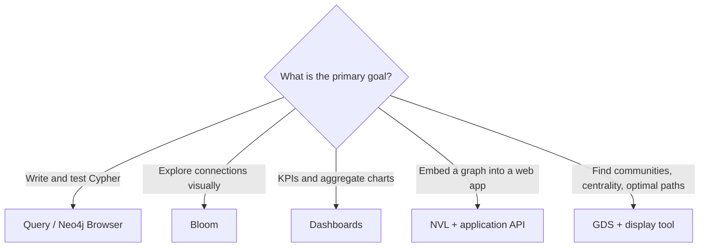
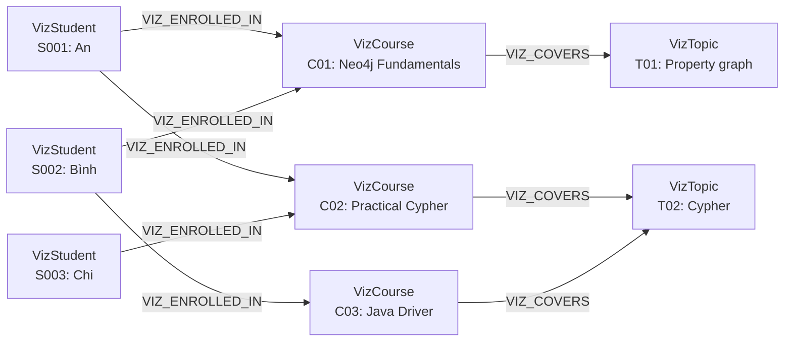
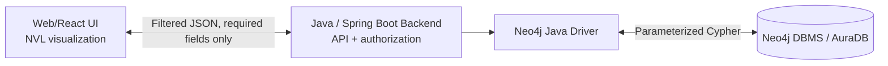

# Graph Exploration and Visualization Tools in the Neo4j Ecosystem

> **Chapter:** Developer Tools  
> **Module:** `DATABASE_ENGINE_GRAPH_NEO4J`  
> **Scope:** UI-based tools for developers, analysts, and custom applications when working with property graph data in Neo4j.

## 1. Why Are Graph Visualization Tools Needed?

Neo4j stores connected data as a **property graph**: **nodes** represent entities, **relationships** represent directed links, **labels / relationship types** describe roles, and **properties** store information for each element. Cypher helps find nodes, relationships, paths, and compute results. In an online learning system, the question "which students are taking the Neo4j course?" can be answered with a table, whereas the question "which students study shared topics and through which courses are they connected?" becomes much easier to understand when displayed as a graph.

Visualization helps learners:

- **Verify the model:** are relationships pointing in the right direction, are nodes missing, do paths make sense?
- **Explore:** start from one node, expand connections, and identify clusters or central hubs.
- **Explain business logic:** express connections through colors, labels, and concept groups familiar to users.
- **Track metrics:** display enrollment counts, node counts by label, and completion rates as tables or charts.
- **Integrate into applications:** embed an interactive graph into a web app instead of using only Neo4j admin interfaces.

However, **a visual diagram is a projection of the queried data**, not the entire database. Dragging, arranging, hiding nodes, or changing colors typically alters only the display; **edit/create/delete** operations supported in certain tools can actually write data. Distinguish these two categories when working in real environments.

This lesson uses a unified dataset to practice **Query / Neo4j Browser**, **Bloom**, and **Dashboards**, and introduces how to build custom visualizations with **Neo4j Visualization Library (NVL)**. These tools complement the other topics in this module: graph modeling, Cypher, indexes, constraints, data import, query optimization, Java Driver, Spring Data Neo4j, and graph system operations.

## 2. Map of Tools in the Neo4j Ecosystem

| Tool | Primary Users | Strongest Output | Need to Write Cypher? | Key Point to Remember |
| --- | --- | --- | --- | --- |
| **Query / Neo4j Browser** | Developers, DBAs, Cypher learners | Graph, Table, RAW, query plans | Usually **yes** | Renders nodes, relationships, or paths returned by `RETURN`. |
| **Bloom** | Analysts, business users, data explorers | Interactive graph Scenes, Perspectives, Search phrases | Not required | Searches using model semantics, expands from nodes, switches views. |
| **Dashboards** | Product owners, metrics analysts, operations teams | Tables, KPIs, bar/pie/line charts, graphs | Can write Cypher; some environments support AI creation | Each card fetches data via a query and answers a specific question. |
| **Neo4j Visualization Library (NVL)** | Frontend developers, product teams | Custom graphs inside web/React apps | Not required in the render layer; backend usually uses Cypher | JavaScript/TypeScript library that takes node/relationship data to render. |
| **Neo4j Graph Data Science (GDS)** | Data scientists, graph analytics engineers | Centrality, community, similarity, pathfinding algorithms | Yes or via GDS API | GDS **analyzes data**, not a drag-and-drop drawing tool; results can be rendered via Bloom/Query/Dashboards/NVL. |
| **BI connectors and BI tools** | Enterprise reporting teams | Aggregate charts, integrated reports | Depends on connector | Suitable when graph results need to feed into an existing BI system. |

You can choose a tool based on your question:



**Where to open the tools:**

- **Neo4j Desktop 2.x:** under **Studio**, you will find **Import, Query, Bloom, and Dashboards**. Select the **instance** and **database** before taking action.
- **Neo4j Aura Console:** open the corresponding tools within the Aura environment and select the right instance/database.
- **Neo4j Server / standalone Browser:** open Neo4j Browser via the server's corresponding endpoint/interface.
- **Custom applications:** build the frontend with NVL or another graph solution; call backend APIs to fetch data from Neo4j.

Menu names and access permissions can vary by product version, Aura tier, and organization settings. Do not assume a tool is available in every version or every account simply because it appears in documentation.

## 3. Creating a Shared Practice Dataset

To compare results across tools, we use a small graph for an online learning platform. Nodes include students, courses, and topics; the `VIZ_ENROLLED_IN` relationship connects students to courses, and `VIZ_COVERS` connects courses to topics.

### 3.1. Model



When the test database does not yet contain these sample elements, the resulting graph consists of **8 nodes** (3 students, 3 courses, 2 topics) and **8 relationships** (5 enrollments, 3 topic-coverage relationships). Some nodes will appear multiple times across paths; **the number of paths/records is not the number of nodes**.

### 3.2. Cypher to Create the Data

**Run this write block only on a test database**, never on production without authorization.

```cypher
MERGE (an:VizStudent {studentId: 'S001'})
SET an.name = 'An'
MERGE (binh:VizStudent {studentId: 'S002'})
SET binh.name = 'Bình'
MERGE (chi:VizStudent {studentId: 'S003'})
SET chi.name = 'Chi'

MERGE (neo4j:VizCourse {courseId: 'C01'})
SET neo4j.title = 'Neo4j Fundamentals'
MERGE (cypher:VizCourse {courseId: 'C02'})
SET cypher.title = 'Practical Cypher'
MERGE (java:VizCourse {courseId: 'C03'})
SET java.title = 'Java Driver'

MERGE (propertyGraph:VizTopic {topicId: 'T01'})
SET propertyGraph.title = 'Property graph'
MERGE (cypherTopic:VizTopic {topicId: 'T02'})
SET cypherTopic.title = 'Cypher'

MERGE (an)-[:VIZ_ENROLLED_IN]->(neo4j)
MERGE (an)-[:VIZ_ENROLLED_IN]->(cypher)
MERGE (binh)-[:VIZ_ENROLLED_IN]->(neo4j)
MERGE (binh)-[:VIZ_ENROLLED_IN]->(java)
MERGE (chi)-[:VIZ_ENROLLED_IN]->(cypher)

MERGE (neo4j)-[:VIZ_COVERS]->(propertyGraph)
MERGE (cypher)-[:VIZ_COVERS]->(cypherTopic)
MERGE (java)-[:VIZ_COVERS]->(cypherTopic)

RETURN 'Demo data created' AS thongBao;
```

`MERGE` checks for an existing pattern before creating, so re-running the whole block on a consistent sample dataset normally does not duplicate relationships. In real systems with concurrent writers, **uniqueness constraints** are needed to protect `studentId`, `courseId`, and `topicId`; `MERGE` alone does not guarantee uniqueness under all race conditions.

### 3.3. Checking Counts Before Visualizing

```cypher
MATCH (n)
WHERE n:VizStudent OR n:VizCourse OR n:VizTopic
RETURN count(n) AS soNodeDemo;
```

```cypher
MATCH ()-[r]->()
WHERE type(r) IN ['VIZ_ENROLLED_IN', 'VIZ_COVERS']
RETURN type(r) AS loaiQuanHe, count(r) AS soLuong
ORDER BY loaiQuanHe;
```

With a clean demo dataset, expected results are: **8 nodes**, `VIZ_COVERS = 3`, and `VIZ_ENROLLED_IN = 5`. If the numbers differ, check the active database, prior data state before creation, and any extra imports/writes.

## 4. Query / Neo4j Browser: Exploration Starting from Cypher

**Query** in Desktop/Aura and **Neo4j Browser** are interfaces centered on authoring Cypher. After each query, results can be switched between **Graph**, **Table**, and **RAW**; with `EXPLAIN` or `PROFILE`, you can also inspect **Plan**.

### 4.1. Returning Nodes and Relationships to Enable Graph Mode

```cypher
MATCH (s:VizStudent)-[e:VIZ_ENROLLED_IN]->(c:VizCourse)
RETURN s, e, c
ORDER BY s.studentId, c.courseId
LIMIT 20;
```

Select **Graph**. The UI renders nodes as circles and relationships as directed lines. With the sample dataset, this returns **5 result rows**, but course/student nodes are deduplicated in the display so fewer than 10 circles appear. Click a node or relationship to inspect properties; depending on the UI, you can drag nodes, zoom, and expand neighbors.

Or return a multi-hop `path` variable:

```cypher
MATCH p = (s:VizStudent)
          -[:VIZ_ENROLLED_IN]->(c:VizCourse)
          -[:VIZ_COVERS]->(t:VizTopic)
RETURN p
LIMIT 20;
```

These are **student → course → topic** paths. The sample result has 5 paths of length 2 relationships; the Graph view contains up to all 8 nodes and 8 relationships of this dataset if all paths are returned.

### 4.2. Why Is Only Table Visible?

Compare:

```cypher
MATCH (s:VizStudent)-[:VIZ_ENROLLED_IN]->(c:VizCourse)
RETURN s.name AS hocVien, c.title AS khoaHoc
ORDER BY hocVien, khoaHoc;
```

Although `MATCH` traverses relationships, `RETURN` yields only **two strings**; Browser/Query has no graph elements to draw connecting lines, so it displays in **Table** or **RAW**. To see a graph diagram, return nodes, relationships, or paths; simply toggling the view button cannot reconstruct edges that were never returned.

### 4.3. When to Use Each Mode?

| Mode | Suitable Data | What Can Be Learned |
| --- | --- | --- |
| **Graph** | `RETURN s, e, c` or `RETURN p` | Relationship direction, connected clusters, intermediate nodes. |
| **Table** | `RETURN s.name, c.title`, `count(...)`, `avg(...)` | Values, ordered records, aggregated data. |
| **RAW** | Need to inspect request/response structure | Data types and detailed response metadata. |
| **Plan** | `EXPLAIN` or `PROFILE` | How the DBMS finds nodes, uses indexes, and traverses relationships. |

To check whether a query uses an index:

```cypher
EXPLAIN
MATCH (s:VizStudent {studentId: 'S001'})
RETURN s.name;
```

`EXPLAIN` only plans without executing. `PROFILE` executes the query and collects statistics; therefore, **`PROFILE` on a write statement still performs the write operation**.

### 4.4. Is the Graph View the Entire Database?

No. `LIMIT`, record-count settings, and rendered node limits make the displayed set only a **subset of query results**. Expanding a node can fetch additional data. Distinguish:

- **Row count:** number of records returned by Cypher.
- **Unique node/relationship count:** number of graph elements appearing in the loaded records.
- **Total elements in the database:** must be obtained with a count query and appropriate conditions.

When a graph is dense, filter with `WHERE` and `LIMIT`, pick **one starting point**, and expand incrementally instead of pulling thousands of nodes into the browser.

## 5. Neo4j Bloom: Exploring Graphs with Perspectives and Scenes

**Bloom** is a graph exploration tool for users who want to interact using keywords, relationship patterns, colors, and Scene manipulation. In **Neo4j Desktop 2.x**, open **Bloom** from Studio; in **Aura Console**, open Bloom in the instance's toolset. Screens and features may vary by environment or tier.

### 5.1. Key Concepts

| Concept | Meaning |
| --- | --- |
| **Perspective** | A "business lens" determining which categories, relationships, properties, labels, colors, icons, and Search phrases are presented. |
| **Category** | A business entity group that can map from one or more node labels. |
| **Scene** | The canvas displaying searched or expanded elements; does not automatically hold every node in the database. |
| **Search bar** | Enter keywords, graph patterns, or Search phrases; receive suggestions based on the Perspective. |
| **Search phrase** | A friendly name representing a predefined Cypher query, optionally parameterized. |
| **Legend / Styling** | Set colors, captions, icons, sizes, and conditional display rules for categories/relationships. |
| **Inspector / Card list** | View detailed properties of selected elements to support relationship investigation. |

For example, a **"Learning" Perspective** might map:

- `VizStudent` → **Student**, blue color, caption `name`.
- `VizCourse` → **Course**, purple color, caption `title`.
- `VizTopic` → **Topic**, orange color, caption `title`.
- `VIZ_ENROLLED_IN` → **Enrolled in**.
- `VIZ_COVERS` → **Covers topic**.

Colors, category names, and captions are an **interpretation layer**; changing them in a Perspective does not alter labels/properties inside Neo4j.

**Tier limits:** AuraDB Free currently includes only the **Default Perspective**; creating additional custom Perspectives requires an eligible tier. If the button to create or edit a Perspective does not appear, check your tier/permissions rather than assuming a data error.

### 5.2. Exploration Exercise in Bloom

1. In Desktop/Aura, select the instance/database where you created the data in section 3.
2. Open **Bloom**, selecting **Default Perspective** if you do not have a custom Perspective.
3. In the **Search bar**, use the suggestion `Show me a graph` to fetch a sample graph, or search by category/pattern such as students linked to courses.
4. Select a student with caption `An`, open property details, and observe `S001`.
5. **Expand** the node to view the courses An is enrolled in; continue expanding a course to see the covered topic.
6. Use the **Legend** to distinguish the three node groups and two relationship types; depending on permissions and tier, customize colors/captions in your own Perspective.
7. Zoom out/fit-to-screen to observe how the layout adjusts as more elements are added.

Expected data outcome: **An** connects to **Neo4j Fundamentals** and **Practical Cypher**; those two courses connect further to **Property graph** and **Cypher**, respectively.

Bloom can suggest **graph patterns** based on labels, relationship types, and properties. Pick exact suggestions from the menu rather than assuming any free-form natural language sentence will translate into valid Cypher.

### 5.3. Search Phrases: Creating Understandable Entry Points for Business Users

A Search phrase can be named **"Courses of a student"** and execute parameterized Cypher such as:

```cypher
MATCH (s:VizStudent {studentId: $studentId})
      -[e:VIZ_ENROLLED_IN]->(c:VizCourse)
RETURN s, e, c;
```

In Bloom's Search phrase configuration, define the `studentId` **parameter** with the appropriate type, then pass a value such as `S001` at runtime. Specific setup is done in the Perspective UI on versions/tiers that support it. Do not expect that merely pasting Cypher into the Search bar will automatically save a Search phrase.

Beyond Search phrases, Bloom also supports graph pattern search, full-text search, and Scene control actions. Full-text search may require indexes or incur query cost, so bound expensive explorations on large graphs.

### 5.4. Do Actions in Bloom Write to the Database?

- **Pan, zoom, move/arrange, dismiss, clear Scene:** presentation actions or modifying what elements are currently visible in the Scene; they do not delete the graph in the database.
- **Expand/search:** may send additional read queries to the DBMS and bring more elements into the Scene.
- **Create/Edit/Delete node/relationship, Search phrases containing write statements:** can **modify the graph** if the account has sufficient permissions.

Note that **Clear Scene** clears the canvas and is not equivalent to `MATCH (n) DETACH DELETE n`. Conversely, deleting a node via data-editing features is a real write operation that may not be reversible with a Scene Undo button.

### 5.5. Exporting and Sharing

Bloom supports exporting **Scene images (PNG)** and other export/sharing methods depending on product, version, and permissions. Image exports are helpful for architecture diagrams or explaining a connection, but an image alone is not enough to reproduce a query. When reproducible reports are needed, also record:

- Instance/database and query timestamp.
- Perspective or styling ruleset used.
- Search phrase/graph pattern or equivalent Cypher.
- Filter criteria, limits, and input values.

Before sharing images or CSVs, check whether the image reveals personal information, internal identifiers, or sensitive attributes.

### 5.6. Note on Bloom Lifecycle

Official documentation announces that **starting January 1, 2027**, new Bloom features will focus on **Studio tools** in Aura Console, Neo4j Enterprise Studio, and Desktop; **standalone** Bloom versions will gradually stop receiving new features per the published policy. When building long-term workflows, prefer opening Bloom from Studio if your organization uses Aura/Desktop and verify product policies at deployment time.

## 6. Dashboards: From Graph to Metrics and Decisions

Sometimes the question is not "which node connects to which node?" but "how many students does each course have?" or "which course attracts the most enrollments?". **Dashboards** in Aura/Desktop let you create **cards** displaying tables, bar charts, pie charts, and other visualizations from Cypher results.

Each card has a **query** and a **presentation**. Do not use every `MATCH` returning paths to draw a bar chart; aggregate into columns with proper numeric data types.

### 6.1. Card for Enrollment Count by Course

```cypher
MATCH (s:VizStudent)-[:VIZ_ENROLLED_IN]->(c:VizCourse)
RETURN c.title AS khoaHoc,
       count(DISTINCT s) AS soHocVien
ORDER BY soHocVien DESC, khoaHoc;
```

Result on the sample dataset:

| khoaHoc | soHocVien |
| --- | ---: |
| Practical Cypher | 2 |
| Neo4j Fundamentals | 2 |
| Java Driver | 1 |

Open **Dashboards**, select the instance/database, and add a **card**. Paste the Cypher, run **Preview**, choose **Bar chart**, and map `khoaHoc` as the category label and `soHocVien` as the value. Field names in the UI may vary by version. If only a table appears, check **chart type**, column names, and the numeric type of `count(...)`.

### 6.2. KPI Card for Total Enrollments

```cypher
MATCH (:VizStudent)-[e:VIZ_ENROLLED_IN]->(:VizCourse)
RETURN count(e) AS soLuotGhiDanh;
```

The sample result is **5**. Set the card type to KPI/Number if available in your version. This is the **number of enrollment relationships**, not distinct students. If you need distinct students:

```cypher
MATCH (s:VizStudent)-[:VIZ_ENROLLED_IN]->(:VizCourse)
RETURN count(DISTINCT s) AS soHocVien;
```

The sample result is **3**. The distinction between these two numbers is critical when explaining a dashboard to decision-makers.

### 6.3. Card for Metrics by Topic

```cypher
MATCH (s:VizStudent)-[:VIZ_ENROLLED_IN]->(c:VizCourse)
      -[:VIZ_COVERS]->(t:VizTopic)
RETURN t.title AS chuDe,
       count(DISTINCT s) AS soHocVien
ORDER BY soHocVien DESC, chuDe;
```

Expect **Property graph = 2** (An, Bình) and **Cypher = 3** (An, Bình, Chi), because both courses `C02` and `C03` cover the Cypher topic. `count(DISTINCT s)` prevents counting a student multiple times when they reach the same topic through multiple courses.

### 6.4. Do Dashboards Replace Graph Exploration Tools?

Not completely. Dashboards are well suited for **periodic metric tracking**, whereas a bar chart card cannot clearly display long relationship chains or intermediate nodes. When investigating paths, open Query or Bloom on the corresponding data; when tracking metrics, use cards with aggregated Cypher.

On some Aura tiers, the number of dashboards you can create is limited. **AI-assisted dashboard creation** and online sharing also depend on platform/tier; in Desktop, you can build cards using Cypher without needing AI features. Before sharing a dashboard, note that **database access permissions** and **dashboard sharing permissions** are two different permission types.

## 7. Neo4j Visualization Library (NVL): Embedding Graphs into Applications

When a product requires a custom interactive screen—such as a "learning network diagram per student" inside a web app—do not assume you can directly customize Query or Bloom UIs to fit every requirement. **Neo4j Visualization Library (NVL)** is a TypeScript/JavaScript library for rendering custom graphs, complete with a React wrapper and interaction handlers.

### 7.1. Architecture with Proper Separation of Responsibilities



Recommended data flow:

1. Frontend sends a request to fetch student `S001`'s graph to the backend over an authenticated API.
2. Backend checks access permissions, sets element limits, and executes **parameterized Cypher** via Java Driver.
3. Backend maps nodes/relationships into clean JSON DTOs containing only fields allowed for display.
4. Frontend receives the JSON and passes it to NVL for rendering, filtering, node selection, and navigation.

**Never embed Neo4j database passwords or credentialed URIs into JavaScript shipped to the browser.** NVL is a visualization library; it does not replace a backend, access control, or transactions.

### 7.2. Installation and Simple Example

Install in a frontend project using npm:

```bash
npm install @neo4j-nvl/base
```

Illustrative TypeScript example rendering a static graph without opening a DB connection:

```typescript
import { NVL } from '@neo4j-nvl/base';

const nodes = [
  { id: 'S001', caption: 'An' },
  { id: 'C01', caption: 'Neo4j Fundamentals' },
  { id: 'T01', caption: 'Property graph' }
];

const relationships = [
  { id: 'r01', from: 'S001', to: 'C01' },
  { id: 'r02', from: 'C01', to: 'T01' }
];

const target = document.getElementById('graph');
if (!target) {
  throw new Error('Graph element not found');
}

const graph = new NVL(target, nodes, relationships);
// The graph variable can be used to update data or attach interactions
// according to the documentation of the installed NVL version.
```

The graph container element must have an explicit height. Example in HTML:

```html
<div id="graph" style="width: 100%; height: 480px;"></div>
```

If the container has zero height, the graph may be initialized without the user **seeing anything**. When moving to React, follow the wrapper's mount/unmount lifecycle conventions to avoid instantiating multiple instances on one DOM node.

### 7.3. Fetching Dynamic Data from Neo4j

A backend query can return elements with explicit application identifiers:

```cypher
MATCH (s:VizStudent {studentId: $studentId})
      -[e:VIZ_ENROLLED_IN]->(c:VizCourse)
RETURN s.studentId AS fromId,
       c.courseId AS toId,
       s.name AS studentCaption,
       c.title AS courseCaption,
       type(e) AS relationshipType
LIMIT $maxRows;
```

The backend can build the `nodes` array from `fromId/toId` (deduplicated by ID) and `relationships` from each row, assigning stable edge IDs within the **display payload**. If a pair of nodes can have multiple relationships of the same type, use a dedicated key to distinguish each edge; avoid concatenating `fromId + toId` as a global identifier without ensuring uniqueness.

Do not use Neo4j's `elementId()` as a long-lived business key: it is an internal identifier with no guarantee of stability across data/DBMS lifecycles. Define application ID properties and corresponding uniqueness constraints instead.

### 7.4. When to Choose NVL?

NVL fits well when you need:

- A UI matching custom branding and proprietary business workflows.
- Clicking a node to open a student/course profile.
- Integration with the application's own filters, search, forms, APIs, and user permissions.
- Control over payload size, paginated exploration, caching, and UI event logging.

In return, the development team must build **the backend, security, accessibility, error handling, and performance optimizations**. For quick analysis, Query/Bloom/Dashboards usually save implementation effort.

## 8. Graph Data Science and Visualizing Algorithm Results

**Graph Data Science (GDS)** provides graph algorithms, such as computing **centrality**, **community detection**, **similarity**, and **pathfinding**. It is not a default graph canvas; you need to pair algorithm results with a visualization tool.

Example scenario: finding the course connected to the most students. On a small graph, aggregate Cypher suffices:

```cypher
MATCH (:VizStudent)-[e:VIZ_ENROLLED_IN]->(c:VizCourse)
RETURN c.courseId AS maKhoaHoc,
       c.title AS khoaHoc,
       count(e) AS bacKetNoi
ORDER BY bacKetNoi DESC, maKhoaHoc;
```

On large graphs, more complex analyses can use GDS to compute centrality or communities in a graph projection. Results can then be:

- **Streamed** as a table and sent to Dashboards.
- **Written** back as analytical properties on the graph when authorized and intentional, then styled with **Bloom styling** by score or community.
- Returned as JSON to a frontend to adjust node colors/sizes via NVL.

A large node or darker color **only truly represents an algorithm score** if there is an explicit score-mapping rule. Never assume "a node in the middle of the diagram = the most important node", because layout algorithms exist purely for visual arrangement.

GDS permissions, versions, and procedure syntax depend on the installed Neo4j/GDS version. Always verify against the exact version's documentation before using in production.

## 9. Rules for Meaningful Graphs and Avoiding Misinterpretation

### 9.1. Choosing Consistent Captions and Colors

| Element Type | Suggested Caption | Suggested Color/Style | Reason |
| --- | --- | --- | --- |
| `VizStudent` | `name`, with `studentId` in detail view | Dedicated color | Easy to spot learners while keeping IDs to distinguish duplicate names. |
| `VizCourse` | `title` | Different color from students | Easy to recognize hubs where many relationships converge. |
| `VizTopic` | `title` | Third color | Keeps the topic layer visually distinct. |
| `VIZ_ENROLLED_IN` | Label "enrolled in" | Arrow from student to course | Relationship direction expresses business semantics. |
| `VIZ_COVERS` | Label "covers" | Arrow from course to topic | Shows how to read path chains. |

Captions are not unique keys. If two students share the name "An", the `studentId` property is required to distinguish them. Colors can be hard to distinguish for color-vision-deficient users; combine **labels, icons, and contrast** rather than relying solely on color.

### 9.2. Never Confuse "On-Screen Size" with "Data Magnitude"

- **Node size** by degree/centrality must be tied to a concrete metric.
- **Edge width** by transaction count or weight must have a legend; otherwise viewers may mistake it for multiple relationships.
- **Layout** changes with node positions, layout algorithms, and canvas dimensions; pixel distance does not necessarily represent business distance.
- **Relationship direction** should be shown with arrows or legends, especially in graphs with multiple edge types.
- **Time axes** and **geography** should use appropriate chart types when a pure graph fails to clarify trends.

### 9.3. Avoiding Overload on Large Graphs

A query like:

```cypher
MATCH (n)
RETURN n;
```

can pull too many nodes to the client, freeze the UI, and lack context. Replace it with a query that has **a starting point, relationship type, limit, and business criteria**:

```cypher
MATCH (s:VizStudent {studentId: $studentId})
      -[e:VIZ_ENROLLED_IN]->(c:VizCourse)
RETURN s, e, c
ORDER BY c.courseId
LIMIT 20;
```

If you frequently look up by `studentId`, consider an index or uniqueness constraint on that property. Use `EXPLAIN`/`PROFILE` on read queries over large data to inspect lookup and traversal behavior. **Server query cost** and **client rendering cost** are two separate concerns: a query can be fast while a graph of thousands of nodes remains unwieldy to interact with.

## 10. Security, Access Control, and Sharing Visuals

A graph tool can expose properties about users, transactions, contacts, or internal IDs. Therefore:

1. Use a **Neo4j account with appropriate permissions**, preferring read-only when the goal is exploration.
2. Never put passwords/tokens into screenshots, shared notes, embedded URLs, or frontend source code.
3. In Bloom, distinguish **Clear Scene/Dismiss** from **Delete**; real Edit/Delete actions can modify the DB.
4. When exporting PNG/CSV or sharing Scenes/Dashboards, check for sensitive properties, data scope, and recipient permissions.
5. With NVL, the backend must verify identity and **filter fields/records by permissions**, avoiding returning the entire property graph to every frontend.
6. When using production data for illustrations, choose anonymized data or fixtures; never move real data into external tools without authorization.

For reproducible reports, save the **Cypher, parameters, database, timestamp, filter criteria, and schema version** alongside the image; a picture alone is insufficient to verify how metrics were computed.

## 11. Comparison Through a Real-World Scenario

**Scenario:** a learning manager wants to know which course has the most enrollments and investigate why the Cypher topic has many students.

| Question / Action | Recommended Tool | Expected Output on Sample Dataset |
| --- | --- | --- |
| Write and test the `MATCH` query | Query/Browser | Table of 5 enrollment rows. |
| See which two courses and two topics An connects to | Bloom or Query Graph | Two paths from An through courses to topics. |
| See which students both enrolled in Neo4j | Bloom / graph query | An and Bình both connect to `C01`. |
| See student counts per course | Dashboards | `C01 = 2`, `C02 = 2`, `C03 = 1`. |
| Explain why the Cypher topic has many students | Query + Dashboard | `T02 = 3` distinct students, via two courses `C02` and `C03`. |
| Embed a "View learning network" button on the web | NVL + Java/Spring backend | Interactive graph with navigation and per-user authorization. |
| Rank important nodes on a large graph | GDS + Query/Bloom/NVL | Scores computed and displayed according to clear rules. |

The common thread of this workflow is that **data and queries must be accurate** before the UI looks polished. On the same graph, charts can describe different levels: `count(e)` counts relationship edges, `count(DISTINCT s)` counts unique students, while the Graph diagram primarily conveys **connection structure**.

## 12. Common Pitfalls in Graph Exploration and Visualization

| Symptom | Common Cause | How to Check |
| --- | --- | --- |
| Query shows only Table, no Graph | `RETURN` contains only scalars/strings | Also return `node`, `relationship`, or `path`. |
| Graph has nodes but no connecting edges | Only nodes returned or query did not return relationships | Use `RETURN s, e, c` or `RETURN p`. |
| Bloom does not show newly created label/course | Wrong database selected, Perspective does not include new category, Scene not refreshed | Check connection, database, Default Perspective, and Refresh/Explore. |
| Cannot create a custom Perspective | Tier limit or missing permissions | Check Aura tier and account permissions. |
| Empty Scene after Clear Scene | Canvas was cleared | Search again; data is likely still intact in the DB. |
| Dashboard bar chart empty/wrong labels | Query returns wrong types, wrong aliases, or missing column mapping | Run Cypher in Query, check text/number columns and Preview. |
| Dashboard miscounts students | Used `count(*)`/`count(e)` when unique count was needed | Use `count(DISTINCT s)` if distinct learners are required. |
| NVL renders a blank canvas | Container has no height, missing node IDs, or JS error | Check element dimensions, nodes/relationships arrays, and app console. |
| UI data differs from report data | Different instance/database, filter/`LIMIT`, cache, execution time | Explicitly record URI/database/parameters, compare queries, and refresh results. |
| Graph responds slowly | Returning too many nodes/relationships, expensive query or rendering | Add `WHERE`/`LIMIT`, appropriate indexes, and narrow the exploration scope. |
| Cannot edit nodes from Bloom | Read-only account, missing permissions, or UI/tier restriction | Verify permissions; do not escalate privileges just for exploration. |
| Java/Spring connects fine but NVL frontend shows no data | Backend JSON does not match schema or endpoint returns 403/0 rows | Inspect API response, DTOs, authorization, and ID mapping. |

To separate query bugs from display bugs, run a **count** query directly on the selected database:

```cypher
MATCH (n:VizStudent)
RETURN count(n) AS soHocVien;
```

If it returns `0`, first verify the data and database; if it returns `3` while Bloom shows nothing, focus on checking Bloom's Perspective, Search, Scene, and filters.

## 13. Self-Check Practice Exercises

Use a **test database** and the `VizStudent`/`VizCourse`/`VizTopic` dataset from section 3.

**Exercise 1 — Initialization.** Run the Cypher to create sample data; verify there are **8 nodes**, **5 `VIZ_ENROLLED_IN`**, and **3 `VIZ_COVERS`**. Explain the difference between node count and relationship count.

**Exercise 2 — Graph in Query.** Return `RETURN p` with pattern `Student → Course → Topic`. Observe **5 paths**; explain why there are only **8 unique nodes** even though several nodes repeat across paths.

**Exercise 3 — Table in Query.** Return `s.name` and `c.title`, sorted by student then course. Try enabling Graph and explain why there are no nodes/relationships to render.

**Exercise 4 — Bloom.** Open Default Perspective, use the Search bar to find student `An`, expand across `VIZ_ENROLLED_IN` to courses, and continue to topics. Observe the difference between **Dismiss/Clear Scene** and **data deletion**.

**Exercise 5 — Choosing Captions.** If your version/tier supports custom Perspectives, configure caption `name` for students and `title` for courses; explain why `studentId` is still needed as the business ID.

**Exercise 6 — Dashboard.** Create two cards: `count(e) = 5` enrollments and a bar chart of students per course `2, 2, 1`. Add a third card for unique students `3` and compare the three metrics.

**Exercise 7 — Cypher Topic.** Use `count(DISTINCT s)` across `VIZ_COVERS` to compute students per topic. Prove **Property graph = 2** and **Cypher = 3** from the paths.

**Exercise 8 — NVL.** Use the static node/relationship data from section 7.2 to render a graph in your test page, ensuring the container has a height. Outline a Java/Spring API returning JSON with fields `id, from, to, caption` without exposing the database password.

**Exercise 9 — Performance.** Compare a graph expansion query with `LIMIT 20` against an unbounded query on a small dataset; explain why production queries with millions of relationships need a starting point and a bound.

### Controlled Demo Data Cleanup

Only act in a test database and inspect nodes before deleting:

```cypher
MATCH (n)
WHERE (n:VizStudent AND n.studentId IN ['S001', 'S002', 'S003'])
   OR (n:VizCourse AND n.courseId IN ['C01', 'C02', 'C03'])
   OR (n:VizTopic AND n.topicId IN ['T01', 'T02'])
RETURN labels(n) AS nhan, properties(n) AS thuocTinh
ORDER BY nhan;
```

Once you confirm this dataset is strictly for the lesson and **deliberately want to delete it**, run:

```cypher
MATCH (n)
WHERE (n:VizStudent AND n.studentId IN ['S001', 'S002', 'S003'])
   OR (n:VizCourse AND n.courseId IN ['C01', 'C02', 'C03'])
   OR (n:VizTopic AND n.topicId IN ['T01', 'T02'])
DETACH DELETE n;
```

`DETACH DELETE` deletes nodes and **every relationship attached to those nodes**. If you connected demo nodes to other data, those extra links will also be deleted. Therefore, do not run this example on a shared database without verifying its impact.

## 14. Key Takeaways

- **Query/Browser** is suited for testing Cypher, Graph/Table/RAW views, and query plans; to show Graph view, return nodes/relationships/paths.
- **Bloom** is suited for exploring connected networks via Perspectives, Search bar, and Scenes; a Scene is the set of currently displayed elements, **not the entire database**.
- **Dashboards** are suited for answering metric questions with cards; choose the right aggregation, especially distinguishing `count(e)` from `count(DISTINCT s)`.
- **NVL** is suited for custom web apps; serve graph data through an authenticated and authorized Java/Spring backend.
- **GDS** produces graph analytics outputs; pair it with a visualization tool and interpret colors/sizes accurately.
- **Limiting displayed data** and **query accuracy** matter more than how many nodes are drawn on screen.
- When using remote instances or production environments, verify **URI, database, account, and permissions**, and carefully distinguish Scene arrangement from actual write/delete operations.

## 15. Official References

- [Neo4j — Data visualization: overview of tools](https://neo4j.com/docs/visualize/)
- [Neo4j Browser — Result frames](https://neo4j.com/docs/browser/operations/result-frames/)
- [Neo4j Desktop — Query](https://neo4j.com/docs/desktop/current/query/)
- [Neo4j Desktop — Bloom](https://neo4j.com/docs/desktop/current/explore/)
- [Neo4j Desktop — Dashboards](https://neo4j.com/docs/desktop/current/dashboards/)
- [Neo4j Aura — Bloom](https://neo4j.com/docs/aura/explore/introduction/)
- [Neo4j Aura — Perspectives](https://neo4j.com/docs/aura/explore/explore-perspectives/perspectives/)
- [Neo4j Aura — Search bar and Search phrases](https://neo4j.com/docs/aura/explore/explore-visual-tour/search-bar/)
- [Neo4j Aura — Dashboards](https://neo4j.com/docs/aura/dashboards/)
- [Neo4j Aura — Dashboard visualizations](https://neo4j.com/docs/aura/dashboards/visualizations/)
- [Neo4j Visualization Library (NVL)](https://neo4j.com/docs/nvl/current/)
- [Neo4j NVL — Installation and usage](https://neo4j.com/docs/nvl/current/installation/)
- [Neo4j Bloom — Standalone lifecycle changes starting 2027](https://neo4j.com/docs/bloom-user-guide/current/deprecation/)
- [Neo4j Graph Data Science — Documentation](https://neo4j.com/docs/graph-data-science/current/)

> **Version Note:** tool names and tier capabilities vary between Neo4j Desktop, Aura, and standalone editions. Exercises use mock data; before applying to a real system, check the documentation for the running product version and current account permissions.
