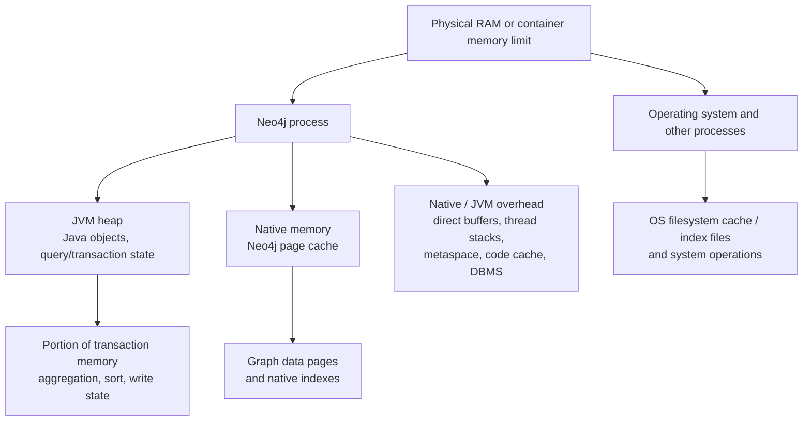
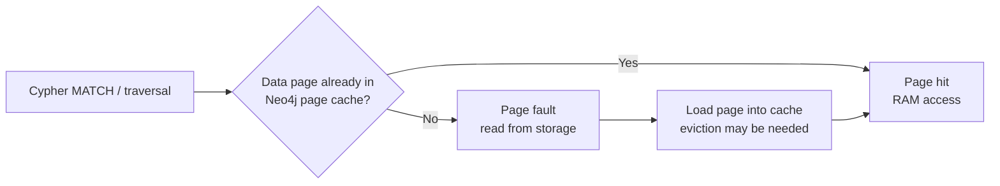

# Relationship Between Heap, Page Cache, Transaction Memory, and OS Memory in Neo4j

A Neo4j server with **32 GiB RAM** does not mean you can configure **16 GiB JVM heap + 16 GiB page cache** and assume you are using resources optimally. Beyond those two regions, the Neo4j process and the operating system also need memory for thread stacks, JVM metaspace, network buffers, indexes, native libraries, background processes, and I/O operations. Without reserving headroom, a container can be OOM-killed or the OS may start swapping even when the Java heap is not full.

Conversely, allocating too little heap causes `collect()`, `ORDER BY`, variable-length paths, or large write batches to hit GC pressure and transaction memory limits; allocating too little page cache forces Neo4j to read graph/index data from disk more frequently.

This lesson belongs to the **Resource Configuration** chapter of the `DATABASE_ENGINE_GRAPH_NEO4J` module: using Neo4j to model property graphs, query nodes/relationships/paths with Cypher, optimize indexes/constraints, import data, and operate from Java Driver/Spring Data Neo4j. The goal is to understand the **relationship between heap, page cache, transaction memory, and OS RAM**, establish an initial memory budget, measure the right signals, and apply verified configuration changes.

> **Key principle:** **transaction memory typically resides inside the heap**, not as an independent block of RAM that must be added in full on top of `heap + page cache`. However, part of transaction execution can use off-heap memory; therefore, you still need to reserve room for native memory and the operating system. There is no fixed RAM percentage formula that is optimal for every workload.

## 1. Memory Map of a Neo4j Server

Neo4j is a JVM process, but **not all RAM used by Neo4j lives inside the JVM heap**.



Four common concepts:

| Concept | Primary Location | Typical Contents | Configuration Keys |
| --- | --- | --- | --- |
| **JVM heap** | Memory inside the JVM, managed by the garbage collector | Java objects, query/transaction state, runtime structures, query cache | `server.memory.heap.initial_size`, `server.memory.heap.max_size` |
| **Neo4j page cache** | Native/off-heap memory managed by Neo4j | Graph data pages and native index structures, avoiding repeated disk reads | `server.memory.pagecache.size` |
| **Transaction memory** | **Primarily allocated within the heap**, with possible off-heap portions | Intermediate results, sorts, aggregations, uncommitted changes; query-dependent | `dbms.memory.transaction.total.max`, `db.memory.transaction.total.max`, `db.memory.transaction.max` |
| **OS and other off-heap memory** | Operating system and native process regions | Thread stacks, metaspace, network buffers, filesystem cache, certain search/vector indexes, and background processes | **Reserved via total budget**, no single Neo4j key |

These regions have a **containment relationship**. For example, a transaction currently using 200 MiB of heap does not mean it has consumed an additional 200 MiB *outside* the maximum heap size. A transaction memory limit is a **tracked consumption cap**, not a command asking the OS to pre-allocate a separate physical RAM region.

Similarly, the **Neo4j page cache** and the **Linux filesystem page cache** are two distinct mechanisms; do not treat similar-sounding names as the same region that can be arbitrarily added or subtracted.

## 2. JVM Heap: Where Objects and Intermediate Results Live

### 2.1. What Work Does the Heap Serve?

A Cypher query typically passes through multiple operators: finding nodes via an index, expanding relationships, filtering, joining rows, aggregating, sorting, and returning results. Part of that state is held in the Java heap.

For example:

```cypher
MATCH (p:Person)-[:BOUGHT]->(o:Order)
WITH p, collect(o) AS allOrders
RETURN p.customerId AS customerId,
       allOrders;
```

If a customer has hundreds of thousands of orders, the `allOrders` list and intermediate results can put pressure on transaction memory. A larger heap can help absorb higher load, but **it cannot fix** a query that collects unbounded results.

The heap is managed by **garbage collection (GC)**. When many objects are allocated and held for a long time, Neo4j may spend more CPU/time on GC; query latency increases even if application-side CPU is not busy.

### 2.2. Two Heap Settings

In `neo4j.conf` for current Neo4j versions:

```properties
server.memory.heap.initial_size=8G
server.memory.heap.max_size=8G
```

- `initial_size` corresponds to the initial heap size (conceptually equivalent to `-Xms`).
- `max_size` caps the maximum heap size (conceptually equivalent to `-Xmx`).
- Neo4j recommends **setting both values equal** to reduce the risk of unwanted GC pauses when resizing the heap.
- These two values are process settings, **not** the memory limit for the entire container/host.

Do not conclude that "larger heap is always better": increasing the heap within a fixed RAM budget usually takes memory away from the page cache or OS. An overly large heap can also make GC management more complex; what matters is observing post-GC usage, pause frequency and duration, concurrent queries, and the data model.

### 2.3. The Heap Does Not Hold the Entire Graph

Millions of nodes/relationships typically reside on disk in store files. When a query needs to access them, Neo4j uses the page cache to keep the **actively needed data pages** in RAM. Therefore, **you do not need a heap large enough to hold the entire graph**.

For example, for a graph with 80 GiB of data files and native indexes, a server with an 8 GiB heap can still operate normally if the page cache, storage speed, and workload are appropriately designed.

## 3. Page Cache: Reducing Disk Read/Write Operations

The Neo4j page cache is a native memory region used to hold pages of graph data and native indexes. When a query needs a page:

1. If the page is already in the cache: **page cache hit**, it can be used without reading from disk again.
2. If not present: **page cache fault**, the system must bring the required page into the cache.
3. If the cache is full, it may need to **evict** another page; writing dirty pages and checkpointing also involve I/O.



Setting the page cache:

```properties
server.memory.pagecache.size=18G
```

This does **not** require every page of every database/index to reside in RAM simultaneously. Neo4j prioritizes keeping recently or frequently accessed data through its cache management mechanism.

### 3.1. When Does Increasing the Page Cache Help?

- Repeated queries spanning large portions of data with high page cache faults and high disk I/O.
- Frequently accessed graph data and native indexes can fit in the cache after increasing the allocation.
- Graphs with heavy traversal workloads: each hop needs to read node records, relationship records, and related structures.

However, if the workload mainly operates within a small working set that is already cached, increasing the page cache from 18 GiB to 24 GiB may **not significantly improve** results.

### 3.2. Not Every Index Lives in the Neo4j Page Cache

Certain search indexes such as Lucene/full-text, and especially vector index structures, may use **OS memory and different mechanisms**, rather than simply fitting inside `server.memory.pagecache.size`. Neo4j operations documentation notes that sufficient OS memory must be reserved for vector indexes to perform well. Therefore, when using full-text/vector search, do not allocate all spare RAM to the page cache.

**Rule:** when estimating the size of stores, native indexes, and search indexes, classify them according to the actual mechanism of the **Neo4j version you are running**, rather than summing all index files and treating the page cache as the sole container for every index.

### 3.3. The Page Cache Can Be Cold at Startup

Right after a restart, the page cache may not yet hold frequently used pages; page faults/I/O may spike temporarily as the cache warms up. Therefore, do not use the first few minutes after a restart as final proof that the page cache is too small.

Some versions/editions include a **page cache warmup** feature; check support conditions and options for your deployed release. Do not use warmup as a substitute for a reasonable RAM budget.

## 4. Where Does Transaction Memory Fit in the Budget?

Transaction memory is the amount of memory Neo4j needs to process running transactions: holding uncommitted changes, intermediate results, filtering/sorting/aggregation structures, and graph traversal state. It is **not** a fixed memory pool permanently sized to the limit setting.

For example, on the same database:

```cypher
// Intermediate state can grow when the number of relationships is large
MATCH (u:User)-[:VIEWED]->(p:Product)
WITH u, collect(DISTINCT p) AS viewed
RETURN u.userId AS userId, viewed;
```

and:

```cypher
// Return a count instead of materializing a list of nodes
MATCH (u:User)-[:VIEWED]->(p:Product)
RETURN u.userId AS userId,
       count(DISTINCT p) AS viewedCount;
```

The two queries return **different information**, but the second one typically requires holding far less output state because it does not materialize a large node list. Queries with many paths, `ORDER BY` over large row sets, `collect(path)`, and overly wide `UNWIND` batches can all drive transaction memory high.

**Transaction memory primarily belongs to the heap and may have an off-heap component.** Transaction memory limits are generally based on **allocation estimation and tracking**, not an exact byte-by-byte measurement of every object. Neo4j can terminate a transaction when it exceeds the limit to protect the process, though staying under the limit does not guarantee the process can never run out of RAM.

### 4.1. Three Tiers of Limits

Current settings:

| Setting | Scope | Purpose |
| --- | --- | --- |
| `dbms.memory.transaction.total.max` | **Entire Neo4j DBMS** | Total memory of running transactions across the server |
| `db.memory.transaction.total.max` | **Single database** | Total transaction consumption within that database |
| `db.memory.transaction.max` | **Single transaction** | Prevents an individual query/transaction from consuming excessive memory |

According to current Neo4j documentation, the default for **DBMS global transaction total** is derived from the heap limit (the docs mention 70% of heap), while per-database total and per-transaction may default to `0`, meaning no additional per-tier limit is enforced at that layer. **Always verify with `SHOW SETTINGS` on the specific server**, as versions/editions may differ.

An illustrative constraint example:

```properties
dbms.memory.transaction.total.max=4G
db.memory.transaction.total.max=3G
db.memory.transaction.max=512M
```

Meaning:

- A single transaction exceeding roughly `512M` according to Neo4j's tracker can be terminated.
- The sum of multiple transactions in a single database is capped at `3G`.
- Total transactions across the entire server are capped at `4G`.
- If databases A and B are both active, the two per-database limits are not a guarantee that "each database always gets 3 GiB dedicated." They still **compete for the global budget and heap**.

**Do not add `4G + 3G + 512M` onto `heap` to calculate how much RAM to buy.** These are overlapping consumption caps, not three separate memory regions sitting next to the heap.

### 4.2. Concurrency Example

Suppose each transaction consumes about **300 MiB** of tracked memory:

| Concurrent Transactions in One Database | Approximate Total | Compared to 3 GiB Limit |
| ---: | ---: | --- |
| 4 | 1,200 MiB | Below |
| 8 | 2,400 MiB | Below |
| 12 | 3,600 MiB | **Above**, may hit limit |

Each individual transaction is under `512M`, yet 12 concurrent transactions can exceed the database limit. This explains why a query runs fine in isolation but gets terminated when running concurrently with many other requests.

This is **illustrative arithmetic**, not an exact memory prediction: actual footprint varies with data, query plan, result width, retained records, and client latency.

### 4.3. Rejections Due to Conservative Estimation

Neo4j notes that transaction memory tracking uses estimation that can be conservative, especially when many paths share nodes/relationships or when `UNWIND` iterates over a very large list. A limit may be reached before actual heap usage reaches what you might expect.

Do not resolve this by **setting all limits to 0** in production. Inspect the query, plan, and measurements first to see if you can reduce `collect()`, batch size, traversal depth, or concurrency; only adjust limits in a controlled environment with sound technical justification.

## 5. OS Memory and Native Overhead: The RAM You Must Not Forget

When Neo4j runs, beyond the JVM heap and page cache, RAM is also used for:

- **JVM metaspace and code cache:** class metadata, JIT-compiled code.
- **Thread stacks:** each thread has its own stack; many connections/workers can add up.
- **Network/direct buffers:** Bolt and I/O operations.
- **Neo4j native DBMS/database overhead:** additional caches and allocators.
- **OS filesystem cache:** files and indexes can use the operating system's caching layer.
- **OS and monitoring services:** kernel, agents, exporters, and other co-located processes on the same host.
- **Search/vector index structures:** must be budgeted according to the specific features and version.

A 32 GiB machine cannot safely allocate 24 GiB heap and 8 GiB page cache at the same time while **leaving 0 for OS/native**. That configuration ignores off-heap costs and can lead to swapping or an OOM kill.

On a dedicated Linux host for Neo4j, documentation recommends reserving OS headroom and avoiding swap where appropriate; however, the **exact GiB amount** depends on total RAM, index count, workload, JVM, containerization, and co-located software. Do not blindly apply a single "10% OS rule" to every machine.

### 5.1. OS Cache Differs from Neo4j Page Cache

If Linux reports high memory in the cache column, do not assume Neo4j's page cache is over-allocating. The OS uses free RAM for filesystem caching; part of that cache can be reclaimed when needed. Distinguish between:

- `server.memory.pagecache.size`: the budget for **Neo4j page cache**.
- **Heap used/committed/max**: different memory states inside the JVM.
- **RSS / cgroup memory.current**: process/container memory usage as tracked by the OS.
- **buff/cache and MemAvailable**: Linux host metrics; their meaning depends on OS and container accounting.

Do not rely on a **single** "used memory" figure on a dashboard to conclude that heap is insufficient or page cache is too large.

## 6. RAM Budgeting Formula Without Double Counting

For a rough initial model:

\[
M_{\text{available}} \gtrsim
M_{\text{heap max}}+
M_{\text{page cache}}+
M_{\text{off-heap native/JVM}}+
M_{\text{OS and shared processes}}
\]

This is a **budgeting inequality**, not an exact formula for RSS at any given instant. Some regions are allocated on demand, and OS memory reporting can overlap.

In particular, **do not write**:

\[
M_{\text{available}} =
M_{\text{heap}} + M_{\text{page cache}} +
M_{\text{transaction limit}} + M_{\text{OS}}
\]

if you are assuming transaction memory is entirely **extra memory outside the heap**. Doing so **double-counts** on-heap transaction memory and produces a flawed capacity model.

### 6.1. Example Machine/Container with a 32 GiB Limit

Suppose the workload is traversal-heavy with moderate concurrency. An **experimental starting point**, not a universal recommendation:

| Component | Illustrative Budget |
| --- | ---: |
| JVM heap max | **8 GiB** |
| Neo4j page cache | **18 GiB** |
| Remainder for OS, JVM native/off-heap, and other overhead | **6 GiB** |
| **Total** | **32 GiB** |

Sanity check:

```text
32 GiB total limit
- 8 GiB heap
- 18 GiB page cache
= 6 GiB not hard-allocated to those two regions
```

**This 6 GiB is not "transaction memory."** On-heap transactions use part of the 8 GiB heap; off-heap portions and other activities draw from the reserved headroom.

If the workload includes many large `collect()` operations or batch imports requiring substantial query state, you may need to **increase heap and reduce page cache**. If the workload is mostly graph reads with lean queries and high page faults, you may need a larger page cache — provided it does not starve OS/native memory. Decisions should come from **actual measurements**, not just the total node count in the graph.

### 6.2. When Does the 32 GiB Example Not Fit?

- Large vector indexes requiring extra OS memory.
- Multiple databases within the same DBMS, each adding overhead/cache.
- Plugins/APOC/GDS or native workloads using substantial RAM.
- Multiple application processes running on the same host.
- Host/container effective memory limit smaller than 32 GiB.
- Hot graph data + native indexes exceeding 18 GiB, causing heavy disk load.
- High query concurrency where heap/transaction limits are too low.

Each of these factors may require **redesigning the proportions**, not just adding 1–2 GiB by guesswork.

## 7. The neo4j.conf File: A Consistent Illustrative Configuration

A reference configuration **for a test machine/container with a 32 GiB memory limit**:

```properties
# JVM heap (on-heap)
server.memory.heap.initial_size=8G
server.memory.heap.max_size=8G

# Neo4j native page cache
server.memory.pagecache.size=18G

# Tracked memory consumption limits for transactions
# Do not add these values to the 8G + 18G sum.
dbms.memory.transaction.total.max=4G
db.memory.transaction.total.max=3G
db.memory.transaction.max=512M
```

Heap/page cache settings generally require planning a **restart** to take effect; several transaction memory settings are marked **Dynamic** by Neo4j and can be changed at runtime via the appropriate configuration mechanism.

**Do not treat every runtime change as permanent**: Neo4j documentation notes that dynamic runtime-only changes can be lost on restart; update configuration files/Helm values/infrastructure-as-code and apply them across each cluster member following your change procedure. Also avoid configuring settings based on Neo4j 4.x names without checking Upgrade/Migration notes; many setting names changed in Neo4j 5.

### 7.1. Inspecting Running Server Configuration

The following commands are **read-only** and do not modify the database:

```cypher
SHOW SETTINGS
YIELD name, value
WHERE name IN [
  'server.memory.heap.initial_size',
  'server.memory.heap.max_size',
  'server.memory.pagecache.size',
  'dbms.memory.transaction.total.max',
  'db.memory.transaction.total.max',
  'db.memory.transaction.max'
]
RETURN name, value
ORDER BY name;
```

Some versions/editions have privilege restrictions on `SHOW SETTINGS` or differing column names; check documentation and server permissions. What matters is **reading the actual active values**, not just looking at `neo4j.conf` in a deployment directory.

To inspect the memory pools used by the Neo4j process, you can run:

```cypher
CALL dbms.listPools();
```

This procedure provides memory pool information depending on server/edition support; it may require specific privileges. The figures are a **runtime snapshot**, and column names can vary across versions.

## 8. Choosing Initial Values with memory-recommendation

Rather than picking ratios at random, Neo4j provides a built-in tool:

```bash
bin/neo4j-admin server memory-recommendation --memory=32g
```

The tool generates **starting recommendations** for heap and page cache; with appropriate options it can also report total sizes of existing store/index files.

If configuring Docker, you can output environment variable format:

```bash
bin/neo4j-admin server memory-recommendation --memory=32g --docker
```

Notes:

- Run with the exact Neo4j version and the **actual RAM budget of the process/container**, not the host's total RAM if the container is smaller.
- The output is not automatically optimal for every query; measure GC, page faults, concurrent transactions, and real workloads.
- When a database uses many native indexes, account for frequently accessed data/indexes, not just the node store file size.
- For Lucene/full-text/vector indexes, account for OS memory instead of stuffing every file into the page cache.
- Factor in data growth, backup/restore, index rebuilds, and headroom for large import bursts.

**Picking numbers from the tool is the starting point, not the end of capacity planning.**

## 9. Docker and Kubernetes: The Memory Limit Is the Effective Budget

### 9.1. Docker: Environment Variable Names Differ from Config Keys

In containers, Neo4j converts dots `.` to underscores and original underscores `_` to double underscores `__` in environment variable names. For example:

| neo4j.conf | Docker env |
| --- | --- |
| `server.memory.heap.initial_size` | `NEO4J_server_memory_heap_initial__size` |
| `server.memory.heap.max_size` | `NEO4J_server_memory_heap_max__size` |
| `server.memory.pagecache.size` | `NEO4J_server_memory_pagecache_size` |
| `dbms.memory.transaction.total.max` | `NEO4J_dbms_memory_transaction_total_max` |

An illustrative Compose example with memory limits, **excluding production settings such as secrets, volumes, TLS, or networking**:

```yaml
services:
  neo4j:
    image: neo4j:5
    mem_limit: 32g
    environment:
      NEO4J_server_memory_heap_initial__size: "8G"
      NEO4J_server_memory_heap_max__size: "8G"
      NEO4J_server_memory_pagecache_size: "18G"
```

The `neo4j:5` tag is **illustrative only**; do not use floating tags in CI/CD or production where reproducibility is required—choose a verified image tag matching your actual server version. When deploying, include proper data volumes, credentials, and restart policies.

A common mistake: the host has 64 GiB RAM, but the container is given `--memory=16g`. Configuring `heap=8G` and `pagecache=18G` will not fit because their sum **already exceeds the container limit**, even though the host has plenty of RAM.

### 9.2. Kubernetes: Requests Differ from Limits

In Kubernetes, `resources.requests.memory` is used for scheduling, while `resources.limits.memory` is the threshold enforced on the container. If memory usage exceeds the limit, **`OOMKilled`** can occur at the container level **without any Java `OutOfMemoryError` appearing beforehand**.

With the Neo4j Helm chart, an outline configuration for 32 GiB:

```yaml
neo4j:
  resources:
    cpu: "4"
    memory: "32Gi"

config:
  server.memory.heap.initial_size: "8G"
  server.memory.heap.max_size: "8G"
  server.memory.pagecache.size: "18G"
```

This snippet illustrates the documented Neo4j Helm chart syntax and is **not a standalone Kubernetes manifest**. Check the chart version you are running, as values structure and supported limits may change.

If a container is `OOMKilled`, increasing `-Xmx` often **makes the situation worse** by taking even more RAM from native/OS space. First examine the container memory limit, `heap + page cache + headroom`, and actual container metrics.

## 10. Relationship Between Cypher Query Patterns and RAM Demand

No single heap/page cache split fits every query pattern. For example:

| Workload | Where Pressure Builds | Signals to Watch | Priority Remediation |
| --- | --- | --- | --- |
| Repeated node/relationship lookups | Page cache / storage I/O | Page faults, hit ratio, disk latency | Proper indexes, more page cache if hot set doesn't fit |
| Very large `collect()` | Heap and transaction memory | Allocated heap, GC, transaction limits | Avoid collecting when only counts are needed; bound lists |
| `ORDER BY` on millions of results | Heap and transaction state | Sort/Top operator, Rows/DB Hits, GC | Top-k, indexes, reduce rows before sorting |
| Variable-length traversals/paths | Both page cache and query state | Page faults, cardinality, transaction memory | `maxDepth`/bounded patterns, early filtering |
| Very large `UNWIND` batch imports | Transaction state, heap; page cache writes | Memory errors, commit latency, GC | Smaller batches, index on `MERGE` key, cap concurrency |
| Full-text/vector search | OS memory, indexes/cache; also query state | OS/cgroup memory, index behavior, latency | Reserve OS headroom, measure per index/feature |
| Hundreds of concurrent Java Driver requests | Heap, transaction memory, network buffers | Pool usage, active transactions, GC | Limit concurrency, page size, timeouts |

Example of an API that does not need to return full nodes:

```cypher
// Wide output, easily causes the application to build large payloads
MATCH (p:Person)-[:PURCHASED]->(o:Order)
RETURN p, collect(o) AS orders;
```

```cypher
// If the business logic only needs the order count, reduce output state
MATCH (p:Person)-[:PURCHASED]->(o:Order)
RETURN p.customerId AS customerId,
       count(o) AS orderCount;
```

Because the two queries have **different output semantics**, only switch to the second when the API genuinely needs a count rather than the list of orders.

A `LIMIT 10` at the end does not guarantee the query only processes 10 rows beforehand. An unsuited `collect()` or sort can still process millions of intermediate records. Therefore, **optimizing Cypher before raising heap/transaction limits** is usually more effective and sustainable.

## 11. Measuring Memory: Check Multiple Sources, Not Just One Chart

### 11.1. SHOW TRANSACTIONS

With appropriate privileges, running queries can be observed via:

```cypher
SHOW TRANSACTIONS
YIELD database,
      transactionId,
      estimatedUsedHeapMemory,
      allocatedDirectBytes,
      currentQueryAllocatedBytes
RETURN database,
       transactionId,
       estimatedUsedHeapMemory,
       allocatedDirectBytes,
       currentQueryAllocatedBytes
ORDER BY estimatedUsedHeapMemory DESC;
```

Columns may be `null` if no query is running, privileges are lacking, or the server does not expose the data. `estimatedUsedHeapMemory` is an **estimate** from the tracking mechanism, not an exact physical byte count.

On a lightly loaded database, running `SHOW TRANSACTIONS` may only show the monitoring command's own transaction. In real environments, collect it periodically into monitoring to capture spikes during batch imports or concurrent requests.

### 11.2. PROFILE for Suspect Queries

```cypher
EXPLAIN
MATCH (p:Person)-[:CONNECTED_TO*1..3]->(other:Person)
RETURN p.personId, count(DISTINCT other);
```

```cypher
PROFILE
MATCH (p:Person)-[:CONNECTED_TO*1..3]->(other:Person)
RETURN p.personId, count(DISTINCT other);
```

`EXPLAIN` only builds the plan and **does not execute the query**; `PROFILE` **actually executes it**, reporting metrics such as Rows/DB Hits and sometimes Memory/Time depending on the runtime. The `*1..3` path syntax is standard in Cypher 5; for Cypher 25, verify the corresponding path syntax.

**Only run `PROFILE` on approved read queries or in a controlled test environment.** With `PROFILE CREATE/DELETE`, the database is still written to or deleted from. A plan that blows up row counts at `Expand`, `CartesianProduct`, `Sort`, or `Aggregation` can explain transaction memory growth.

### 11.3. Metrics from Neo4j and the OS

| Metric | Where to Check | Question It Answers |
| --- | --- | --- |
| JVM heap used/committed/max | Neo4j/JVM JMX/metrics | Is heap continuously hitting the ceiling? |
| GC count/time/pause | GC logs/metrics | Are there long pauses or frequent GC under load? |
| Page cache hit/fault/usage | Neo4j metrics | Is the working set constantly faulting due to insufficient cache? |
| Transaction memory pool | `dbms.listPools()`, `SHOW TRANSACTIONS` | Is any transaction or threshold growing too large? |
| Process RSS, memory.current, OOM events | OS/cgroup/container metrics | Is the container nearing its limit or getting killed? |
| Disk read/write, IOPS, latency | Host/volume metrics | Are queries bottlenecked on storage during page cache faults? |
| App latency, timeouts, pool wait | Java Driver/Spring/observability | What is the impact on end users? |

Exact metric names and export capabilities depend on version, edition, and monitoring stack. JVM, transaction pool, page cache, and OS metrics should be aligned on the **same timeline** alongside workload changes so you do not draw false conclusions from an isolated event.

Do not take a **high hit ratio** as proof that "page cache is sufficient" if the workload just shifted or has spikes. Likewise, low GC does not guarantee the container still has native headroom.

## 12. Three Commonly Misdiagnosed Scenarios

### Scenario A — Transaction memory limit reached

**Symptom:** a `collect(path)` query or import batch fails with a transaction memory limit error, while the OS still has plenty of free RAM.

Investigate in order:

1. Run `SHOW SETTINGS` to check current per-transaction, per-database, and global limits.
2. Run `PROFILE` on test data to spot operators exploding row counts.
3. Inspect `collect` lists, path depth, `UNWIND` batch size, and concurrency.
4. Try reducing batch size, path count, or using `count`/`EXISTS` or pagination as business requirements allow.
5. Only raise the limit if you have **proven heap/native headroom**, while updating monitoring and load-testing.

**Mistake:** treating a transaction limit error as a sure sign to increase the page cache. The page cache primarily addresses store access and cannot supply heap for an oversized `collect()`.

### Scenario B — Rising Page Faults and Disk Latency

**Symptom:** repeated graph read/traversal queries show normal GC, but page faults and disk read times are high.

Check:

- Is the page cache still warming up after a restart?
- Which graph/native index files make up the working set? Is the hot set near or exceeding the page cache?
- Are there overly broad full scans or traversals due to missing indexes/predicates?
- Is the disk saturated or suffering latency from another workload?
- Is there enough native/OS RAM to increase `server.memory.pagecache.size` without shrinking headroom too far?

**Mistake:** blindly increasing the heap. When the bottleneck is page faults, a larger heap can **reduce the RAM left for page cache**, making the problem worse.

### Scenario C — Container OOMKilled Without Java OOME

**Symptom:** Kubernetes restarts Neo4j with status `OOMKilled`; application logs show no clear `java.lang.OutOfMemoryError`.

Primary hypotheses:

- `heap.max_size + pagecache` is too close to the memory limit.
- Native/direct buffers, JVM thread stacks, metaspace, or search/vector indexes are using substantial extra RAM.
- The cgroup limit is smaller than host resources; startup heuristics do not reflect the intended boundary.
- Concurrent load increased, or plugin/OS cache usage shifted.

Action: check container `memory limit`, RSS/cgroup `memory.current`, native/heap/pagecache metrics, configuration, and peak timestamps. You may need to **lower** heap/page cache or **increase** the limit after measuring, rather than increasing the JVM heap.

## 13. Multiple Databases, Clustering, and Node Differences

In a Neo4j DBMS hosting multiple databases, some resources are scoped per **server**, while others are scoped per **database**:

- `server.memory.heap.max_size` and `server.memory.pagecache.size` apply to the **Neo4j process/server**; they do not allocate that many GiB separately to each database.
- `dbms.memory.transaction.total.max` governs transaction memory at the **DBMS server** scope.
- `db.memory.transaction.total.max` caps total transactions **within a single database**.
- Individual databases have their own costs: metadata, query cache, data/indexes, and transactions; overall memory pressure grows with database count and load.
- In a cluster, each server has its **own process and RAM**. Changing one member does not automatically change the others; read/write workloads, replication, or roles can create different memory pressure.

When an application uses the Neo4j Java Driver with a `neo4j://` routing URI, queries can be routed to different members. Therefore, inspect **memory per server**, not just a cluster-wide average chart.

If node A has a large page cache and node B has a small one, read traffic routed to B can experience higher latency. Administrators should standardize key baseline settings across members according to documentation and actual workload.

## 14. Controlled Tuning Workflow

A more sustainable approach than "bump the heap and see":

1. **Document the workload:** primary read/write queries, p95/p99 latency, concurrent transactions, batch imports, graph/native index sizes, full-text/vector indexes.
2. **Confirm the true budget:** host RAM or container memory limit, co-located processes on the same host, and OS/native requirements.
3. **Verify the version:** setting names, edition, index mechanics, and memory metrics can vary across Neo4j releases.
4. **Capture the baseline:** `SHOW SETTINGS`, `memory-recommendation`, heap/GC, page cache hit/fault/usage, transaction pool, OS RSS/cgroup, disk I/O.
5. **Form a concrete hypothesis:** is page cache too small, or is one transaction building a huge list? Is OS/headroom starved, or is it a network issue?
6. **Fix queries and data access first:** reduce cardinality, avoid Cartesian products, bound paths, batch imports, and choose proper indexes before adding resources.
7. **Change only one setting group at a time:** heap, page cache, or transaction limits; keep the previous configuration ready for rollback.
8. **Deploy to canary/staging:** verify the config took effect, observe JVM startup and page cache warmup, and replay a representative workload.
9. **Re-measure metrics and business outcomes:** GC, hit/fault, memory pools, container headroom, and latency; ensure query semantics did not change.
10. **Record the decision:** old/new values, rationale, measurement date, observed metrics, and rollback criteria.

### Change Comparison Table

| Hypothesis | Change to Test | Risks to Check |
| --- | --- | --- |
| Heap insufficient for valid workload | Increase heap within budget | Reduced page cache/headroom, GC behavior |
| Page cache insufficient, high disk I/O | Increase page cache if RAM allows | OOM from starved native/OS memory |
| Single transaction too large | Reduce batch/query state or tune per-tx limit with measurements | Repeated failures under concurrent load |
| Too many concurrent transactions | Limit concurrency, queues, timeouts, global/per-db limits | Application throughput and SLAs |
| Container OOMKilled | Reduce hard allocations, raise cgroup limit, or cut native usage | Load still exceeds threshold, restarts |
| Slow graph reads due to scans | Add/tune indexes or predicates | Write-time index overhead, statistics/planner |

## 15. Self-Check Questions

**Question 1.** A container has a **16 GiB** limit, heap max **8 GiB**, and page cache **8 GiB**. Why is this risky even though the sum is exactly 16 GiB?

**Question 2.** Transaction memory is capped at 4 GiB DBMS-wide. Do you need to add that full 4 GiB **outside** the heap when calculating minimum RAM? Explain the off-heap case.

**Question 3.** A `collect(path)` query is terminated due to memory limits while the page cache hit ratio is high. What should you inspect before adding RAM?

**Question 4.** Heap/GC look normal, yet page faults and disk latency are very high during traversal queries. Where is the bottleneck likely located?

**Question 5.** Under concurrent load, 12 transactions use 300 MiB each; the per-transaction limit is 512 MiB, while the per-database total limit is 3 GiB. Is there a risk of transaction termination?

**Question 6.** Why doesn't a Kubernetes `OOMKilled` event necessarily leave a Java `OutOfMemoryError`?

**Question 7.** In a DBMS with 5 databases, does `server.memory.pagecache.size=18G` mean each database gets its own 18 GiB?

**Question 8.** Why are high page faults during the first few minutes after a restart not necessarily a misconfiguration?

**Suggested answers:** (1) No RAM remains for OS/native/JVM overhead. (2) No; most transaction state uses the heap, though off-heap portions still need headroom. (3) Execution plan, row counts, batch size, path depth, and transaction limits. (4) Page cache working set/storage or overly broad scans/traversals. (5) Yes: roughly 3,600 MiB total exceeds 3 GiB even though each transaction is below 512 MiB. (6) The kernel/cgroup can kill the process upon exceeding the container limit before the JVM throws an error. (7) No, the page cache is managed at the server scope. (8) The cache is cold and has to warm up with the workload.

## 16. References

- [Neo4j Operations Manual — Memory configuration](https://neo4j.com/docs/operations-manual/current/performance/memory-configuration/): RAM partitioning, heap, native memory, page cache, transaction limits, and capacity planning.
- [Neo4j Operations Manual — Configuration settings](https://neo4j.com/docs/operations-manual/current/configuration/configuration-settings/): setting names, values, and dynamic behavior across versions.
- [Neo4j Operations Manual — The neo4j.conf file](https://neo4j.com/docs/operations-manual/current/configuration/neo4j-conf/): file syntax and configuration lifecycle.
- [Neo4j Operations Manual — Docker configuration](https://neo4j.com/docs/operations-manual/current/docker/configuration/): mapping settings to environment variables and container considerations.
- [Neo4j Operations Manual — Kubernetes Helm configuration](https://neo4j.com/docs/operations-manual/current/kubernetes/configuration/): memory limits and headroom when running on Kubernetes.
- [Neo4j Operations Manual — Essential metrics](https://neo4j.com/docs/operations-manual/current/monitoring/metrics/essential/): page cache, GC, and key monitoring signals.
- [Neo4j Operations Manual — Show transactions](https://neo4j.com/docs/operations-manual/current/database-internals/show-and-terminate-transactions/): per-transaction memory usage/allocation columns.

**Key takeaway:** the **heap** holds objects and much of query state, the **page cache** holds frequently used graph/native index pages, **transaction memory** is a limitable consumption pool **primarily inside the heap**, and **OS/native headroom** ensures the process and system have room to operate. Good configuration means not just dividing RAM sensibly, but also inspecting queries, measuring GC/page faults/transaction metrics, and testing under real workloads.
