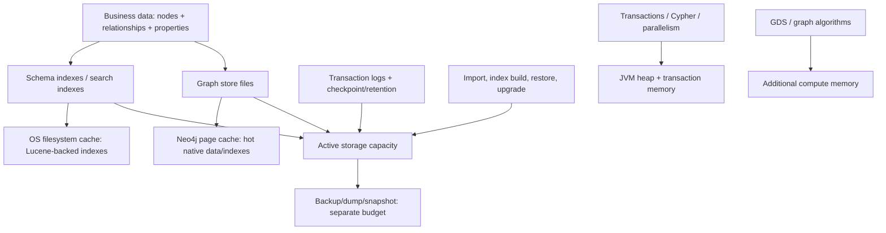
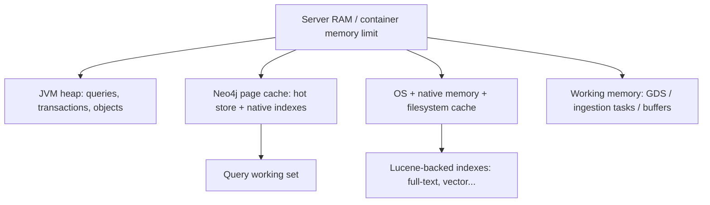

# Capacity Planning by Node Count, Relationship Count, Properties, and Indexes in Neo4j

## 1. The Capacity Planning Problem: Counting Nodes Alone Is Not Enough to Size a Server

A system using **Neo4j** represents relationships as a *property graph*: a **node** is an entity, a **relationship** is a directed link, and a **property** stores data on a node/relationship. In the `DATABASE_ENGINE_GRAPH_NEO4J` module, applications use **Cypher**, **Neo4j Java Driver**, and **Spring Data Neo4j** to ingest data, look up connections, and traverse paths. As data grows, the operational question is no longer "How many nodes can Neo4j store?" but rather:

- With **N nodes**, **R relationships**, and a given number of properties and indexes, how much disk space is needed?
- Which subset of data should live in the **page cache** to avoid slow I/O?
- How much **JVM heap** is required for transactions, queries, and graph expansion operations?
- How much capacity must be reserved for **transaction logs, data ingestion, index rebuilds, backups, cluster replicas**, and growth?
- How do you measure and recalibrate forecasts instead of trusting a single "bytes per node" number that does not hold across all graphs?

This lesson belongs to the **Resource Configuration** chapter, focusing on **capacity planning by node count, relationship count, properties, and indexes**. It serves as a design and operations guide applicable to self-managed Neo4j; on **Neo4j Aura**, instance sizing, limits, and allocation mechanisms depend on the managed service.

### Objectives

After this lesson, you will be able to:

1. Build an inventory of **nodes, relationships, properties, and indexes** broken down by label and relationship type.
2. Understand why property counts, data types, string lengths, degree distribution, and **store format** change storage footprint.
3. Construct a forecast table covering **data store + indexes + transaction logs + temporary space + headroom**.
4. Distinguish **disk** requirements from **page cache, heap, OS cache, and GDS compute memory**.
5. Use `neo4j-admin server memory-recommendation` and real metrics as a calibration baseline.
6. Incorporate growth, cluster replication, backups, and performance verification into resource planning.

> **Version scope:** Neo4j 4.4, the 5.x series, and current releases differ in store formats, setting names, index types, and Enterprise capabilities. Configuration examples here use common names from **Neo4j 5.x and later**; numeric values are **illustrative calculation samples**, not standard sizes guaranteed by Neo4j. Always verify the exact version, edition, and deployment model before applying them.

## 2. Breaking Total Capacity into Meaningful Categories



**Two distinct questions:**

1. **Disk capacity:** Needs enough space to store current files and growth, plus temporary working areas that arise over time.
2. **RAM capacity:** Needs enough memory for the **working set** actually read by the query load, active transactions, the JVM, the OS, and graph algorithms.

You cannot take the total database size on disk and conclude that RAM must equal that exact number. A multi-terabyte graph can still run with less RAM if its hot working set is narrow and I/O is adequate; conversely, a small graph with queries returning millions of paths can still exhaust the heap.

### 2.1. Which Categories Belong to a Neo4j Database?

| Category | Formed From | What Makes It Grow |
| --- | --- | --- |
| **Node storage** | Node count, labels, and reference metadata | Creating more nodes; how labels are stored per store format |
| **Relationship storage** | Relationship count, relationship types, start/end nodes, adjacency structures | Creating more relationships; high degree, skewed topology |
| **Property storage** | Property count and values on nodes/relationships | Adding fields, long strings, lists, or vectors |
| **Index storage** | Token lookup, range/text/point/full-text/vector indexes, constraint backing indexes | Adding indexes, more indexed values, larger value lengths |
| **Transaction logs** | All mutations written to the transaction log | Write rate, retention policy, backups/clustering |
| **Other** | Metadata, checkpoints, system data, management structures, and auxiliary files | Number of databases, deployment type, maintenance/upgrades |

Do not assume **all indexes live in the same file type or the same cache type**. Some indexes use native structures while others are **Lucene-backed**; this distinction matters for RAM allocation.

## 3. Gathering Counts Before Forecasting

### 3.1. Inventorying Nodes by Label

Suppose an e-commerce application has:

```text
(:Customer {customerId, name, email, createdAt})
(:Order {orderId, state, total, createdAt})
(:Product {sku, title, category, price})

(Customer)-[:PLACED]->(Order)
(Order)-[:CONTAINS {quantity, unitPrice}]->(Product)
```

This model illustrates why **R can be many times larger than N**: each order has one edge to a customer but can have many `CONTAINS` edges to products.

```cypher
MATCH (c:Customer)
RETURN count(c) AS customerCount;
```

```cypher
MATCH (o:Order)
RETURN count(o) AS orderCount;
```

```cypher
MATCH (p:Product)
RETURN count(p) AS productCount;
```

To count total nodes:

```cypher
MATCH (n)
RETURN count(n) AS totalNodes;
```

Counts by label **can overlap** if a node carries multiple labels, such as `:Customer:VIP`. Do not sum `count(:Label)` results and assume they equal total nodes when labels can overlap.

### 3.2. Inventorying Relationships by Type

```cypher
MATCH (:Customer)-[r:PLACED]->(:Order)
RETURN count(r) AS placedCount;
```

```cypher
MATCH (:Order)-[r:CONTAINS]->(:Product)
RETURN count(r) AS containsCount;
```

```cypher
MATCH ()-[r]->()
RETURN count(r) AS totalRelationships;
```

In Neo4j, every relationship has **a single stored direction**. The query `MATCH ()-[r]->()` matches one direction per edge, avoiding double-counting a relationship just because Cypher can traverse it in reverse. When using an undirected pattern `-[r]-` or multi-segment patterns, counts and row multiplication can differ; use a clear, directed pattern when compiling statistics.

### 3.3. Track the Relationship-to-Node Ratio Too

From the counts:

\[
\text{Average relationship density}=\frac{R}{N}
\]

The `R/N` ratio helps identify "edge-heavy" graphs, but **it does not reflect degree distribution**. Two graphs with identical N and R can have completely different structures:

- Graph A: most nodes have 5–10 edges.
- Graph B: most nodes have 1–2 edges, but a few "super-connected" nodes have millions of edges.

Very high-degree nodes can affect how adjacency is stored per store format and especially impact **traversal cost**. Therefore, collect **P50/P95/P99/max degree**, or at least a list of high-degree nodes, rather than relying solely on the graph-wide average.

Example checking users with many outgoing follow relationships:

```cypher
MATCH (u:GraphUser)
OPTIONAL MATCH (u)-[r:FOLLOWS]->()
RETURN u.userId AS userId,
       count(r) AS outgoingFollows
ORDER BY outgoingFollows DESC
LIMIT 20;
```

**Warning:** This measurement query can be very expensive on a large graph. Run it on an appropriate test environment or replica, set a timeout, and inspect `PROFILE`; do not assume it is "cheap" just because it returns 20 rows, since the engine may still have to count edges for a vast number of nodes before sorting.

## 4. Properties: Count and Data Types Determine Size

### 4.1. Measuring Average Properties on Nodes and Relationships

```cypher
MATCH (n:Order)
RETURN count(n) AS nodes,
       avg(size(keys(n))) AS avgPropertiesPerNode,
       max(size(keys(n))) AS maxPropertiesPerNode;
```

```cypher
MATCH ()-[r:CONTAINS]->()
RETURN count(r) AS relationships,
       avg(size(keys(r))) AS avgPropertiesPerRelationship,
       max(size(keys(r))) AS maxPropertiesPerRelationship;
```

`keys(...)` returns the list of property names present on an entity. These queries read actual data and can be costly at scale. **Do not run them across the entire production graph during peak hours** just for an estimate; instead, sample by partition, batch, or staging data.

If there are `N` nodes with an average of `p_N` properties/node and `R` relationships with `p_R` properties/relationship:

\[
P_N\approx N \times p_N,\qquad
P_R\approx R \times p_R
\]

This is the **number of property-values**, not the number of bytes. The same property count in `BOOLEAN`, integers, 200-character strings, long arrays, or embedding vectors produces vastly different sizes.

### 4.2. Categorizing Properties That Affect Storage Size

| Value Type | Example | What to Measure |
| --- | --- | --- |
| Boolean/small numbers | `active`, `quantity` | Value range and representation per store format |
| Short strings | `status = 'PAID'`, `sku` | Length and value distribution |
| Long strings | `description`, `comment` | P50/P95/P99 length, UTF-8 characters |
| Date/datetime | `createdAt` | Temporal type and actual storage layout |
| Lists | `tags`, numeric arrays | Element count and length distribution |
| Point | `location` | Spatial type and index in use |
| Vector embedding | `embedding` with hundreds/thousands of dimensions | Dimensions, element type, vector index, and data copies |

**UTF-8 does not use a fixed number of bytes per character.** Vietnamese strings, emojis, and ASCII strings differ in byte length; store formats themselves also organize and pack values differently. Do not treat `length(name)` as an exact physical storage measurement.

### 4.3. Sampling String Lengths

```cypher
MATCH (p:Product)
WHERE p.title IS NOT NULL
RETURN count(p) AS productsWithTitle,
       avg(size(p.title)) AS avgCharacters,
       max(size(p.title)) AS maxCharacters;
```

This snippet measures **character count** in Cypher, helping reveal data distribution, though **it does not account for storage overhead or actual UTF-8 byte length**. For large datasets, take a representative sample including cohorts with unusually long descriptions. Also record the percentage of **missing properties**, since a node without a property is completely different from a node storing a long string.

### 4.4. Storage Does Not Grow Linearly with Entity Count Alone

If a later release adds a 768-dimensional `embedding` to every `Product`, the property count per node increases by only **one**, yet storage volume can surge compared to adding a Boolean. When a **vector index** is attached, there are also search structure costs, vector data stored inside the index, and **OS filesystem cache** requirements.

Therefore, a capacity report must include the **property size distribution**, not just the average property count.

## 5. Indexes and Constraints: Account for Overlapping Storage Separately

### 5.1. Inspecting Actually Existing Indexes

In Neo4j 5.x and modern versions:

```cypher
SHOW INDEXES
YIELD name, type, entityType, labelsOrTypes, properties, state
RETURN name, type, entityType, labelsOrTypes, properties, state
ORDER BY name;
```

```cypher
SHOW CONSTRAINTS
YIELD name, type, labelsOrTypes, properties
RETURN name, type, labelsOrTypes, properties
ORDER BY name;
```

A **unique constraint** typically has a corresponding backing index. If budgeting from **actual index file measurements**, do not count an existing index and then count it a second time as a separate "constraint cost." `SHOW INDEXES` lists metadata; it **does not directly promise exact byte sizes for each index** across all versions.

### 5.2. How Index Types Affect Capacity

| Type | Purpose | Capacity Notes |
| --- | --- | --- |
| Lookup index | Look up nodes by label, relationships by type | Carries its own index overhead |
| Range index | Equality, range, and property-based access | Cost depends on entry count and property type/size |
| Composite range index | Combines multiple properties on the same entity | Size/cost varies with entry count and fields |
| Text index | Pattern-based string search | Should not be assigned the same bytes/entry as range indexes |
| Point index | Spatial lookups | Cost depends on values and index type |
| Full-text index | Lucene keyword search | Uses separate Lucene-backed structures and filesystem cache |
| Vector index | Embedding and similarity search | Uses HNSW/quantization structures, Lucene files, and OS RAM |

**Indexes cost more than just disk:** every time an indexed property is updated, the index must also be maintained. Too many indexes increase write overhead, checkpoint/backup times, and data ingestion duration.

### 5.3. Do Not Create Indexes "Just in Case"

For example:

```cypher
CREATE CONSTRAINT customer_business_id IF NOT EXISTS
FOR (c:Customer)
REQUIRE c.customerId IS UNIQUE;
```

For a unique key like `Customer.customerId`, the constraint enforces uniqueness and provides a backing index. There is no need to create an identical range index just to serve the same ID lookup. For a new query pattern such as `Order(state, createdAt)`, you can evaluate a dedicated composite range index and measure its total cost versus benefit.

## 6. Why Is There No Universally Reliable "X Bytes Per Node" Formula?

A conceptual decomposition estimate:

\[
\begin{aligned}
D_{\text{data+index}}\approx&
N\cdot b_{\text{node}}+
R\cdot b_{\text{rel}}\\
&+P_N\cdot b_{\text{prop,node}}+
P_R\cdot b_{\text{prop,rel}}\\
&+D_{\text{labels/types/dynamic values}}+
D_{\text{indexes}}+
D_{\text{metadata}}
\end{aligned}
\]

Where:

- `N`: node count, `R`: relationship count.
- `P_N` and `P_R`: total property-values on nodes and relationships.
- `b_node`, `b_rel`, `b_prop`: **coefficients measured on sample data under the same version/format**, not fixed Neo4j byte quotas.
- `D_indexes`: actual index file sizes for the target schema.

These coefficients vary with **store format** (`standard`, `aligned`, `high_limit`, `block` depending on version/edition), degree distribution, label count, property size, data types, and record layout. In particular, modern store formats handle large values and high-degree nodes differently; never take byte numbers from an old-version blog post and apply them to a new database.

### 6.1. A More Reliable Empirical Sizing Model

Instead of guessing coefficients:

1. Create a **test database** using the exact target **edition, version, store format, and index schema**.
2. Ingest a sample whose node/relationship ratios, degrees, properties, and value lengths match production.
3. Measure **store file and index file sizes** after indexes are created and populated.
4. Grow the dataset in stages (for instance, from 100k to 300k nodes) and measure the delta.
5. Separate **transaction logs, dumps, backups, and temp files** from store/index measurements so they are not counted as bytes/node.
6. Repeat at two or more scales to detect fixed overhead and non-linear scaling errors.

This is **empirical sizing**. Always record the **sample dataset, timestamp, index set, ingestion method, Neo4j version, and filesystem** so measurements remain comparable.

## 7. Example Capacity Calculation from Sample Measurements

Suppose a measurement run is performed on a **test database** populated with synthetic data matching expected business characteristics:

| Metric | Test Sample | Projected Target Scale |
| --- | ---: | ---: |
| Nodes | 100,000 | 2,000,000 |
| Relationships | 500,000 | 10,000,000 |
| Avg properties/node | 5 | 5 |
| Avg properties/relationship | 2 | 2 |
| Index set | Same schema | Same schema |
| Measured data store files | **0.42 GiB** | Extrapolated |
| Measured index files | **0.12 GiB** | Extrapolated |

**The figures 0.42 GiB and 0.12 GiB are illustrative assumptions, not a Neo4j benchmark.** They assume non-overlapping measurements of data and index directories only, excluding logs and backups.

Growth factor:

\[
k=\frac{2{,}000{,}000}{100{,}000}
=\frac{10{,}000{,}000}{500{,}000}=20
\]

Assuming the same data types and distributions, initial extrapolation:

\[
D_{\text{data+index}}
\approx (0.42+0.12)\times 20
=10.8\ \text{GiB}
\]

Adding **30% headroom for data/indexes** for illustration:

\[
10.8\times 1.30
=14.04\ \text{GiB}
\]

Then **add separately**:

| Line Item | Illustrative Budget |
| --- | ---: |
| Extrapolated data + indexes with 30% headroom | 14.04 GiB |
| Estimated transaction log retention | 2.00 GiB |
| Free space for imports/index builds and operations | 5.00 GiB |
| Example floor for the active volume | **21.04 GiB** |
| Backups/dumps and snapshots | **Excluded**; allocate separate storage/policy |
| DBMS installation, OS, system DB, operational logs | **Excluded**; add based on infrastructure |

Do not treat `21.04 GiB` as a minimum production size for any real system. Real environments also face shifting relationship ratios, long properties, new index types, longer retention, recovery/upgrade buffers, and filesystem characteristics.

### 7.1. Why Can Linear Extrapolation Be Wrong?

- The `R/N` ratio climbs as the application adds recommendations, follows, or product links.
- Early data only has short strings, whereas later data adds descriptions, image metadata, or embeddings.
- New range/full-text/vector indexes are introduced.
- Many nodes become **supernodes** with high degree.
- After bulk deletes/updates, file size and space reuse behave differently than during fresh ingestion.
- The store format or Neo4j version changes during an upgrade.
- Write frequency rises, generating more transaction logs even when `N` and `R` do not grow proportionally.

Therefore, prepare at least **three scenarios**: low/base/high, and update forecasts periodically using observed metrics.

## 8. RAM Budgeting Differs from Disk Budgeting

Neo4j uses multiple memory regions:



### 8.1. JVM Heap

The heap supports transaction state, Java objects, query execution, and intermediate state. Workloads that commonly pressure the heap:

- Queries calling `collect(...)` on very large collections.
- `ORDER BY`/aggregations over large row counts.
- Unbounded-hop path traversals or intermediate row explosions.
- Overly large write/`UNWIND` transactions.
- High concurrency of queries/transactions.

Settings described in current documentation:

```properties
server.memory.heap.initial_size=8g
server.memory.heap.max_size=8g
```

This is a **syntax example only**, not an 8 GiB recommendation for every system. Neo4j generally recommends setting sensible initial and max values—often equal—to avoid unwanted resizing/GC pauses. Measure actual heap usage, GC, transaction memory, and workload. Do not grow the heap indefinitely, as that reduces RAM left for cache/OS.

### 8.2. Page Cache

`server.memory.pagecache.size` controls how much RAM Neo4j uses to cache on-disk data and corresponding page-cache-managed indexes:

```properties
server.memory.pagecache.size=16g
```

What matters most is the **working set**:

- If 80% of queries only touch 5% of recent nodes/relationships, the page cache can focus on that hot subset.
- If queries continuously scan the entire graph, page cache/I/O demands can be far higher.
- If data is not yet loaded into cache after startup, the warm-up phase may show high **page faults** and elevated latency.

For some workloads, caching most native data/indexes is beneficial. However, **you do not have to size the page cache to match total disk size**, especially when RAM must also be reserved for OS, heap, and other components.

### 8.3. OS Filesystem Cache and Lucene

Text/full-text/vector indexes can use Lucene and depend on the **OS filesystem cache**, so **do not assume every index resides inside the Neo4j page cache**. For vector indexes, Neo4j maintains dedicated documentation covering HNSW, vector values, and memory requirements for Lucene.

If a node stores an `embedding` property and also has a vector index:

- The vector property in the graph store has its own storage cost.
- The vector index maintains its own data/structures, potentially including quantized representations.
- Vector search may use OS filesystem cache; if queries also read the `embedding` property from the graph, page cache may be needed for that property as well.

Do not take total index size and push all RAM into `server.memory.pagecache.size`, starving the OS of memory needed to cache Lucene and causing extra I/O.

### 8.4. GDS and Graph Algorithms

Graph Data Science can create **in-memory graph projections**, consuming additional memory beyond database operations. Running PageRank on a few hundred thousand nodes is completely different from running an embedding algorithm on tens of millions of nodes.

If deploying GDS, establish a **separate memory budget for named graphs and algorithms**, using GDS memory estimation matching your version. Never assume a 10 GiB graph on disk equals an exact 10 GiB graph projection in RAM.

### 8.5. Using the Memory Recommendation Tool as a Starting Point

In an environment with administrative access on the Neo4j host:

```bash
neo4j-admin server memory-recommendation --memory=64g
```

This command provides **initial recommendations** for JVM heap and page cache given an assumed RAM budget. On current Neo4j versions, it is also useful for inspecting existing store and index sizes. **Do not run it on an empty machine without real stores and assume the file measurements reflect production.**

Crucially, this is a **heuristic recommendation**, not performance-guaranteed auto-tuning. Neo4j recommends refining settings using metrics and load tests; when running in a container, `--memory` should reflect the **actual RAM limit allocated to Neo4j**, not a larger host's total RAM.

## 9. Transaction Logs and Write Traffic: Easily Overlooked Space

Neo4j maintains **transaction logs** to support recovery, backups, and cluster operation. Log growth rate depends on the **volume of mutations**, not just the number of existing nodes/relationships.

### 9.1. Two Graphs of Equal Size Can Generate Very Different Logs

- System A: 10 million nodes, rarely modified, mostly read queries.
- System B: 10 million nodes, but updates many properties daily, creates/deletes relationships, and runs regular imports.

Even with similar node counts, System B can generate vastly more transaction logs and write I/O. Measure **write rate, retention window, and checkpoint/backup policy**.

### 9.2. Configuring Logs per Version

Some current settings:

```properties
# Configuration example: check your version's documentation before using.
db.tx_log.rotation.size=256MiB
db.tx_log.rotation.retention_policy=2 days 2G
```

These two values are illustrative and match common defaults noted in current documentation; real environments must tune them based on **RPO, differential backup requirements, log retention needs, and write rate**.

**Never manually delete transaction logs to free disk space.** Neo4j manages pruning in coordination with checkpoints and recovery safety. A retention limit does not mean disk usage is pinned to an exact byte cap at every moment, due to active logs, checkpoints, and backup requirements.

### 9.3. Operational Free Space

Operations that may require extra free space:

- Bulk imports and building new indexes.
- Rebuilding or updating indexes.
- Database restores, store format conversions, or upgrades.
- Checkpoints, log rotation, and storage-level snapshots.
- Exports/dumps/backups written on the same machine.

When storage is nearly full, a recovery or migration operation can fail **even while the current database remains readable**. Size headroom for the **largest maintenance operation** in your runbook, not merely daily net growth.

## 10. Clustering and Backups: Distinguish Single-Replica Size from Total Infrastructure

### 10.1. Per-Server Capacity for Hosting a Database

A database in a Neo4j cluster can be allocated across multiple servers in **primary** and **secondary** roles depending on topology. Each replica allocated and maintained on a target server requires an appropriate disk budget for that server's store/index/logs and operational work.

Illustrative example:

- A database requires **15 GiB** of store/index space with headroom for one replica.
- The topology places that database on **3 servers**, each holding a replica.
- The budget for store/index alone may be close to **3 × 15 = 45 GiB** across the cluster.

However, **do not calculate total storage simply as "node count × server count"** when a server hosts multiple databases, uses asymmetric primary/secondary allocations, or holds different log/temporary areas. Build a **database × server × role × storage area** matrix to avoid both under-sizing and double-counting.

### 10.2. Backups Have a Separate Budget

Backups have their own requirements:

- Size of the initial full backup and subsequent incremental/differential artifacts depending on the mechanism used.
- Backup frequency and retention duration.
- Number of retained backup versions, compression, and encryption policies.
- Restore drills and temporary space needed during restoration.
- Backup storage placed in a different failure domain from the production database.

Do not store all backups on the single active production volume; if that volume fails or fills up, both the database and its backups can be compromised.

### 10.3. Do Not Confuse Backup Disk with RAM

Keeping three backup copies does not mean tripling the page cache. Backups affect **storage, network, I/O, and operational windows**, whereas the page cache serves the active working set on each running instance.

## 11. Modeling Growth Rates and Three Scenarios

### 11.1. Based on Data Generation Rate

Suppose an application writes on average:

- 20,000 new orders per day.
- 1 `PLACED` relationship per order.
- An average of 4 `CONTAINS` relationships per order.
- 5 properties per Order and 2 properties per `CONTAINS`.

Daily new entities (excluding other node types):

\[
\begin{aligned}
\Delta N/\text{day}&=20{,}000\ \text{Order}\\
\Delta R/\text{day}&=20{,}000\times(1+4)=100{,}000
\end{aligned}
\]

After 365 days, assuming no deletions and unchanged ratios:

\[
\Delta N_{\text{year}}=7{,}300{,}000,\quad
\Delta R_{\text{year}}=36{,}500{,}000
\]

These are **entity counts only**, not byte sizes. Use **empirically measured coefficients** from a sample import with the same data types and indexes to compute disk growth.

### 11.2. Include Update Rate, Not Just New Creations

If 80% of orders change `state` multiple times, extra logs and I/O occur even though node count does not rise with each update. If the business adds a new relationship type, the `R/N` ratio can climb faster than expected.

Build at least three scenarios:

| Variable | Low | Base | High |
| --- | --- | --- | --- |
| Node growth | Below forecast | Per business plan | Sharp surge from new products |
| Relationships/node | Stable | Slight increase | Spike from recommendation/linking features |
| Property length | Mostly short values | Matches current sample | Includes comments, lists, embeddings |
| Indexes | Current schema | A few query-driven indexes | Large-scale full-text/vector indexes |
| Write rate | Read-heavy | Mixed workload | Continuous imports, frequent updates |
| Retention/backup | Short per policy | Current operational level | Many retained copies, strict RPO |

The high scenario must reflect **real product risks**, not just an arbitrary multiplier applied across every column.

## 12. Choosing Storage Media and Monitoring I/O

Disk capacity (GiB/TiB) is only one dimension. Two 1 TiB volumes can exhibit completely different latency:

- Read queries jumping across many nodes/relationships can trigger heavy **random reads** if the working set does not fit in the page cache.
- Imports and index updates generate substantial write traffic.
- Transaction logs, checkpoints, and backups can compete for **IOPS, bandwidth, and latency** with online queries.
- After a restart, warm-up can cause sharp spikes in page faults and I/O.

Monitor:

| Metric Group | Warning Signs |
| --- | --- |
| Disk usage/free space | Steady growth, free space dropping below operational threshold |
| Disk IOPS, throughput, await/latency | Slow queries coinciding with high I/O |
| Neo4j page cache hit ratio / faults | Insufficient working set cache or cold warm-up |
| JVM heap and GC | Oversized transactions/queries or high concurrency |
| Transaction logs rate/retention | Logs growing faster than node-count forecasts |
| Checkpoint duration | Prolonged checkpoints or I/O contention |
| Query latency, DB hits, Rows | Missing/wrong index, supernodes, high fan-out |
| Native/OS cache and swap | Insufficient RAM for Lucene/vector indexes/OS |

Alert thresholds must align with **SLAs and workload**. A high page cache hit ratio does not guarantee fast queries if the plan traverses too many relationships. Correlate metrics over time alongside **`PROFILE`** output for representative queries.

## 13. Implementation Playbook: From Measurements to Infrastructure Decisions

### Step 1. Lock Down the Data Scope

Tabulate node labels, relationship types, business keys, required/optional properties, and schema indexes. Explicitly note whether **vector indexes, full-text indexes, GDS, multiple databases, or clustering** will be used.

### Step 2. Collect Distributions

For each group:

- Node counts, relationship counts, `R/N`.
- Average property count, percentage of missing properties.
- Size distributions for strings/lists/vectors.
- Top-degree nodes, relationship directions and types.
- Daily write, delete/update rates, and retention windows.

If production is too large, use stratified sampling or ingestion statistics instead of running unconditional full-graph scans.

### Step 3. Build an Equivalent Sample Dataset

Load a subset into a Neo4j instance with the **same version and store format**, with all constraints/indexes created. Measure files after index population finishes and workload stabilizes. Record **log growth rate** separately.

### Step 4. Extrapolate Across Scales

Calculate from measured figures instead of defaulting to "100 bytes per node." Incorporate property lengths, density, new indexes, and retention into the model.

### Step 5. Size RAM by Working Set

Choose a budget for heap, page cache, OS filesystem cache, and auxiliary memory (GDS, imports) whose total fits available RAM/cgroup limits. Use:

```bash
neo4j-admin server memory-recommendation --memory=64g
```

as a **starting point**, then load-test and tune. Never size page cache + heap to consume 100% of RAM leaving nothing for OS/native allocations.

### Step 6. Add Operational Overhead

Include transaction logs, growth headroom, backups, restores, imports, index builds, and per-database replica allocations according to the exact topology.

### Step 7. Validate and Refresh Periodically

Measure P95/P99 query latency, page cache, I/O, heap/GC, and peak write bursts. Compare measured disk usage against forecasts after every major release or bulk import. When data distributions shift, recalibrate sizing coefficients.

## 14. Common Mistakes

| Mistake | Consequence | How to Avoid |
| --- | --- | --- |
| Counting nodes while ignoring relationships | Severe under-sizing on edge-rich graphs | Measure both `N` and `R` by type and direction |
| Using bytes/node from a different version | Wrong due to store format, properties, adjacency | Measure on the actual target version/format |
| Ignoring property types | Misses long strings, lists, vectors | Collect property size and frequency stats |
| Double-counting constraint backing indexes | Inflated index estimates | Cross-reference constraints with actual indexes |
| Assuming all indexes live in the page cache | Starves OS RAM for Lucene/vector indexes | Separate native indexes from Lucene-backed ones |
| Treating disk size as RAM requirement | Misaligned RAM for the working set | Measure page cache faults and query patterns |
| Forgetting transaction logs | Volume fills up under heavy writes | Forecast log generation rate and retention |
| Treating log retention as an exact byte ceiling | Overconfidence around checkpoints/rotation | Track peak log space and retention policy |
| Manually deleting logs when disk nears full | Breaks recovery and backup chains | Rely on official pruning mechanisms |
| Giving all RAM to the heap | Page cache/OS starved, heavy I/O | Balance heap, page cache, native, and OS |
| Using `LIMIT` to "reduce work" on any query | Query may still traverse/sort huge sets | Use indexes, anchors, hop limits, and `PROFILE` |
| Omitting cluster replicas | Under-sized total infrastructure storage | Sum per database × server allocations |
| Putting backups on the sole active volume | Storage failure loses both DB and backups | Separate failure domains and test restores |
| Measuring only a current snapshot | Ignores growth and maintenance spikes | Build forecasts with headroom and scenarios |

## 15. Practice Exercises

### Exercise 1. Forecasting Relationship Counts

An application has 200,000 customers and 1,000,000 orders; each order has 1 `PLACED` edge and an average of 3 `CONTAINS` edges. How many order-related relationships are there?

**Answer:** `1,000,000 × (1 + 3) = 4,000,000` relationships. You cannot conclude there are only 4 million relationships **across the entire database** if other relationship types exist.

### Exercise 2. Estimating Property-Values

There are 2 million nodes with an average of 5 properties/node and 10 million relationships with an average of 2 properties/relationship. Calculate total property-values.

**Answer:** `2,000,000 × 5 + 10,000,000 × 2 = 30,000,000` property-values. This is **not 30 million bytes**; you still need property types/sizes and the store format.

### Exercise 3. Measuring and Extrapolating

A sample of 100,000 nodes and 500,000 relationships uses `0.42 GiB` for store files and `0.12 GiB` for indexes. The target is 20x larger with the same data/index characteristics. Add 30% headroom on store/index, excluding logs/backups. What is the forecast?

**Answer:** `(0.42 + 0.12) × 20 × 1.30 = 14.04 GiB`. This exercise only tests the method; real figures must be re-measured to confirm linearity.

### Exercise 4. Page Cache and Vector Indexes

A server has range indexes and a vector index; the ops team sums the disk size of all indexes and assigns that total to `server.memory.pagecache.size`. Why can this go wrong?

**Answer:** Vector indexes/Lucene need **OS filesystem cache**, and not all index files are cached inside the Neo4j page cache. RAM must be reserved for heap, OS, native buffers, and Lucene, and the real working set must be measured.

### Exercise 5. Cluster Storage

A database requires 20 GiB of active storage on each server hosting a replica. If three servers each hold that replica, what is the estimated combined active storage? Does that include backups?

**Answer:** Roughly `3 × 20 = 60 GiB`, excluding backups, additional log/temporary space if 20 GiB does not cover them, and any other databases on those servers.

### Exercise 6. Counting Nodes by Label

A node has both `:Customer` and `:VIP`. If you add `count(:Customer) + count(:VIP)`, does the sum equal the number of distinct nodes across those two labels?

**Answer:** Not necessarily; a node with both labels is counted twice. You must count **distinct entities** consistently when forecasting.

### Exercise 7. Why Doesn't Disk Usage Drop Immediately After Deletions?

After deleting many old nodes, node/relationship counts drop, yet total store file size does not shrink proportionally. Can you immediately conclude the database is corrupted?

**Answer:** No. Neo4j reuses free space inside store files, and deletions do not mean every file is physically shrunk right away. Review **space reuse/store format** documentation for your version and re-measure before considering an appropriate maintenance procedure.

### Exercise 8. Capacity Planning for a New Feature

The product is about to add 768-dimensional embeddings to 5 million nodes along with a vector index. Beyond node count, list at least five pieces of data you need to collect.

**Suggested answer:** Vector numeric type/precision; percentage of nodes carrying an embedding; vector property storage size in the store; vector index type/configuration and quantization; measured index size; OS filesystem cache required for search; whether queries also read the embedding property from the graph; available RAM; embedding update rate and rebuild costs.

## 16. Pre-Approval Budget Checklist

- [ ] Confirmed **Neo4j Server version, edition, store format**, and deployment model.
- [ ] Collected **node counts by label**, accounting for multi-label nodes.
- [ ] Collected **relationship counts by type**, `R/N` ratio, and degree/supernode distribution.
- [ ] Collected property counts per node/relationship, types, sizes, and missing-value rates.
- [ ] Inventoried actual **indexes/constraints** without double-counting backing indexes.
- [ ] Measured store/index sizes on **representative** test data rather than fixed byte quotas.
- [ ] Forecasted growth in nodes, relationships, properties, indexes, and write rates.
- [ ] Separated disk budgets for store/indexes, transaction logs, backups, and temporary work areas.
- [ ] Accounted for per-database replica allocations if using a cluster.
- [ ] Partitioned RAM across heap, page cache, OS/Lucene/native, and GDS if applicable.
- [ ] Checked `neo4j-admin server memory-recommendation` output.
- [ ] Executed load tests with representative queries, monitoring GC, I/O, and page cache.
- [ ] Reserved headroom for imports/restores/index rebuilds/upgrades.
- [ ] Configured disk capacity alerts, growth trend tracking, and backup restore tests.

## 17. Summary

Neo4j capacity planning must start from the **actual data model**: **node** counts, **relationship** counts, **property** counts and sizes on both entity types, and the **index/constraint** inventory. No single bytes-per-node constant applies accurately to every store format or application. The reliable approach is **measuring a representative sample, extrapolating conditionally, validating at scale, and updating from real observations**.

The **disk** budget must cover data stores, indexes, transaction logs, backups, and temporary space; the **RAM** budget must separate JVM heap, Neo4j page cache, OS/native filesystem cache, and algorithm memory if needed. In a cluster, every server hosting a database replica needs corresponding disk and compute resources. Ultimately, **query latency, page cache hits/faults, I/O, GC, and log rate** determine whether your forecast meets production workload demands.

### Official References

- [Neo4j Operations Manual – Memory configuration](https://neo4j.com/docs/operations-manual/current/performance/memory-configuration/)
- [Neo4j Operations Manual – Get initial memory recommendations](https://neo4j.com/docs/operations-manual/current/configuration/neo4j-admin-memrec/)
- [Neo4j Operations Manual – Store formats](https://neo4j.com/docs/operations-manual/current/database-internals/store-formats/)
- [Neo4j Operations Manual – Transaction logging](https://neo4j.com/docs/operations-manual/current/database-internals/transaction-logs/)
- [Neo4j Operations Manual – Vector index memory configuration](https://neo4j.com/docs/operations-manual/current/performance/vector-index-memory-configuration/)
- [Neo4j Operations Manual – Essential metrics](https://neo4j.com/docs/operations-manual/current/monitoring/metrics/essential/)
- [Neo4j Cypher Manual – Show indexes](https://neo4j.com/docs/cypher-manual/current/indexes/search-performance-indexes/)
- [Neo4j Operations Manual – Disks, RAM and other tips](https://neo4j.com/docs/operations-manual/current/performance/disks-ram-and-other-tips/)
