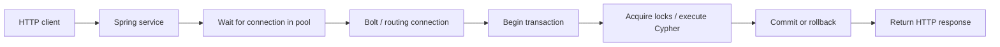
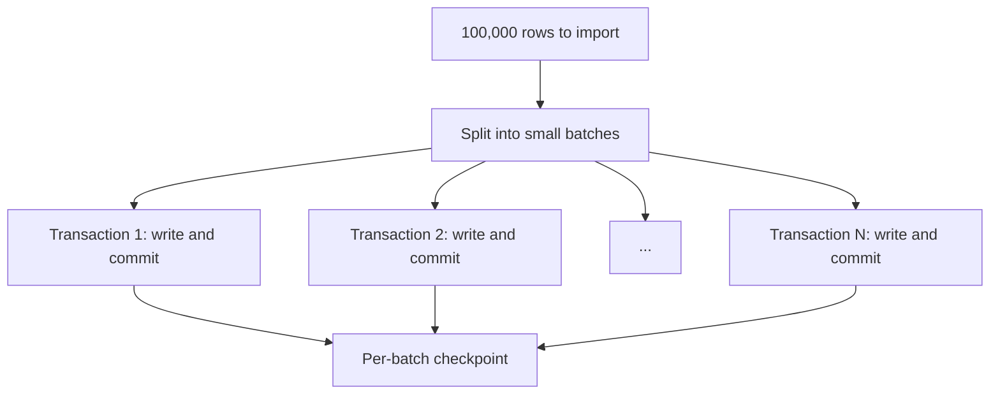

# Configuring Timeouts, Transaction Limits, and Version-Specific Capabilities in Neo4j

## 1. Objectives and Scope

An application using **Neo4j** to manage a **property graph** routinely runs Cypher queries that read paths, expand relationships, create nodes/relationships with `MERGE`, or ingest bulk data. The same query may run quickly on a small graph yet become very slow as relationships per node grow, when indexes are missing or mismatched, or when multiple transactions contend for locks.

Resource limits do not directly "make queries faster." Instead, they **keep the system in a controllable state**: transactions do not hang indefinitely, no single task monopolizes resources, failures surface with clear signals, and applications know when to retry or batch work.

This lesson belongs to the **Resource Configuration** chapter of the `DATABASE_ENGINE_GRAPH_NEO4J` module. It connects Neo4j server configuration, transaction limits, Cypher, Java Driver, Spring Data Neo4j, and production observability.

After this lesson, you will be able to:

1. Distinguish **connection**, **connection pool acquisition**, **lock acquisition**, **transaction execution**, **bookmark readiness**, and **HTTP transaction idle** timeouts.
2. Inspect and configure `db.transaction.timeout`, `db.lock.acquisition.timeout`, `db.transaction.concurrent.maximum`, and appropriate transaction memory limits.
3. Verify effective values with `SHOW SETTINGS`, inspect active transactions with `SHOW TRANSACTIONS`, and understand permission and version implications.
4. Configure per-transaction timeouts in the Neo4j Java Driver instead of confusing them with HTTP or pool timeouts.
5. Identify dynamic settings versus settings requiring a restart, as well as differences across Neo4j 4.x, 5.x, newer releases, and managed services like Aura.
6. Establish testing, measurement, rollback, and error-handling policies rather than simply raising limits whenever queries slow down.

> **Version note:** Neo4j configuration keys are illustrated primarily using **Neo4j 5 and current Operations Manual conventions**. In Neo4j 4.x, several keys carry a `dbms.` prefix; newer releases may add, rename, or remove settings. Java examples use Java 17+ and Java Driver 5.x. Always verify against your running version, edition, and deployment environment before changing any limits.

## 2. Six "Clocks" You Should Never Collapse into One Timeout

A single API request can traverse multiple stages:



Each segment can have its own timeout. A `connection acquisition timeout` error **does not mean** Neo4j terminated a long-running transaction.

| Limit | Where It Applies | Typical Symptom When Exceeded |
| --- | --- | --- |
| **Connection timeout** | Driver establishing DNS/TCP/Bolt/TLS to an endpoint | Cannot open a new connection |
| **Pool acquisition timeout** | Driver waiting for an available connection | Request fails to obtain a connection within allowed time |
| **Lock acquisition timeout** | Neo4j waiting for a lock held by another transaction | Transaction fails with lock timeout/is terminated |
| **Transaction timeout** | Neo4j tracking transaction lifecycle | Transaction is marked terminated/rolled back if not yet committed |
| **Bookmark ready timeout** | Waiting for database to catch up to a bookmark state | Error waiting for causal read consistency via bookmark |
| **HTTP transaction idle timeout** | HTTP endpoint supporting long-lived transactions with no activity | Idle HTTP transaction is closed per policy |

**Additionally, there is the HTTP request deadline at the application or load balancer.** A proxy timing out at 20 seconds does not automatically stop Neo4j's work inside the database at the same instant. You need database-layer cancellation or transaction timeouts to bound orphaned work after the client disconnects.

### 2.1. Example of a Request Crossing Multiple Thresholds

Suppose a test system has:

```text
API request budget:                  20 seconds
Driver pool acquisition wait:         3 seconds
Neo4j lock wait:                      5 seconds
API-supplied transaction timeout:    12 seconds
```

This is an **illustrative policy**, not a default preset. If a transaction blocks acquiring a lock, a lock timeout fires before the transaction timeout. If too few connections are available, a pool error occurs before even opening a transaction. If Neo4j takes 12 seconds to execute, an API timeout at 20 seconds does not turn into a partial commit.

**Do not sum these thresholds into a rigid end-to-end SLA.** Stages overlap, and additional time goes into TLS/routing setup, result streaming, application processing, and timeout monitor polling intervals. Measure **end-to-end latency** alongside component timeouts.

## 3. Transactions, Locks, and Server-Side Time Limits in Neo4j

Neo4j uses transactions to group read/write operations into an ACID unit. For write transactions, when an **uncommitted** transaction is terminated or rolled back, none of the uncommitted changes in **that transaction** are persisted.

### 3.1. db.transaction.timeout

In Neo4j 5, the standard configuration key is:

```properties
# neo4j.conf — example for discussion, do not apply blindly to production
db.transaction.timeout=30s
```

This sets the **default database-side transaction timeout**. In documented Neo4j configs, `0s` typically means **disabling the default timeout**, not aborting every transaction immediately. Even if a default happens to be `0s`, do not assume that is safe for production.

Key points to remember:

- The limit governs the **transaction lifecycle**, not just CPU time of a single `MATCH`.
- Waiting on locks and executing multiple Cypher statements within one transaction both count toward transaction duration.
- Drivers can supply a **per-transaction timeout**; in modern Neo4j, this per-transaction value **overrides the default timeout**, so the server default should not be assumed to be an unbreakable ceiling for every request.
- Neo4j monitors timeouts via periodic checks. Do not treat `30s` as a millisecond-exact real-time stopwatch.
- On a timeout error, the application must treat the failed transaction as **unsuccessful**; never convert it into HTTP 200 just because earlier rows had been processed.

### 3.2. db.lock.acquisition.timeout

When two transactions attempt to write to the same node or relationship concurrently, one may wait for a lock held by the other.

```properties
db.lock.acquisition.timeout=5s
```

This limits **waiting to acquire a lock**, not total query duration. Per Neo4j docs, `0s` can signify disabling the lock acquisition timeout. The transaction timeout can still terminate a waiting transaction if configured.

Business example:

```cypher
MATCH (p:Product {sku: $sku})
SET p.stock = p.stock + $delta;
```

If many writers continuously update the same `Product`, one writer holds the lock while others queue up. Adjusting `db.lock.acquisition.timeout` **does not fix** the root cause of contention; examine business-key hot spots, update design, concurrency, batching, and whether delta updates are retry-safe.

### 3.3. db.transaction.bookmark_ready_timeout

In clusters or applications using **bookmarks** to preserve causal transaction ordering, a read session may need to wait for a database instance to catch up to the state represented by a bookmark:

```properties
# Example: bookmark wait threshold in a specific environment
db.transaction.bookmark_ready_timeout=30s
```

This is **neither** a transaction timeout nor a TCP connection timeout. If applications see bookmark-ready errors, inspect server roles, replication/routing, cluster lag, and bookmark lifecycle instead of blindly raising Cypher execution timeouts.

### 3.4. A Timeout Does Not Commit Partial Progress

Consider a single transaction:

```cypher
UNWIND $rows AS row
MERGE (p:Product {sku: row.sku})
SET p.name = row.name;
```

If it rolls back before commit, **all uncommitted writes in that transaction** are discarded. However, if the application split the data across 20 separate transactions and the first 10 committed, a failure on transaction 11 **does not roll back the first 10 transactions**.

Therefore, time limits and **transaction boundaries** must be designed together: timeouts, batch sizes, checkpoints, and idempotent operations.

## 4. Concurrency Limits and Transaction Memory Resources

Timeouts only bound **duration**. If hundreds of heavy transactions run simultaneously, the system can still overload before any timeout fires.

### 4.1. db.transaction.concurrent.maximum

```properties
# Example capping concurrent transactions
db.transaction.concurrent.maximum=200
```

This setting limits the **number of transactions allowed to run concurrently** per Neo4j's configuration scope. In current Neo4j docs, `0` disables the limit. Check `SHOW SETTINGS` on your running version for actual defaults and scope.

This **does not mean**:

- Maximum HTTP requests/second is 200.
- Maximum Bolt connections is 200.
- Each transaction only reads one node or one relationship.
- All transactions will finish within the configured timeout.

If set too low, the application may hit rejections/errors starting transactions at peak load. If set too high, the system may take on more lock contention, memory, and I/O than hardware can sustain. Never rely on a default number as a throughput guarantee for every graph shape.

### 4.2. Transaction Memory Limits

Distinguish three tiers of limits:

| Configuration Key | Meaning |
| --- | --- |
| `db.memory.transaction.max` | Memory threshold for **a single transaction** in a database |
| `db.memory.transaction.total.max` | Total transaction memory threshold within **a single database** |
| `dbms.memory.transaction.total.max` | Total transaction memory threshold across **a server/DBMS** |

**Illustrative** thresholds, not sizing recommendations for any machine:

```properties
db.memory.transaction.max=256m
db.memory.transaction.total.max=1g
dbms.memory.transaction.total.max=2g
```

If one transaction needs more than its per-transaction threshold, it can be terminated for exceeding memory limits rather than consuming more. If many transactions run concurrently, the database or DBMS total may trigger first. Settings must align with heap size, workload, indexes, mutated entity counts, and memory needed by other components.

**Important note:** these are limits on **Neo4j-tracked transaction memory**, not hard caps on **all** memory inside the JVM, page cache, native drivers, or Graph Data Science. A system can still face memory pressure from allocations outside these transaction counters.

### 4.3. Heap and Page Cache Differ from Transaction Limits

Two familiar setting groups:

```properties
# Illustrates key names only; never pick real sizes without sizing host/container
server.memory.heap.initial_size=4g
server.memory.heap.max_size=4g
server.memory.pagecache.size=4g
```

- **Heap:** used by the JVM for execution structures, management, and much of query/transaction state.
- **Page cache:** caches store-file pages, directly influencing disk read/write cost.
- **Transaction memory:** memory tracked by Neo4j per transaction, driven by query shape and modified entities.

You cannot simply compute `RAM - heap = pagecache` and allocate everything left: reserve RAM for the OS, native/off-heap allocations, thread stacks, networking, GDS, and co-located services. In Docker/Kubernetes, **container** memory limits also apply; a config that fits physical host RAM can still exceed a container cgroup limit.

## 5. Inspecting Running Configuration with SHOW SETTINGS

Before editing `neo4j.conf`, check **effective running values** and whether they are dynamic.

On Neo4j versions/privileges supporting settings inspection:

```cypher
SHOW SETTINGS
YIELD name, value, defaultValue, isDynamic, description
WHERE name IN [
  'db.transaction.timeout',
  'db.lock.acquisition.timeout',
  'db.transaction.bookmark_ready_timeout',
  'db.transaction.concurrent.maximum',
  'db.memory.transaction.max',
  'db.memory.transaction.total.max',
  'dbms.memory.transaction.total.max'
]
RETURN name, value, defaultValue, isDynamic, description
ORDER BY name;
```

Columns:

- `name`: setting key recognized by the current server.
- `value`: currently effective value on that server, formatted as a string.
- `defaultValue`: default value for the version/environment, **not necessarily** the running value.
- `isDynamic`: indicates whether the setting supports dynamic updates; **does not mean** the current user has permission to change it.
- `description`: explains the setting's behavior and scope.

For a shorter view:

```cypher
SHOW SETTINGS
YIELD name, value, isDynamic
WHERE name STARTS WITH 'db.transaction.'
RETURN name, value, isDynamic
ORDER BY name;
```

**Limitations to keep in mind:**

1. `SHOW SETTINGS` reflects **the server executing the command**, not automatically a combined view across all cluster members. Checking every member may require connecting per member as supported by your deployment.
2. Viewing settings may be restricted by privileges; application users should not normally hold full config inspection rights.
3. On **Neo4j Aura**, `SHOW SETTINGS` may **not be available**; rely on configuration options and observability provided by the managed service.
4. Older versions used different mechanisms such as `dbms.listConfig()`; never use commands or setting names from newer docs to guess valid keys on older versions.
5. `isDynamic = true` does not mean a change automatically propagates across all servers or persists across restarts without an explicit configuration-management workflow.

To troubleshoot a missing setting, check version, edition, privileges, and renamed keys; **never invent undocumented keys** in production configs.

## 6. Observing Running Transactions with SHOW TRANSACTIONS

`SHOW TRANSACTIONS` lists running transactions within the caller's privilege scope:

```cypher
SHOW TRANSACTIONS
YIELD database, transactionId, username,
      elapsedTime, waitTime, status, activeLockCount
RETURN database, transactionId, username,
       elapsedTime, waitTime, status, activeLockCount
ORDER BY elapsedTime DESC;
```

Signals:

| Field | How to Use |
| --- | --- |
| `elapsedTime` | How long the transaction has been alive since start |
| `waitTime` | Time spent waiting on locks by the transaction |
| `status` | Version-specific state such as running/blocked/terminating |
| `activeLockCount` | Reported count of locks held by the transaction |
| `transactionId` | Transaction identifier for investigation or controlled termination |
| `username` | Who is executing it; treat as controlled operational metadata |

Do not conclude "the query is burning CPU" from `elapsedTime` alone: the transaction may be waiting on a lock, waiting for the client to consume results, or sitting idle. Combine query metrics, `PROFILE` plans, GC, I/O, and thread/CPU metrics to diagnose performance.

### 6.1. Tagging Transactions with Application Metadata

The Neo4j Java Driver supports attaching metadata to transactions. Use non-sensitive fields such as:

```json
{
  "application": "graph-service",
  "operation": "list-products",
  "requestClass": "interactive"
}
```

During investigation, if supported by version/privileges:

```cypher
SHOW TRANSACTIONS
YIELD transactionId, elapsedTime, status, metaData
RETURN transactionId, elapsedTime, status, metaData
ORDER BY elapsedTime DESC;
```

Metadata can surface in logs, dashboards, and operational tools. Never put **passwords**, tokens, customer PII, sensitive secrets, or raw sensitive business payloads into metadata.

### 6.2. Terminating Transactions Requires Privileges and Process

Neo4j provides `TERMINATE TRANSACTIONS` for authorized accounts. This is an emergency control that can force a write transaction to roll back, surfacing errors to the application. Never auto-terminate every transaction "over 10 seconds" without distinguishing legitimate imports, migrations, backups, and interactive queries.

When terminating a transaction is necessary:

1. Identify the transaction ID, owner, workload type, and blast radius.
2. Verify whether the application can retry safely or if earlier batches already committed.
3. Execute via authorized accounts/roles following operational procedures.
4. Monitor locks, active transaction count, and application-side recovery.

## 7. Java Driver: Setting Deadlines per Transaction

Applications typically run mixed workloads: 20-item list queries, longer analytical reports, and batch imports. A single server-wide timeout poorly reflects each workload's **latency budget**.

The Neo4j Java Driver provides `TransactionConfig` to set per-transaction **timeout** and **metadata**. Example with Java 17+, driver 5.x:

```java
import java.time.Duration;
import java.util.Map;
import org.neo4j.driver.Driver;
import org.neo4j.driver.Session;
import org.neo4j.driver.SessionConfig;
import org.neo4j.driver.TransactionConfig;

public final class TimedNeo4jReader {
    public static int probe(Driver driver, String database) {
        TransactionConfig config = TransactionConfig.builder()
            .withTimeout(Duration.ofSeconds(8))
            .withMetadata(Map.of(
                "application", "graph-service",
                "operation", "connectivity-probe"
            ))
            .build();

        try (Session session =
                 driver.session(SessionConfig.forDatabase(database))) {
            return session.executeRead(tx -> {
                return tx.run("RETURN 1 AS ok")
                         .single()
                         .get("ok")
                         .asInt();
            }, config);
        }
    }
}
```

Explanation:

- `Duration.ofSeconds(8)` is a **client-requested transaction deadline**, not a connection acquisition timeout.
- `withMetadata(...)` attaches diagnostic tags. Never use metadata to store credentials.
- `session.executeRead(...)` manages a read transaction. The driver may **retry** certain transient errors according to its retry configuration; the callback can run multiple times.
- `try (Session ...)` ensures the session closes afterward and returns connection resources to the driver pool.
- `RETURN 1` is a safe illustration; it **does not benchmark** real graph reads and does not replace proper privilege-aware health checks.

**Never trigger non-idempotent external side effects inside a managed transaction callback** (e.g., sending emails or charging payments), because the callback may be retried. If performing delta inventory updates, pair them with deduplication/idempotency mechanisms.

### 7.1. Client Timeout Overrides Server Default

In modern Neo4j, `TransactionConfig.withTimeout(...)` can specify a value **different from** `db.transaction.timeout`. For example:

```text
Server default transaction timeout: 30s
Request A sets custom timeout:       8s
Request B sets no custom timeout:   30s (uses server default)
```

Do not treat `30s` on the server as an **absolute hard cap** if clients are permitted to pass longer per-transaction timeouts. Some older Neo4j/driver versions behave differently—another reason to check compatibility tables.

To enforce an **HTTP request SLA**, pair timeouts at the web/reverse-proxy layer with database-side cancellation/timeout plans. A transaction timeout **does not guarantee** that the entire HTTP lifecycle, JSON serialization, and network transport finish within 8 seconds.

### 7.2. Sessions, Transactions, and Threads

`Driver` is designed to be reused application-wide. `Session` is lightweight and **not thread-safe**; never share a single session across independent requests/threads. When using Spring Data Neo4j, prefer Spring-managed transactions for repositories/`Neo4jClient` instead of creating a new driver per method.

Never open an explicit transaction and hold it open across multiple user HTTP requests. Doing so holds locks and resources, risks timeouts, and complicates recovery.

## 8. Spring Boot and Spring Data Neo4j: Pool and Retry Timeouts

Spring Boot applications using `spring-boot-starter-data-neo4j` typically receive a Boot-configured `Driver` bean. The pool properties below illustrate modern Spring Boot configuration:

```yaml
spring:
  neo4j:
    uri: ${NEO4J_URI}
    authentication:
      username: ${NEO4J_USERNAME}
      password: ${NEO4J_PASSWORD}

    pool:
      max-connection-pool-size: 30
      connection-acquisition-timeout: 5s
      max-connection-lifetime: 1h

    max-transaction-retry-time: 15s

  data:
    neo4j:
      database: ${NEO4J_DATABASE}
```

This snippet uses **environment variable placeholders** and contains no real credentials. Numbers are **illustrative milestones**; do not assume they fit production.

| Property | What It Limits | What It Does Not Limit |
| --- | --- | --- |
| `spring.neo4j.pool.max-connection-pool-size` | Driver-side connection pool | Max transactions on the server or cluster-wide |
| `spring.neo4j.pool.connection-acquisition-timeout` | Time spent waiting to borrow a connection | Total Cypher runtime after acquiring a connection |
| `spring.neo4j.pool.max-connection-lifetime` | Maximum age of a pooled connection | Maximum duration of a transaction |
| `spring.neo4j.max-transaction-retry-time` | Driver retry budget for transient errors | Not a DB transaction timeout; does not make data errors retryable |

Spring Boot property names and defaults can change across **major versions** or custom configurations. Check **Common Application Properties** for your exact Spring Boot release—and never copy these keys into `neo4j.conf`.

### 8.1. Calculating Connections Across Replicas

Suppose 8 pods each have a max pool size of 30 connections to a target. As a **theoretical configuration ceiling**, that allows up to:

```text
8 pods × 30 connections = 240 connections
```

This is **not** the exact connection count at any instant or cluster-wide: routing drivers may maintain pools per endpoint, load may leave connections idle, and the server enforces its own limits.

Raising the pool from 30 to 100 **is not guaranteed** to fix timeouts if queries hold connections too long, CPU/I/O is saturated, or transactions contend on the same lock. Measure active connections, pool wait times, query latency, and concurrency before expanding pools.

### 8.2. @Transactional Has Its Own Boundary

In Spring Data Neo4j, a `@Transactional` method can wrap multiple repository calls inside **a single transaction**. Even if the method loops over 10,000 items, it does not automatically split into 20 batched transactions.

To commit each batch independently, place transaction boundaries **per batch**—for example via a dedicated service respecting proxy boundaries or `TransactionTemplate`. Never accidentally create one giant transaction and then just raise `db.transaction.timeout` to "make it pass."

## 9. Batching Writes to Avoid Oversized Transactions

Batching helps control duration, transaction memory, and lock hold times simultaneously:



In Cypher, one option is `CALL { ... } IN TRANSACTIONS` (modern Neo4j supports explicit input-variable scoping):

```cypher
UNWIND range(1, 2000) AS i
CALL (i) {
  MERGE (p:ResourceDemoItem {id: 'ITEM-' + toString(i)})
  SET p.value = i
} IN TRANSACTIONS OF 500 ROWS;
```

This illustrative statement creates/updates test nodes; **run only in a practice database**. The `CALL (i) { ... }` syntax uses a *variable scope clause*, supported from Neo4j 5.23 onward; earlier 5.x releases can use `CALL { WITH i ... }` per version support.

Keep in mind:

- This executes **multiple separate transactions**. If the third transaction fails due to timeout or memory, the first two committed transactions do not roll back.
- `OF 500 ROWS` bounds **row count** per transaction, not bytes and not "commit every 5 seconds."
- `CALL { ... } IN TRANSACTIONS` must run in an **implicit transaction**; do not run it inside an explicit or managed Java Driver transaction.
- Source reading, error handling, and crash recovery require an **idempotency key** and checkpoints. `MERGE` on a stable key prevents duplicates on replay, but it does not automatically protect additive updates like `SET p.stock = p.stock + delta`.
- Across Neo4j releases with differing subtransaction options, verify exact syntax and error-handling behavior in version-specific docs.

**A transaction timeout does not turn bad data into valid data.** Before ingesting, enforce constraints/indexes on business keys and validate input data; `PROFILE`/`EXPLAIN` help verify the Cypher plan.

## 10. Capabilities by Version, Edition, and Deployment Model

This is a core theme of this topic: **do not assume identical setting names or APIs across every Neo4j release**.

### 10.1. Compatibility Orientation Table

| Environment Group | What Usually Needs Checking | Appropriate Action |
| --- | --- | --- |
| **Neo4j 4.x** | Several transaction keys use the `dbms.` prefix, e.g., `dbms.transaction.timeout` | Consult 4.x Operations Manual; do not copy 5.x configs verbatim |
| **Neo4j 5.x** | Keys like `db.transaction.timeout`, `db.lock.acquisition.timeout`, `db.memory.transaction.max`; varying dynamic support | Check `SHOW SETTINGS` and matching 5.x documentation |
| **Annual/newer releases** | Settings, Cypher runtimes, and edition features may be added/changed; defaults are not immutable | Check exact version docs and live server output |
| **Aura / managed Neo4j** | May not allow editing `neo4j.conf` or running `SHOW SETTINGS` | Use provider-supported dashboards, limits, and options |
| **Self-managed Docker/Kubernetes** | Env vars, mounted files, startup configs, container memory limits | Verify application per instance and rollout impact |
| **Java Driver / Spring Boot** | Timeout, retry, and pool properties live client-side with independent versions | Check driver/Boot manuals and integration tests |

Example of a key renamed across major versions:

```text
Neo4j 4.x:  dbms.transaction.timeout
Neo4j 5.x:  db.transaction.timeout
```

In newer releases, `db.transaction.timeout` acts as a **transaction default**, not necessarily a hard cap over every client-supplied timeout. In some older versions, override behavior differed. **Never guess** server versions from a Bolt URI alone; query authorized version info and operations docs.

### 10.2. isDynamic Does Not Mean Ad-Hoc Uncontrolled Edits

Where `SHOW SETTINGS` is supported, `isDynamic` shows whether a setting can be updated dynamically. Neo4j provides admin mechanisms to update certain dynamic settings, but:

- Proper administrative privileges are required; business applications should not hold them.
- Updates may need to be applied per **individual server** or synchronized via configuration management.
- A runtime dynamic change **does not automatically persist** in files/manifests; after a restart, values can revert unless persisted through configuration management.
- Measure before and after, and prepare a rollback plan; never let user requests alter timeouts dynamically.

For **non-dynamic** settings, configuration updates normally require a planned config rollout and server restart. In a production cluster, never restart all members simultaneously just to change a threshold.

### 10.3. Docker, Config Files, and Environment Variables

In self-managed Neo4j Docker containers, many settings map to environment variables following the image's dot/underscore conversion rules. Illustrative example:

```text
neo4j.conf:
  db.transaction.timeout=30s

Neo4j Docker environment:
  NEO4J_db_transaction_timeout=30s
```

**Apply only the mapping rules published by your exact image/version**, especially for keys containing underscores, where escaping may differ from simple character replacement. Never treat Docker env var examples as configuration syntax for Aura or Spring Boot.

In Kubernetes, updating a `ConfigMap` or environment variables does not automatically update a running Neo4j process; depending on mounts and dynamic support, a rolling restart may be required. Memory settings must also be aligned with **pod limits/requests** and JVM settings to avoid OOMKills.

## 11. Designing Time Budgets by Workload Type

A system can classify tasks as follows:

| Workload | Operational Goal | Design Policy |
| --- | --- | --- |
| API list queries | Low p95, fast response, bounded row count | Indexed Cypher, `LIMIT`, shorter per-transaction timeout |
| Bounded path reads | Prevent path explosion | Depth/fan-out caps, timeout, and result-size bounds |
| Single-order writes | Ensure atomicity | Short transactions, business-key locking, controlled retries |
| Large CSV imports | Throughput and resumability | Batch by rows/bytes/time, checkpoints/idempotency |
| Summary reports | May run longer | Queued/background job with separate budget; never hold HTTP requests open |
| Maintenance/migrations | Predictable resource usage and access control | Run in monitored change windows with a rollback plan |

The thresholds below **only illustrate tiered budgeting**:

```text
API list:          transaction timeout 5s,  max pageSize 50
API graph search:  transaction timeout 10s, max 3 hops
Import batch:      transaction timeout 30s, 500-row batches
Admin reporting:   job-specific transaction timeout with resource quotas
```

Never pick numbers directly from an illustrative table; base them on p95/p99 latency, expanded entity counts, lock waits, data size, and hardware capacity. A multi-minute report should never be served by holding an HTTP request open and raising every timeout to hours.

## 12. Monitoring, Troubleshooting, and Tuning Limits

### 12.1. Essential Metric Set

| Metric | Question It Answers |
| --- | --- |
| `requestLatencyMs` p50/p95/p99 | How long are users waiting? |
| `transactionDurationMs` | How long do transactions run before commit/rollback? |
| Lock waits and deadlocks | Are concurrent writes contending on the same nodes/relationships? |
| Active running transactions | Are we approaching concurrency limits? |
| Pool acquisition time | Is the app starving for connections due to load or leaked sessions? |
| Transaction memory and heap/GC | Are queries/batches hitting memory limits? |
| Page-cache hits/faults, disk I/O | Is the bottleneck storage reads or query cost? |
| Retries/timeouts/rollbacks by type | How are transient errors, data errors, and configured limits distributed? |
| Completed batches and checkpoints | Can imports resume safely after a batch failure? |

If errors spike after a config change, correlate the **rollout timestamp** against latency, GC, memory, and log graphs first—never raise thresholds across the board based on a single timeout alert.

### 12.2. Workflow for Investigating a Timed-Out Query

1. **Locate where it occurred:** HTTP gateway, application, driver pool, Bolt connection, lock, or server transaction.
2. **Identify the query:** operation name, database, request ID, timestamp, row count, and duration; keep logs free of sensitive data.
3. **Inspect transactions:** run `SHOW TRANSACTIONS` if still active and authorized, checking `elapsedTime`/`waitTime`/`status`.
4. **Inspect the plan:** run `EXPLAIN` for estimated operators; run `PROFILE` only when safe because it **executes** the query.
5. **Correlate system load:** concurrency, pool, heap/GC, page cache, I/O, and lock contention.
6. **Fix the root cause:** indexes/constraints, filter predicates, query ordering, batching, hop limits, row bounds, or load distribution.
7. **Only then** adjust timeouts/limits when evidence shows the old threshold was unrealistic and sufficient resources exist.
8. **Verify rollback/retry:** confirm aborted transactions never cause the application to report false success.

### 12.3. Why Raising Timeouts Does Not Fix a Poor Query

Example:

```cypher
MATCH (u:User)-[:FOLLOWS*1..6]->(other:User)
RETURN other.id AS userId;
```

Multi-hop expansions can touch vast numbers of paths; raising a timeout from 10 seconds to 120 seconds only lets it hold resources longer. First constrain starting nodes, specify direction and path bounds, reduce output volume, or adopt an algorithm/query pattern suited to the task.

If a `MERGE` is slow because the business key lacks an index, raising `db.transaction.concurrent.maximum` can actually **worsen** contention. Auditing indexes and Cypher plans almost always pays off more than loosening server-wide caps.

## 13. Common Failure Modes

| Symptom | Possible Cause | Remediation |
| --- | --- | --- |
| Transaction aborted after a long run | `db.transaction.timeout` or driver per-tx timeout | Verify effective value; optimize query/split into batches |
| Queries slow when multiple requests write same node | Lock contention, deadlock | Measure `waitTime`; reduce contention or change update model |
| Application cannot acquire connection | Pool exhausted, unclosed sessions, or slow server | Measure pool usage, close sessions properly, optimize queries |
| Errors when too many transactions run | Hit `db.transaction.concurrent.maximum` or server overload | Throttle app concurrency, review capacity |
| Large transaction fails with memory error | Exceeded per-tx, per-db, or server memory limit | Split batches, shrink intermediate state, measure memory |
| Raised memory limit yet container still OOMKilled | Heap/page cache/native/OS exceeded cgroup limit | Build full RAM budget and inspect pod memory |
| Edited `neo4j.conf` yet values unchanged | Restart not done, wrong server edited, or env override | Check `SHOW SETTINGS` on target server and deployment method |
| Setting in docs missing from `SHOW SETTINGS` | Version/edition mismatch, privileges, or Aura | Check docs for exact environment; never guess key names |
| Java sets 60s timeout while server default is 30s | Per-tx timeout can override default in newer releases | Audit client/server policy and test on target version |
| Transaction timed out yet API returned success | Swallowed exception or misunderstood partial commit | Handle rollback errors properly and reconcile checkpoints |
| One import batch failed yet earlier batches exist | Batches run as independent transactions | Use idempotent replay and per-batch checkpoints |
| `SHOW TRANSACTIONS` hides other users' transactions | Observation privilege restrictions | Use an authorized ops account; never give admin rights to apps |

## 14. Practice Exercises

### Exercise 1 — Distinguishing Timeouts

An application has a 10-connection pool. All connections are busy running write queries. The 11th request waits 5 seconds and fails to obtain a connection, even though server `db.transaction.timeout` is 30 seconds.

**Question:** Which timeout occurred? Should you simply increase `db.transaction.timeout`?

**Hint:** This is a **pool acquisition timeout**; the 11th request may never have opened a transaction. Raising the server transaction timeout could let slow queries hold connections even longer. Measure pool utilization and query latency to find the root cause first.

### Exercise 2 — Lock Timeout vs. Transaction Timeout

Transaction A holds a write lock on `Product P1` for 12 seconds. Transaction B tries to update the same node while `db.lock.acquisition.timeout=5s` and B's custom timeout is 20 seconds.

**Hint:** B can fail after waiting over 5 seconds for the lock, long before hitting its 20-second transaction timeout. A sustainable fix reduces lock hold time/contention or implements safe retries, rather than just raising both thresholds.

### Exercise 3 — Batching and Partial Commits

An import job processes 2,300 rows using `IN TRANSACTIONS OF 500 ROWS`. The first three batches commit, and the fourth fails. How many rows are already committed in this scenario, and what happens to the fifth batch?

**Hint:** Three committed batches equal **1,500 rows**; the fourth batch cannot be considered committed. Whether execution aborts and how subsequent batches behave depend on error-handling settings and statement configuration; never assume the fifth batch ran. Resumption requires markers/checkpoints and idempotent writes.

### Exercise 4 — Transaction Memory

A server has `db.memory.transaction.max=256m`, `db.memory.transaction.total.max=1g`, and six transactions each attempt to use roughly 200 MiB. Can you conclude all six will definitely complete?

**Hint:** No. Each individual transaction is below 256 MiB, yet their combined demand (~1,200 MiB) exceeds 1 GiB; behavior also depends on global memory limits, allocation timing, and real workload. Measure usage, cap concurrency/batch size, or configure appropriately.

### Exercise 5 — Migrating from Neo4j 4.x to 5.x

An old config file has `dbms.transaction.timeout=15s`. A team member copies the file unchanged to Neo4j 5 and claims every transaction now has a 15-second timeout.

**Hint:** Check the new key name `db.transaction.timeout` in Neo4j 5 and verify the live value via `SHOW SETTINGS`. Also check per-transaction timeouts in drivers, other cluster members' configs, and version-specific behavior changes.

### Exercise 6 — Choosing Policies per Service

An application has a product-list endpoint, a 4-hop graph expansion endpoint, and a multi-million-record import job. Choose a limit strategy for each, name at least one metric to monitor, and describe one case requiring retries.

**Hint:** List queries use indexes/`LIMIT` and short transactions; graph traversals need hop/fan-out/result caps and path measurements; imports use batching with checkpoints/idempotency. Retry only well-defined transient errors—never infinitely retry a malformed row. Monitor p95/p99 latency, timeouts, memory, lock wait, and batch commit rate.

## 15. Pre-Production Checklist

- [ ] Confirmed exact **Neo4j version, edition, and deployment type**; never rely on setting names from memory.
- [ ] Distinguished connection, pool, lock, transaction, bookmark, HTTP idle, and request deadlines.
- [ ] `db.transaction.timeout` is a reasonable default for the workload; accounted for client overrides.
- [ ] `db.lock.acquisition.timeout` and write concurrency match actual lock contention.
- [ ] `db.transaction.concurrent.maximum` fits server capacity; applications also bound concurrency.
- [ ] `db.memory.transaction.*` and `dbms.memory.transaction.total.max` are sized alongside heap/page cache/container memory.
- [ ] Checked `SHOW SETTINGS` on target servers where supported; know which settings are dynamic versus restart-required.
- [ ] Designed `SHOW TRANSACTIONS`, query logs/metrics, and observation privileges while keeping PII/secrets out of logs.
- [ ] Java Driver uses sessions/transactions in proper scope, closes sessions, and attaches non-sensitive metadata.
- [ ] Spring Boot configures pool/retry properties matching the exact Spring Boot release.
- [ ] Queries use proper indexes/constraints, bounded graph expansion, and bounded result sets.
- [ ] Long imports are batched, with clear handling for partial commits, checkpoints, and idempotency.
- [ ] Tested timeouts, lock waits, memory limits, pool saturation, and rollback/retry behavior.
- [ ] Configuration changes are benchmarked, rolled out with monitoring, and backed by a rollback plan.
- [ ] For Aura/managed environments, use platform-supported capabilities rather than assuming access to `neo4j.conf`.

## Conclusion

**Resource configuration in Neo4j is a multi-layered system, not a single timeout number.** Connection and pool waits live in the driver; lock waits, transaction timeouts, concurrent transaction caps, and transaction memory limits live in Neo4j; HTTP deadlines and application work have their own budgets. The sound workflow is **set targets per workload → measure Cypher plans and resources → configure appropriate limits → verify effective running values → test failures/rollbacks/retries → monitor post-rollout**. Above all, verify **version-specific capabilities**, since setting names, settings inspection rights, and client timeout overrides differ across Neo4j 4.x, 5.x, newer releases, and Aura.

### References

- [Neo4j Operations Manual — Configuration settings](https://neo4j.com/docs/operations-manual/current/configuration/configuration-settings/)
- [Neo4j Operations Manual — Show configuration settings](https://neo4j.com/docs/operations-manual/current/configuration/show-settings/)
- [Neo4j Operations Manual — Update dynamic settings](https://neo4j.com/docs/operations-manual/current/configuration/dynamic-settings/)
- [Neo4j Operations Manual — Transaction management](https://neo4j.com/docs/operations-manual/current/database-internals/transaction-management/)
- [Neo4j Operations Manual — Show and terminate transactions](https://neo4j.com/docs/operations-manual/current/database-internals/show-and-terminate-transactions/)
- [Neo4j Operations Manual — Memory configuration](https://neo4j.com/docs/operations-manual/current/performance/memory-configuration/)
- [Neo4j Java Driver Manual — Transactions](https://neo4j.com/docs/java-manual/current/transactions/)
- [Spring Boot Reference — Common Application Properties](https://docs.spring.io/spring-boot/appendix/application-properties/)
