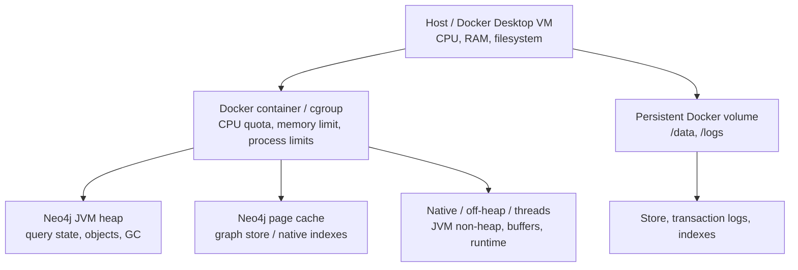

# CPU, RAM, and Volume Limits for Container Deployments

## 1. Why Must You Configure Resources for Containerized Neo4j?

Neo4j stores a **property graph** of nodes, relationships, properties, and indexes, then uses Cypher to query relationships or paths. When running in Docker, Neo4j consumes more than just JVM heap: it also needs **page cache**, native/off-heap memory, CPU for graph traversals, I/O to read/write stores, and durable space for data, transaction logs, and indexes.

A container that starts with default settings is **not a production-ready configuration**. Three common mistakes:

- Setting `mem_limit: 4g` while simultaneously allocating `heap = 3G` and `page cache = 2G`. Total memory already exceeds the container budget before even counting native memory; the kernel may OOM-kill the container.
- Setting `cpus: 1` to save resources while multiple multi-hop queries run concurrently. CPU quota throttling spikes p95/p99 latency even though the Cypher queries are valid.
- Failing to mount a volume for `/data` or accidentally running `docker compose down -v`. When the container is recreated, all data vanishes.

**Goal of this lesson:** understand how container-level limits differ from Neo4j's internal resource budgets, write a Docker Compose configuration with sensible CPU/RAM/volume settings, verify effective limits, and diagnose out-of-memory, disk-full, and CPU-saturation conditions.

This lesson belongs to the **Resource Configuration** chapter of the `DATABASE_ENGINE_GRAPH_NEO4J` module, connecting graph modeling, Cypher, indexes/constraints, query tuning, data ingestion, Java Driver, and Spring Data Neo4j. Examples use a single instance for lab practice; a Neo4j cluster requires separate budgets and volumes for **each member**, along with a different redundancy/replication design.

### After this lesson, you will be able to

1. Explain the meaning of **CPU quota**, **memory hard limit**, **soft reservation**, and remaining host capacity.
2. Partition RAM across **JVM heap**, **page cache**, native memory, and headroom.
3. Use Neo4j environment variables correctly in the `NEO4J_server_memory_...` format inside Docker.
4. Configure **named volumes** for `/data` and `/logs` and distinguish them from bind mounts, ephemeral filesystems, and backups.
5. Verify actual CPU/RAM limits and detect OOM-kills, CPU throttling, and I/O pressure.
6. Tune after measuring with `docker stats`, Neo4j metrics, `EXPLAIN`/`PROFILE`, and application load.

## 2. Distinguishing the Two Layers of Resource Configuration



| Layer | What It Controls | Configuration Example |
|---|---|---|
| **Host / Docker Desktop VM** | Total CPU/RAM/disk available to all containers | Server hardware, Docker Desktop/WSL2 limits |
| **Docker CPU** | Maximum CPU consumption via quota or core pinning | `cpus: 2.0`, `cpuset` if needed |
| **Docker RAM** | Memory limit usable by the container | `mem_limit: 4g` |
| **Neo4j heap** | Java heap: transaction state, query state, objects, etc. | `server.memory.heap.max_size` |
| **Neo4j page cache** | Holds graph store/native index pages to reduce I/O | `server.memory.pagecache.size` |
| **Native / off-heap** | Off-heap regions, memory-mapped files, thread stacks, runtime, buffers, etc. | Primarily requires reserving **headroom** |
| **Docker volumes** | Persists files beyond container lifecycle | `neo4j_data:/data`, `neo4j_logs:/logs` |

**Docker limits do not automatically configure Neo4j memory optimally.** Conversely, setting small heap and page cache values does not stop the container from using extra native memory. Both layers must be designed around **a single unified budget**.

> Configuration keys and image examples below use the Neo4j `2026.10.2` release branch currently referenced as an example in official docs. In another deployment, pin an image tag tested by your organization and re-check matching documentation; never use `latest` to auto-upgrade databases without compatibility validation.

## 3. CPU Limits: Quota Is Not Guaranteed Dedicated CPUs

Docker can enforce a **CPU quota** via cgroups. For example, `cpus: 2.0` sets a usage budget equivalent to roughly **two logical CPUs** over time; it does **not** grant two exclusive physical cores, nor guarantee the container always receives full CPU if the host is shared or overloaded.

| Configuration Option | Meaning | Important Caveats |
|---|---|---|
| `cpus: 2.0` in Compose | Limits container CPU usage via quota | Easy to configure; CPU can be throttled |
| `docker run --cpus=2` | Same behavior for containers launched directly | Does not set Neo4j worker thread count |
| `cpuset: "0-1"` | Restricts container to specific logical CPUs | Does not grant exclusivity; depends on host/cgroup |
| `cpu_shares` / `cpu_weight` | Relative scheduling weight under contention | Not a hard limit of two CPUs |
| `deploy.resources.limits.cpus` | CPU limit in Compose Deploy spec | Enforcement depends on deployment tooling |

### 3.1. How Does a CPU Quota Affect Graph Queries?

Consider the Cypher query:

```cypher
MATCH (a:Person {id: $personId})-[:FOLLOWS*1..3]->(b:Person)
RETURN count(DISTINCT b) AS reachablePeople;
```

This is a **conceptual pattern**, not an executable query until matching data exists. A high-degree node can force Neo4j to expand a huge number of relationships. When CPU is constrained:

- Overall throughput (queries/second) can drop.
- p95/p99 latency climbs when multiple relationship-expansion, sort, or aggregation queries run concurrently.
- Queuing builds up in connection pools or services even though memory has not hit its hard limit.
- Adding more application threads/workers does not automatically boost throughput if CPU is already throttled by quota.

In Docker/cgroups, **throttling** means the container exhausted its CPU budget for the current accounting period and is suspended until the next period. That differs from an application sleeping or waiting on disk I/O.

### 3.2. Choosing Initial CPU Allocation

For a lab instance, `2 vCPU` can serve as an **experimental baseline**, not a minimum standard for every app. Test with a representative workload covering indexed reads, multi-hop traversals, relationship updates, index builds, imports, and aggregation queries.

Principles:

1. Record queries/second, p50/p95/p99 latency, connection acquisition latency, and error rate.
2. Ramp concurrency gradually; identify the point where load increases but throughput stops scaling proportionally.
3. Monitor CPU usage and throttled time; distinguish CPU saturation from disk I/O wait and GC.
4. Fix Cypher/indexes causing excessive DB Hits or row explosions before merely throwing more CPU at it.
5. Leave headroom for batch ingestion, index population, and admin tasks—never design production to run continuously at the quota ceiling.

## 4. RAM: Heap, Page Cache, and Off-Heap Memory Must All Fit Inside the Limit

Neo4j requires at minimum these groups:

| Region | Primary Contents | When Undersized |
|---|---|---|
| **JVM heap** | Java objects, transaction/query state, aggregations | Continuous GC, heap OOME errors, query memory limits |
| **Page cache** | Graph store and native index pages | Rising page faults/cache misses, heavier disk reads |
| **Off-heap / JVM non-heap** | Metaspace, thread stacks, direct/native buffers, runtime | Container OOM even while heap is not full |
| **Filesystem cache / other OS** | Buffers, auxiliary process memory, kernel accounting | Slower I/O or container exceeding cgroup limit |

Never confuse the **Neo4j page cache** with the **JVM heap**: increasing heap does not make store pages cache better. Nor should you give all remaining RAM to the page cache, since native memory, the OS, and query workloads can grow.

### 4.1. Memory Budgeting Formula

Given a container RAM limit, estimate:

```text
Container memory hard limit
  > JVM heap max
  + Neo4j page cache
  + JVM non-heap + direct/native memory
  + thread stacks + runtime/OS overhead
  + headroom for traffic bursts
```

The `>` sign expresses the principle of **leaving headroom**, not an exact formula for every version/runtime. Total usage tracked by cgroups also depends on host memory accounting modes.

An **illustrative learning layout**, not a production recommendation:

| Item | Estimated Budget |
|---|---:|
| Container hard limit | ~4 GiB |
| `server.memory.heap.initial_size` | 1 GiB |
| `server.memory.heap.max_size` | 1 GiB |
| `server.memory.pagecache.size` | 1 GiB |
| Remainder for native, OS, overhead, variance | ~2 GiB |

**Note:** initial heap and max heap **do not add together as two separate allocations**; initial heap is the starting point inside the max heap bound. A real benchmark must inspect working set memory, GC pauses, transaction memory, page cache faults, and `docker stats` before tuning these values.

Setting `heap = 3G` and `pagecache = 2G` inside a `4G` container is an **invalid budget**: those two items already total 5G before even counting overhead.

### 4.2. Neo4j Environment Variables in Docker

Neo4j maps config keys to environment variables using these rules:

- Prefix with `NEO4J_`.
- Convert dots `.` to single underscores `_`.
- Convert existing underscores in the key to **double** underscores `__`.

| Key in `neo4j.conf` | Environment Variable in Container |
|---|---|
| `server.memory.heap.initial_size` | `NEO4J_server_memory_heap_initial__size` |
| `server.memory.heap.max_size` | `NEO4J_server_memory_heap_max__size` |
| `server.memory.pagecache.size` | `NEO4J_server_memory_pagecache_size` |
| `server.jvm.additional` | `NEO4J_server_jvm_additional` |

Docker environment example:

```yaml
environment:
  NEO4J_server_memory_heap_initial__size: "1G"
  NEO4J_server_memory_heap_max__size: "1G"
  NEO4J_server_memory_pagecache_size: "1G"
```

On older Neo4j releases, key names may use `dbms.memory...`. **Never mix variables across major generations** hoping Neo4j will sort them out. Verify active keys and startup warnings, especially after image upgrades.

### 4.3. Using the Memory Recommendation Tool

Neo4j provides the command:

```bash
neo4j-admin server memory-recommendation --memory=4g --docker
```

When `neo4j-admin` is available in the image, you can run it inside a test container:

```bash
docker compose exec neo4j neo4j-admin server memory-recommendation --memory=4g --docker
```

The command outputs suggested environment variables based on the **input memory budget**, not a mandatory config for every workload. For databases already containing data, also compare store and index sizes against the page cache recommendation. `memory-recommendation` does not replace real measurements under heavy transaction workloads, full-text/vector search, or large imports.

## 5. Docker Compose: A Safe CPU, RAM, and Volume Configuration for Testing

The complete example below uses **Docker Compose V2**. The service name is `neo4j`; the image is pinned to a specific tag to avoid unexpected upgrades. Passwords are supplied via a **Docker Compose secret**, never hardcoded in YAML.

**Preparation:** create `./secrets/neo4j_auth.txt` on the Compose host containing a **single line** in the format `neo4j/<strong-password>`. Restrict file read permissions, keep it outside source control or add it to `.gitignore`, and use your platform's secret store in real environments. Neo4j uses `NEO4J_AUTH_FILE` to read the initial secret on first initialization.

```yaml
services:
  neo4j:
    image: neo4j:2026.10.2
    restart: unless-stopped

    # Docker/container-level resource limits.
    cpus: 2.0
    mem_limit: 4g
    mem_reservation: 3g
    pids_limit: 512
    stop_grace_period: 90s

    # Bind to localhost in learning environments;
    # do not expose Bolt/Browser directly to the Internet.
    ports:
      - "127.0.0.1:7474:7474"
      - "127.0.0.1:7687:7687"

    environment:
      NEO4J_AUTH_FILE: /run/secrets/neo4j_auth
      NEO4J_server_memory_heap_initial__size: "1G"
      NEO4J_server_memory_heap_max__size: "1G"
      NEO4J_server_memory_pagecache_size: "1G"

    secrets:
      - neo4j_auth

    volumes:
      - neo4j_data:/data
      - neo4j_logs:/logs

secrets:
  neo4j_auth:
    file: ./secrets/neo4j_auth.txt

volumes:
  neo4j_data:
  neo4j_logs:
```

Explanation:

1. `cpus: 2.0` caps CPU; **it does not set worker/query thread counts**.
2. `mem_limit: 4g` is the container RAM hard limit; `mem_reservation: 3g` is a soft reservation, **not** guaranteed RAM like a hard quota.
3. Heap 1G + page cache 1G leaves headroom for allocations outside those two pools; still monitor `OOMKilled` and RSS/working set.
4. `neo4j_data` and `neo4j_logs` are **named volumes**, preserving data/logs when the container is replaced or recreated with the same volumes.
5. `127.0.0.1` publishes ports only to the local host; if an app runs in another container on the same Compose network, connect via service name `neo4j:7687` and avoid exposing ports unnecessarily.
6. `NEO4J_AUTH_FILE` uses a file-based secret, avoiding embedding passwords in `compose.yaml` or environment variables. Protect the source file on the host.

**Warning:** `NEO4J_AUTH`/`NEO4J_AUTH_FILE` sets the **initial password**; if `/data` already contains an initialized database with auth state, changing the secret on restart **does not automatically change the existing password**. Rotate passwords using Neo4j's identity administration procedures.

### 5.1. Running and Verifying the Configuration

The commands below are steps for **learners to run in their practice Docker environment**; this guide does not execute commands on your machine:

```bash
docker compose config --quiet
docker compose up -d
docker compose ps
docker compose logs --tail 80 neo4j
```

`docker compose config --quiet` validates syntax and parsing without printing the full resolved config to the terminal. Never post unfiltered `docker compose config` or `docker inspect` output to public logs if secrets could be exposed.

Connect to Neo4j Browser at `http://localhost:7474` and Bolt at `bolt://localhost:7687` if deployed as shown. For production, establish dedicated network policies, TLS, RBAC, operations runbooks, and backups; **never** use this learning example directly as a production deployment.

### 5.2. Starting Directly with docker run

Without Compose, the same approach translates to:

```bash
docker run -d --name neo4j-lab \
  --cpus 2 \
  --memory 4g \
  --memory-reservation 3g \
  -p 127.0.0.1:7474:7474 \
  -p 127.0.0.1:7687:7687 \
  -v neo4j_lab_data:/data \
  -v neo4j_lab_logs:/logs \
  -e NEO4J_server_memory_heap_initial__size=1G \
  -e NEO4J_server_memory_heap_max__size=1G \
  -e NEO4J_server_memory_pagecache_size=1G \
  neo4j:2026.10.2
```

This illustrates **resource flags only**. It omits secret/initial-password configuration; use the **Compose with secret** pattern above for authenticated practice. Never set `NEO4J_AUTH=none` just to spin up a database reachable by others.

### 5.3. Compose `deploy.resources` Differs from Service-Level Keys

In the **Compose Deploy Specification**, an alternative pattern is:

```yaml
services:
  neo4j:
    image: neo4j:2026.10.2
    deploy:
      resources:
        limits:
          cpus: "2.0"
          memory: 4G
        reservations:
          cpus: "1.0"
          memory: 2G
```

This is an **isolated snippet**, not a complete second Compose file (lacking volumes/auth/networking). `deploy.resources` declares limits/reservations per deployment spec; actual enforcement depends on Docker Compose/Swarm and tool version. Within one service, **do not specify conflicting `mem_limit` and `deploy.resources.limits.memory` values**. After deploying, inspect the created container's actual runtime properties rather than trusting YAML alone.

For local `docker compose up`, the main example uses `cpus`, `mem_limit`, and `mem_reservation` directly for clarity. For Kubernetes, use `resources.requests/limits` and `PersistentVolumeClaim` manifests; **never** copy a Compose file verbatim in place of Kubernetes manifests.

## 6. Volumes: Persistence Is Neither a Quota Nor a Backup

Common container mount paths used by the Neo4j Docker image:

| Container Mount | Role | Permissions / Notes |
|---|---|---|
| `/data` | Database stores, transaction logs, and related data | **Essential**; requires read/write, durable storage |
| `/logs` | Neo4j log files | Recommended to separate for monitoring, rotation, and debugging |
| `/import` | CSV/file source for data ingestion | Commonly mounted **read-only** when writes are unneeded |
| `/conf` | Neo4j configuration | Mount only when you understand config loading and file permissions |
| `/plugins` | Approved APOC JARs and extensions | Restrict write access; verify version compatibility |
| `/licenses` | Neo4j/plugin licenses if required | Protect read permissions appropriately |

### 6.1. Named Volume vs. Bind Mount

| Criterion | Named Volume | Bind Mount |
|---|---|---|
| Declaration | `neo4j_data:/data` | `/srv/neo4j/data:/data` |
| Host path management | Managed by Docker | Operator manages explicit host path |
| Host migration | Requires backup/data transfer or shared storage solution | Must prepare paths/permissions on target host |
| File permissions | Follows volume and container UID | Must verify UID/GID, ACLs, SELinux/AppArmor |
| Risks | Accidental volume deletion/cleanup | Mounting wrong directory, bad permissions, unsuitable filesystem |

Example bind mount replacing named volumes on a Linux host with pre-created directories:

```yaml
services:
  neo4j:
    volumes:
      - /srv/neo4j/data:/data
      - /srv/neo4j/logs:/logs
      - /srv/neo4j/import:/import:ro
```

This snippet **replaces only the volumes section** and is not a full Compose file. The host must provide the directories, proper read/write permissions, and durable storage. The Neo4j image runs as user `neo4j` inside the container; common images use UID `7474`, though you should check your exact image and `--user`/user-namespace policies before adjusting ownership. **Never "fix" permission errors with `chmod -R 777` or by unnecessarily running the DB as root.**

### 6.2. Docker Does Not Enforce a Size Quota on Named Volumes by Default

`mem_limit` caps **RAM only**; it does not put a 10 GB or 100 GB cap on `neo4j_data`. Standard named volumes share the capacity of the underlying filesystem/driver. `storage_opt` or specific filesystem/quota setups can enforce caps in narrow scenarios, but **there is no universal fixed-size quota flag for all Docker volumes**.

Therefore, **control disk space at the storage layer**: dedicated partitions/LVM/quotas or filesystems, quota-aware volume drivers, managed cloud disks/PVCs, and disk-space alerts. Never guess remaining GB from a volume's name.

Disk usage grows from multiple sources:

- Graph stores for nodes and relationships.
- Native indexes, full-text indexes (Lucene), vector indexes, and query-supporting structures.
- Transaction logs, checkpoints, and mutations not yet pruned per retention policy.
- Operational logs, temporary export/import files, and database dumps/backups if placed on the same filesystem.
- Index population during creation/rebuilds can temporarily require substantial disk space and I/O.

**Budget for total disk demand**, including **growth rate** and space for recovery/upgrade operations—not merely initial store size.

### 6.3. Data Persistence and Dangerous Cleanup Commands

`docker compose stop` or `docker compose down` normally preserves Compose-managed named volumes. However:

```bash
# DANGEROUS: illustration only, DO NOT RUN against data you need to keep.
docker compose down -v
```

The `-v` flag deletes project-managed named volumes. If those volumes hold `/data`, data can be permanently lost without a backup.

Changing the **project name** or Compose volume name can also make a new container attach to **a different volume**, causing Neo4j to boot with an empty store even though the old data still exists in the previous volume. Before concluding "data was lost," check volume names, actual mounts, selected database, and backups.

**Persistence ≠ backup.** Volumes keep data across container restarts/recreations, yet they do not protect against accidental deletes, store corruption, ransomware, filesystem bugs, admin errors, or host failure. Maintain a Neo4j backup/restore workflow matching your edition and online/offline needs, store copies off-host, and test restores. **Never simply tar/copy a live `/data` directory** and assume the copy is consistent.

## 7. Verifying That CPU/RAM Limits and Volumes Are Effective

Do not judge a configuration by `docker compose up` returning exit code 0. Verify reality across the **Docker host**, **container**, and **Neo4j**.

### 7.1. Inspecting Docker/cgroups

```bash
# View container status for the Compose project.
docker compose ps

# CPU%, MEM USAGE / LIMIT, NET I/O, BLOCK I/O.
docker stats --no-stream

# Inspect memory/CPU limits Docker recorded for the Neo4j container.
docker inspect --format '{{.HostConfig.Memory}}' <container-id>
docker inspect --format '{{.HostConfig.NanoCpus}}' <container-id>

# Check whether the container was OOM-killed on its last exit.
docker inspect --format '{{.State.OOMKilled}}' <container-id>

# Which volumes are actually mounted?
docker inspect --format '{{json .Mounts}}' <container-id>
```

In these commands, `<container-id>` is the Neo4j container ID or name from `docker compose ps`—**do not** type the angle brackets literally. `HostConfig.Memory` is typically in bytes; `HostConfig.NanoCpus` expresses quota in nano-CPUs when used. Docker engines may store quotas in other fields depending on configuration, so cross-check container runtime state instead of relying on a single field.

**Security warning:** full `docker inspect` output can reveal sensitive environment variables and mount paths; in reports, extract only needed fields and protect logs/traces. The snippets above filter to specific common fields.

### 7.2. Inspecting Volume and Disk Status

```bash
# Docker-managed volume names and mount points.
docker volume ls
docker volume inspect <volume-name>

# Overview of Docker disk usage.
docker system df -v

# View filesystem capacity from inside the container.
docker compose exec neo4j df -h /data /logs
```

These commands do not create quotas. `docker volume inspect` reports volume metadata and **does not guarantee an accurate "capacity" field**. `df -h` shows the filesystem hosting the mount; when multiple volumes share one filesystem, verify how quotas are enforced at the storage layer.

For storage systems with per-volume limits (cloud disks/PVCs/specialized drivers), check capacity metrics from that storage platform too. If `/data` and `/logs` share one disk, runaway logs can starve the database of write space.

### 7.3. Inspecting Neo4j from the Inside

Once Neo4j is running, an account authorized to inspect configuration can run:

```cypher
SHOW SETTINGS
YIELD name, value
WHERE name IN [
  'server.memory.heap.initial_size',
  'server.memory.heap.max_size',
  'server.memory.pagecache.size'
]
RETURN name, value
ORDER BY name;
```

Expect values matching 1G/1G/1G; exact byte/unit formatting depends on version. `SHOW SETTINGS` privileges may be restricted by RBAC; never grant admin privileges to application accounts just for inspection.

Read startup logs:

```bash
docker compose logs --tail 150 neo4j
```

Look for **unrecognized config keys**, memory warnings, `/data` permission errors, indexes failing to initialize, or low disk space. Setting a Docker hard memory limit does not guarantee the JVM always infers an optimal budget for your workload; verify the exact settings Neo4j applied.

## 8. Symptom-Driven Configuration, Not Random Tweaking

| Symptom | Data Source | Likely Root Cause | Next Step |
|---|---|---|---|
| Container `OOMKilled` | Docker state/events, memory metrics | Heap + page cache + native exceeded limit | Lower allocations or raise limit safely; check dumps/logs and peaks |
| Java reports heap `OutOfMemoryError` | JVM GC logs, heap metrics | Very large result sets, transactions, or aggregations | Optimize Cypher, cap query memory, evaluate heap size |
| Rising p95, long GC pauses | JVM GC, heap usage | Undersized heap or long-lived objects | Inspect transactions/queries, batch sizes, profiling |
| Rising page cache faults | Neo4j metrics, I/O reads | Working set exceeds page cache or cache is cold | Measure warmup, memory budget, indexes/scans |
| CPU% near quota, high throttling | `docker stats`, cgroup CPU stats | Quota too low for concurrency and query cost | Optimize `PROFILE`/indexes, throttle load, consider raising CPU |
| High I/O wait while CPU has headroom | Disk latency, page faults, block I/O | Slow disk, undersized cache, index population | Evaluate SSD, capacity/IOPS, and workload |
| `No space left on device` | `df`, volume metrics, logs | Stores/indexes/logs filled filesystem | Expand storage, clean authorized artifacts, check backup/retention |
| Startup fails right after mount | Container logs, filesystem ACLs | Wrong `/data` or `/logs` permissions | Fix ownership/ACLs safely for runtime UID |
| Database looks empty after `up` | Mounts, project name, volume list | Attached to wrong volume or wrong database | Locate previous volume; do not initialize/overwrite before investigating |

### 8.1. Distinguishing Three Kinds of "Out of Memory"

1. **Heap OOME**: the JVM heap is exhausted; the container **may still have** memory headroom, yet a huge aggregation or millions of records inside the Java heap crashes Neo4j.
2. **Native/off-heap OOM**: an off-heap allocation fails even before heap reaches max, involving page cache, direct buffers, or runtime structures.
3. **Container OOM kill**: the OS/cgroup kills the process when total memory usage exceeds the hard limit; `OOMKilled=true` is a useful clue, though state/events/logs must still be checked to confirm the exact incident.

Never automatically raise heap up to `mem_limit` when seeing an OOM. Doing so shrinks space for native memory and page cache and can make failures worse.

### 8.2. Evaluating with EXPLAIN and PROFILE

A multi-hop Cypher query can be expensive even when the container has abundant CPU/RAM:

```cypher
EXPLAIN
MATCH (p:Person {id: $personId})-[:FOLLOWS*1..3]->(other:Person)
RETURN count(DISTINCT other) AS reachablePeople;
```

`EXPLAIN` does not execute; read the operator tree to check starting points, scan/index choices, `Expand` steps, and estimated rows. Run `PROFILE` only against appropriate test data/databases, as it **executes the query**:

```cypher
PROFILE
MATCH (p:Person {id: $personId})-[:FOLLOWS*1..3]->(other:Person)
RETURN count(DISTINCT other) AS reachablePeople;
```

This query is a **syntax illustration** and requires real `Person` and `FOLLOWS` fixture data to measure. Inspect `Rows`, `DB Hits`, memory, and runtime pipelines to catch overly broad expansions, late filtering, or costly sorts/aggregations. `DB Hits` counts logical database access work, **not** physical disk reads or CPU time.

**Always optimize queries and indexes alongside resource limits.** More container memory will not fix a query that explodes intermediate rows; more CPU will not fix a missing index.

## 9. Optimizing Volumes and Ensuring Data Durability

### 9.1. Neo4j I/O Characteristics

A single transaction creating/updating relationships can touch:

- The database store.
- Transaction logs and checkpoints.
- Indexes updated alongside nodes/relationships.
- The page cache and disk flush mechanisms.

Consequently, Neo4j needs storage with predictable latency and **durable write semantics**. SSD/NVMe or managed persistent disks with monitored IOPS and throughput are generally far better suited than network filesystems lacking guaranteed flush semantics or latency. Before using NFS, SMB, Docker Desktop file sharing, or specialized storage drivers for production `/data`, check Neo4j and platform recommendations.

### 9.2. Imports, Log Rotation, and Growth

- For CSV ingestion, prefer mounting sources into `/import` as needed, typically `read-only`; avoid placing giant CSV files on the store volume unnecessarily.
- Monitor log rotation and retention; prevent `/logs` from filling the filesystem.
- Building full-text/vector indexes can increase disk usage and build time; reserve extra headroom during schema transitions.
- Store backups/archives **outside the data volume and off-host**, or at least in an independently managed location, and test restores.
- When changing image versions, keep the volume while still checking **store format/upgrade path compatibility**, backups, and maintenance windows; a persistent volume does not guarantee arbitrary database version rollbacks.

### 9.3. Safe Startup and Shutdown

Give the container a suitable **stop grace period** so Neo4j can shut down cleanly, flush data, and close transactions. Setting `stop_grace_period: 90s` in the Compose example is illustrative—90 seconds is not always enough for very large databases or heavy workloads.

`restart: unless-stopped` restarts the container after certain crashes, **but it does not cure** repeated OOMs, corrupted volumes, or insufficient RAM. Restart loops require alerting and investigation; never "fix" real data by wiping `/data`.

## 10. Running on Docker Desktop, Servers, and Orchestrators

| Environment | Key Differences to Remember |
|---|---|
| Linux Docker Engine | Cgroups and quotas apply directly to host resources; storage/volumes depend on driver and filesystem |
| Docker Desktop Windows/macOS | Docker runs inside a VM/WSL2; VM RAM/CPU caps constrain containers even when the host has more hardware |
| Single-host Docker Compose | Easy to set `cpus`, `mem_limit`, and named volumes, but provides no HA on its own |
| Docker Swarm | Uses platform `deploy.resources` and volumes with explicit placement/persistence design |
| Kubernetes | Configures CPU/memory requests/limits and PersistentVolumeClaims; manages eviction, readiness/liveness, and topology |

In a Neo4j cluster, **every member must have its own properly modeled storage**, role-appropriate CPU/RAM, networking/discovery, quorum, and monitoring. Never mount the **same `/data` volume** across multiple active Neo4j processes; doing so risks data corruption.

### 10.1. Do Not Confuse Requests/Reservations with Limits

- **Limit**: a ceiling; CPU can be throttled and memory can be OOM-killed.
- **Reservation/request**: resource amount used for scheduling or platform priority; not a hard cap.
- **Resource availability**: the host must still have enough aggregate RAM, CPU, and I/O for **all** containers. Two containers each given `mem_limit: 4g` on a 4 GB machine do not each get 4 GB of real RAM.

## 11. Safe Workflow for Measuring and Updating Configuration

A practical workflow for Neo4j services using Java Driver or Spring Data Neo4j:

1. **Freeze workload and test dataset:** node/relationship counts, native/full-text/vector index sizes, Cypher categories, concurrent users, batch ingestion.
2. **Define SLOs:** e.g., read p95 < 200 ms at 100 QPS, errors < 0.1%, acceptable ingestion duration; these numbers are **illustrative**, not standard Neo4j SLOs.
3. **Record baseline:** CPU throttling, RSS/working set, container OOMs, heap/GC, page cache faults/hits, block I/O, free disk, and API p50/p95/p99.
4. **Change one parameter group at a time:** e.g., raise `cpus` from 1 to 2 while holding RAM constant, or increase page cache within a budget that preserves headroom.
5. **Apply/restart via standard procedure:** confirm cgroups and `SHOW SETTINGS` reflect the new config, and verify indexes and databases are online.
6. **Warm up then benchmark:** separate cold/warm cache, test multiple concurrency levels, common vs. rare queries, and mixed read/write load.
7. **Compare before/after:** identical data, hardware, load profile, and duration; if p95 improves while OOMs/GC or write latency worsen, reject the change.
8. **Define rollback and monitoring:** save the previous config, and never roll back a store/database version without a supported upgrade/downgrade path and a verified backup.

### 11.1. Example Comparison Table (Hypothetical Figures)

| Option | CPU Limit | Container RAM | Heap | Page Cache | p95 Read | OOM / Disk |
|---|---:|---:|---:|---:|---:|---|
| A | 1 vCPU | 4G | 1G | 1G | 310 ms | None / sufficient |
| B | 2 vCPU | 4G | 1G | 1G | 160 ms | None / sufficient |
| C | 2 vCPU | 4G | 2.5G | 1.5G | 120 ms in short test | OOM risk from zero headroom |
| D | 2 vCPU | 6G | 2G | 2G | 135 ms | None / sufficient |

These figures were **not measured from a real Neo4j cluster**; they illustrate how to evaluate trade-offs. Option C is not safe just because its short-run p95 is lower: heap and page cache already consume the full 4G with zero room for native/OS memory. Option B fits best within a fixed 4G budget; Option D weighs extra infrastructure cost against meaningful latency gains.

## 12. Common Mistakes and How to Prevent Them

1. **Setting heap equal to container RAM.** Starves page cache and native memory; causes OOMs. Always reserve headroom.
2. **Only raising heap when queries slow down.** Queries may be slow due to page cache misses, CPU throttling, or graph fan-out; check metrics and `PROFILE`.
3. **Treating `cpus` as exclusive CPUs.** A CPU quota does not guarantee host CPU availability; monitor saturation and throttling.
4. **Treating memory reservation as memory limit.** Reservations do not replace hard limits; check `docker inspect` to verify.
5. **Treating volumes as backups.** Volumes do not stop accidental deletes or host loss; maintain backups and restore drills.
6. **Omitting a `/data` mount.** Data is lost whenever the container is replaced or removed; mount persistent volumes before loading data.
7. **Assuming Docker named volumes have built-in quotas.** Capacity usually comes from the underlying filesystem/driver; configure alerts.
8. **Using `down -v` during production cleanup.** Deletes volumes and data; never run it without verifying scope.
9. **Using bind mounts without proper permissions.** Neo4j fails to write stores/logs and cannot start; verify UID/GID/ACLs.
10. **Sharing one `/data` volume across multiple Neo4j servers.** That does not form a cluster; it risks store corruption.
11. **Setting a new `NEO4J_AUTH` expecting to change an existing password.** It only applies on first initialization; rotate existing passwords properly.
12. **Upgrading images via `latest` without backups.** Store formats and configs can change; pin tags and test upgrades.

## 13. Practice Exercises

1. **4G Budgeting:** a team proposes 2G heap and 2G page cache with a 4G hard limit. Explain why this fails, and propose an alternative that leaves headroom.
2. **Compose Practice:** write a Compose file with `cpus: 1.5`, `mem_limit: 6g`, 2G heap, 2G page cache, and named volumes for `/data` and `/logs`. Validate with `docker compose config --quiet` and `docker inspect`.
3. **Comparing CPU:** run the same Cypher workload at fixed concurrency with 1 vs. 2 vCPU limits. Measure p50/p95, throughput, and throttling. Do not draw conclusions from a single run.
4. **Comparing Page Cache:** hold the hard limit fixed and raise page cache from 512M to 1G while headroom permits. Observe cache faults, I/O, and p95 in cold vs. warm cache states.
5. **Testing Volume Persistence:** create a few nodes in a practice database, stop and recreate the container **with the same named volume**, and verify the nodes persist; explain the danger of `down -v` **without executing destructive commands**.
6. **Investigating Permissions:** configure a bind mount with mismatched UID/GID in a test environment, inspect startup logs, and fix ACLs for the Neo4j runtime user; never use `chmod 777`.
7. **Distinguishing Limit Styles:** create one Compose file using `deploy.resources` and one using `mem_limit`/`cpus`, deploy separately in an approved test environment, and compare enforced limits.
8. **Diagnosing OOM:** given 1G heap, 1G page cache, 1.5G peak native usage, and a 3G limit, explain why an OOM occurs even though the heap is not full.
9. **Capacity Forecasting:** given a 30G graph store, 12G indexes, 8G logs, 4G/month growth, and space needed for backups/index rebuilds, build a 12-month storage budget and alert thresholds.
10. **Production Review:** draft a checklist covering CPU/RAM/volumes, image tags, TLS, backup/restore, file permissions, metrics, stop grace period, upgrades, and rollback for a Spring Data Neo4j service.

**Completion criteria:** the learner proves container CPU/RAM limits **are actively enforced**, Neo4j applies the intended heap/page cache, `/data` persists across container recreation, storage is monitored, and benchmark gains do not trade off stability for OOMs, data loss, or upgrade hazards.

## 14. Pre-Production Checklist

- [ ] CPU quota and RAM budget match measured load; host retains headroom for other workloads.
- [ ] Heap + page cache + transaction memory stay safely inside cgroup RAM; native headroom is monitored.
- [ ] `docker inspect`/`docker stats` and `SHOW SETTINGS` confirm effective configuration.
- [ ] `/data` uses a dedicated persistent volume per instance; `/logs` is managed with rotation and disk alerts.
- [ ] Appropriate storage capacity/IOPS and **consistent backups** are in place with passing restore tests.
- [ ] Bolt/Browser are not exposed publicly; secrets and TLS are configured for the environment.
- [ ] Image tags are pinned, with upgrade, backup, and **store-format-compatible** rollback plans.
- [ ] SLOs and monitoring cover CPU throttling, OOMs, heap/GC, page cache, I/O, p95/p99, and volume health.
- [ ] `down -v` is never part of routine container cleanup.

## 15. References

- [Neo4j Operations Manual — Docker](https://neo4j.com/docs/operations-manual/current/docker/): running Neo4j in Docker, configuration, and images.
- [Neo4j — Configure Docker image](https://neo4j.com/docs/operations-manual/current/docker/configuration/): environment variables and `neo4j.conf` mapping.
- [Neo4j — Docker-specific configuration settings](https://neo4j.com/docs/operations-manual/current/docker/ref-settings/): full list of `NEO4J_server_memory_*` environment variables.
- [Neo4j — Persisting data with Docker volumes](https://neo4j.com/docs/operations-manual/current/docker/mounting-volumes/): `/data`, `/logs`, `/import`, and file permissions.
- [Neo4j — Deploy with Docker Compose](https://neo4j.com/docs/operations-manual/current/docker/docker-compose-standalone/): Compose configuration and Docker secrets.
- [Neo4j — Docker-specific operations](https://neo4j.com/docs/operations-manual/current/docker/operations/): `neo4j-admin server memory-recommendation --docker`.
- [Neo4j — Memory configuration](https://neo4j.com/docs/operations-manual/current/performance/memory-configuration/): heap/page cache, stores/indexes, and controlling transaction memory.
- [Docker Docs — Compose container specification](https://docs.docker.com/reference/compose-file/container-spec/): `cpus`, `mem_limit`, `mem_reservation`, and mounts.
- [Docker Docs — Compose Deploy Specification](https://docs.docker.com/reference/compose-file/deploy/): `deploy.resources.limits` and `reservations`.
- [Neo4j Cypher Manual — Execution plans](https://neo4j.com/docs/cypher-manual/current/planning-and-tuning/execution-plans/): using `EXPLAIN`/`PROFILE` to diagnose resource-intensive queries.
