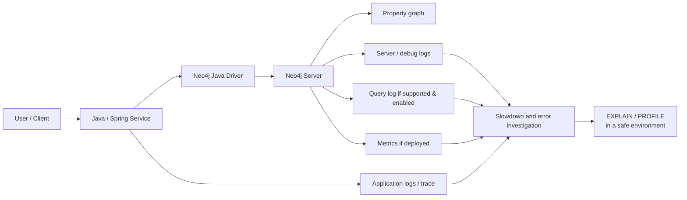
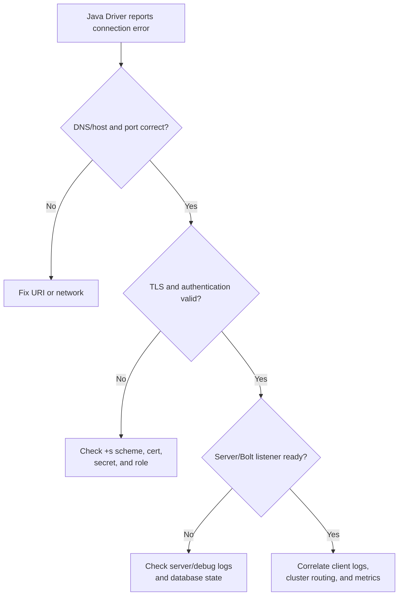
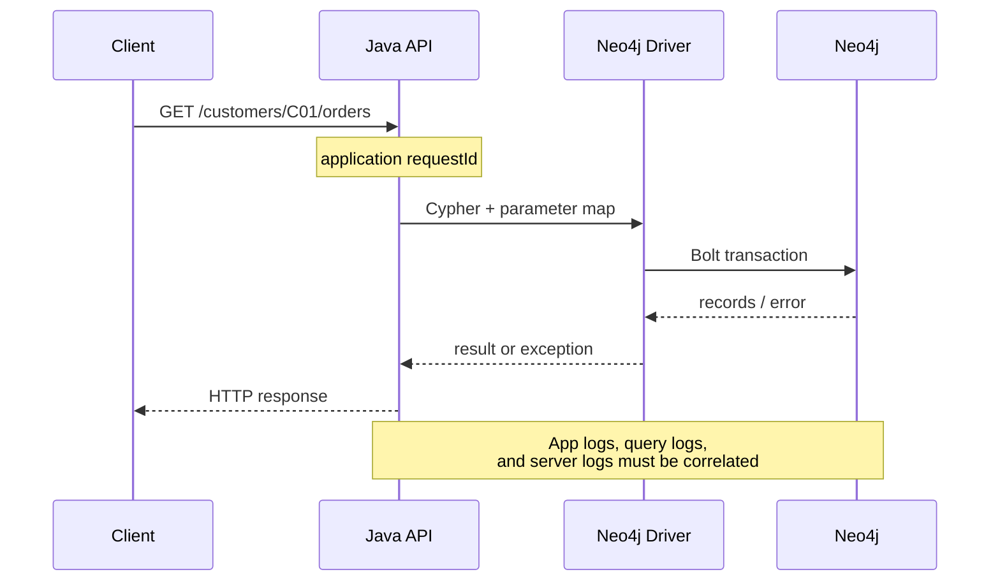
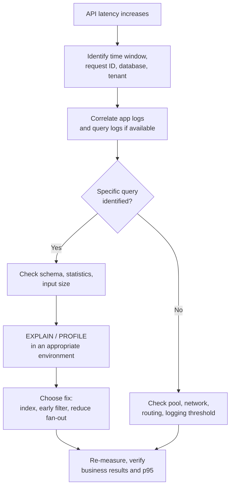

# Server Logs, Query Logs, and Support Scope

A slow Cypher query, a Java Driver failing to connect, or Neo4j failing to start can all appear as a "Neo4j error". However, these three issues require different types of evidence. **Server logs** help explain the lifecycle and errors of the Neo4j process; **query logs** help investigate executed Cypher statements, processing times, and configured execution details; while **security logs** and **metrics** help identify authentication events, load, and resource health.

This lesson belongs to the **Monitoring** chapter of the **DATABASE_ENGINE_GRAPH_NEO4J** module. The context is a *property graph* system querying nodes, relationships, and paths with Cypher, using **indexes/constraints**, the **Neo4j Java Driver** or **Spring Data Neo4j**, along with data import and graph operation pipelines. The content focuses on **which log answers which question, how to read and use them, and support boundaries by version, edition, privileges, and deployment model**.

> **First principle:** Do not assume every Neo4j deployment has the exact same log files or the same log-viewing privileges. Some capabilities only exist in specific versions, editions, or service tiers; managed systems may expose logs/metrics only through the provider's UI or API rather than allowing direct reads of the server's log directory.

## 1. Monitoring Map: Logs, Metrics, Traces, and Execution Plans

In operations, four observability sources complement one another:

| Source | Questions Answered Best | Limitations |
| --- | --- | --- |
| **Server logs** | How did Neo4j start/stop? Are there config, connectivity, memory, or server component errors? | Do not necessarily list individual Cypher statements |
| **Query logs** | Which queries were recorded? How long did they take? Which parameters/execution details were permitted? | Do not replace a `PROFILE` plan; may be disabled or restricted |
| **Metrics** | How do CPU, heap, page cache, transactions, throughput, and latency change over time? | Aggregated numbers rarely pinpoint the exact Cypher query causing slowness |
| **Distributed tracing / app logs** | Which API request triggered which transaction? Is latency in Java, network, Neo4j, or another service? | Requires proper instrumentation and correlation |
| **`EXPLAIN` / `PROFILE`** | Which operators does the planner choose; how are intermediate rows and `DB Hits` distributed? | `PROFILE` actually executes the query; not a long-term log |

An investigation flow from API to Neo4j:



Do not rely on a single signal. For example, a query log showing an 8-second query does not prove all 8 seconds were spent traversing relationships. The cause might be lock waiting, page cache misses, system load, sorting, or actual execution time. Always cross-reference plans, metrics, and concurrent requests.

## 2. Common Log Types in Neo4j

When **self-managing Neo4j**, the names below represent the log types to look for. Whether a file exists, what it contains, whether it is enabled, and its exact filename depend on version, configuration, and edition.

| Common Log Type | Primary Role | Typical Investigation Use |
| --- | --- | --- |
| `neo4j.log` / server log | Server-level operational events, startup/shutdown, warnings, and errors | Startup failure, server unavailable, invalid configuration |
| `debug.log` | More detailed diagnostics for internal components, depending on log level | Deep server component errors, technical troubleshooting with operations |
| `query.log` | Query details configured for recording, such as Cypher text, duration, or status | Slow queries, heavy query patterns, investigating specific requests |
| `security.log` | Authentication, authorization, or security-related changes when supported | Failed logins, security administration actions |
| `http.log` | HTTP access entries if HTTP request logging is deployed/enabled | HTTP/Browser endpoint errors or HTTP traffic issues |
| GC/JVM log | Garbage collection details and JVM behavior when configured | Heap pressure, GC pauses, OutOfMemory risk |
| Application/Driver logs | Client-side Java Driver or application events where the client runs | DNS, TLS, retries, request ID, mapping errors |
| Transaction log (WAL) | Transactional write structures for durability/recovery | Recovery and storage operations; **not** a query log to read in a text editor |

**Two distinctions to keep clear:**

1. **`query.log` is not the transaction log**: the transaction log is internal binary/storage data for durability and recovery, not a human-readable list of Cypher statements for analysis.
2. **`security.log` does not equal full auditing of all data reads**: recorded events and scope depend on edition, configuration, and privileges; compliance auditing requires dedicated design and verification.

### 2.1. Logs Are Not Absolute Performance Counters

A log message is evidence that **a specific event was recorded**; it does not prove that other events did not occur. For instance, not seeing a Cypher query in `query.log` may be because:

- Query logging is not enabled or the edition does not support it.
- The query ran faster than the logging threshold.
- Log level filtering excluded that event category.
- The log was rotated, deleted by retention, or lives on another cluster node.
- The query ran on a different database/node than the one whose log you are viewing.
- The application never sent the request to that server.

Therefore, **"not found in the log" does not mean "the query definitely never ran"**.

## 3. Where to Find Logs by Deployment Environment?

### 3.1. Self-Managed Neo4j on a Host

In many self-managed Neo4j installations, log files reside in the **`logs`** directory under Neo4j's configured data/home path. **Illustrative structure**, not a mandatory layout:

```text
neo4j-home/
  conf/
    neo4j.conf
    server-logs.xml       # Separate Log4j config may exist depending on version
    user-logs.xml
  logs/
    neo4j.log
    debug.log
    query.log             # Only when supported and configured
    security.log          # Depends on version/edition
```

**Do not use this illustrative tree to blindly create files or alter config.** In containers or OS package installations, configuration files and log directories may be mapped elsewhere. Some logs are sent to **stdout/stderr** instead of named files.

To locate logs accurately, administrators should check the **log configuration documentation for the exact running version**, container mounts/manifests, and the system's log collection policy.

### 3.2. Docker and Kubernetes

With Docker, you can view **stdout/stderr of the container process** using the operational CLI, for example conceptually:

```bash
docker logs --tail 200 neo4j
```

In Kubernetes:

```bash
kubectl logs deploy/neo4j --tail=200
```

These commands are **operational examples**—use them only with the right container/deployment name and required permissions. **Stdout/stderr is not guaranteed to include all of `query.log` or `security.log`**, because individual logs may be written to separate files or collectors. In a cluster, inspect the exact pod/member that handled the query or aggregate logs across nodes.

If logs must survive container removal, configure an appropriate **persistent volume or log collector**. Never store secrets in logs, and do not rely on ephemeral container filesystems for long-term retention requirements.

### 3.3. Managed Neo4j and Aura

With managed services, users typically **do not have SSH access or arbitrary server file read access**. Depending on the service tier and release, you may have:

- Operational metrics via consoles/dashboards.
- Provider-exposed query observability or diagnostic tools.
- Log export/lookup features via supported consoles, APIs, or support tiers.
- Restrictions on configuring log levels, filesystems, retention, and plugins.

Never instruct learners to edit `neo4j.conf` or look for `logs/query.log` on an Aura host as if it were a self-managed VM. Use the **documented features of the active product/tier**; if raw query logs are unavailable, supplement with application-side logging/tracing and the observability tools provided by the service.

## 4. Server Logs: What Should You Read?

Server logs and debug logs are especially useful when errors happen **before** a query executes or at the infrastructure layer.

Event categories to look for:

1. **Startup/shutdown:** Did Neo4j start listening on Bolt? Did the database transition to an available state?
2. **Configuration:** Invalid config keys, insufficient path permissions, unreadable TLS certificates.
3. **Database lifecycle:** Database starts, stops, recovery failures, or cluster member states.
4. **Runtime errors:** JVM/heap errors, filesystem errors, internal errors, or inability to serve requests.
5. **Network/Bolt/HTTP:** Messages regarding ports, listeners, and connections when enabled.
6. **Operational warnings:** Resource or configuration signals warranting deeper investigation.

**Illustrative** message example (not verbatim output from a specific Neo4j version):

```text
2026-11-25T08:00:01Z INFO  [Server] Starting Neo4j ...
2026-11-25T08:00:08Z INFO  [Bolt] Listening on 0.0.0.0:7687
2026-11-25T08:00:10Z INFO  [Database] Database "neo4j" is available
2026-11-25T08:14:20Z WARN  [Memory] Resource pressure detected
```

To interpret a log line, you need to know:

- **Timestamp** and timezone: is the data in UTC or local time?
- **Log level:** DEBUG/INFO/WARN/ERROR is a logging priority, not automatically business severity.
- **Emitting component:** Bolt, database, transaction, JVM, security, or another module.
- **Database/server:** a Neo4j cluster has multiple members and multiple databases.
- **Message and attached error:** stack trace, error code, or request context.

Do not search only for lines containing `ERROR`: a repeating series of warnings can describe an ongoing degradation, whereas a single self-recovered error might not have impacted users.

### 4.1. Server Logs and Java Driver Connection Issues

When the Java Driver reports a connection failure, first determine **whether the request even reached Neo4j**. A DNS or firewall issue on the application side can occur before the server receives any connection; in that case, server logs will have no record of it.

Typical workflow:



Examples:

- `bolt://localhost:7687` inside a Java container may mistakenly point to the **Java container itself**, not Neo4j.
- `neo4j+s://...` may fail TLS due to a mismatched endpoint or certificate; never switch arbitrarily to `+ssc` in production.
- A successful `verifyConnectivity()` only confirms a connection can be established; it does not prove the user has privileges to execute real data queries in the target database.

## 5. Query Logs: What Are They Actually For?

**Query logging** records **queries matching the configured policy**, helping identify slow Cypher statements, monitor workloads, and investigate user-reported incidents.

Typical questions:

- Which query templates frequently exceed the time threshold?
- Which query slowed down after a release introduced a new relationship traversal pattern?
- Is a long-running write request increasing wait times for many other requests?
- Which time windows experience unusually high query volume?
- Is a Cypher statement using an unexpected query pattern or returning errors?

Query logs can contain the Cypher statement, timestamp, database, duration, status, client, or transaction details according to the **respective format and configuration**. The exact field set is **not identical** across all Neo4j versions.

### 5.1. Logging Levels and Slow Query Thresholds

In Neo4j 5.x versions that support query logging, common settings include:

```properties
# Example configuration for a self-managed environment supporting this feature.
# Verify exact setting names, edition support, and syntax against your version.
db.logs.query.enabled=INFO
db.logs.query.threshold=1s
db.logs.query.parameter_logging_enabled=false
```

Concept:

| Configuration | Purpose |
| --- | --- |
| `db.logs.query.enabled` | Enable/disable or adjust the detail level of query logging if supported |
| `db.logs.query.threshold` | Set a duration threshold to capture slow queries when logging level allows |
| `db.logs.query.parameter_logging_enabled` | Control logging of parameter values per version capabilities; security-sensitive |

These are **conceptual configuration examples**, not a standard parameter set across all products/editions. Neo4j 4.x, 5.x, and newer releases may rename settings or adjust behavior. In managed environments, users may **not be allowed** to modify these settings.

Depending on whether the level is `INFO` or `VERBOSE`, the set of logged queries and detail level can differ. Never assume a given value logs "all queries" or "only slow queries" across every version; read the configuration reference for your exact running version.

### 5.2. Inspecting Current Settings (If Supported)

On versions supporting administrative commands and with an authorized account:

```cypher
SHOW SETTINGS
YIELD name, value
WHERE name STARTS WITH 'db.logs.query'
RETURN name, value
ORDER BY name;
```

**Limitations:**

- `SHOW SETTINGS` and its returned fields can depend on Neo4j version, edition, and user privileges.
- A missing setting may mean a different version, unsupported feature, or insufficient privileges.
- A setting's value alone does not verify that a log collector is actively retaining the data.
- Changing logging in production must follow change procedures: reload/restart behavior, disk capacity, retention, and performance impact.

If you lack permission to inspect config, obtain the configuration from an administrator or environment dashboard instead of guessing from an empty log file.

### 5.3. Query Logging Does Not Equal Full Auditing

Query logging primarily serves **query and performance diagnostics**. Organizations with audit requirements must define exact events to record, identities, permissions, read/write scope, tamper protection, and retention periods.

A query log does not by default include:

- Every statement ever executed, if filtered by threshold or log level.
- Every actual record returned to the caller.
- All parameter values when parameter logging is disabled by policy.
- Application-level business events that do not directly emit Cypher.
- Complete compliance evidence of "who viewed which property".

Therefore, never treat `query.log` as the **sole source of truth** for legal reconciliation or sensitive data access audits.

## 6. Reading Query Logs Without Over-Inferring

A query log entry might contain data like the following. This is a **mocked format**, not a canonical Neo4j output format:

```text
timestamp=2026-11-25T09:41:12Z
database=sales
query="MATCH (c:Customer {customerId: $id})-[:PLACED]->(o:Order) RETURN o"
durationMs=2450
status=completed
parameters=[redacted]
source=order-api
```

Questions to ask when reading:

| Field / Meaning | What to Ask |
| --- | --- |
| Timestamp | When did it start/finish? Which timezone does the log use? |
| Query text/template | Which business query is this? Did it change in a recent app release? |
| Duration | How long did it take, and under what version-specific timing semantics? |
| Database/server | Which database and which cluster member executed it? |
| Parameter logging | Is it disabled/redacted to protect sensitive data? |
| Client/transaction info | Is there enough context to correlate with application logs? |
| Status/error | Completed, failed, or terminated? Does the error code show why? |

**Do not assert that `durationMs=2450` in the example equals exactly 2,450 ms of CPU or disk time.** Recorded duration depends on metric definitions and may include wait times and other components. Also, never generalize from a single entry that all requests are equally slow.

### 6.1. Query Text, Literals, and Parameters Can Be Sensitive

Example request querying personal data:

```cypher
MATCH (c:Customer {email: $email})
RETURN c.customerId AS id;
```

If parameter logging is enabled, the `$email` value may be written to the logging pipeline. If the application concatenates literals directly into Cypher strings, sensitive data can appear **directly inside the query text** even when parameter logging is turned off.

Therefore, you should:

- **Parameterize** all input values.
- Prefer disabling/minimizing parameter logging when not needed for operations and when supported.
- Never embed passwords, tokens, cookies, or personal payloads in query text or query metadata.
- Enforce log read permissions, redaction/masking, and retention policies.
- When sending logs to technical support, **scrub secrets/PII before sharing**.

### 6.2. Query Logs May Omit Fast Queries

If logging is configured only for queries exceeding 1 second, queries finishing in 30 ms will not appear. This may be **intentional to reduce noise**, not a bug.

Conversely, logging every single query in detail on a high-QPS server can:

- Increase disk I/O devoted to writing logs.
- Cause log files to grow rapidly.
- Drive up log ingestion and storage costs.
- Expand the security exposure surface by retaining more queries and metadata.
- Make finding a critical error harder amid millions of lines.

Prefer slow thresholds and diagnostic sampling/classification policies; when increasing verbosity during an incident, define **the active window, owner, and rollback condition**.

## 7. How Do Query Logs Differ from EXPLAIN and PROFILE?

Suppose an API looks up orders by customer ID:

```cypher
MATCH (c:Customer {customerId: $customerId})
      -[:PLACED]->(o:Order)
WHERE o.createdAt >= $startDate
RETURN o.orderId AS orderId,
       o.createdAt AS createdAt
ORDER BY createdAt DESC;
```

If logs show the query is slow, the analysis workflow is:

1. **Use the query log** to identify the query pattern, timestamp, database, slowness severity, and recorded context.
2. **Retrieve the exact query template** from application source code along with **sanitized** test parameters.
3. **Run `EXPLAIN`** to see where the planner intends to start, whether it can use an index or falls back to a full scan.
4. When safe and actual measurements are needed, **run `PROFILE`** in a test database or controlled environment.
5. Inspect **Rows**, **DB Hits**, page cache behavior, relationship expansion operators, sorting, and latency.
6. Evaluate **indexes/constraints, data distribution, and workload**; do not optimize based on a single isolated run.

Examples:

```cypher
EXPLAIN
MATCH (c:Customer {customerId: $customerId})
      -[:PLACED]->(o:Order)
WHERE o.createdAt >= $startDate
RETURN o.orderId AS orderId,
       o.createdAt AS createdAt
ORDER BY createdAt DESC;
```

```cypher
PROFILE
MATCH (c:Customer {customerId: $customerId})
      -[:PLACED]->(o:Order)
WHERE o.createdAt >= $startDate
RETURN o.orderId AS orderId,
       o.createdAt AS createdAt
ORDER BY createdAt DESC;
```

In Neo4j Browser, parameters must be set before execution; in the Java Driver, they are passed via a parameter map. `PROFILE` in this example runs a **read query**. For `CREATE`, `MERGE`, `SET`, or `DELETE`, `PROFILE` **actually writes data**, so use a test database, a controlled transaction, or `EXPLAIN` if you only need the plan.

### 7.1. Operators to Watch

| Operator or Group | Signal to Check |
| --- | --- |
| `NodeByLabelScan` | Is it fetching too many nodes before filtering properties? |
| `NodeIndexSeek` / `NodeUniqueIndexSeek` | Did the planner choose an index for the lookup predicate? |
| `Expand(All)` / `VarLengthExpand` | Are relationships high-degree, causing row counts to explode? |
| `Filter` | How many rows are discarded after expensive traversal work? |
| `Sort` / `Top` | Is it sorting/buffering a large intermediate dataset? |
| `CartesianProduct` | Are two disconnected graph patterns forming a Cartesian product? |
| `Eager` / `Aggregation` | Is an operator buffering many intermediate rows in memory? |

**`DB Hits` is not the number of physical disk reads**, and `Rows` is the intermediate row count emitted by an operator, not the total node count in the database. Query logs help you find queries worth inspecting; `PROFILE` helps explain **why** a specific execution was expensive.

## 8. Hands-On Example: From Symptom to Root-Cause Query

Learning dataset with customers and orders. Run on a **test database**:

```cypher
CREATE CONSTRAINT customer_id_unique IF NOT EXISTS
FOR (c:Customer)
REQUIRE c.customerId IS UNIQUE;

CREATE CONSTRAINT order_id_unique IF NOT EXISTS
FOR (o:Order)
REQUIRE o.orderId IS UNIQUE;
```

```cypher
MERGE (c1:Customer {customerId: 'C01'})
SET c1.name = 'An'
MERGE (c2:Customer {customerId: 'C02'})
SET c2.name = 'Bình'
MERGE (o1:Order {orderId: 'O01'})
SET o1.createdAt = date('2026-11-01')
MERGE (o2:Order {orderId: 'O02'})
SET o2.createdAt = date('2026-11-03')
MERGE (o3:Order {orderId: 'O03'})
SET o3.createdAt = date('2026-11-04')
MERGE (c1)-[:PLACED]->(o1)
MERGE (c1)-[:PLACED]->(o2)
MERGE (c2)-[:PLACED]->(o3);
```

Parameterized query:

```cypher
MATCH (c:Customer {customerId: $customerId})
      -[:PLACED]->(o:Order)
WHERE o.createdAt >= $startDate
RETURN o.orderId AS orderId
ORDER BY orderId;
```

With `customerId = 'C01'` and `startDate = date('2026-11-01')`, the results are `O01` and `O02`. With `customerId = 'C02'`, the result is `O03`.

Key takeaways:

- With the exact same **query template**, actual executed row counts can vary by `customerId`.
- With a unique constraint, finding the starting node by `customerId` can be backed by an appropriate index.
- On three orders, it is difficult to reproduce a meaningful slow query; **do not invent fabricated DB Hits or latency figures**.
- To evaluate real slow queries, use a dataset representative in node counts, relationship degrees, indexes, cache state, and concurrency.

If a real execution appears in the query log taking several seconds, check whether the customer has an unusually high number of `PLACED` relationships, or whether the date filter is applied only after expanding a large set.

## 9. Observing Running Queries When Logs Have No Entry Yet

Query logs record **policy-matched events**; some environments allow inspecting active transactions via administrative Cypher. In supported Neo4j versions with appropriate privileges:

```cypher
SHOW TRANSACTIONS
YIELD transactionId, currentQuery, elapsedTime, status
RETURN transactionId, currentQuery, elapsedTime, status
ORDER BY elapsedTime DESC;
```

This command is useful when a long-running query has **not yet written a completion record** to the query log. However:

- Privileges to view all transactions may be restricted; an account may only see authorized transactions.
- Field names and availability depend on the Neo4j version.
- `currentQuery` may contain sensitive data; never expose this arbitrarily to normal user APIs.
- Do not assume a long-elapsed transaction is CPU-heavy; it may be blocked waiting on locks or resources.
- Exercise caution before terminating a transaction: that is an administrative action impacting an in-flight request and uncommitted work.

**Do not confuse "current query" with query history**: the active transaction list is a point-in-time snapshot, not a substitute for time-series log collection.

## 10. Correlating Server Logs with the Java Driver and Spring Data Neo4j

A Java service receives an HTTP request and calls Neo4j:



When a user reports "the API took 5 seconds", measure and observe at least:

1. **Total HTTP latency** at the API gateway/controller.
2. **Connection acquisition time** from the Driver pool and network latency.
3. **Cypher execution time** at Neo4j or via supported metrics/logs.
4. **Result/Record fetch and DTO mapping time**.
5. **System load** at the time of execution: CPU, heap, page cache, transactions, locks, network.

A 3-second entry in the query log does not prove Neo4j caused all 5 seconds of API latency; the remaining 2 seconds may be Java processing or downstream calls. Conversely, zero slow entries in the query log does not prove the API wasn't waiting on connections or timing out before the query ever reached the server.

### 10.1. Adding a Correlation ID to Transaction Metadata

When your Java Driver version supports transaction metadata, the application can attach a **non-sensitive request identifier** to assist correlation in monitoring tools capable of displaying metadata.

Example using Java Driver 5.x:

```java
import java.time.Duration;
import java.util.Map;

import org.neo4j.driver.Driver;
import org.neo4j.driver.Session;
import org.neo4j.driver.SessionConfig;
import org.neo4j.driver.TransactionConfig;

public final class CustomerQuery {
    public static long countOrders(
            Driver driver, String databaseName,
            String customerId, String requestId) {

        TransactionConfig config = TransactionConfig.builder()
            .withTimeout(Duration.ofSeconds(10))
            .withMetadata(Map.of(
                "requestId", requestId,
                "component", "order-api"
            ))
            .build();

        try (Session session = driver.session(
                SessionConfig.forDatabase(databaseName))) {

            return session.executeRead(tx ->
                tx.run("""
                    MATCH (c:Customer {customerId: $customerId})
                          -[:PLACED]->(o:Order)
                    RETURN count(o) AS total
                    """, Map.of("customerId", customerId))
                    .single()
                    .get("total")
                    .asLong(),
                config
            );
        }
    }
}
```

Here:

- `requestId` should be an application-generated/controlled identifier; it must **not** contain tokens, passwords, or personal data.
- `withTimeout` bounds the transaction duration via Driver/server mechanisms, and does not replace gateway or application timeouts.
- Transaction metadata is only helpful if **your Neo4j version's logs/metrics/monitoring tools actually expose it**. Never assume every `query.log` setup prints `requestId` automatically.
- If one request spawns **multiple transactions**, attach the same correlation ID across related transactions or use application-layer tracing.
- `Driver` should be reused across the application, while `Session` should be short-lived and closed promptly.

### 10.2. With Spring Data Neo4j

Spring Data Neo4j can manage the Driver, repositories, and transactions for your application. Framework-generated Cypher may cause the query text in logs to look different from what you expect based on the repository method name.

When investigating:

- Identify the **repository method/service operation** tied to the request ID.
- Inspect the generated query if framework logging provides it, without carelessly enabling sensitive parameter logging.
- Separate database time from aggregate hydration, deserialization, and service logic time.
- Review custom `@Query` statements, `@Transactional` boundaries, and unnecessary relationship fetching.
- In a test environment, run `EXPLAIN`/`PROFILE` on the actual Cypher pattern and verify appropriate indexes.

**Application-side Spring Data/Driver logs do not replace server `query.log`**, and vice versa.

## 11. Support Scope: Version, Edition, Product, and Privileges

The phrase **"Neo4j has query logs"** must always be qualified by conditions:

| Factor | What to Verify | Consequence |
| --- | --- | --- |
| **Neo4j version** | 4.x, 5.x, or newer; corresponding setting/API names | Do not use commands/configs from a different version |
| **Community vs Enterprise** | Logging/metrics/security features and admin tools by edition | Never assume every Enterprise feature exists in Community |
| **Self-managed vs managed** | Can you read server files, edit config, or only use dashboards/APIs? | Aura/managed tiers may not allow reading `query.log` files |
| **Single instance vs cluster** | Are there multiple servers/members and databases? | Must collect logs from the specific participating nodes |
| **Role/privileges** | Do you have privileges for `SHOW SETTINGS`, `SHOW TRANSACTIONS`, or log reading? | Some details may be hidden by authorization |
| **Query logging configuration** | Enabled/disabled, threshold, verbosity, parameter logging | A missing query in logs may simply match policy |
| **Log destination & retention** | File, stdout, collector, rotation, retention window | Logs may no longer exist on the current server |
| **Application logging** | Are Driver/framework logs/traces configured? | Need client-side correlation |

**Do not treat this table as a feature-guarantee matrix across versions.** Final decisions must be based on the **Neo4j documentation for your exact running version and edition**, granted privileges, and current managed service capabilities.

### 11.1. In Neo4j Community

Do not instruct teams to "enable all Enterprise security logs, query logs, and metrics" as if they are guaranteed to exist. Several advanced administrative/monitoring features are only supported in higher editions.

When server query logging is unavailable or inaccessible:

- Add instrumentation in the Java Driver or Spring Data Neo4j for **latency and template names**, without logging sensitive data.
- Use `EXPLAIN`/`PROFILE` in a test environment to analyze execution plans.
- Observe server logs and OS/container metrics available in the environment.
- Evaluate upgrading edition or changing deployment topology if operational requirements demand it.

### 11.2. In Neo4j Enterprise/Cluster

Richer logging/metrics enable deeper investigation, but also require:

- Specifying the exact **server/member** and database.
- Collecting logs across multiple members; routing can send a request to a different member than the initial entrypoint.
- Synchronizing NTP time and timezones across applications, servers, and collectors.
- Tracking membership/topology, leader/follower roles, or version-appropriate coordination states.
- Ensuring log aggregation preserves metadata required for correlation.

Never assume checking `query.log` on a single node reveals **all** queries executed across the cluster.

### 11.3. In Managed Environments

Support scope depends on your product tier and account privileges. If raw log files cannot be opened, **do not attempt unsupported filesystem paths or shell workarounds**. Use provided dashboards/log exports/metrics, add application-side tracing, and contact support when server-side evidence outside customer access is needed.

## 12. Securing Logs and Reducing Data Leak Risks

Logs are operationally valuable, yet they can contain:

- Usernames, client IP addresses, database names, and Cypher statements.
- Parameter values containing emails, phone numbers, customer IDs, or document payloads.
- URIs or error messages containing tokens/secrets if misconstructed by the application.
- Label schemas, relationship types, and business domain structures.
- Stack traces, internal paths, or infrastructure details.

Consequently, logging policy is **part of security**:

1. **Data minimization:** log metrics and metadata sufficient for troubleshooting, rather than dumping every payload by habit.
2. **Access control:** restrict log reading to authorized operational accounts.
3. **Retention/rotation:** limit storage duration and size per organizational policy.
4. **Encryption:** protect logs in transit and at rest where required.
5. **Redaction:** strip/mask PII and secrets before sharing with other teams or vendors.
6. **Integrity:** use append-only/tamper-evident log systems when required by audit rules.
7. **Separation of duties:** application maintainers do not necessarily need access to full security logs or logging policy controls.
8. **Change management:** every temporary increase in log verbosity must have an owner and a scheduled revert time.

### 12.1. Caution When Enabling Parameter Logging

When debugging an elusive issue, operators are tempted to enable full parameter logging. Doing so can push sensitive values into a central log collector accessible to far more people than the database itself. Preferred alternatives:

- Use request IDs and template names instead of logging raw PII.
- Reproduce in a test environment using synthetic data.
- Keep sensitive parameters redacted/unlogged.
- If detailed capture is unavoidable, require approval, narrow scope, strict expiration, and secure deletion procedures.

**Never use parameterization as an excuse to log all parameter values by default.** Parameter binding mitigates injection, yet those very parameters can still be sensitive data.

## 13. Log Rotation, Retention, and Collection Reliability

A continuously running server can generate large log volumes. Define:

| Component | Required Operational Rule |
| --- | --- |
| Destination | File, stdout/stderr, or collector |
| Rotation | Rollover conditions by size/time |
| Retention | Days/volume kept per policy |
| Compression | Compress older logs when appropriate |
| Backup / export | Whether logs must be archived for incident review or compliance |
| Alerting | Alert when logs stop reaching the collector, disk nears full, or critical errors occur |
| Correlation | Preserve timestamp, server ID, database, and request ID when present |
| Privacy | Ensure masking and access control before forwarding logs |

When configuring specifically, use the logging system/configuration of **the exact running version**. Neo4j may rely on its own logging config, stdout/stderr, and external collectors. Never assume an arbitrary `logrotate` rule works safely without verifying how it interacts with Neo4j's logger.

### 13.1. Log Collectors Do Not Replace Telemetry

A sudden spike in `ERROR` lines is a signal to investigate, but **does not automatically mean** query latency increased. Conversely, a query running for several minutes may have no query log line yet if logging only writes upon completion.

Therefore, pair logs with:

- Transaction latency and active transaction counts.
- CPU, heap, and garbage collection.
- Page cache hits/misses and I/O.
- Java Driver connection pool metrics.
- API latency at p50/p95/p99.
- Application error and retry rates.

Never set an alert saying "every INFO line is an incident". Alert criteria should reflect **service SLOs** and user impact.

## 14. Runbook: Investigating Slow Cypher Queries

A practical workflow:



### Step 1 — Define the Symptom

Capture concrete facts instead of just saying "Neo4j is slow":

- Which endpoint?
- Which database?
- Which time window and timezone?
- Starting from which application release?
- What percentage of requests are affected?
- Read-only queries or also `MERGE`/`SET`?
- Did result counts or payload sizes grow?

### Step 2 — Gather Evidence from the Right Sources

- Query log if supported and enabled.
- App/Driver logs and request traces.
- Server/debug logs if infrastructure symptoms appear.
- Metrics for CPU/heap/cache/transactions/locks.
- `SHOW TRANSACTIONS` when needing to inspect still-running queries.
- Query template and sanitized test parameters.

### Step 3 — Analyze the Plan

For a Neo4j graph:

- Is there an **index seek** on `customerId`, `orderId`, or the filtered property?
- Is it expanding too many relationships from a high-degree node?
- Is there a `CartesianProduct` from two disconnected patterns?
- Are `Sort`, `Aggregation`, or `Eager` buffering large intermediate row sets?
- Are oversized write batches causing long transactions/locks?
- Is a stale query plan mismatched with current data distribution?

**Do not jump to conclusions solely because a scan appears**: on tiny datasets, a scan can be reasonable. Optimization must rely on representative data, verified correctness, and before/after metrics.

### Step 4 — Verify Effectiveness

Hold parameters, dataset, and load conditions reasonably constant. Record:

| Criterion | Before | After |
| --- | --- | --- |
| Query template | Previous version | New version |
| Business result | Must be accurate | Must remain equivalent |
| `Rows` / `DB Hits` | Measured | Measured |
| Plan/operators | From `EXPLAIN`/`PROFILE` | From `EXPLAIN`/`PROFILE` |
| p95 API latency | Measured | Measured |
| Server CPU/cache/locks | From metrics | From metrics |
| Risks/side effects | Documented | Confirmed none introduced |

**Do not fabricate numbers**; these columns are a capture template for real systems.

## 15. Runbook: Common Non-Slow-Query Incidents

| Incident | Priority Evidence Sources | What Not to Assume |
| --- | --- | --- |
| Neo4j fails to start | Server/debug logs, configuration, disk, JVM | Empty `query.log` is not the cause |
| Driver `connection refused` | URI, Bolt listener, network, server logs | Not a Cypher error; no query ran yet |
| TLS certificate error | Client logs, scheme, CA/hostname | Do not disable certificate verification |
| Authentication failed | Redacted App/Driver logs, security events if supported | Not caused by indexes/plans |
| Single long-running query | Query log, active transactions, metrics, plan | Do not assume it's just a missing index |
| Many queries slow simultaneously | CPU, heap, GC, locks, page cache, I/O, cluster | Unlikely a single Cypher query caused everything |
| Slow `MERGE` writes | Unique constraints, transactions/locks, query plan, metrics | Plan cache does not replace indexes/constraints |
| Wrong query results | Cypher tests, node/relationship model, parameters | Timing logs alone do not prove data correctness |
| Missing query logs | Edition, config, threshold, destination, rotation | Does not mean queries did not execute |
| Disk full due to logs | Retention, rotation, collector, filesystem | Never delete open files without following ops procedure |

## 16. Practice Exercises

### Exercise 1 — Choosing the Right Log Type

Given four scenarios: server startup failure, slow `MATCH` response, repeated wrong-password logins, and a Docker container killed due to OOM, select the appropriate **server/debug log**, **query log**, **security log**, or **JVM/container metrics**. Explain why no single log type covers everything.

### Exercise 2 — Distinguishing Query Logs from PROFILE

A query log records a query taking 2,400 ms. List what information you should gather before running `EXPLAIN`/`PROFILE` and explain why `PROFILE` reveals `Rows`/`DB Hits` whereas standard query logs do not provide an equivalent operator tree.

### Exercise 3 — Logging Thresholds

Suppose an environment supports `db.logs.query.threshold=1s`. Why might a query finishing in 50 ms be absent from the query log? List other reasons a query might be missing and how to verify execution **without assuming the query never ran**.

### Exercise 4 — Privileges and Support Scope

A team using managed Neo4j lacks access to the `logs` directory but wants to analyze slow queries. Design an approach combining provided dashboards, application tracing, Driver latency, and `EXPLAIN`/`PROFILE` in a test environment. Why shouldn't the team ask for shell access to Neo4j Aura?

### Exercise 5 — Protecting Parameters

The query `MATCH (c:Customer {email: $email}) RETURN c` properly uses parameters. What happens if logging of `$email` values is enabled? Propose ways to minimize sensitive data in logs while preserving performance diagnostic capability.

### Exercise 6 — Correlating Java Requests

Design a Java service passing transaction metadata containing a non-sensitive `requestId`, while API logs record request timestamps. Explain why transaction metadata helps, yet you **cannot guarantee** every Neo4j version/query log configuration will automatically print `requestId`.

### Exercise 7 — Multi-Member Cluster

An application uses the routing URI `neo4j://...` and experiences slow results. An administrator checks `query.log` on only one server and finds nothing. List hypotheses involving routing, database, threshold, and log destination. How do you select the right set of servers/members to inspect?

### Exercise 8 — Write Queries and PROFILE

A sync job uses `MERGE` to update many nodes, and operations wants to run `PROFILE` in production "just to view the plan". Explain the risk and propose a workflow using `EXPLAIN` first, followed by `PROFILE` in a test environment or a verified rolled-back transaction.

### Exercise 9 — Dashboard Design

Design a Neo4j monitoring dashboard containing at minimum: API p95 latency, Driver error rate, active transactions, server CPU/heap, page cache, slow queries, and log collector health. Which operational question does each metric answer? Which SLOs should drive alert thresholds?

### Exercise 10 — Incident Runbook

After a new release, an order-lookup API's p95 jumps from 300 ms to 3 seconds. Write an investigation checklist ordered by timeline, request correlation, logs, metrics, `EXPLAIN`/`PROFILE`, and a before/after comparison plan. Ensure **business result correctness** is verified alongside latency targets.

## 17. Key Takeaways

**Server logs** help diagnose lifecycle, configuration errors, and Neo4j operational issues. **Query logs** help identify recorded queries, latencies, and workloads, subject to **logging level, thresholds, version, edition, privileges, and log destination**. **Security logs** and **JVM/container metrics** answer different questions; not every log type is available in every environment.

When investigating a Cypher query, connect **application request → Java Driver/Spring Data Neo4j → query logs (if available) → server metrics → `EXPLAIN`/`PROFILE`**. Never treat query logs as an execution plan, never run `PROFILE` as if it were read-only on write queries, and never treat a single log line or the absence of a log line as absolute proof. Reliable monitoring requires **verified support scope, correlation, sensitive-data protection, rotation/retention, and a validated investigation process**.
