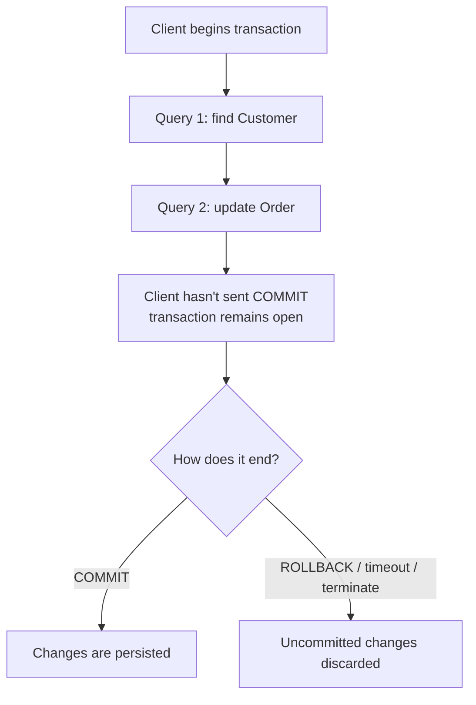
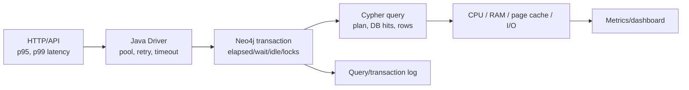

# Monitoring Running Queries or Transactions and Handling Long-Running Queries in Neo4j

In a Neo4j system, a Cypher query can run slowly for many different reasons: overly broad path expansion across the graph, scanning nodes when an index is missing, aggregation over multiplied rows, lock contention when updating the same node, or simply because **the application opened a transaction and failed to close it**. These situations may all manifest as slow APIs, request timeouts, high CPU, rising memory, or queued requests. Yet **the remediation differs**: compute-heavy queries require Cypher optimization, blocked transactions require lock investigation, and idle transactions require fixing session/transaction lifecycles in the application.

This lesson belongs to the **Monitoring** chapter of the **DATABASE_ENGINE_GRAPH_NEO4J** module, within the context of using Neo4j to model property graphs, query nodes, relationships, and paths with Cypher; design indexes/constraints; tune queries, import data, integrate the Java Driver and Spring Data Neo4j; and operate graph systems.

After this lesson, you will be able to:

- Distinguish an **open transaction** from an **actively executing query** and understand the meaning of observed fields.
- Use `SHOW TRANSACTIONS` to identify long-running transactions, lock-waiting transactions, or transactions with no active query.
- Interpret `elapsedTime`, `currentQueryElapsedTime`, `cpuTime`, `waitTime`, `idleTime`, `activeLockCount`, `currentQueryId`, and `transactionId` in proper context.
- Use **query logs**, transaction logging, metrics, and Java Driver metadata to pinpoint root causes.
- Diagnose slow queries using `EXPLAIN`/`PROFILE`, indexes, cardinality, node degree, locks, and batching.
- Weigh `TERMINATE TRANSACTIONS` safely, understanding rollback behavior and termination boundaries.
- Establish runbooks for real incidents, alert thresholds, and recurrence prevention.

> **Version scope:** Syntax focuses on Neo4j 5.x and current Neo4j releases. Some statistical columns, logging options, administrative privileges, and cluster behaviors depend on version/edition; consult official documentation for your exact environment. Never run examples that induce lock contention or terminate transactions on a production database.

## 1. First Question: Long Query or Long Transaction?

A **query** is a single Cypher statement such as `MATCH`, `MERGE`, or `CALL` being executed. A **transaction** is a unit of work that can contain **one or more queries**, with a lifecycle spanning from begin until commit, rollback, or termination.



A transaction can stay open for **2 minutes** while its latest query took only **50 ms** and the application left the transaction idle for the remaining time. Conversely, a path traversal query can consume CPU continuously throughout most of the transaction's lifetime.

Therefore, you cannot look at `elapsedTime` alone and conclude the current query is hung.

| Metric | What Does It Measure? | Relevant Question |
| --- | --- | --- |
| `elapsedTime` | Time since the transaction began | "How long has this transaction been open?" |
| `currentQueryElapsedTime` | Time since the current query began; may be `null` | "How long has this Cypher statement been running?" |
| `cpuTime` / `currentQueryCpuTime` | CPU time consumed if provided by the system | "Is it actively burning CPU?" |
| `waitTime` / `currentQueryWaitTime` | Time spent waiting to acquire locks | "Is there evidence of lock contention?" |
| `idleTime` | Idle time of the transaction if available | "Is the app holding a transaction open without running queries?" |
| `activeLockCount` | Number of locks currently held | "Could this transaction be holding resources blocking others?" |

Fields starting with `currentQuery...` pertain to the **currently executing query**; unprefixed fields generally reflect the transaction. Some metrics may be `null` when unavailable—never assume `null = 0`.

## 2. Why Does Neo4j Need Concurrent Visibility into Queries and Transactions?

In a property graph, one query can expand from a single node across millions of relationships. In another case, many requests update the same `:Product` node, forcing subsequent transactions to **wait on locks** even though each query touches only one node.

Or data may be imported inside a single huge transaction: finding nodes by index is fast, yet **write volume** and lock hold durations create latency for other users.

A useful monitoring picture looks across multiple layers:



**No single metric proves the root cause.** High API p99 may come from network or connection pool waits before Cypher ever executes; a long-waiting transaction may be blocked behind another writer holding a lock; high CPU may stem from a read-only query traversing too broadly across the graph.

## 3. Live Inspection Tool: `SHOW TRANSACTIONS`

Neo4j provides an administrative command to inspect **currently existing transactions** on the connected server:

```cypher
SHOW TRANSACTIONS;
```

The command returns transactions that the current account is permitted to view. Users can view their own transactions; viewing other users' transactions depends on the **`SHOW TRANSACTION`** privilege, edition/configuration, and granted scope.

### 3.1. Selecting Key Columns

```cypher
SHOW TRANSACTIONS
YIELD database, transactionId, username,
      status, currentQueryStatus,
      elapsedTime, currentQueryElapsedTime,
      waitTime, idleTime,
      activeLockCount, currentQueryId, currentQuery
RETURN database, transactionId, username,
       status, currentQueryStatus,
       elapsedTime, currentQueryElapsedTime,
       waitTime, idleTime,
       activeLockCount, currentQueryId, currentQuery
ORDER BY elapsedTime DESC
LIMIT 20;
```

`SHOW TRANSACTIONS` is a **point-in-time snapshot**. It is not a historical archive of all queries. If a query finished before you ran the inspection, it will not appear.

**Common pitfall:** your own `SHOW TRANSACTIONS` query can briefly spawn a transaction and appear in the output. Do not mistake it for an incident.

### 3.2. Reading the Columns Correctly

| Column | Meaning | Notes |
| --- | --- | --- |
| `database` | Transaction's target database | Essential to identify in multi-database environments |
| `transactionId` | Active transaction ID | **Use this ID** for `TERMINATE TRANSACTIONS` |
| `currentQueryId` | Executing query ID, may be `null` | **Do not use in place of transactionId to terminate** |
| `username` | Executing user | Helps locate the calling service/workload |
| `status` | Transaction status, e.g., Running/Blocked/Closing/Terminated | Not directly synonymous with a query error |
| `currentQueryStatus` | Query status, e.g., planning/running/waiting, may be `null` | No query may be active inside an open transaction |
| `elapsedTime` | Transaction age | Transaction may be idle or may have run multiple queries |
| `currentQueryElapsedTime` | Current query age | Useful for separating a slow query from a long-lived transaction |
| `waitTime` | Time transaction spent waiting to **acquire locks** | Correlate with status and locked resources |
| `idleTime` | Inactive time of the transaction, if available | Can indicate a client holding a transaction open |
| `activeLockCount` | Number of locks held by the transaction | More locks does not automatically mean an error |
| `currentQuery` | Cypher text currently running, or `null` | May contain sensitive data |

In Neo4j, `transactionId` typically follows `<database>-transaction-<id>`, such as `neo4j-transaction-123`. Always **take the actual value from observed output**, never construct it from row position or `currentQueryId`.

### 3.3. Filtering Transactions Open Longer Than a Threshold

```cypher
SHOW TRANSACTIONS
YIELD database, transactionId, username,
      elapsedTime, currentQueryElapsedTime,
      status, currentQueryStatus, waitTime, idleTime
WHERE elapsedTime > duration({seconds: 30})
RETURN database, transactionId, username,
       elapsedTime, currentQueryElapsedTime,
       status, currentQueryStatus, waitTime, idleTime
ORDER BY elapsedTime DESC;
```

`duration({seconds: 30})` is an **example threshold** for this lesson. A legitimate analytics job or batch import can run for minutes; never assume "over 30 seconds = must kill".

When hunting for a **currently slow query**, watch `currentQueryElapsedTime`; when hunting for a **long-open transaction running no query**, watch `elapsedTime` and `idleTime`.

### 3.4. Inspecting Locks and Resources

```cypher
SHOW TRANSACTIONS
YIELD transactionId, username, status,
      currentQueryStatus, elapsedTime,
      cpuTime, waitTime, idleTime,
      activeLockCount, resourceInformation,
      pageHits, pageFaults
RETURN transactionId, username, status,
       currentQueryStatus, elapsedTime,
       cpuTime, waitTime, idleTime,
       activeLockCount, resourceInformation,
       pageHits, pageFaults
ORDER BY waitTime DESC
LIMIT 20;
```

These fields help form hypotheses:

- High `waitTime` with `Blocked`/`waiting` status: likely **waiting on a lock**.
- High `cpuTime`, low `waitTime`: leans toward **computation/graph traversal**.
- High `pageFaults`: may be reading data outside the page cache; correlate with I/O and workload.
- Large `activeLockCount`: transaction may be holding many locks; interpret alongside query text and update volume.
- `resourceInformation` may give context on blocked transactions, though **its structure can vary** by state and version.

**Do not treat these metrics as standalone proof.** `cpuTime` or `idleTime` may be unavailable, and a blocked transaction is the **victim waiting for a lock**, not necessarily the transaction that should be terminated.

## 4. Distinguishing Executing Queries, Blocked Transactions, and Idle Transactions

These three cases require different fixes:

| Case | Common Symptoms | Priority Investigation |
| --- | --- | --- |
| **Long-executing query** | Rising `currentQueryElapsedTime`, `currentQueryStatus = running`, CPU/DB hits may be high | Cypher pattern, indexes, row counts, and path depth |
| **Lock-waiting query** | `currentQueryStatus = waiting` or transaction `Blocked`, rising `waitTime` | Who holds the lock, which transactions update the same node |
| **Idle open transaction** | High `elapsedTime`, `currentQueryId` or `currentQuery` is `null`, large `idleTime` | Session lifecycle, missing commit/rollback, HTTP calls inside transaction |

Observed state can shift between consecutive `SHOW TRANSACTIONS` runs. Seeing the same transaction ID transition states across snapshots is normal as work progresses.

### 4.1. Query Finished, Transaction Still Open

An application might do this:

```text
BEGIN TRANSACTION
  -> MATCH Customer (10 ms)
  -> SET Order.status (20 ms)
  -> HTTP call to external service (15 seconds)
  -> COMMIT
```

During the 15-second HTTP wait, Neo4j executes no query, yet the transaction remains open and **acquired locks may remain held** until the transaction finishes. Increasing the connection pool size does not fix the root issue.

A better design is **never placing long network I/O inside a Neo4j transaction boundary**. For multi-step workflows, define intermediate states/idempotency and handle failures when separate transactions commit independently.

### 4.2. A Blocked Query Is Not Necessarily the Culprit

Suppose:

- Transaction **T1** updates `:Product {sku:'P-100'}`, then leaves the transaction open.
- Transaction **T2** tries to update the same node and blocks waiting for the lock.
- `SHOW TRANSACTIONS` shows **T2 waiting**, yet T1 is the transaction holding the resource open.

Terminating T2 fails one request while T1 still holds the lock. Before intervening, locate **the lock holder** and understand why it hasn't completed. Do not mistakenly kill critical data jobs merely because they appear at the top of a `waitTime` sort.

## 5. Attaching Java Driver Metadata to Identify Workloads

In multi-service architectures, `username` alone is often insufficient: both APIs and batch jobs may share the same technical identity. The Neo4j Java Driver supports attaching **transaction metadata**, visible via `SHOW TRANSACTIONS` and query logs when configured.

Example:

```java
import java.time.Duration;
import java.util.Map;

import org.neo4j.driver.Session;
import org.neo4j.driver.TransactionConfig;

TransactionConfig config = TransactionConfig.builder()
    .withTimeout(Duration.ofSeconds(8))
    .withMetadata(Map.of(
        "appName", "graph-api",
        "operation", "lookup-related-products",
        "requestId", "req-042"
    ))
    .build();

try (Session session = driver.session()) {
    var related = session.executeRead(tx ->
        tx.run("""
            MATCH (p:Product {sku: $sku})
                  -[:RELATED_TO]->(other:Product)
            RETURN other.sku AS sku
            LIMIT 20
            """, Map.of("sku", "SKU-001"))
          .list(record -> record.get("sku").asString()),
        config
    );

    related.forEach(System.out::println);
}
```

Here:

- `withTimeout(...)` sets a maximum duration for this specific transaction; if exceeded, the server can terminate it.
- `withMetadata(...)` ties activity to **service, operation, and request ID** during investigations.
- `executeRead()` manages the transaction and can retry eligible transient errors per Driver policy.
- `try-with-resources` closes the session once work finishes.

**Never put passwords, tokens, personal emails, card numbers, or sensitive data into metadata.** Metadata can appear in query logs and administrative commands.

Inspecting metadata:

```cypher
SHOW TRANSACTIONS
YIELD transactionId, username, elapsedTime,
      currentQuery, metaData
WHERE metaData.appName = 'graph-api'
RETURN transactionId, username, elapsedTime,
       metaData, currentQuery
ORDER BY elapsedTime DESC;
```

If `metaData` is empty or clients do not attach metadata, you cannot group by `appName`. In that case, rely on application logs and connection/request details to correlate.

## 6. Safely Reproducing Lock Contention

Perform this only in an **isolated test database**, never in an environment serving real users.

### 6.1. Sample Data

```cypher
CREATE CONSTRAINT monitor_account_id IF NOT EXISTS
FOR (a:MonitorAccount)
REQUIRE a.accountId IS UNIQUE;
```

```cypher
MERGE (a:MonitorAccount {accountId: 'A-001'})
ON CREATE SET a.balanceMinor = 100000;
```

### 6.2. Two Independent Transactions

```mermaid
sequenceDiagram
    participant T1 as Session 1 / TX1
    participant DB as Neo4j
    participant T2 as Session 2 / TX2
    participant ADM as Monitoring Session
    T1->>DB: BEGIN; SET A-001.balanceMinor
    Note over T1,DB: TX1 holds lock, uncommitted
    T2->>DB: BEGIN; SET same A-001
    Note over T2,DB: TX2 waits for lock
    ADM->>DB: SHOW TRANSACTIONS
    DB-->>ADM: TX1 open; TX2 waiting/Blocked
    T1->>DB: ROLLBACK (in test)
    DB-->>T2: Lock released
    T2->>DB: COMMIT or ROLLBACK per test
```

To reproduce this scenario, use **two separate Java Driver Sessions** and two separate threads/requests. A snippet simulating TX1:

```java
import org.neo4j.driver.Session;
import org.neo4j.driver.Transaction;

try (Session session = driver.session();
     Transaction tx = session.beginTransaction()) {

    tx.run("""
        MATCH (a:MonitorAccount {accountId: 'A-001'})
        SET a.balanceMinor = 99000
        """).consume();

    // TEST ONLY: hold the transaction at a breakpoint or synchronize
    // with CountDownLatch so another session attempts to SET the same node.
    // A third session runs SHOW TRANSACTIONS to observe.

    tx.rollback();
}
```

Holding a transaction open in this example is a **controlled fault-simulation technique**, not an application pattern for production. If executed sequentially on one thread with no concurrent TX2, **no lock contention will occur**.

### 6.3. Interpreting Output and Fixing Root Causes

If TX2's `waitTime` rises, identify TX1 and what it is doing. TX1 may have completed its query yet not committed because:

- Java code is waiting on HTTP/queues or sleeping inside the transaction.
- Slow business logic sits between Cypher statements.
- Code missed `commit()` / `rollback()` upon catching an exception.
- The client disconnected and resource lifecycle was not cleaned up as expected.
- An oversized write batch is holding locks too long.

The usual fix is **shortening transactions**, moving network I/O outside, using `try-with-resources` or managed transactions, and sizing batches appropriately. Never simply raise `db.lock.acquisition.timeout` just to delay errors.

## 7. Example of a Long-Running Read Query Caused by Row Explosion

A query can run slowly even with zero lock waits. In densely connected graphs, unbounded variable-length patterns can expand huge numbers of paths:

```cypher
// Illustrative of risk only; DO NOT run arbitrarily on large graphs.
MATCH path = (u:User {userId: $userId})-[:KNOWS*]->(v)
RETURN path;
```

This query can generate astronomical path counts, exhausting CPU and memory. A better-scoped version:

```cypher
MATCH path = (u:User {userId: $userId})-[:KNOWS*1..3]->(v:User)
WHERE v.active = true
RETURN DISTINCT v.userId AS relatedUserId
LIMIT 100;
```

**Depth bounds and `LIMIT` do not guarantee cheap execution**: the database may still expand many branches before filtering, deduplicating, and returning 100 results. Inspect the execution plan and apply selective starting nodes, relationship types, directions, indexes, and suitable graph modeling.

### Common Cardinality Pitfalls

| Pattern | Why Row Count Explodes | Consequence |
| --- | --- | --- |
| `MATCH (a:Author), (b:Book)` | Cartesian product of two unrelated sets | Rows = authors × books |
| Two branches `Customer→Order` and `Customer→Ticket` | Each order pairs with every ticket | `sum(amount)` / `count()` can distort and burn resources |
| `MATCH p=(a)-[:KNOWS*1..10]->(b)` | Many paths and branching factors | CPU and memory spike |
| `collect()` over millions of rows | Buffers massive intermediate sets | Transaction memory climbs |
| `ORDER BY` / `DISTINCT` on large sets | Requires full sorting/deduplication | Memory and latency increase |
| Missing index on `customerId` | Scans excessive nodes | High DB hits, slow responses |

Do not conclude every slow query means "Neo4j is a bad fit". Often the query is performing far more work than the business requires due to missing constraints or suboptimal graph patterns.

## 8. Using `EXPLAIN` and `PROFILE` After Identifying a Suspect Query

Once you identify a problematic Cypher query, the next step is inspecting its **execution plan**.

```cypher
EXPLAIN
MATCH (c:Customer {customerId: $customerId})
MATCH (c)-[:PLACED]->(o:Order)
RETURN o.orderId AS orderId
LIMIT 20;
```

- `EXPLAIN` generates the predicted plan **without running the query's work**.
- `PROFILE` **executes the query** and reports actual per-operator statistics such as `Rows`, `DB Hits`, and memory/timing where runtime supports it.
- Never run `PROFILE` on `CREATE`, `SET`, `MERGE`, or `DELETE` in production just to "take a look": it **can modify live data**.
- If the original query is overloading production, run `EXPLAIN` first or test on representative data in a safe environment.

### Reading Plans by Questions, Not a Single Operator

| Operator / Metric | Diagnostic Question |
| --- | --- |
| `NodeByLabelScan` | Is it scanning many nodes instead of using an indexed starting point? |
| `NodeIndexSeek` | Is it using the index on the right key? |
| `Expand` / `VarLengthExpand` | How steeply do rows multiply after relationship expansion? |
| `CartesianProduct` | Are two independent patterns unintentionally cross-joined? |
| `EagerAggregation` / `OrderedAggregation` | Does aggregation/deduplication happen before or after row multiplication? |
| `Sort` | Is it sorting a huge set just to return a few results? |
| `Rows` | At which step does cardinality spike sharply? |
| `DB Hits` | Which operation performs the most storage/engine touches? |
| `Page Cache Hits/Faults` | Are many accesses reading data from outside the cache? |

**Don't search only for the word `CartesianProduct`.** Two branches fanning out from the same `Customer` can still multiply rows via fan-out without a separate `CartesianProduct` operator appearing in the plan.

### When an Index Is Missing

Create an appropriate constraint for business keys:

```cypher
CREATE CONSTRAINT customer_id_unique IF NOT EXISTS
FOR (c:Customer)
REQUIRE c.customerId IS UNIQUE;
```

Inspect the schema:

```cypher
SHOW INDEXES
YIELD name, type, labelsOrTypes, properties, state
RETURN name, type, labelsOrTypes, properties, state
ORDER BY name;
```

A uniqueness constraint speeds up locating the starting node, **not** the subsequent expansion of hundreds of thousands of relationships from that node. Nor should you create purposeless indexes, as indexes add storage and write overhead.

## 9. `TERMINATE TRANSACTIONS`: A High-Risk Intervention Tool

When a transaction is causing severe impact and must be stopped, Neo4j provides:

```cypher
TERMINATE TRANSACTIONS $transactionId
YIELD transactionId, username, message
RETURN transactionId, username, message;
```

**`$transactionId` must be the exact transaction ID obtained from `SHOW TRANSACTIONS`**, never `currentQueryId` or a guessed ID.

### 9.1. Safe Pre-Termination Checklist

1. Confirm **database, transactionId, username, metadata, and workload**.
2. Check `elapsedTime`, `currentQueryElapsedTime`, `waitTime`, `idleTime`, and query/business category.
3. Distinguish transactions **holding locks** from transactions **waiting on locks**.
4. Verify whether the task is a scheduled long-running import, migration, analytics job, or backup.
5. Assess interruption risk: rollback cost, already-committed batches, ambiguous client state.
6. If possible, contact the service/job owner and consider throttling or halting new submissions.
7. When termination is necessary and authorized, use the **exact ID** and observe the outcome; never mass-terminate based on duration alone.

### 9.2. Verifying the ID Before Sending Terminate

```cypher
SHOW TRANSACTIONS $transactionId
YIELD database, transactionId, username,
      status, elapsedTime, currentQuery,
      metaData, activeLockCount
RETURN database, transactionId, username,
       status, elapsedTime, currentQuery,
       metaData, activeLockCount;
```

Only issue terminate after confirming the exact problematic transaction. A transaction may already have **completed** between the two commands; read the returned `message` and actual state rather than assuming termination always succeeds.

### 9.3. Execution Privileges

Users may terminate their own transactions according to Neo4j rules. Terminating another user's transaction requires the **`TERMINATE TRANSACTION`** privilege within the granted scope. Do not grant broad terminate privileges to standard application accounts; maintain **dedicated operational accounts** with audited workflows.

### 9.4. What Does Terminating a Transaction Actually Mean?

- The server receives a request to **end the transaction**, not to "rewind all history".
- **Uncommitted changes** of the terminated transaction will not be persisted and are rolled back.
- Locks/resources are released once the transaction stops and rollback completes—not necessarily in the exact millisecond the command is sent.
- Any transaction committed **before termination takes effect** is not undone.
- **Other** transactions or **separately committed batches** do not automatically roll back just because the current transaction was killed.
- The client may receive an error or experience an indeterminate commit outcome if disconnection occurs around commit time; this must be handled at the application layer.

`TERMINATE TRANSACTIONS` is an **emergency rescue tool**, not a replacement for fixing queries, schemas, and transaction lifecycles.

## 10. Relationship Between Termination, Rollback, and Batch Imports

A job may use `CALL { ... } IN TRANSACTIONS` to process imports in batches. With modern syntax:

```cypher
UNWIND $rows AS row
CALL (row) {
  MERGE (u:User {userId: row.userId})
  SET u.displayName = row.displayName
} IN TRANSACTIONS OF 500 ROWS;
```

Notes:

1. The `CALL (row) { ... }` syntax applies to Neo4j versions supporting variable scope clauses (5.23+); older versions may require `CALL { WITH row ... }`.
2. `CALL { ... } IN TRANSACTIONS` executes within an **implicit transaction** per Cypher rules; do not nest it arbitrarily inside an explicit/managed transaction.
3. Each batch **commits independently**. If a job is terminated while batch 8 is running, batches 1–7 that already committed are **not rolled back** along with batch 8.
4. Therefore, import jobs require **checkpoints, data reconciliation, business keys, and idempotent replay**.
5. `500 ROWS` is purely illustrative; size batches through testing against data volume, lock contention, and memory.

Never see "import terminated" and report that **all 4,000 records rolled back**. Determine exactly which batches committed and what data remains in the graph.

### Other Write Queries

If an HTTP request runs three separate transactions A, B, and C, terminating C affects only C. Transactions A and B already committed and retain their changes. A business flow requiring atomicity across multiple steps needs proper orchestration/reconciliation design rather than expecting Neo4j to undo prior committed transactions.

## 11. Timeouts: Protecting the System from Runaway Queries

Neo4j and applications use multiple timeout layers:

| Mechanism | Scope | Key Difference to Remember |
| --- | --- | --- |
| `db.transaction.timeout` | Server-side default transaction timeout | Applies to total transaction age, not a single query |
| `db.lock.acquisition.timeout` | Wait limit to acquire a lock | Does not cap total query runtime |
| `TransactionConfig.withTimeout(...)` | Per-transaction timeout sent by Java Driver | Can override the server default |
| Driver retry budget | Total time Driver retries a managed transaction on transient errors | Total API time can exceed a single transaction timeout |
| HTTP/request deadline | API gateway/app request deadline | Client timeout does not guarantee server rollback |
| Connection/network timeout | Waiting for socket connection or I/O | Must distinguish network errors from slow queries |

Illustrative server configuration:

```properties
# Example values; size according to real SLA/workload.
db.transaction.timeout=30s
db.lock.acquisition.timeout=10s
```

Never blindly raise all timeouts to several minutes to "fix errors". That often just lets transactions hold locks longer and deepens request queues.

### Is a 30-Second Timeout Exact to the Millisecond?

Neo4j checks and enforces timeouts via internal mechanisms, so **do not expect millisecond-exact termination**. Client protocols, retries, network latency, and transaction cleanup also affect the total latency seen by users.

### A Client Timeout Does Not Prove Transaction Rollback

Suppose an API times out right after sending `COMMIT`. The client may miss the acknowledgment even though the server committed. If the application retries creating an Order without an idempotency key, it can produce duplicate records. Use business identifiers and verify commit state whenever outcomes are uncertain.

## 12. Query Logs: Finding Completed or Missed Slow Queries

`SHOW TRANSACTIONS` is a **live snapshot**. To analyze previously executed queries, use the **query log** when supported and configured.

Example **Neo4j Enterprise** configuration tuned to a logging policy:

```properties
# Illustrative: log only completed queries exceeding threshold.
db.logs.query.enabled=INFO
db.logs.query.threshold=5s

# Limit parameter values appearing in logs.
db.logs.query.parameter_logging_enabled=false
db.logs.query.obfuscate_literals=true
```

Meaning:

- `INFO`: logs when a query completes if it exceeds `db.logs.query.threshold`.
- `VERBOSE`: logs both query start and completion per active configuration; useful for visibility, though log volume can grow large.
- `OFF`: disables query logging.
- `db.logs.query.threshold=5s`: an **example** threshold, not a universal optimum.
- `parameter_logging_enabled=false` avoids logging unnecessary parameter values.
- `obfuscate_literals=true` helps reduce exposure of sensitive literals in queries, though it is **not an absolute guarantee** across every error format or malformed query.

Query log settings and availability depend on **edition/version**, and some recent releases enable query logging by default. Verify actual settings using `SHOW SETTINGS` or version docs; never assume illustrative snippets reflect production.

### 12.1. What Does the Query Log Show?

An entry may record execution time, planning time, waiting time, CPU, page hits/faults, tracked memory, query text, database, user, and metadata. Field names, text/JSON formats, and granularity vary by version and configuration.

Use the log to answer:

- Which query took **5 seconds** at 10:31?
- Which service, user, or request ID ran it?
- Was there heavy wait time or mostly CPU work?
- Is a Cypher pattern repeating frequently and driving high load?
- Did the transaction linger **after the query finished**?

### 12.2. Transaction Logging Inside the Query Log

In supported environments, you can log transaction start/end timestamps to catch cases where **a short query sits inside a long-open transaction**:

```properties
# Use only if supported by your deployment edition/version.
db.logs.query.transaction.enabled=INFO
db.logs.query.transaction.threshold=20s
```

When set to `INFO`, transactions exceeding the threshold are recorded via the query/transaction logging mechanism. Do not enable verbose logging for every transaction under heavy load without evaluating log volume and security policy.

### 12.3. Query Logs vs. Internal Transaction Logs

| File / Concept | Purpose |
| --- | --- |
| `query.log` | Monitoring details, timing, and behavior of executed queries |
| Transaction logging in `query.log` | Transaction lifecycle markers for observability |
| Database **transaction log files** | Write-ahead data for durability, recovery, and backup/replication |

**Transaction log files are not a history of "which queries ran slowly".** Never treat internal storage logs as a substitute for query logs.

## 13. Protecting Privileges and Data While Monitoring

Output from `SHOW TRANSACTIONS` or query logs may contain:

- Cypher queries with sensitive literals.
- Query parameters and request metadata.
- Users/services accessing the database.
- Client IP addresses or connection IDs.
- Business data shapes embedded in queries.

Therefore:

1. Grant `SHOW TRANSACTION` and `TERMINATE TRANSACTION` only to teams that require them.
2. Never put raw `currentQuery`, `parameters`, or query logs on public dashboards.
3. Attach metadata using **non-sensitive reference IDs**, avoiding emails, tokens, and passwords.
4. Enforce log retention, encryption at rest, and access controls per policy.
5. Never embed credentials inside query text or URIs.
6. When sharing queries for troubleshooting, replace real data with parameter placeholders or synthetic values.
7. Audit every termination: who, when, which transaction, why, and the outcome.

Good monitoring never trades away data security just to capture every parameter.

## 14. Monitoring Across Clusters and Multiple Databases

In a Neo4j cluster, requests can be served across **multiple member servers**. Administrative documentation defines `SHOW TRANSACTIONS` for the **current server**; never treat results from one arbitrary connection as the complete transaction list of the whole cluster.

Operational practices:

- Identify **which database and server** a transaction is running on.
- If connecting via a routing URI, know which member received the administrative command.
- Inspect the right server when a transaction ID from logs points elsewhere.
- Do not infer "the transaction disappeared from server A" means no jobs are running on server B.
- With remote database aliases, observability has specific semantics; target the proper instance per documentation.
- Label metrics/logs by **server, database, and service** before aggregating onto dashboards.

If applications use Spring Data Neo4j or the Driver with a connection pool, also watch client-side connection counts, queued requests, and retries. A user-perceived slow query may not even have reached Neo4j if the application is waiting for a connection.

## 15. What Should Dashboards and Alerts Watch?

System metrics do not replace `SHOW TRANSACTIONS`, but they catch problems **before requests fail en masse**.

| Signal Group | Example Observations | Explanation |
| --- | --- | --- |
| **API latency** | p50/p95/p99 latency per endpoint | User-facing symptom |
| **Transactions** | Open transaction count, max age, rollback rate | Detects concurrency spikes and abnormal transactions |
| **Queries** | Queries > 5s, retry counts, Cypher pattern frequency | Spots repeating queries and regressions |
| **Locks** | Lock wait time, blocked transactions | Detects contention |
| **Resources** | CPU, heap/GC, page cache, disk I/O | Separates compute, memory, and I/O bottlenecks |
| **Driver** | Pool saturation, connection acquisition time, retries | Catches pre-query or post-query delays |
| **Database** | Availability, query failures, error rate | Quantifies service impact |
| **Batches/jobs** | Import progress, committed batch count, backlog | Prevents killing legitimate background work |

Specific Prometheus/JMX/Neo4j Ops Manager metric names vary by **edition, version, and metric exporter**. Never copy metric names from old articles without verifying they actually exist on your instance.

### 15.1. Example Alert Thresholds

Design alerts around **SLOs**:

- Graph read API p95 exceeds threshold for 10 minutes.
- Transaction timeout / lock timeout rate rises above baseline.
- An interactive transaction stays open > 60 seconds outside an allowlist of long jobs.
- Blocked transaction count or total wait time climbs rapidly.
- Query logs record many Cypher patterns exceeding 5 seconds.
- Heap/GC or page faults rise concurrently with latency spikes.

These numbers are purely illustrative. A 20-minute GDS job may be completely expected, whereas a 3-second login API already breaches expectations. **Workload classification** matters far more than a single database-wide threshold.

### 15.2. Avoiding Noisy Alerts

If a single query crosses a threshold once without impacting SLAs, log it without paging. Escalate priority when CPU, lock wait, p99, and error rates rise together.

Alerts should include context:

- Database and server.
- Service/operation from metadata.
- Start time and impact scope.
- Count of waiting transactions or slow queries.
- Runbook link and triage steps.
- Whether the condition was previously handled.

Never embed `currentQuery` or sensitive parameters directly into public notifications.

## 16. Runbook: Handling a Long-Running Query in Production

Suppose users report that the related-customers API is slow while multiple transactions have been open for a long time. Proceed in order of lowest risk.

### Step 1 — Confirm Impact

Gather timestamp, p95/p99, error rate, database, endpoint, request ID, and service. Determine whether this is a new incident or a known scheduled job.

**Do not start by running terminate** before knowing which transactions are involved.

### Step 2 — Capture Transaction State

```cypher
SHOW TRANSACTIONS
YIELD database, transactionId, username,
      elapsedTime, currentQueryElapsedTime,
      status, currentQueryStatus,
      cpuTime, waitTime, idleTime,
      activeLockCount, metaData
RETURN database, transactionId, username,
       elapsedTime, currentQueryElapsedTime,
       status, currentQueryStatus,
       cpuTime, waitTime, idleTime,
       activeLockCount, metaData
ORDER BY elapsedTime DESC
LIMIT 30;
```

Capture only necessary columns; avoid exporting sensitive data. Run against the appropriate server/database.

### Step 3 — Classify the Case

- **High CPU, low wait:** examine Cypher/cardinality/query plan.
- **High wait:** locate the lock holder, reduce contention, or terminate an overly long lock-holding transaction after assessment.
- **High idle:** check applications holding sessions/transactions open.
- **High page faults:** inspect memory/page cache and I/O.
- **No transaction visible:** the query may have finished; switch to query logs, driver logs, and metrics.

### Step 4 — Identify Owner and Impact

Inspect `username` and `metaData`, cross-reference application logs and running jobs. If it is a scheduled migration, large import, or maintenance task, determine stop criteria and a resume plan.

### Step 5 — Optimize or Shed Load Least Destructively First

Options include:

- Throttling new requests or capping concurrency in the load-generating service.
- Fixing the query with tighter filters, indexes, or relationship direction/depth bounds.
- Shrinking transactions and removing HTTP calls from inside transactions.
- Splitting batches and moving heavy jobs off peak hours.
- Tuning cache and connection pool sizing where supported by evidence.

Do not rush to raise all timeouts or memory settings without supporting evidence.

### Step 6 — If Required, Terminate by ID

Only when impact is severe and the operator is authorized:

```cypher
SHOW TRANSACTIONS $transactionId
YIELD database, transactionId, username,
      status, elapsedTime, metaData
RETURN database, transactionId, username,
       status, elapsedTime, metaData;
```

After confirming the exact ID:

```cypher
TERMINATE TRANSACTIONS $transactionId
YIELD transactionId, username, message
RETURN transactionId, username, message;
```

Read the `message`; never assume "command sent = instantaneous rollback".

### Step 7 — Verify After Intervention

- Does `SHOW TRANSACTIONS` still show related transactions?
- Did lock wait and p95/p99 drop?
- Is the application logging errors and aggressively retrying?
- How far did any batch/job commit?
- Are new transactions with the same pattern recreating the issue?

If the upstream source keeps sending the bottlenecking workload, terminating one transaction may simply repeat the incident.

### Step 8 — Root-Cause Analysis

Record sanitized evidence: query family, plan, DB hits, lock metrics, deployment version, indexes, batch size, and service/operation ID. Create preventive follow-ups: performance tests, metadata, proper timeouts, transaction lifecycle code reviews, and alerts.

## 17. Decision Scenarios

### 17.1. A Very Old Transaction with No Current Query

**Observation:** `elapsedTime` 120 seconds, `currentQuery = null`, high `idleTime`.

**Hypothesis:** the application opened an explicit transaction, ran a short query, then waited on external work or forgot to close it.

**Action:** locate the owning session and request, inspect source code, apply preventive timeouts, use managed transactions/`try-with-resources`; terminate if impact is severe and rollback effects are assessed.

### 17.2. A Read Query with High CPU

**Observation:** rising `currentQueryElapsedTime`, high `cpuTime`, low wait, massive DB hits.

**Hypothesis:** broad path traversal, unindexed scan, or intermediate row multiplication.

**Action:** `EXPLAIN` the query, `PROFILE` on safe data, bound scope/depth, filter early, add/fix indexes, and choose appropriate graph algorithms when warranted.

### 17.3. Many Write Requests Updating the Same Product Node

**Observation:** many `Blocked` transactions, rising `waitTime`, queries updating `:Product`.

**Hypothesis:** lock hotspot.

**Action:** inspect the lock-holding transaction, shorten lock hold duration, throttle concurrency, consider restructuring updates; do not merely increase the lock timeout.

### 17.4. Batch Import Terminated Mid-Run

**Observation:** job fails with an error; exact count of imported rows is unclear.

**Hypothesis:** the active batch rolled back while earlier batches already committed.

**Action:** check checkpoints, reconcile nodes/relationships by business key, replay idempotently; never blindly restart from scratch if operations are non-idempotent.

### 17.5. API Times Out While SHOW TRANSACTIONS Shows No Slow Queries

**Observation:** 20-second HTTP request, yet Neo4j queries finish in milliseconds or don't appear.

**Hypothesis:** requests are waiting on the connection pool, network, Driver retries, another service, or caching.

**Action:** check Driver metrics, application traces, and hop-by-hop latency. Do not guess at Cypher optimizations when the query isn't the bottleneck.

## 18. Spring Data Neo4j: Setting Proper Transaction Boundaries

Spring Data Neo4j handles object-graph mapping, yet still requires crisp transaction boundaries:

```java
import org.springframework.stereotype.Service;
import org.springframework.transaction.annotation.Transactional;

@Service
public class OrderService {

    private final OrderRepository orderRepository;

    public OrderService(OrderRepository orderRepository) {
        this.orderRepository = orderRepository;
    }

    @Transactional
    public void markCancelled(String orderId) {
        Order order = orderRepository.findByOrderId(orderId)
            .orElseThrow(() ->
                new IllegalArgumentException("Order not found"));

        order.setStatus("CANCELLED");
        orderRepository.save(order);
    }
}
```

This example assumes `Order` and `OrderRepository` are defined in the project. A `@Transactional` method must not wrap HTTP calls to payment gateways or long waits.

If you only need to update one field on a node with many relationships, consider a **narrowly scoped Cypher write** rather than loading the entire object graph just to change one property:

```cypher
MATCH (o:Order {orderId: $orderId})
SET o.status = 'CANCELLED'
RETURN o.orderId AS orderId, o.status AS status;
```

Note that Spring's transaction manager and the Neo4j Driver maintain separate timeout/retry configurations; never assume `@Transactional` timeout behaves identically to `TransactionConfig.withTimeout()` across all versions.

## 19. Common Misconceptions

| Misconception | Why It's Wrong | Correct Understanding |
| --- | --- | --- |
| "`elapsedTime` is how long the current query has run." | That is transaction age | Check `currentQueryElapsedTime` for the current query |
| "`currentQueryId` is the ID used to terminate." | Terminate requires the transaction ID | Use `transactionId` |
| "A transaction with no current query is harmless." | It may still hold locks | Check `idleTime`, locks, and owner |
| "High `waitTime` means the query is CPU-heavy." | `waitTime` measures lock waiting | Find the lock holder and compare CPU |
| "A lock-waiting transaction is always the culprit." | It may be the victim of another writer | Locate the transaction holding the lock |
| "`SHOW TRANSACTIONS` is a history of all queries." | It reflects only active transactions | Use query logs/metrics for history |
| "Seeing no queries on this server means the cluster has none." | Queries may be running on another server | Inspect the right member/database |
| "`TERMINATE` undoes all previous batches." | Separately committed batches do not roll back | Inspect checkpoints |
| "An HTTP timeout proves the DB rolled back." | Commit may have succeeded without client ACK | Check state and use idempotency |
| "Raising timeouts always fixes slow queries." | It only lets work hold resources longer | Fix the root cause, size timeouts to SLA |
| "`LIMIT 10` guarantees a fast query." | Many rows may be computed before LIMIT | Check the plan and cardinality |
| "`PROFILE` only previews the plan without running." | `PROFILE` executes for real | Use `EXPLAIN` when you only want an estimate |
| "Logging all parameters is always helpful." | Can leak sensitive data | Restrict/redact per security policy |
| "Query log is the transaction log for DB recovery." | The two logs serve completely different purposes | Distinguish observability logs from internal WAL logs |
| "One admin privilege for every service is convenient." | Magnifies blast radius if credentials leak | Least privilege and separate ops accounts |

## 20. Practice Exercises

**Exercise 1 — Distinguishing durations.** `SHOW TRANSACTIONS` reports `elapsedTime = 90s`, `currentQueryElapsedTime = 2s`, and high `idleTime`. Should you conclude the current query has been running slowly for 90 seconds? List additional details to check.

**Exercise 2 — Identifying the right ID.** Output shows `transactionId = 'neo4j-transaction-23'` and `currentQueryId = 'query-57'`. Which value does terminate take? Why must an operator check user/database and metadata before using it?

**Exercise 3 — Locks.** TX1 updates a `:Product` node and then waits 60 seconds before committing; TX2 is `waiting`. Identify the root cause, which transaction holds the lock, and two long-term fixes.

**Exercise 4 — Query plan.** A query traverses `[:KNOWS*]` from a user and returns huge numbers of paths. Write a depth-bounded version using an indexed starting point and explain why `LIMIT` alone is insufficient.

**Exercise 5 — Query logs.** Explain the difference between `db.logs.query.enabled=INFO` vs. `VERBOSE` and the role of `db.logs.query.threshold`. Why disable or restrict logging parameters containing sensitive data?

**Exercise 6 — Batch import.** A job uses `IN TRANSACTIONS OF 500 ROWS`; seven batches committed and the eighth was terminated. Which changes persist? Design an idempotent resume strategy using business keys.

**Exercise 7 — Driver metadata.** Add `withMetadata` for `appName`, `operation`, and a non-sensitive request ID to `TransactionConfig`. Write a `SHOW TRANSACTIONS` query filtering by `metaData.appName`.

**Exercise 8 — API timeout.** An HTTP request exceeds 10 seconds while query logs show every Neo4j query finished in 30 ms. Propose three other layers to inspect before blaming Cypher.

**Exercise 9 — When to terminate?** Two transactions have been open for 15 minutes: one is a legitimate scheduled GDS job, and the other is an API request holding locks while running no query. How do you gather evidence and make the call?

**Exercise 10 — Safety with PROFILE.** Why shouldn't you run `PROFILE MATCH ... SET ...` directly in production just to inspect DB hits? Propose a safe alternative workflow.

### Operations Checklist

- [ ] Distinguish current query, long-open transaction, and request/driver timeouts.
- [ ] Know how to run `SHOW TRANSACTIONS` with `YIELD`, filtering, and sorting.
- [ ] Never confuse `currentQueryId` with `transactionId`.
- [ ] Have a way to identify owners via user/service and transaction metadata.
- [ ] Monitor CPU, lock wait, idle time, page cache, connection pools, and p95/p99.
- [ ] Configure query/transaction logging according to edition, security policy, and retention.
- [ ] Know when to use `EXPLAIN`/`PROFILE` and control risks on write queries.
- [ ] Have a mechanism to find lock holders and shorten lock-holding transactions.
- [ ] Set appropriate timeouts without treating timeouts as the primary optimization.
- [ ] Before terminating, verify ID, database, owner, and rollback impact.
- [ ] After terminating, check committed batches, app retries, and whether the issue recurs.
- [ ] Maintain runbooks, workload-specific alerts, and a long-term query tuning cadence.

## 21. Reference Documentation

Syntax and column/setting names may vary by Neo4j version and edition; verify against official docs when deploying:

- [Neo4j Operations Manual — Show and terminate transactions](https://neo4j.com/docs/operations-manual/current/database-internals/show-and-terminate-transactions/): `SHOW TRANSACTIONS`, `TERMINATE TRANSACTIONS`, privileges, and status fields.
- [Neo4j Operations Manual — Logging](https://neo4j.com/docs/operations-manual/current/monitoring/logging/): query log, transaction logging, settings, and logged fields.
- [Neo4j Operations Manual — Configuration settings](https://neo4j.com/docs/operations-manual/current/configuration/configuration-settings/): timeouts, log thresholds, and resource limits.
- [Neo4j Operations Manual — Transaction management](https://neo4j.com/docs/operations-manual/current/database-internals/transaction-management/): transaction lifecycle and timeout management.
- [Neo4j Cypher Manual — Query tuning](https://neo4j.com/docs/cypher-manual/current/planning-and-tuning/query-tuning/): `EXPLAIN`/`PROFILE`, operators, and query performance.
- [Neo4j Java Driver Manual — Transactions](https://neo4j.com/docs/java-manual/current/transactions/): `TransactionConfig`, timeouts, metadata, and retries.
- [Neo4j Operations Manual — Monitoring](https://neo4j.com/docs/operations-manual/current/monitoring/): metrics and server/database observability tools.

**Key takeaway:** handling a "long-running query" starts with **observing the right entity**. `elapsedTime` tells you how long the transaction has been open; `currentQueryElapsedTime` tells you how long the active query has run; `waitTime` and `idleTime` reveal lock contention or clients holding transactions open. `SHOW TRANSACTIONS` gives current state, query logs give history, `EXPLAIN`/`PROFILE` help pinpoint root causes, and `TERMINATE TRANSACTIONS` should only be used **selectively** once commit/rollback impacts are understood.
