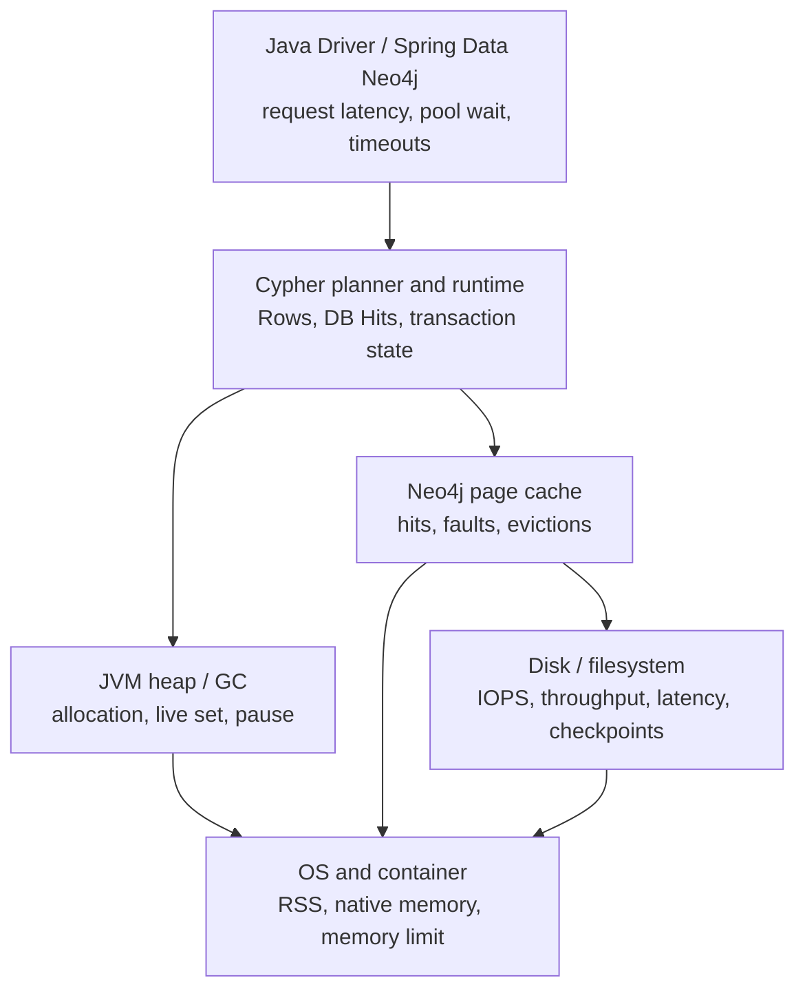
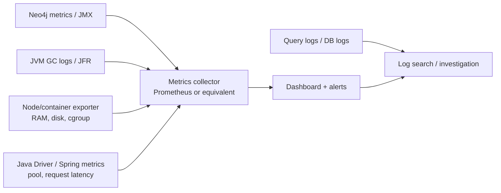

# Memory, Page Cache, Garbage Collection, and I/O Metrics in Neo4j

A Neo4j application slowing down does not mean the cause is always a Cypher query or a missing index. A query that locates the right node via an index can still suffer high latency when the system has to read data from disk, the JVM runs garbage collection continuously, transaction memory is hitting limits, or the container is close to its memory limit. Conversely, a chart showing "RAM usage at 90%" is not enough to conclude Neo4j is running out of memory.

This lesson belongs to the **Monitoring** chapter of the `DATABASE_ENGINE_GRAPH_NEO4J` module. The module uses Neo4j to model connected data as a property graph, query nodes, relationships, and paths with Cypher, optimize indexes/constraints, import data, and connect from the Neo4j Java Driver or Spring Data Neo4j. This lesson helps learners design and interpret **memory, page cache, JVM garbage collection (GC), and disk I/O** metrics, correlate them with query behavior, and know when to tune the system.

Practical goal: know **what to measure, where, over what time window, how metrics relate to each other, and which action to take first**. A good dashboard helps locate root causes and verify fixes; it doesn't merely turn numbers red when thresholds are crossed.

## 1. Observing Neo4j Across Multiple Layers

Neo4j runs on the JVM, stores graphs and indexes primarily on storage, manages its own page cache, and serves queries over Bolt. Consequently, a request's latency can originate from several layers:



A single query can take time for multiple reasons simultaneously. For example:

- `MATCH` fails to use an appropriate index, increasing the number of nodes and relationships that must be read.
- The page cache lacks the needed data pages, forcing Neo4j to trigger page faults and potentially read from storage.
- `collect(path)` or `ORDER BY` materializes large intermediate datasets, putting pressure on transaction memory and the heap.
- The garbage collector runs more frequently; requests stall during GC pauses.
- The database storage volume exhibits high write latency when transaction logs or checkpoints create I/O pressure.
- The Driver waits for a connection from the pool or the client consumes results too slowly.

**Distinguish three groups of evidence:**

1. **Metrics:** time-series numbers such as heap used, page faults/sec, GC time, and disk read latency.
2. **Logs and events:** query logs, transaction errors, `OutOfMemoryError`, container `OOMKilled`, checkpoint logs, and GC logs.
3. **Diagnostic queries:** `SHOW TRANSACTIONS`, `EXPLAIN`/`PROFILE`, configuration views, and database statistics.

Never substitute a single `PROFILE` run for metrics, or substitute a heap graph for I/O measurements.

## 2. Before Reading Metrics: Gauge, Counter, Rate, and Histogram

Telemetry sources emit different data types:

| Metric Type | Example | How to Read Correctly |
| --- | --- | --- |
| **Gauge** | JVM heap used, allocated page cache size, active connections | Value at a point in time; inspect current level, peaks, and trend |
| **Counter** | Total page hits, page faults, GC count, total disk bytes read | Cumulative value; inspect **increase over time** rather than absolute magnitude |
| **Rate** | Page faults/sec, IOPS, bytes read/sec | Delta of a counter over an observation window |
| **Histogram / percentile** | GC pause p95/p99, request latency p95/p99 | Reflects distribution; a low average does not rule out major spikes |
| **Ratio** | Page cache hit ratio, heap used/max | Denominator and measurement scope must be explicit |

If a counter increases from 120,000 to 132,000 in 60 seconds:

\[
\text{Event rate} =
\frac{132000 - 120000}{60} = 200\ \text{events/sec}
\]

A huge cumulative counter may simply reflect long server uptime; **200 events/sec** tells you the actual rate during that window. Counters reset on server restart, so rate calculations must handle resets instead of treating negative deltas as negative traffic.

A dashboard generally needs **utilization, rate of change, and latency** side by side. For example: page cache hit ratio, page fault rate, and disk read latency; relying on just one of the three invites baseless conclusions.

## 3. Memory: Four Regions to Monitor Separately

### 3.1. Memory Layout

```text
Host / container RAM limit
│
├── Neo4j JVM heap
│   ├── Java objects, Cypher execution state
│   └── most tracked transaction memory
│
├── Neo4j page cache (native/off-heap)
│   └── graph data pages and native indexes
│
├── Other Neo4j process regions
│   └── thread stacks, metaspace, direct buffers, native allocations
│
└── OS / cgroup / other processes and caches
    └── filesystem cache, indexes outside page cache, agents...
```

**Do not add the transaction memory limit on top of the heap as if it were an independent RAM pool.** Most transaction state resides **inside the heap**; transaction memory settings typically act as tracked usage caps rather than pre-allocated RAM pools. Some operations can use off-heap memory, so you still must budget for native memory.

For example, a machine or container with a **32 GiB RAM** limit might start by testing **8 GiB** heap, **18 GiB** page cache, and **6 GiB headroom** for OS/native/other regions. This is an **illustrative scenario**, not a universal ratio for every workload. Full-text/vector workloads, multiple databases, plugins, or high query concurrency may demand a very different split.

### 3.2. Core Memory Metric Set

| Logical Metric | What to Plot? | When Is It Suspicious? |
| --- | --- | --- |
| JVM heap **used** | Absolute value and % of heap max | After repeated GCs, heap stays near max |
| JVM heap **committed** and **max** | Alongside used on the same time axis | Heap resizes unexpectedly or allocation mismatches plan |
| Heap **used after GC** / live set | Trend across multiple GC cycles | Climbs steadily under flat workload—warrants investigation |
| Non-heap JVM | Metaspace, code cache, thread overhead when exported | Native/JVM overhead grows unexpectedly |
| Neo4j page cache size/usage | Allocated size and utilization % | Cache full **accompanied by** high page faults and I/O |
| Transaction allocated/estimated memory | Per transaction/database/server when supported | Individual queries or total concurrency hit limits |
| Process **RSS** | Resident set size of the process | Near limit, unexplained native memory growth |
| Container/cgroup memory | Memory charged to cgroup and memory limit | Near limit, OOM kill events |
| OS `MemAvailable`, swap | Available RAM headroom and swap-in/out | Host lacks headroom or is actively swapping |

**Heap used is not RSS.** RSS can include heap, native page cache, and other process regions. Container memory also is not identical to RSS: cgroup accounting for page/file caches can differ from JVM reports. Therefore, never sum overlapping metrics and call the total "RAM in use".

### 3.3. Heap and GC Chart Patterns to Read Together

A sawtooth heap pattern is normal:

```text
Heap used
  8 GiB ┤      /\       /\       /\
        │     /  \     /  \     /  \
  4 GiB ┤  __/    \___/    \___/    \__
        └───────────────────────────────→ time
              GC        GC        GC
```

Heap climbs as the application allocates objects and drops after GC. What is suspicious is not each upward slope, but a **steadily rising post-GC baseline**, overly frequent GC cycles, overly long pauses, or heap hugging max continuously under steady workload.

**Analytical example:** if average heap used is 7.5 GiB out of an 8 GiB max heap, yet after full/major GC it drops back to 2 GiB and latency is normal, there is insufficient evidence to enlarge the heap. Conversely, if heap stays at 7.6 GiB right after GC and transaction errors rise, that demands investigation.

### 3.4. Transaction Memory and Specific Queries

Cypher queries that can inflate transaction memory:

```cypher
// If each person has very many connections, the list can grow huge.
MATCH (p:Person)-[:FOLLOWS]->(f:Person)
RETURN p.personId AS id,
       collect(f) AS allFollowers;
```

If only the follower count is needed:

```cypher
MATCH (p:Person)-[:FOLLOWS]->(f:Person)
RETURN p.personId AS id,
       count(f) AS followerCount;
```

These two queries return different results; change only if the business truly needs the **count** instead of the node list. Operators like `Sort`, `Aggregation`, `Expand`, or `CartesianProduct` producing large intermediate row sets can also drive up per-transaction memory usage.

Common memory limit layers in modern Neo4j:

| Setting | Scope |
| --- | --- |
| `dbms.memory.transaction.total.max` | Total tracked transaction memory across the entire DBMS |
| `db.memory.transaction.total.max` | Total tracked within a single database |
| `db.memory.transaction.max` | Single transaction cap |

These limits **overlap/nest**, rather than representing three separate RAM pools. A "transaction memory limit reached" error does not automatically prove the JVM ran out of heap or the OS ran out of RAM; inspect the configured limit, the query, and actual concurrency.

## 4. Page Cache: Metrics Reflecting Graph Access

The page cache is Neo4j's native memory region holding data pages from the graph store and native indexes. When a query requests a page:

- **Page hit:** the page is already in the page cache.
- **Page fault:** the page is missing and must be brought into cache; this may trigger a storage read.
- **Eviction:** replacing another page when space is needed; high cache eviction during a repeating workload suggests the working set exceeds cache size.
- **Flush/write:** modified dirty pages are written back to storage via managed mechanisms; this generates write I/O.

### 4.1. Four Numbers to Place Side by Side

| Logical Metric | Type | Purpose |
| --- | --- | --- |
| Page cache **hits** | Counter → hits/sec | Measures accesses served from cache |
| Page cache **faults** | Counter → faults/sec | Measures pages not found in cache |
| Page cache **hit ratio** | Ratio | Shows percentage of successful cache accesses |
| Page cache **evictions/flushes** | Counter → rate | Reveals page turnover and write pressure |

Simple conceptual formula:

\[
\text{Hit ratio} \approx
\frac{\text{hits}}{\text{hits}+\text{faults}}
\times 100\%
\]

For example, in an observation window with **19,500 hits** and **500 faults**:

\[
\frac{19500}{19500+500}\times100\% = 97.5\%
\]

This illustrates the meaning of the ratio. A specific Neo4j version's exported hit ratio metric may use its own aggregation/windowing method; when building dashboards, prefer **the metric emitted by the Neo4j exporter** or verify the formula matches the collected counter semantics.

**Do not assume 500 faults equals exactly 500 physical disk reads.** A page fault at the Neo4j layer may still be served by the OS filesystem cache depending on the environment; to know actual storage load, inspect **disk I/O** as well.

### 4.2. High Hit Ratio Can Still Be Slow

Suppose a workload sees 1,000,000 hits/sec and 10,000 faults/sec. The hit ratio stays around **99%**, yet 10,000 faults per second can be severe on a slow storage volume. Therefore, read **hit ratio + absolute fault rate + disk latency + request latency** together.

On the other hand, right after a restart the page cache is **cold**; elevated faults for a period do not necessarily indicate misconfiguration. Conclude cache under-sizing only after observing over sufficient time under steady load once the cache has warmed up.

The page cache is normally full on an active system. **"Page cache usage near 100%" by itself is not an error.** Caches are designed to utilize all allocated memory; what matters is page turnover rate, faults, latency, and working set fit.

### 4.3. Situations That Commonly Spike Page Faults

- Database restart or failover shifting read traffic to another cluster member.
- A large batch import or full scan evicting hot working-set data from cache.
- Graph growth or workload shifts toward different regions of nodes/relationships.
- Poor query plans: label scans, unbounded path expansions, or late filtering.
- Page cache sized too small for the actively accessed working set.
- Multiple databases sharing one server's page cache.

Not all Lucene full-text or vector indexes live inside the same Neo4j page cache; some structures rely additionally on OS/native memory. Thus increasing `server.memory.pagecache.size` may not eliminate all search-index latency.

## 5. Garbage Collection: Measuring Heap Pressure and Pause Latency

The Java garbage collector (GC) reclaims memory from unused objects. In Neo4j, queries producing large row sets, lists, paths, or objects drive up allocation rates. GC is normal behavior, but excessive GC pauses and CPU overhead can degrade request latency.

### 5.1. GC Signals to Track

| Metric | What to Observe |
| --- | --- |
| **GC count** | Rate per minute compared with query throughput |
| **Total GC time** | Seconds spent in GC over the observation window |
| **Individual pause duration** | p50/p95/p99/max distribution if available |
| **Heap after GC** | Whether it returns to baseline or creeps upward |
| **Allocation rate** | Rate of object allocation, if metrics/JFR support it |
| **GC cause** | Young/old/mixed/concurrent/explicit GC depending on collector |
| **JVM process CPU** | Share consumed by GC relative to query execution |

You can define an approximate GC cost ratio over an interval:

\[
\text{GC time fraction} =
\frac{\text{GC time in interval}}{\text{observation interval length}}
\]

For instance, if total stop-the-world pause time is **12 seconds in 5 minutes**, pauses account for about **4% wall-clock time**. However, **do not add concurrent GC phase times directly as downtime**. Check the collector type and exact pause metrics when correlating with service stalls.

### 5.2. Reading Alongside p95/p99 Latency

If p99 request latency jumps from 150 ms to 1,200 ms at the exact moment GC pause peaks near 900 ms, that is a **strong hypothesis worth testing**. Still, two matching lines do not prove sole causality: disk I/O, CPU, or connection pools may also be saturated at the same time.

When GC becomes frequent, check first:

1. Which query creates massive intermediate results or large `collect()` lists?
2. Are `UNWIND`/import batches overly wide?
3. Did concurrent transaction count spike abruptly?
4. Is post-GC heap hovering near max?
5. Do the running JVM and collector match Neo4j version recommendations?
6. Is a Java Driver/Spring client holding results/sessions open too long or fetching millions of records?

**Do not tune advanced GC flags** based on a single chart. Neo4j and the JDK use version-tested defaults; any GC tuning belongs in staging first with GC log inspection and p95/p99 evaluation.

### 5.3. Distinguishing Different Failure Signals

- **`java.lang.OutOfMemoryError: Java heap space`:** JVM failed to allocate heap; check active query state, live set, and heap max.
- **Transaction memory limit exceeded:** one or more transactions hit tracked caps; the whole heap is not necessarily full.
- **Container `OOMKilled`:** cgroup/kernel killed the process for total container memory; can occur **without** any Java OOME.
- **High GC pauses while heap is nowhere near cap:** may stem from allocation bursts, collector settings, or short-lived workload spikes; inspect GC cause/logs.

These signals demand **different investigation paths**—never lump them all under "needs more RAM".

## 6. I/O: Storage Reads/Writes, Transaction Logs, and Checkpoints

Neo4j performs I/O to read uncached data, append transaction logs, flush dirty pages, run checkpoints, and support backups/index maintenance. Thus I/O **does not occur solely on page cache misses**.

### 6.1. Disk Metric Group

| OS/Storage Metric | Common Unit | Question Answered |
| --- | --- | --- |
| Read IOPS | Reads/sec | How many read operations are occurring? |
| Write IOPS | Writes/sec | How many write operations are occurring? |
| Read/write throughput | MiB/sec | Is total I/O bandwidth high or low? |
| Read/write latency | ms/op | How slow is each storage operation? |
| Queue depth / await | Requests / ms | Is I/O queuing waiting on storage? |
| Disk utilization / busy time | % per tool | Is the device busy most of the time? |
| Filesystem free space | GiB/% | Is there risk of disk exhaustion blocking logs/checkpoints? |
| Filesystem errors | Events | Are there read-only mounts, volume errors, retries, or storage disconnects? |

Numbers from `iostat`, cloud block storage, SAN/NVMe, or container overlay filesystems are **not strictly equivalent**. For example, `%util` near 100% on certain devices does not prove absolute saturation of multi-queue SSD/NVMe drives. Always evaluate **actual latency and throughput against storage capacity limits**.

### 6.2. Why Can Write I/O Be High Despite High Page Hit Ratio?

Write transactions still append logs and dirty data pages; dirty pages must be flushed/checkpointed. Therefore a system can show:

- High page cache hits, low faults.
- High disk **writes/sec** because the application is importing/updating.
- Periodic write bursts caused by checkpoints.
- Higher transaction latency from log flushes or storage saturation.

Hence, you cannot diagnose **write** issues using page cache hit ratio alone. For write-heavy workloads, inspect commit latency, checkpoint activity, log volume, disk write await, and concurrency.

### 6.3. Separating Faults from Physical I/O

```text
Cypher requests a data page
  │
  ├── Page hit: already in Neo4j page cache
  │
  └── Page fault: absent from Neo4j page cache
         │
         ├── OS/filesystem cache may already hold the data
         └── Or physical read from storage is required
                        │
                        ▼
                  Disk I/O latency
```

If faults jump while disk reads barely move, OS caching or measurement semantics may be involved. If disk reads climb while page faults stay low, check transaction logs, backups, files/indexes outside Neo4j's page cache, or noisy neighbor processes sharing the volume.

**Never rely on a single metric source as sole proof.** Identify which volumes hold data, transaction logs, indexes, and backups; separate storage paths create distinct bottlenecks.

## 7. Collection Sources: Neo4j Metrics, JVM, OS, and Client

A practical monitoring stack combines multiple exporters:



### 7.1. Verifying Configured Resource Settings

On an appropriate Neo4j server, inspect resource settings:

```cypher
SHOW SETTINGS
YIELD name, value
WHERE name IN [
  'server.memory.heap.initial_size',
  'server.memory.heap.max_size',
  'server.memory.pagecache.size',
  'dbms.memory.transaction.total.max',
  'db.memory.transaction.total.max',
  'db.memory.transaction.max'
]
RETURN name, value
ORDER BY name;
```

This is a read-only query; output and privileges may vary by Neo4j version/edition. A configured limit does not equal **current usage**: an 8 GiB heap max does not mean the JVM currently consumes 8 GiB.

You can inspect memory pools when supported and authorized:

```cypher
CALL dbms.listPools();
```

Verify pool columns and definitions against documentation for your exact Neo4j version. Never sum all listed pools as if they were non-overlapping memory regions.

### 7.2. Finding Transactions Causing Heap Pressure

Example diagnostic query:

```cypher
SHOW TRANSACTIONS
YIELD database, transactionId, estimatedUsedHeapMemory
RETURN database,
       transactionId,
       estimatedUsedHeapMemory
ORDER BY estimatedUsedHeapMemory DESC;
```

`estimatedUsedHeapMemory` is an **estimate**, not exact RSS. Your own monitoring transaction may appear in the list. Depending on version/configuration, this column may be absent or require admin privileges; verify on the actual server before automating on column names.

If a transaction consumes heavy memory, investigate its query and operators in a suitable environment; **never auto-terminate transactions** solely for crossing an arbitrary threshold.

### 7.3. Exporting Metrics to Prometheus

Neo4j editions/versions that support metrics export can expose a Prometheus endpoint. Example **configuration template to verify against your running version's docs** in `neo4j.conf`:

```properties
# Dev host example only; verify edition/version first.
server.metrics.enabled=true
server.metrics.prometheus.enabled=true
server.metrics.prometheus.endpoint=127.0.0.1:2004
```

- Bind the endpoint to **localhost** in examples to avoid accidentally exposing operational metrics to the Internet.
- If Prometheus runs on another host, use an agent/proxy or proper network controls and authentication per security policy.
- Ports, setting keys, and exporter availability can change across releases/editions; verify via the Operations Manual and live config.
- **Do not guess time-series names** from prose in articles. Inspect the actual `/metrics` endpoint or version metric catalog, then build dashboards on the exact exported series.

Metrics scoped by **database**, **server/member**, or **DBMS** have different cardinalities. Some metrics exist only in certain editions; a missing time series may mean **not exported**, not a measured value of 0.

### 7.4. Linux/Container Tools

Read-only commands run on the target host/container when permitted:

```bash
# Host/JVM overview
free -h
vmstat 1

# Per-device read/write stats (requires sysstat)
iostat -xz 1

# Per Neo4j process; replace PID with the actual PID
pidstat -r -u -d -p 12345 1

# Cgroup v2: if these files exist in the environment
cat /sys/fs/cgroup/memory.current
cat /sys/fs/cgroup/memory.max
cat /sys/fs/cgroup/memory.events
```

Not every Windows, Docker, or Kubernetes environment provides these utilities. Inside containers, `free -h` sometimes reflects host RAM rather than the cgroup limit; cross-check against cgroup/Kubernetes metrics. The PID shown is illustrative, not a literal PID to run.

OS telemetry also reveals **swap activity**, filesystem saturation, OOM events, and memory headroom—none of which can be deduced from heap used alone.

## 8. Minimum Dashboard for a Neo4j System

Recommended four core panel groups plus one user-impact group:

| Dashboard Group | Recommended Panels | Objective |
| --- | --- | --- |
| **Memory** | Heap used/max, heap after GC, RSS/cgroup memory/max, transaction memory | Detect heap exhaustion or headroom shortage |
| **Page cache** | Hit ratio, hits/s, faults/s, evictions/s, cache size/usage | Separate normal cache fill from thrashing |
| **GC** | GC time/rate, pause p95/p99/max, allocation rate if available | Correlate JVM pauses with latency |
| **I/O** | Read/write IOPS, throughput, await/latency, queue, free disk | Spot storage bottlenecks |
| **Application & queries** | Query throughput, p95/p99 latency, timeouts, transaction errors, Driver pool wait | Measure real user impact |

Every panel should feature:

- **Aligned time axes** across all sources, e.g., 1h, 6h, 24h.
- **Labels for instance/server, database, and role** when supported; never blend multiple clusters into a single ratio.
- **Clear units:** bytes, MiB/GiB, requests/s, page faults/s, ms, %.
- **Long enough rate windows** to smooth noise without hiding critical spikes.
- **Annotations for deploys/restarts/imports/backups** so on-call engineers understand load shifts.
- **Peak-hour baselines** and SLO lines to distinguish normal operation from degradation.

Avoid high-cardinality labels: never use `queryText`, transaction IDs, `personId`, or per-request parameter values as time-series labels. That overloads metrics backends and risks leaking business or personal data.

### 8.1. Correlated Alerting Rules

| Hypothesis | Illustrative Alert Condition | Priority Action |
| --- | --- | --- |
| Heap pressure | Sustained high post-GC heap, rising GC pauses, **and** degrading query p95/p99 | Check allocation, query state, concurrency |
| Cache smaller than working set | Sustained rise in faults/s or evictions/s **and** high disk read latency/IOPS | Check scans, hot set, page cache budget |
| Native/container issue | Cgroup memory near limit, rising OOM events even when heap is not full | Check page cache, native RSS, OS headroom |
| Storage bottleneck | Rising disk await and queue, rising query/commit latency | Check volume, batch I/O, checkpoints |
| Abnormal transactions | Transaction memory near limit, rising transaction errors | Inspect queries, `collect`, sorts, batch size |
| User-impacting GC pauses | GC pause p99 exceeds latency budget and aligns with request spikes | Check GC logs, heap live set, JVM config |

Real percentage thresholds must reflect **baselines and SLOs**. For example, `heap used > 85%` for one minute **does not prove a problem** if it drops cleanly after GC and response times remain steady. Similarly, a page cache hit ratio under 98% is not a universal alert rule across all workloads.

## 9. Investigation Example: Reading Metrics at the Same Timestamp

Suppose a system has 32 GiB RAM, 8 GiB max heap, and 18 GiB page cache. A dashboard compares two periods:

| Metric | Stable Morning | Slow Period at 14:00 |
| --- | ---: | ---: |
| API p95 latency | 90 ms | 850 ms |
| Page faults/s | 120 | 8,000 |
| Page cache hit ratio | 99.8% | 94.0% |
| Disk read await | 3 ms | 65 ms |
| Heap used after GC | 3.0 GiB | 3.2 GiB |
| GC pause p99 | 18 ms | 22 ms |
| Read IOPS | 300 | 5,500 |

These figures are **hypothetical for analytical practice**, not measurements from a specific Neo4j server.

Reasonable interpretation:

1. **Clear degradation:** API p95 jumped roughly 9×.
2. **Sharp surge in page faults:** many graph pages are missing from Neo4j's page cache.
3. **Sharp jump in disk read latency:** storage is under heavy load or bottlenecked on reads.
4. **Post-GC heap and GC pauses are nearly flat:** no strong evidence that GC is the primary driver.
5. **Next checks:** was a broad-scanning query deployed at 14:00? Did an import/backup shift the working set or share the volume? Did a restart leave the page cache cold?

**Do not jump straight to "increase page cache".** If the root cause is an unindexed Cypher query scanning the whole graph, fixing the query is far more effective and avoids locking up extra static memory.

Recommended approach:

- Verify timestamps of deployments, restarts, backups, and imports.
- Cross-check query logs and run `EXPLAIN`/`PROFILE` on the suspect read query in an authorized environment.
- Inspect indexes, cardinality, relationship directions, `Sort`/`Aggregation`, and intermediate row counts.
- Check I/O on **the exact volume** holding data and indexes.
- If queries are already optimal yet the working set grew sustainably, consider enlarging page cache within RAM budget, then re-measure fault rate and p95 latency.

## 10. Four Common Incident Runbooks

### 10.1. Rising Heap and High GC Pauses

**Symptoms:** more request timeouts, steadily climbing post-GC heap, higher p95/p99 pauses, high transaction memory.

**Steps:**

1. View heap max and post-GC heap used over the same window.
2. Identify queries or batch imports coinciding with the spike.
3. Check for queries using `collect(path)`, broad `ORDER BY`, large `UNWIND` batches, or unbounded traversals.
4. Run `EXPLAIN` first, then controlled `PROFILE` on read queries or in staging.
5. Bound intermediate data, split batches, and reduce concurrency if needed.
6. Increase heap only if legitimate workloads still fall short and OS/native headroom allows; compare GC/latency before and after.

**Avoid:** enlarging page cache to fix GC; removing all transaction limits; tweaking JVM GC flags impulsively in production.

### 10.2. Rising Page Faults with Disk Reads

**Symptoms:** hit ratio drops or faults/s climb, high disk read await, normal heap/GC.

**Steps:**

1. Check whether the database/member recently restarted or took shifted read traffic.
2. Inspect running queries and plans: scans/indexes/expands.
3. Watch faults, evictions, read IOPS, and await **across the exact same time window**.
4. Estimate the working set and size of frequently accessed native data/indexes.
5. Optimize queries first, then evaluate page cache sizing if memory headroom exists.
6. Measure effectiveness once the cache is warm, not just during the first 30 seconds.

**Avoid:** treating 100% page cache usage as an error; assuming every page fault is a physical disk read.

### 10.3. Kubernetes OOMKilled While Heap Isn't Full

**Symptoms:** Neo4j pod restarts with `reason: OOMKilled`, GC logs show no Java heap OOME.

**Steps:**

1. Retrieve the pod/container `memory limit` and cgroup OOM events.
2. Compare configured heap max + page cache against the limit; calculate headroom.
3. Inspect RSS, cgroup `memory.current`, page cache, native allocations, JVM overhead, and search/vector index memory.
4. Inspect workload/imports/concurrency at the moment of the kill.
5. You may need to **lower** heap/page cache, shed load, or raise the limit appropriately—never blindly increase heap.
6. Validate with load testing and monitor over time.

**Avoid:** watching only `heap_used / heap_max` without an OS/container memory panel.

### 10.4. Slow Writes During Checkpoints or Imports

**Symptoms:** many slow `MERGE` transactions, high write IOPS/latency, while page cache hit ratio stays good.

**Steps:**

1. Check transaction log/checkpoint activity, backups, compaction/index maintenance, and volume load.
2. Inspect write throughput, disk await, queues, and fsync/commit latency if collected.
3. Review batch size, concurrent writers, indexes/constraints, and number of properties/relationships updated.
4. Lower concurrency or split batches when bursts overwhelm storage.
5. Check provisioned IOPS/bandwidth/capacity and storage limits.
6. Re-measure both throughput and p95 commit latency; don't optimize records/sec blindly.

**Avoid:** increasing heap when the bottleneck is durable writes or volume throughput.

## 11. Connecting Metrics with EXPLAIN and PROFILE

Metrics tell you **what symptoms the system exhibits**; `EXPLAIN`/`PROFILE` help tell you **which query causes those symptoms**.

For example, a relationship traversal query that can produce huge row counts:

```cypher
EXPLAIN
MATCH (p:Person)-[:FOLLOWS*1..3]->(f:Person)
RETURN p.personId AS id,
       count(DISTINCT f) AS reachable;
```

In Cypher 5, variable-length syntax `*1..3` is widely used; in Cypher 25, check the corresponding quantified pattern syntax. `EXPLAIN` **does not run** the query, making it safe for initial plan inspection.

Once confirmed **read-only** and in an authorized measurement environment:

```cypher
PROFILE
MATCH (p:Person)-[:FOLLOWS*1..3]->(f:Person)
RETURN p.personId AS id,
       count(DISTINCT f) AS reachable;
```

In the plan, inspect `Expand`, `Filter`, `Aggregation`, `Sort`, `Rows`, and `DB Hits`. If an expansion multiplies 10,000 rows into 1,000,000 rows only to aggregate down to 50 rows, that is a prime candidate for reducing transaction memory and I/O.

**Limitations of PROFILE:** it measures database-side execution per runtime telemetry; it does not directly measure payload serialization cost, Java Driver network round trips, or client rendering latency. `PROFILE` on **write** queries still mutates data. Never run `PROFILE DELETE` or `PROFILE CREATE` in production just to "inspect".

After optimizing a query, compare metrics under a representative workload:

- Correctness: business results remain accurate.
- Query metrics: Rows, DB Hits, operators, and latency.
- Server metrics: page fault rate, heap/GC, transaction memory, disk I/O.
- Client metrics: p95/p99 request latency and timeout counts.

## 12. Common Chart Interpretation Mistakes

| Wrong Conclusion | Why It's Wrong | Correct Reading |
| --- | --- | --- |
| "Heap used at 90% means Neo4j is about to OOM." | Heap naturally fills before GC | Check post-GC heap, GC pauses, max, and errors |
| "High RSS means high JVM heap." | RSS includes native/page cache and other regions | Separate heap, page cache, native, cgroup |
| "A 4 GiB transaction limit adds on top of 8 GiB heap." | Most transaction state lives inside the heap | Understand overlapping memory caps |
| "Page cache 100% full means out of RAM." | Cache is designed to use its allocation | Watch faults/evictions/latency |
| "99% hit ratio is definitely fine." | 1% faults on massive traffic can still be huge | Watch faults/s and disk read await |
| "Every page fault is a disk read." | OS filesystem cache may serve it | Cross-check actual disk I/O |
| "Rising GC count means JVM failure." | GC is normal operation | Watch pauses, live set, latency, allocation |
| "No Java OOME means no OOM happened." | Container can be killed by kernel/cgroup | Check `OOMKilled` and memory events |
| "100% disk utilization means max IOPS reached." | Depends on device and metric math | Check await, queue, throughput, volume limits |
| "A constantly rising counter is abnormal." | Counters accumulate over time | Use rate and handle counter resets |
| "Cluster-average green dashboard means all members are healthy." | One member may be severely overloaded | Inspect per member and per database |
| "With metrics, query logs/PROFILE aren't needed." | Metrics don't pinpoint query logic | Combine logs, plans, and metrics |

## 13. Practice Exercises

**Exercise 1 — Distinguishing counters and rates.** A page faults counter rises from 600,000 to 618,000 in 3 minutes. Compute faults/sec; explain why 618,000 should not be used as an alert threshold.

**Exercise 2 — Hit ratio.** An interval records 97,000 hits and 3,000 faults. What is the illustrative hit ratio? If disk read latency is high, is this ratio alone enough to conclude the page cache is undersized?

**Exercise 3 — Memory budget.** Container limit is 16 GiB, heap max 8 GiB, and page cache 8 GiB. Why is this risky even though the sum equals the limit?

**Exercise 4 — GC.** Request p99 latency spikes alongside rising GC pauses, yet post-GC heap regularly drops back to baseline. Give at least three hypotheses besides "heap too small".

**Exercise 5 — I/O.** A batch import drives high write IOPS and disk await while page cache hit ratio stays at 99%. Explain a plausible reason and how to verify it using metrics/logs.

**Exercise 6 — Reading multiple metrics.** Page faults/s rise, disk await rises, and GC pauses remain nearly unchanged. Should you inspect query plans, page cache, or GC first? Why?

**Exercise 7 — Counter resets.** The server restarts between two counter samples, making the later sample lower than the earlier one. How must the dashboard handle this to avoid plotting a meaningless negative rate?

**Suggested answers:** (1) `18000 / 180 = 100 faults/s`; counters are cumulative. (2) `97%`; also check fault rate, workload, and I/O. (3) Leaves zero headroom for native/OS/JVM overhead. (4) Allocation bursts, collector pauses, CPU contention, concurrent workloads, or disk bottlenecks. (5) Transaction logs/checkpoints/dirty-page flushes; inspect disk writes and commit latency. (6) Check queries and page cache/storage first since those signals moved together. (7) Use a rate function that handles counter resets or starts a fresh calculation window.

## 14. Process for Applying to a Real Environment

Roll out Neo4j monitoring in order:

1. **Identify monitored targets:** instance/server, database, member role, cluster, container, volume, and client applications.
2. **Confirm version and edition:** metric names, exporters, JMX, settings, and privileges can differ; never copy unverified dashboards.
3. **Collect the four core groups:** heap/transaction/native, page cache, GC, disk I/O; align labels and clocks.
4. **Collect business impact:** QPS, request p95/p99, errors/timeouts, retries, and Driver pool waits.
5. **Establish baselines:** peak hours, batch imports, backups, post-restart warmup, and steady state.
6. **Alert on correlated signals:** multiple metrics degrading sustainably, not isolated heap or page cache percentages.
7. **Write runbooks:** every alert should link to checking logs, query plans, config, OS/containers, and rollback steps.
8. **Simulate in staging:** high-fan-out queries, cold caches, write batches, high concurrency; verify dashboards reflect symptoms accurately.
9. **Review periodically:** after Neo4j/JDK upgrades, storage changes, new indexes, graph growth, APOC/GDS additions, or routing changes.
10. **Protect monitoring data:** restrict exporter/log access; keep passwords, sensitive query parameters, and personal IDs out of labels.

## 15. References

- [Neo4j Operations Manual — Essential metrics](https://neo4j.com/docs/operations-manual/current/monitoring/metrics/essential/): critical operational metrics.
- [Neo4j Operations Manual — Metrics](https://neo4j.com/docs/operations-manual/current/monitoring/metrics/): metric catalog and export mechanisms by version/edition.
- [Neo4j Operations Manual — Memory configuration](https://neo4j.com/docs/operations-manual/current/performance/memory-configuration/): heap, page cache, transaction memory, and headroom.
- [Neo4j Operations Manual — Show and terminate transactions](https://neo4j.com/docs/operations-manual/current/database-internals/show-and-terminate-transactions/): per-transaction memory visibility and privileges.
- [Neo4j Cypher Manual — Execution plans](https://neo4j.com/docs/cypher-manual/current/planning-and-tuning/execution-plans/): EXPLAIN, PROFILE, Rows, and DB Hits.
- [Prometheus — Metric types](https://prometheus.io/docs/concepts/metric_types/): gauges, counters, histograms, and rate semantics.

**Key takeaway:** read **heap + transaction memory + RSS/cgroup**, **page cache hits/faults/evictions**, **GC pauses and live set**, and **disk I/O latency/throughput** side by side with **query latency and application errors**. Any single metric rarely proves root cause. Proper monitoring reveals whether to **tune Cypher, adjust memory, fix storage, or shed load**, and verifies improvement after every change.
