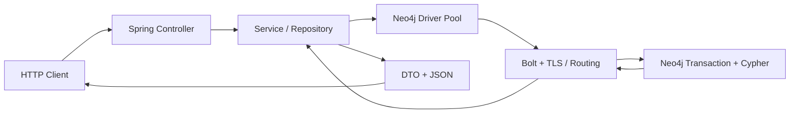
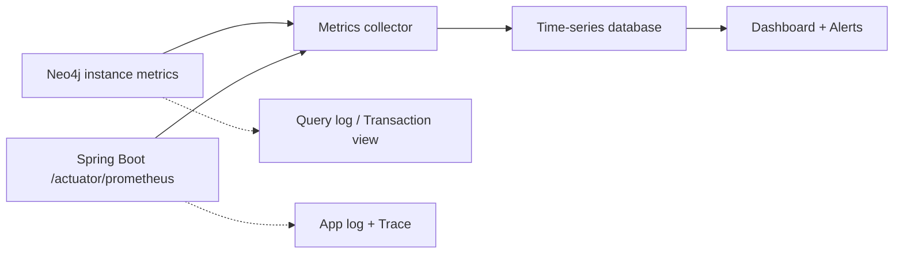

# Combining Server Metrics with Connection Pools and Application-Side Latency in Neo4j

## 1. Why Observe Across Multiple Layers?

Neo4j stores data using a **property graph** model: applications query nodes, relationships, properties, and paths with **Cypher**. An API reading 20 products or traversing 3 hops can be slow for many different reasons: the query scans too many nodes, an index is missing on a business key, a transaction is waiting on locks, the server JVM is running GC, the application's connection pool is exhausted, the network to the cluster is slow, or JSON serialization overhead is huge.

If you look only at Neo4j server CPU, you can miss the fact that the application is **waiting to acquire a connection**. If you look only at HTTP handling duration, you can mistakenly conclude Cypher is slow when most of the time is spent in Java code or serialization.

This lesson belongs to the **Monitoring** chapter of the `DATABASE_ENGINE_GRAPH_NEO4J` module. Its focus is building **end-to-end observability**: linking Neo4j server telemetry with the **Neo4j Java Driver** pool, **Spring Boot/Spring Data Neo4j** latency, and real API experience.

After this lesson, you will be able to:

1. Map a request flow from HTTP to Neo4j and identify which duration is measured at which layer.
2. Select essential metrics across server, driver/pool, Cypher/transactions, and application.
3. Use Micrometer/Actuator, Prometheus, or an equivalent system to observe latency per operation.
4. Compute throughput, error rate, p95/p99, and saturation, and distinguish counters, gauges, and histograms.
5. Diagnose slowdowns caused by **pool**, **server**, **locks**, **graph fan-out**, **network**, or **serialization**.
6. Design dashboards, alerts, and incident workflows without leaking secrets, PII, or creating high-cardinality metric labels.

> **Versions:** Examples target Neo4j 5.x, Java Driver 5.x, Spring Boot 3.x, and corresponding Micrometer versions. Server metric names, exporter options, licensing, driver metrics capabilities, and administrative column lists may differ by version/edition or managed services like **Neo4j Aura**. Consult the metric catalog for your exact running version; the application metric names in this lesson are **custom metrics we define ourselves**, not a guarantee that Neo4j emits them automatically.

## 2. Timing Map of a Request

A request typically passes through these layers:



Intervals can be named as follows:

| Measurement | Start and End Points | What Work Does It Include? |
| --- | --- | --- |
| `http.duration` | Request received → response sent per framework measurement | Controller, service, database, serialization, and potentially part of server network I/O |
| `graph.operation.duration` | Service prepares to call Neo4j → receives needed DTOs/records | Pool wait, transaction, Bolt, Cypher, retries, and record mapping depending on timer placement |
| `pool.acquire.duration` | Connection requested → connection granted | Waiting for an available connection; **not** query execution time |
| `bolt.network.duration` | Sending/receiving Bolt messages | Round trips, routing, TLS, and result streaming; requires proper tooling/traces to isolate cleanly |
| `transaction.duration` | Begin → commit/rollback | Cypher, lock wait, server execution, and client interaction gaps inside the transaction |
| `server.query.duration` | Neo4j tracking a single query | Server-side query processing per version metric/log definition |
| `json.serialization.duration` | Converting DTO → JSON | API mapping/payload emission, not necessarily tied to Neo4j |

**Never simply add all of these numbers together.** `http.duration` already **encompasses** most of `graph.operation.duration`; transactions and queries can also nest inside one another. These are **nested** or overlapping scopes, not disjoint segments you can blindly sum.

Illustrative example:

```text
Total HTTP:                          420 ms
  Java validation / misc logic:       20 ms
  Graph service call:                330 ms
    connection pool wait:            180 ms
    communication + transaction:     130 ms
    mapping Record to DTO:            20 ms
  JSON build and response flush:      70 ms
```

This example uses **intentionally decomposed segments** that sum cleanly to 420 ms. If you only have `graph.operation.duration = 330 ms`, never claim the Neo4j server executed Cypher for 330 ms: in this example, **180 ms** was lost in the pool.

### 2.1. Naming the Same Operation Consistently Across Layers

Suppose `GET /products` serves a list of 20 `:Product` nodes. Across telemetry systems, standardize on a low-cardinality operation name:

```text
operation = "products.list"
database  = "neo4j"
app       = "catalog-service"
```

Use this operation name across spans, timers, logs, and transaction metadata. During an outage, operators can filter by the exact same `products.list` value to correlate metrics and traces instead of guessing which HTTP route belongs to which Cypher query.

## 3. Four Signal Groups to Know Whether the System Is "Healthy"

A system can combine the **RED** model at the service layer and **USE** at the resource layer:

- **Rate:** requests/transactions or graph operations per second.
- **Errors:** error rates broken down by class: client input, timeout, transient, authentication/authorization, query/constraint.
- **Duration:** processing time distribution, especially p95/p99—not just averages.
- **Utilization:** CPU, heap, page cache, pool connections, and storage capacity currently consumed.
- **Saturation:** queued requests, pending connections, lock-waiting transactions, or resources approaching limits.

| Layer | Metrics or Signals to Watch | What Question Does It Answer? |
| --- | --- | --- |
| HTTP / Spring Boot | request rate, 4xx/5xx, p50/p95/p99, in-flight requests | Are users experiencing slowness or errors? |
| Service / query client | `graph.operation.duration` by operation/outcome, retries, timeouts | Which operation type is slow? |
| Driver / pool | active/idle connections, pending acquisitions, acquisition wait, connect failures | Is the app queuing before reaching Neo4j? |
| Bolt / network | connection errors, reconnects, routing failures, TLS handshakes, network RTT | Is the channel to Neo4j stable? |
| Server transactions | running, lock-waiting, terminated transactions, durations, timeout errors | Which transactions is Neo4j busy with? |
| Query / Cypher | query duration, DB hits, rows, plan, index seek/scan, fan-out | Is the query doing more work than needed? |
| JVM / host | CPU, heap, GC pauses, native memory, container RSS | Is the host compute- or memory-bound? |
| Storage | page-cache hits/faults, disk latency/IOPS, transaction log throughput | Does the working set fit in memory; is I/O a bottleneck? |

Do not pick metrics solely because a default dashboard has them. For instance, if a system ingests batches, **committed batch counts**, **queue lag**, and **records pending retry** can matter just as much as API p95.

## 4. Neo4j Server Telemetry Sources

Neo4j provides metrics, query logging, transaction monitoring, and administrative views. Exact capabilities must be verified by **edition, version, and deployment model**. On Neo4j Aura, collection and custom exporter options differ from self-managed Neo4j.

### 4.1. Transaction and Lock Telemetry

Track the following groups using exact metric names from your operational catalog:

- Transactions **started**, **committed**, and **rolled back/failed/terminated** over time.
- **Active** or blocked transactions when exposed.
- **Lock wait time**, lock contention/deadlocks, and transactions touching the same nodes/relationships.
- Long-running, timed-out, or deliberately terminated transactions.
- Transaction memory usage and limit-exceeded errors where published.

Neo4j also allows live transaction inspection via Cypher:

```cypher
SHOW TRANSACTIONS
YIELD database, transactionId, username,
      elapsedTime, waitTime, status, activeLockCount
RETURN database, transactionId, username,
       elapsedTime, waitTime, status, activeLockCount
ORDER BY elapsedTime DESC;
```

This is a **point-in-time snapshot**, not a time series replacing metrics. A finished transaction will no longer appear by the time operators investigate. Viewing other users' transactions is restricted by roles; never grant application accounts admin privileges just to power dashboards.

### 4.2. Memory, Page Cache, and JVM

For queries reading many nodes/relationships, separate these metric groups:

| Group | Meaning |
| --- | --- |
| Heap used, heap committed, GC pauses | Java memory allocation/reclamation; GC pauses can trigger latency spikes |
| Page cache size/usage | Share of the store's working set held in cache |
| Page cache hits/faults | Whether data pages are served from cache or fetched from storage |
| Native/off-heap/process RSS | Memory outside the heap, including database structures or plugins |
| Transaction memory | Resources consumed by transactions per Neo4j tracking mechanisms |
| CPU and disk I/O | Physical resource consumption and saturation under load |

A **high page-cache hit ratio** is generally favorable, yet not sole proof that queries are optimal. An unindexed query can scan millions of cached nodes and still burn heavy CPU. Conversely, a lightweight query encountering a cold-cache fault is not necessarily a production problem.

When running Neo4j in Docker/Kubernetes, also watch **cgroup memory limits, OOMKilled events, CPU throttling**, and storage performance. Heap, page cache, and native memory together must leave headroom for the OS and sidecars; never treat transaction memory as a measure of **total RSS**.

### 4.3. Bolt Connections and Routing

A server can track open **Bolt connections**, accepted/closed connections, failures, and throughput. On clusters, observe per **server instance** and role. Server-side connection totals **need not match** one application's active pool count:

1. Multiple applications or replicas may connect to the same server.
2. A routing driver maintains pools to **multiple endpoints**.
3. Idle connections remain open without indicating active queries.
4. Servers also accept connections from admin tools, ETL pipelines, backups, or other drivers.

When debugging routing failures, inspect both seed URIs and the **advertised** addresses returned to the driver; one unreachable endpoint or misconfigured TLS cert can degrade a subset of traffic.

### 4.4. Exporting Metrics and Securing Endpoints

A typical self-managed architecture:



If Neo4j uses the **Prometheus exporter** or an equivalent exporter, enable the feature per your version, configure the **endpoint**, allow scrapes only from **trusted collectors**, and inspect the actual received series. Managed services may instead expose prebuilt dashboards/metrics APIs.

Never expose metrics ports to the public Internet. Even without passwords, CPU usage, database names, topology, query activity, and cluster status are sensitive infrastructure details.

**Usage rule:** server metric names vary across releases. In this lesson, names like `graph_query_duration_seconds` are **application-defined**; any dashboard expression reading Neo4j server metrics must be verified against live scrape output rather than assumed names.

## 5. Neo4j Java Driver Connection Pool

The Java Driver reuses Bolt connections from pools. Under routing configurations, pools are managed per target server address; **one Driver does not necessarily have only a single global pool**.

### 5.1. Active, Idle, and Pending Are Distinct

```text
                request needing Neo4j
                        │
                        ▼
          ┌────────────────────────┐
          │ Waiting for connection │ ◀── acquisition wait
          └────────────┬───────────┘
                       ▼
          ┌────────────────────────┐
          │ Connection in use      │ ◀── active / in-use
          └────────────┬───────────┘
                       ▼
          ┌────────────────────────┐
          │ Returned to pool (idle)│
          └────────────────────────┘
```

| State | Interpretation | When Rising Abnormally |
| --- | --- | --- |
| **Idle** | Available connection held ready | May simply indicate low load or warm pool; not an error by itself |
| **In-use/active** | Connection actively serving work | Check slow queries, long transactions, and request concurrency |
| **Pending acquisition** | Request waiting for a connection | Sign of pool saturation or leaked/long-held connections |
| **Acquisition wait** | Duration spent waiting before getting a connection | Directly inflates application-side latency |
| **Connection creation/failure** | Opening new sockets, reconnect/TLS/routing errors | May indicate network, credentials, certs, or server unavailability |

These names are **observability concepts**, not a promise that every Java Driver release emits gauges with those exact identifiers. Use the driver metrics API/exporter supported by your version or instrument appropriately in application code; never compute `http.duration - server.query.duration` and label it "pool wait" because those two measurements cover different scopes.

### 5.2. Pool Configuration in Spring Boot

Illustrative example for Spring Boot 3.x:

```yaml
spring:
  neo4j:
    uri: ${NEO4J_URI}
    authentication:
      username: ${NEO4J_USERNAME}
      password: ${NEO4J_PASSWORD}
    pool:
      max-connection-pool-size: 30
      connection-acquisition-timeout: 5s
      max-connection-lifetime: 1h

  data:
    neo4j:
      database: ${NEO4J_DATABASE}
```

Depending on version, Java Driver pool settings can be customized via `Config`/bean customizers. Values `30`, `5s`, and `1h` are purely illustrative. **Do not copy them straight to production** without benchmarking.

`max-connection-pool-size` is not a cluster-wide concurrent transaction cap. If 8 replicas each cap at 30 connections per server, total connections can far exceed 30 across replicas and routing endpoints.

### 5.3. A Full Pool Doesn't Automatically Mean the Pool Is Too Small

Suppose:

```text
Pool maximum:             30
Connections in use:       30
Waiting for connection:   45 requests
Neo4j server CPU:         35%
API p95:                  2.8 seconds
```

Multiple hypotheses exist:

- One or more transactions are **holding connections very long** due to lock waits or slow client result consumption.
- Threads are failing to close sessions properly or holding transactions open across external I/O.
- Application concurrency is too high relative to pool sizing.
- One routing endpoint is degraded, bottlenecking only the pool targeting that endpoint.
- Pool cap is genuinely too low for spare server capacity, **only after ruling out** the above.

35% CPU **does not prove** Neo4j is idle: it may be waiting on disk, locks, networking, or a single saturated core. **Do not jump pool size to 200 immediately**; inspect query/transaction duration, pending acquisitions, wait time, server metrics, and session lifecycles.

### 5.4. Distinguishing Neo4j Pools from HikariCP

Spring Boot applications often connect simultaneously to a relational database via JDBC/HikariCP and to Neo4j via the Java Driver. **HikariCP metrics are JDBC metrics**, not evidence of how Neo4j's Bolt connection pool is behaving. A dashboard panel showing `hikaricp.connections.active` never replaces instrumenting the Neo4j Driver.

When using Spring Data Neo4j repositories, calls still flow through the **Neo4j Java Driver**. Measure the exact Driver pool managed by Spring Boot rather than instantiating a second Driver just for metrics and accidentally maintaining two separate pools.

## 6. Application-Side Latency: Measure the Right Scope and Drain Results

In Java, timers must have **well-defined boundaries**. Measuring from service entry until DTO list completion includes pool wait, routing, retries, Cypher execution, and Record-to-DTO mapping. That measurement is operationally valuable, yet **it is not pure server execution time**.

### 6.1. Micrometer Timer for a Stable Operation

Java 17+, Spring Boot + Micrometer + Neo4j Java Driver 5.x example. Assumes Spring injects `Driver` and `MeterRegistry`, database `neo4j` exists, and data is readable. Place each `public record`/`public class` in its own Java file when integrating into a project:

```java
import java.util.List;
import java.util.Map;
import org.neo4j.driver.Driver;
import org.neo4j.driver.Session;
import org.neo4j.driver.SessionConfig;
import io.micrometer.core.instrument.MeterRegistry;
import io.micrometer.core.instrument.Timer;
import org.springframework.stereotype.Service;

public record ProductSummary(String sku, String name) {}

@Service
public final class ProductGraphReader {
    private final Driver driver;
    private final MeterRegistry metrics;

    public ProductGraphReader(Driver driver, MeterRegistry metrics) {
        this.driver = driver;
        this.metrics = metrics;
    }

    public List<ProductSummary> listProducts(
        String tenantId, int pageSize
    ) {
        if (tenantId == null || tenantId.isBlank()
            || pageSize < 1 || pageSize > 100) {
            throw new IllegalArgumentException("Invalid list request");
        }

        Timer.Sample sample = Timer.start(metrics);
        String outcome = "success";
        try (Session session =
                 driver.session(SessionConfig.forDatabase("neo4j"))) {
            return session.executeRead(tx -> tx.run("""
                MATCH (p:Product {tenantId: $tenantId})
                RETURN p.sku AS sku, p.name AS name
                ORDER BY sku ASC
                LIMIT $pageSize
                """, Map.of(
                    "tenantId", tenantId,
                    "pageSize", pageSize
                )).list(record -> new ProductSummary(
                    record.get("sku").asString(),
                    record.get("name").asString()
                ))
            );
        } catch (RuntimeException exception) {
            outcome = "error";
            throw exception;
        } finally {
            Timer timer = Timer.builder("graph.query.duration")
                .description("Client-side Neo4j operation latency")
                .tag("operation", "products.list")
                .tag("outcome", outcome)
                .publishPercentileHistogram()
                .register(metrics);
            sample.stop(timer);
        }
    }
}
```

**Measurement span of this example:** from starting session creation until `executeRead` returns or throws, including driver work and mapping `Record` to `ProductSummary`. It does **not** include Spring MVC JSON serialization after the method returns.

Important notes:

- `.list(...)` consumes all result rows inside the callback. Calling `tx.run(...)` without consuming results can **under-measure** streaming/result handling cost.
- Driver `executeRead` may retry eligible transient errors; the timer measures **one service invocation**, which may span multiple attempts. Tracking individual attempts requires additional instrumentation.
- `Timer` uses `operation = products.list` and `outcome = success/error`; these are **low-cardinality** tags safe for aggregation.
- This example assumes `name` and `sku` are non-null. Production code must enforce required properties, types, and tenant authorization.
- Never put `tenantId`, `sku`, `orderId`, query parameters, or `requestId` into timer tags where cardinality can explode. Put diagnostic identifiers into controlled logs/traces instead.
- `ORDER BY sku LIMIT $pageSize` does not guarantee the server reads only `pageSize` nodes; ensure appropriate indexes and verify with `EXPLAIN`/`PROFILE` on representative data.

### 6.2. Histograms and p95/p99

`publishPercentileHistogram()` instructs Micrometer to publish backend-compatible histograms when supported by the registry. With `micrometer-registry-prometheus`, the `graph.query.duration` timer typically exports time series prefixed with:

```text
graph_query_duration_seconds_count
graph_query_duration_seconds_sum
graph_query_duration_seconds_bucket
```

These are **expected metric names emitted by the code snippet above** via the Prometheus registry—not Neo4j server metric names. Verify exact names and tags at your live scrape endpoint.

Meaning:

- **Count:** number of recorded operation calls.
- **Sum:** total observed duration across calls, typically in seconds in Prometheus.
- **Bucket:** observations falling at or below threshold `le`, used for percentile estimation.

For example, over 100 requests in a window, `p95 = 800 ms` means roughly 95% of samples finished at or below the computed p95 value. It does **not** mean the slowest request took 800 ms.

**Never average per-pod p95s** to estimate cluster-wide p95. When histograms share compatible buckets, sum bucket `rate(...)` values across pods first and then compute `histogram_quantile`.

### 6.3. Exporting Metrics via Actuator/Prometheus

In Maven (for a Spring Boot project with dependency management):

```xml
<dependencies>
    <dependency>
        <groupId>org.springframework.boot</groupId>
        <artifactId>spring-boot-starter-actuator</artifactId>
    </dependency>
    <dependency>
        <groupId>io.micrometer</groupId>
        <artifactId>micrometer-registry-prometheus</artifactId>
    </dependency>
</dependencies>
```

Example configuration:

```yaml
management:
  endpoints:
    web:
      exposure:
        include: health,info,prometheus
  endpoint:
    health:
      show-details: never
```

When properly configured, `/actuator/prometheus` exposes the defined timer. Operations teams must **restrict access** via internal networks, ingress policies, or authentication; `prometheus` should never be left open publicly.

A single `curl` right after startup does not verify metrics readiness: timers typically appear **only after the operation executes at least once**. Call the endpoint with valid data first, then check the exported series.

## 7. Separating Transaction Latency from Network/Pool Latency with Traces

Per-operation metrics tell you **whether it is slow**. Traces pinpoint **which segment is slow** inside a request:

```text
Trace: GET /products                     420 ms
  ├─ HTTP filter/security                 12 ms
  ├─ ProductService.list                  338 ms
  │   ├─ acquire Neo4j connection         180 ms
  │   ├─ Bolt + Neo4j transaction          135 ms
  │   └─ map Record -> DTO                 23 ms
  └─ serialize / finish response           70 ms
```

This is an **illustrative trace**, not spans automatically emitted with those exact names and timings by every Java Driver version. Obtaining a separate `acquire connection` span requires supported driver instrumentation or explicit hooks; you cannot deduce it solely from a span wrapping `ProductService.list`.

### 7.1. Trace IDs and Transaction Metadata

Good practices:

- Propagate **traceId** or correlation IDs in application logs and requests; optionally attach them to transaction metadata if policy permits.
- Attach `operation = products.list` to identify the matching query family.
- Keep **low-cardinality tags** in metrics (operation, outcome, environment)—never push individual traceIds into metrics.
- Propagate trace context across HTTP and service boundaries using OpenTelemetry or your deployed tracing stack.
- Never leak raw Cypher containing sensitive parameters or database stack traces in API responses.

Example attaching metadata when managing transactions directly via the Java Driver:

```java
import java.time.Duration;
import java.util.Map;
import org.neo4j.driver.TransactionConfig;

TransactionConfig config = TransactionConfig.builder()
    .withTimeout(Duration.ofSeconds(8))
    .withMetadata(Map.of(
        "application", "catalog-service",
        "operation", "products.list",
        "workload", "interactive"
    ))
    .build();

// Pass config to session.executeRead(callback, config)
// when transactions are managed by the Java Driver.
```

This snippet does not ship traces to a tracing backend by itself. It attaches **metadata** to assist transaction inspection where Neo4j supports it. With **Spring Data Neo4j `@Transactional`**, Spring owns the transaction boundary; do not open a separate Driver transaction inside it expecting both to share the exact same boundary.

### 7.2. SHOW TRANSACTIONS and Metadata

In environments with sufficient privileges:

```cypher
SHOW TRANSACTIONS
YIELD database, transactionId, status, elapsedTime,
      waitTime, metaData
RETURN database, transactionId, status, elapsedTime,
       waitTime, metaData
ORDER BY elapsedTime DESC;
```

If several transactions show `operation = products.list` with high `waitTime`, lock contention becomes a stronger suspect. However, **`SHOW TRANSACTIONS` only snapshots currently alive transactions**, so long-term metrics/logs remain necessary to analyze past incidents.

## 8. Cypher Queries: Linking DB Hits, Rows, and Plans to Latency

A graph read query may return 20 rows while touching millions of intermediate rows. For example:

```cypher
MATCH (u:User {id: $userId})-[:FOLLOWS*1..4]->(other:User)
RETURN DISTINCT other.id AS userId
LIMIT 20;
```

If a user has thousands of neighbors, path counts explode exponentially with depth. `LIMIT 20` caps **returned rows**, not the number of relationships the query expands internally.

### 8.1. EXPLAIN First, PROFILE When Permitted

`EXPLAIN` shows the predicted plan **without executing** the query:

```cypher
EXPLAIN
MATCH (u:User {id: $userId})-[:FOLLOWS*1..4]->(other:User)
RETURN DISTINCT other.id AS userId
LIMIT 20;
```

`PROFILE` **executes** the query and prints actual plan statistics:

```cypher
PROFILE
MATCH (u:User {id: $userId})-[:FOLLOWS*1..4]->(other:User)
RETURN DISTINCT other.id AS userId
LIMIT 20;
```

Inspect operators and counters per your version's capabilities:

| Signal | Interpretation |
| --- | --- |
| `NodeIndexSeek` or equivalent index operator | Did Neo4j use an index to locate the starting node? |
| `NodeByLabelScan` / similar scans | Is it scanning far more nodes than expected? |
| Expansion / path operators | How fast do rows multiply at each hop? |
| `Distinct` / aggregation / sort | Is it deduplicating or sorting a huge intermediate set? |
| `Rows` | How large are the intermediate row counts? |
| `DB Hits` | Engine-level storage access work; not equivalent to physical disk reads |
| Estimated vs. actual rows | Is the planner's cardinality estimate far off from reality? |

Never run `PROFILE` on write statements in production just to "peek": it can **actually create, modify, or delete nodes and relationships**. Build representative data and load in a test environment.

### 8.2. Combining Signals to Classify the Problem

If `graph.operation.p95` spikes alongside:

- Rising `DB Hits` or scans appearing → inspect indexes, tenant filters, cardinality, fan-out.
- Rising `waitTime`/lock contention → inspect write transactions hitting the same entities and lock hold duration.
- Rising page-cache faults and disk I/O → inspect working set, page cache sizing, storage.
- Rising GC pauses → inspect heap, memory pressure, and intermediate result volume.
- Rising pool pending while server query duration stays flat → inspect connection pool/sessions/concurrency.

No **single metric** alone suffices to prove root cause.

## 9. Prometheus: Joining Application Metrics with Server Telemetry

In this section, we combine **application metrics emitted by the Micrometer example** with server-side signals aligned on dashboards. Never assume a single Neo4j server metric name is fixed across all versions.

### 9.1. Graph Operation p95 from Histograms

Example PromQL:

```promql
histogram_quantile(
  0.95,
  sum by (le, operation) (
    rate(graph_query_duration_seconds_bucket[5m])
  )
)
```

This estimates p95 from histograms over a 5-minute window, **aggregated across replicas** when series share compatible buckets and definitions. You can group by `operation`, `environment`, or `service` provided those tags exist and cardinality stays controlled.

### 9.2. Throughput by Operation

```promql
sum by (operation) (
  rate(graph_query_duration_seconds_count[5m])
)
```

This returns average **operation calls/second** over the window—not Neo4j records created or driver transaction attempts. A single operation call may involve internal driver retries.

### 9.3. Error Rate by Graph Operation

```promql
sum by (operation) (
  rate(graph_query_duration_seconds_count{outcome="error"}[5m])
)
/
clamp_min(
  sum by (operation) (
    rate(graph_query_duration_seconds_count[5m])
  ),
  0.001
)
```

This calculates error ratio while avoiding division by zero via `clamp_min`. Under very low traffic, sample counts in the window may be too small to draw conclusions; for alerting, add **minimum request volume**, sustained duration, and corroborating metrics.

### 9.4. Avoid Baseless Time-Series Joins

To display clean correlations on dashboards, standardize metadata:

```text
Application side:  environment, app, instance, operation, outcome
Neo4j server:      environment, cluster, database, instance
Common time:       aligned timestamps and timezones across metric backends
```

An app metric filtered by `operation` **does not have an automatic 1:1 join** to CPU metrics on one specific Neo4j server, especially when routing distributes calls across cluster members. Dashboards can place both panels on the same time axis for visual correlation; only conclude a specific operation hit a specific server when backed by **routing/span/log evidence**.

### 9.5. Counter Resets, Gauges, and Labels

- **Counters** increase monotonically with events and reset on process restarts. Use backend `rate`/`increase` instead of raw differences that break on resets.
- **Gauges** reflect instantaneous states like active connections and can fluctuate between scrapes.
- **Histograms** require sensible buckets and controlled overhead; never mint thousands of arbitrary label values.
- **Pre-aggregated summaries/percentiles** generally cannot be combined across pods via simple averaging.

A metric tagged with `customerId` can spawn millions of time series—bloating collector RAM, slowing dashboards, and driving up storage costs. Stick to allowlisted `operation` values, small `outcome` sets, and `instance`/`database` labels only where needed.

## 10. Combined Dashboard: From User Experience to Server

An operational dashboard can be organized into rows:

| Row | Charts / Signals | Purpose |
| --- | --- | --- |
| **User experience** | HTTP RPS, 5xx, p50/p95/p99 per endpoint | Are customers impacted? |
| **Graph operations** | `graph.query.duration` p95, count, outcome | Which Cypher operation slowed or failed? |
| **Driver / pool** | active/idle/pending, acquisition duration, connect/retry errors | Is the app queuing on connections before queries run? |
| **Transactions** | active, commits/rollbacks, blocked/lock waits, timeouts | Is Neo4j experiencing transaction contention? |
| **Server compute** | CPU, heap/GC, process memory, page cache | Is the server CPU- or memory-constrained? |
| **Storage / network** | Disk latency, page faults, Bolt connections, routing failures | Is there an I/O or network bottleneck? |
| **Data / import** | Rows/batch, committed batches, queue lag, rejected rows | Are background jobs hurting interactive APIs? |

Every dashboard needs appropriate filters for `environment`, `database`, and `instance/cluster`. Never merge every database on a host into one aggregate number when an application depends on a specific database.

### 10.1. Time Slicing During Incident Analysis

Suppose API p95 jumps from 250 ms to 2 seconds at 10:02:

1. Check deployments, feature flags, or config changes between 10:00 and 10:05.
2. Check whether `graph.query.duration` spiked at the same timestamp.
3. If yes, check pending acquisitions and pool wait time.
4. If the pool isn't queuing, check server transaction/query durations, lock waits, CPU, GC, and page faults.
5. Pull a representative trace or query log entry to identify the exact operation, query template, row counts, and endpoint.
6. Declare root cause only with **multi-layer evidence**, never from one correlated chart alone.

Watch for telemetry lag: 30-second scrape intervals, 5-minute rollups, delayed logs, and clock skew can make peaks from the same incident appear slightly offset.

## 11. Alerting on SLOs Rather Than Arbitrary Thresholds

An **SLO** defines target user experience, for example:

```text
Operation: products.list
Illustrative SLO: 99% of calls succeed in <= 500 ms
Evaluation window: 28 days
```

This target is **illustrative only**. Never impose a 500 ms interactive list target onto a batch job ingesting millions of records.

### 11.1. High p95 Alert

Example Prometheus rule for the application metric from Section 6:

```yaml
groups:
  - name: neo4j-app-query-latency
    rules:
      - alert: ProductGraphQueryP95High
        expr: |
          histogram_quantile(
            0.95,
            sum by (le) (
              rate(
                graph_query_duration_seconds_bucket{
                  operation="products.list"
                }[5m]
              )
            )
          ) > 0.5
        for: 10m
        labels:
          severity: warning
        annotations:
          summary: "Product graph query p95 above 500 ms"
```

This rule tracks **client-side operation latency**, not `http.duration`. An operation with healthy p95 can still produce bad API latency if JSON serialization is slow. In production, enforce minimum request volume guards and pair with alerts on error rate, saturation, queue depth, or SLO burn rate.

### 11.2. Splitting Alerts by Cause and Impact

| Alert | Suggested Condition | First Action |
| --- | --- | --- |
| High API p95 + rising 5xx | User-facing impact | Open app dashboard, compare graph operations and recent deploys |
| Rising pool pending | App waiting on connections | Check long transactions, connection leaks, query latency, routing |
| Rising lock waits & rollbacks | Write contention | Identify hot entities, batch/concurrency sizing, and deadlocks |
| High page faults + disk latency | Working set / I/O bottleneck | Check storage, page cache, scans, and query plans |
| GC pauses or OOMKills | JVM / container pressure | Inspect heap/native memory, batch sizes, and intermediate data |
| Rising Bolt / routing failures | Endpoint or network issue | Check TLS, DNS, routing, advertised addresses, and server health |
| Climbing import queue lag | Background pipeline falling behind | Check batch throughput, errors, pool usage, and load priority |

Every good alert specifies **owner**, **runbook**, severity, and recovery verification. Alerting solely on "CPU > 70%" without user impact or resource saturation quickly causes alert fatigue.

## 12. Six Cross-Layer Diagnostic Scenarios

### 12.1. Scenario A — The Pool Is the Bottleneck

**Signals:** HTTP p95 rises, `graph.query.duration` rises, pool pending and acquisition wait rise, while server query duration in logs barely changes.

**Hypothesis:** requests wait longer for connections due to higher concurrency, long-running transactions holding connections, unclosed sessions, or undersized pools.

**Experiments:**

1. Inspect in-use connections per pod and target endpoint.
2. Hunt for long-open transactions or `executeRead`/`executeWrite` callbacks holding connections.
3. Review replica counts, retries, and post-deploy traffic shifts.
4. Throttle concurrency or shorten long transactions, then re-measure acquisition wait.
5. Increase pool size only after confirming Neo4j has spare capacity and calculating total cluster-wide connections.

### 12.2. Scenario B — Lock Contention

**Signals:** write API p95 rises, `SHOW TRANSACTIONS` shows high `waitTime`, rollbacks/deadlocks rise; pools may also slowly exhaust as connections stay held.

**Hypothesis:** concurrent transactions contend on the same `(Product {sku})` or create relationships touching hot nodes.

**Actions:** shorten transactions, keep external I/O out of transactions, group/batch cleanly, limit concurrency on hot keys, and ensure writes are **idempotent** on retry. Raising timeouts only holds locks longer if the root cause remains unaddressed.

### 12.3. Scenario C — Cypher Scans Too Much Data

**Signals:** server CPU rises, DB Hits/Rows are huge, query duration climbs, plans show scans or deep multi-hop expansions.

**Hypothesis:** missing index on `tenantId` + business key, overly broad filters, unbounded `MATCH ... *1..6`, or paginating only after row multiplication.

**Actions:** inspect `EXPLAIN`/`PROFILE`, add proper indexes/constraints, paginate starting nodes before expanding relationships, and bound hops/fan-out and returned results.

### 12.4. Scenario D — Network or Routing

**Signals:** driver logs connect/retry errors, pool creation stalls, or connections fail against one server; server CPU does not rise proportionally.

**Hypothesis:** DNS, firewall, TLS/CA/hostname mismatch, advertised addresses, or an unreachable cluster member.

**Actions:** test reachability from the application network to the actual advertised endpoints; preserve TLS verification and never downgrade `neo4j+s://` to `neo4j+ssc://` as a production "quick fix".

### 12.5. Scenario E — Server Memory or Storage

**Signals:** GC pauses rise, heap/RSS stays high, page faults/disk latency climb, or containers get OOMKilled; both APIs and batch imports slow down.

**Hypothesis:** working set exceeds page cache, oversized batch transactions, queries buffering massive intermediate sets, or mis-sized container memory limits.

**Actions:** audit the combined heap/page cache/native/container budget, workload mix, concurrent transactions, sort/aggregation queries, and batch sizes. Never raise an internal memory cap while leaving the container ceiling unchanged.

### 12.6. Scenario F — Server Fast, API Slow

**Signals:** server query duration is steady, minimal pool waiting, `graph.query.duration` relatively low, while HTTP p95 climbs alongside large response payloads.

**Hypothesis:** graph entity-to-DTO hydration, cyclic JSON serialization, N+1 calls, heavy Java processing, or transferring oversized payloads.

**Actions:** measure serialization separately, return flat DTOs/`nodes + edges` rather than unbounded subgraphs; check compression, payload size, backpressure, and web server thread pools.

**Core lesson:** a "green" server dashboard and a "red" HTTP dashboard do not contradict each other—they measure different stages of the same request.

## 13. Monitoring Data Imports and Interactive Queries Simultaneously

In e-commerce apps, a job importing `100,000` `:Product` nodes may run concurrently with live product-list APIs. If the import monopolizes connections or triggers lock contention, API latency climbs even though read queries didn't change.

A workload-segmented monitoring model:

```text
interactive:
  products.list
  products.details
  search.related-products

background:
  products.import-batch
  graph.rebuild-index
  reconciliation.scan
```

Track separately:

- **Interactive:** p95/p99, error rate, active requests, pool wait.
- **Import:** ingested rows, valid/rejected rows, committed batches, retries, throughput, queue lag, and per-transaction duration.
- **Neo4j:** transaction concurrency, lock waits, memory, CPU, page cache, and transaction logs.

Mitigations include **capping concurrent writers**, smaller batches, off-peak scheduling, dedicated worker pools, or access prioritization. Using **one Driver** per application often works well when properly tuned; spinning up extra Drivers with separate pools merely for "isolation" can make total connections and resource limits harder to control.

### 13.1. Signs a Batch Is Too Large

| Signal | Likely Meaning |
| --- | --- |
| `transactionDurationMs` p95 climbs steeply with `batchSize` | Transactions hold resources too long |
| Rising timeouts/rollbacks during imports | Timeout settings or batch sizes are mismatched |
| Rising transaction memory/GC | One batch touches too many entities or buffers large state |
| API pool pending climbs during imports | Imports hog connections or push concurrency too high |
| Throughput stops scaling with larger `batchSize` | Bottleneck has shifted to CPU, I/O, locks, or network |

Choose batch sizes through **controlled experiments**. For example, run the same representative data at 100, 500, and 1,000 rows/batch; compare throughput, p95 transaction time, rollbacks, lock waits, and API impact. Never pick batch size solely from CSV file size.

## 14. Securing Observability Data

A poorly designed monitoring stack can become a data leak vector even when Neo4j enforces TLS and RBAC.

### 14.1. Keep Sensitive Data Out of Metric Labels

Labels **to avoid**:

```text
customerId = "C189391"
orderId    = "O900012"
cypher     = "MATCH (u {email: 'real-user@example...'} ) ..."
requestId  = "c1ab...a brand new value per request"
```

These illustrate **anti-patterns never to use**. Stick to bounded labels such as `operation=products.list`, `outcome=success/error`, `environment=prod`, and `instance` with controlled cardinality.

### 14.2. Query Logs and Tracing Require Controls

- Configure query logging per **privileges, version, and security policy**. Weigh carefully whether parameters should be logged, as they can carry PII or business secrets.
- Never log passwords, tokens, private keys, connection strings with credentials, or secret store configurations.
- Use query names/operation IDs and **query template hashes** for statistics instead of storing raw user payloads.
- Enforce retention windows, dashboard access controls, and download/third-party export restrictions on logs/traces.
- Keep trace IDs out of metric labels; use traces/logs for per-request debugging.
- Apply tenant/role partitioning on dashboards if operational data could reveal sensitive graph structures.

Never expose unrestricted `SHOW TRANSACTIONS` or raw query logs as an application endpoint for end users.

## 15. Version Compatibility and Configuration Pitfalls

| Topic | What to Verify |
| --- | --- |
| Neo4j self-managed 5.x | Edition, metric exporter, database/DBMS/Bolt metric groups, transaction view privileges |
| Newer Neo4j releases | Setting/metric names, exporter capabilities, and admin columns may change |
| Neo4j Aura | Provider-managed dashboards/metrics APIs; cannot freely edit `neo4j.conf` or open exporter ports |
| Java Driver 5.x | Actual API for enabling/reading driver metrics; per-server/routing pools and exposed stats |
| Spring Boot 3.x | Actuator, Micrometer Registry, auto-configuration, `spring.neo4j.pool.*` properties |
| Spring Data Neo4j | Repositories/`Neo4jClient` run via Driver/transaction manager; not every operation gets its own timer automatically |
| Kubernetes / Docker | Pod memory/CPU, scrape labels, replica counts, readiness/liveness, network routing |

**Common pitfall:** reading `hikaricp.connections.active` as Neo4j Bolt connections, or assuming `/actuator/metrics` automatically exports every Neo4j Driver pool state. Verify bean wiring, driver instrumentation, exporters, and actual received data.

**Another pitfall:** the same Cypher query can produce different plans and metrics across two Neo4j versions. When comparing before/after an upgrade, record version, dataset, schema/indexes, workload, page cache warm-up, and measurement environment.

## 16. Ordered Incident Investigation Workflow

Upon receiving a `products.list p95 high` alert:

1. **Quantify impact:** HTTP p95/p99, 5xx rate, request rate, affected tenants/scope, and exact start time.
2. **Isolate the operation:** did `graph.query.duration` for `products.list` rise; are outcomes errors or retries?
3. **Check the pool:** pending acquisitions, active/idle counts, wait time, connection failures. If metrics are missing, add instrumentation rather than guessing.
4. **Inspect the server:** transaction counts, lock waits, CPU, GC, page cache, disk, and Bolt connections on the exact database/instance.
5. **Read a representative trace/log:** link request ID, operation, transaction metadata, and sanitized query template.
6. **Check the Cypher plan:** `EXPLAIN`, safe-environment `PROFILE`, indexes/constraints, intermediate rows, and fan-out.
7. **Check recent changes:** deployments, import jobs, pool settings, replica counts, cluster restarts, schema migrations.
8. **Hypothesize and test:** change one variable, compare before/after metrics, and record outcomes.
9. **Recover safely:** roll back the release, throttle concurrency, split batches, or shift workloads depending on root cause; never disable TLS or bypass permissions with admin accounts.
10. **Postmortem:** capture timeline, relevant metrics/traces, root cause, preventive actions, and owners.

Never raise `pool.maxConnectionPoolSize`, transaction timeout, and heap simultaneously without explanatory evidence. If symptoms disappear after raising all three, you won't know which change mattered and may simply be masking overload.

## 17. Practice Exercises

### Exercise 1 — Separating Client and Server p95

An operation reports:

```text
HTTP p95:                 900 ms
Graph operation p95:      740 ms
Server query p95:         180 ms
Pool acquisition p95:     490 ms
```

**Question:** can you conclude Neo4j Cypher took 740 ms? What is the next diagnostic step?

**Hint:** no. `graph operation` spans multiple layers; high pool acquisition p95 points to investigating connection saturation, long-held transactions, retries, and measurement compatibility. Never subtract **p95 values** to isolate one request's exact breakdown: p95s come from **different sample distributions**.

### Exercise 2 — Full Pool, Low CPU

Eight app replicas each cap pools at 30; the API hits connection acquisition timeouts while Neo4j CPU hovers around 40%.

**Question:** should you raise every pool to 100? Name at least three checks first.

**Hint:** inspect active/idle/pending counts per pod and endpoint, transaction/lock wait durations, routing failures, proper session closing, and request concurrency. Moderate total CPU does not prove sufficient I/O or lock capacity.

### Exercise 3 — Query Fan-Out

`MATCH (u)-[:FOLLOWS*1..5]->(v) RETURN v LIMIT 20` includes `LIMIT 20`, yet p99 spikes steeply as `FOLLOWS` edges grow.

**Question:** why didn't `LIMIT` save it? How do you verify?

**Hint:** the final output is capped at 20 rows, yet intermediate paths can grow vast. Run `EXPLAIN`/`PROFILE`, constrain starting nodes, direction, hops/fan-out, and duplicate paths.

### Exercise 4 — Calculating Throughput and Error Rate

Over 5 minutes, application metrics record `1,200` calls to `products.list` with `24` errors.

**Suggested answer:** average throughput `1200 / 300 = 4` operations/sec; error rate `24 / 1200 = 2%`. This reflects recorded **service invocations**, not raw Neo4j Driver query attempts when retries occur.

### Exercise 5 — Never Average p95s

Pod A handles 10 requests with p95 of 50 ms; Pod B handles 10,000 requests with p95 of 500 ms. Can you take `(50 + 500)/2 = 275 ms` as system-wide p95?

**Answer:** no. Percentiles do not combine linearly, and sample sizes differ drastically across pods. Aggregate compatible histogram buckets and apply `histogram_quantile` to the combined series, or recompute quantiles from raw combined samples.

### Exercise 6 — Designing a Dashboard for an Import Job

An app batch-imports 2 million nodes and relationships while serving read APIs. Select at least 8 metrics spanning **app/pool/server/storage** and define two alerts.

**Hint:** batch throughput, rejected rows, queue lag, transaction p95, retries, HTTP p95, pool pending, lock wait, heap/GC, page faults, disk latency. Alert on sustained high API p95 or growing import lag paired with rising error rates, linked to triage runbooks.

### Exercise 7 — Is This Observability Safe?

A dashboard uses a `queryText` label containing Cypher with customer emails and a unique `requestId` per request. Is this good tracing practice?

**Answer:** no. It risks leaking PII and creates unbounded label cardinality. Keep metrics limited to low-cardinality operation/outcome tags; store request IDs and controlled diagnostics in logs/traces governed by masking, RBAC, and retention policies.

## 18. Pre-Deployment Checklist

- [ ] Mapped the request path from HTTP through driver pool/Bolt/Cypher/DTO to clarify each timer's boundary.
- [ ] Measured rate, errors, and p50/p95/p99 for both HTTP endpoints and Neo4j-backed operations.
- [ ] Verified pool telemetry comes from **Neo4j Java Driver**, not confused with HikariCP.
- [ ] Collected per-database/instance server metrics: transactions, lock waits, CPU, heap/GC, page cache, disk.
- [ ] Configured correlated traces/logs and transaction metadata per operation without leaking secrets.
- [ ] Configured compatible histograms for p95/p99 rather than averaging percentiles across pods.
- [ ] Restricted metric tags to a finite allowlist; excluded request/customer/order IDs.
- [ ] Verified metric sources, exact series names, and differences across Neo4j versions/editions/Aura.
- [ ] Added dashboard filters for environment, app, database, instance/cluster, and workload class.
- [ ] Configured user-impact and saturation alerts with runbooks and noise controls.
- [ ] Separated interactive workloads from import/background jobs, tracking batch/checkpoint progress and pool impact.
- [ ] Tested scenarios for pool exhaustion, lock contention, scans/fan-out, routing errors, and GC/storage pressure.
- [ ] Used `EXPLAIN`/`PROFILE` safely; never ran `PROFILE` recklessly on production writes.
- [ ] Protected `/actuator/prometheus` and Neo4j exporters with network and access controls.
- [ ] Enforced retention, masking, and RBAC on logs/traces; never logged passwords or sensitive parameters.
- [ ] Measured before and after any pool/index/config change on representative workloads with a rollback plan.

## Conclusion

**Effective Neo4j observability connects user experience to the underlying resources producing it.** HTTP p95 shows how long users wait; service timers show which graph operations lag; connection pool stats reveal queuing delays; and transaction/lock metrics, Cypher plans, JVM stats, page cache, and storage explain what the database is actually doing. There is no simple subtraction between p95 numbers, and no single CPU graph proves root cause. Combine **metrics, logs, traces, Cypher plans, and controlled experiments**, while keeping metric labels low-cardinality and protecting operational data. Done well, teams can tune node/relationship queries, Java Driver usage, Spring Data Neo4j, and batch imports on solid evidence instead of blindly raising pools or timeouts.

### References

- [Neo4j Operations Manual — Monitoring](https://neo4j.com/docs/operations-manual/current/monitoring/)
- [Neo4j Operations Manual — Metrics](https://neo4j.com/docs/operations-manual/current/monitoring/metrics/)
- [Neo4j Operations Manual — Show and terminate transactions](https://neo4j.com/docs/operations-manual/current/database-internals/show-and-terminate-transactions/)
- [Neo4j Cypher Manual — Execution plans](https://neo4j.com/docs/cypher-manual/current/planning-and-tuning/execution-plans/)
- [Neo4j Java Driver Manual — Performance](https://neo4j.com/docs/java-manual/current/performance/)
- [Neo4j Java Driver Manual — Transactions](https://neo4j.com/docs/java-manual/current/transactions/)
- [Spring Boot Reference — Actuator](https://docs.spring.io/spring-boot/reference/actuator/index.html)
- [Micrometer Reference](https://docs.micrometer.io/micrometer/reference/)
- [Prometheus — Histogram and summaries](https://prometheus.io/docs/practices/histograms/)
