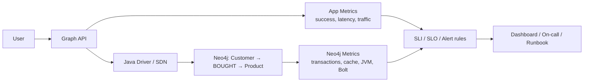
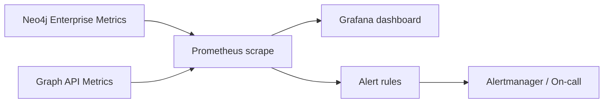

# Setting Alert Thresholds by Baseline and Service Level Objectives in Neo4j

A Neo4j system can operate smoothly at 80% CPU during peak hours yet be experiencing an outage if **query latency triples** during off-peak hours. If you set a fixed threshold like "CPU > 70% triggers a page" around the clock, operations gets flooded with false alarms. Conversely, if you only alert when the database stops completely, users may suffer slow queries or errors for a long time first.

This lesson belongs to the **Monitoring** chapter of the **DATABASE_ENGINE_GRAPH_NEO4J** module: using Neo4j to store property graphs, query relationships/paths with Cypher, optimize indexes, and operate **Neo4j Java Driver** or **Spring Data Neo4j** applications. The focus here is designing **alert thresholds grounded in baselines** and **Service Level Objectives (SLOs)**, rather than picking arbitrary numbers.

After this lesson, you will be able to:

- Distinguish **metric, SLI, SLO, SLA, baseline, alert threshold, and error budget**.
- Build baselines accounting for peak hours, day of week, query classes, tenants, and data import windows.
- Pick user-experience signals first and link them to internal Neo4j metrics.
- Design **static thresholds**, **baseline-driven thresholds**, **multi-window alerts**, and **error-budget burn rates**.
- Reduce alert noise using sustained durations, severity tiers, deduplication, maintenance exclusions, and missing-telemetry checks.
- Build an alert matrix, Prometheus/Grafana examples, and a practical **Cypher/Neo4j** triage runbook.

> **Deployment scope:** Metric names, export capabilities, query logs, and monitoring UIs vary across Neo4j Community, Enterprise, and Aura, as well as across versions. Numbers in this lesson are **worked illustrative examples**, not Neo4j defaults or mandatory production values.

## 1. From System Signals to Actionable Alerts

Consider a graph-backed recommendation application:



Suppose `GET /recommendations` must return recommended products before a deadline. There are four layers to observe:

1. **User:** did the request succeed and finish fast enough?
2. **Application:** requests/s, errors, p95/p99, connection pool wait time, retries.
3. **Neo4j:** transactions, query errors, Bolt, page cache, JVM/GC, checkpoint duration.
4. **Infrastructure:** CPU, RAM, disk, I/O, network, cluster health.

**A good alert doesn't merely say "a metric went up"—it answers "which objective is at risk of breach, who needs to act, and what should they do?"**

For example, a dip in page cache hit ratio right after a restart may just be cache warm-up; unless accompanied by SLI degradation, **observe and verify** first instead of automatically waking up on-call.

## 2. Using the Terminology Accurately

| Term | Meaning | Example |
| --- | --- | --- |
| **Metric** | Measured quantity from app/Neo4j/infrastructure | Requests/s, active transactions, page faults/s |
| **SLI** (*Service Level Indicator*) | Metric measuring the service quality users actually experience | Ratio of valid requests succeeding before the deadline |
| **SLO** (*Service Level Objective*) | Quantitative target for an SLI over a time window | ≥ 99.9% successful requests over 30 days |
| **SLA** (*Service Level Agreement*) | Commitment/agreement with customers, potentially with contractual consequences | Uptime commitment and remedies upon breach |
| **Baseline** | Typical metric distribution under a known workload context | p95 latency during 9–18h vs. overnight |
| **Alert threshold** | Measurable condition that triggers a system alert | Error ratio > threshold over a sufficiently long window |
| **Error budget** | Allowable margin of SLO violations | A 99.9% SLO leaves a 0.1% allowable failure budget |
| **Burn rate** | Speed of error budget consumption relative to the sustainable average rate | A burn rate of 10 means spending error budget 10× faster than allowed |

### SLIs Must Measure User-Perceived Units

A Cypher query returning successfully **does not guarantee the API request succeeded**:

- The query may finish while application-side serialization fails.
- The Java Driver may retry, causing the API response to miss its latency target.
- The API may time out before the user receives the payload.
- Business logic may return wrong or incomplete data even though Neo4j reported query success.

Thus, for graph APIs, SLIs are typically measured at the **application service boundary**; Neo4j metrics serve as **diagnostic signals** explaining why an SLI degraded.

## 3. Define Clear SLOs Before Setting Thresholds

Suppose the product team defines two **illustrative** objectives for `/recommendations`:

| Objective | SLI | Illustrative SLO | Window |
| --- | --- | --- | --- |
| **Availability** | Ratio of valid requests returning valid results within deadline | **≥ 99.9%** | Rolling 30 days |
| **Latency** | Ratio of valid requests completing within **400 ms** | **≥ 99%** | Rolling 30 days |

These two targets are distinct: a service could return HTTP 200 on every request yet take over 400 ms on 20% of requests—breaching the latency SLO while meeting availability.

**An SLI definition must explicitly state:**

1. **Denominator:** which requests count—e.g., valid endpoint traffic, explicitly noting whether admin queries or client-aborted requests are excluded.
2. **Numerator:** which requests count as good—e.g., HTTP 2xx within deadline; whether client-input 4xx errors count against service reliability.
3. **Measurement point:** API gateway, application server, end-to-end trace, or external probe.
4. **Window:** rolling 30 days, calendar week, or calendar month.
5. **Segmentation:** endpoint, region, tenant tier; avoid splitting labels by user ID to prevent excessive metric cardinality.

An SLO without explicit numerator/denominator rules easily leads to two dashboards reporting two different "success rates".

### 3.1. Error Budget Over 30 Days

With a **99.9%** success SLO, the allowable error budget is:

\[
e_{\text{budget}} = 1 - 0.999 = 0.001 = 0.1\%.
\]

If 30 days see **1,000,000** eligible requests, the maximum permitted non-compliant requests are:

\[
1,000,000 \times 0.001 = 1,000\ \text{requests}.
\]

For a **time-based** uptime SLO, 30 days contain 43,200 minutes; 0.1% equals **43.2 minutes** of allowable downtime. **Never mix the two calculations**: request-based and time-based error budgets have different denominators; pick one definition and apply it consistently.

### 3.2. Burn Rate Shows Urgency

Let `error_ratio` be the fraction of requests breaching the SLO in a measurement window:

\[
\text{burn rate} =
\frac{\text{observed error ratio}}{1 - \text{SLO target}}.
\]

For a 99.9% SLO with a 0.1% budget:

| Observed Error Ratio | Burn Rate | Interpretation |
| --- | ---: | --- |
| 0.05% | 0.5× | Below sustainable budget burn rate |
| 0.1% | 1× | Consuming budget at exact sustainable pace |
| 0.6% | 6× | Burning budget six times faster than allowed |
| 1.44% | 14.4× | Very high; warrants urgent paging if traffic volume is sufficient |

Burn rate ties alert severity directly to **service objectives**, rather than arbitrary failure-percentage guesses.

## 4. The Concept of a Baseline in Neo4j

A **baseline** is the metric distribution under well-understood operating conditions—not simply **the overall average across all data**.

For example, a graph system may experience:

- Daytime: heavy recommendation lookup API traffic.
- Nighttime: light online traffic, paired with CSV imports or CDC backfills.
- Mondays: heavy graph aggregation reports.
- Month-end: relationship scoring batches, GDS runs, or index builds.
- A few large tenants: supernodes with very high degree whose query p95 differs from small tenants.

Averaging all hours together distorts alerts due to **seasonality**, scheduled batches, and mixed workload profiles.

### 4.1. Hypothetical Baseline Dataset

Suppose telemetry was collected from a graph-reading application over two stable weeks:

| Context | Baseline Traffic | API p95 Latency | Neo4j CPU | Notes |
| --- | ---: | ---: | ---: | --- |
| Weekday business hours | 120 req/s | 180 ms | 65–80% | Heavy concurrent traversals |
| Weekday nights | 15 req/s | 75 ms | 20–35% | High cache hit rate |
| Nights with batch import | 25 req/s | 150 ms | 60–85% | Write transactions, elevated I/O |
| Weekends | 35 req/s | 110 ms | 30–55% | Query mix differs from weekdays |

This is **hypothetical data** for practicing threshold design. Do not infer that Neo4j must always stay under 80% CPU or that every graph API must hit 180 ms.

Examples:

- An immediate `CPU > 75%` alert will fire false positives repeatedly during **business hours**.
- A 180 ms p95 at 11:00 may be normal, whereas 180 ms p95 at 02:00 with no batch job running warrants investigation.
- During a batch import, elevated page faults alone do not prove an incident if API objectives and deadlines continue to pass.

### 4.2. How to Collect a Baseline

A practical workflow:

1. **Pick a representative period**, e.g., 2–4 weeks covering weekdays, weekends, and recurring batch cycles.
2. **Annotate operational events**: deploys, restarts, backups, imports, index builds, memory/page cache changes, load tests.
3. **Segment sensibly**: endpoint, read/write workload, hour of day, day of week, tenant tier.
4. **Store distributions**: median, p90/p95/p99, spread—never just averages.
5. **Exclude past incidents**: do not silently bake outage windows into your "healthy baseline".
6. **Verify sample volume**: 10 requests/hour is too small for a stable p99 estimate.
7. **Compare against SLOs**: baselines describe how the system **currently behaves**; SLOs describe what the system **must achieve**.

**Never raise alert thresholds merely to normalize chronic slowness.** A poor baseline does not make degraded performance acceptable.

## 5. Choosing Metrics: User Impact First, Resources Second

Neo4j exposes metrics as **gauges** (instantaneous values), **counters** (cumulative), and **histograms** (distributions). Per Neo4j documentation, metrics can be scoped at **DBMS level** or **per database**. Detailed export mechanisms are **Enterprise Edition** features, while Aura exposes metric dashboards according to service tier.

| Metric Group | Example Observations | What Is It Used For? |
| --- | --- | --- |
| **API SLIs** | Success ratio, p95/p99 latency, timeout ratio | Alert when user experience breaches SLO |
| **Traffic** | Requests/s, queries/s, read/write ratio | Separate load-driven degradation from resource issues |
| **Neo4j queries** | Query execution failures, query latency | Isolate slow or failing Cypher queries |
| **Transactions** | Active read/write, started, committed, rollbacks, terminated | Detect long transactions, lock contention, or rising rollbacks |
| **Bolt** | Open connections, messages failed/done | Separate driver load from transport/connection errors |
| **Page cache** | Hit ratio, page faults, usage ratio | Investigate disk reads and cache pressure |
| **JVM** | Heap usage, GC time/pauses, threads | Detect GC pressure or heap exhaustion |
| **Disk / I/O** | Disk free, I/O latency, checkpoint duration | Storage exhaustion or I/O bottlenecks |
| **Cluster** | Member availability, replication/Raft state | Detect node, leader, or replication failures |
| **Pipeline** | CDC lag, age of last event, backlog | Measure graph data freshness in sync pipelines |

**Do not call every metric an SLI.** Page cache hit ratio is an important internal metric, yet it does not directly measure whether user requests succeed or fail.

### 5.1. Current Neo4j Metrics: Identify Types Properly

In Neo4j Enterprise, the Operations Manual documents conceptual metric names like the following (typically prefixed with `neo4j`, and including the database name for per-database metrics):

| Group | Example Neo4j Metric Name | Type / Meaning |
| --- | --- | --- |
| Page cache | `<prefix>.dbms.page_cache.hit_ratio` | Gauge; hit ratio—do not apply `rate()` directly |
| Page cache | `<prefix>.dbms.page_cache.page_faults` | Counter; inspect **rate of increase** |
| Transaction | `<prefix>.database.<db>.transaction.active` | Gauge; currently active transactions |
| Transaction | `<prefix>.database.<db>.transaction.rollbacks` | Counter; inspect rollbacks/s and failure ratio |
| Bolt | `<prefix>.dbms.bolt.messages_failed` | Counter; inspect rate alongside messages done |
| JVM | `<prefix>.dbms.vm.gc.time.<gc>` | Counter; cumulative GC duration |
| Checkpoint | `<prefix>.database.<db>.check_point.duration` | Gauge; duration of the latest checkpoint |

**Naming note:** Never assume dotted metric strings in documentation are **exact Prometheus metric names** character-for-character. Exporters convert `.` to `_`, add histogram/counter suffixes, or attach database/instance labels. Before writing PromQL against real Neo4j metrics, **inspect `/metrics` output from your running deployment** and check your version's docs.

Across newer Neo4j versions, metrics may be renamed, deprecated, or added. Re-validate alert rules after every upgrade.

### 5.2. Query Metrics vs. Slow Query Logs

- **Metrics** reveal trends, such as rising query error rates or page faults/s.
- **Query logs** reveal the exact Cypher text, runtime, and lock/cost clues when enabled and configured.
- **`EXPLAIN`/`PROFILE`** analyze a Cypher template's execution plan on representative data.

Do not leave verbose full-query logging on indefinitely as your sole monitoring tool; logging incurs storage and security overhead and may capture sensitive values.

## 6. Collecting Metrics: Self-Managed and Aura

### 6.1. Self-Managed Enterprise with Prometheus

In **Neo4j Enterprise**, enable the Prometheus metrics endpoint in `neo4j.conf`:

```properties
# Example for self-managed Enterprise environments:
server.metrics.prometheus.enabled=true
server.metrics.prometheus.endpoint=localhost:2004
```

`localhost:2004` is the common default listen address for this endpoint. If Prometheus runs on a separate host or container, Prometheus's `localhost` is **not** Neo4j's `localhost`. Configure authorized collection over a private network, proxy, or collector sidecar; **never expose metrics endpoints to the public Internet**.

Example Prometheus scrape config when the collector runs on **the same host or network namespace** as Neo4j:

```yaml
scrape_configs:
  - job_name: neo4j
    scrape_interval: 15s
    static_configs:
      - targets:
          - "127.0.0.1:2004"
```

In Docker/Kubernetes, replace the target with the Neo4j address actually reachable by the collector, restricted by security policies. Changing settings may require a restart, and Community/Aura environments do not universally support editing `neo4j.conf`.

**Collection flow:**



Other options include Neo4j Ops Manager, JMX, CSV metrics, or enterprise monitoring agents when supported by your version/edition.

### 6.2. Aura

With **Neo4j Aura**, use the **Metrics** view in the Aura Console when supported by your tier. Aura documentation notes that **AuraDB Free lacks the metrics view** available in paid tiers. Higher tiers also support managed metrics export integrations.

Never copy self-managed Prometheus `neo4j.conf` snippets for Aura expecting to edit server files directly. If raw Neo4j server metrics aren't directly scrapable, still measure **application SLIs in Java/Spring** and combine them with Aura Console metrics/logs available in your tier.

## 7. From Baselines to Alert Thresholds

Three threshold classes are commonly used, each solving a distinct need.

### 7.1. Static Thresholds for Physical Limits or Absolute Rules

Some conditions suit fixed thresholds:

- Consecutive health probe failures.
- Disk **critically low** or projected exhaustion time dangerously close.
- Rising `OutOfMemoryError` counts.
- Unscheduled database downtime.
- Source-to-graph propagation delay breaching business freshness limits.

**Hypothetical policy example:** if free disk falls below 10% **and** projected exhaustion is within 24 hours, file a ticket or page depending on impact. Never apply 10% blindly across all disk sizes: 10% of 10 TB is vastly different from 10% of 100 GB.

### 7.2. Baseline-Driven Thresholds for Seasonal Signals

Suppose business-hour p95 latency baseline is 180 ms and nighttime baseline is 75 ms. An illustrative threshold set might look like:

```text
Business hours: alert to investigate if p95 > 300 ms for 10 minutes
Off-peak hours: alert to investigate if p95 > 150 ms for 10 minutes
```

These are **investigation** thresholds—not automatically SLO breaches. Choose them from baseline distribution, variance, traffic, and response cost. For volatile metrics, you can use:

\[
T_{\text{dynamic}}(h) =
\max(T_{\text{floor}},\ Q_{0.99,\text{healthy}}(h)),
\]

where `h` is the matching hour/day bucket, `Q_{0.99,healthy}` is the 99th percentile of healthy observations, and `T_floor` prevents tiny low-traffic noise from triggering alerts.

**Combine with an SLO ceiling.** If the baseline p95 is already 700 ms while the service commits to finishing most requests under 400 ms, you cannot set "normal" to 1,000 ms and ignore the broken target.

### 7.3. SLO-Based Thresholds for User-Impacting Incidents

Instead of paging on `CPU > 80%`, page when **error budget burns too fast**. For example:

- 99.9% success SLO.
- A 1.44% error ratio equals a 14.4× burn rate.
- Sustaining this rate for **1 hour** consumes roughly **2% of the 30-day error budget**, assuming steady traffic and request-based SLI accounting.

Budget-based alerting spares operations endless debates over whether 75% CPU is "good or bad". Internal Neo4j metrics remain essential afterward to pinpoint **root cause**.

## 8. Multi-Window and Burn-Rate Alerting

Single short windows are noisy; single long windows react too slowly. The standard solution is **multi-window / multi-burn-rate** alerting:

| Purpose | Burn Rate | Long + Short Windows | Illustrative Response |
| --- | ---: | --- | --- |
| Catch rapid major outages | 14.4× | 1 hour and 5 minutes | Page if both breach |
| Catch persistent elevated errors | 6× | 6 hours and 30 minutes | Page/ticket per policy |
| Catch prolonged slow burn | Lower threshold | 3 days and shorter window | Ticket, schedule remediation |

Based on 30 days = 720 hours:

\[
\frac{14.4 \times 1}{720} = 2\%
\]

of the budget consumed in one hour at a 14.4× burn rate, and

\[
\frac{6 \times 6}{720} = 5\%
\]

of the budget consumed in six hours at a 6× burn rate.

These window pairs are **SRE design patterns**, not Neo4j defaults. Tune them to traffic patterns, variance, and on-call rotation realities.

### Why Require Both Short and Long Windows?

- **Long window** confirms the error rate is genuinely significant rather than a handful of random failures.
- **Short window** confirms the issue is *still ongoing*, avoiding paging on an incident that already recovered.
- **Volume guards** prevent one failure during a 1-request minute from skewing ratios.
- **Zero-traffic alerts** must be handled separately: success ratio is undefined when the denominator is 0.

## 9. Worked Example from an Incident Scenario

Suppose the success SLO is 99.9% and at 11:00 `/recommendations` shows:

| Metric | 11:00 Baseline | Current |
| --- | ---: | ---: |
| Traffic | 120 req/s | 115 req/s |
| 5-min error ratio | 0.03% | 2.0% |
| API p95 latency | 180 ms | 730 ms |
| Active Neo4j transactions | 35 | 210 |
| Page cache hit ratio | 99% | 98.5% |
| Neo4j CPU | 70% | 76% |

Assessment:

1. Traffic is near baseline, ruling out "sudden traffic surge" as the sole explanation.
2. A **2%** error ratio equals **20×** the 0.1% error budget—page-worthy if traffic volume and duration sustain.
3. p95 is roughly **4.1×** baseline, likely breaching latency targets.
4. Active transactions jumped from 35 to 210; inspect long-running queries, lock contention, or retries.
5. CPU at 76% barely rose; a static `"CPU > 80%"` alert would have **missed this incident completely**.
6. Page cache at 98.5% is not automatically the culprit; correlate page faults/s, query latency, GC, disk I/O, and query logs.

**Priority:** page on SLI/error budget burn, then use Neo4j metrics to inspect **transactions, slow Cypher, Bolt, and driver retries**. Never blindly add RAM or restart the database merely because one metric moved.

## 10. Sample PromQL for Graph Application SLIs

Assume the Java/Spring app **already instruments** these metrics (these are **team-defined application metric names**, not built-in Neo4j metrics):

- `graph_api_requests_total{endpoint="recommendations"}`: counter of total eligible requests.
- `graph_api_request_errors_total{endpoint="recommendations"}`: counter of requests failing the SLI success criteria.
- `graph_api_request_duration_seconds_bucket{endpoint="recommendations",le="..."}`: histogram of end-to-end duration.

Initialize error counters at 0 so series don't vanish before the first error; avoid `userId` or `queryText` labels to prevent label cardinality explosions.

### 10.1. 5-Minute Error Ratio

```promql
sum(rate(graph_api_request_errors_total{endpoint="recommendations"}[5m]))
/
clamp_min(
  sum(rate(graph_api_requests_total{endpoint="recommendations"}[5m])),
  0.001
)
```

This ratio is meaningful only when counters and labels match, traffic volume is adequate, and samples aren't missing. `clamp_min` prevents division by zero—it is **not** proof that an idle endpoint is healthy.

### 10.2. 5-Minute p95 Latency

```promql
histogram_quantile(
  0.95,
  sum by (le) (
    rate(
      graph_api_request_duration_seconds_bucket{
        endpoint="recommendations"
      }[5m]
    )
  )
)
```

When exported as a **classic histogram**, `histogram_quantile` works properly if buckets and `le` labels align. Native histograms or other exporters may use different syntax; verify against actual exporter output. Units are **seconds**, so 400 ms = **0.4 seconds**.

Never average p95 values across instances: service-wide percentiles must be calculated from **aggregated buckets** or an appropriate distributed quantile method.

### 10.3. Dual-Window Fast Burn-Rate Alert

**Reference Prometheus alert rule** for a 99.9% 30-day success target:

```yaml
groups:
  - name: graph-api-slo
    rules:
      - alert: GraphApiFastErrorBudgetBurn
        expr: |
          (
            sum(rate(graph_api_request_errors_total{
              endpoint="recommendations"
            }[1h]))
            /
            clamp_min(
              sum(rate(graph_api_requests_total{
                endpoint="recommendations"
              }[1h])),
              0.001
            )
          ) > 0.0144
          and
          (
            sum(rate(graph_api_request_errors_total{
              endpoint="recommendations"
            }[5m]))
            /
            clamp_min(
              sum(rate(graph_api_requests_total{
                endpoint="recommendations"
              }[5m])),
              0.001
            )
          ) > 0.0144
          and
          sum(increase(graph_api_requests_total{
            endpoint="recommendations"
          }[1h])) >= 100
        for: 2m
        labels:
          severity: page
          service: graph-api
        annotations:
          summary: "Graph API is burning error budget rapidly"
          description: "Check SLI, traffic, and the Neo4j runbook."
```

At a 99.9% SLO:

\[
14.4 \times (1 - 0.999) = 0.0144 = 1.44\%.
\]

**How to read this rule:** page only when error ratio exceeds 1.44% over **both the 1-hour and 5-minute windows**, at least 100 requests occurred in the past hour, and the condition holds for `for: 2m`.

This is an **illustrative template**—do not copy it directly to production without:

- Verifying counter names, labels, and zero-traffic/no-data behavior.
- Tuning the volume guard to real traffic, especially for low-QPS endpoints.
- Aligning error classification with the SLO (client 4xx, timeouts, 5xx, etc.).
- Testing alert routing, on-call paging, and response SLAs.
- Backtesting against simulated failures and historical telemetry.

**Important:** Using `and` in PromQL requires matching label sets on both sides. Here every `sum(...)` reduces to a single unlabeled series, so the intersection succeeds. When splitting by service/endpoint/tenant tier, preserve consistent grouping labels across clauses.

## 11. Alert Matrix Combining SLOs and Baselines

Example table for designing **alerts with owners and runbooks**:

| Signal | Illustrative Condition | Severity | Action |
| --- | --- | --- | --- |
| Graph API error-budget burn | 14.4× across both 1h and 5m, sufficient volume | **Page** | Investigate request errors, dependencies, Neo4j availability |
| Graph API latency burn | Requests missing deadline burn budget rapidly | **Page** or ticket per SLO | Check query logs, plans, pool waits |
| Neo4j unreachable from app | Synthetic probes fail consecutively across sources | **Page** if user impact | Verify endpoints, routing, auth, cluster/network |
| Rising transaction rollbacks | Rollbacks/s above baseline and API errors rising | **Page/ticket** by impact | Check deadlocks, timeouts, write queries |
| Rising page cache faults/s | Exceeds baseline for 15–30 minutes | **Ticket** | Check query access patterns, warm-up, RAM, I/O |
| JVM GC pressure | GC time multiplies over baseline and p95 degrades | **Page/ticket** by impact | Check heap, allocation, query cardinality |
| Low free disk | Absolute bytes + time-to-exhaustion trend | **Ticket/page** by time left | Free safe space / expand capacity |
| High active transactions | Exceeds hourly baseline + rising queues/latency | **Ticket/page** | Inspect long-running transactions, locks/waits |
| Metrics endpoint missing data | No scrape within expected interval | **Ticket/page for monitoring** | Fix scrape/network/exporter; do not assume DB is down |

**All thresholds are starting examples for design.** The same active transaction count may be routine in a large cluster and critical on a tiny instance.

### Two Urgency Tiers (Plus Passive Visibility)

- **Page:** broad user impact or rapid error budget burn—on-call acts immediately.
- **Ticket:** worsening resource trend or mild degradation not yet warranting waking someone up.
- **Dashboard-only:** helpful diagnostic context that lacks a standalone action outside SLI impact.

Never create an alert merely because a tool lets you. Without an **owner, impact level, concrete action, and clear resolution criterion**, it probably belongs on a dashboard rather than in an alert rule.

## 12. Reducing Alert Noise Without Masking Real Outages

A sound alerting system catches real incidents **while** sparing on-call engineers from fatigue.

### 12.1. Common Techniques

1. **Sustained duration:** `for: 5m` or consecutive samples instead of firing on one noisy spike.
2. **Hysteresis:** higher trigger threshold than recovery threshold to prevent boundary flapping.
3. **Multi-window:** short window confirms the issue is active; long window confirms significance.
4. **Volume guards:** require enough request samples before evaluating error ratios or p99.
5. **Maintenance schedules:** use time-bounded, owned silences—never "mute forever".
6. **Grouping/deduplication:** collapse multi-instance symptoms from one root cause into a single incident instead of hundreds of pages.
7. **Dependency-aware alerts:** once Neo4j unavailability pages, group cascading API alerts under the same incident.
8. **Missing data:** monitor `up` or scrape health **explicitly**; never treat missing series as zero errors.
9. **Deployment markers:** annotate deploys/restarts/imports for fast triage without ignoring real SLO breaches.
10. **Bounded metric cardinality:** use labels like service, route, database, and role—never userId, raw Cypher, or transactionId.

### 12.2. Hysteresis with Illustrative Numbers

Suppose the system monitors high active transactions during off-peak hours:

```text
Trigger investigation alert: active transactions > 120 for 10 minutes
Resolve alert:               active transactions < 90 for 10 minutes
```

If active count oscillates between 115 and 125, the two thresholds stop flapping. However, if SLOs are already severely breached, **never wait for every infrastructure condition** before paging.

### 12.3. Baselines Shift After Deploys or Data Growth

After graph growth or query architecture changes, re-evaluate baselines. Never automatically learn a "new normal" during an active incident. Instead:

- Compare before/after deployments with clear annotations for index/schema changes.
- Track distributions across stable workload classes, not just aggregate transactions.
- Review SLOs with product owners if real requirements evolve.
- Audit alert history regularly to verify alerts drive useful actions.

## 13. Investigating an Alert Using Logs and Cypher

When paged for rising API p95 and high error ratio, follow this workflow.

### Step 1 — Determine Scope

Check dashboards:

- Are errors limited to a traversal endpoint or hitting every endpoint?
- Are they hitting one large tenant or the entire service?
- Were there recent imports, index rebuilds, backups, GDS projections, or deploys?
- Did traffic surge, or did quality degrade under normal load?

If only one query family is slow, avoid jumping to the conclusion that every database is overloaded.

### Step 2 — Inspect Neo4j

Inspect active/rolled-back/terminated transactions, Bolt failures, page faults, GC, disk, and database availability. In a cluster, compare individual members and routing paths rather than cluster averages alone.

When authorized with administrative privileges, run:

```cypher
SHOW TRANSACTIONS;
```

This reveals currently running transactions, though visible columns depend on privileges, edition, and version. **Never mass-terminate transactions merely to lower active counts**; inspect queries and business impact first.

### Step 3 — Inspect Slow Queries via Query Logs

On self-managed Neo4j Enterprise, configure query logging to capture queries exceeding a threshold:

```properties
# Illustrative configuration for threshold-based query logging.
db.logs.query.enabled=INFO
db.logs.query.threshold=200ms

# Protect parameters containing sensitive data.
db.logs.query.parameter_logging_enabled=false
db.logs.query.obfuscate_literals=true
```

`200ms` is an **illustrative log threshold**, not an SLO or timeout. Verify supported settings on your specific Neo4j version. Query logs can still contain sensitive patterns; manage log security, retention, and read access strictly.

A Cypher statement may run slowly due to broad label scans, supernode traversals, missing indexes, large sorts, lock waits, or page cache misses. Query logs identify which statement to inspect—they **do not explain the full execution plan by themselves**.

### Step 4 — Inspect the Execution Plan

Example property-graph recommendation query:

```cypher
EXPLAIN
MATCH (u:Customer {customerId: $customerId})
      -[:BOUGHT]->(p:Product)
RETURN p.productId AS productId,
       count(*) AS purchases
ORDER BY purchases DESC
LIMIT 20;
```

`EXPLAIN` does not execute the query; use `PROFILE` in an **appropriate environment** to measure `Estimated Rows`, `Rows`, `DB Hits`, and `Expand`, `Sort`, `Filter` costs:

```cypher
PROFILE
MATCH (u:Customer {customerId: $customerId})
      -[:BOUGHT]->(p:Product)
RETURN p.productId AS productId,
       count(*) AS purchases
ORDER BY purchases DESC
LIMIT 20;
```

`PROFILE` **executes the query**: avoid running it casually on write queries in production. When profiling performance, use **representative parameters and data skew**, especially high-degree (hub) customers.

### Step 5 — Separate Symptoms from Root Causes

| Observation | Hypothesis to Check |
| --- | --- |
| API latency up, Neo4j query latency normal | Pool waits, network, retries, Java mapping/serialization |
| Neo4j query latency up, page faults/s up | Cache/I/O bottleneck or query scanning cold/broad data |
| Write rollbacks up, active transactions up | Lock contention, deadlocks, or timeouts |
| Bolt failures up, multiple apps fail to connect | Pool/connections, network, auth, or Neo4j saturation |
| Only large tenants are slow | Data skew, supernodes, suboptimal cardinality/plans |
| DB metrics healthy yet graph data is stale | Delayed CDC/backfill; needs freshness SLO and pipeline metrics |

**Never apply one blanket fix** like "increase heap" or "restart Neo4j" to every alert. Base actions on verified root causes.

## 14. Measuring from the Java Driver and Spring Data Neo4j

With the Neo4j Java Driver, the application sees full end-to-end duration from API invocation until results are received and processed. This is the right boundary for measuring **business-level latency**, including non-database steps.

In Spring Boot apps, **Micrometer/Actuator** commonly exports metrics to Prometheus. Track at minimum:

- `requests_total` and `request_errors_total` by endpoint and result class.
- `request_duration_seconds` histogram with buckets aligned to SLO deadlines.
- Timeouts, retries, Neo4j connection errors, and pool wait times when instrumented.
- Time spent calling Neo4j separated from total request time for diagnostics.
- Graph data freshness relative to source events when using CDC/Kafka connectors.

### Instrumentation Pseudo-Code Pattern

```java
// Illustrative code for the concept, not a complete class.
// Registry/metrics are initialized and managed by the application.
Timer.Sample sample = Timer.start(meterRegistry);

try {
    List<Recommendation> result = graphService.findRecommendations(
        customerId, 20
    );
    graphApiRequests.increment();
    return result;
} catch (RuntimeException ex) {
    graphApiRequests.increment();
    graphApiRequestErrors.increment();
    throw ex;
} finally {
    sample.stop(graphApiRequestDurationTimer);
}
```

In practice, place instrumentation at the right request boundary, avoid **double-counting** when the Neo4j Driver retries internally, clearly classify HTTP timeouts vs. client errors, and stick to low-cardinality tags.

**Never substitute Neo4j's successful query count for your graph API's successful request count.** One API request may issue multiple queries, retry, or fail after a query already succeeded.

## 15. Monitoring Data Freshness for CDC, ETL, and Graph Data Science

A database can be **online** with low CPU while the graph serves **stale** data. When Neo4j acts as a read replica updated via Kafka, CDC, or ETL, service quality also depends on **freshness**.

Example business target:

> 99% of order status change events are reflected in the graph within 60 seconds.

The corresponding SLI must measure event age until graph application or processing checkpoint lag, depending on the data contract.

Metrics to watch:

| Pipeline Metric | Meaning |
| --- | --- |
| Event processing lag | Queued events / offset lag waiting to process |
| Event age | Age of the oldest unapplied event |
| Dead-letter queue size | Failed records requiring intervention |
| Last successful import timestamp | Latest committed import/CDC checkpoint |
| Reconciliation mismatch | Discrepancies between source and graph by business key |
| GDS graph projection age | Staleness of in-memory graph projection vs. stored graph |

**A Graph Data Science projection is a snapshot** taken at projection time; if algorithms run on an older projection, the Neo4j database remains online and up to date while **GDS outputs may be stale**. Define an explicit refresh workflow matched to business needs.

Never treat `"consumer lag = 0"` as sole proof of data accuracy; verify mapping logic, silently skipped failures, idempotency, and source reconciliation.

## 16. Runbook Structure for an Actionable Alert

Every alert should link to a concise runbook:

| Item | Required Content |
| --- | --- |
| **Alert name** | `GraphApiFastErrorBudgetBurn` |
| **Condition** | Burn rate > 14.4× across 1h and 5m, sufficient volume |
| **Impact** | Recommendation request failure rate exceeds objective |
| **Owner** | On-call Graph API / Neo4j team per org policy |
| **Dashboard** | SLI, traffic, latency, transactions, Bolt, page cache, GC |
| **Verification steps** | Check probes, error breakdown, recent deployments |
| **Diagnostic steps** | Query logs, `SHOW TRANSACTIONS`, `EXPLAIN`/`PROFILE` in a safe environment |
| **Mitigation** | Shed load / tune concurrency, roll back deploy, shift traffic where supported |
| **Recovery check** | Burn rate and p95 drop, live traffic persists, backlog drains |
| **Follow-up** | Postmortem, threshold tuning, tests, and preventive tasks |

Runbooks must not stop at "if CPU is high, restart". Every action mutating database state (restart, terminate transaction, drop index) must be risk-assessed and authorized.

## 17. Testing Alerts Before Relying on Them

Before production rollout:

1. **Replay historical data:** would the rule have paged accurately on past incidents?
2. **Audit alert noise:** how many non-actionable pages fire per week?
3. **Test brief bursts:** do `for` and multi-window clauses suppress 1-minute blips cleanly?
4. **Test sustained slow burns:** does a steady 0.6% error rate fire the longer-window alert?
5. **Test low traffic:** does 1 error out of 2 requests avoid false paging when volume is low?
6. **Test lost exporter:** do missing metrics trigger a **monitoring gap** alert rather than looking healthy?
7. **Test maintenance:** are silences time-bounded and owned while SLO accounting stays accurate?
8. **Test total outage:** do external probes and error monitors still fire if the app crashes and stops emitting metrics?
9. **Test Neo4j upgrades:** re-verify metric names and deprecated configs after upgrading.
10. **Test paging pipeline:** do alerts arrive with owner, dashboard link, runbook, and priority intact?

### Periodic Alert Quality Reviews

After each incident or operational cycle, evaluate:

- Percentage of alerts leading to meaningful action.
- Time from SLI degradation to page delivery.
- False pages during peak hours or batch windows.
- Missed incidents due to overly high thresholds or dropped series.
- Whether SLOs still match product expectations.
- Whether baselines shifted after adding tenants, indexes, GDS jobs, or ingestion flows.

Thresholds are **revisable operational decisions**, not permanent constants.

## 18. Self-Check Exercises

**Question 1.** During business hours, Neo4j CPU regularly sits at 70–80% while APIs still meet SLOs. Should you page whenever CPU crosses 75%?

<details>
<summary>Suggested Answer</summary>

No. That load level may belong to a healthy baseline. CPU is a diagnostic metric; paging should track user impact such as SLO error budget burn or latency. You can file a planning ticket on sustained CPU trends and headroom if capacity planning is needed.

</details>

**Question 2.** A 99.9% success SLO across 1,000,000 requests permits how many failing requests at most?

<details>
<summary>Suggested Answer</summary>

The budget is 0.1% of total requests: `1,000,000 × 0.001 = 1,000` failed requests. This is a request-based budget; do not convert it into downtime minutes without defining a time-based SLI.

</details>

**Question 3.** Current error ratio is 0.6% while the SLO is 99.9%. What is the burn rate?

<details>
<summary>Suggested Answer</summary>

The allowable error rate is 0.1%, so burn rate = `0.6% / 0.1% = 6×`. Determining urgency requires checking long/short windows, traffic volume, and budget already consumed.

</details>

**Question 4.** Page cache hit ratio drops immediately after a restart while API success and latency remain unaffected. Is there enough basis to page?

<details>
<summary>Suggested Answer</summary>

Not yet. The cache may simply be warming up; watch page fault trends, I/O, time since restart, baseline load, and SLIs. Only investigate cache/I/O as a bottleneck if low hit ratio persists alongside slow queries.

</details>

**Question 5.** Why is `error_ratio > 1%` over 1 minute noisy for an endpoint serving only 2 requests/minute?

<details>
<summary>Suggested Answer</summary>

A single error yields a 50% ratio, which does not represent long-term behavior. Use volume guards, longer/dual windows, tailored criteria for low-traffic endpoints, and meaningful synthetic probes/availability checks.

</details>

**Question 6.** Neo4j reports all queries succeeding while the graph API repeatedly returns HTTP 504. Where should the SLI be measured?

<details>
<summary>Suggested Answer</summary>

At the API/gateway boundary experienced by users. Queries may finish on Neo4j while the app stalls on pool waits, retries, networking, or serialization. Neo4j metrics aid diagnosis—they never replace API SLIs.

</details>

**Question 7.** Prometheus fails to scrape Neo4j metrics for 10 minutes. Can you conclude Neo4j is down?

<details>
<summary>Suggested Answer</summary>

No. The fault could lie in the exporter, scrape target, network, or collector. Use a dedicated `monitoring gap` alert and an independent health/synthetic probe before declaring the database down.

</details>

**Question 8.** A CDC pipeline shows lag = 0, yet the graph is still missing relationships on some orders. Should alerts watch lag alone or additional metrics?

<details>
<summary>Suggested Answer</summary>

Add source reconciliation, failed/skipped event counts, DLQ size, freshness age, and mapping validation. Lag 0 only confirms the consumer kept up with measured offsets—not that the graph holds accurate data.

</details>

**Question 9.** Why is averaging p95 across three instances unsuitable for computing service-wide p95?

<details>
<summary>Suggested Answer</summary>

Percentiles do not combine linearly by averaging, especially when instances serve different request volumes. Compute from properly aggregated histogram buckets or an equivalent distributed quantile method.

</details>

## Key Takeaways

- **SLOs are targets**, **baselines are observed distributions**, and **alert thresholds decide when to act**.
- Base user-impact paging on **SLIs, error budgets, and burn rates**; use Neo4j metrics to pinpoint causes.
- Baselines must account for **hour/day, read/write mixes, batch imports, large tenants, and graph growth**—never a single flat average.
- **CPU, heap, page cache, and active transactions** should not trigger pagers merely for crossing an uncontextualized absolute number.
- **Multi-window, volume guards, hysteresis, `for`, and deduplication** cut alert noise without missing prolonged outages.
- Distinguish **application metrics**, **Neo4j metrics**, **query logs**, and **synthetic availability probes**; each offers a distinct view.
- Neo4j Enterprise exports metrics to Prometheus; Aura provides metrics per tier/console; **verify your version before relying on metric names or configs**.
- Every alert requires an **owner, severity, runbook, recovery verification, and postmortem loop**.

### References

- [Neo4j Operations Manual — Essential metrics](https://neo4j.com/docs/operations-manual/current/monitoring/metrics/essential/)
- [Neo4j Operations Manual — Metrics reference](https://neo4j.com/docs/operations-manual/current/monitoring/metrics/reference/)
- [Neo4j Operations Manual — Expose metrics](https://neo4j.com/docs/operations-manual/current/monitoring/metrics/expose/)
- [Neo4j Operations Manual — Logging](https://neo4j.com/docs/operations-manual/current/monitoring/logging/)
- [Neo4j Aura — View metrics](https://neo4j.com/docs/aura/metrics/view-metrics/)
- [Google SRE Workbook — Alerting on SLOs](https://sre.google/workbook/alerting-on-slos/)
- [Prometheus — Alerting rules](https://prometheus.io/docs/prometheus/latest/configuration/alerting_rules/)
- [Prometheus — Histogram and summary](https://prometheus.io/docs/practices/histograms/)
- [Spring Data Neo4j Reference](https://docs.spring.io/spring-data/neo4j/reference/)
