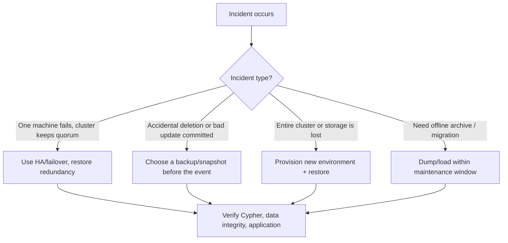
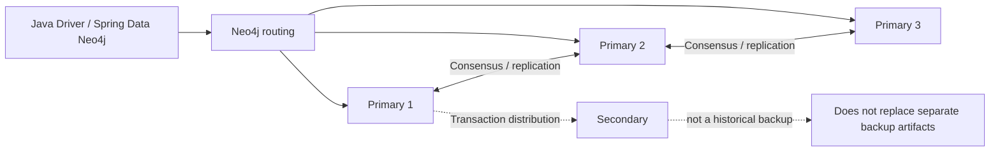
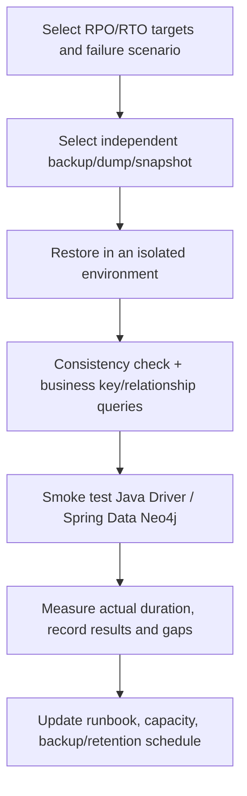

# Distinguishing Backups, Dumps, Snapshots, and High-Availability Replicas in Neo4j

## 1. A System with Multiple Replicas Can Still Lose Data

A Neo4j application stores **nodes, relationships, properties, labels, indexes, and constraints** as the data of a database. A Java service uses the **Neo4j Java Driver**, **Spring Data Neo4j**, and **Cypher** queries to update business data and traverse relationships in a *property graph*. When a server or disk fails, operators must know **which copy to use for recovery** and **how much of the latest data they can afford to lose**.

In the **Backup and Recovery** chapter of the `DATABASE_ENGINE_GRAPH_NEO4J` module, four terms are very easy to use interchangeably:

1. **Backup (database backup)**: creating an intentional recovery artifact, stored separately from the active source.
2. **Dump**: creating an archive of a database under offline conditions so that it can be `load`ed back.
3. **Snapshot**: a point-in-time capture at the volume, virtual machine, file system, or cloud service layer.
4. **Replica/copy in a cluster for HA**: a live database copy maintained to help the system keep operating when a failure occurs.

These four options address **different types of risk**. HA reduces downtime when a machine is lost, but it usually **replicates accidental deletions, corrupted updates, and many logic errors**. Backups preserve state from a point in time before the error; snapshots can shorten some recovery steps provided consistency requirements are met; dumps are suitable for maintenance or data migration with planned downtime.

### After This Lesson, You Will Be Able To

- Accurately explain what is stored, where the data is read from, and the prerequisites for each option.
- Distinguish **RPO**, **RTO**, consistency, and availability.
- Choose among online full/differential backup, offline dump, storage snapshot, and HA replica based on the failure scenario.
- Identify the `neo4j-admin database backup`, `restore`, `dump`, and `load` commands and their edition/version limits.
- Design a **backup → verify → retain → test restore → validate** pipeline.
- Avoid mistakenly treating a snapshot or a replica as proof that data can be recovered to a historical point in time.

> **Version scope:** Example commands are based on **Neo4j 5.x and current releases**. Syntax, edition availability, permissions, metadata handling, and new features may vary by version. `neo4j-admin database backup` is an **Enterprise Edition** feature for self-managed Neo4j and does not run directly on Neo4j Aura. For Aura, use the **service-provided backup/restore features** according to your Aura plan and documentation.

## 2. Four Concepts Side by Side

| Criterion | Online backup | Offline dump | Storage snapshot | HA replica/cluster copy |
| --- | --- | --- | --- | --- |
| Primary purpose | Recover a database from data loss/corruption/operational error | Archive, migrate, and restore from an inactive database | Fast infrastructure-level restore or cloning when consistency is guaranteed | Maintain availability when one or more servers fail |
| Data source | Running DB | Database must be stopped/offline at the source | Volume/file system/storage layer | Transactions replicated according to cluster topology |
| Output format | Backup artifact, optionally with a full + differential chain | `.dump` archive | Block/volume image or infrastructure snapshot | Live database copy, not an independent archive |
| Requires downtime on source DB? | No DB stop required for backup | Yes, for the database being dumped | Depends on technology and application-consistent procedure | No "backup step"; HA operates continuously |
| Retains historical points? | Yes, per backup retention/chain | Yes, per stored archives | Yes, per snapshot schedule and retention | **Does not automatically create a historical archive to roll back to** |
| RPO profile | Determined by completed backup schedule, log chain, and recoverability | Determined by the most recent dump | Determined by the consistent snapshot timestamp | Typically serves near-real-time HA; does not guarantee rollback to the past |
| RTO profile | Depends on backup transfer, chain replay, restore, and testing | Depends on decompression/load, initialization, and testing | Can be fast for volume restore, but DB must still be verified | Depends on quorum, routing, and failover |
| Protection against propagated accidental deletion | **Yes**, if a backup prior to the deletion exists | **Yes**, if an older archive exists | **Yes**, if an older usable snapshot exists | **No**, valid committed changes are replicated |
| Resources and edition | Enterprise, backup service, and backup client resources | Community/Enterprise under offline conditions | Determined by storage provider | Enterprise cluster with suitable topology |
| Critical verification | Complete chain, consistency, restore drill | Readable archive, load + verify | Multi-volume consistency, logs, recovery test | Quorum, replication lag, failover, capacity |

Do not evaluate using only a single checkbox of "whether a copy exists or not." **A live replica is not necessarily an independent recovery point**, and an existing archive file does not by itself prove it can be loaded into the target environment.

## 3. Classify the Incident Before Choosing a Tool



### 3.1. Losing One Server

If a database has enough **primary allocations** and satisfies the topology quorum condition, the cluster can continue serving writes when one machine fails. Restoring the replica count and load distribution may be needed after the incident.

If there is only one primary or too many primaries are lost, the database may no longer accept writes even though some secondary replicas remain. **Never assume "having 3 machines" means every database can survive losing 1–2 machines equally**: you must check the allocations of that specific database.

### 3.2. Accidentally Deleting Nodes and Relationships

Suppose an administrator runs:

```cypher
MATCH (c:Customer {customerId: 'C001'})
DETACH DELETE c;
```

This is a valid operation at the transaction level. Once committed in the cluster, the change can be replicated to the other copies. HA **ensures all replicas reflect the committed state**; it cannot infer that node `C001` still exists on a replica to "retrieve it back."

To return to the state before the deletion, you must have an **independent backup, dump, or snapshot** holding the required point in time, or another business mechanism to reconstruct the data.

### 3.3. Ransomware, Logic Bugs, Disasters

A backup placed on the same volume or using the same administrative credentials can be deleted or encrypted alongside the source database. A cluster with all machines placed in the same **failure domain** also provides insufficient protection against an infrastructure zone outage.

A recovery strategy must protect **location, credentials, delete permissions, retention, and the ability to open the backup**. "Having a backup file" does not equal "having recovery capability."

## 4. Two Decisive Metrics: RPO and RTO

### 4.1. RPO: How Much Data Can Be Lost at Most?

**Recovery Point Objective (RPO)** is the maximum time-window of data loss acceptable to the business, for example **15 minutes**.

Suppose:

```text
10:00  Full backup completed
10:15  Differential backup completed
10:30  Differential backup completed
10:45  Differential backup completed
10:52  Incident destroys the database
```

If the backup chain is intact and can be restored up to the 10:45 run, the window of data at risk of loss is **7 minutes**, not the entire 52 minutes since the full backup. However, a committed RPO must account for **actual run schedule, backup completion duration, scheduler delay, job failures, and chain verification**, not just writing a cron job for "every 15 minutes."

### 4.2. RTO: How Long Does It Take to Resume Operations?

**Recovery Time Objective (RTO)** is the maximum duration a service is allowed to remain down according to business targets, for example **60 minutes**.

An illustrative recovery scenario:

| Step | Illustrative estimated time |
| --- | ---: |
| Detection, decision to isolate source | 5 minutes |
| Provision clean environment, credentials/network | 15 minutes |
| Restore and replay backup chain | 25 minutes |
| Consistency checks, application checks, and traffic switchover | 10 minutes |
| **Total** | **55 minutes** |

The minutes in this table are **not a Neo4j benchmark**. A multi-terabyte database or a long differential chain may require substantially more time and temporary disk space. RTO is only proven through **recovery drills on data of comparable scale**, not by adding up estimates.

### 4.3. Distinguishing RPO/RTO from HA

HA primarily improves **availability** and reduces recovery time for hardware failures. Historical backups support **data recovery** against operator mistakes, storage loss, or cluster-wide failures. A sound strategy often needs **both HA, regular backups, and selected managed snapshots**.

## 5. Online Backup: A Consistent Backup of a Running Database

### 5.1. When Should You Use It?

For a **self-managed Neo4j Enterprise** system that must keep serving users during backup, the primary tool is:

```bash
neo4j-admin database backup \
  --from=backup-source.example.internal:6362 \
  --to-path=/secure/neo4j-backups \
  --temp-path=/secure/neo4j-backup-work \
  --type=FULL \
  neo4j
```

This is a **learning command template**—do not use the literal hostname/paths in production. The backup service must be enabled on the source server, network connectivity and accounts must be properly configured, and the command should run under the `neo4j` OS user according to documentation. Do not run operational commands on production without an approved runbook and authorization.

Online backups are typically executed from a **dedicated backup client** to reduce resource impact on cluster servers. Any server hosting the database can serve as a backup source; when a cluster has multiple allocations, choose an appropriate source, consider **replication lag**, and prefer avoiding write impact on the primary.

### 5.2. Full Backup and Differential Backup

Neo4j Enterprise supports:

- **Full backup**: creates an artifact containing the entire database store at a backup point.
- **Differential backup**: creates an artifact based on **transaction logs** that can be applied sequentially on top of a full backup.
- **Backup chain**: a full backup followed by contiguous differentials linked by the required transaction sequence.


If the backup server no longer retains the transaction logs required for a differential, the command may **fall back to a full backup** according to supported policy/mode settings. Never delete a differential file from the middle of a chain and expect subsequent files to restore independently.

Subsequent command once a full backup already exists at the destination:

```bash
neo4j-admin database backup \
  --from=backup-source.example.internal:6362 \
  --to-path=/secure/neo4j-backups \
  --temp-path=/secure/neo4j-backup-work \
  --type=AUTO \
  neo4j
```

`AUTO` lets the tool decide between full and differential according to state and version policy; `DIFF` does not eliminate the requirement for a valid full backup and appropriate transaction logs.

### 5.3. Differential Reduces Data Transfer, Not Necessarily Restore Time

Suppose a full backup is 500 GiB and each differential is 5 GiB:

- Creating a differential may transfer much less data.
- During recovery, the system still must restore the full backup and **replay the relevant transactions** in the chain.
- Long chains increase processing time and the number of artifacts that must remain intact.

In supported versions, you can **aggregate a backup chain** into a single recovered full artifact to simplify management and reduce restore time:

```bash
neo4j-admin backup aggregate \
  --from-path=/secure/neo4j-backups \
  --temp-path=/secure/neo4j-backup-work \
  neo4j
```

The command name `neo4j-admin backup aggregate` is recommended starting in the **2025.01** series; older versions used a different command name. Before running it, check the documentation regarding **retention/deletion of old artifacts** and temporary space requirements. Do not manually delete links in a chain without a verified retention and validation plan.

### 5.4. Do Not Confuse "Backup Completed" with "Restorable"

A job exiting with a success code only proves that the tool finished its run; ensuring recoverability also requires:

- Artifact files exist in an accessible location and were not purged too early by a retention job.
- The full backup and all required differentials are present.
- The archive/chain has metadata matching the right database.
- The target Neo4j version is compatible for restore.
- Sufficient disk space, permissions, and compute resources are available for restore.
- Actual testing has brought the database online and verified data and application connectivity.

## 6. Dump: Archive from an Offline Database

### 6.1. When Is Dump Appropriate?

`neo4j-admin database dump` creates a `.dump` archive from a **database that is not mounted/active**. It is a common choice for lab environments, development environments, offline migrations, or maintenance windows where downtime is acceptable.

On a **stopped** database, you can run:

```bash
neo4j-admin database dump neo4j \
  --to-path=/secure/neo4j-dumps
```

In this example, `neo4j` is the name of the **database being dumped**, not the entire DBMS. If the DBMS hosts multiple user databases, list all databases that require archiving and handle each protected database separately. In a cluster, the database must be **stopped on the machine performing the dump**; this does not mean the entire cluster is stopped.

> **Important boundary:** `dump` is **not** meant to be used as a raw file copy of a mounted database. Neo4j does not support arbitrarily copying and pasting store files of a running database as a substitute for a consistent backup.

### 6.2. Loading a Dump Back

When preparing a **separate target environment** where the target database is not mounted, run:

```bash
neo4j-admin database load neo4j \
  --from-path=/secure/neo4j-dumps
```

If you need to **replace an existing database**, you must stop the target database and only use `--overwrite-destination=true` after confirming permission to delete/overwrite target data. The example command above intentionally **does not** overwrite automatically.

In Enterprise Edition, after loading a new database that does not yet exist, a **CREATE DATABASE** step with administrative privileges on `system` is required as part of provisioning; do not assume loading the archive onto the filesystem is sufficient for the database to be served.

### 6.3. Does a Dump Include Users and Roles?

`dump` only backs up the data of the specified database; it does not automatically include **users/roles metadata** needed to fully restore access permissions. You must plan separately for:

- The `system` database and appropriate administrative state.
- Procedures to back up and restore **RBAC**, accounts, credentials, and role grants.
- Neo4j configuration files, TLS/private keys/certificates, plugins, and licenses where applicable.

Do not conclude that "dump file loaded successfully" means the application has regained all permissions, configurations, and connectivity as before the incident.

### 6.4. Dump Differs from Cypher/CSV Export

A CSV file exported using:

```cypher
MATCH (c:Customer)
RETURN c.customerId AS id, c.name AS name;
```

contains only the columns selected in the query. It is **not** equivalent to a full graph archive: it can miss relationships, indexes, constraints, property types, metadata, and other labels.

Dump is intended for **database recovery**; CSV is suited for **business-level data exchange/ingestion** when the schema and relationship reconstruction logic are explicitly defined.

## 7. Storage Snapshots: Infrastructure Captures Are Not Automatically Neo4j Backups

### 7.1. What Does a Snapshot Capture?

A snapshot at the block storage, volume, VM, or file system layer usually preserves the **infrastructure-layer data state** at a point in time. Depending on the provider, snapshots may use copy-on-write or incremental delta storage. They can help provision new volumes or roll back a volume faster than full file copies in some cases.

However, a snapshot does not carry the same contract as `neo4j-admin database backup`. At the database level, you must distinguish:

- **Application-consistent snapshot**: the snapshotting mechanism properly coordinated with the database and transaction logs via a provider-supported procedure.
- **Crash-consistent snapshot**: guarantees only a point-in-time state equivalent to power loss; the DB may need to run recovery from transaction logs.
- **Unsynchronized multi-volume snapshot**: store files captured at one instant, transaction logs at another; may not recover safely.

A file system snapshot taken while the database is actively writing **is not automatically certified consistent** simply because a cloud service labels it a "snapshot."

### 7.2. Be Careful When Data Store and Transaction Logs Reside on Different Volumes

Suppose:

```text
Volume A: Neo4j database files
Volume B: Neo4j transaction log files

Snapshot A at 11:00:00
Snapshot B at 11:00:07
```

Two volumes captured at two different timestamps do not automatically form a state recoverable as a single crash event. In multi-volume deployments, you need an **atomic snapshot group** or a verified Neo4j/storage-coordinated procedure covering both logs and related components.

Without a guaranteed procedure, prefer Neo4j's **official backup tools** or stop the database before taking an appropriate snapshot rather than assuming safety.

### 7.3. Limitations of Snapshots

- Snapshots within the **same account/cloud region** can share risks of accidental deletion, credential compromise, or regional outages.
- Snapshots **do not automatically guarantee** that RBAC, config, certificates, and plugins are preserved together.
- Old snapshots may lack sufficient logs/metadata to start up as a healthy database.
- Restoring/cloning across different Neo4j versions and store formats depends on both Neo4j and infrastructure compatibility.
- Snapshots perform **volume-level rollback**, which differs from **restoring one logical database** when a server hosts multiple databases.

Thus, snapshots can serve as **an additional layer of protection**, but should not be treated as the sole recovery mechanism without verified restore drills, consistency guarantees, and an independent failure domain.

## 8. HA Replicas in a Cluster: High Availability, Not Backup History

### 8.1. What Are Primaries and Secondaries For?

In a Neo4j Enterprise cluster, a database can be allocated across multiple **primaries** and **secondaries**:

- **Primaries** participate in consensus/write protocols according to topology and can maintain write availability while quorum is met.
- **Secondaries** are typically useful for scaling read capacity and may receive data asynchronously; they should not be assumed to always hold the very latest transaction.
- Failure of one member does not necessarily cause database loss if required replicas and cluster members remain.



This diagram illustrates concepts, not every topology, protocol, or routing rule of a specific Neo4j version. A system with only one primary does not have the same fault tolerance as one with enough primaries; a secondary can **lag** behind committed transactions.

### 8.2. Why Can't Replicas Save You After an Accidental Deletion?

```text
T0:  Customer C001 exists on all replicas
T1:  Client commits DETACH DELETE Customer C001
T2:  Cluster replicates the change to remaining copies
T3:  User discovers Customer C001 is missing
```

At T3, healthy replicas may all reflect the deletion. **A replica's job is to continue serving committed state**, not to retain a separate image from before T1. Only **independently retained recovery points** allow returning to the state prior to T1.

### 8.3. Quorum Does Not Replace an Off-Cluster Backup

Risks that a cluster does not solve on its own:

- Authorized accidental delete/update commands.
- Logical corruption or application bugs propagated across state.
- Ransomware/sabotage affecting the entire cluster and credentials.
- Loss of the entire availability zone/data center hosting all members.
- Dropping the entire database or losing all allocations.

Even if a **secondary** still holds data files, whether it can be used to re-establish a database depends on its state/transaction ID and version-specific disaster recovery procedures—it does not guarantee raw files can simply be copied as a backup.

## 9. Choosing the Right Tool for Actual Needs

| Objective | Primary choice | Complementary measures |
| --- | --- | --- |
| Zero interruption when one machine fails | HA cluster, quorum, routing | Independent backup for multi-machine loss risk |
| Recover after committed accidental update | Full/differential backups retaining required points | Proven-consistent snapshots, audit logs |
| Archive database for lab environment | Offline dump/load | Online backup if Enterprise and DB cannot stop |
| Recover large database after storage loss | Off-failure-domain backup + restore runbook | HA in another site, valid snapshots if helpful for RTO |
| Need closely spaced recovery points | Scheduled differential backups, retention, and chain | External CDC/event log if properly designed |
| Need fast volume clone in same infrastructure | Verified storage snapshot | Backups to protect against shared failure-domain outages |
| Reduce restore time for long chains | Periodic fulls, chain aggregation, drills | Sufficient storage/bandwidth |
| Preserve accounts/permissions after DR | Appropriate backup for `system`, RBAC metadata, config/certs | IaC, secrets vault, bootstrap guide |

### Decision Workflow

1. Classify the **incident**: machine failure, accidental deletion, corruption, site loss, or environment migration.
2. Confirm business-approved **RPO** and **RTO**.
3. Check **edition/version** and deployment model (standalone, cluster, Docker/Kubernetes, Aura).
4. Identify a usable **independent recovery point**, or use HA if only a member was lost.
5. Estimate time, cost, metadata, permissions, and recoverability **on a test copy**.
6. Only perform production changes/cutover after verification and with a corresponding rollback step.

## 10. Business Data Example: Recovery Verification Checkpoints

A successful backup must restore **relationships between entities**, not just a handful of nodes.

### 10.1. Creating Small Sample Data in a Test Database

```cypher
CREATE CONSTRAINT recovery_customer_id IF NOT EXISTS
FOR (c:RecoveryCustomer)
REQUIRE c.customerId IS UNIQUE;

CREATE CONSTRAINT recovery_order_id IF NOT EXISTS
FOR (o:RecoveryOrder)
REQUIRE o.orderId IS UNIQUE;
```

```cypher
MERGE (c:RecoveryCustomer {customerId: 'C001'})
SET c.name = 'An';

MERGE (o:RecoveryOrder {orderId: 'O001'})
SET o.amount = 250000,
    o.status = 'PAID';

MATCH (c:RecoveryCustomer {customerId: 'C001'})
MATCH (o:RecoveryOrder {orderId: 'O001'})
MERGE (c)-[:PLACED]->(o);
```

These are dedicated test labels, not real commercial data. When practicing backups/dumps, always work on an **isolated lab database**; never run destructive operations on production just for demonstration.

### 10.2. Recording Data Checkpoints

Before backup:

```cypher
MATCH (c:RecoveryCustomer)
RETURN count(c) AS customers;
```

```cypher
MATCH (o:RecoveryOrder)
RETURN count(o) AS orders;
```

```cypher
MATCH (:RecoveryCustomer)-[r:PLACED]->(:RecoveryOrder)
RETURN count(r) AS placedRelationships;
```

```cypher
MATCH (c:RecoveryCustomer {customerId: 'C001'})
      -[:PLACED]->
      (o:RecoveryOrder {orderId: 'O001'})
RETURN c.customerId AS customerId,
       o.orderId AS orderId,
       o.amount AS amount,
       o.status AS status;
```

Expected on a clean test database: 1 customer, 1 order, 1 relationship, and output `C001 / O001 / 250000 / PAID`.

After recovery, compare **business keys** and relationships—do not use `id(node)` or internal IDs as stable identifiers across restores or environment migrations.

## 11. Standalone Database Recovery Scenario

### 11.1. Never Overwrite Live Systems While Learning

A sensible sequence:

1. Select the full/chain artifact or dump to test.
2. Provision a **clean, network-isolated Neo4j environment** separate from production to avoid endpoint confusion.
3. Verify the version/edition of the archive and target Neo4j; do not restore a backup into an **older version** than the one that created it.
4. Prepare data paths, transaction log paths, free disk space, user/group permissions, and required configuration files.
5. Run the corresponding restore/load tool.
6. Provision/register the database/DBMS as required; do not open write traffic immediately.
7. Verify consistency, schema, node/relationship counts, business invariants, and application connectivity.
8. Only update the production runbook once the drill passes.

### 11.2. Restoring an Enterprise Backup

Command pattern per current documentation:

```bash
neo4j-admin database restore \
  --from-path=/secure/neo4j-backups \
  --temp-path=/secure/neo4j-restore-work \
  neo4j
```

`--from-path` must point to the artifact/directory containing the appropriate chain; if the directory contains multiple databases, version-specific options to filter the **source database** may be required. In a new target environment, `CREATE DATABASE` may be needed after restore per Neo4j Enterprise documentation. Where an older target database exists, replacement requires stopping the DB and obtaining approval.

Never include `--overwrite-destination=true` in scripts by default; it **destroys existing data at the destination**. In a cluster, restore/seed/recreate follows specific cluster procedures—do not blindly copy standalone steps across every member.

### 11.3. Loading a Dump from an Offline Archive

Command pattern for a database that does not yet exist on an appropriate target environment:

```bash
neo4j-admin database load neo4j \
  --from-path=/secure/neo4j-dumps
```

Note: `load` reads a `.dump` archive (or a **full backup** where supported by the version); it **does not replace the procedure for applying a differential chain**. Do not attempt to `load` an individual differential `.backup` file expecting a complete database.

### 11.4. Recovery and Traffic Cutover

Before switching the URI for Java Driver/Spring Data Neo4j:

- Confirm the restored DB is online and test read/write queries succeed.
- Create/verify appropriate users, roles, grants, and secrets.
- Verify certificates/TLS, driver URI, routing, and network policies.
- Confirm **schema indexes/constraints** are ready; some import/restore operations take time to populate indexes.
- Define **traffic cutover**, stop old writers, or enforce safeguards against unsynchronized split writes.
- Prepare a clear rollback/forward-fix plan in case the recovery point is not recent enough.

Never just check `MATCH (n) RETURN count(n)` and conclude the application is ready to serve every API.

## 12. Integrity and Usability Verification

### 12.1. Consistency Check

Neo4j provides a tool to inspect the structural and relationship integrity of a database/backup/dump:

```bash
neo4j-admin database check \
  --from-path=/secure/neo4j-dumps \
  neo4j
```

This example illustrates checking an appropriate archive with the matching tool version. For **differential chains or unrecovered full backups**, you may need to **aggregate/recover** before running a consistency check; do not assume running `check` on an isolated differential is a valid test.

A consistency check provides an important signal about storage structure, but **it does not catch every business error** such as orders linked to the wrong customer, wrong totals, or misconfigured permissions.

### 12.2. Verifying Data with Cypher

```cypher
MATCH (c:RecoveryCustomer)
RETURN count(c) AS customers;
```

```cypher
MATCH (o:RecoveryOrder)
RETURN count(o) AS orders;
```

```cypher
MATCH (c:RecoveryCustomer)-[r:PLACED]->(o:RecoveryOrder)
RETURN count(r) AS relationships,
       count(DISTINCT c) AS linkedCustomers,
       count(DISTINCT o) AS linkedOrders;
```

Add business-rule checks:

```cypher
MATCH (o:RecoveryOrder)
WHERE o.amount < 0
RETURN count(o) AS ordersWithNegativeAmount;
```

Expected result for the example: zero orders with negative `amount`. Also verify row counts by date/cutoff, unique key constraints, missing-endpoint relationships **in source logic**, and domain-specific business invariants.

### 12.3. Checking What Lives Outside the Graph

A restore may have accurate nodes and relationships yet the application still fails because:

- Users/roles have not been created or grants have not been restored.
- Certificates or secrets are expired or wrong.
- Plugin/APOC/GDS versions are incompatible.
- Routing configuration, DNS, driver URI, or connection pools are misconfigured.
- ETL/CDC jobs resume from an inappropriate checkpoint, causing duplicates or gaps.
- Neo4j server, database, schema, and client drivers are at incompatible versions.

Therefore, recovery is complete only when **critical business and operational flows work**, not merely when the CLI returns exit code 0.

## 13. Managing the `system` Database, Permissions, and External Configuration

### 13.1. Do Not Back Up Only One User Database

Neo4j maintains a **`system` database** for administrative metadata such as database allocations and security. In multi-database deployments, plan backups for **every database requiring recovery**, not just the default `neo4j` database.

Never assume dumping a single user database captures all DBMS users/roles. Conversely, some **Enterprise backup** options may include RBAC metadata depending on command flags and version behavior; explicitly confirm which artifact contains it and test restoring permissions end-to-end.

### 13.2. Inventory Outside the Database

| Resource | Why it needs recovery | How to manage |
| --- | --- | --- |
| `neo4j.conf` | Memory, connectors, paths, backup/cluster settings | Versioned IaC, controlled backups |
| TLS certificates/private keys | Secure client/cluster/backup connections | Secret manager + rotation policy |
| Plugins/APOC/GDS | Queries depending on procedures or algorithms | Compatible version manifest, artifact repository |
| License/entitlement files | Required for Enterprise/extension features | Store separately with appropriate access controls |
| Users/roles/grants | Applications need proper access rights | `system`/RBAC metadata backup, admin scripts |
| Application secrets/credentials | Java Driver/Spring Data Neo4j authentication | Vault, never commit to dumps or git |
| Job checkpoints/queues | Prevent duplicate or missed import/CDC processing | State synchronization runbook at recovery time |

A sound backup plan includes **the ability to rebuild the environment**, not just saving database files.

## 14. Securing Backups: Retention Matters as Much as Creation

### 14.1. The 3-2-1 Strategy and Immutability

A widely used principle:

- Keep **at least three copies** of data in total, including the live copy.
- Use **two independent storage types/media** as appropriate.
- Keep **one copy off-site/in a separate failure domain**.

For critical data, add an **immutable/offline** copy per security policy and perform regular **restore validation**. These are design goals, not guarantees Neo4j provides automatically.

### 14.2. Access Controls

- Backup/dump directories must **not be world-readable or world-executable**.
- Use a least-privilege backup account, separated from application admin accounts where feasible.
- Encrypt data **at rest** and **in transit** per organizational standards; protect backup metadata and configuration too.
- Expose backup ports only to trusted sources; never expose them to the public Internet.
- Apply retention policies and object lock/WORM if ransomware protection policies require them.
- Periodically test **restore** permissions, not just backup creation permissions: during an incident, the backup operator might lack permissions to provision target resources.

### 14.3. Capacity and Cost

Beyond total archive size:

- Budget space for the **temporary directory**, since cloud backups may still stage intermediate data on the backup client host.
- Network egress costs and bandwidth affect restore duration.
- Differential chains carry the risk of a broken link.
- Backups taking longer than the retention/schedule interval can cause overlapping runs.
- Large cluster restores require adequate storage on each replica plus reallocation time.

Never assume you can back up 1 TiB with only 1 GiB of temporary free space on the backup client.

## 15. Drills: Only a Restore Test Proves Recovery Capability

### 15.1. Designing a Drill



Each drill should record:

1. Database, Neo4j edition/version, and selected artifact/chain.
2. Latest recoverable data timestamp; compare against RPO.
3. Start time, restore completion time, and smoke test completion time; compare against RTO.
4. Backup size, network throughput, CPU/RAM/disk, and temporary space consumed.
5. Consistency check results and checks on business keys, nodes, relationships, and constraints.
6. Authentication, RBAC, Java Driver routing, and core application functionality results.
7. Issues encountered and updates needed for the runbook.

### 15.2. Scheduling and Failure Criteria

Backup jobs should alert when:

- No new artifact is produced within the RPO threshold.
- A chain is broken or the latest full backup is too old.
- Temporary/destination free disk space is low.
- A backup job runs abnormally long or exits with a non-zero code.
- Archive/metadata cannot be read or consistency cannot be verified.
- A **restore drill fails** or exceeds RTO.

Do not report only "backup cron ran"; monitoring should explicitly state **the latest recovery point proven usable**.

## 16. Common Misconceptions

| Misconception | Why it is wrong | Correct approach |
| --- | --- | --- |
| "Having 3 primaries means no backup is needed" | Accidental deletion/logic corruption replicates, and full cluster loss can still happen | HA **plus** off-site backups |
| "Replicas are older versions you can roll back to" | Replicas maintain committed state via replication | Keep independent historical points |
| "Cloud snapshots are always Neo4j-consistent" | May be only crash-consistent or skewed across volumes | Supported procedure + restore drill |
| "Copying the data folder while DB is running is a backup" | Can miss consistent logs/metadata; Neo4j does not support arbitrary copy-paste | Use online backup or offline dump |
| "A dump is the same as an online backup" | Dump requires an offline database and has no differential chain | Choose the right tool/edition |
| "Only keeping the latest differential file is enough" | Differentials require the full backup and valid chain | Retain all dependent artifacts |
| "Backup job exit 0 means we can recover" | Permissions, version, chain, schema, and app have not been tested | Verify and run restore drills |
| "One .dump file contains all users/roles" | Dumps do not automatically store DBMS RBAC metadata | Plan for `system` and grants |
| "Backing up to the same server protects against disasters" | Shared failure domain | Store off-site, immutable if required |
| "RPO = 15 minutes if cron runs every 15 minutes" | Backups can lag, fail, or still be uploading | Track actual verified recovery points |
| "Restore will be fast because backup files are small" | May require chain replay, index builds, checks, and cutover | Measure end-to-end RTO |
| "Checking count(node) is enough" | Relationships, properties, permissions, and app flows can still be broken | Verify business invariants and ecosystem |
| "Put --overwrite-destination in every script" | Can irreversibly wipe a target DB | Separate lab/prod, verify approval, stop DB |

## 17. Practice Exercises with Answers

### Exercise 1. Accidental Deletion in a Cluster

A cluster has three primaries and the database is operating normally. An administrator accidentally deletes 2,000 nodes and commits. Will HA automatically bring the data back?

**Answer:** No. Committed valid changes are replicated. You need an independent recovery point from before the deletion, or a pre-designed business reconstruction process.

### Exercise 2. RPO with a Differential Schedule

A full backup finishes at 00:00 and differentials finish at 00:15, 00:30, 00:45, and 01:00. An incident occurs at 01:08. Assuming the chain is complete and restorable to 01:00, what is the window of data at risk of loss?

**Answer:** **8 minutes**. Actual RPO for an incident is the gap between the latest recoverable point and the time of failure, not simply the minutes between two cron runs.

### Exercise 3. Choosing Dump or Online Backup

A small Community system is used for a lab and can stop the database for 20 minutes to create an archive. An Enterprise production system cannot stop serving APIs. Which option fits each?

**Answer:** The lab can use `neo4j-admin database dump` while the database is offline; Enterprise production should use online `neo4j-admin database backup` and store backups independently. Both need a restore plan.

### Exercise 4. Snapshot Across Two Volumes

Neo4j stores database files on volume A and transaction logs on volume B. Volume A is snapshotted at 13:00:00, and volume B at 13:00:05. Can you immediately claim an "application-consistent backup"?

**Answer:** No. Two different timestamps can produce an inconsistent state. You need an atomic volume-group snapshot/Neo4j-coordinated procedure and a restore test; otherwise, use official Neo4j backups or an offline snapshot.

### Exercise 5. Why Can a Full + Differential Chain Cause High RTO?

Operations has a 500 GiB full backup and 96 small differentials. They believe "each diff is only a few MiB so restore will be fast." What is overlooked?

**Answer:** The system must restore the full backup, process/replay the relevant transactions in the chain, run consistency checks, and start the service. Total time can be substantial. Creating periodic fulls or aggregating the chain in supported Neo4j versions, then drilling to measure RTO, helps address this.

### Exercise 6. Distinguishing Backup from CSV Export

A report runs `MATCH (c:Customer) RETURN c.customerId, c.name` and saves a CSV. Can that file restore all `PLACED` relationships, indexes, and constraints?

**Answer:** No. The CSV only contains the two selected properties; it does not store relationships, schema, or database metadata. It serves data export, not a complete backup of a property graph.

### Exercise 7. Backup Exists, But Application Cannot Log In

After restore, Cypher node counts match, but Spring Data Neo4j reports insufficient query permissions. What should you check?

**Answer:** The `system` database, users/roles/grants, whether RBAC metadata accompanied the backup, secrets, URI/TLS, application account privileges, and configuration versions. Never disable authentication entirely just to pass a smoke test.

### Exercise 8. Total Site Loss

All cluster machines are lost, and the most recent backup is on the same site. Can cluster HA still help recover?

**Answer:** You cannot rely on a cluster that has lost all servers. You need backups or replicated data per a DR strategy **in a different failure domain**, rebuild the cluster/database, and restore. This is why off-site backups and cross-location restore tests are essential.

## 18. Backup and Recovery Runbook Checklist

- [ ] Identify databases to protect, including **user databases** and `system` per strategy.
- [ ] Document **Neo4j version, edition, topology, and deployment model**.
- [ ] Have business-approved RPO, RTO, and rules for measuring them.
- [ ] Distinguish backup artifacts, dumps, storage snapshots, and HA replicas in the runbook.
- [ ] Enterprise online backup uses an appropriate backup client/source and permissions.
- [ ] Offline dump runs only on a properly stopped/offline database.
- [ ] Snapshots use a supported consistency mechanism; never copy store files while running.
- [ ] Full/differential chains are complete; never delete links still in use.
- [ ] Backups are stored **outside the failure domain**, protected against deletion/encryption.
- [ ] Budget temp disk, storage, network, and CPU/RAM for both backup and restore.
- [ ] Maintain metadata to identify database, tx ID, timestamp, version, and artifact.
- [ ] Have a plan for `system`, RBAC, Neo4j config, TLS, plugins, and licenses.
- [ ] Include consistency check commands and **application smoke tests** after restore.
- [ ] Have a cutover plan to stop old writers and prevent split-brain/dual writes.
- [ ] Do not put `--overwrite-destination` by default in unapproved runbooks.
- [ ] Have metrics/alerts for backup freshness, chain integrity, and restore drills.
- [ ] Run regular drills at sufficient scale to measure actual RPO/RTO.

## 19. Summary

Neo4j Enterprise **online backup** creates recovery artifacts from a running database, supports full/differential modes, and requires keeping the chain intact. **Offline dump** produces an archive from an inactive database, suitable for maintenance and migration; it does not automatically capture all users/roles. **Storage snapshot** is an infrastructure capability that only becomes a reliable recovery option with proven consistency and a verified procedure. **HA replica/cluster copy** reduces downtime when servers fail, but does not preserve historical points to roll back committed logic errors.

A solid strategy combines **business-aligned RPO/RTO, independent backup points, HA topology, safe retention, access security, consistency checks, and real restore drills**. The finish line is not "a .backup or .dump file exists," but **having restored the right nodes, relationships, constraints, permissions, and application functionality at the approved recovery point**.

### Official References

- [Neo4j Operations Manual – Backup and restore planning](https://neo4j.com/docs/operations-manual/current/backup-restore/planning/)
- [Neo4j Operations Manual – Backup modes](https://neo4j.com/docs/operations-manual/current/backup-restore/modes/)
- [Neo4j Operations Manual – Online backup](https://neo4j.com/docs/operations-manual/current/backup-restore/online-backup/)
- [Neo4j Operations Manual – Offline dump](https://neo4j.com/docs/operations-manual/current/backup-restore/offline-backup/)
- [Neo4j Operations Manual – Restore a database backup](https://neo4j.com/docs/operations-manual/current/backup-restore/restore-backup/)
- [Neo4j Operations Manual – Restore a database dump](https://neo4j.com/docs/operations-manual/current/backup-restore/restore-dump/)
- [Neo4j Operations Manual – Aggregate backup chain](https://neo4j.com/docs/operations-manual/current/backup-restore/aggregate/)
- [Neo4j Operations Manual – Consistency checker](https://neo4j.com/docs/operations-manual/current/backup-restore/consistency-checker/)
- [Neo4j Operations Manual – Clustering](https://neo4j.com/docs/operations-manual/current/clustering/)
- [Neo4j Operations Manual – Disaster recovery](https://neo4j.com/docs/operations-manual/current/clustering/multi-region-deployment/disaster-recovery/)
