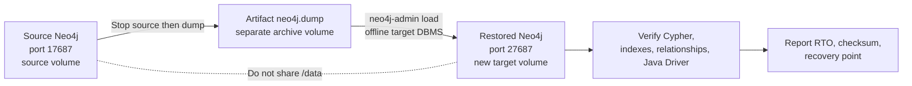
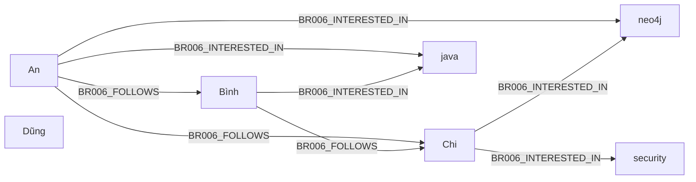

# Practicing Restore into an Isolated Environment

## 1. Goal: Prove Recoverability, Not Just File Creation

In a Neo4j system, data resides in a **property graph** of nodes, relationships, properties, and indexes; Java Driver or Spring Data Neo4j applications query the graph using Cypher. When facing database loss, disk failure, accidental deletion, or pre-change backup validation, a `.dump` or `.backup` file is **only an input**. True recoverability must be proven by standing up another Neo4j instance, loading the copy, running queries, and confirming the data is **accurate, complete, and usable**.

This lesson belongs to the **Backup and Recovery** chapter of the `DATABASE_ENGINE_GRAPH_NEO4J` module. The focus is **isolated restore rehearsal**: the source Neo4j is never overwritten, the target environment has its own volumes and endpoints, and it cannot accidentally connect to live production systems.

**After this lesson, you will be able to:**

1. Explain why restoring to a separate target is safer than overwriting directly on production.
2. Distinguish offline `neo4j-admin database dump/load` from Enterprise Edition `backup/restore`.
3. Stand up two independent Neo4j instances with Docker, seed a fixture, dump the source, and load into a fresh volume.
4. Verify the **backup file, checksum, nodes/relationships, properties, indexes/constraints, business queries**, and application connectivity.
5. Confirm the recovery point, measure actual RTO, and identify permissions, configs, and metadata not carried inside the copy.
6. Propose a security checklist, recovery report, stop conditions, and lab cleanup steps that avoid deleting original data.

> **Safety boundary:** All commands below are **lab exercises** meant for learners to run in a **self-created Docker environment**. Never point volumes, backup directories, or database names at live systems. Never run `--overwrite-destination`, `docker volume rm`, or `docker compose down -v` on data you need to keep. No command in this lesson executes automatically against production Neo4j.

## 2. Isolation Model and Success Criteria



| Component | Must be distinct | Reason |
|---|---|---|
| **Source** | Volume `br006_lab_source_data`, container/service `source` | Preserves original data for comparison and avoids accidental overwrite |
| **Restore** | Volume `br006_lab_restored_data`, service `restored` | Creates an independent graph copy sharing no `/data` |
| **Backup artifact** | Volume `br006_lab_archives` | Separates backup files from database filesystems |
| **Endpoint** | Bolt `17687` source, `27687` target on localhost | Prevents Java Driver/Browser from writing to the wrong database |
| **Accounts** | Separate source and restored secrets | Ensures source passwords are not blindly carried to target |
| **Docker network** | Two separate networks in Compose | Prevents source and restored containers from sharing an app network |

In real environments, **isolation also covers VMs/VPCs/networks, access permissions, secrets, outbound integrations, queue consumers, and job schedulers**. Two containers on the same host only simulate volume/network isolation at lab scale; they do **not** protect against losing the entire host and are insufficient for disaster-grade backups.

### 2.1. What Do RPO and RTO Measure?

| Metric | Definition | Illustrative example |
|---|---|---|
| **RPO – Recovery Point Objective** | Maximum data loss acceptable to the business | A 15-minute RPO targets losing no more than 15 minutes of changes |
| **RTO – Recovery Time Objective** | Maximum acceptable outage duration to restore service | A 60-minute RTO includes locating backups, restoring, verifying, and resuming app service |
| **Actual recovery point** | Latest timestamp/transaction present in the restored copy | Offline `neo4j.dump` reflects database state at dump time |
| **Restore elapsed time** | Time spent loading the artifact into the store | Only **one part** of total RTO |

In this lesson, after taking the dump, we deliberately create a new node **only on the source**. That node **must not** appear in the restored database: this visually proves the restored copy holds a distinct point in time, not a continuously synced mirror.

## 3. Choosing a Backup Mechanism Before Restoring

| Artifact | Creation command | Basic prerequisite | Appropriate restore command |
|---|---|---|---|
| **Offline dump `.dump`** | `neo4j-admin database dump` | Database must be offline; Community Edition requires DBMS offline | `neo4j-admin database load` |
| **Online full backup `.backup`** | `neo4j-admin database backup` | Enterprise Edition with configured backup service, running database | `neo4j-admin database restore`; can `load` a **full backup** |
| **Online differential backup** | `database backup --type=DIFF` | Enterprise; requires valid full/differential chain | `database restore` processes the backup chain |
| **Direct `/data` copy while DB writes** | Ordinary filesystem copy | **Not** a recommended consistent backup approach | Never use as a standard recovery input |

Per current Neo4j documentation, `database dump` backs up **only database data**, **excluding users/roles** stored in `system`. Plan separate backups for `system`, configurations, certificates, plugins, and secrets based on incident scope; in this lab we **do not restore source `system` to the target** to avoid importing external identities, privileges, and sensitive configs.

**Lab choice:** we use offline `dump → load` because it works on both Community and Enterprise, needs no network backup service, and is straightforward to verify in Docker. Enterprise online backup is compared separately in Section 11.

## 4. Prerequisites and Safety Locks

Before starting:

1. Docker Engine and **Docker Compose V2** available, with enough RAM, CPU, and disk for **two** stores plus a dump archive.
2. Select Neo4j and `neo4j/neo4j-admin` images at the **exact same version**; for example `2026.10.2` per official Docker docs at writing time. In real projects, pin a tested tag.
3. Volume names `br006_lab_*` **must not already exist**; if a name collides with a volume holding data, **stop** and pick another name. Never reuse a volume of unknown ownership.
4. Prepare two separate secrets—never commit them to Git, never paste into logs/chat, use strong passwords, and restrict read permissions.
5. Ensure **no** other Neo4j instance uses either target or source volume. Never run the `load` helper while the target server is running.
6. Work in an isolated lab folder; all volume/container commands below are executed and verified intentionally by the learner.

### 4.1. Check Names Before Creating Volumes

```bash
# Run on the lab machine using Docker CLI.
docker volume ls
docker ps --format "table {{.Names}}\t{{.Status}}\t{{.Ports}}"

# Only after confirming these three names hold no existing data:
docker volume create br006_lab_source_data
docker volume create br006_lab_restored_data
docker volume create br006_lab_archives
```

`docker volume create` **does not wipe an existing volume**; therefore, a successful return **does not prove** you just created an empty volume. Confirm beforehand via `docker volume inspect` or choose fresh unique names.

### 4.2. Directory Structure and Docker Compose

Prepare locally:

```text
br006-lab/
├── compose.yaml
└── secrets/
    ├── source-auth.txt
    └── restored-auth.txt
```

Each secret file holds **one line** `neo4j/<strong-unique-password>`. Never use the same file for both sides. The restore environment's secret file should be provisioned by the restore environment, not copied from production credentials.

Contents of `compose.yaml`:

```yaml
services:
  source:
    image: neo4j:2026.10.2
    profiles: ["source"]
    ports:
      - "127.0.0.1:17474:7474"
      - "127.0.0.1:17687:7687"
    environment:
      NEO4J_AUTH_FILE: /run/secrets/br006_source_auth
    secrets:
      - br006_source_auth
    volumes:
      - source_data:/data
    networks:
      - source_net

  restored:
    image: neo4j:2026.10.2
    profiles: ["restored"]
    ports:
      - "127.0.0.1:27474:7474"
      - "127.0.0.1:27687:7687"
    environment:
      NEO4J_AUTH_FILE: /run/secrets/br006_restored_auth
    secrets:
      - br006_restored_auth
    volumes:
      - restored_data:/data
    networks:
      - restored_net

secrets:
  br006_source_auth:
    file: ./secrets/source-auth.txt
  br006_restored_auth:
    file: ./secrets/restored-auth.txt

volumes:
  source_data:
    external: true
    name: br006_lab_source_data
  restored_data:
    external: true
    name: br006_lab_restored_data

networks:
  source_net:
  restored_net:
```

The two `external: true` volumes **are excluded from Compose's automatic volume deletion lifecycle**. Both networks have distinct logical names; ports are published only to host `127.0.0.1`. Note that the Docker host still has administrative access over both; production requires separate host/network isolation and outbound connection policies.

Validate and start **only source**:

```bash
docker compose config --quiet
docker compose --profile source up -d source
docker compose --profile source ps
docker compose --profile source logs --tail 80 source
```

If Neo4j is not ready yet, inspect logs and container status; do not start creating data while the server is still initializing. Open Browser at `http://localhost:17474`, log in with the **source secret**; the Bolt endpoint is `bolt://localhost:17687`. Avoid default port `7687` so you never connect to another Neo4j instance by mistake.

## 5. Creating a Graph Fixture with Verifiable Results

We build `BR006Person` and `BR006Topic` nodes with two relationship types:



Every Cypher statement in this section runs on **source** (Browser port `17474`, database `neo4j`). Label, relationship, and constraint names are prefixed with `BR006` for easy identification.

### 5.1. Identity Schema

```cypher
CREATE CONSTRAINT br006_person_id IF NOT EXISTS
FOR (p:BR006Person)
REQUIRE p.id IS UNIQUE;
```

```cypher
CREATE CONSTRAINT br006_topic_code IF NOT EXISTS
FOR (t:BR006Topic)
REQUIRE t.code IS UNIQUE;
```

### 5.2. Create Nodes

```cypher
UNWIND [
  {id: 'an', name: 'An'},
  {id: 'binh', name: 'Bình'},
  {id: 'chi', name: 'Chi'},
  {id: 'dung', name: 'Dũng'}
] AS row
MERGE (p:BR006Person {id: row.id})
SET p.name = row.name;
```

```cypher
UNWIND ['neo4j', 'java', 'security'] AS code
MERGE (:BR006Topic {code: code});
```

### 5.3. Create Relationships and Relationship Properties

```cypher
UNWIND [
  {from: 'an', to: 'binh', year: 2024},
  {from: 'an', to: 'chi', year: 2025},
  {from: 'binh', to: 'chi', year: 2025}
] AS row
MATCH (source:BR006Person {id: row.from})
MATCH (target:BR006Person {id: row.to})
MERGE (source)-[r:BR006_FOLLOWS]->(target)
SET r.sinceYear = row.year;
```

```cypher
UNWIND [
  {person: 'an', topic: 'neo4j', weight: 3},
  {person: 'an', topic: 'java', weight: 2},
  {person: 'binh', topic: 'java', weight: 2},
  {person: 'chi', topic: 'neo4j', weight: 4},
  {person: 'chi', topic: 'security', weight: 1}
] AS row
MATCH (p:BR006Person {id: row.person})
MATCH (t:BR006Topic {code: row.topic})
MERGE (p)-[r:BR006_INTERESTED_IN]->(t)
SET r.weight = row.weight;
```

### 5.4. Record Baseline Before Dumping

```cypher
MATCH (p:BR006Person)
WITH count(p) AS persons
MATCH (t:BR006Topic)
WITH persons, count(t) AS topics
MATCH (:BR006Person)-[f:BR006_FOLLOWS]->(:BR006Person)
WITH persons, topics, count(f) AS follows
MATCH (:BR006Person)-[i:BR006_INTERESTED_IN]->(:BR006Topic)
RETURN persons, topics, follows, count(i) AS interests;
```

Expected output:

| persons | topics | follows | interests |
|---:|---:|---:|---:|
| 4 | 3 | 3 | 5 |

Verify a two-hop business traversal query:

```cypher
MATCH (:BR006Person {id: 'an'})-[:BR006_FOLLOWS]->
      (friend:BR006Person)-[:BR006_INTERESTED_IN]->
      (topic:BR006Topic)
RETURN topic.code AS topic, count(DISTINCT friend) AS people
ORDER BY topic;
```

On the initial fixture, the three rows are `java=1`, `neo4j=1`, and `security=1`. This is a **golden result** proving that relationships were restored too, not just nodes.

Verify a relationship property as well:

```cypher
MATCH (:BR006Person {id: 'an'})-[r:BR006_FOLLOWS]->
      (:BR006Person {id: 'binh'})
RETURN r.sinceYear AS sinceYear;
```

Expected `sinceYear = 2024`. Record these results and the completion timestamp of fixture creation; this is the pre-backup checkpoint.

## 6. Stopping Source and Creating an Offline Dump

**Precondition:** all fixture write transactions have completed, and the learner has confirmed source data is accurate. Never run `database dump` while the database is mounted and written by a Neo4j server.

In the directory containing `compose.yaml`, stop **only** the `source` service:

```bash
docker compose --profile source stop source
docker compose --profile source ps
```

Confirm the `source` service is stopped. Do not stop another Docker project with a similar name; `docker compose` operates on the current directory/project.

Use a **temporary admin container** at the same Neo4j version; mount the source volume at `/data` and a separate volume to store the dump:

```bash
docker run --rm \
  --mount type=volume,src=br006_lab_source_data,dst=/data \
  --mount type=volume,src=br006_lab_archives,dst=/backups \
  neo4j/neo4j-admin:2026.10.2 \
  neo4j-admin database dump neo4j --to-path=/backups
```

Expected result is artifact `neo4j.dump` inside `br006_lab_archives`. If the command reports volume permission errors, **do not** `chmod 777` the entire directory: inspect the image's `neo4j` user UID/GID (typically 7474) and adjust permissions on the **lab volume** per Docker docs. If it reports the database is active, go back and confirm `source` is stopped; never force a dump while another container writes the store.

### 6.1. Why Use `--rm` and an Admin Sidecar?

The `neo4j/neo4j-admin` helper runs the command and deletes the **ephemeral container** afterward without deleting mounted named volumes. It does not start a database server, allowing **offline** store operations. This follows Neo4j's official Docker `dump/load` guide.

`.dump` is **not** a real-time distributed replica and **does not** carry network config, `system` users/roles, keys/certificates, or application connections. It is a database data artifact that must be secured and tracked with separate metadata.

## 7. Verifying the Artifact Before Loading

A dump reporting success is not enough to claim recoverability. At minimum verify:

1. The artifact sits in the right volume for the right database, not a leftover file from an earlier run.
2. File size is reasonable, the file is readable, and metadata shows the expected format/version.
3. A checksum exists alongside a record of creation time, source, version, owner, and storage location.
4. If digital signing/immutable storage is used, verify per policy before importing into a test environment.

### 7.1. Inspecting Archive Metadata with `neo4j-admin`

```bash
docker run --rm \
  --mount type=volume,src=br006_lab_archives,dst=/backups,readonly \
  neo4j/neo4j-admin:2026.10.2 \
  neo4j-admin database load neo4j --from-path=/backups --info
```

`--info` **only displays archive metadata**—it does not load data or touch the restore volume. If it fails or points to the wrong archive, fix the root cause **before** loading. Never pass `--overwrite-destination` as a workaround for input errors.

### 7.2. Checksum and Backup Catalog

Example computing SHA-256 from a helper container and **recording the value in a separate test log**:

```bash
docker run --rm \
  --entrypoint /bin/sh \
  --mount type=volume,src=br006_lab_archives,dst=/backups,readonly \
  neo4j/neo4j-admin:2026.10.2 \
  -c 'sha256sum /backups/neo4j.dump'
```

This requires `sha256sum` inside the helper image; if your chosen image lacks it, use an equivalent hash tool on a **read-authorized** copy. A hash computed **after** a file has already been tampered with does not prove integrity; reference digests must be stored outside where backups can be modified, or signed/verified per procedure.

Minimum catalog fields:

| Field | What to record |
|---|---|
| `artifact` | `neo4j.dump` |
| `source DB` | `neo4j` on source `17687` |
| `source version` | Neo4j `2026.10.2` (per lab image) |
| `createdAt` and `recovery point` | Dump completion timestamp, transaction/metadata checkpoint if available |
| `size` and `SHA-256` | Actual measured size/digest—never fabricate values |
| `location` | `br006_lab_archives`; off-host copy location if any |
| `owner` and `retention` | Operator, retention period, encryption key if applicable |

**Security:** Backup data can contain sensitive nodes, relationships, and properties. Never upload publicly, never send files over unauthorized chat/email; restrict read permissions, encrypt at rest and in transit, and enforce safe deletion after drills.

## 8. Creating a Post-Dump Delta on the Source

Restart `source` (still attached to `br006_lab_source_data`):

```bash
docker compose --profile source start source
docker compose --profile source logs --tail 50 source
```

Log into the source Browser at `http://localhost:17474`. **Only on source**, add a marker node:

```cypher
MERGE (p:BR006Person {id: 'after-dump'})
SET p.name = 'Change after backup';
```

Verify on source:

```cypher
MATCH (p:BR006Person)
RETURN count(p) AS personCount;
```

Expect **5** people on source. Because the backup was created before the `after-dump` event, a valid restored database must have **only 4** people. Seeing the marker in `restored` indicates a mixed-up volume, wrong artifact, or querying the source by mistake.

Do not use this step to claim exact production RPO: it is a **point-in-time capture test**. Real-world RPO also depends on backup scheduling, off-site transfer latency, and chain/differential recovery capability.

## 9. Loading into a Fresh Target Volume Without Overwriting Source

**Preconditions before running `load`:**

- Volume `br006_lab_restored_data` is a fresh/empty volume dedicated **exclusively** to this lab.
- Service `restored` **has not started yet**; no Neo4j instance has the target volume mounted for writes.
- Artifact `neo4j.dump` passed `--info` and checksum verification.
- The helper uses a version compatible with the artifact.

Run:

```bash
docker run --rm \
  --mount type=volume,src=br006_lab_restored_data,dst=/data \
  --mount type=volume,src=br006_lab_archives,dst=/backups,readonly \
  neo4j/neo4j-admin:2026.10.2 \
  neo4j-admin database load neo4j --from-path=/backups
```

**Do not pass `--overwrite-destination`**: the restore volume must be empty and recognized as new. The overwrite flag exists specifically for **genuinely** replacing an existing database in an approved environment; it should not appear in an isolated recovery drill.

After the command succeeds, start **only** the `restored` service:

```bash
docker compose --profile restored up -d restored
docker compose --profile restored ps
docker compose --profile restored logs --tail 80 restored
```

Open the **target** Browser at `http://localhost:27474`, or connect Bolt `bolt://localhost:27687` using the **restored secret**. Because `.dump` contains only the user database, target accounts and passwords are **not** restored from source. If you use the source credentials/port and still see results, double-check the URL before concluding restore worked.

## 10. Multi-Layer Verification of the Restored Copy

`docker compose ps` showing `running` does not prove the graph is right. You need an **acceptance test** verifying quantities, semantics, and real application readability.

### 10.1. Confirm Database Is Online and on the Right Endpoint

In the `restored` Browser (`27474`), run:

```cypher
SHOW DATABASES
YIELD name, currentStatus
RETURN name, currentStatus
ORDER BY name;
```

Confirm database `neo4j` is online. Neo4j Enterprise may require **`CREATE DATABASE`** when restoring a database not yet registered in `system`; this Community lab uses the default `neo4j` database.

Run a query counting both total people and marker nodes with an explicit aggregate expression:

```cypher
MATCH (p:BR006Person)
RETURN count(p) AS personCount,
       sum(CASE WHEN p.id = 'after-dump' THEN 1 ELSE 0 END) AS markers;
```

Expect **`personCount=4`, `markers=0`**. Getting `5,1` strongly suggests you are pointing at source, reused the wrong volume, or actually dumped after adding the marker. Getting `0,0` warrants checking the selected database, label names, load logs, and artifact.

### 10.2. Reconcile Node and Relationship Counts

Run the exact **baseline** query from Section 5.4 on `restored`:

```cypher
MATCH (p:BR006Person)
WITH count(p) AS persons
MATCH (t:BR006Topic)
WITH persons, count(t) AS topics
MATCH (:BR006Person)-[f:BR006_FOLLOWS]->(:BR006Person)
WITH persons, topics, count(f) AS follows
MATCH (:BR006Person)-[i:BR006_INTERESTED_IN]->(:BR006Topic)
RETURN persons, topics, follows, count(i) AS interests;
```

Expect `4 persons, 3 topics, 3 FOLLOWS, 5 INTERESTED_IN`. **Matching counts are necessary but not sufficient:** identical totals can still hide wrong keys or a missing relationship offset by an unintended one.

### 10.3. Reconcile Keys, Properties, and Traversals

Check a relationship property:

```cypher
MATCH (:BR006Person {id: 'an'})-[r:BR006_FOLLOWS]->
      (:BR006Person {id: 'binh'})
RETURN r.sinceYear AS sinceYear;
```

Expect `2024`. Check a weighted edge:

```cypher
MATCH (:BR006Person {id: 'chi'})-[r:BR006_INTERESTED_IN]->
      (:BR006Topic {code: 'neo4j'})
RETURN r.weight AS weight;
```

Expect `4`. Re-run the two-hop business query:

```cypher
MATCH (:BR006Person {id: 'an'})-[:BR006_FOLLOWS]->
      (friend:BR006Person)-[:BR006_INTERESTED_IN]->
      (topic:BR006Topic)
RETURN topic.code AS topic, count(DISTINCT friend) AS people
ORDER BY topic;
```

Expect `java=1, neo4j=1, security=1`. Together, these verify **node identity, relationship accuracy, traversal direction, and Cypher execution**.

### 10.4. Check Indexes and Constraints

```cypher
SHOW CONSTRAINTS
YIELD name, type, entityType, labelsOrTypes, properties
WHERE name STARTS WITH 'br006_'
RETURN name, type, entityType, labelsOrTypes, properties
ORDER BY name;
```

Expect `br006_person_id` and `br006_topic_code`. Check their backing indexes:

```cypher
SHOW INDEXES
YIELD name, type, state, labelsOrTypes, properties
WHERE name IN ['br006_person_id', 'br006_topic_code']
RETURN name, type, state, labelsOrTypes, properties
ORDER BY name;
```

Wait for indexes to reach `ONLINE` before evaluating performance. For backups of real databases, compare all **constraints, range/text/full-text/vector indexes**, custom plugins/functions, and other active schemas. A restored database that runs queries yet lacks indexes or plugins still **fails application readiness**.

### 10.5. Confirm Source Remained Unchanged

Return to the source Browser (`17474`) and run:

```cypher
MATCH (p:BR006Person)
RETURN count(p) AS personCount;
```

Expect **5** on source and **4** on restored. Compare side by side:

| Check | Source post-dump | Restored |
|---|---:|---:|
| Persons | 5 | 4 |
| Topics | 3 | 3 |
| `BR006_FOLLOWS` | 3 | 3 |
| `BR006_INTERESTED_IN` | 5 | 5 |
| Has `after-dump` | Yes | No |
| `br006_person_id`/`br006_topic_code` | Present | Present |

This provides core evidence of **data isolation and recovery point accuracy**, while catching shared-volume or wrong-endpoint mistakes.

## 11. Verifying with Java Driver and Distinguishing Enterprise Backup

### 11.1. Application Smoke Test Against the Restored Endpoint

Every Java Driver/Spring Data Neo4j application must use a dedicated connection profile for the restore environment. **Never use production connection strings**, never enable write-producing schedulers/jobs, and never let test apps emit messages to live queues.

Java example:

```java
import java.util.Map;
import org.neo4j.driver.AuthTokens;
import org.neo4j.driver.Config;
import org.neo4j.driver.GraphDatabase;

String password = System.getenv("BR006_RESTORE_PASSWORD");
if (password == null || password.isBlank()) {
    throw new IllegalStateException("Missing restored credential");
}

try (var driver = GraphDatabase.driver(
        "bolt://localhost:27687",
        AuthTokens.basic("neo4j", password),
        Config.defaultConfig()
    )) {
    driver.verifyConnectivity();
    try (var session = driver.session(
            org.neo4j.driver.SessionConfig.forDatabase("neo4j"))) {
        var result = session.executeRead(tx ->
            tx.run("""
                MATCH (p:BR006Person)
                RETURN count(p) AS count
                """, Map.of())
              .single()
              .get("count").asLong()
        );
        if (result != 4L) {
            throw new IllegalStateException("Unexpected restore count: " + result);
        }
        System.out.println("Restored graph smoke test passed");
    }
}
```

With Spring Data Neo4j, use a dedicated profile enabling only **read repositories**, pointing `spring.neo4j.uri` to `bolt://localhost:27687` with the restored secret. Test relationship mapping, parameterized queries, and confirm forbidden writes fail under a read-only role (when RBAC is enabled). **Do not** equate a successful connection check with full system recovery: you still need aggregations, traversals, indexes, and business-feature tests.

### 11.2. Working with Enterprise `.backup` Artifacts

If the real source uses `neo4j-admin database backup` (Enterprise Edition), artifacts may be a **full backup** or a **full + differential** chain. You cannot arbitrarily grab one differential and run `database load` as if it were a standalone `.dump`.

Typical command for restoring on **standalone Enterprise**:

```bash
# Syntax illustration—do not run directly on production:
neo4j-admin database restore \
  --from-path=/isolated/backups/neo4j-YYYYMMDD.backup \
  restoredlab
```

Conditions for this example:

- `--from-path` points to a **real artifact** whose metadata and integrity were verified; the path above is an **illustrative placeholder**, not an existing file.
- Run on a **separate target server/volume**, with filesystem ownership matching the `neo4j` user; never share source data.
- When restoring to a new database name, Enterprise requires registering the database via `CREATE DATABASE restoredlab` on `system` **after restore finishes**, per your version's procedure.
- For full/differential chains, provide the complete path/artifacts so `database restore` can locate and replay required transaction logs.
- `--overwrite-destination` **should not be used** in an isolated recovery drill; in a cluster it is even more critical not to treat it as a safe overwrite.

Neo4j supports `--restore-until` for certain transaction-ID or timestamp recoveries when matching logs exist. This depends on **the backup chain and version**, and cannot reconstruct moments whose logs are unavailable. If using Change Data Capture, review `txLogEnrichment` policies and how consumers handle recovery points; load/restore does not replay CDC events like normal live write transactions.

**Metadata note:** `.dump` does not contain users/roles. Enterprise online backups, depending on version and `--include-metadata`, may carry role/user metadata, yet high-level DBMS privileges are not necessarily preserved in full. Never import production users/roles into a lab without security review. Never conclude application permissions are intact merely because graph data and constraints restored.

## 12. Failure Scenarios to Test Proactively

| Scenario | Symptom | Response |
|---|---|---|
| Artifact not in volume | `load --info` cannot find `neo4j.dump` | Check mount, database name, version, and path; never create dummy files |
| Wrong permissions | Helper cannot read/write `/data` or `/backups` | Check UID/GID, ACLs; fix **only the lab volume** |
| Target is running | Error because database is mounted or store locked | Stop `restored` service; confirm no other process runs |
| Target already holds a database | `load` refuses because destination exists | **Stop**, inspect volume; never reflexively add overwrite |
| Incompatible store version | Startup or restore fails | Use a Neo4j-supported version/upgrade path; never restore into an older version |
| Corrupt/partial artifact | Checksum mismatch or archive read error | Use another valid copy; never manually patch backup files |
| Online differential missing full/chain | Restore cannot find required parent/logs | Restore intact chain from the backup repository |
| Out of disk space | Load/restore runs out of space | Budget store + indexes + temp + logs; expand storage safely |
| Load finishes but zero nodes appear | Queried wrong source/DB/label | Check endpoint, `SHOW DATABASES`, checksum, and node counts |
| Query works but missing plugins/roles | App path/permissions fail | Check configs, RBAC, schema, and APOC/GDS libraries |
| Source marker appears in restored | Copy taken post-checkpoint or shared volume | Fail acceptance; audit both artifact and source |
| Restored app writes to live systems | Outbound jobs/connectors not isolated | Cut network, disable schedulers/consumers, report incident |

### 12.1. Failure Drills Must Not Harm the Source

To practice permission or file-corruption failures, **make a secondary copy of the artifact** in a test scratch area—never modify the original `br006_lab_archives/neo4j.dump`. For real backups, verify hashes and access controls **before** placing artifacts into untrusted environments.

If a load fails mid-way, **never** assume the target volume is clean. Stop and inspect the target volume's contents and ownership before retrying, using a **fresh target volume** rather than slapping on `--overwrite-destination` to "fix" an uninvestigated error.

## 13. Measurable RTO and Recovery Runbook

Every drill must record both timings and outcomes. Example milestone breakdown:

```text
T0  Receive drill request, confirm scope
T1  Confirm backup catalog, permissions, and checksum
T2  Provision restore volume/host, freeze write tasks
T3  Start neo4j-admin load/restore
T4  Load finishes, target Neo4j server starts ONLINE
T5  Verify nodes, relationships, constraints, Cypher
T6  Java Driver/Spring Data Neo4j smoke test passes
T7  Report readiness status and remaining caveats
```

**Restore duration** is typically measured from T3 to T4; **rehearsal RTO** should be measured from T0 to T7 (per your organization's agreed definition). If backups live in object storage and must be downloaded, include transfer and decryption time; lab timings do not linearly represent RTO when production is thousands of times larger.

Acceptance report template:

| Criterion | Fill after run | PASS condition |
|---|---|---|
| Valid artifact | Name, path, hash, metadata | Matches approved catalog |
| Compatible version | Source/target Neo4j | Supported by documentation |
| Isolated target | Volume, container, network, endpoint | Shares no `/data` with source |
| Source intact | 5 persons, marker present | PASS |
| Restored at right point | 4 persons, no marker | PASS |
| Relationships & properties | 3 FOLLOWS, 5 INTERESTED_IN, exact properties | PASS |
| Schema/indexes | Two constraints; indexes `ONLINE` | PASS |
| Business queries | Three topics match golden result | PASS |
| Java Driver test | Connects to `27687` and verifies count | PASS |
| Permissions & secrets | Separate target principal, zero prod integrations | PASS |
| Actual RTO | Measured minutes | Evaluated against real SLO—never auto-PASS |

If any mandatory item fails, report **`RESTORE TEST FAILED / PARTIAL`** with root cause. Never mark `backup verified` merely because `load` exited 0. Record the **tester**, run ID, data scope, hashes, logs, and remediation plan.

## 14. Data Security When Restoring to Another Environment

Neo4j backups can hold PII, customer records, organizational data, and sensitive relationships **even when intended strictly for testing**. Therefore:

- **Use only synthetic data** in public labs. If using real backups, obtain formal approval, data classification, data-processing agreements, and storage controls.
- Keep **separate secrets** in the restore environment; never embed production passwords in images or Compose YAML.
- Restrict access to volumes and artifacts, encrypt at rest and in transit as appropriate, enforce retention, and audit viewer access.
- Block outbound network access or disable **queue consumers, CDC exporters, SMTP, webhooks, billing, schedulers, and automated jobs** so the restored graph cannot trigger side effects on production.
- Never paste backup data into external AI tools, logs, or unapproved services.
- Document which copies were **anonymized/masked**, who performed masking, and post-masking checks. An anonymized graph keeping full network relationships can still re-identify entities via link structure.
- Never restore production `system` and roles into uncontrolled targets; rebuild permissions via a dedicated RBAC workflow when needed.

In practice, DR drills belong on **dedicated hosts/clusters and isolated network segments**. Binding to `127.0.0.1` in this lesson is a lab convenience, not a production security boundary.

## 15. Extended Exercises

1. **Challenge assumptions:** run the baseline queries before dumping; explain why a restore with matching node counts yet mismatched relationship counts still fails.
2. **Prove independence:** add the `after-dump` marker on source after dumping. Why must `restored` lack the marker, and how does this relate to recovery point?
3. **Inspect artifacts:** run `neo4j-admin database load --info`; record checksum, size, version, and backup timestamp. If multiple `.dump` files exist for the same database name, how should artifact selection policy work?
4. **Wrong endpoint:** intentionally point the test Java Driver to port `17687`; catch the bug using the marker check and document safeguards against misdirected connections.
5. **Missing index scenario:** in the test restored database, inspect `SHOW CONSTRAINTS` and `SHOW INDEXES`, and explain the impact on ID-lookup performance.
6. **Measure RTO:** replace the fixture with a graph 100x larger, timing prep, load, startup, and smoke tests; distinguish raw restore time from total RTO.
7. **Compare mechanisms:** state when to use `dump/load` vs. Enterprise `backup/restore` to meet RPO without stopping the source.
8. **Security:** design a lab network blocking `restored` from calling production webhooks/SMTP/queues; create a checklist ensuring zero real secrets in exported data.
9. **Differential chain:** diagram a full backup B0 and two differentials D1, D2. If D1 is lost, explain why D2 cannot simply be treated as a full backup.
10. **Total host loss:** assume both `br006_lab_source_data` and `br006_lab_archives` sit on the same disk. What happens if that disk fails? Design off-host backup placement and periodic restore checks.

**Lesson completion criteria:** verifiable artifact exists, source and restore hold independent data, Cypher outputs match golden fixture, schemas/indexes work, endpoints and credentials stay separated, and an RPO/RTO report plus security plan are documented.

## 16. Controlled Lab Cleanup

Once finished, **stop only the lab containers**:

```bash
docker compose --profile source --profile restored down
```

Volumes declared with `external: true` are preserved; that is the **safe default**. Inspect before doing anything further:

```bash
docker volume inspect br006_lab_source_data
docker volume inspect br006_lab_restored_data
docker volume inspect br006_lab_archives
```

If you want to clean up the graph inside `restored` to practice Cypher cleanup, run only on `restored`, **not** on `source`:

```cypher
MATCH (p:BR006Person)
DETACH DELETE p;
```

```cypher
MATCH (t:BR006Topic)
DETACH DELETE t;
```

```cypher
DROP CONSTRAINT br006_person_id IF EXISTS;
```

```cypher
DROP CONSTRAINT br006_topic_code IF EXISTS;
```

**Safer choice:** leave source/archive/restore volumes intact so Prime or the instructor can review them. Only remove a **specific lab volume** after verifying no container uses it, any backup worth keeping is stored elsewhere, and explicit approval is given; **never** run `docker volume prune`, `docker system prune --volumes`, or `down -v` indiscriminately.

## 17. Official References

- [Neo4j Operations Manual — Backup and restore planning](https://neo4j.com/docs/operations-manual/current/backup-restore/planning/): database scope, `system`, RPO/RTO, and external config files to back up separately.
- [Neo4j Operations Manual — Backup modes](https://neo4j.com/docs/operations-manual/current/backup-restore/modes/): full/differential and differences between `backup` and `dump`.
- [Neo4j Operations Manual — Back up an offline database](https://neo4j.com/docs/operations-manual/current/backup-restore/offline-backup/): `neo4j-admin database dump` syntax and offline preconditions.
- [Neo4j Operations Manual — Restore a database dump](https://neo4j.com/docs/operations-manual/current/backup-restore/restore-dump/): `neo4j-admin database load`, `--info`, `--overwrite-destination`, and limitations.
- [Neo4j Docker — Dump and load a database (offline)](https://neo4j.com/docs/operations-manual/current/docker/dump-load/): official examples with `neo4j/neo4j-admin` container and separate volumes.
- [Neo4j Docker — Persisting data with Docker volumes](https://neo4j.com/docs/operations-manual/current/docker/mounting-volumes/): `/data`, permissions, persistence, and recovery.
- [Neo4j Operations Manual — Online backup](https://neo4j.com/docs/operations-manual/current/backup-restore/online-backup/): Enterprise backups and differential chains.
- [Neo4j Operations Manual — Restore a database backup](https://neo4j.com/docs/operations-manual/current/backup-restore/restore-backup/): restore, transaction log replay, backup selection, and cluster notes.
- [Neo4j Docker — Docker Compose and secrets](https://neo4j.com/docs/operations-manual/current/docker/docker-compose-standalone/): Compose layout and using `NEO4J_AUTH_FILE`.
- [Neo4j Java Driver Manual](https://neo4j.com/docs/java-manual/current/): connectivity, distinguishing transactions, and verifying post-restore results.
