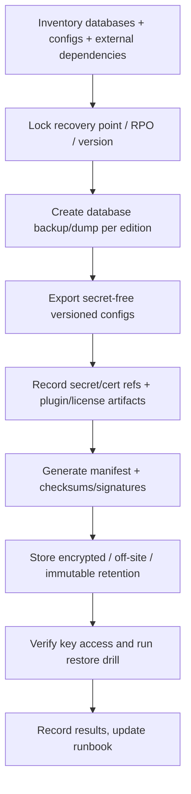

# Protecting Configuration, Secrets, Certificates, and Non-Data Assets in Neo4j Backups

A Neo4j backup may contain **every node, relationship, property, index, and transaction needed to restore the database**, yet the service can still fail to come back after an incident: `neo4j.conf` was lost, TLS certificates expired, the APOC plugin is missing, the Java Driver does not trust the new CA, or the application cannot fetch credentials from the secret manager.

That is why **"restoring the database" does not automatically mean "restoring the service."** A recovery plan must cover components **outside the database data files** and protect each according to its sensitivity.

This lesson belongs to the **Backup and Recovery** chapter of the `DATABASE_ENGINE_GRAPH_NEO4J` module. The module uses Neo4j to model property graphs, query connections/paths with Cypher, manage indexes and constraints, import data, and integrate with the Java Driver and Spring Data Neo4j. This lesson focuses on inventorying, retaining, and restoring **server configuration, security data, keys/certificates, plugins, licenses, and dependencies outside Neo4j**, so that once the graph is restored, applications still query accurately and securely.

> **Goal:** assemble a complete "recovery set," protect secrets from exposure, establish the restoration order in an isolated environment, and define clear acceptance checks before reopening the service to users.

## 1. Two Distinct Objectives: Database Recovery and Service Recovery

Suppose an online learning application stores `:Student` and `:Course` nodes with `:ENROLLED_IN` relationships in the graph. The system uses:

- Neo4j Enterprise with multiple databases, including user databases and `system`.
- `neo4j.conf` configuring Bolt ports, memory, TLS, and procedure permissions.
- TLS certificates for Bolt, plus separate certificates for inter-cluster communication.
- The APOC plugin and a custom procedure packaged as a JAR.
- Application accounts stored in a secret manager; Spring Data Neo4j reads the URI and credentials at startup.
- Course images stored in object storage, while the graph stores only URLs or object keys.

After losing a host, if you **restore only a user database**, several failures can appear:

| Post-restore symptom | Component that may be missing |
| --- | --- |
| `MATCH` works locally, yet the app cannot connect | DNS, Bolt routing, TLS config, certificates, firewall |
| Can read the graph, yet cannot log in with the right role | `system` database, privilege grants, external identity provider |
| `CALL apoc.path.expandConfig(...)` reports unknown procedure | APOC JAR, plugin version, allowlist/config |
| Custom procedure query fails even though nodes exist | Wrong JAR version, incompatible Java/JDK |
| Java Driver reports certificate validation failed | CA/truststore, DNS/SAN, or server certificate |
| Images/lessons missing even though graph nodes exist | Object storage or non-Neo4j data assets |
| CDC reprocesses events, creating duplicate relationships | External offset/checkpoint, lack of idempotency |

Therefore, distinguish clearly between:

- **Data recovery:** the database is in a consistent state holding data at the target point in time.
- **Service recovery:** data recovery **plus** configuration, identities, secrets, TLS, plugins, networking, compute resources, applications, and non-graph dependencies.

These two objectives are connected, not interchangeable.

## 2. What Does a Neo4j Backup Actually Include?

Neo4j provides mechanisms such as `neo4j-admin database backup/restore` and `neo4j-admin database dump/load`. Applicability depends on **Neo4j edition and version**:

| Mechanism | Primary scenario | Key point to remember |
| --- | --- | --- |
| Online backup/restore | Self-managed Neo4j Enterprise needing backups while active | Produces artifacts for a **specific database**, supporting full/differential chains per version |
| Offline dump/load | Supported editions when the database is placed in an appropriate offline state | Suitable for certain backup/migration strategies when downtime is acceptable |
| Managed service backups | E.g., Neo4j Aura | Recovery capabilities, retention schedules, and operator actions depend on tier/service |

**Never use raw filesystem copies of a running database's data directory as a default backup method.** Improper file copies can yield inconsistent backups. Always use documented backup tooling/features for your running Neo4j release.

### 2.1. User Databases Differ from the `system` Database

Neo4j maintains the `system` database for DBMS administrative metadata, including **database configuration state, accounts, roles, and security data**. User databases store the graph and schema of each individual database.

Accordingly, backup schedules must account for:

1. **Every database needing recovery**, not just the default `neo4j` database.
2. The **`system` database** or a verified equivalent workflow for managing accounts and roles.
3. **Point-in-time alignment** across user databases, security metadata, and configuration changes.

Some Neo4j Enterprise releases support `--include-metadata` when backing up a user database to include users/roles metadata. **This capability has scope limits**—for instance, certain DBMS-level administrative privileges are excluded. **Never treat it as a complete substitute for protecting the `system` database** when full DBMS recovery is required.

### 2.2. Files Outside the Database Must Be Backed Up Separately

Per the Neo4j Operations Manual, protect at least the following separately:

- **`neo4j.conf`**; in a cluster, the configuration of **each individual member**.
- **TLS cryptographic material:** private keys, public certificates, and `trusted` and `revoked` directories per applicable scope/cluster member.
- **Custom plugins** and components deployed under `plugins/`.
- **License key files** for products requiring them, such as certain Enterprise capabilities of GDS or Bloom.

Beyond this minimum list, real operations typically rely on **`neo4j-admin.conf`, JDK/container images, Helm values, systemd units, Kubernetes Secrets, plugin allowlists, cron/schedulers, dashboards, scripts, Java Driver configs, and secret managers**. None of these automatically become part of a database backup.

## 3. Recovery Assets Inventory Matrix

Before configuring schedules, inventory every asset required for recovery. For example:

| Category | Typical assets | How to store/recover | Sensitivity |
| --- | --- | --- | --- |
| Graph data | User databases, schema/indexes, transaction state in artifacts | Version-matched Neo4j backup or dump | **High** |
| DBMS administration | `system` database, native users/roles/privileges | Matching DBMS backup with admin restore workflow | **Very high** |
| Neo4j config | `neo4j.conf`, `neo4j-admin.conf` if used, supplemental config files | Git/IaC or versioned access-controlled archive | May contain secrets |
| Runtime/deployment | Image digest, JDK, Helm chart/values, systemd unit, Compose, volume mappings | Git/IaC, registry, and artifact repository | Usually internal |
| TLS and trust | `private.key`, `public.crt`, CA chain, `trusted/`, `revoked/` | PKI/Vault or tightly restricted encrypted store | **Very high for private keys** |
| External auth | LDAP/OIDC/SSO, service accounts, secret references | Secret manager and identity provider config | **Very high** |
| Plugins | APOC, custom procedures/UDFs, GDS, dependencies | Artifact repository, checksums, pinned versions | Internal; may be sensitive |
| Licenses | GDS/Bloom or equivalent products | License vault/secure artifact store | Restricted |
| Integrations & external data | Object storage, source CSVs, CDC offsets, queues/schedulers | Separate backups of upstream/downstream systems, ledgers/checkpoints | Data-dependent |
| Operations | Runbooks, job definitions, access policies, alert rules, audit config | Controlled Git/IaC and documentation | Internal |
| Backup decryption capability | Encryption/KMS keys, key recovery policy | KMS/HSM with an independent recovery plan | **Critical** |

**Never dump everything into an unencrypted ZIP file.** Each asset class has its own owner, access controls, and incident handling. An admin authorized to restore a database should not necessarily be able to view or copy production private keys and passwords.

## 4. Neo4j Configuration: More Than Just One `neo4j.conf` File

### 4.1. Parameters That Must Be Restored in Context

A deployment may require these configuration groups:

| Group | Examples | Risk if forgotten |
| --- | --- | --- |
| Network/Bolt | `server.bolt.listen_address`, `server.bolt.advertised_address`, and related settings | Clients cannot reach the advertised host/port |
| Memory | `server.memory.heap.max_size`, `server.memory.pagecache.size` | OOMs or severe performance degradation after restore |
| Security/TLS | `dbms.ssl.policy.bolt.*`, `server.bolt.tls_level` | Unencrypted connections or TLS handshakes failing |
| Cluster | Discovery and advertised addresses, seeding/routing settings | Failure to join or form the cluster properly |
| Procedures/plugins | Version-specific settings for procedure availability/unrestricted access | APOC/custom procedures fail or get overly broad permissions |
| Logs/metrics | Log rotation, query logs, Prometheus/JMX, audit logs | Loss of observability and forensic capability |
| Backup | Backup listener, TLS policy, backup paths, scheduler | Scheduled backups fail to resume after recovery |
| Database paths | Directory overrides, mounts for data/logs/import | Reading/writing wrong volumes or permission errors |

Never copy `neo4j.conf` verbatim from an old server to a new machine if hostnames, paths, IPs, RAM, or Neo4j versions changed. Configurations must **be regenerated from controlled templates reconciled against the target environment**, rather than blindly restored.

### 4.2. Configuration Can Live in Many Places

```text
IaC / Git (no secrets)
       │
       ├── neo4j.conf template
       ├── Docker Compose / Helm values / ConfigMap
       ├── systemd unit / startup flags
       ├── image tag/digest + plugin list
       └── backup job / runbook
                 │
                 ▼
        Neo4j process config
                 ▲
                 │
Secret manager → mounts/env references
                 ▲
                 │
        certificate / credential stores
```

In Docker, settings may be passed via environment variables or a bind-mounted `/conf`. In Kubernetes, sources typically include Helm charts, ConfigMaps, Secrets, PVCs, and admission/network policies. **Saving only a `neo4j.conf` inside a container does not guarantee reproducing runtime settings** if environment variables and deployment manifests drift.

Some settings change **dynamically at runtime** without automatically persisting back into `neo4j.conf`. Therefore, reconcile:

- Approved configuration in IaC.
- Effective runtime configuration actually applied.
- Emergency changes not yet reflected in the configuration repository.

### 4.3. Selective Cypher Query to Inspect Settings

When properly authorized on a suitable Neo4j instance:

```cypher
SHOW SETTINGS
YIELD name, value
WHERE name IN [
  'server.memory.heap.max_size',
  'server.memory.pagecache.size',
  'server.bolt.tls_level',
  'dbms.ssl.policy.bolt.enabled'
]
RETURN name, value
ORDER BY name;
```

This illustrates **reading selected non-secret settings**. Never dump the entire `SHOW SETTINGS` output into public logs or artifacts: configuration may contain sensitive paths or restricted values. Setting names and view privileges can vary across versions; cross-check with the Neo4j Operations Manual for your deployment.

## 5. Secrets and Accounts: Separate Values from Configuration Docs

### 5.1. Secrets That Affect Recoverability

It is not just the `neo4j` user's password:

- Service accounts used by Java Driver/Spring Data Neo4j.
- Backup client credentials or object storage access accounts.
- LDAP bind passwords, OIDC client secrets, and integration API keys.
- Passwords protecting private keys/truststores if encrypted.
- Backup encryption keys and KMS/HSM decrypt permissions.
- Credentials for plugins calling external services, Kafka connectors, and job schedulers.

**Never** store plaintext secrets in Git, runbooks, manifests, test reports, or logs. When recording reproducibility metadata, store **secret references and versions**, while ensuring the secret manager/KMS itself has an independent recovery mechanism.

Example manifest recording **references only**:

```yaml
secrets:
  neo4jApplication:
    store: "secret-manager"
    reference: "prod/graph/app-credential"
    versionRef: "approved-version-id"
  backupArchiveKey:
    store: "kms"
    keyReference: "alias/graph-backup-recovery"
    recoveryProcedure: "security-runbook-id"
```

These are **illustrative values**, not real IDs or paths. If the secret manager is lost and secrets or keys cannot be recovered, having a manifest is still **insufficient** to restore access or decrypt backups. Thus, recovery testing must include **verifying KMS/secret store access from the standby environment**.

### 5.2. The `system` Database Does Not Replace External Secrets

The `system` database can hold native Neo4j users/roles and security metadata, yet **it does not hold everything inside LDAP, OIDC providers, Kubernetes Secrets, or Vault**.

After restoring `system`:

1. Verify DBMS-scoped accounts, roles, and privileges.
2. Verify external authentication connectivity and accurate identity mapping.
3. Verify application secrets exist, match expected versions, and are readable.
4. Never distribute copies of `system` to unauthorized personnel; it holds sensitive administrative data.
5. If restoring to an older point in time, review user/privilege changes and credential revocation policies enacted after the backup timestamp.

### 5.3. If Secrets Were Exposed During an Incident

There are two distinct cases:

- **Host lost with no sign of secret compromise:** restore secrets from a protected store or issue fresh secrets per procedure.
- **Host compromised or private keys potentially exposed:** never restore old secrets onto the new system and assume it is safe. You must **revoke/rotate**, update client trust and credentials, and investigate blast radius.

A good backup enables **functional recovery**, yet it does not make **post-incident trust decisions** for you.

## 6. TLS: Private Keys, Certificates, CAs, and Trust Chains Recover as One Unit

Neo4j supports multiple TLS communication channels, for instance:

- **Bolt:** Java Driver, Spring Data Neo4j, and Cypher clients.
- **HTTPS:** web UI/API when enabled.
- **Cluster:** internal inter-member communication.
- **Backup:** backup client/server traffic when a dedicated channel is configured.

Each channel can use its own `dbms.ssl.policy.<scope>.*` policy and certificate directories. Never assume a single certificate serves every channel.

### 6.1. Illustrative File Layout

```text
<NEO4J_HOME>/
└── certificates/
    ├── bolt/
    │   ├── private.key       [SECRET]
    │   ├── public.crt
    │   ├── trusted/
    │   └── revoked/
    ├── cluster/
    │   ├── private.key       [SECRET]
    │   ├── public.crt
    │   ├── trusted/
    │   └── revoked/
    └── backup/
        ├── private.key       [SECRET]
        ├── public.crt
        ├── trusted/
        └── revoked/
```

This is an **illustrative structure**, not a requirement that every environment contain all three folders. Paths can differ with containers, volumes, or PKI/secret managers. If a cluster uses per-member certificates, **each member needs its own matching key/cert** along with approved CA/trust policies.

Example Bolt configuration in `neo4j.conf`:

```properties
dbms.ssl.policy.bolt.enabled=true
dbms.ssl.policy.bolt.base_directory=certificates/bolt
dbms.ssl.policy.bolt.private_key=private.key
dbms.ssl.policy.bolt.public_certificate=public.crt
server.bolt.tls_level=REQUIRED
```

This example contains no private key material or passwords. **Never set `trust_all=true` or disable certificate verification just to get past a restore error**; doing so turns an operational outage into a security vulnerability.

### 6.2. Differences Between Certificates and Private Keys

| Component | Role | How to protect |
| --- | --- | --- |
| `public.crt` | Public certificate, hostname, issuer, validity period | Can be distributed via verified processes |
| `private.key` | Proves ownership of the TLS identity | **Encrypted at rest**, minimal read permissions, never placed in public artifacts |
| CA/intermediate chain | Establishes trust for clients/cluster | Lifecycle management, distributed to the right trust stores |
| `trusted/` | List of trusted CAs/certificates | Protect against tampering; block unauthorized CAs |
| `revoked/` | List of revoked certificates (if used) | Must remain synchronized with trust policies |
| Hostname/SAN | Lets clients verify the exact target host | Reissue cert if target hostname changes |
| Key password | Protects an encrypted private key | Dedicated secret manager, never plaintext in config |

The Neo4j Operations Manual notes that private keys should be readable only by the OS account running Neo4j. After restoration, set **exact owner/group and file permissions**—never `chmod` the entire certificates directory to world-readable just to fix permission errors.

### 6.3. Verify Certificates Before Opening Connections

Example read-only commands in an **authorized test environment**:

```bash
# Read public certificate metadata without printing any private key.
openssl x509 \
  -in /path/to/certificates/bolt/public.crt \
  -noout -subject -issuer -dates -serial

# Inspect owner/group/mode on Linux.
stat -c '%a %U:%G %n' \
  /path/to/certificates/bolt/private.key
```

After bringing up the TLS endpoint in the test environment:

```bash
openssl s_client \
  -connect graph-recovery.example.test:7687 \
  -servername graph-recovery.example.test \
  -verify_return_error < /dev/null
```

Hostname and CA verification commands may require specifying your organization's CA/truststore; behavior depends on server/client TLS settings. This **does not replace** testing with the Neo4j Java Driver using the corresponding `neo4j+s://` or `bolt+s://` URI scheme.

Notes:

- An **unexpired** certificate does not guarantee matching hostname/SAN or possession of the paired private key.
- A valid server cert does not guarantee the Java Driver trusts the CA; application truststores must also be restored/updated.
- When DNS/hostnames change after DR, you may need to **reissue certificates** rather than restoring old ones verbatim.
- For suspected key compromise, prioritize **rotating/revoking** and updating trust across all parties per PKI procedures.

## 7. Plugins, Procedures, and Licenses Are Execution Dependencies

Suppose the graph holds valid data, yet the application executes:

```cypher
MATCH (start:Person {personId: $startId})
CALL apoc.path.expandConfig(start, {
  relationshipFilter: 'FOLLOWS>',
  minLevel: 1,
  maxLevel: 3
})
YIELD path
RETURN length(path);
```

If APOC is not installed or allowed on the target server, this Cypher query fails **even though the database restored completely**.

Minimum inventory per plugin:

| Attribute | Example detail to record |
| --- | --- |
| Name and type | APOC Core, custom UDF, custom procedure, GDS |
| Artifact version | Pinned version compatible with Neo4j and JDK |
| Source | Artifact registry/internal address with retention |
| Digest/signature | SHA-256 or trusted release signature |
| Configuration | Procedure allowlist/unrestricted settings, feature flags |
| Dependencies | Additional JARs, external files, credentials, API endpoints |
| License | File/key when the product requires licensing |
| Verification | Which procedures must appear and run |

**Never copy arbitrary old JARs onto a newer Neo4j server and assume they are safe.** Custom procedures and plugins depend on Neo4j major/API versions, JDK versions, and security policies. Evaluate compatibility, provenance, and permissions. An untrusted plugin can execute arbitrary code inside the server; a backup is no excuse to widen unrestricted procedures.

Check after restore:

```cypher
SHOW PROCEDURES
YIELD name
WHERE name IN [
  'apoc.path.expandConfig'
]
RETURN name;
```

If the application uses GDS, also verify the plugin, license, and required capabilities. **In-memory graph projections** in some libraries are not automatically part of database backups; if workflows rely on temporary projections/caches, maintain scripts to rebuild them from restored data.

## 8. Non-Graph Components: Object Storage, Import Files, and CDC

A node may hold:

```cypher
MATCH (c:Course {courseId: $courseId})
RETURN c.courseId AS id,
       c.coverObjectKey AS coverKey,
       c.contentUrl AS contentUrl;
```

Neo4j backups preserve **reference properties** stored inside the database, yet **do not automatically back up file payloads** in S3/object storage/CDN or other services' disks.

Design around **data boundaries**:

| Dependency | If missing after restore | Supplemental plan |
| --- | --- | --- |
| Object storage holding images/PDFs | Graph references objects that no longer exist | Object backup/versioning and read permissions |
| CSV/JSON files used for import/replay | Cannot rebuild batches or reconcile | Retain raw/staging files with retention and checksums |
| Kafka/CDC brokers | Lose events emitted after the recovery point | Offset/replay window management, idempotency |
| External identity provider | Logins fail or roles map incorrectly | IdP DR, client secrets, certs/CAs |
| Cron/job schedulers | Backups/cleanup/CDC fail to resume | Restore job definitions and state |
| Search services/linked apps | APIs return broken links or stale/missing results | Cross-service DR and smoke tests |
| Monitoring/log pipelines | New errors go undetected | Restore exporters, alert rules, and endpoints |

**Especially for CDC:** a graph database restored to time `T` while the broker checkpoint sits at `T+20 minutes` will create an **event gap** if workers resume from the newer offset. Conversely, replaying from too far back can duplicate relationships if the pipeline is not idempotent. Proper recovery coordinates **watermarks, offsets, transaction/checkpoints, and business keys**, not just restoring a backup file.

## 9. Protecting the Backups Themselves: Encryption, Permissions, and Immutability

A Neo4j backup can contain personal data, customer relationships, transactional records, and administrative metadata. Thus, **backups are sensitive data**, not ordinary operational files.

### 9.1. Protection Principles

- **Encryption at rest:** use organization-approved encryption with keys managed in KMS/HSM/secret managers under access controls.
- **Encryption in transit:** prefer TLS/mTLS or secure transport between databases, backup clients, and repositories.
- **Least privilege:** an account allowed to create backups should not automatically have rights to read/decrypt every copy; apply separation of duties where appropriate.
- **Off-fault-domain storage:** store outside production hosts/volumes, preferring independent infrastructure zones or off-site locations.
- **Immutable/versioned retention:** reduce the risk of ransomware deleting or modifying all backups; test policies regularly.
- **Integrity checks:** checksums/signatures, artifact inventories, and restore verification results.
- **Purposeful retention:** long enough for RPO/RTO and legal mandates, without retaining sensitive copies indefinitely.
- **Auditability:** log who creates, accesses, decrypts, restores, or deletes artifacts in an appropriate audit system.

One easily overlooked detail: if backup artifacts are **encrypted using a key stored inside the same failed system**, you have backups yet **cannot decrypt them**. Recovery plans must include reaching, recovering, and authorizing **decryption keys** when the primary site is lost.

### 9.2. Never Place Secrets Beside Publicly Versioned Configs

Separate into two repositories:

```text
Git/IaC (no secrets)                Vault/KMS/PKI (secrets)
├── neo4j.conf template            ├── app credentials
├── Helm values references         ├── TLS private keys
├── chart/image/plugin versions    ├── backup encryption keys
├── restore scripts                ├── LDAP/OIDC client secrets
└── artifact manifest *refs*       └── CA/rotation metadata
              │                               │
              └───────────┬───────────────────┘
                          ▼
                 Recovery environment
```

You may store **references, secret version IDs, and public certificate hashes** in manifests, never passwords, private keys, or decryption tokens.

### 9.3. Physically Separate Storage Is Not Necessarily Permission-Independent

If production and backups share an identity authorized to **delete both live data and backup buckets**, an attacker compromising that identity can wipe the recovery copies too. Separate IAM roles, enforce deny-delete/immutable retention, and isolate backup credentials appropriately.

Similarly, backups in another volume **on the same node**, or object storage in another bucket under **the same broad admin role**, may fail shared-incident resilience requirements.

## 10. Recovery Manifest: Linking Loose Artifacts into One Recovery Set

A common mistake is having all files yet not knowing **which file belongs to which backup**, which `neo4j.conf` revision matched, which cert was active when the backup ran, or which plugin JARs are compatible.

Maintain a **manifest containing no secret values**, for example:

```yaml
recoverySetId: "neo4j-prod-20261125T010000Z"
capturedAt: "2026-11-25T01:00:00Z"

source:
  environment: "production"
  neo4jVersion: "VERIFY_FROM_SOURCE"
  neo4jEdition: "Enterprise"
  topology: "cluster"

databaseArtifacts:
  - database: "neo4j"
    artifactRef: "protected-store://backup-set/userdb"
    checkpointRef: "recorded-in-backup-catalog"
  - database: "system"
    artifactRef: "protected-store://backup-set/system"

deployment:
  configGitRevision: "APPROVED_COMMIT_ID"
  imageDigest: "PINNED_IMAGE_DIGEST"
  helmChartVersion: "VERIFIED_CHART_VERSION"
  pluginManifestRef: "artifact-repo://graph/plugins/manifest"
  networkPolicyRevision: "APPROVED_REVISION"

perMemberArtifacts:
  - member: "member-a"
    configRef: "config-store://neo4j/member-a"
    tlsRef: "vault://neo4j/member-a/identity#version"
  - member: "member-b"
    configRef: "config-store://neo4j/member-b"
    tlsRef: "vault://neo4j/member-b/identity#version"

secrets:
  applicationCredentialRef: "vault://neo4j/app#version"
  backupDecryptKeyRef: "kms://neo4j-backup-key"

dependencies:
  objectStorageBackupRef: "protected-store://course-assets/set"
  cdcCheckpointRef: "checkpoint-store://graph/consumer"

verification:
  artifactIntegrity: "TO_BE_VERIFIED"
  restoreDrillId: "MOST_RECENT_DRILL_RECORD"
```

All strings above are **structural illustrations**, not real paths or IDs. A manifest should capture **artifact SHA-256/signatures**, data timestamp, backup status, owners, expiry/retention, and tested recovery docs; matching this exact YAML layout is not mandatory.

**Version alignment ≠ timestamp alignment:** if a cert was rotated after time `T`, restoring a data backup from `T` does not require reusing the old private key. Use the **approved TLS identity for the recovery environment**, while the manifest simply tracks history and dependencies.

## 11. Workflow for Building a Safe Recovery Set



### Step 1 — Lock Scope and Data Checkpoint

List actual databases; do not schedule only `neo4j` while forgetting `system` or other business databases. Record Neo4j version and edition, cluster state, application RPO/RTO, permissions, and version-appropriate backup tooling.

Read-only inspection queries when authorized:

```cypher
SHOW DATABASES
YIELD name, currentStatus
RETURN name, currentStatus
ORDER BY name;
```

```cypher
CALL dbms.components()
YIELD name, versions, edition
RETURN name, versions, edition;
```

Returned fields or admin privileges can vary by server/edition. **Never** export sensitive user info or credentials into diagnostic logs.

### Step 2 — Back Up Databases with the Right Tool

Depending on edition/version, check the commands:

```bash
# Inspect usage without creating or restoring data.
neo4j-admin database backup --help
neo4j-admin database restore --help
neo4j-admin database dump --help
neo4j-admin database load --help
```

These commands **display help only**—they do not run backup/restore. When writing real jobs, follow syntax for your **deployed Neo4j version** (Enterprise online, offline dump, backup chains, SSL policies), `neo4j-admin` OS user permissions, and secure artifact storage locations.

Never attach test restore commands to production as a "verification step." All testing must occur in an **isolated environment**.

### Step 3 — Capture Configuration and Non-Database Manifest

- Record config from IaC/git revisions and reconcile runtime overrides.
- Save `neo4j.conf`, `neo4j-admin.conf` if used, deployment manifests/Helm values, mount paths, and server-specific overrides.
- Inventory private keys/certs/CAs/trusted/revoked **per TLS scope and per server**.
- Record versions/digests of the Neo4j image, JDK, APOC, custom JARs, and licenses.
- Record secret references accessible from the DR region—never copy plaintext into manifests.
- Inventory dependencies outside Neo4j: object storage, CDC, registries, DNS/PKI, and alerting.

### Step 4 — Secure the Artifacts

Push to encrypted, off-site/versioned/immutable storage per policy. Confirm artifacts are readable under the DR identity and a key-recovery path exists. Verify checksums/signatures post-transfer, retention periods, and access quotas.

**Do not check only that the job exited 0.** A job succeeding on-host whose artifact failed to upload, lacks the `system` database, lacks decryption keys, or has a manifest pointing to the wrong version is still an **incomplete** recovery set.

## 12. Restore Drill: Restoration Sequence in an Isolated Environment

Recovery must be **drilled**, not merely documented. Reference sequence:

### Phase A — Environment Preparation

1. Pick a sandbox/DR namespace with no direct route to production; verify access controls and network isolation.
2. Select a Neo4j server version **compatible with the artifact**. The Neo4j Operations Manual states backups restore into the same or supported newer versions, **never backward into older versions**.
3. Provision volumes, internal DNS, service OS user, directory permissions, resource limits, and network policies.
4. Pull configs from an approved revision; **update hostnames, IPs, advertised addresses, and resource allocations** to match the recovery region.
5. Deploy compatible plugin JARs/digests; mount certs/secrets properly via PKI/secret manager.

### Phase B — Database and Administrative Metadata Recovery

1. Verify backup integrity and decryption access inside the recovery environment.
2. Restore user databases and `system` using the **runbook matching version and standalone vs. cluster**. Never assume restoring one cluster member suffices to recover the entire cluster.
3. Restore/audit users, roles, privileges, and administrative changes made after the recovery point.
4. Block CDC jobs, schedulers, and live production apps from writing before reconciliation finishes.

**Handle the `system` database carefully:** it contains DBMS and security metadata, so restoring into an environment with different config/topology must follow documented procedures—never arbitrarily overwrite a running system. In clusters, verify the exact Neo4j version's cluster seed/topology/restore workflow.

### Phase C — Non-Data Restoration

1. Restore or reissue TLS keys/certificates/CAs/trust stores per policy; enforce minimal ownership and permissions.
2. Restore secret references from Vault/KMS; verify service read access and rotation plans if exposure is suspected.
3. Restore plugins/licenses, scripts, job schedulers, and log/metrics pipelines.
4. Restore object storage or confirm external resources referenced by the graph still exist.
5. Align CDC offsets with the recovery point to avoid missing or duplicating events.

### Phase D — Pre-Launch Verification

1. Confirm Neo4j starts, databases reach online, and zero plugin/TLS errors appear.
2. Run **Java Driver/Spring Data Neo4j** from a test app environment to verify routing/TLS and critical queries.
3. Verify accounts/roles obey least privilege.
4. Test queries calling `CALL apoc...`/custom procedures plus required constraints/indexes.
5. Verify object storage references and CDC workflows.
6. Measure recovery duration, achieved RPO/RTO, and record evidence in the drill report.
7. Open traffic/writes only after explicit sign-off from the accountable owner.

## 13. Acceptance Test Suite for a Recovery Set

A restore is considered **complete** when it passes these verification groups:

| Check | What must hold |
| --- | --- |
| **Artifact** | All required user databases and `system` present; valid checksums/signatures |
| **Version** | Server/image/plugins/JDK compatible with backups and configs |
| **Security** | Secrets accessible; no leaked passwords/tokens; post-restore permissions match policy |
| **TLS** | Certs unexpired, matching hostname/SAN, paired keys, working CA/trust chain |
| **Plugins** | APOC/custom procedures recognized, right version, proper permissions |
| **Graph** | Nodes/relationships/constraints/indexes and business query outputs match |
| **Application** | Java Driver/SDN connects via real URI, not merely localhost |
| **External assets** | Referenced files/images/objects remain readable from the recovery environment |
| **CDC** | Offsets/replay reconciled with zero dropped events or duplicates |
| **Monitoring** | Query logs, error alerts, backup schedules, and audits active again |
| **Operational** | RPO/RTO and recovery duration measured; runbook has owner and evidence |

### 13.1. Sample Graph Verification Queries

```cypher
// Example checking two business node types.
MATCH (c:Course)
RETURN count(c) AS courses;
```

```cypher
MATCH (s:Student)-[e:ENROLLED_IN]->(c:Course)
RETURN count(e) AS enrollments,
       count(DISTINCT s) AS studentsWithEnrollment;
```

```cypher
// Verify procedure availability if the domain uses APOC.
SHOW PROCEDURES
YIELD name
WHERE name = 'apoc.path.expandConfig'
RETURN count(*) AS apocAvailable;
```

Expected numbers must come from a **verified recovery manifest and business oracle**, never copied from post-restore results and retroactively declared expected. For example, a graph having 100,000 Courses does not mean every restore must show 100,000; anchor expectations to the **data checkpoint** and matching filters.

### 13.2. Secret-Free TLS and Application Checks

- Java Driver connects using a certificate-verifying URI such as `neo4j+s://graph-recovery.example.test:7687` where supported.
- `driver.verifyConnectivity()` succeeds using credentials fetched from the secret manager.
- `RETURN 1 AS ok` passes, followed by real path queries or repository mapping tests.
- Tests use accounts scoped to appropriate read/write privileges, never a superuser for every request.
- Logs/console print only test outcomes—**never** print private keys, secret values, connection strings containing passwords, or tokens.

## 14. Failure Scenarios Required in Drills

| Incident | Symptom | Safe remediation |
| --- | --- | --- |
| Database backup exists, `neo4j.conf` lost | TLS/cluster/memory overrides unknown | Rebuild from IaC revision + verify runtime config |
| Missing `system` database | Incomplete user/role/DBMS metadata | Restore metadata per runbook, verify permissions |
| Secret manager unreachable | Apps cannot authenticate/decrypt | Trigger secret manager/KMS DR path; never hardcode secrets |
| Private key lost | TLS listener fails to start/prove identity | Fetch from secure vault or reissue certificate/key |
| Expired cert or wrong hostname | Java Driver rejects TLS | Reissue, fix DNS/trust chain; never disable verification |
| Certificate/private key compromised | Risk of server impersonation | Revoke/rotate, update client trust, investigate |
| Missing APOC JAR | Procedure not found | Deploy matching JAR/version/config, check allowlist |
| Over-permissive procedures after restore | Lost security boundary | Reconcile against policy and tighten allowlist |
| Plugin right name, wrong major | Classloading/`NoSuchMethodError` | Check Neo4j/JDK/plugin compatibility |
| GDS/Bloom missing license | Features unavailable | Restore license per terms and procedure |
| Object storage not restored | URLs exist in graph yet files return 404 | Restore/reconcile object backups and IAM |
| Kafka checkpoint newer than graph | Event window lost after restore | Align recovery point/offsets and replay |
| Only encrypted backup exists, KMS key lost | Cannot decrypt archive | KMS/HSM recovery per tested procedure |
| Backups share host and delete permissions with prod | Outage/ransomware wipes backups too | Off-site immutable backups, separate IAM and fault domains |
| Restore into older Neo4j version | Restore unsupported | Use compatible server version; never downgrade |

**In particular:** after a security breach, restoring old passwords/certificates from before the breach into production can reintroduce the exact vulnerability exploited. Security recovery plans must include **re-evaluating trust and rotating credentials** independently of data restoration.

## 15. RPO, RTO, and Configuration Changes Outside Backup Schedules

### 15.1. Data RPO and Configuration RPO Can Differ

- **RPO (Recovery Point Objective):** acceptable data loss.
- **RTO (Recovery Time Objective):** maximum acceptable service recovery duration.

Suppose orders require `RPO ≤ 15 minutes`, while Neo4j configuration changes only every few months. That does **not** mean quarterly config backups suffice: rotating a certificate, swapping a plugin, changing an endpoint, or updating critical permissions **right before an outage** can render an older config backup unusable.

Therefore, enforce **event-driven protection**:

| Change type | Recording/backup action |
| --- | --- |
| `neo4j.conf` or Helm values change | Commit/approve revision, test, update manifest |
| TLS certificate rotation | Record cert serial/expiry, secret version, trust rollout, verify recovery |
| Create/update secret | Record version/reference, ensure DR replication/escrow per policy |
| Upgrade Neo4j server/JDK/plugin | Pin image/artifact digest, compatibility tests, rehearsal |
| Role/privilege changes | Protect `system`/metadata, audit, and test permissions |
| Change CDC checkpoint/retention | Update replay strategy and recovery window |
| Change license | Update secure license storage and permissions |
| Rotate backup encryption key | Verify older backups **remain decryptable** |

### 15.2. RTO Is Driven by Non-Data Components Too

Suppose restoring the database takes **25 minutes**, yet reissuing a TLS certificate takes **90 minutes** or verifying KMS access takes **60 minutes**. **Actual RTO** is not 25 minutes.

Illustrative drill timing table:

| Stage | Assumed duration |
| --- | ---: |
| Provision infrastructure and network | 15 minutes |
| Fetch config/IaC and pin plugins | 10 minutes |
| Fetch/reissue secrets and certificates | 20 minutes |
| Restore database and `system` | 30 minutes |
| Verify queries, permissions, TLS, external dependencies | 20 minutes |
| **Sequential total** | **95 minutes** |

These numbers are **not a Neo4j benchmark**. Several steps can run in parallel; true total RTO must be measured in drills with representative data volume and topology.

## 16. Differences by Deployment Model

### Self-Managed Standalone

- Back up user databases and `system` appropriately.
- Protect config/SSL/plugins/licensing outside the data directory.
- Restore host, service unit, permissions, storage, and Java Driver endpoint.
- Test startup/restart and re-enable backup schedules.

### Self-Managed Neo4j Cluster

- Back up **per database**, while preserving **per-member** configurations and certificates.
- Record topology, discovery/routing, advertised addresses, CA trust, and intra-cluster TLS.
- Never restore/copy database files directly onto members using unsupported filesystem operations.
- Follow official cluster restore/seed procedures for your specific server version.
- Evaluate restoring `system` and administrative metadata when target topology differs from source.
- Verify via `neo4j+s://` client routing and test read/write under granted roles.

### Docker/Kubernetes

- Do not back up only the `/data` PVC: cover `/conf`, mounted Secrets/certs, Helm chart/values, image digests, plugins, and volume permissions.
- Container image tags can drift; **pin digests/versions** and store deployment manifests in registry/IaC.
- Kubernetes Secrets are **objects requiring their own protection** and do not automatically survive cluster loss. Secret backup/restore must use proper encryption and IAM.
- Namespaces, Services, Ingresses, DNS, and NetworkPolicies all affect Neo4j Java Driver connectivity.
- Never place private keys in ConfigMaps or public Docker images.

### Neo4j Aura / Managed Services

- Database backups and restore options depend on plan/tier; never assume shell access to run `neo4j-admin` on hosts.
- Customers still own DR for **applications, secret managers, client-side certificates/trust, object storage, data pipelines, and IaC**.
- Base planning on the service's official SLA/RPO/RTO and export/restore features rather than assuming self-managed Enterprise mechanics.

## 17. Checklist for a Drill Run

| # | Criterion | Result |
| --- | --- | --- |
| 1 | Backups exist for all required databases, including `system` or eligible metadata approach | PASS/FAIL |
| 2 | Database artifacts have integrity verification and encryption | PASS/FAIL |
| 3 | Decryption keys are recoverable via an independent DR path | PASS/FAIL |
| 4 | `neo4j.conf`/runtime overrides reproducible from an approved revision | PASS/FAIL |
| 5 | Plugin JARs and licenses match version with verified checksums | PASS/FAIL |
| 6 | TLS private keys, certs, CAs, trusted/revoked properly restored/rotated | PASS/FAIL |
| 7 | Private key permissions restricted strictly to authorized accounts | PASS/FAIL |
| 8 | Native auth/roles and external IdP/secret manager operational | PASS/FAIL |
| 9 | Java Driver/SDN connects via real routing/TLS URI and executes business queries | PASS/FAIL |
| 10 | Object storage and external references resolve without errors | PASS/FAIL |
| 11 | CDC offsets/replay reconciled with zero duplicates | PASS/FAIL |
| 12 | Monitoring, auditing, and backup scheduler operational again | PASS/FAIL |
| 13 | Restore finishes within RTO; recovery point meets RPO | PASS/FAIL |
| 14 | Drill report, owner, follow-ups, and test evidence recorded | PASS/FAIL |

If any row **FAILS**, never mark "recovery succeeded" simply because `MATCH (n) RETURN count(n)` returns rows. Recoverability must be judged against the application's **service contract**.

## 18. Scenario Exercises

**Exercise 1 — Backup Scope.** A job backs up only the `neo4j` database and uploads it to object storage. List at least six non-graph components whose absence can still cause recovery to fail.

**Exercise 2 — Missing TLS Files.** After restore, Neo4j opens Bolt yet the Java Driver reports a certificate error. Outline the troubleshooting sequence: DNS/hostname, SAN, public cert, private key, CA/trust, expiry, and URI scheme.

**Exercise 3 — Plugin Failure.** `CALL apoc.path.expandConfig(...)` worked in production and now reports "unknown procedure." Is the graph data lost? What must be checked?

**Exercise 4 — Secret Compromise.** Security confirms the old host was breached and the private key may have leaked. Why shouldn't you reuse the exact old key in the recovery environment even though its backup is intact?

**Exercise 5 — Administrative Metadata.** After restoring a user database, application accounts lose privileges. Why are both the `system` database and user/role metadata options worth checking, yet must not be treated as completely equivalent?

**Exercise 6 — CDC.** The graph restores to 10:00, while the broker checkpoint records 10:20. What happens if the worker resumes from the newer checkpoint without reconciling against the recovery point?

**Exercise 7 — Backup Encryption Key.** Artifacts are intact and checksums match, yet the KMS key is unreachable from the DR region. Does this backup meet recovery requirements?

**Exercise 8 — RTO.** Why does a 20-minute data restore not mean the entire service has a 20-minute RTO?

**Suggested answers:** (1) Config, `system`/roles, secrets, TLS keys/certs, plugins, licenses, object storage, CDC checkpoints, network/IaC. (2) Check hostname/SAN, cert expiry, key pair match, CA, and TLS mode; never disable verification. (3) Graph data is not necessarily lost; check JARs, versions, allowlists/permissions, server/JDK compatibility. (4) Compromised keys must be revoked/rotated to prevent impersonation. (5) `system` holds broader metadata, whereas user-backup metadata options have version/scope limits. (6) A 20-minute event window may be lost unless replayed. (7) No; decryption capability must be proven. (8) Config, TLS, KMS, networking, plugins, testing, and traffic cutover all take time.

## 19. References

- [Neo4j Operations Manual — Backup and restore planning](https://neo4j.com/docs/operations-manual/current/backup-restore/planning/): `system` database, additional files, requirements to separately back up config/certs/plugins/licenses, retention, and backup security.
- [Neo4j Operations Manual — Backup and restore](https://neo4j.com/docs/operations-manual/current/backup-restore/): differences between online backup and offline dump by edition.
- [Neo4j Operations Manual — Back up an online database](https://neo4j.com/docs/operations-manual/current/backup-restore/online-backup/): backup artifacts, users/roles metadata, networking, and backup client TLS.
- [Neo4j Operations Manual — Restore a database backup](https://neo4j.com/docs/operations-manual/current/backup-restore/restore-backup/): version compatibility limits and cluster restore/seed methods.
- [Neo4j Operations Manual — SSL framework](https://neo4j.com/docs/operations-manual/current/security/ssl-framework/): TLS scopes, certificate/private key/trusted/revoked structure, and file permissions.
- [Neo4j Operations Manual — Configuration settings](https://neo4j.com/docs/operations-manual/current/configuration/configuration-settings/): server configuration, dynamic settings, and non-persisted runtime changes.
- [Neo4j Operations Manual — Docker configuration](https://neo4j.com/docs/operations-manual/current/docker/configuration/): `/conf`, environment variables, and image options.
- [Neo4j Operations Manual — Kubernetes authentication and authorization](https://neo4j.com/docs/operations-manual/current/kubernetes/authentication-authorization/): Kubernetes Secrets and authentication dependencies.

**Takeaway:** graph backups are **one part** of a recovery plan. For a Neo4j service to operate safely after a disaster, you must simultaneously protect **per-server configuration, `system` metadata, secrets/KMS, TLS certificates/private keys, plugins/licenses, and dependencies outside the database**. Treat a recovery set as trustworthy only once it **can be decrypted, redeployed, verified, application-tested, and shown to meet RPO/RTO** in an actual drill.
