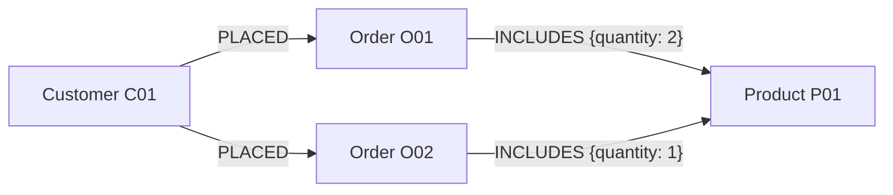
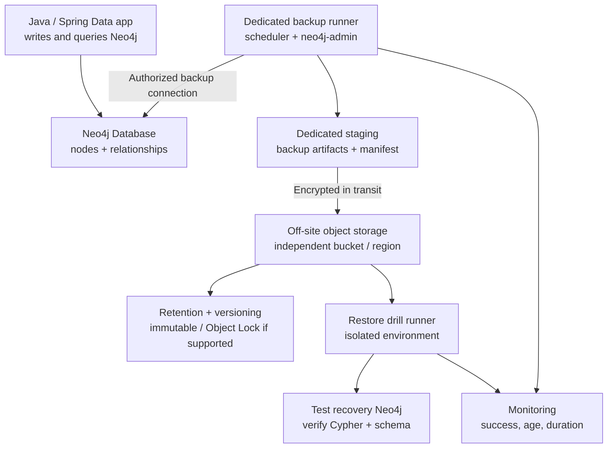
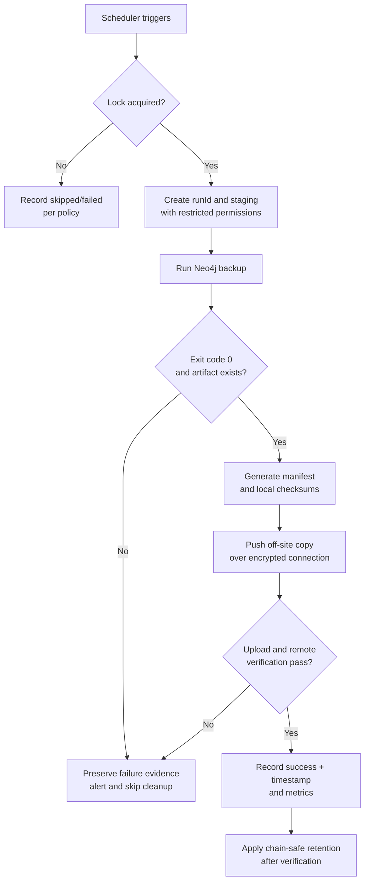
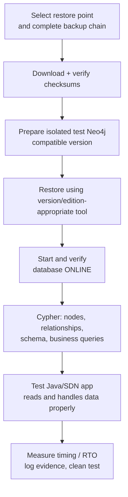

# Automating Backup Schedules, Off-Host Storage, and Periodic Verification

A **Neo4j** system can model customers, orders, products, or knowledge as **nodes**, **relationships**, and properties, then query them with **Cypher**, the **Neo4j Java Driver**, or **Spring Data Neo4j**. If a database is accidentally deleted, a disk fails, ransomware encrypts the server, or a bad import creates millions of erroneous relationships, the result is **data loss and loss of service**. Having a directory named `backup` is not enough to protect the system: you need to know whether the copy is **current enough, stored independently, restorable, and actually verified**.

This lesson belongs to the **Backup and Recovery** chapter of the **DATABASE_ENGINE_GRAPH_NEO4J** module. It focuses on building **automated backup schedules**, **off-host/off-site backup storage**, managing **retention and security**, and conducting **periodic integrity checks and recovery drills**. Examples illustrate self-managed Neo4j systems using version-appropriate backup capabilities; **Neo4j Aura/managed**, Community, or other versions must cross-check available features before use.

> **Operational rule:** A backup is valuable only when it can **restore data and meet recovery targets**. A backup job reporting success, a large file size, or object storage returning HTTP 200 **never replaces a real test restore**.

## 1. What Does a Backup Protect, and What Is Not Guaranteed?

**Backing up** means creating a copy of data usable to restore database state after an incident. The goal is not merely saving a file containing nodes: relationships, properties, schemas, and external dependencies must also be accounted for.

Example business system with a graph:



If recovery brings back nodes yet loses `PLACED` or `INCLUDES`, the following business query will return wrong results:

```cypher
MATCH (c:Customer {customerId: $customerId})
      -[:PLACED]->(o:Order)
RETURN o.orderId AS orderId
ORDER BY orderId;
```

Therefore, after restore you must verify **graph contents and structure**, not just node counts.

### 1.1. Distinguishing Four Concepts

| Concept | Purpose | What cannot be inferred |
| --- | --- | --- |
| **Backup** | Produce data usable in a restore workflow | Does not guarantee recoverability until tested |
| **Replication/cluster** | Increase availability and server fault tolerance | Does not protect against valid delete commands replicated across members |
| **Storage snapshot** | Capture volume/object state via infrastructure technology | Does not automatically guarantee Neo4j transactional consistency |
| **CSV/JSON export** | Data exchange or analytics | Not by default a backup capable of full database recovery |
| **Disaster recovery** | Coordinate full service restoration after disaster | Requires people, infrastructure, security, DNS, apps, and drills |

A Neo4j cluster with multiple replicas can still **synchronize an erroneous `DETACH DELETE`** across all members. Hence, clustering and backups address different risk classes.

### 1.2. Business Targets Before Choosing a Schedule

Two targets to align with system owners:

- **RPO — Recovery Point Objective:** maximum data/time-window of changes acceptable to lose after an incident.
- **RTO — Recovery Time Objective:** maximum acceptable duration to restore service delivery.

Illustrative example requirements:

| Service | Target RPO | Target RTO | Design implication |
| --- | --- | --- | --- |
| Internal knowledge graph updated daily | 24 hours | 8 hours | Can evaluate nightly backups |
| Operational order graph | 1 hour | 2 hours | Needs fresher recovery points, suitable backup mechanism, and fast restore |
| Graph analytics rebuilt from upstream sources | 48 hours | 12 hours | Can combine backups with rebuild/reconciliation pipelines |

Numbers in this table are **learning assumptions**, not default Neo4j SLAs.

**Note:** Daily backups do not satisfy a 1-hour RPO without a supported, verified mechanism capturing interim changes. Conversely, a short RPO does not prove RTO is met: downloading copies, restoring the database, reconnecting clients, and testing the application can take hours.

## 2. Backup Capabilities Depend on Version, Edition, and Deployment Model

There is no single universal backup command across all Neo4j distributions.

| Environment | Approach to evaluate |
| --- | --- |
| **Self-managed Neo4j Enterprise** | Can use **online database backup** per version and configuration; check matching `neo4j-admin database backup` syntax |
| **Neo4j Community** | Does not include Enterprise online backup by default; evaluate supported dump/restore, DB stop workflows, and downtime tolerance |
| **Neo4j Aura/managed service** | Uses backups/restores, snapshot history, and guarantees provided by the service/tier; never assume SSH or host `neo4j-admin` access |
| **Neo4j cluster** | Must understand backup sources, cluster members, logs/chains, storage, and consistency per version; never treat replicas as backups |
| **Self-managed Docker/Kubernetes** | Containers do not preserve data or backups across replacement; need persistent volumes/runners/object stores and schedules |

**Online backup** is designed to back up a running database where supported; **offline dump** typically serves an inactive database per command/version rules. Never swap the two operations casually.

### 2.1. Verify Actual Tooling Before Scheduling

On a host with the admin tooling for your exact Neo4j version installed:

```bash
neo4j-admin database backup --help
neo4j-admin database dump --help
neo4j-admin database restore --help
neo4j-admin database load --help
```

These `--help` commands only **inspect syntax**. Not all commands are available or share the same flags across every edition/version. Syntax differs across Neo4j 4.x, 5.x, and newer releases.

Before deploying online backups, verify:

1. Edition/license and online backup support in your installed version.
2. Compatibility between the backup client/`neo4j-admin` version and the Neo4j server.
3. Configured backup endpoint and port, typically distinct from **Bolt port 7687**.
4. Network permissions between the **backup runner** and Neo4j hosts.
5. Write permissions and sufficient disk space in the staging directory.
6. That you back up the exact **database name** and all other required databases.
7. Full/differential flags, backup chain retention, and restore procedures matching your version.

### 2.2. The Neo4j Aura Case

On Aura or managed services, operators may receive automated backups, restore points, or exports per plan. However, **frequency, retention duration, storage region, data scope, and restore permissions** depend on the service/plan at the time of use.

Never apply `cron` + `neo4j-admin database backup` examples to Neo4j Aura: users normally lack OS command access on Aura hosts. If RPO/RTO needs exceed your plan's capabilities, **clarify with the provider** or design supported complementary mechanisms; JSON exports from an app are not automatically equivalent to provider-managed database backups.

## 3. Architecture: Backup Runner and Off-Host Storage

A practical architecture for **self-managed Neo4j supporting online backup**:



**Why store backups off-host?** If backups sit on the same disk or VM as the database, losing the host destroys both primary data and backups. A separate disk mounted on the same host mitigates certain disk faults yet **does not protect against accidental deletion, ransomware, or losing the entire infrastructure zone**.

Distinguish:

- **Off-host:** copies reside outside the database host, such as on a dedicated backup server.
- **Off-site:** copies reside outside the same fault domain, such as a separate storage region/facility by design.
- **Immutable/WORM:** copies enforced against modification/deletion for a retention window, not merely OS-level read-only file permissions.

One guiding heuristic is the **3-2-1** rule: multiple copies, across distinct storage media/systems, with at least one off-site copy. Against ransomware threats, add immutable copies and restore verification; numbers only help when access boundaries and real recoverability are designed genuinely.

## 4. Designing a Backup Policy from RPO, RTO, and Data State

Before writing a `cron` schedule, build an **inventory**:

| Data / object | What to inventory |
| --- | --- |
| User databases | Name and role of each database: `sales`, `knowledge`, ... |
| System database | Accounts, roles, and system config/metadata requiring recovery per version approach |
| Schema | Indexes, unique constraints, and database schema elements |
| External dependencies | Import files, app configs, plugins/APOC, certificates, secrets, and job schedulers |
| Cluster topology | Members, routing endpoints, rebuild steps, and backup behavior |
| Storage | Current size, growth rate, backup size, network bandwidth |
| Security | Who can create, read, delete, and restore backups; encryption keys and rotation plans |
| Business verification | Cypher queries used to reconcile nodes/relationships after restore |

Never assume a backup of `sales` automatically includes **application configs**, APOC files, secrets, or data from other databases. When backing up multiple databases, copies taken at different times **do not automatically form an atomic cross-database snapshot**, let alone align with external ERP/CRM systems.

### 4.1. Choosing Full vs. Differential/Incremental

Depending on version/features:

- **Full backup:** creates a dataset sufficient to restore one database at that checkpoint.
- **Differential/incremental backup:** records only changes per supported mechanism and depends on a compatible **base backup/chain**.
- **AUTO mode** or other optimization flags, if present, must be verified in version docs; never assume every version supports the exact same mode.

An illustrative schedule requiring real-world validation:

| Task | Assumed cadence | Goal |
| --- | --- | --- |
| Full backup | Sunday 01:00 | Establish a recovery baseline |
| Delta backup, if supported by version | Hourly | Shrink potential data-loss window |
| Off-site push | After each successful backup batch | Never leave recent copies only on one host |
| Checksum/manifest check | Every backup and post-upload | Detect transfer corruption or file tampering |
| Restore drill with graph checks | Monthly | Prove copies genuinely restore |
| End-to-end RTO drill on prod-like scale | Quarterly | Measure full service recovery duration |

**RPO warning:** An hourly schedule **does not automatically guarantee a 1-hour RPO** if jobs run long, lag, fail off-site verification, error out, or leave an incomplete chain. Measure the **latest usable recovery point**, not merely scheduler triggers.

### 4.2. Is a Nightly Full Backup Enough?

If data changes only a few times a day and business RPO allows 24 hours, nightly backups may be reasonable. Still account for:

- Elapsed time between **two successful backups**, not two cron starts.
- Backup runtime and when the copy becomes ready for restore.
- Off-host transfer time and cross-region latency.
- Sudden data spikes from batch imports.
- Impact on page cache, I/O, and live transactions if backups overlap peak load.

If nightly backups fail several days in a row, actual RPO quietly becomes **multiple days** even while cron keeps running.

## 5. Preparing Backup Source and Destination on Self-Managed Neo4j

Before automating, **test backups manually following exact version docs** in a test environment.

For Neo4j 5.x Enterprise versions supporting online backup, syntax may look like:

```bash
# Illustrative example: verify against neo4j-admin database backup --help.
neo4j-admin database backup \
  --from=neo4j-backup.internal:6362 \
  --to-path=/srv/neo4j-backups/manual \
  sales
```

**This is not an unconditional copy-paste command**:

- `neo4j-backup.internal:6362` is only an example of a configured **backup endpoint**; never treat that hostname/port as a mandatory default.
- `--from`, `--to-path`, database name, and output layout must be confirmed via `--help` on your running version.
- Online backup requires the proper service/feature entitlement; on Community or Aura, do not force this command.
- The destination directory must live on an authorized backup runner/storage, not a directory that could be wiped alongside the database host.
- Never expose the backup endpoint publicly to the Internet; use private networks/VPNs/protected transport and least privilege.

### 5.1. Neo4j Server Configuration Is Not Application Java Config

Backup endpoints and related permissions are controlled on the **Neo4j server side**, not via `spring.neo4j.uri` in Spring Boot. Some versions use settings in the `server.backup.*` group; **check exact setting names and enablement rules in docs for your exact version**.

To avoid operator confusion:

| Component | Role |
| --- | --- |
| Bolt endpoint, typically `:7687` | Java Driver executes Cypher |
| Dedicated backup endpoint (if present) | Backup tools communicate via Neo4j's backup protocol |
| Neo4j `neo4j.conf` | Configures database server and listeners |
| Spring `application.yml` | Configures application client |
| Backup runner scheduler | Coordinates cadence, artifacts, uploads, checksums, and alerts |

**Never use an app CRUD account's needs as an excuse to grant admin rights to every backup runner.** Backup and restore are sensitive operational tasks requiring dedicated permissions and private networking.

### 5.2. Offline Dump Is a Separate Option

In environments without online backup, versions typically provide:

```bash
neo4j-admin database dump --help
neo4j-admin database load --help
```

The typical flow places the target database into **a state meeting offline dump requirements**, runs dump, stores the artifact, and uses matching-version load tooling during recovery. Never run `dump` against an actively serving database without checking version rules; also never treat **raw file copies of an actively written data directory** as a consistent dump.

If stopping the database to dump, include downtime in RTO/SLO and maintenance windows. Consider isolating a dedicated standby/environment where architecture permits rather than stopping production every hour.

## 6. Automating with a Scheduler: Designing Fault-Tolerant Jobs

A reliable backup job is more than `neo4j-admin ...` running nightly. It must handle **overlap prevention, run IDs, exit codes, complete artifacts, uploads, checksums, retention, and failure alerts**.



**Mark success only at the end**, once the backup sits in policy-compliant storage. If local backup succeeds on staging disk yet upload fails, status should be **OFFSITE_FAILED**, not "system backup complete."

### 6.1. Illustrative Shell Script on Linux

The example below targets a **Linux backup runner** authorized to run `neo4j-admin`, `flock`, `sha256sum`, and AWS CLI against a compatible backup source with object-storage write rights. **Customize policies, endpoints, command flags, IAM, and buckets before scheduling.** Never run a template against production without testing in staging first.

```bash
#!/usr/bin/env bash
set -Eeuo pipefail
umask 077

# Variables injected by secret/config management before execution.
: "${BACKUP_FROM:?missing backup endpoint}"
: "${BACKUP_ROOT:?missing local staging root}"
: "${BACKUP_BUCKET:?missing offsite bucket}"
: "${BACKUP_KMS_KEY_ID:?missing KMS key identifier}"

DATABASE="sales"
RUN_ID="$(date -u +%Y%m%dT%H%M%SZ)"
RUN_DIR="$BACKUP_ROOT/$DATABASE/$RUN_ID"
S3_URI="s3://$BACKUP_BUCKET/neo4j/$DATABASE/$RUN_ID/"

# Prevent two jobs for the same database from overlapping.
exec 9>"/tmp/neo4j-sales-backup.lock"
if ! flock -n 9; then
    echo "Backup already running" >&2
    exit 75
fi

mkdir -p "$RUN_DIR"

# Example online backup syntax for supported environments.
# Cross-check --help and backup chain policy for your Neo4j version.
neo4j-admin database backup \
    --from="$BACKUP_FROM" \
    --to-path="$RUN_DIR" \
    "$DATABASE"

# Generate manifest for all files produced by the backup.
(
    cd "$RUN_DIR"
    test -n "$(find . -type f -print -quit)"
    find . -type f ! -name SHA256SUMS -print0 |
        sort -z |
        xargs -0 -r sha256sum > SHA256SUMS
    test -s SHA256SUMS
    sha256sum --check SHA256SUMS
)

# Upload via HTTPS using AWS CLI and bucket SSE-KMS.
# Bucket policies, IAM, and Object Lock must be configured separately.
aws s3 cp "$RUN_DIR/" "$S3_URI" \
    --recursive \
    --sse aws:kms \
    --sse-kms-key-id "$BACKUP_KMS_KEY_ID"

# This signal only indicates the upload command succeeded.
# A separate job is needed to download/verify the remote artifact.
echo "BACKUP_UPLOADED database=$DATABASE run=$RUN_ID uri=$S3_URI"
```

**Key points in this script:**

- `set -Eeuo pipefail` aborts the job on command/pipeline errors, preventing "success" reports when backup or upload fails.
- `umask 077` restricts permissions on files created on the runner; parent directories still need proper permission policies.
- `flock` provides locking on a single Linux runner; with multiple runners, use a **distributed lock** or ensure the scheduler runs only one job per database.
- A UTC-timestamped `RUN_ID` distinguishes runs. If two runs could start in the same second or across multiple runners, append a scheduler run ID to prevent destination collisions.
- `SHA256SUMS` detects byte changes **against the manifest**; if both files and manifest are altered together, checksums alone cannot prove authenticity. Protect or sign manifests in threat-sensitive environments.
- `aws s3 cp` **does not enable Object Lock automatically**: configure retention/immutability on the bucket/policy and test enforcement.
- The script **does not delete local copies** and **does not perform a restore drill**; those are separate controlled steps.
- It assumes AWS credentials come from IAM roles/secret managers—never hardcode access keys in scripts.
- Never treat illustrative bucket names, KMS keys, or endpoints as real environment values.

**Important:** A CLI exiting 0 with a valid local hash does not verify the remote copy can actually be downloaded intact. For off-site proof, a verification job should download copies into an isolated environment, check hashes, and execute scheduled restore tests.

### 6.2. Scheduling with `cron`

If the backup runner uses `cron` on Linux:

```cron
# Run daily at 02:00 in the cron host's timezone.
0 2 * * * /usr/local/sbin/neo4j-backup-sales.sh
```

This is only a cadence example. In production, account for:

- Actual host timezone and daylight-saving shifts if applicable.
- Overlaps with statistics jobs, reindexing, imports, ETL, or peak traffic windows.
- Retry limits and backoff intervals; never spawn overlapping backups.
- Monitoring for **cron failing to trigger**, not just script errors after execution.
- When a job runs past expected duration, alert and investigate instead of launching duplicate concurrent runs.

In Kubernetes, use a `CronJob` with `concurrencyPolicy: Forbid` and proper Job resource limits; in enterprise schedulers, use Airflow or equivalent orchestrators. The tool name matters less than **state tracking, concurrency limits, audit trails, and safe retries**.

### 6.3. Retries Must Never Produce Bad Backups

If a backup fails due to a network drop, the job may retry. However:

1. **Never mark a failed attempt as successful.**
2. Never overwrite a previously successful artifact.
3. Quarantine incomplete staging output, mark `FAILED`, and enforce cleanup limits.
4. With differential/incremental modes, verify **base and chain** before retrying or starting a new cycle.
5. Never delete the latest good backup just to free disk for a retry.
6. Keep technical logs detailed enough for troubleshooting without logging secrets.

## 7. Encryption and Off-Host Storage

Neo4j backups can hold highly sensitive relationship data: orders, account structures, internal labels, personal attributes, and even privilege metadata depending on backed-up targets.

A reliable off-site strategy includes these layers:

| Layer | Control |
| --- | --- |
| **In transit** | TLS/HTTPS or private network; never transfer unprotected backups across the public Internet |
| **At rest** | Object-storage encryption or client-side encryption if policy requires |
| **Key management** | KMS/secret manager, scoped key usage permissions, backed-up key access, and rotation procedures |
| **Access control** | Separate backup write permissions from delete/modify permissions; restrict accounts and buckets |
| **Immutability** | Object Lock/WORM/retention lock when supported and properly configured |
| **Geographic separation** | Store outside source host/fault zone aligned to RPO/RTO and legal rules |
| **Integrity** | Manifest hashes, download verification, and restore drills |
| **Retention** | Explicit lifecycles without pruning required chain links |

### 7.1. Off-Site Does Not Automatically Mean Immutable

If the backup account can **delete all objects** in the bucket, ransomware or an attacker compromising that account can wipe both primary data and backups.

To reduce risk:

- Grant upload accounts **write-only permissions to their assigned prefix**, restricting delete rights.
- Separate retention/immutability administration from application and backup-runner accounts.
- Enable object versioning and retention lock/Object Lock where supported; verify policies and test unauthorized deletion in a safe environment.
- Protect root/admin credentials, MFA, and KMS policies; never let the "sole decryption key" depend on a single unrecoverable account.
- Evaluate replication to an independent region/account if full-region disaster sits in your threat model.

### 7.2. Multi-Generational Retention

An **illustrative** retention example, not a mandatory policy:

| Copy tier | Retention count/duration | Rationale |
| --- | --- | --- |
| Recent recovery points | 48 hours | Fast rollback when errors are caught soon after occurring |
| Daily backups | 14 days | Near-term daily recovery points |
| Weekly backups | 8 weeks | Medium-term checkpoints |
| Monthly backups | 12 months | Investigations or compliance as required |
| Immutable copies | Per risk-assessed duration | Tamper/delete resistance inside locked window |

**Never delete a base full backup while differentials/incrementals still depend on it for restore.** Retention must follow the **dependency chain**, not merely individual file age. A lone surviving incremental file is useless without its base and preceding segments.

When regulatory data-erasure requests apply, evaluate backup retention under legal policy as well. Do not retain sensitive personal data forever simply "to be safe."

## 8. Verifying Backups: Three Necessary Tiers

A sound workflow enforces **multiple verification levels**.

### 8.1. Tier 1 — Backup Job Completion

Verify:

- Scheduler triggered on time.
- Backup command exited cleanly per exit code/summary.
- Artifacts are non-empty and in the expected destination.
- Metadata/date checkpoint, database name, tool version, and `COMPLETED` status exist.
- Size and runtime do not deviate abnormally from history.
- No storage or out-of-disk errors occurred.

**Limitation:** File existence and exit code 0 do not prove recoverability.

### 8.2. Tier 2 — Off-Site Copy Downloads Cleanly

After upload:

1. Confirm required artifacts exist at the **off-host prefix/bucket**.
2. In a dedicated check environment, **download** the selected copy.
3. Compare file SHA-256 hashes against a protected or signed manifest matching the backup structure.
4. Confirm the full + differential/incremental chain satisfies restore requirements.
5. Test read permissions and **decryption capability** using the actual recovery account.
6. Record download duration and actual throughput; this feeds directly into RTO.

Example after downloading a backup into a local folder with a valid manifest:

```bash
cd /srv/restore-drill/downloaded-backup
sha256sum --check SHA256SUMS
```

This checks **byte integrity** against the manifest. It does not check **graph consistency or database bootability**. To defend against tampering with both files and manifest, protect provenance or use trusted signatures/metadata.

### 8.3. Tier 3 — Real Restore in an Isolated Environment

This is the most important check:



Never overwrite a production database for a "quick test." A restore test must use **isolated paths, database names, credentials, and networking**, with controls ensuring test apps cannot send emails, payments, or webhooks to live systems.

## 9. Restore Drill Procedure on Neo4j

For self-managed Neo4j, the steps below serve as an **operational runbook**. Check `restore`, `load`, and stop/start requirements for your exact tooling version:

### Step 1 — Select Recovery Target

Record:

- Database: e.g., `sales`.
- Chosen restore point/backup timestamp.
- Whether the artifact is a full or full + differential/incremental chain.
- Source and target Neo4j versions.
- Target RPO and RTO.
- Authorized recovery operator.

Never assume a backup from a newer Neo4j version can restore onto an older server version. **Restore and upgrade compatibility** must be verified against version docs and drills.

### Step 2 — Prepare an Isolated Destination

- Provision a dedicated host/container/VM for the restore drill.
- Size disk, heap/page cache, and network for the dataset size.
- Block access from live production apps or sync jobs.
- Place the target database into the state required by the restore tool.
- Grant backup/file permissions to the recovery account, not routine application accounts.

If the product requires the target database to be stopped or absent prior to restore, follow that rule; **never try to overwrite a live serving database**.

### Step 3 — Verify Artifact and Check Version-Specific Syntax

```bash
neo4j-admin database restore --help
neo4j-admin database load --help
```

Use **restore** for backups produced by the online backup mechanism, or **load** for dumps when that is the artifact type created. The two tools serve different purposes and formats; never treat them as interchangeable.

Run the restore per official documentation, recording exit code, duration, and job logs. If the backup spans multiple parts, **supply the complete base/chain per version rules**.

### Step 4 — Start the Database and Check Status

On the restored test Neo4j instance:

```cypher
SHOW DATABASES;
```

Confirm the expected database is **ONLINE** or in the corresponding operational state, executes read queries, and emits no critical errors in server logs. Never treat a running Neo4j OS PID as proof the database recovered cleanly.

### Step 5 — Reconcile Graph and Schema

Example verification checks:

```cypher
MATCH (c:Customer)
RETURN count(c) AS customerCount;
```

```cypher
MATCH (o:Order)
RETURN count(o) AS orderCount;
```

```cypher
MATCH (c:Customer)-[r:PLACED]->(o:Order)
RETURN count(r) AS placedRelationshipCount;
```

```cypher
MATCH (o:Order)
WHERE NOT EXISTS {
  MATCH (:Customer)-[:PLACED]->(o)
}
RETURN o.orderId AS orderWithoutCustomer
ORDER BY orderWithoutCustomer
LIMIT 20;
```

Counts **must be compared against source checkpoints/manifests or restore-point expectations**, rather than assuming fixed numbers are always right. If the domain permits orders without customers, the final query is a **reconciliation report** rather than an automatic error.

Verify schema:

```cypher
SHOW CONSTRAINTS
YIELD name, type
RETURN name, type
ORDER BY name;
```

```cypher
SHOW INDEXES
YIELD name, type, state
RETURN name, type, state
ORDER BY name;
```

Confirm indexes reach the expected state and business-key constraints exist. **Equal node and relationship counts are not enough**: two graphs can have identical totals while linking the wrong pairs. Add deterministic business-path queries to verify exact result sets.

### Step 6 — Application Testing and Measuring RTO

After restore:

- Run a **read-only** integration test suite via Neo4j Java Driver/Spring Data Neo4j against the test database.
- Test lookups by `customerId`, `orderId`, and critical graph paths.
- Verify database name/URI, application permissions, and companion settings.
- Verify dependent pipelines such as search or CDC/ETL sync can resume **from an aligned checkpoint**.
- Measure elapsed time from drill initiation until the app meets "ready" criteria; record **observed RTO**.
- Identify the latest restored commit timestamp and compare against source data to evaluate **observed RPO**.

**Never define RTO = runtime of the `restore` command.** Downloading off-site copies, decrypting, warming indexes, switching endpoints, and business validation all belong to the real recovery critical path.

## 10. Periodic Verification Schedule: Do Not Wait for an Outage

To avoid discovering broken backups on recovery day, maintain a drill schedule:

| Check | Suggested cadence | Evidence to record |
| --- | --- | --- |
| Job/scheduler and off-site upload | **Every run** | Exit code, timestamp, artifacts, upload status |
| Local manifest/checksums | **Every backup** | Verified SHA-256 digests |
| Off-site download check | **Weekly** or risk-based | Artifact downloaded cleanly and matches hash |
| Isolated Neo4j restore | **Monthly** | Database opens cleanly; Cypher/schema/integrity pass |
| End-to-end RTO drill | **Quarterly** | Timing log and discovered issues |
| Key/role or storage-region loss drill | Per risk profile | Alternate access and failover plans |
| Retention/immutability audit | Periodic & post-config change | Base backups intact, WORM active |

Cadences are **design suggestions**. Systems with minutes-level RPO or strict compliance may require tighter schedules. Avoid scheduling heavy drills alongside major production events if restores share network bandwidth or object-storage quotas.

### 10.1. Restore Drill Report

A minimal drill record should include:

```yaml
drillId: DRILL-2026-11
database: sales
restorePoint: "2026-11-24T23:00:00Z"
backupKind: full-plus-changes
sourceLocation: offsite-immutable-store
checksum: PASS
databaseOnline: PASS
constraintsAndIndexes: PASS
nodeRelationshipChecks: PASS
applicationReadChecks: PASS
observedRestoreMinutes: 74
rpoRequirementMinutes: 60
rtoRequirementMinutes: 120
result: REVIEW
```

**Values are illustrative only, not real Neo4j metrics.** `result: REVIEW` indicates an item needing review—for instance, insufficient data to confirm RPO even though RTO passed. Never auto-mark an entire drill PASS simply because the database started.

### 10.2. Do Not Leave Test Results Buried in Email

Store reports and metrics in a centralized system:

- Backup source name and version.
- Database, recovery point, and chain details.
- Hashes/manifests and verification evidence.
- Cypher outputs and expected baselines.
- Timings for download, restore, startup, validation, and simulated cutover.
- Encountered failures, owners, and remediation deadlines.
- Verdict against agreed RPO/RTO.

A backup whose restore drill **failed** must be treated as an active risk, even if daily cron emails keep saying "backup success."

## 11. Monitoring and Alerting: Watch Recoverable Copies

You can deploy an exporter, job status API, or push metrics from the backup runner into your monitoring platform. Tool brand matters less than tracking these signals:

| Metric / event | Meaning | Alerting usage |
| --- | --- | --- |
| `backup_job_success` | Did the last run finish cleanly? | Alert immediately on failure |
| `last_successful_backup_age_seconds` | Age since last successful backup point | Warn before breaching RPO safety margin |
| `last_offsite_verified_age_seconds` | Age of latest verified off-site copy | Catch cases where local backup works yet off-site fails |
| `backup_duration_seconds` | How long the job took | Alert on abnormal spikes vs. baseline |
| `backup_size_bytes` | Copy size | Alert on sudden drops/spikes needing investigation |
| `backup_chain_complete` | Are all parts needed for restore present? | Alert on missing base or chain gaps |
| `offsite_upload_failed_total` | Count of upload failures | Investigate permissions, network, storage |
| `restore_drill_last_pass_age_seconds` | Time since last passing restore drill | Alert when drill cadence goes overdue |
| `observed_rto_seconds` | Latest measured restore duration | Compare against RTO target |
| `checksum_failure_total` | Count of byte-integrity failures | Critical alert; pause cleanup immediately |

**Never treat `backup_job_success = 1` as the sole indicator.** Pair it with **recovery-point freshness, off-site status, and periodic restore drills**.

### 11.1. Example SLA-Derived Alert Levels

With a 60-minute target RPO, a policy might define:

- **Warning:** no verified recovery point within the buffer window approaching RPO.
- **Critical:** latest usable recovery point is older than the **agreed RPO**.
- **Critical:** upload failed and no compliant off-site copy remains inside the safety window.
- **Action required:** latest restore drill failed or is overdue.

Base thresholds on the **latest recoverable data timestamp**, not merely when cron started. Distinguish `job_start_time`, `backup_end_time`, `restore_point_time`, and `offsite_verified_time`.

## 12. Dangerous Mistakes and How to Prevent Them

| Mistake | Consequence | Prevention |
| --- | --- | --- |
| Backups on the same disk/VM | Losing the host destroys backups too | True independent off-host/off-site storage |
| Replicas only, no backups | Bad delete commands propagate across the cluster | Time-stamped restore points |
| Copying running DB files with ordinary tools | May be transactionally inconsistent | Use Neo4j-supported backup/dump/snapshot methods |
| Running online backup on wrong edition/version | Job fails or produces invalid artifacts | Verify capabilities, `--help`, and dry runs |
| Scheduler logs "success" before upload | Off-site storage lacks recent data | Mark success only after all mandatory stages |
| Keeping too many copies in staging | Disk fills up; next backup fails | Controlled retention, never deleting the sole good copy |
| Deleting base full backup of a differential chain | Cannot restore from remaining deltas | Chain-aware retention management |
| Having checksums without test restores | Format/compatibility bugs go unseen | Real restore drills into an isolated database |
| Having backup files yet losing KMS keys | Cannot decrypt copies | Drill key/access recovery procedures |
| Backup account can delete all objects | Attacker or ransomware wipes backups | Separation of duties, immutability/WORM |
| Backing up multiple DBs at different times | Cross-DB state may be inconsistent | Design consistency boundaries and reconciliation |
| Checking only `count(n)` | Wrong relationships or properties go unnoticed | Verify nodes, relationships, schema, and business queries |
| Running restore drills on production | Can overwrite live serving data | Fully isolated environment and credentials |
| Trusting cron schedule as actual RPO | Jobs may fail or lag by hours | Monitor verified recovery-point age |

## 13. Connections to Java Driver, Spring Data Neo4j, and Data Ingestion

Java application code does not replace database backup workflows:

- `Driver.verifyConnectivity()` checks connectivity only—it creates no backups.
- Spring Data Neo4j `@Transactional` manages app transaction scope—it **does not create restore points**.
- `MERGE` avoids creating duplicate nodes during re-ingestion, yet cannot undo committed deletions or bad updates.
- `EXPLAIN`/`PROFILE` inspect query plans and costs—they do not recover data.
- CDC/ETL pipelines can help **rebuild from a source of truth**, but only if upstream retains full history, business keys, relationships, and event ordering.

### 13.1. Restoring the Database Still Requires Restoring Pipelines

Suppose by 10:00 a CDC job applied events up to offset `L1000`. The database is restored to 09:00, while the consumer's external checkpoint outside Neo4j still says `L1000`. If the consumer resumes from there, events from 09:00 to 10:00 will be **skipped** against the restored database.

Therefore, DR plans must:

1. Identify the database restore point and **corresponding source/CDC checkpoint**.
2. Confirm upstream event sources still retain events needing replay.
3. Process events using **idempotent** logic, versioning, and business keys.
4. Suppress external side effects outside Neo4j, such as sending emails or charging payments.
5. Re-verify the graph after catch-up replay before reopening normal traffic.

**Single-database backup consistency does not automatically guarantee distributed-system consistency** across Neo4j, Kafka, ERP, CRM, and object storage.

### 13.2. Restoring Permissions and Configuration

Even after `sales` data returns, applications may still fail if:

- URIs, TLS certificates, DNS, or secrets do not match the new endpoint.
- Users/roles lack permissions on the restored database.
- APOC/plugins required by queries are missing on the target environment.
- Indexes are not ready yet or required migrations were not applied.
- Spring Boot config connects to the wrong default database.
- Monitoring/backup agents were not re-enabled.

That is why RTO must measure **end-to-end service recovery**, not just loading files.

## 14. Runbook for Database Loss or Accidental Deletion

A real incident requires minimizing the risk of **causing further data damage** during recovery.

### Phase A — Containment

1. Confirm affected databases/applications and the **time of detection**.
2. If needed, pause write jobs, CDC consumers, or mutating APIs per incident protocol.
3. Preserve logs/evidence for root-cause investigation.
4. Select a restore point **recent enough yet strictly prior to the faulty action**—do not blindly pick the latest copy.
5. Align with system owners on RPO trade-offs and recovery duration.

### Phase B — Choose Strategy

| Scenario | Strategy to consider |
| --- | --- |
| One cluster machine lost, valid data remains | Restore topology service capacity; still check independent backups |
| Bad write committed and replicated | Pick a pre-event restore point, or apply a verified data-repair procedure |
| Disk/file corruption | Restore from an intact backup chain on a clean environment |
| Off-site backup exists, primary region lost | Execute DR runbook covering network, DNS, keys, and standby compute |
| Newer valid data after restore point must be kept | Evaluate event replay/reconciliation; avoid blind overwrites |

### Phase C — Restore and Validate

1. Grant access to backups/decryption keys and select the recovery environment.
2. Download off-site copies; verify checksums and chain integrity.
3. Restore the exact artifact type using compatible tooling.
4. Start Neo4j; verify database status, indexes/constraints, and server logs.
5. Execute critical business queries; reconcile metrics against checkpoints.
6. Update Java Driver/Spring Data Neo4j configs and routing in a controlled rollout.
7. Reopen traffic gradually while monitoring error rates, p95 latency, and data integrity.
8. Record actual timings, data lost/recovered, and incident lessons learned.

**Never delete older backups right after discovering an incident**: they may be the only restore points untouched by the faulty operation.

## 15. Checklist Before Approving an Automated Backup Schedule

- [ ] Every database has a clear **owner**, RPO, and RTO.
- [ ] Online backup/offline dump/managed backup matches **Neo4j edition and version**.
- [ ] Backup runner environment, endpoint, network, and permissions are tested.
- [ ] Backup schedule accommodates runtime without overlapping jobs.
- [ ] Alerting detects both **scheduler non-execution** and job failures.
- [ ] Every run records artifacts/manifests, run ID, and clear status.
- [ ] Copies live **off-host** and outside the required fault domain.
- [ ] Encryption, KMS/secret controls, least privilege, and retention are enforced.
- [ ] Protection against unauthorized deletion/modification is enabled where required.
- [ ] For differential/incremental modes, retention keeps **intact chains**.
- [ ] Periodic download and checksum checks verify **off-site copies**.
- [ ] Scheduled **real restore drills** run on isolated Neo4j instances.
- [ ] Verification covers nodes, relationships, schemas, and business queries.
- [ ] **Observed RPO/RTO** are measured and logged.
- [ ] Runbooks cover Java Driver, Spring Data, CDC, permissions, DNS, and cutover.
- [ ] Logs/metrics never leak sensitive data or backup keys.

## 16. Practice Exercises

### Exercise 1 — Sizing RPO/RTO Targets Correctly

A system has a 2-hour RPO and 4-hour RTO. A nightly full backup runs at 01:00, takes 40 minutes to complete, and takes another 20 minutes to upload off-site. An incident occurs at 23:00. With only the previous night's backup, does the plan meet the 2-hour RPO? Propose a supplemental schedule, noting why merely adding an hourly cron is insufficient if jobs fail or off-site uploads lag.

### Exercise 2 — Distinguishing Backups from Replicas

A three-server Neo4j cluster replicates an accidental `DETACH DELETE`. Why don't three replicas let you "rewind" to before the event? Describe how to choose an appropriate restore point and preserve valid post-checkpoint events where possible.

### Exercise 3 — Picking Tools by Environment

Compare three setups: self-managed Neo4j Enterprise, self-managed Community, and Neo4j Aura. For each, list capabilities to verify before designing a schedule and explain why `neo4j-admin database backup` cannot be used as a universal recipe.

### Exercise 4 — Non-Overlapping Scheduling

An hourly backup job normally takes 35 minutes, yet occasionally takes 80 minutes. Propose scheduler policies (locking/concurrency, timeouts, retries, and alerting) so two jobs never write to the same backup chain simultaneously. Which fields belong in the run ID/manifest?

### Exercise 5 — Off-Site Storage and Ransomware

A backup pushes to object storage, yet the backup runner can delete the entire bucket and shares credentials with the database host. List at least four changes across permissions, encryption, backup accounts, storage regions, and immutable retention to reduce the risk of losing both primary data and backups.

### Exercise 6 — Checksums vs. Restore Validation

A `sales` copy downloads from a bucket and all SHA-256 hashes match the manifest. What does this prove and what does it **not prove**? Outline a plan to boot a test Neo4j instance and verify schemas, node/relationship counts, and business paths.

### Exercise 7 — Chain-Safe Retention Pruning

You have a Sunday full backup and six subsequent daily differentials/incrementals depending on it. If a policy deletes any file older than 3 days, what breaks? Write a chain-aware retention rule and explain how to protect the base full.

### Exercise 8 — Recovering Alongside CDC Data

Neo4j is restored to 09:00, while the Kafka consumer checkpoint sits at 10:00. Which events risk being missed? Design a workflow to align checkpoints, replay idempotently, and prevent duplicate external side effects after recovery.

### Exercise 9 — Measuring Actual RTO

A drill spends 25 minutes downloading backups, 50 minutes restoring, 15 minutes starting the database, and 30 minutes switching endpoints and testing the app. Sum the total time and determine whether a 2-hour RTO passes. Name factors that could make real DR slower than the drill.

### Exercise 10 — Designing Monitoring

Design a dashboard covering backup job status, recovery-point age, off-site upload results, chain integrity, restore-drill age, and observed RTO. Select alerts that should page immediately and explain why `backup_job_success=1` alone is insufficient.

## 17. Takeaways

**Effective Neo4j backup is a continuous lifecycle**, not a one-off command. Define **RPO/RTO** first, choose tooling suited to your **version, edition, and deployment model**, automate with fault handling, store copies **off-host/off-site** with encryption and least privilege, and guard chains against accidental deletion or tampering.

Finally, **download copies and run periodic restore drills on isolated Neo4j instances**. Only once you verify the database opens cleanly and **node–relationship** data, **index–constraint** schemas, and **Java Driver/Spring Data Neo4j** workflows function properly do you have proof that your backups truly restore your graph.
