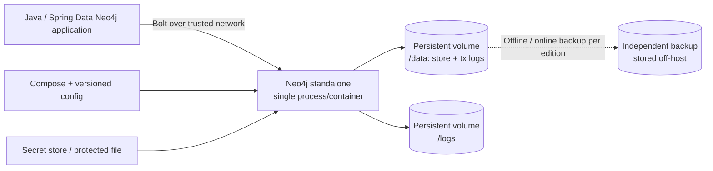

# Deploying a Single Neo4j Server with Persistent Storage and Reproducible Configuration

While learning Cypher, developers often run Neo4j on a personal machine and accept wiping data when shutting down the environment. However, when Neo4j serves a Java application, **nodes, relationships, indexes, constraints, accounts, configuration, and logs** must be managed with clear expectations: containers may be recreated, hosts may reboot, software needs upgrades, and the system must recover after data loss.

This lesson guides you through deploying **a standalone Neo4j server** according to three principles:

1. **Data is persisted** on storage independent of the container/process lifecycle.
2. **Deployment configuration is defined as code** (e.g., Docker Compose), version-controlled, and reproducible on a new host.
3. **Recovery is verifiable** through backups, restores, monitoring, and operational procedures — never treating a volume as a backup.

This lesson belongs to the **Deployment** chapter of the **DATABASE_ENGINE_GRAPH_NEO4J** module. Throughout the module, Neo4j is used to model property graphs, query nodes/relationships and paths with Cypher, use indexes/constraints, optimize queries, import data, use Java Driver and Spring Data Neo4j, and operate the graph system. Proper deployment is the foundation for using those techniques safely outside a learning environment.

After this lesson, you will be able to design a storage layout, author a version-pinned Compose manifest, manage secrets separately, test persistence across container recreation, plan backup/restore, troubleshoot basic operational issues, and understand the **limits of a single-server model**.

> **Example scope:** The main guide uses Docker Engine and Docker Compose v2 on a Linux host with Neo4j Community Edition. The image `neo4j:2026.10.2` is **an example of a specific version** documented by Neo4j at the time of writing, not a requirement to use that version forever. Choose a version/edition tested with your application; adjust syntax, resource requirements, and permissions for your actual environment. Linux shell commands may not run verbatim on Windows PowerShell.

## 1. When Is the Standalone Model Appropriate?

A standalone Neo4j deployment is **a single database instance on a single server**. Applications can connect to that instance via Bolt; administrators can use Neo4j Browser or `cypher-shell`. This configuration is well suited for:

- Learning, development, or integration testing environments.
- Internal systems with moderate traffic that can tolerate a maintenance downtime window.
- Graph workloads that can be restored from backup or rebuilt from an authoritative source.
- Early product stages where HA (high availability) requirements do not yet justify a cluster.

Logical diagram:



**Core limitation:** a single server is a **single point of failure**. If the host, disk, kernel, or process stops, the application can lose connectivity. `restart: unless-stopped` only **restarts the container under certain conditions**; it does not create synchronous replicas, perform automatic primary failover, or guarantee continuous service when the host fails.

| Criterion | Standalone | Cluster/HA |
| --- | --- | --- |
| Number of instances | One | Multiple members per supported topology |
| Configuration/operations | Simpler | More complex; requires networking/quorum/operations |
| Host failure | Causes downtime | Can reduce downtime when properly configured |
| Protection against accidental deletion | Still requires backups | **Still requires backups** |
| Recoverability | Restore/rebuild on a new host | Depends on HA mechanisms and backups |
| Suitability for learning | Very suitable | Unnecessary for many hands-on exercises |

**Do not confuse availability with durability:** data remaining on disk after a container crashes (*durability*) does not mean the application can still query while the server is down (*availability*).

## 2. Define Operational Targets Before Configuring

Before running commands, establish the deployment assumptions.

| Question | Example Decision | Why It Matters |
| --- | --- | --- |
| Is Neo4j the system of record or a read replica of another source? | Neo4j stores a relationship network edited directly by users | Losing the graph may be impossible to rebuild solely via re-import |
| Current data size and growth rate? | 20 GB currently, growing 3 GB/month | SSD sizing, backups, headroom for recovery |
| How much downtime is acceptable? | 1 hour during upgrades | Determines whether standalone is acceptable or HA is needed |
| Maximum acceptable data loss window? | 24 hours or 15 minutes | Determines backup frequency and type |
| Who has Bolt access? | One API inside a private network | Firewall, TLS, and account design |
| Who manages secrets? | Organization secret manager | Avoids passwords in Git/manifests |
| Are APOC/GDS plugins needed? | Not needed for initial release | Avoid installing unneeded plugins |
| How to recover if the host is completely lost? | Off-host backups + manifest | Realistic RTO testing |

Two operational terms:

- **RPO (*Recovery Point Objective*):** the maximum acceptable data loss in a disaster scenario, e.g., at most 1 hour of committed transactions. A once-daily backup does not satisfy a 1-hour RPO.
- **RTO (*Recovery Time Objective*):** the target time to restore service, including provisioning a host, configuring, restoring the store, verifying, and reconnecting applications.

RPO/RTO cannot be achieved simply by adding `restart: always`. You need backups, independent replicas if HA is required, restoration capability, and drills.

## 3. Distinguish Data, Configuration, Logs, and Backups

In the official Docker image, the key mount points are:

| Container Path | Content / Meaning | Recommended Policy |
| --- | --- | --- |
| `/data` | Graph store, database metadata, and transaction logs by default | **Must mount persistent storage** |
| `/logs` | Neo4j logs for diagnostics | Mount separately or forward to centralized logging |
| `/conf` | Neo4j and logging configuration files | Mount only when managing full config files |
| `/plugins` | Plugins/extensions like APOC, GDS if permitted | Pin versions, control source and licensing |
| `/import` | CSV sources for data import | Can be mounted read-only with restricted access |
| `/ssl` | Certificates/keys for TLS | Read-only, least-privilege permissions |
| `/metrics` | Certain metrics outputs depending on edition/config | Ensure collection path/retention |
| `/backups` | **A path you choose** when running backups | Backups must be stored off-host or outside the failure domain |

### What does `/data` contain?

Neo4j maintains files storing nodes/relationships/indexes, the system database, and **transaction logs** to recover committed changes. By default, transaction logs live under Neo4j's data tree, e.g., `/data/transactions/<database>`.

When a volume is mounted at `/data`, data remains in that volume across container replacements, provided the volume and its contents are not deleted or corrupted. However:

- If the host disk fails, a volume on that disk is also lost.
- If the wrong volume is mounted after replacing the container, the system may appear as a **new empty database**.
- If data is copied arbitrarily with `cp -r` or `rsync` while writes are occurring, the copy may be inconsistent.
- If required transaction logs are deleted manually, recovery capability can be destroyed.
- A raw disk snapshot does not automatically equate to a restore-tested backup.

**Do not delete files in `/data/transactions` to free disk space.** Neo4j manages checkpointing and retention/pruning via configuration. Manual log deletion is an unsupported operation.

### `/logs` is not recovery transaction logs

Files in `/logs` record server activity, queries, or errors depending on configuration. Internal **transaction logs** ensuring crash recovery are a separate structure. Never substitute the observability log directory for a backup.

### Named volumes vs. bind mounts

| Type | Example | Advantages | Notes |
| --- | --- | --- | --- |
| **Docker named volume** | `neo4j_standalone_data:/data` | Docker manages path and volume lifecycle separately from container | Does not automatically move data to another host; manage backups and volume names |
| **Bind mount** | `/srv/neo4j/data:/data` | Easy to locate files on host; fits dedicated disk policies | Must handle UID/GID permissions, SELinux/AppArmor, and paths |
| **Container writable layer** | No `/data` mount | Fast for temporary demos | Data can be lost when container is removed/recreated |

This lesson uses **named volumes** to minimize path errors and focus on storage concepts. In production, the choice of volume type/filesystem/SSD must be validated for durability, latency, IOPS, and infrastructure support; do not assume every NFS or network share is suitable for a Neo4j store.

## 4. What Makes a Deployment "Reproducible"?

"Reproducible deployment" is often misunderstood as "copying one Compose file brings back the entire system." In reality, distinguish:

| Component | Reproducible from config code? | Needs a separate plan? |
| --- | --- | --- |
| Neo4j image | Yes, if tag/digest is pinned and registry is known | Verify availability and supply chain |
| Ports, memory, restart policy | Yes, via Compose/config | Verify in target environment |
| Network and volume declarations | Declarations only | **Volume contents do not appear automatically** |
| Passwords and private keys | **Should not** be stored in Git | Secret manager/identity |
| Indexes/constraints and schema migrations | Yes, if migration scripts are versioned | Manage ordering and compatibility |
| Accumulated graph data | Cannot be derived from Compose alone | Backup/restore or re-import from source of truth |
| Accounts/roles in system database | Not just a YAML variable | System DB backup or privilege recreation process |
| Plugins | Yes, if versions and install steps are pinned | Licensing, compatibility |
| Monitoring and backup schedules | Can be IaC/automation | Endpoints, secrets, and external storage |

A system can **recreate its runtime environment** in minutes yet take hours to restore 500 GB of data. Therefore, reproducibility and recoverability must be designed together.

### Pin versions: do not use `latest` for real systems

```yaml
# Avoid for environments requiring reproducibility:
image: neo4j:latest

# Better example: specify the exact tested release:
image: neo4j:2026.10.2
```

A specific version tag reduces the risk of Neo4j changing unexpectedly on `docker compose pull`. If an organization requires **byte-for-byte image** reproducibility, you can also pin the **actual SHA-256 digest verified from the registry** per policy; never invent a digest.

Do not upgrade a database by blindly changing the tag. Neo4j has requirements for store formats, upgrade order, plugin compatibility, and rollback capabilities. Every version change requires reading the corresponding migration/upgrade guide.

## 5. Preparing the Linux Host

Assume a dedicated Linux host for Neo4j with Docker Engine, Docker Compose plugin, and an account authorized to manage Docker.

Illustrative directory structure:

```text
neo4j-standalone/
├── compose.yaml                   # Committed to Git
├── .gitignore                     # Committed to Git
├── secrets/
│   └── neo4j_auth.txt             # NOT committed, contains real secret
└── docs/
    └── restore-runbook.md         # Can be managed in operations repository
```

With named volumes, actual data **does not live** in the project directory as a `data` folder you can copy casually. Docker manages the volume independently.

Prerequisites:

1. Select a host/VM with sufficient CPU, RAM, IOPS, and spare disk capacity.
2. Store data on a supported filesystem and storage backend resilient to power loss.
3. Configure firewall rules: open Bolt `7687` and HTTP Browser `7474` only to the required scope.
4. Synchronize system time (NTP) so logs and operational timestamps are reliable.
5. Have an **off-host** backup mechanism and protected backup storage.
6. Have OS/container restart, security patching, and disk-usage monitoring policies.
7. Define RPO/RTO and how to provision a new host during an incident.

**Docker daemon access grants very high host privileges.** Do not add users to the `docker` group if they are not authorized to administer the server.

### Neo4j write permissions inside the container

The Neo4j Docker image defaults to user `neo4j` with UID 7474 in many current releases. With bind mounts, if the host directory does not allow this user to read/write, Neo4j may fail to start or the entrypoint may need to adjust ownership. With named volumes, Docker handles initialization more smoothly, though permissions should still be verified.

Never fix permission errors with `chmod -R 777` on data or running the container with `--privileged`. Use appropriate owner/group/ACL settings or create volumes per official documentation.

## 6. Separating Secrets from Deployment Files

Neo4j supports declaring bootstrap authentication via `NEO4J_AUTH`. Writing `NEO4J_AUTH=neo4j/password` directly into Compose risks exposing passwords in Git, shared files, or inspect outputs.

With Docker Compose, Neo4j documentation describes using a **Docker secret file** and the `NEO4J_AUTH_FILE` variable.

Create a file **that exists only on the deployment host**, formatted as:

```text
neo4j/<securely-provisioned-initial-password>
```

The line above is a **format placeholder**, not a real password. Generate a sufficiently strong value using a secret management tool; do not paste production passwords into shell history or public documents. You can create the file using a secret manager or a protected editor rather than shell commands that put passwords in command arguments.

File permissions:

```bash
mkdir -p secrets
chmod 700 secrets

# Create secrets/neo4j_auth.txt via your organization's secret provisioning process.
# Never write real passwords in example commands or source control.
chmod 600 secrets/neo4j_auth.txt
```

Example `.gitignore`:

```gitignore
secrets/
*.secret
*.key
.env
.env.*
!.env.example
```

**Warning:** Host-file-based Docker Compose secrets do not automatically encrypt passwords on disk. Protect the host, file read permissions, Docker daemon, and secret backups. For cloud/production environments, consider an appropriate secret manager/KMS.

### Why `NEO4J_AUTH_FILE` is not a complete rotation mechanism

It is a way to **supply credentials for image initialization**. Once Neo4j already has data and accounts in the system database, changing the secret file and restarting the container **does not automatically change existing database passwords**. Rotation requires using proper Neo4j administrative commands and updating all clients, not merely editing the file.

## 7. Minimal Yet Reproducible `compose.yaml`

Complete example running **one Neo4j Community Edition** instance:

```yaml
name: neo4j-standalone

services:
  neo4j:
    image: neo4j:2026.10.2
    restart: unless-stopped
    stop_grace_period: 2m

    ports:
      - "127.0.0.1:7474:7474"
      - "127.0.0.1:7687:7687"

    environment:
      NEO4J_AUTH_FILE: /run/secrets/neo4j_auth
      NEO4J_server_memory_heap_initial__size: "1G"
      NEO4J_server_memory_heap_max__size: "1G"
      NEO4J_server_memory_pagecache_size: "1G"

    volumes:
      - graph_data:/data
      - graph_logs:/logs

    secrets:
      - neo4j_auth

secrets:
  neo4j_auth:
    file: ./secrets/neo4j_auth.txt

volumes:
  graph_data:
    name: neo4j_standalone_data
  graph_logs:
    name: neo4j_standalone_logs
```

### Explaining Each Section

| Item | Purpose | Notes |
| --- | --- | --- |
| `name: neo4j-standalone` | Sets the Compose project name | Not the database name |
| `image: neo4j:2026.10.2` | Pins a specific Neo4j release | Pin digest if strict policy requires |
| `restart: unless-stopped` | Auto-restarts per Docker policy | Does not provide HA if host fails |
| `stop_grace_period: 2m` | Gives the process time for graceful shutdown | Tune for actual workload/checkpointing |
| `127.0.0.1:7474:7474` | Browser/HTTP listens only on host loopback | Not publicly exposed by default |
| `127.0.0.1:7687:7687` | Bolt published only on host loopback | Remote clients need designed network/SSH/VPN |
| `NEO4J_AUTH_FILE` | Reads initial credentials from secret file | Not automatic password rotation |
| `NEO4J_server_memory_heap_initial__size` | Configures initial heap | `__` represents a single underscore in setting name |
| `NEO4J_server_memory_heap_max__size` | Limits heap | Account for page cache and overhead too |
| `NEO4J_server_memory_pagecache_size` | Page cache size | Separate memory region from heap |
| `graph_data:/data` | Preserves graph store across container replacement | Most critical for durability |
| `graph_logs:/logs` | Keeps logs outside container | Manage rotation/retention |
| `secrets` | Provides secret file to container | Protect source file on host |
| `name: neo4j_standalone_data` | Fixes the Docker volume name | Helps accurately identify volume during backup |

**Intentional access restriction:** `127.0.0.1:7687:7687` allows applications running **on the same host** to connect. If the application is another container in the same Compose network, it can connect via `bolt://neo4j:7687` over the internal Docker network without publishing Bolt to the entire Internet. If applications run outside the host, design private networking/VPN, firewalls, TLS certificates, and privileges; **do not simply change it to `0.0.0.0:7687:7687` and open it to the Internet**.

### Memory Numbers Are Examples Only

1 GiB heap and 1 GiB page cache illustrate a setup on a host with extra RAM for the OS, native memory, and transactions. **Do not apply verbatim to production.** For large graphs, measure store/index sizes, hot working sets, concurrent transactions, and footprints of other processes.

In the Docker image, defaults may optimize for testing multiple containers rather than production. Always size and monitor before increasing load.

## 8. Translating Neo4j Setting Names to Docker Variables

In `neo4j.conf`, setting names contain dots and sometimes underscores; in Docker environment variables, Neo4j applies this rule:

1. Add the `NEO4J_` prefix.
2. Replace dots `.` with single underscores `_`.
3. Replace underscores `_` in the original setting name with **double underscores `__`**.

Examples:

| Neo4j Setting | Docker Variable |
| --- | --- |
| `server.memory.heap.initial_size` | `NEO4J_server_memory_heap_initial__size` |
| `server.memory.heap.max_size` | `NEO4J_server_memory_heap_max__size` |
| `server.memory.pagecache.size` | `NEO4J_server_memory_pagecache_size` |
| `server.default_listen_address` | `NEO4J_server_default__listen__address` |
| `db.tx_log.rotation.size` | `NEO4J_db_tx__log_rotation_size` |

**Common mistake:** `NEO4J_server_memory_heap_max_size` is not equivalent to `NEO4J_server_memory_heap_max__size`. Missing one underscore can cause the setting to be ignored or the container to fail on startup.

When configuring many complex settings or Log4j XML, you can version-control `neo4j.conf` and mount `/conf` appropriately. However, mounting `/conf` can **override default configs inside the image**; ensure all required files, read permissions, and upgrade compatibility are maintained. For a minimal deployment, environment variables are cleaner and easier to track.

### Dynamic Settings and Configuration Drift

Some Neo4j settings can be changed at runtime, but dynamic changes **do not automatically update** Compose/`neo4j.conf`. After a restart, the system reverts to the declared configuration.

Therefore, **authoritative configuration must be updated in version control** once an approved dynamic change is validated. Do not tweak runtime settings manually and assume a newly built server will match the old one.

## 9. Starting and Verifying

In the directory containing `compose.yaml`, prepare the secret file per section 6, then run:

```bash
# Validate the Compose file syntax and structure.
docker compose config --quiet

# Pull the image for the selected tag.
docker compose pull

# Start a single Neo4j instance.
docker compose up -d

# Check service/container status and recent logs.
docker compose ps
docker compose logs --tail=100 neo4j
```

`docker compose config` validates and renders the Compose configuration; if your env includes secrets, **be careful not to dump the full rendered output into CI logs**. In this example, Compose only holds a secret file reference path, not a literal password in env.

**Do not treat `docker compose ps` showing `running` as proof the database is ready for queries.** Neo4j needs time to boot, recover transaction logs, initialize databases, and open Bolt.

### Verify via cypher-shell

```bash
docker compose exec neo4j cypher-shell -u neo4j -d neo4j
```

Log in using the provisioned test credentials via an interactive prompt; **do not pass passwords as command-line arguments** if shell history, process listings, or logs might record them.

Once inside `cypher-shell`, run:

```cypher
RETURN 1 AS ready;
```

Verify the database is online with appropriate privileges:

```cypher
SHOW DATABASES
YIELD name, currentStatus
RETURN name, currentStatus
ORDER BY name;
```

If using Community Edition without advanced administration features, verify against the current version/roles; an account without sufficient administrative privileges may not be able to view all databases or settings.

### Verify Effective Settings

```cypher
SHOW SETTINGS
YIELD name, value
WHERE name IN [
  'server.memory.heap.initial_size',
  'server.memory.heap.max_size',
  'server.memory.pagecache.size'
]
RETURN name, value
ORDER BY name;
```

Verify effective runtime settings rather than assuming every environment variable in Compose was accepted by Neo4j. If warnings appear about renamed/deprecated settings, update the config for your version rather than arbitrarily disabling validation.

### Verify Applications Connect to the Right Target

- Same host: `bolt://localhost:7687` for demos.
- App container in the same Compose network: `bolt://neo4j:7687`.
- Remote environment: a URI matching TLS, hostname, and topology, usually `bolt+s://` or `neo4j+s://` once the server is configured with valid certificates.

**Do not send passwords over unencrypted HTTP Browser on untrusted networks.** Port `7474` in the example binds only to loopback to avoid default exposure.

## 10. Proving Storage Persistence via Container Recreation Test

A proper test is not just **restarting the process**, but **replacing the container while keeping the volume**. Practice this on a database dedicated to the lesson.

### 10.1. Create a marker in the graph

After logging into Neo4j via `cypher-shell` or Neo4j Browser:

```cypher
MERGE (p:DeploymentProbe {probeId: 'persist-demo-001'})
ON CREATE SET p.createdAt = datetime()
RETURN p.probeId AS probeId, p.createdAt AS createdAt;
```

Record `createdAt`. This is only a test probe node in a test environment; do not share labels/keys with business data.

### 10.2. Stop and recreate the container

```bash
# This stops and removes the Compose container/network;
# by default it does NOT remove named volumes.
docker compose down

# Recreate from the same compose.yaml + same named volumes.
docker compose up -d

# Check status and logs.
docker compose ps
docker compose logs --tail=100 neo4j
```

**Do not add `-v`** to `docker compose down` in this test. `down -v` deletes Compose-managed named volumes and causes **unrecoverable data loss if no backup exists**.

### 10.3. Verify the marker still exists

Reconnect and run:

```cypher
MATCH (p:DeploymentProbe {probeId: 'persist-demo-001'})
RETURN p.probeId AS probeId,
       p.createdAt AS createdAt;
```

If the marker and original creation timestamp remain, the deployment has proven **data survives container recreation with the same volume**.

What this test **has NOT proven**:

- Whether a backup can be restored on a new host.
- Whether data survives **failure of the disk holding the volume**.
- Whether the store remains compatible across a major image upgrade.
- Whether the system has HA when the host disappears.
- Whether all credentials/roles and plugins are recreated from the manifest.

That is why a separate restore drill is required.

## 11. Docker Operations That Easily Cause Accidental Data Loss

| Command or Action | Basic Expectation | Risk to Check |
| --- | --- | --- |
| `docker compose stop` | Stops container, keeps container/volume | Service stops; applications lose access |
| `docker compose start` | Starts an existing created container | Does not apply Compose changes like a recreate |
| `docker compose restart` | Restarts existing container | Not the proper way to apply new image/config |
| `docker compose up -d` | Reconciles container with Compose | May recreate on image/config changes; needs right volume |
| `docker compose down` | Removes project containers/networks | Keeps named volumes by default, but service stops |
| `docker compose down -v` | **Removes associated volumes too** | **Can permanently delete graph data** |
| `docker volume rm ...` | Removes specified named volume | Loses store if targeting the data volume |
| `docker system prune --volumes` | Cleans resources/volumes per Docker rules | Risk of deleting unattached volumes |
| Renaming volume in Compose | Container may mount a different empty volume | Easily mistaken for data loss |
| Changing image tag without upgrade review | Engine changes; store format may change | Requires backup and migration process |

**Never run volume cleanup commands** on a host running Neo4j without verifying exact volumes to retain and backup status.

### Inspect Volumes Before Making Changes

```bash
docker volume ls
docker volume inspect neo4j_standalone_data
docker volume inspect neo4j_standalone_logs
```

`docker volume inspect` shows metadata/mount path, **not whether the data inside has been backed up**. With Docker Desktop, the physical path of a named volume may reside inside a Docker-managed VM and not be directly browsable like a normal host folder.

## 12. Persistent Storage Is Not Backup or Disaster Recovery

A persistent volume survives the container lifecycle, yet still shares a failure domain with its host/storage. If data is wiped by an accidental `DETACH DELETE`, the volume **faithfully persists the deletion**.

Distinction:

| Mechanism | What does it protect? | What does it NOT solve? |
| --- | --- | --- |
| Named volume `/data` | Keeps store across container recreation | Disk/host failure, accidental deletion, corruption, ransomware |
| Transaction log + crash recovery | Recovers committed transactions in many crash scenarios | Does not replace off-host backups |
| Checkpoint | Reduces transaction log replay needed on recovery | Not an independent copy |
| Offline `dump` backup | Creates a recovery artifact while database is stopped | Requires downtime and backup scheduling |
| Enterprise online backup | Backs up while database is running per edition capabilities | Still requires privileges, storage, schedule, and restore tests |
| Copying data to off-host storage | Reduces single-host/disk failure risk | Needs secret protection, consistency checks, and restore testing |
| Cluster/replication | Improves availability when a member fails | Does not fully protect against logical accidental deletion |

### 12.1. Neo4j transaction logs and checkpoints

Neo4j uses transaction logs to record changes and support crash recovery. Checkpointing flushes required changes to store files and establishes recovery points. Retention/pruning is managed by Neo4j and configurable; **never delete log files manually** to shrink `/data`.

A full disk can prevent Neo4j from processing writes even while the container remains `running`. Monitor store, indexes, transaction logs, observability logs, and backup storage.

### 12.2. Backups must live outside the failure domain

A `/backups` directory on the **same disk as `/data`** helps for local file operations but **offers zero protection if that disk fails**. After creating a backup, transfer/sync it to independent storage with access controls, versioning, and retention; test restores in an isolated environment.

### 12.3. Backups must be designed around RPO/RTO

If an application has a 15-minute RPO, nightly offline backups do not meet the requirement. You must evaluate edition features, online/differential backups, or source-data designs enabling rebuilds; upgrading architecture/edition may be necessary.

RTO also depends on data size: restoring 500 GB from remote storage takes far longer than restarting a container.

## 13. Offline Backup with Community Edition: Controlled Example

Neo4j Community Edition supports `neo4j-admin database dump` for **offline databases**. This command produces a `.dump` archive that can be loaded into a compatible recovery environment. Enterprise Edition additionally offers online backup (`neo4j-admin database backup`).

**Before proceeding:** confirm this is a practice database, downtime is communicated, enough backup space exists, and no other container is writing to the same volume.

### 13.1. Stop the database

```bash
docker compose stop neo4j
```

In this approach, the container stops completely so no database process writes to `/data`. The dump runs inside a separate utility container.

### 13.2. Create a temporary backup volume

```bash
docker volume create neo4j_standalone_backups
```

This volume is only the initial landing target for the backup. Afterward, you **must transfer the artifact to off-host storage** per policy.

### 13.3. Dump the database using the matching neo4j-admin image

```bash
docker run --rm \
  --volume neo4j_standalone_data:/data \
  --volume neo4j_standalone_backups:/backups \
  neo4j/neo4j-admin:2026.10.2 \
  neo4j-admin database dump neo4j --to-path=/backups
```

Explanation:

- `neo4j_standalone_data` must be the **actual volume holding the database** in the example Compose.
- `neo4j_standalone_backups` receives the dump file.
- `neo4j/neo4j-admin:2026.10.2` is the utility image matching the example release.
- The trailing `neo4j` is the **database name**, not the container name.
- Runs while the database is **offline**; do not mix with an application still writing to the graph.

If the application uses a database named something other than `neo4j`, specify that exact name. When processes also require **identities and privileges**, manage backups or recreation of the **system database** along with corresponding configs/secrets. A dump of a user database does not automatically include user/role metadata.

### 13.4. Restart and confirm

```bash
docker compose start neo4j
docker compose ps
docker compose logs --tail=100 neo4j
```

Reconnect to verify the database is online. Inspect dump command output, artifact count, file size, and integrity using supported tools. Do not treat exit code 0 as a **substitute** for a test restore.

### Limitations of the dump workflow

While the database is stopped, the API cannot serve queries. If the product cannot tolerate a backup downtime window, evaluate **online backup in Enterprise Edition** or a different service architecture.

Never use `cp -r` on `/data` of a running database as a "quick backup." A point-in-time file copy may lack consistent checkpoints/transaction logs.

## 14. Restoring Backups: Testing on Isolated Data

A **restore drill** is practical proof that a backup works when needed. Never practice overwrite-destination commands on a production volume.

A test procedure:

1. Fetch an existing backup, checking its origin and checksum if policy requires.
2. Prepare a **new recovery volume** and a separate host/Compose project to avoid mixing with production.
3. Choose a utility image compatible with the dump format.
4. Load data into the **new volume**, without overwriting production data.
5. Start **an isolated Neo4j test instance** using appropriate test ports and credentials.
6. Run node/relationship/schema checks and several critical business Cypher queries.
7. Verify connectivity using Java Driver/Spring Data Neo4j.
8. Record recovery duration, configuration issues, and missing steps in the runbook.

Example creating a new volume and loading the dump:

```bash
docker volume create neo4j_restore_candidate

docker run --rm \
  --volume neo4j_restore_candidate:/data \
  --volume neo4j_standalone_backups:/backups \
  neo4j/neo4j-admin:2026.10.2 \
  neo4j-admin database load neo4j --from-path=/backups
```

**Note:** the command above only **loads data into the recovery volume**. To prove the restore succeeded, you need a **separate Neo4j test instance** pointing `/data` at `neo4j_restore_candidate`, start it, and verify via Cypher. Never point two Neo4j processes simultaneously at the **same data volume**: this risks file locking and data corruption.

If backups include `system` or databases with custom users/roles, test restoring identities, privileges, and passwords accordingly. A fresh instance with newly loaded data does not automatically inherit the security setup of the old host.

### Verifying the graph after restore

Example Cypher checks:

```cypher
MATCH (p:DeploymentProbe {probeId: 'persist-demo-001'})
RETURN p.probeId AS probeId,
       p.createdAt AS createdAt;
```

```cypher
SHOW CONSTRAINTS
YIELD name, type, labelsOrTypes, properties
RETURN name, type, labelsOrTypes, properties
ORDER BY name;
```

```cypher
MATCH (c:Customer)-[r:PLACED]->(o:Order)
RETURN count(r) AS totalPlacedRelationships;
```

Do not rely on a single `count(*)` to conclude a backup is intact. Verify business identifiers, key properties, relationship directions, constraints, privileges, and representative queries.

## 15. Controlled Upgrades and Reproducibility

Upgrading Neo4j must be treated as a **data and software change**, not merely editing one line of YAML.

### 15.1. Upgrade plan

1. Record current image, driver, Spring Data Neo4j, plugin, and store versions.
2. Read the release-specific upgrade/migration guide, especially across major versions or release lines.
3. Verify compatibility of APOC, GDS, and custom procedures.
4. Take a restore-tested backup before making changes.
5. Restore a data copy **in staging** and test the upgrade first.
6. Check renamed/deprecated settings and Cypher behavior changes affecting the application.
7. Schedule a maintenance window; update image/config via reviewed manifests.
8. Monitor startup/recovery, logs, query latency, data, and driver connections.
9. If errors occur, execute the rehearsed **compatible recovery procedure**.

**Do not assume reverting to the old image tag is a safe rollback.** A database opened and upgraded by a new version may no longer be compatible with the older version. Rollback may require **restoring the pre-upgrade backup**.

### 15.2. Avoiding configuration drift

What to commit to Git:

- `compose.yaml` or equivalent IaC.
- **Non-sensitive** config variables, database names, resource requests.
- Approved image and plugin versions.
- Schema migrations (indexes, constraints, reproducible seed data).
- Backup/restore runbooks and post-deploy checks.

What **NOT** to commit:

- Neo4j passwords, private keys, secret tokens.
- Dumps/backups containing real data.
- Logs with personal data or sensitive query parameters.
- Runtime-generated config files containing credentials.

Use code review and pipelines to compare approved manifests against live deployments, preventing operators from patching containers manually without updating the source of truth.

### 15.3. Why versioning schema migrations matters

Recreating a container does not automatically recreate a new business index added manually:

```cypher
CREATE CONSTRAINT customer_business_key IF NOT EXISTS
FOR (c:Customer)
REQUIRE c.customerId IS UNIQUE;
```

This statement should live in a versioned migration, executed in a controlled manner with appropriate schema privileges. If the database is restored, the constraint may already exist in the backup; migrations must be **state-aware** to avoid duplicates or data damage.

Do not unconditionally run a batch of `DROP INDEX`/`CREATE CONSTRAINT` statements on every container start. Separate **server startup** from **business schema changes**.

## 16. Connecting Java Driver and Spring Data Neo4j to the Right Topology

With the example Compose file, the host publishes Bolt only on loopback, so a Java app running **on the same host** can use:

```java
import org.neo4j.driver.AuthTokens;
import org.neo4j.driver.Driver;
import org.neo4j.driver.GraphDatabase;

String uri = System.getenv("NEO4J_URI");
String user = System.getenv("NEO4J_USERNAME");
String password = System.getenv("NEO4J_PASSWORD");

try (Driver driver = GraphDatabase.driver(
        uri, AuthTokens.basic(user, password))) {
    driver.verifyConnectivity();
}
```

The example assumes environment variables are supplied and non-null. For production, validate configuration at application startup and never log passwords. `Driver` should generally be managed over the service lifecycle using its shared connection pool; do not create a new Driver per request.

With Spring Boot/Spring Data Neo4j, configuration can look like:

```yaml
spring:
  neo4j:
    uri: ${NEO4J_URI}
    authentication:
      username: ${NEO4J_USERNAME}
      password: ${NEO4J_PASSWORD}
  data:
    neo4j:
      database: ${NEO4J_DATABASE:neo4j}
```

The placeholders `${NEO4J_URI}`, `${NEO4J_USERNAME}`, and `${NEO4J_PASSWORD}` are resolved by Spring Boot from environment configuration at runtime. Passwords must be injected from a secret manager/environment variable, never hard-coded in `application.yml`.

### If the application also runs in Docker Compose

Within the same Compose network, the app can connect using the service name:

```text
bolt://neo4j:7687
```

Host-published ports do not need to be opened publicly for containers on the same network. However, an internal Compose network alone does not satisfy all security needs: you still need username/password, proper privileges, TLS over untrusted links, and connection limits.

### When is `neo4j+s://` needed?

For access from hosts/applications on other networks, configure TLS with trusted server certificates and use the appropriate URI. **Do not blindly switch from `bolt://` to `neo4j+s://` without enabling/verifying TLS on Neo4j**; certificate validation or handshake errors will occur.

## 17. Operations: Memory, Disk, Logs, and Downtime

### 17.1. Balancing heap, page cache, and OS

Neo4j uses:

- **JVM heap:** objects and transaction/query state.
- **Page cache:** memory region mapping store files and structures for fast reads.
- **Native/off-heap and kernel memory:** outside heap/page cache.
- **OS memory:** for the operating system, Docker, and other processes.

For example, a host with 8 GiB RAM **should not** allocate 7 GiB heap and 3 GiB page cache. Overcommitting memory leads to OOM kills or heavy swapping. Profile the workload and leave sufficient **headroom**.

```yaml
environment:
  NEO4J_server_memory_heap_initial__size: "1G"
  NEO4J_server_memory_heap_max__size: "1G"
  NEO4J_server_memory_pagecache_size: "1G"
```

These values are illustrative, not standard production thresholds.

### 17.2. Storage health

Monitor:

- Free space on the filesystem/volume.
- Growth rate of store, indexes, and transaction logs.
- Disk latency/IOPS/throughput.
- Page cache hit/miss ratio and page faults.
- Checkpoint duration and startup recovery time.
- I/O errors, read-only storage, filesystem corruption.
- Backup file growth and log retention.

If `/data` fills up, do not "quick fix" it by deleting transaction logs. Evaluate expanding volume capacity, supported retention policies, and root causes of data growth.

### 17.3. Logs and readiness

`docker compose logs` is useful at startup, but logs may only reflect container stdout/stderr rather than all database log files. When `/logs` is mounted, manage log rotation and retention; do not let logs fill the disk.

Set up minimal monitoring covering:

| Signal | Purpose |
| --- | --- |
| Is the container/process running? | Detect crashes/restarts |
| Does `RETURN 1` over Bolt succeed? | Verify database is actually ready |
| p95/p99 latency of graph APIs | Measure user experience |
| CPU/heap/GC/page cache | Analyze load and memory |
| Storage free/inodes/I/O | Prevent write failures |
| Open/blocked transaction count | Detect locks or long-running queries |
| Backup success rate and backup age | Ensure data is recoverable |
| Time since last restore drill | Prevent untested "file exists" backups |

**Liveness** (process running) is not **readiness** (database ready to execute Cypher), and neither is **durability** or recoverability.

## 18. A Single Server Requires Defense in Depth

| Layer | Required Actions |
| --- | --- |
| **Host** | Patch OS/Docker, restrict SSH accounts, firewall, audit |
| **Network** | Do not expose `7687`/`7474` to the Internet by default; prefer private connectivity |
| **Neo4j auth** | Strong user/password, dedicated app accounts, least privilege |
| **Secrets** | Never commit; inject at runtime, rotate and revoke |
| **TLS** | Verify hostname and CA when connecting over untrusted networks |
| **Volumes** | Least-privilege permissions, encryption at rest if needed, do not mount entire host filesystem |
| **Backups** | Encrypt and restrict access; dump artifacts contain real data |
| **Plugins** | Install only approved plugins, pin versions, review permissions |
| **Operations** | Audit restarts, restores, image changes, and user/role changes |

A common vulnerability is exposing Bolt directly to the Internet while keeping default passwords. In real deployments, **never use `NEO4J_AUTH=none`** for databases holding protected data.

If the application is multi-tenant, Neo4j roles/labels or business-layer filters must be deliberately designed; an application account having read access to the database must not allow tenants to read each other's subgraphs.

## 19. Common Incidents and Triage Workflow

| Symptom | Possible Cause | How to Check |
| --- | --- | --- |
| Container starts but Neo4j is not ready | Database recovering, bad config, insufficient RAM | `docker compose logs`, Bolt readiness |
| Container has same name but data is empty | Mounted different volume or volume was deleted | `docker volume ls/inspect`, current Compose, backups |
| Permission denied on `/data` or `/logs` | Wrong bind-mount UID/GID/ACL | Check owner, volume, and mount permissions |
| Cannot connect from another machine | Bound only to `127.0.0.1` or blocked by firewall | Check topology; never open publicly recklessly |
| Neo4j runs but API gets auth errors | Bootstrap password differs from actual credential, user/role changed | Check accounts and secret rotation |
| Neo4j fails to open store after image change | Version/format incompatibility, plugin, or config issue | Logs/migration guide, test restore |
| Server stops suddenly due to OOM | Heap+page cache+native exceeded host/container limit | RAM metrics, kernel OOM logs |
| Disk grows rapidly | Large graph/indexes, transaction log retention, or logs/backups | Inspect size per area; do not delete tx logs manually |
| Backup file exists but restore fails | Incompatible version/tool, corrupt artifact, missing system DB | Restore drill on another volume |
| Database restores but accounts are wrong | Bootstrap secret is not actual account or system DB not restored | Check identity recovery procedure |
| `docker compose up` creates unexpected fresh instance | Renamed volume/project or mount path | Compare manifest, identify volume ID |
| `docker compose down -v` was just run | Named volume was deleted | Stop further writes; recover from independent backup |

### 7-Step Runbook When a Host Is Lost

1. **Confirm scope:** lost process or lost host/volume? Is storage data intact?
2. **Freeze risky actions:** do not run `docker volume prune` or overwrite restores before triaging.
3. **Assess actual RPO/RTO:** latest backup, re-ingestable data volume, and recovery duration.
4. **Provision clean host:** Docker, permissions, network, storage, and monitoring.
5. **Rebuild config from Git/IaC:** pinned image, Compose, runtime secrets, schema/migration strategy.
6. **Restore from verified backup or attach intact volume if valid:** never let two Neo4j instances write to the same store.
7. **Verify graph and switch traffic:** Bolt readiness, accounts/roles, indexes, node/relationship counts, business queries; write post-mortem report.

## 20. Misconceptions to Avoid

| Misconception | More Accurate Truth |
| --- | --- |
| "Using Docker makes data automatically persistent." | Must mount `/data` to a proper volume and protect storage |
| "`restart: unless-stopped` provides HA." | It is only a single-container restart policy |
| "A named volume is a backup." | It stays in the host failure domain unless backed up externally |
| "Container stopped = data is definitely lost." | With proper volumes, data persists; loss usually involves removed writable layers or deleted volumes |
| "`docker compose down` and `down -v` are the same." | `-v` can delete critical data |
| "Committing Compose recreates the entire database." | You also need secrets, backups, migrations, and source data |
| "`image: latest` is always better because it stays updated." | Breaks reproducibility and can trigger unintended upgrades |
| "Changing `NEO4J_AUTH_FILE` rotates all passwords." | Bootstrap does not replace credential management in existing databases |
| "Copying live `/data` is a safe backup." | May lack consistent transaction logs/checkpoints |
| "Transaction logs can be deleted manually when disk is full." | Neo4j must manage retention/pruning itself |
| "Having a backup file means recovery works." | Must run a real restore test on an isolated instance |
| "Running `PROFILE` in production only inspects the plan." | `PROFILE` actually executes the query and can mutate data |
| "Just open port 7687 to the whole Internet." | Requires private networks, firewalls, auth, and TLS |
| "Runtime manual settings automatically sync back to Compose." | They may be lost on restart; update committed manifests/configs |
| "Rolling back an upgrade is just reverting the image tag." | Upgraded stores may require restoring a pre-upgrade backup |

## 21. Exercises and Self-Check Criteria

**Exercise 1 — Distinguish durability and HA.** A Neo4j container has a `/data` volume, a restart policy, and runs on a single VM. What happens when the container crashes? When the disk fails? When the entire VM is lost? Which design components enable recovery?

**Exercise 2 — Broken Compose.** Identify the problems in this configuration:

```yaml
services:
  neo4j:
    image: neo4j:latest
    environment:
      NEO4J_AUTH: "neo4j/password123"
    ports:
      - "7687:7687"
    restart: always
```

Propose fixes for persistent storage, separated secrets, pinned image, and restricted network access.

**Exercise 3 — Verify data persistence.** Create a `:DeploymentProbe` node with a key and creation timestamp, run `docker compose down` then `up -d`. What result proves the volume is being used correctly? Why must `down -v` not be used?

**Exercise 4 — Docker setting translation.** Convert `server.memory.heap.max_size`, `server.memory.pagecache.size`, and `db.tx_log.rotation.size` into Neo4j Docker environment variables. Explain why underscores in original setting names must be doubled.

**Exercise 5 — Backup.** With standalone Neo4j Community Edition, why must the database be offline to run `neo4j-admin database dump`? Why is writing the dump to the same disk as `/data` insufficient for disaster recovery?

**Exercise 6 — Restore drill.** Design a scenario using an isolated `neo4j_restore_candidate` volume to test loading a backup. List at least five checks covering nodes, relationships, schema, accounts, and Java queries before declaring the backup usable.

**Exercise 7 — Privileges.** An application only needs to read the graph over Bolt from a host on the same private network. Design the port binding, TLS, account, and secret setup. Why shouldn't the default admin user be used for every request?

**Exercise 8 — Upgrade.** A project currently runs Neo4j release A and wants to move to B. Create a plan covering staging copy testing, backups, plugin checks, image change, post-startup verification, and recovery if B is incompatible.

**Exercise 9 — RPO/RTO.** A system tolerates at most 30 minutes of data loss and 1 hour of downtime. Do nightly offline backups meet this? Explain the difference between a backup schedule and recovery requirements.

**Exercise 10 — Operations.** After a Docker Engine restart, the container is running yet the API reports database errors. Describe the diagnostic path from `docker compose ps`, logs, `RETURN 1`, URI configuration, and credentials to RAM/disk resources.

### Single-Server Deployment Checklist

- [ ] Defined RPO/RTO and documented acceptance of the **single point of failure**.
- [ ] Selected a supported Neo4j release/edition and **pinned the image**.
- [ ] Configured persistent storage at `/data`; verified volume name and access permissions.
- [ ] Defined log/metrics storage strategy and disk/I/O monitoring.
- [ ] Version-controlled Compose/IaC; never commit passwords, private keys, or real backups.
- [ ] Credentials provided via secret reference; auth and TLS controlled.
- [ ] Ports `7474`/`7687` open only to required networks.
- [ ] Memory heap/page cache sized and verified via effective runtime settings.
- [ ] Versioned schema migrations in place, independent of manual edits.
- [ ] Tested **container recreation** and verified probe node survival.
- [ ] Off-host backups aligned with RPO and successful **restore drill** completed.
- [ ] Documented upgrade/rollback, host-failure recovery, and account migration runbooks.
- [ ] Tested connectivity from Java Driver or Spring Data Neo4j with a business query.
- [ ] Configured alerts for process/Bolt availability, disk, memory, query latency, and backup age.

## 22. References

Use the references below to verify syntax and operations for your **deployed Neo4j version**:

- [Neo4j Operations Manual — Docker Compose standalone](https://neo4j.com/docs/operations-manual/current/docker/docker-compose-standalone/): standalone deployment, Docker Compose, secret files.
- [Neo4j Operations Manual — Docker volume mounts](https://neo4j.com/docs/operations-manual/current/docker/mounting-volumes/): `/data`, `/logs`, `/conf`, `/plugins`, and access permissions.
- [Neo4j Operations Manual — Docker configuration](https://neo4j.com/docs/operations-manual/current/docker/configuration/): environment variables and `/conf` mounts.
- [Neo4j Operations Manual — Docker env naming](https://neo4j.com/docs/operations-manual/current/docker/ref-settings/): converting dots and underscores in setting names.
- [Neo4j Operations Manual — Dump and load offline](https://neo4j.com/docs/operations-manual/current/docker/dump-load/): `neo4j-admin database dump/load` in containers.
- [Neo4j Operations Manual — Backup and restore](https://neo4j.com/docs/operations-manual/current/backup-restore/): Community/Enterprise backup differences, online/offline, and restore.
- [Neo4j Operations Manual — Transaction logging](https://neo4j.com/docs/operations-manual/current/database-internals/transaction-logs/): transaction logs, checkpoints, and retention.
- [Neo4j Operations Manual — Memory configuration](https://neo4j.com/docs/operations-manual/current/performance/memory-configuration/): heap, page cache, and sizing.
- [Neo4j Java Driver Manual — Connect](https://neo4j.com/docs/java-manual/current/connect/): URIs, credentials, TLS, and Driver lifecycle.
- [Docker Documentation — Compose files](https://docs.docker.com/compose/compose-file/): volumes, secrets, and restart policies in Compose.

**Key takeaway:** for standalone Neo4j, **Compose reproduces how it runs**, the **persistent `/data` volume preserves data across container changes**, and **independent backups plus restore drills** enable recovery from host/storage loss or accidental deletion. A solid deployment combines pinned releases, separated secrets, network restrictions, versioned configuration, proper sizing, observability, and rehearsed runbooks.
