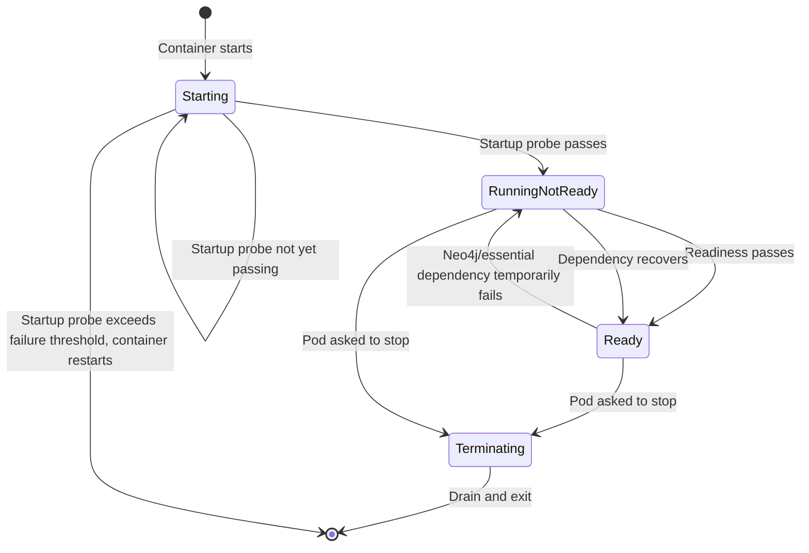
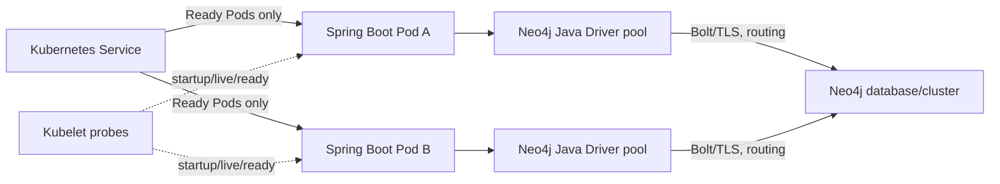
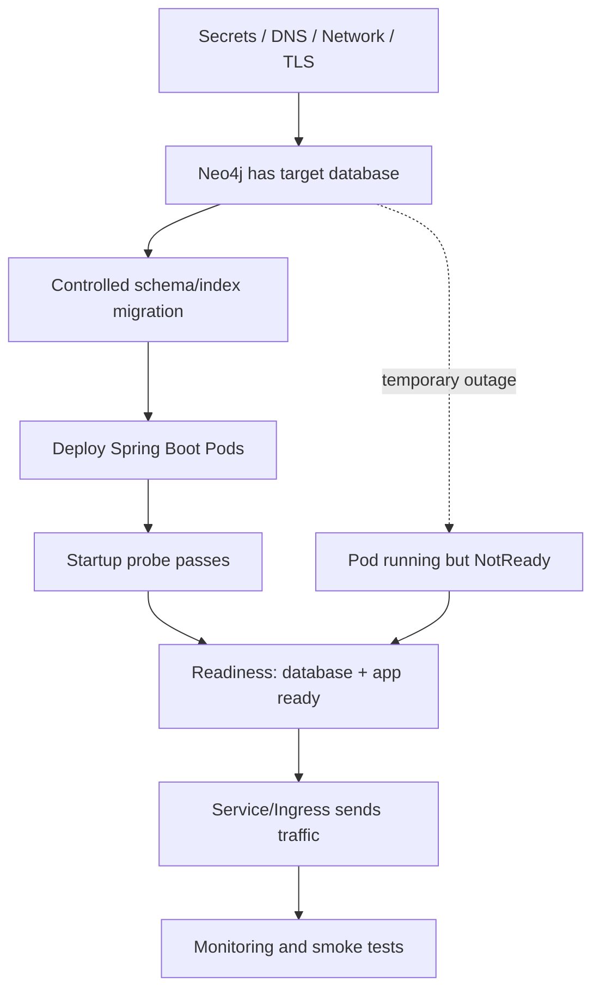
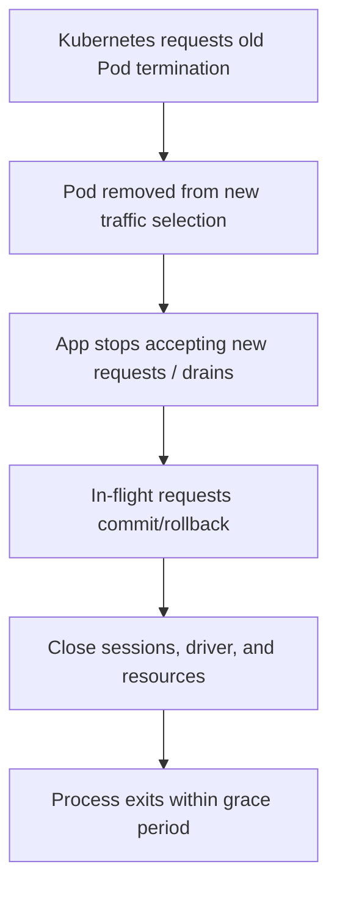
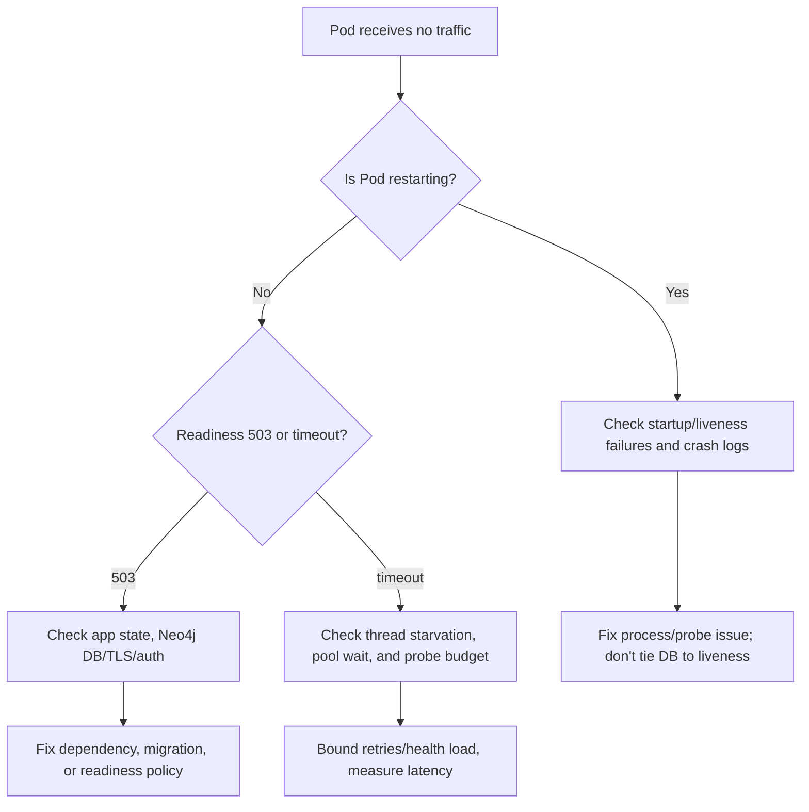

# Readiness, Liveness, and Application Startup Sequence with Neo4j

## 1. Why Does a Successful Deployment Not Mean the Application Is Ready?

A Java application uses **Neo4j** to query a **property graph** of nodes, relationships, and properties using Cypher. With the **Neo4j Java Driver** or **Spring Data Neo4j (SDN)**, an application container can start successfully even when it cannot yet reach the database. Conversely, a healthy running application can temporarily lose connectivity to Neo4j due to rolling upgrades, DNS, routing, TLS certificates, or network issues.

If Kubernetes checks only "is the Java process alive," it may route requests to an unready application. If a Neo4j query is used as **liveness**, a shared database outage can cause Kubernetes to restart **every** application replica, compounding the outage.

This lesson belongs to the **Deployment** chapter of the `DATABASE_ENGINE_GRAPH_NEO4J` module. Its focus is coordinating **startup sequence**, **startup probes**, **liveness probes**, **readiness probes**, **Spring Boot Actuator**, Neo4j connectivity verification, and graceful shutdown in a real deployment.

After this lesson, you will be able to:

1. Distinguish the three probe types and explain why **liveness should not depend directly on Neo4j reachability**.
2. Choose the right level of readiness verification: process, Bolt, target database, or actual business requirements.
3. Configure Spring Boot Actuator and a read-only `HealthIndicator` using the Java Driver.
4. Write Kubernetes probes with clear deadlines and avoid restart loops caused by dependency outages.
5. Sequence secret provisioning, Neo4j startup, schema migrations, application startup, traffic opening, and application shutdown.
6. Test scenarios including database unavailability, wrong passwords, cluster role switches, probe timeouts, and rolling deployments.

> **Version scope:** Examples target Spring Boot 3.x, Java 17+, Spring Data Neo4j/Neo4j Java Driver 5.x, Neo4j 5.x, and modern Kubernetes. Exact settings and endpoints may vary by version, edition, Neo4j Aura, or Helm/Operator. Verify against your actual image/version before using configurations in production.

## 2. Concepts: Liveness, Readiness, and Startup

### 2.1. Decision Table

| Check Type | Question Answered | On Failure, What Does Kubernetes Usually Do? |
| --- | --- | --- |
| **Liveness** | Is the process still alive and capable of self-recovery? | After the failure threshold, restarts the container |
| **Readiness** | Should this instance receive **new traffic** right now? | Marks the Pod **NotReady**, removes it from the Service's ready endpoints |
| **Startup** | Has the application finished its initial startup phase? | Waits within the startup budget; if failures exceed the threshold, restarts the container |

An important behavior of **startupProbe** in Kubernetes: when configured, **liveness** and **readiness** do not run until the startup probe succeeds. This gives the Java application time to boot, load beans, and prepare internal infrastructure before liveness starts judging it.

A typical lifecycle:



**Liveness runs in parallel** once the container passes the startup probe. If liveness fails enough times, Kubernetes can restart the container from either Ready or NotReady state. Do not infer from the diagram that "NotReady" automatically leads to a restart.

### 2.2. Distinguishing "Dead," "Not Ready," and "Infrastructure Incident"

Examples:

- A severely deadlocked JVM unable to answer even a simple health request: likely a **liveness** issue.
- The application serves HTTP but cannot yet connect to Neo4j: usually a **readiness** issue if endpoints require the database to function.
- Neo4j TLS certificate expired: a **dependency/database issue**; there is no reason to mass-restart applications via liveness.
- The application still serves static pages while the database is temporarily down: readiness can be designed **for degraded mode** without removing all pods, depending on the product contract.
- Spring Boot is loading configs and beans and hasn't opened its HTTP port yet: this is the **startup** phase and needs an appropriate startup budget.

> **Rule:** Liveness should check the health of **the process itself**. Readiness checks the conditions **needed to serve requests routed to that instance**. Do not place all external dependencies inside liveness.

## 3. Practical Architecture: Application, Pool, Bolt, Database



When `GET /products` needs to read `:Product` nodes in the `catalog` database:

1. The HTTP request is routed to a Ready Pod via the Service/Ingress mechanism.
2. The Spring service invokes a repository or `Neo4jClient`, using the `Driver` managed by Spring Boot.
3. The Driver acquires a connection from the pool, connects via Bolt/TLS/routing, authenticates, and executes Cypher.
4. Neo4j returns data; the application maps it to a DTO and returns the HTTP response.

A readiness probe **does not need** to simulate full business workflows on every check. A tiny query proving a session can be opened to the target database is a useful signal, though it **does not by itself prove** write permissions, schema/indexes, the entire cluster, or correct graph contents.

## 4. Choosing the Level of Readiness Verification

### 4.1. From TCP Connectivity to Business Readiness

| Check Level | What It Does | What It Guarantees | What It Does NOT Guarantee |
| --- | --- | --- | --- |
| **Process/HTTP** | Health endpoint responds | JVM and web stack operate well enough to answer the endpoint | Database is reachable |
| **Bolt port** | Can open TCP to Bolt port | Something listens on the network port | TLS, authentication, target database, and Cypher |
| **Driver connectivity** | `driver.verifyConnectivity()` | Driver can connect/authenticate to Neo4j at driver level | Specific databases, roles, and business queries |
| **Database read** | Session targeting explicit database runs `RETURN 1 AS ok` | Can execute a minimal Cypher statement on the chosen database | Business `MATCH` queries, write privileges, and schema |
| **Business smoke test** | Reads sample data/schema per contract | Subset of real behavior works at test time | Full dataset or write capacity under heavy load |

**Do not put every level into a probe running every 5 seconds.** Readiness should be **lightweight, bounded by a finite timeout, and side-effect-free**, whereas deep business checks belong in post-deploy smoke tests or separate test jobs.

### 4.2. The Neo4j Server Can Be Alive While a Database Is Not Ready

A Neo4j server process may be running and even serving some administrative interfaces while the target database is offline, unallocated, recovering, or ineligible for the desired read/write role.

Therefore:

- **Neo4j process alive** differs from **the `catalog` database being online**.
- Successfully reaching a **seed/router** differs from all advertised routing addresses being reachable.
- `RETURN 1` succeeding in a read session does not guarantee a `MERGE` write flow will succeed if the role or database forbids writes.
- Never use write operations like `CREATE`/`MERGE` in a continuously running readiness probe; they create data, acquire locks, and add load.

When investigating at an administrative level, a statement like the following can help if version and privileges permit:

```cypher
SHOW DATABASES
YIELD name, currentStatus, requestedStatus
WHERE name = 'catalog'
RETURN name, currentStatus, requestedStatus;
```

This is an **operational observability** command, not a public readiness API for all application accounts. Column names and privileges depend on version. In Neo4j Aura or restricted environments, use the provider-supported status page and mechanisms.

### 4.3. When Should Readiness Depend on Neo4j?

If **every endpoint** of a catalog service requires the graph database to return valid results, making connectivity to the target database a readiness condition is reasonable.

If the service has endpoints that still perform useful work when Neo4j is down (e.g., serving approved cached responses, maintenance notices, or independent workflows), decide whether to:

- Mark the Pod NotReady to stop sending all requests, **or**
- Keep the Pod Ready, return controlled errors on routes requiring Neo4j, use circuit breakers/degraded mode, and monitor separately.

There is no one-size-fits-all policy. If **all** replicas go NotReady together when a shared database fails, the Kubernetes Service may have zero endpoints left to receive requests. That is appropriate if the app cannot serve anything; if degraded service is viable, an overly strict policy takes down healthy functionality too.

## 5. Spring Boot Actuator: Separating Health Groups

### 5.1. Declaring the Dependency

In a Spring Boot project with dependency management, add Actuator:

```xml
<dependency>
    <groupId>org.springframework.boot</groupId>
    <artifactId>spring-boot-starter-actuator</artifactId>
</dependency>
```

`spring-boot-starter-data-neo4j` is used by the application to configure repositories and the Java Driver; Actuator exposes status observation endpoints. Depending on version, Boot may auto-configure a **Neo4j health contributor**, but **do not assume** which contributor belongs to your desired readiness group. Inspect actual contributor names before relying on them.

### 5.2. `application.yml` for Probes

Example for Spring Boot 3.x:

```yaml
spring:
  application:
    name: graph-catalog-api

  neo4j:
    uri: ${NEO4J_URI}
    authentication:
      username: ${NEO4J_USERNAME}
      password: ${NEO4J_PASSWORD}
    pool:
      connection-acquisition-timeout: 2s

  data:
    neo4j:
      database: ${NEO4J_DATABASE}

management:
  endpoint:
    health:
      show-details: never
      probes:
        enabled: true
        add-additional-paths: true
      group:
        liveness:
          include: livenessState
        readiness:
          include: readinessState,graphReadiness
  endpoints:
    web:
      exposure:
        include: health,info
```

This is **one unified YAML configuration**, without duplicate `management.endpoint.health` keys. The `2s` value is only an example for pool acquisition timeout, **not** the absolute timeout for the entire health check.

In configurations supporting `add-additional-paths: true`, Spring Boot can expose short paths **`/livez`** and **`/readyz`** on the **main application port**, convenient when liveness/readiness must confirm the actual traffic-serving web server. Standard paths are typically `/actuator/health/liveness` and `/actuator/health/readiness`. Verify actual endpoints in your Spring Boot version.

| Endpoint | Intended Content |
| --- | --- |
| `/livez` or `/actuator/health/liveness` | Application liveness state only, without calling Neo4j |
| `/readyz` or `/actuator/health/readiness` | Application readiness state **and** `graphReadiness` |
| `/actuator/health` | Aggregate health across configured contributors; not necessarily identical to the readiness group |

**Security:** Health endpoints should return only minimal status for kubelet and observability systems. Never expose usernames/passwords, connection URIs containing secrets, stack traces, or business data in the response body.

## 6. A Read-Only Readiness `HealthIndicator` for Neo4j (Without Writing the Graph)

To tie readiness to the right database, the application can define a dedicated contributor. Example for Java 17+, Spring Boot 3.x, Neo4j Java Driver 5.x:

```java
import java.time.Duration;
import org.neo4j.driver.Driver;
import org.neo4j.driver.Session;
import org.neo4j.driver.SessionConfig;
import org.neo4j.driver.TransactionConfig;
import org.springframework.beans.factory.annotation.Value;
import org.springframework.boot.actuate.health.Health;
import org.springframework.boot.actuate.health.HealthIndicator;
import org.springframework.context.annotation.Bean;
import org.springframework.context.annotation.Configuration;

@Configuration
public class Neo4jProbeConfiguration {

    @Bean("graphReadiness")
    HealthIndicator graphReadiness(
        Driver driver,
        @Value("${spring.data.neo4j.database}") String database
    ) {
        TransactionConfig config = TransactionConfig.builder()
            .withTimeout(Duration.ofSeconds(2))
            .build();

        return () -> {
            try (Session session =
                     driver.session(SessionConfig.forDatabase(database))) {
                int result = session.executeRead(
                    tx -> tx.run("RETURN 1 AS ok")
                            .single()
                            .get("ok")
                            .asInt(),
                    config
                );

                return result == 1
                    ? Health.up().build()
                    : Health.down()
                        .withDetail("reason", "unexpected_result")
                        .build();
            } catch (Exception ex) {
                // Do not return raw exceptions or connection details via the endpoint.
                return Health.down()
                    .withDetail("reason", "database_unreachable")
                    .build();
            }
        };
    }
}
```

When Boot registers a `HealthIndicator` bean named `graphReadiness`, the readiness group can reference contributor ID `graphReadiness` as shown in the configuration. Verify the registered ID and health group behavior in your exact Spring Boot version.

**Technical explanation:**

1. `Driver` is injected by Spring Boot, avoiding creating a new connection pool on every check.
2. `SessionConfig.forDatabase(database)` targets the **actual database the application uses**, instead of relying on the account default.
3. `executeRead` runs a minimal query inside a managed read transaction; `RETURN 1 AS ok` modifies no nodes, relationships, or schema.
4. `TransactionConfig.withTimeout(2s)` sets only the **per-attempt transaction timeout**; it does not automatically cap total wait time across connection, routing, pooling, retries, and Spring overhead.
5. Errors map to `Health.down()`, fitting readiness semantics. Never let exceptions containing hostnames, certificates, credentials, or user data leak directly into the response.
6. `Health.up()` means the **defined check** succeeded, not that all read/write operations are guaranteed.

### 6.1. Why Does Readiness Need a Realistic Deadline?

Suppose the Kubernetes probe has `timeoutSeconds: 2`, while the driver can wait 10 seconds to connect or retry over a long window. Kubelet times out the probe at the configured mark, yet **the health work inside the JVM may not abort immediately**, causing overlapping health calls to pile up and pressure the pool.

When deploying:

- Align `connection-acquisition-timeout`, connection timeout, and retry budget with the **overall probe budget**.
- Bound concurrent health checks; consider a **short-TTL cached status poller** if you have hundreds of replicas or Neo4j is under pressure.
- Never run multi-hop traversals, multi-million node counts, admin-only `SHOW DATABASES`, or migrations inside readiness.
- Monitor health-check duration and failure counts, not just restart counts.

The Java snippet above intentionally focuses on **one minimal read query**; end-to-end deadlines and caching policies must be integrated and tested for your deployment environment.

### 6.2. Do Not Put Database Checks in the Liveness Group

If you configure:

```yaml
management:
  endpoint:
    health:
      group:
        liveness:
          include: livenessState,graphReadiness
```

then when Neo4j fails, `graphReadiness` returns `DOWN`, liveness also becomes `DOWN`, and kubelet will **restart application containers** after the failure threshold. A shared database outage can trigger a fleet-wide restart storm, wiping caches, dropping recovering connections, and slowing recovery.

Keep the liveness group limited to **`livenessState`** or checks that truly prove the process itself must restart. For recoverable database errors, readiness or controlled request handling is the right layer.

### 6.3. When Deeper Business Verification Is Needed

A `RETURN 1` readiness check does not prove:

- Constraints/indexes are valid or migrations have run.
- The account has `MATCH` privileges on real labels, or `MERGE`/`CREATE` privileges.
- Routing works for both reads and writes across the entire cluster.
- Business nodes/relationships or new-version seed data exist.

Place these checks in **post-deploy smoke tests**—for instance, a bounded `MATCH` read on business labels, a schema version check, or a write test transaction **on isolated test data** rolled back per approved procedure. Never use a live data-mutating write as a probe running every few seconds.

## 7. Kubernetes Deployment with Startup, Liveness, and Readiness

**Abbreviated yet structured** manifest example for a Spring Boot application:

```yaml
apiVersion: apps/v1
kind: Deployment
metadata:
  name: graph-catalog-api
spec:
  replicas: 3
  selector:
    matchLabels:
      app: graph-catalog-api
  template:
    metadata:
      labels:
        app: graph-catalog-api
    spec:
      terminationGracePeriodSeconds: 40
      containers:
        - name: app
          image: registry.example.com/graph-catalog-api:1.0.0
          ports:
            - name: http
              containerPort: 8080
          env:
            - name: NEO4J_URI
              value: "neo4j+s://graph.prod.example.com:7687"
            - name: NEO4J_DATABASE
              value: "catalog"
            - name: NEO4J_USERNAME
              valueFrom:
                secretKeyRef:
                  name: catalog-neo4j-credentials
                  key: username
            - name: NEO4J_PASSWORD
              valueFrom:
                secretKeyRef:
                  name: catalog-neo4j-credentials
                  key: password

          startupProbe:
            httpGet:
              path: /livez
              port: http
            timeoutSeconds: 2
            periodSeconds: 5
            failureThreshold: 24

          livenessProbe:
            httpGet:
              path: /livez
              port: http
            timeoutSeconds: 2
            periodSeconds: 10
            failureThreshold: 3

          readinessProbe:
            httpGet:
              path: /readyz
              port: http
            timeoutSeconds: 2
            periodSeconds: 5
            failureThreshold: 2
            successThreshold: 1
```

**Manifest assumptions:** Spring Boot has `management.endpoint.health.probes.add-additional-paths=true`, listens on HTTP port 8080, and exposes `/livez`/`/readyz`. If using a separate Actuator management port or a version without short paths, adjust probes to actual endpoints; never copy non-existent paths.

Timeout and threshold values are **illustrative**. Size them for boot time, GC, CPU throttling, network latency, and desired budgets; production manifests also require resource requests/limits, `securityContext`, Services, network policies, and rollout settings.

### 7.1. Reading the Example Thresholds

| Probe | Configuration | Meaning |
| --- | --- | --- |
| Startup | Every 5s, 24 failures | Allows a startup budget based on probe period, roughly 120s before restart |
| Liveness | Every 10s, 3 failures | Restarts when the process repeatedly fails alive checks after startup succeeds |
| Readiness | Every 5s, 2 failures | Marks NotReady when readiness fails consecutively |
| Graceful termination | 40 seconds | Kubelet gives the container time to shut down cleanly before forceful termination |

The "120 seconds" budget is **approximate**, not an exact stopwatch: initial probe timing, execution latency, scheduling, and kubelet behavior all affect it. If an application occasionally takes 3 minutes to start due to schema migrations, a better approach is usually **moving migrations into a separate Job** rather than raising the startup probe indefinitely.

### 7.2. Why Should `startupProbe` Use the Liveness Path?

Startup only needs to confirm the app has finished internal initialization enough to run. If a Neo4j-dependent readiness check is used as the startup probe, **losing database connectivity longer than the startup window causes application restarts**, even when the JVM is healthy and waiting to recover is completely reasonable.

Using `/livez` for startup in the example allows:

1. Waiting for Spring Boot to start the web server and set `LivenessState.CORRECT`.
2. Starting normal liveness/readiness checks afterward.
3. Keeping the Pod **Running/NotReady** if Neo4j is not yet ready, instead of restarting due to startup failure.
4. Automatically adding the Pod to ready endpoints once the database recovers and readiness passes.

If the application has genuinely long internal bootstrap work where liveness state flips to `CORRECT` too early in a specific version/config, you can design a **dedicated startup indicator**. Still avoid turning transient dependency failures into restart triggers.

### 7.3. How Does Kubelet Evaluate HTTP Status?

For HTTP probes, Kubernetes treats status codes in the documented success range (typically 200–399) as passing; connection errors, timeouts, or 4xx/5xx codes are failures.

With Spring Boot Actuator, a `DOWN` health group normally maps to **HTTP 503**, signaling kubelet to mark the Pod NotReady. If you have custom status mappings, verify that **DOWN actually produces a failing HTTP status**; returning JSON `{"status":"DOWN"}` with HTTP 200 misleads kubelet.

**Do not give kubelet Neo4j usernames/passwords.** Kubelet only calls the app's health endpoint; Neo4j check logic runs inside the application using environment-injected credentials. Also protect health endpoints from public exposure and sensitive data leaks.

## 8. Startup Sequence: From Database to Traffic

A safe deployment sequence separates **dependencies required to serve requests** from **dependencies strictly required for the process to start**.



The diagram shows the **desired orchestration sequence**, not a claim that every step must be a blocking command in one process. For instance, an application can start while the database is unavailable if the driver and application design support **automatic reconnection when the dependency recovers**.

### 8.1. Steps Before Opening Traffic

1. **Infrastructure:** DNS, firewalls, routing, TLS CAs, certificates, Neo4j service, and target database are provisioned per environment standards.
2. **Application account:** username/password provided via secret manager or Kubernetes Secret with least privilege. Never use admin accounts in the app.
3. **Schema/migrations:** confirm business-key constraints, required indexes, and the schema version expected by the new application release.
4. **App deployment:** Spring Boot initializes beans, Driver, repositories, services, and HTTP server.
5. **Startup/liveness:** the process reaches running state without waiting on complex Neo4j queries to confirm "aliveness."
6. **Readiness:** the target database can serve essential functions per policy.
7. **Traffic and smoke tests:** admit Ready Pods to the Service; run controlled post-deploy read/write smoke checks, then monitor errors and latency.

### 8.2. Dependency Unavailable at Application Startup

A fragile pattern is throwing a fatal exception in `ApplicationRunner` simply because Neo4j cannot be reached within 2 seconds, causing crash-restart loops while the database is upgrading.

A more resilient approach:

- Distinguish **unrecoverable configuration errors** (e.g., invalid URI syntax, missing required secret, incompatible schema mapping) from **transient errors** (database port not open yet, role switch, slow DNS/routing).
- For unrecoverable configuration errors, **fail fast** with safe logs so the deployment team can fix them.
- For transient errors, keep the process alive yet **NotReady** if it cannot serve requests; let the driver/poller retry within a bounded budget and backoff.
- Avoid tight connection loops to Neo4j: many replicas can create a connection storm the instant the server recovers.
- Once the database becomes ready, readiness automatically transitions to UP without forcing restarts.

If a system requires a mandatory initialization step before serving any traffic (such as loading signing configs), define a clear **startup budget** and failure state; never equate all transient dependencies with process failure.

### 8.3. Do Not Repeat Migrations/Indexes in Every Readiness Check

Neo4j uses constraints and indexes for efficient `MERGE`, ID lookups, and relationship queries. Creating them inside every probe is an anti-pattern: it demands schema privileges for the app, adds load, causes contention, and turns migration failures into liveness/readiness flapping.

Better approach:

1. Design **versioned** migrations or controlled declarative manifests.
2. Run them via a **Job/migration pipeline** with appropriate privileges before shifting traffic per version compatibility.
3. For rolling deployments, prefer **backward-compatible** changes (expand → migrate → contract) so old and new Pods can coexist briefly.
4. Verify indexes/constraints are in the right state; index creation may need population time before queries benefit.
5. Only after schema/feature flags are satisfied should the new app version become Ready.

If readiness must check "schema matches expected version," prefer a **small cached state updated by a coordinator** or a bounded metadata version check; never run `SHOW INDEXES` or full graph scans every few seconds on every Pod.

## 9. Starting a Neo4j Server Differs from Starting an Application

Do not use the exact same probe setup for both container types:

| Target | What Liveness Should Check | What Readiness Should Check |
| --- | --- | --- |
| **Spring Boot API** | JVM/web stack alive; independent of Neo4j | Capable of serving requests per contract, optionally including target Neo4j DB |
| **Neo4j database server** | Database process and core mechanics alive per image/operator guide | Database/listeners/roles/capabilities needed by clients are ready |

For self-managed Neo4j on Kubernetes, verify:

- Which Helm chart, Operator, or image/entrypoint is used and which health/probe features that version supports.
- Whether it is a standalone server or a **cluster**; the server process can be up while a database is still recovering or lacks the expected role.
- Persistent volumes, transaction logs, and storage are properly mounted before serving traffic.
- Bolt listeners, routing, and TLS certificates are genuinely ready.
- **Server** readiness does not use admin credentials or commands exposing secrets in process arguments when safer options exist.

Do not assume Neo4j exposes an HTTP `/readyz` endpoint like Spring Boot; that was **an endpoint in the Spring application example**, not a Neo4j server guarantee. Use probes provided by the official image/Helm/Operator for your version or an admin-verified mechanism.

### 9.1. Avoid "depends_on Is Enough"

In Docker Compose, `depends_on` can order startup or wait for health conditions per supported syntax. However, it **does not replace** the application's ability to self-recover if Neo4j disconnects **after** all containers have started.

In Kubernetes, **there is no global startup ordering guaranteeing external dependencies stay online**. A resilient pattern combines:

- Provisioning dependencies and running migrations via proper pipelines.
- Startup probes allowing application initialization time.
- Readiness controlling **when an instance enters traffic**.
- Driver reconnection, bounded retries, and proper runtime error handling.

## 10. Rolling Updates, Graceful Shutdown, and Traffic Draining

Deployment is not just startup. When an old Pod is replaced, the goal is to **stop accepting new requests** and let in-flight operations finish within a reasonable budget.

### 10.1. Spring Boot Graceful Shutdown

Example configuration:

```yaml
server:
  shutdown: graceful

spring:
  lifecycle:
    timeout-per-shutdown-phase: 25s
```

In the Kubernetes Deployment in section 7, `terminationGracePeriodSeconds: 40` gives kubelet time for Spring Boot to stop accepting new requests and finish in-flight ones. **25/40 seconds are illustrative only**; account for lifecycle hooks, `preStop` (if any), network drain, and actual request timeouts.

For the Java Driver:

- Never create a `Driver` per request; use the Spring-managed Driver and close it when the application context shuts down.
- Do not hold transactions open across multiple HTTP requests or long shutdown windows.
- Distinguish **committed** requests from **client never received response**: applications may need idempotency keys for safe retries if the connection drops post-commit.
- Long data-import jobs should use **batch checkpoints**; do not assume Kubernetes always lets jobs run to completion.

### 10.2. Desired Shutdown Sequence



When a Pod is deleted, Kubernetes starts termination and updates endpoints; however, **keep-alive connections, ingress/load balancers, and propagation delays** can cause requests to still reach the old Pod briefly. Test actual drain behavior rather than assuming readiness changes instantly vanish all connections.

If a `preStop` hook is needed, use a **designed and tested action** to halt traffic or wait for endpoint propagation; never blindly copy `sleep 30` and burn the entire grace period before processing finishes.

### 10.3. RollingUpdate and Minimum Availability

Optional snippet in Deployment:

```yaml
spec:
  strategy:
    type: RollingUpdate
    rollingUpdate:
      maxSurge: 1
      maxUnavailable: 0
```

This is a **fragment under Deployment `spec`**, not a standalone manifest. With adequate replicas and cluster capacity, this aims to keep Ready replicas available during rollouts. If new Pods **never become Ready** because Neo4j or schema isn't compatible, the rollout halts; that is a signal to investigate/rollback, not a reason to remove readiness checks.

When deploying multiple instances, combine `readiness` with `progressDeadlineSeconds`, verification gates, and platform-appropriate rollback procedures.

## 11. Common Startup Failures

| Symptom | Possible Cause | What to Check |
| --- | --- | --- |
| `CrashLoopBackOff` when Neo4j is down | App fails startup on transient dependency, or startup/liveness checks DB | Check which probe triggers restarts; decouple liveness from DB, add sensible retries |
| Pod `Running` but `0/1 Ready` | Readiness not passing or endpoint returns 503 | Inspect health groups, database URI, auth, TLS, and safe logs |
| `/readyz` returns 404 | Spring Boot additional paths disabled or wrong port/path | Check Actuator/probe config, main port vs. management port |
| Probe gets HTTP 200 despite `DOWN` status | Custom status mapping doesn't map DOWN to failing HTTP code | Verify actual HTTP status code, not just JSON |
| Liveness restarts app during 30s DB blip | `graphReadiness` was added to liveness | Move dependency check to readiness |
| App reports UP yet real queries fail | `RETURN 1` doesn't check schema/write privileges/business logic | Add post-deploy smoke tests, don't put in liveness |
| Readiness repeatedly times out slowly | Driver retry/pool/connect budget exceeds probe timeout | Bound end-to-end deadline, measure health duration, consider caching |
| All Pods go NotReady together | Shared dependency outage, overly strict readiness for degraded mode | Clarify service contract, route-level fallback, and orchestration |
| New rollout never becomes Ready | Migration not run, wrong database, secret/TLS, or routing issue | Inspect readiness conditions, migration status, configs, and rollback |
| Reads succeed while writes fail | Neo4j role/write privilege/routing mismatch | Controlled write smoke test and privilege separation |
| Requests lose results during termination | Drain/grace period too short, jobs lack checkpoints | Tune graceful shutdown, idempotency, retries, and test termination |
| Neo4j server process UP but DB offline | Database recovering/unallocated | Check database status with operational privileges, not just port |

## 12. Observing Probes and Troubleshooting

### 12.1. Kubernetes Observation Commands

In an authorized environment:

```bash
kubectl get pods -l app=graph-catalog-api
kubectl describe pod <pod-name>
kubectl get endpointslices \
  -l kubernetes.io/service-name=graph-catalog-api
kubectl logs deployment/graph-catalog-api --since=10m
```

`<pod-name>` is a placeholder to replace with a real Pod name. This sequence shows Pod status, failed probe events, ready endpoints, and recent logs. **Never** dump entire environments/Secrets to the terminal when debugging auth issues.

If authorized to diagnose network/endpoints:

```bash
# Run from an environment permitted to inspect the app.
curl -i http://localhost:8080/livez
curl -i http://localhost:8080/readyz
```

These `curl` commands target the **Spring application address**, not Neo4j's Bolt port. In Kubernetes, `localhost` only works inside the container or via appropriate port-forwarding; external laptops need controlled access paths. If the app uses HTTPS, adjust the URL and trust policy; never disable TLS verification in production.

### 12.2. Recommended Metrics and Logs

| Layer | Signals | Purpose |
| --- | --- | --- |
| Kubernetes | restart count, liveness failures, readiness failures, NotReady duration | Distinguish restarts from traffic removal |
| Spring Boot | startup duration, readiness state, health-check duration, HTTP 5xx/p95 | Assess app health and user experience |
| Java Driver | pool acquisition wait, active connections, connect/retry failures | Identify connection bottlenecks and transient errors |
| Neo4j | Bolt connections, transactions, lock waits, query duration, DB status | Investigate database health and serviceability |
| Dependency/config | TLS expiry, DNS/routing failures, secret rotation, migration state | Pinpoint why readiness stays down |

Never put `username`, `password`, customer data, or full query parameters into health responses, metric labels, or logs. Use operation IDs like `health.readiness`, safe database names, and correlation IDs in controlled logs.

### 12.3. A Simple Decision Tree



Do not rely solely on `Application started` in logs to conclude a Pod is receiving Service traffic. Verify current readiness and actual endpoints.

## 13. Testing Negative Scenarios Before Production

### 13.1. Test Matrix

| Scenario | Expected Liveness | Expected Readiness | What to Verify |
| --- | --- | --- | --- |
| App just started, before startup passes | Not yet active if `startupProbe` configured | Not yet active if `startupProbe` configured | Startup budget covers initialization time |
| Spring Boot normal, Neo4j ready | UP | UP | Pod added to Service |
| Neo4j stopped 1 minute, app requires DB | **UP** | **DOWN** | Pod does not restart solely due to dependency failure |
| Neo4j recovers | UP | Returns to UP | Pod becomes ready **without restarting** |
| Wrong password | Process may stay alive if config doesn't crash startup | DOWN | Safe error logging; detects unrecoverable config |
| Wrong TLS CA/SAN | Process stays alive in resilient design | DOWN | No TLS downgrade; verify trust/hostname |
| `catalog` DB offline while server online | UP | DOWN | Health query targets exact database |
| One routing endpoint broken | UP if app alive | Depends on impact and serviceability | Verify read/write routing and load balancing |
| Readiness query slower than budget | UP | Probe may fail via timeout | Health requests don't pile up; measure pool/retry |
| Unrecoverable JVM deadlock | May fail | May fail | Liveness restarts per threshold, avoiding GC false positives |
| Pod terminated mid-request | Not a restart criterion | Removed from traffic during termination | Drain and commit/rollback within grace period |

**Never break the production database to run these tests.** Use test/staging environments, controlled fault injection, test accounts, and isolated test data.

### 13.2. Specific Tests with Spring Data Neo4j

Examples of integration tests to include:

1. **Readiness happy path:** with test Neo4j running, `/readyz` returns HTTP 200 and `UP`.
2. **Neo4j unavailable:** stop/block connection to test database; `/readyz` becomes unready while `/livez` stays passing.
3. **Recovery:** restore connection; readiness flips back to `UP` without restarting the Pod/app context.
4. **Wrong database:** point `NEO4J_DATABASE` to a non-existent or unauthorized database; readiness must not report UP.
5. **Wrong auth/TLS:** bad credentials or untrusted certificate must fail the check **without** logging secrets.
6. **Migration incompatible:** app must not receive traffic before schema version meets the contract, if schema is a mandatory dependency.
7. **Graceful termination:** long in-flight requests finish within the grace period or fail cleanly; no duplicate writes occur on retry.

If tests use Testcontainers Neo4j without TLS, that only verifies **startup/readiness logic**. You still need a separate test against a TLS/routing endpoint matching production to verify certificates, hostnames, and cluster members.

## 14. Common Design Mistakes

| Mistake | Consequence | Fix |
| --- | --- | --- |
| Putting `driver.verifyConnectivity()` in liveness | Database outage triggers fleet-wide app restarts | Move dependency checks to readiness |
| Readiness only returns static HTTP 200 | Pod receives traffic before database is usable | Add contributor for essential dependencies |
| Readiness runs `MATCH`/`count(*)` on a large graph | Probe becomes an expensive workload | Minimal query, cache/throttle, or separate smoke test |
| Treating `RETURN 1` as full business certification | Missing schema/write permissions still mark Ready | Combine migration gates and post-deploy smoke tests |
| Omitting `startupProbe` for variable JVM boot times | False liveness failures and startup restarts | Set an appropriate startup budget |
| `startupProbe` depends on transient Neo4j availability | Dependency outage causes restart loop | Probe startup on process state |
| Unbounded retries/timeouts on health checks | Overlapping readiness calls exhaust pool | End-to-end deadline, backoff, concurrency limits |
| Placing Actuator on another port while probing main port | Probe 404/connection refused | Match path/port or enable additional paths on main port |
| Exposing health details publicly | Leaks hostnames, infra details/exceptions | Expose minimal status only; restrict access |
| Every Pod runs DDL migrations on startup | Race conditions, excessive privileges, slow startup | Separate Job/migration pipeline |
| Relying solely on `depends_on` for DB availability | App fails to recover after outages | Readiness + driver reconnect/backoff |
| No graceful shutdown | Dropped requests, ambiguous commit outcomes | Drain, shutdown budget, and idempotency |
| Not checking Service endpoints | Assuming Pod Running means receiving traffic | Check Pod Ready and EndpointSlice |
| Putting Neo4j passwords in manifests | Secrets stored in Git/CI | Use `secretKeyRef` or a secret manager |

## 15. Hands-On Exercises

### Exercise 1 — Classify the Three Probe Types

The application loses Neo4j for two minutes while HTTP stays responsive. A teammate suggests making `liveness` run `MATCH` and restart the pod if no result arrives within 10 seconds.

**Question:** What is wrong with that proposal? Which probe should reflect the failure?

**Hint:** Neo4j failure is a recoverable **dependency** issue, not proof the JVM is dead. If all APIs require Neo4j, readiness should drop to DOWN and recover when the dependency returns; keep liveness independent of Neo4j.

### Exercise 2 — Startup Timing Analysis

A Java application takes up to 85 seconds to boot when CPU-throttled. The startup probe runs every 5 seconds with `failureThreshold: 10`.

**Question:** Is this configuration sufficient?

**Hint:** A ~50-second budget is insufficient for an 85-second startup; it risks premature restarts before boot finishes. Measure actual startup distributions and set a budget with headroom, while also investigating slow boot causes instead of blindly increasing thresholds.

### Exercise 3 — Checking the Database or Just the Server?

Neo4j accepts Bolt connections, but the `catalog` database is offline. A health check using a TCP probe on port 7687 still passes.

**Question:** Why can app readiness be wrong? Propose a better check level.

**Hint:** A TCP probe only confirms a port accepts connections, not that the `catalog` database can execute Cypher. Use a session targeting `catalog` explicitly with a small query, bounded timeout, and least-privilege auth.

### Exercise 4 — Rolling Deployment and Migrations

A new release requires a constraint on `(:Product {tenantId, sku})`. Three old-release Pods are serving traffic, and three new Pods deploy and all run `CREATE CONSTRAINT` on startup.

**Question:** What can happen and how should the sequence change?

**Hint:** Pods can contend on locks/schema, slow down startup, and fail if the app account lacks admin privileges. Move migrations into a dedicated Job/pipeline, ensure backward compatibility with the old release, then roll out new Pods and verify readiness/smoke tests.

### Exercise 5 — Health 200 Yet Writes Fail

`/readyz` returns UP because `HealthIndicator` runs `RETURN 1` successfully. However, the order-creation endpoint using `MERGE` fails with a permission error.

**Question:** Is readiness "completely wrong"?

**Hint:** Readiness verified **exactly its scope**—read connectivity—which is insufficient to prove write privileges. Design controlled write smoke tests or role checks in the deploy pipeline; consider deeper readiness if write capability is mandatory, while avoiding data-mutating writes inside repeating probes.

### Exercise 6 — Distinguish Crash from NotReady

Kubernetes shows Pod `Running`, `Ready=false`, container restart count 0. Someone claims "the app is crashing continuously."

**Hint:** There is no evidence of crashing; the Pod may be running normally while failing readiness. Inspect endpoint/readiness events and DOWN reasons rather than assuming liveness/startup failures.

### Exercise 7 — Design a Recovery Test

Describe a test where Neo4j pauses for 60 seconds and then resumes. Which metrics would you measure to prove the deployment strategy works?

**Hint:** Restart count does not increase due to the DB outage, `/livez` stays UP, `/readyz` drops to DOWN then returns to UP on recovery, EndpointSlice updates, no retry storms occur, connection pool recovers, API returns proper unavailable codes during outage, and traffic resumption time stays within acceptable thresholds.

## 16. Pre-Production Checklist

- [ ] Clearly distinguish **startup**, **liveness**, and **readiness** in the deployment contract.
- [ ] Liveness does not depend directly on Neo4j or external services that can fail temporarily.
- [ ] Readiness checks only essential conditions to serve traffic, with degraded-mode policy if needed.
- [ ] `startupProbe`/budget covers Spring Boot boot time under CPU/memory limits.
- [ ] Probe endpoints exist on the right port; verify HTTP status codes, not just JSON bodies.
- [ ] Readiness targets the exact database, uses a tiny read query, and uses least-privilege app credentials.
- [ ] Driver pool/connect/transaction/retry deadlines fit within probe timeouts.
- [ ] Health checks never run DDL, mutations, large path traversals, or expensive queries.
- [ ] Spring Boot Actuator health groups and contributor IDs verified for the deployed version.
- [ ] Neo4j secrets come from secure sources; health bodies/logs never leak passwords or sensitive URIs.
- [ ] TLS, DNS, routing, and cluster advertised addresses tested.
- [ ] Schema migrations/versions have an independent process compatible with rolling deployments.
- [ ] During database outages, the app avoids restart storms and recovers automatically.
- [ ] Graceful shutdown, termination grace period, and request draining tested.
- [ ] Import jobs have checkpoints/idempotency to stay safe if stopped mid-batch.
- [ ] Dashboards cover readiness/liveness failures, restart counts, pool wait, and Neo4j health.
- [ ] Tested wrong auth, wrong database, TLS failure, pool timeout, recovery, and blocked rollouts.
- [ ] Verified Service/EndpointSlice routes traffic only to eligible instances.

## Conclusion

**Readiness, liveness, and startup answer three different questions.** Startup gives the application time to initialize; liveness decides whether the process must restart; readiness decides whether the instance should receive new traffic. With Neo4j, a Bolt/TLS/database failure is usually a **dependency/readiness issue**, not proof that the JVM needs restarting. A resilient deployment combines **Spring Boot Actuator, a minimal check against the exact database name, Kubernetes probes, separate migrations, secure routing, and graceful shutdown**. Finally, test both **disconnection and recovery**, because returning to Ready automatically without mass pod restarts is just as important as succeeding on the initial startup.

### References

- [Spring Boot Reference — Kubernetes Probes](https://docs.spring.io/spring-boot/reference/actuator/endpoints.html#actuator.endpoints.kubernetes-probes)
- [Spring Boot Reference — Application Availability](https://docs.spring.io/spring-boot/reference/features/spring-application.html#features.spring-application.application-availability)
- [Spring Boot Reference — Graceful Shutdown](https://docs.spring.io/spring-boot/reference/web/graceful-shutdown.html)
- [Kubernetes — Configure Liveness, Readiness and Startup Probes](https://kubernetes.io/docs/tasks/configure-pod-container/configure-liveness-readiness-startup-probes/)
- [Kubernetes — Pod Lifecycle and Termination](https://kubernetes.io/docs/concepts/workloads/pods/pod-lifecycle/)
- [Neo4j Java Driver Manual — Connect to the database](https://neo4j.com/docs/java-manual/current/connect/)
- [Neo4j Java Driver Manual — Transactions](https://neo4j.com/docs/java-manual/current/transactions/)
- [Neo4j Operations Manual — Monitoring](https://neo4j.com/docs/operations-manual/current/monitoring/)
- [Spring Data Neo4j Reference](https://docs.spring.io/spring-data/neo4j/reference/)
