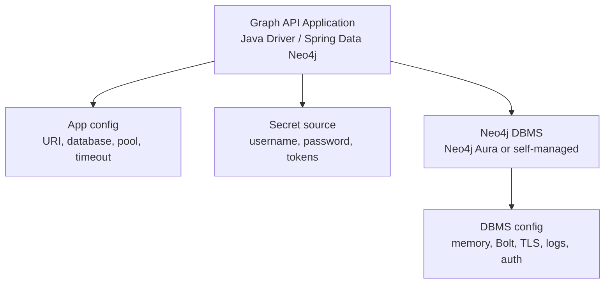
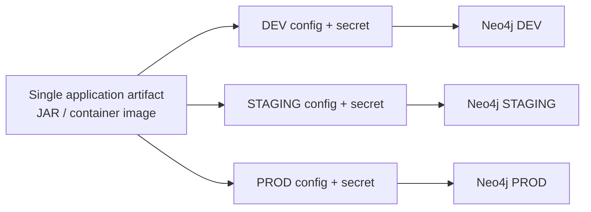
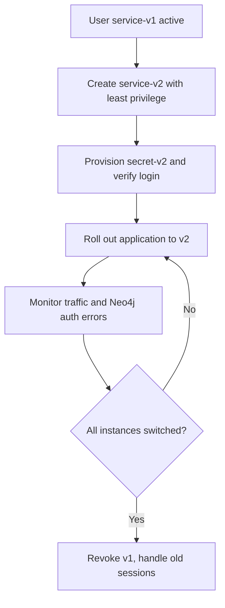
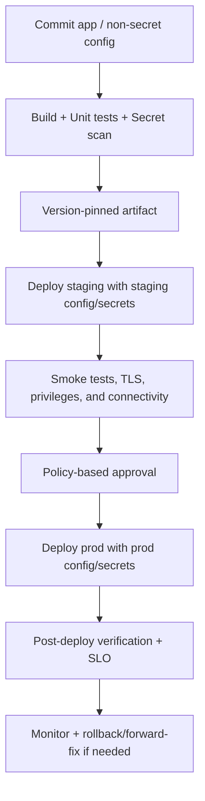

# Managing Configuration and Secrets Per Environment in Neo4j

An application that runs fine with Neo4j on a laptop is not necessarily safe to deploy to staging or production. Connections might point to the wrong database, the URI might be unencrypted, passwords might accidentally end up in Git, or a secret rotation might lock out the application's entire connection pool. **Environment-based configuration management** is more than changing hostnames: it is a controlled process governing **configuration values, access identities, secrets, privileges, deployment methods, and verification**.

This lesson belongs to the **Deployment** chapter of the **DATABASE_ENGINE_GRAPH_NEO4J** module. This module uses Neo4j to model **property graphs**, query nodes, relationships, and paths with **Cypher**, alongside **Neo4j Java Driver** and **Spring Data Neo4j**. In operations, configuration layers must be cleanly separated so application functionality moves from dev to staging to production without carrying over dangerous passwords or privileges.

After this lesson, you will be able to:

- Distinguish **Neo4j DBMS configuration**, **application Neo4j connection configuration**, and **secrets**.
- Build a dev/staging/production matrix with separate URIs, databases, TLS, privileges, resources, and secret sources.
- Use **Spring Boot property placeholders**, profiles, environment variables, and secret managers properly.
- Understand how to configure self-managed Neo4j via `neo4j.conf`, Docker, Kubernetes, and the constraints when using Aura.
- Plan **secret provisioning, rotation, revocation**, connectivity verification, and safe rollbacks.
- Establish CI/CD controls to prevent real passwords or wrong-environment configs from entering deployments.

> **Practice scope:** Hostnames, memory sizes, and policies in this lesson are illustrative only. Setting names, configuration methods, and account management capabilities depend on **Neo4j version, edition, and service type**. Examples assume valid permissions in a test environment. Never copy demo parameters straight to production without checking operational and security requirements.

## 1. Three Configuration Layers That Must Be Managed Independently



| Layer | Example Values | Who Manages It? | Is It a Secret? |
| --- | --- | --- | --- |
| **Application configuration** | `NEO4J_URI`, `NEO4J_DATABASE`, pool size, timeout | App dev/ops team | Usually no, though it may expose topology |
| **Credentials** | Passwords, auth tokens, private keys | IAM/secret manager, account owner | **Yes** |
| **Neo4j DBMS configuration** | `server.memory.heap.max_size`, page cache, Bolt/TLS, logging | Database ops team or managed provider | Mostly no; some items sensitive |
| **Account privileges** | Graph read/write, index creation, user management | Database administrator/identity team | Not a password, but a security policy |
| **Deployment configuration** | Ports, container images, network policies, volumes, node classes | Platform/DevOps | Some metadata must be protected |

**Do not treat an environment variable name as proof of security.** `NEO4J_PASSWORD` is a sensible name, yet if its real value is placed in a committed Compose file, CI/CD logs, or command-line arguments, the secret is still exposed.

Two examples to distinguish:

- Changing `spring.neo4j.uri` in the application **does not** change the address the Neo4j DBMS listens on.
- Changing a user's password in Neo4j **does not** cause already-running Drivers and connection pools to automatically fetch the new credential.

## 2. Creating a Configuration Matrix for Dev, Staging, and Production

A matrix helps the team see **what must differ** and **what must stay consistent** during testing:

| Attribute | Development | Staging | Production |
| --- | --- | --- | --- |
| **Neo4j instance** | Dedicated local/container | Isolated test instance/cluster | Official instance/cluster |
| **Database** | `neo4j` or dev database | Staging database | Designated production database |
| **URI** | e.g., `bolt://127.0.0.1:7687` | Internal URI with appropriate TLS | Provisioned URI with TLS and certificate verification |
| **Application account** | Dev credentials | Dedicated staging credentials | Dedicated prod credentials, least privilege |
| **Secret source** | Dev secret outside Git | Staging secret store | Prod secret store with RBAC/audit |
| **Data** | Synthetic/sample data | Mock or anonymized/scrubbed data | Real business data |
| **Logging** | Can be more verbose, never contains secrets | Sufficient for debugging and performance measurement | Per log/audit policy, no data leaks |
| **Backup/restore** | Reproducible | Recovery drills | RPO/RTO policy and periodic verification |
| **Admin privileges** | Authorized personnel only | Staging ops team only | Strict privileged access management |

**What should NOT be copied between environments:**

- Production passwords onto developer laptops.
- Production snapshots containing raw personal data into staging.
- Production admin accounts for test jobs or CI.
- Production URIs inside dev profiles or default configurations.
- Database create/drop privileges for read-only request paths.

With **Neo4j Community**, granular RBAC differs from Enterprise. If production requires read-only/write-only roles per node, relationship, or database, verify edition/tier support rather than simply naming a user `reader`.

### 2.1. Shared vs. Environment-Specific Configuration

The same application build can run across multiple environments if configuration data is supplied **at deployment time**:



This reduces the risk of "staging code differs from production code." **Same artifact does not mean same user, secret, URI, or database.**

## 3. Defining a Clear Application Configuration Contract

Before writing YAML files, agree on a **configuration contract**:

| Variable / Item | Required? | Non-Sensitive Example | Validation |
| --- | --- | --- | --- |
| `NEO4J_URI` | Yes | `neo4j+s://graph.prod.example` | Valid scheme, host in deployment allowlist |
| `NEO4J_DATABASE` | Yes | `commerce` | Authorized database name; never point to wrong environment |
| `NEO4J_USERNAME` | Per auth method | `graph_api_reader` | Account matching service and environment |
| `NEO4J_PASSWORD` | For basic auth | **Do not provide real password examples** | Non-empty, loaded from secret store, never logged |
| `NEO4J_CONNECT_TIMEOUT` | Per design | e.g., a few seconds | Positive value, fits API budget |
| `NEO4J_POOL_SIZE` | Per load | e.g., 40 | Capped, does not exceed DB resources |
| `SPRING_PROFILES_ACTIVE` | Per app | `staging`, `prod` | Selects target environment; does not replace secret controls |

**Fail-fast** is critical: in production, a missing `NEO4J_URI` or password must never let the application silently fall back to `localhost`, use dev credentials, or connect to the default database.

Never allow HTTP clients to arbitrarily choose `NEO4J_URI`, username, database, or profile to query another database. Those are **server-side configurations**, not business inputs.

### Classifying Sensitivity Levels

- **Safe for version control:** YAML structure, key names, connection pool limits, safe defaults, logging configs without secrets.
- **Requires access control:** production URIs, topology, network allowlists, role policies, account inventories.
- **Must protect as secrets:** passwords, tokens, private keys, signing keys, backup credentials.
- **Must follow data classification:** dumps, snapshots, query logs, and copies of real graph data; these can be sensitive even without passwords.

**Do not "encode with Base64" and treat it as secret protection.** Base64 is only an encoding and can be decoded trivially.

## 4. Spring Boot and Spring Data Neo4j: Placeholders Instead of Passwords in Git

A shared `application.yml` can list **configuration variable names** without secret values:

```yaml
# src/main/resources/application.yml
spring:
  neo4j:
    uri: ${NEO4J_URI}
    authentication:
      username: ${NEO4J_USERNAME}
      password: ${NEO4J_PASSWORD}
  data:
    neo4j:
      database: ${NEO4J_DATABASE}
```

This is **Spring property placeholder** syntax. Values are resolved from application configuration and property sources supplied by the deployment environment. When using Spring Boot, verify the exact **auto-configuration version** and corresponding property names.

In this design:

- `spring.neo4j.uri` configures the Neo4j connection.
- `spring.neo4j.authentication.username/password` configures basic auth.
- `spring.data.neo4j.database` specifies the database the application accesses.
- Real secrets never appear in committed YAML files.

If the application uses another OIDC/token mechanism, adjust auth configuration to match the provider; **do not force every deployment to use basic passwords** just because the example shows username/password.

### 4.1. Use Profiles to Select Behavior, Not to Embed Secrets

For example, `application-local.yml` can hold settings solely for local development:

```yaml
# src/main/resources/application-local.yml
spring:
  neo4j:
    uri: bolt://127.0.0.1:7687
  data:
    neo4j:
      database: neo4j
```

Local apps still need local credentials provided through an appropriate channel. **Do not put `password: neo4j` inside a profile file and commit it to Git.**

In staging/prod, `SPRING_PROFILES_ACTIVE` may be set to `staging` or `prod`, yet profiles are **not a security boundary**. Risk still exists if a production pod accidentally receives a staging `NEO4J_URI` or cross-environment secret.

### 4.2. Configuration Precedence Must Be Verified

Spring Boot has multiple configuration sources: `application.yml`, profile-specific files, environment variables, system properties, command-line arguments, and config imports. **Higher-precedence sources override lower ones**; exact ordering depends on how the app runs and the Boot version.

Watch out for:

- A command-line option overriding a URI set in a file.
- Secret manager injection failing to take effect if a higher-precedence source overrides it.
- Missing variables causing startup errors; maintain fail-fast behavior in production.
- Observability tools like Spring Actuator `/env` exposing configuration if unrestricted. Never expose admin endpoints publicly or print secrets in logs.

**Do not inspect only the config file to conclude effective runtime values.** Safely verify effective values—such as active URI, database, and profile—while **never printing passwords/tokens to logs**.

## 5. Neo4j Java Driver: Inject Configuration, Never Hard-Code It

For applications not using Spring auto-configuration, the Driver can receive configuration from the environment or a validated configuration object.

```java
import java.util.Objects;

import org.neo4j.driver.AuthTokens;
import org.neo4j.driver.Driver;
import org.neo4j.driver.GraphDatabase;
import org.neo4j.driver.Session;
import org.neo4j.driver.SessionConfig;

public final class GraphConnectivity {

    public static void main(String[] args) {
        String uri = Objects.requireNonNull(
            System.getenv("NEO4J_URI"), "Missing NEO4J_URI");
        String database = Objects.requireNonNull(
            System.getenv("NEO4J_DATABASE"), "Missing NEO4J_DATABASE");
        String username = Objects.requireNonNull(
            System.getenv("NEO4J_USERNAME"), "Missing NEO4J_USERNAME");
        String password = Objects.requireNonNull(
            System.getenv("NEO4J_PASSWORD"), "Missing NEO4J_PASSWORD");

        if (uri.isBlank() || database.isBlank()
                || username.isBlank() || password.isBlank()) {
            throw new IllegalArgumentException(
                "Missing required Neo4j configuration");
        }

        try (Driver driver = GraphDatabase.driver(
                uri, AuthTokens.basic(username, password))) {
            driver.verifyConnectivity();

            try (Session session = driver.session(
                    SessionConfig.forDatabase(database))) {

                long ok = session.executeRead(tx ->
                    tx.run("RETURN 1 AS ok")
                      .single()
                      .get("ok")
                      .asLong()
                );

                System.out.println("Query check: " + (ok == 1));
            }
        }
    }
}
```

**What the example demonstrates:**

1. `Driver` is configured from **deployment-side** inputs, never taking URIs/passwords directly from end users.
2. `Objects.requireNonNull` and `isBlank()` checks enforce fail-fast when config is missing.
3. `SessionConfig.forDatabase(database)` avoids relying on a user's default database in multi-database environments.
4. `verifyConnectivity()` checks connection/auth; `RETURN 1` checks query path, **without proving** the user has business-level privileges.
5. In web applications, `Driver` is normally created once and reused across the service lifecycle, not created per request.

Environment variables are a common config transport, **not the safest secret storage by default**: process environments can surface in diagnostics, crash dumps, or ops consoles if poorly controlled. Production should use a secret manager and proper injection/reload mechanisms.

### 5.1. Do Not Log Entire Configurations

Wrong:

```java
// AVOID: may expose passwords or tokens.
System.out.println(System.getenv());
```

Log only classified non-sensitive fields:

```java
System.out.println("Neo4j database configured: " + database);
// Do not print username if ops policy treats account inventory as sensitive.
// Do not print URI if logs have broad/public visibility.
// Never print passwords, tokens, auth headers, or private keys.
```

When debugging, distinguish URI errors, TLS errors, missing privileges, and wrong secrets using **controlled error codes/messages**.

## 6. Managing Self-Managed Neo4j Configuration via `neo4j.conf`

**Server** configuration differs from Java/Spring configuration. On self-managed setups, `neo4j.conf` holds Neo4j process settings. Example:

```properties
# neo4j.conf -- illustrative values, not production sizing.
dbms.security.auth_enabled=true
server.memory.heap.initial_size=1G
server.memory.heap.max_size=1G
server.memory.pagecache.size=512M
```

Meaning:

- `dbms.security.auth_enabled` controls native auth enforcement. **Never disable auth** in environments accessible from untrusted networks.
- Heap and page cache are Neo4j resource settings that must be sized to machine RAM, graph size, queries, transactions, and OS headroom.
- Never reuse local resource sizing in production merely because the container image is identical.
- Some settings require a **restart** to take effect, while others can be updated dynamically when supported.

With appropriate privileges, query effective settings:

```cypher
SHOW SETTINGS
YIELD name, value
WHERE name IN [
  'dbms.security.auth_enabled',
  'server.memory.heap.max_size',
  'server.memory.pagecache.size'
]
RETURN name, value
ORDER BY name;
```

`SHOW SETTINGS` may require viewing privileges. **Do not log all setting values** if some contain sensitive information; select only the specific keys to verify.

### 6.1. Do Not Confuse DBMS Config with Application Config

| Need | Correct Place to Change |
| --- | --- |
| App connects to wrong database | `spring.data.neo4j.database` or `SessionConfig.forDatabase(...)` |
| App uses wrong password | Secret store / auth token / Neo4j user |
| Neo4j needs more page cache | `server.memory.pagecache.size` on self-managed |
| API times out too slowly | API/Driver transaction timeout or Spring config |
| Bolt port blocked on network | Network policy/firewall, Neo4j listener, TLS |
| DBMS credential leaked | Revoke/rotate user, secret store, sessions/connections |
| Neo4j Aura needs more RAM or system config | Aura tier workflow/options; never edit `neo4j.conf` directly |

Changing the wrong layer may fail to solve the incident or introduce worse risks. For example, promoting a user to admin is not the proper fix for a host DNS failure.

## 7. Docker: Separating Container Configuration and Persistent Data

When self-hosting Neo4j with Docker, manage at least four things:

1. **Image** and Neo4j version.
2. Container **environment variables**.
3. **Data volumes** such as `/data`, import files, and backups.
4. **Ports/networks** clients are allowed to access.

Example Compose for a **single-machine dev environment**, exposing ports only on loopback:

```yaml
services:
  neo4j:
    image: neo4j:5
    restart: unless-stopped
    ports:
      - "127.0.0.1:7474:7474"
      - "127.0.0.1:7687:7687"
    environment:
      NEO4J_AUTH: ${NEO4J_AUTH:?Supply development credential}
      NEO4J_server_memory_heap_initial__size: 512m
      NEO4J_server_memory_heap_max__size: 1G
      NEO4J_server_memory_pagecache_size: 512m
    volumes:
      - graph_data:/data
      - ./import:/import:ro

volumes:
  graph_data:
```

In the Neo4j Docker image, `NEO4J_...` environment variables follow a setting-name mapping rule: dots become single underscores, and underscores already present in the setting name become **double underscores**. Thus `server.memory.heap.max_size` becomes `NEO4J_server_memory_heap_max__size`.

**Limitations of this example:**

- `neo4j:5` is an illustrative tag. Production must pin supported versions, follow update policies, and maintain rollback/migration plans.
- `NEO4J_AUTH` initializes **the initial account/password** under applicable conditions. On a `/data` volume with an existing database, changing `NEO4J_AUTH` is not the standard way to **rotate passwords of existing native users**.
- Compose `${...}` injects credentials via **environment**; even if absent from the YAML file, runtime values can be seen by container inspection tools. Do not treat `.env` alone as a secure production secret model.
- `./import:/import:ro` is only for reading CSVs in dev; the import folder is **not** a place to store passwords or tokens.
- Back up the `/data` volume and know the data/schema/credential state before changing images; deleting a container does not automatically delete volumes.

**For production**, prefer platform-supported secret management integrated with your specific Neo4j image version. Do not assume every `NEO4J_*` variable supports a `_FILE` suffix; check the image documentation/secret mechanism for your exact version first.

## 8. Kubernetes: ConfigMap Is Not Secret

In Kubernetes:

- **ConfigMap** is for non-secret configuration values (URIs, database names, feature flags).
- **Secret** is a dedicated object for access-controlled data.
- **Deployment/StatefulSet** references these objects to inject configuration into containers.
- If running Neo4j itself on Kubernetes, account for persistent volumes, storage, routing, certificates, resource requests/limits, and cluster management; do not treat it like an ordinary stateless app.

**Excerpt** of environment configuration for a Java application container (not a complete Deployment manifest):

```yaml
env:
  - name: NEO4J_URI
    valueFrom:
      configMapKeyRef:
        name: graph-app-config
        key: uri
  - name: NEO4J_DATABASE
    valueFrom:
      configMapKeyRef:
        name: graph-app-config
        key: database
  - name: NEO4J_USERNAME
    valueFrom:
      secretKeyRef:
        name: graph-app-credentials
        key: username
  - name: NEO4J_PASSWORD
    valueFrom:
      secretKeyRef:
        name: graph-app-credentials
        key: password
```

**Do not misunderstand Kubernetes Secrets:**

- Kubernetes Secret data encoded in Base64 **does not mean it is securely encrypted at rest**. You need Kubernetes RBAC, etcd encryption at rest where appropriate, audit controls, and backup policies.
- If secrets are injected via **environment variables**, updating the Secret object **does not automatically update env vars** in running processes. You need a rollout/restart or a designed refresh mechanism.
- With mounted secret volumes, files can update via Kubernetes sync, yet **the application must still re-read credentials and refresh the Driver**.
- Never let arbitrary Kubernetes service accounts read all Secrets in a namespace.
- Never place real passwords in committed Helm values, CI manifest logs, or shell-logged `kubectl` commands without controls.

For production, consider organization-approved external secret managers/CSI integrations. Choose based on security policy, availability, and rotation support—not merely whether a secret looks "hidden" in a UI.

## 9. Aura: Service-Managed Resources and System Configuration

**Neo4j Aura** differs from self-managed in that the provider manages many components of the database service. The application still must configure:

- **Connection URI** provided by Aura, with TLS and proper certificate verification.
- **Database name** provisioned for the instance.
- **Credentials/identities** supported by the tier, stored in a secret manager.
- **Network access rules** according to the tier's connectivity features.
- **Timeouts, pool size, and retry policies** in the application, matched to actual load.

Do not assume you can apply:

```properties
# These self-managed settings are not configs that
# applications can edit directly in Aura.
server.memory.heap.max_size=...
server.memory.pagecache.size=...
```

In Aura, resizing/resources, credential management, and options for backups, metrics, and SSO/RBAC depend on the specific service/tier. **Do not try to pass a `neo4j.conf` file into Aura** or change host settings just because a Docker tutorial used that approach.

### 9.1. Do Not Share Secrets Between Aura Dev and Aura Prod

Even when two Aura instances both have `neo4j+s://` URIs, never share users/passwords or carelessly copy env configs. A staging build accidentally pointing to prod can create nodes, alter relationships, or delete data if the account holds broad privileges.

**Defenses:** separate instances, separate identities, role restrictions, and deployment pipelines with preflight checks verifying target database/URI before running migrations or backfills.

## 10. Secret Management: Sources, Access Control, and Auditing

A proper secret manager typically provides:

- Storage of secrets outside source code and images.
- Access control specifying **who/which service** can read each secret.
- Auditing of reads/changes per platform capability.
- Versioning and rotation mechanisms.
- Encryption at rest and in transit.
- Ability to revoke or replace compromised credentials.

Example sources include cloud provider secret managers, Vault, or organization-approved identity services. **No single tool fits every organization**; what matters is controlling permissions, lifecycles, and application integration.

### 10.1. Naming Conventions and Scoping

An environment-based secret layout can follow a convention like this (**logical paths only**, no real values):

```text
team-graph/dev/api/neo4j-password
team-graph/staging/api/neo4j-password
team-graph/prod/api/neo4j-password
team-graph/prod/import-worker/neo4j-password
```

Each key needs a clear owner, dedicated read policy, and rotation schedule. The production API user should not have permission to read backup or admin account passwords.

### 10.2. Where Can Secrets Leak?

| Location | Risk | Mitigation |
| --- | --- | --- |
| Git / pull requests | Commit history retains artifacts long-term | Secret scanning, never commit; rotate immediately if leaked |
| `.env` in project folder | Backed up/attached/pushed to Git | `.gitignore`, strict permissions, use secret manager |
| CI/CD logs | Printing env vars or command lines | Masking, never echo secrets, least-privilege log access |
| Docker/Kubernetes metadata | Users with inspect privileges can read env | Restrict privileges, use proper secret mechanisms |
| Application logs | Printing raw configs or URLs with tokens | Redaction and allowlist-based logging |
| APM/tracing | Attributes holding auth headers or query params | Never put secrets in spans; scrub sensitive fields |
| Backups / snapshots | Carry both real data and sensitive credentials/metadata | Encryption, access controls, retention, restore tests |
| IaC state | Secrets may be stored in Terraform state | Protect state backend, RBAC, encryption |

**Any secret ever committed** must still be rotated even after removing it in a newer commit; Git history and old clones may still retain the value.

## 11. Neo4j Privileges: Proper Auth Still Needs Least Privilege

Do not use a single admin `neo4j` account for all apps, import jobs, reports, and schema operations. Separate identities limit blast radius and show who modified the graph.

| Identity | Purpose | Recommended Scope |
| --- | --- | --- |
| `graph_api_reader` | Query nodes/relationships for API | Read only required database/graph |
| `graph_importer` | Write data from CSV/Kafka | Write only relevant labels/relationship types |
| `schema_migrator` | Create constraints/indexes | Dedicated schema privilege during deploy |
| `graph_admin` | Database/user administration | Authorized group only, controlled usage |

On **Neo4j Enterprise**, RBAC enables fine-grained privilege design; exact syntax depends on version. On **Community**, role/privilege models differ from Enterprise, so simply naming an account `graph_api_reader` does not automatically block writes.

**Do not put admin credentials into the application runtime** merely so the app can "auto-create constraints on startup." Instead, use managed migrations and separate identities to minimize runtime privileges.

### 11.1. Verifying the Active User

In an authorized environment, check:

```cypher
SHOW CURRENT USER;
```

With appropriate administrative privileges:

```cypher
SHOW USERS;
```

To verify data-plane connectivity from the application:

```cypher
RETURN 1 AS ok;
```

**`RETURN 1` does not verify business write privileges**; test required read/write permissions using suitable test data and never run destructive operations on production.

## 12. TLS and Certificate Management Per Environment

A strong password does not protect credentials if traffic crosses an unencrypted network or the client does not verify the server.

| Situation | Example | Choice |
| --- | --- | --- |
| Local dev on loopback | `bolt://127.0.0.1:7687` | Suitable only if host/network is isolated |
| Self-managed with valid TLS | `neo4j+s://graph.internal.example` | Verify trusted CA certificate |
| Internal CA environment | TLS with organization-managed trust chain | Configure proper trust; never skip verification carelessly |
| Aura | Service-provided TLS URI | Use endpoints/certs per service instructions |

For current Driver versions, `neo4j+s://` uses TLS verified against client trust. URIs/routing can vary by topology. Never switch `neo4j+s://` to an unverified scheme just to bypass TLS errors; fix the certificate, hostname, or trust chain instead.

### 12.1. Certificates Also Have Lifecycles

Beyond passwords/tokens, track:

1. **Certificate expiration** and alerts prior to expiry.
2. **Issuer/CA** and application trust stores.
3. **Hostnames** matching the connection URI.
4. **Certificate rotation** with a transition and testing plan.
5. Running Java instances still holding old trust stores/certificates.

A certificate valid when Neo4j started will not remain valid forever; TLS configuration needs a renewal runbook just like credentials.

## 13. Rotating Credentials Without Unintended Outages

Suppose `graph_api_reader` is a native user shared across multiple Java instances. If an admin changes its password while instances still hold the old auth token, new connections will fail.

### 13.1. Rotation Process with a Single Identity

1. **Inventory:** identify every service, job, connector, and secret version referencing the user.
2. **Stage the new secret** in the secret store and verify read permissions and delivery.
3. **Choose an update strategy:** Driver auth token refresh if supported by API/version, or Driver replacement/instance rollout.
4. **Update the credential in Neo4j** via an authorized admin tool.
5. **Switch applications** to the new secret and verify new connections.
6. **Monitor auth errors, pool health, and request SLOs** before marking rotation complete.
7. **Revoke the old secret** in vault, CI/CD, images, and configs, handling active sessions per policy.

A native user normally has one active password. Without a transition mechanism, updating the DBMS and updating app secrets **cannot be treated as atomic**, leaving a potential window of connection errors.

### 13.2. Blue/Green Identities for High-Availability Requirements

If your organization and edition support it, use an alternate user with identical required privileges:



This avoids instances hitting invalid old passwords mid-rollout, though it requires temporarily managing **two identities** and verifying `v2` permissions match scope. It does not automatically terminate open transactions from `v1`.

### 13.3. Code Rollback Does Not Mean Secret Rollback

If an application update fails right after deployment:

- **Rolling back the container image** restores old code, which might not understand how new credentials are injected.
- **Rolling back configuration** might point back to a staging URI or a revoked secret.
- **Rolling back passwords** should not be done recklessly; plan to prevent outages and avoid re-exposing old secrets.

Every rotation/migration should have a **rollback or forward-fix scenario** tested in staging first, with designated approvers and execution timing.

## 14. CI/CD and GitOps: Validate Configuration Before Deploying

A good pipeline does more than build cleanly—it prevents deploying **right code against the wrong database**.



### 14.1. Controls to Put in the Pipeline

- **Secret scanning** across source code, YAML files, `.env`, logs, and artifacts.
- **Separate CI permissions** per environment; build runners must not automatically read prod secrets.
- **Never bake secrets into build artifacts**; inject secrets at runtime/deployment in a controlled way.
- **Approvals** for privilege changes or production database targets.
- **Pin Neo4j image/Driver versions** and verify compatibility on upgrades.
- **Never use un-anonymized production data** for integration tests in staging.
- **Post-deploy smoke tests** using application credentials, not admin accounts.
- **Controlled rollbacks** without reusing revoked secrets just to push an older build.

### 14.2. Configuration Must Also Be Versioned

Operational records should capture:

```text
application version: graph-api 2.x
environment: production
neo4j deployment type: Aura / self-managed
neo4j database: commerce
config revision: config-r17
secret reference: team-graph/prod/api/neo4j-password@v4
schema migration revision: 2026-11-25-01
```

This is **illustrative metadata**, not a way to store passwords. Secret references help auditing, but never record secret values or token-bearing URLs in public docs.

**Do not compare only `application.yml` to verify production.** You must know the effective profile, env vars, overrides, secret version, and actual database used by the process.

## 15. Testing Deployment with Neo4j, Java Driver, and SDN

A testing checklist should separate **connectivity**, **authentication**, **authorization**, **business data**, and **resilience**.

### 15.1. Preflight Before Receiving Traffic

1. Confirm `NEO4J_URI` and `NEO4J_DATABASE` belong to the **target environment**.
2. Verify TLS/certificate/hostname match.
3. Confirm secrets are injected and non-empty; never echo values.
4. Initialize the Driver with config and call `verifyConnectivity()`.
5. Run a minimal read query using **application** privileges, not admin.
6. For write services, run a **write/rollback test** on designated test data if environment policy allows.
7. Confirm schema/constraints/indexes required by the app were deployed via separate migrations.
8. Check health, pool metrics, auth errors, retries, and response latency.
9. For staging/prod, verify no cross-environment connections or misrouted database targets exist.

### 15.2. Cypher Checks

```cypher
// Check the identity of the connected user.
SHOW CURRENT USER;
```

```cypher
// Verify the Cypher endpoint works.
RETURN 1 AS ok;
```

```cypher
// Example constraint check in the target database,
// run only if the account has schema viewing privileges.
SHOW CONSTRAINTS
YIELD name, type, entityType
RETURN name, type, entityType
ORDER BY name;
```

Some `SHOW` commands require specific privileges; not every read-only app account can view users/settings/schema. If lacking privileges, verify using an authorized admin tool—**never grant admin to the app**.

### 15.3. Minimal Test Matrix

| Case | Expected Result |
| --- | --- |
| Missing `NEO4J_URI` in prod | Fail-fast startup, no local fallback |
| Wrong password | Categorized auth error, no secret logged |
| Wrong TLS hostname | Connection properly rejected, no validation bypass |
| Wrong database name | Does not silently switch to another database |
| User lacks write privilege | Write rejected; app does not escalate to admin |
| New secret issued | App transitions to new credential per runbook |
| App rollout/restart | Driver cleanly closed/opened, no connection leaks |
| Neo4j temporarily unavailable | Bounded retries, timeouts, and alerts per SLO |
| Staging runs tests | Production graph remains untouched |
| Neo4j/Driver upgrade | Verify syntax/schema, TLS, auth, and metrics |

## 16. Diagnosing Configuration Errors by Symptom

| Symptom | Common Cause | How to Investigate |
| --- | --- | --- |
| `ServiceUnavailable` | Wrong URI/port, DNS/firewall, database not ready | Verify endpoint and network route from app |
| `Unauthorized` | Wrong user/password, stale secret, wrong provider | Check identity config, secret version; never print password |
| `Forbidden` | Login succeeded but lacks privilege | Check roles/edition; do not reset password blindly |
| TLS handshake/certificate failure | Untrusted cert, wrong hostname, expired | Update CA/hostname/cert; never disable verification |
| App connects locally in prod | Wrong profile/override/fallback | Check effective config and fail-fast rules |
| Dev Docker boots with old password | `/data` volume already populated; `NEO4J_AUTH` only handles bootstrap | Rotate user via Neo4j admin command |
| App ignores new secret | Static env injection or Driver caches old token | Rollout/reload, auth manager, or recreate Driver |
| Timeout/pool exhausted | Pool size, concurrency, slow queries, Neo4j overload | Inspect driver pool, query plans, SLOs, and resources |
| Aura rejects DBMS setting | No permission to alter host-managed configs | Use Aura Console and tier-supported features |
| Secret leaked in logs | Logger prints env/exceptions/request metadata | Redact, restrict logs, rotate leaked secret |
| Backup restored yet app fails | Post-restore database/credential/hostname/schema mismatch | Check restore runbook and new environment config |

### Do Not "Quick-Fix" by Breaking Security Layers

Avoid these bad reactions:

- Disabling `dbms.security.auth_enabled` to stop wrong-password errors.
- Replacing `neo4j+s://` with a certificate-skipping URI just to make it run.
- Granting admin to all services because it's unclear which privilege is missing.
- Copying production credentials to staging to "test like real life."
- Committing `.env` with secrets to a private repo accessible to many people.
- Printing `System.getenv()` to logs to find one missing variable.
- Restarting all of Neo4j before separating DB issues from Driver/pool issues.

Identify the **faulty layer** first, then fix the corresponding config, secret, or privilege.

## 17. Real-World Scenario: A Deployment Pointing to Production by Mistake

Suppose a team is testing an import job for `(:Customer)-[:PLACED]->(:Order)` in staging. The pipeline deploys the staging app, but `NEO4J_URI` is pulled from the production secret store.

Potential consequences:

- The import creates nodes/relationships inside the production graph.
- Test data violates uniqueness constraints or skews reporting results.
- Staging logs/metrics record production transaction details.
- The team assumes staging passed and runs the next migration on the wrong environment.

**Required defense-in-depth:**

1. **Staging** service accounts have zero access to production Neo4j.
2. **Staging** and **production** secret stores have separate IAM policies.
3. Production connections enforce network rules allowing only authorized workloads.
4. Deployments validate **URI + database + identity** match the target environment.
5. Production migrations/schema changes require explicit approval.
6. Import jobs enforce **dry-run/validation** and business keys/constraints.
7. Monitoring tracks unexpected graph mutations, especially unscheduled batches.

One misconfigured environment variable should never be enough for a staging workload to mutate production.

## 18. Self-Check Questions

**Question 1.** Should Neo4j passwords be stored in `application-prod.yml` as long as that file lives in a private Git repository?

<details>
<summary>Suggested answer</summary>

No. Secrets persist in Git history, clones, CI, and artifacts. Store values in a secret manager with RBAC/audit, and commit only keys/placeholders. If a secret was ever exposed in Git, rotate it even after removing it in a newer commit.

</details>

**Question 2.** Does changing `spring.neo4j.uri` in Spring Boot automatically change the Bolt port Neo4j Server listens on?

<details>
<summary>Suggested answer</summary>

No. `spring.neo4j.uri` is **client** configuration. Self-managed Neo4j listeners are configured separately in the DBMS; firewalls/networks/TLS must also be managed at their respective layers.

</details>

**Question 3.** `NEO4J_AUTH` was changed in Docker Compose, yet the database user on the existing `/data` volume still uses the previous password. Why?

<details>
<summary>Suggested answer</summary>

`NEO4J_AUTH` configures initial authentication during image bootstrap, not password reset/rotation for an already-populated database. Update the user's credential via the proper Neo4j administrative operation, then update the application.

</details>

**Question 4.** A Kubernetes Secret's password value was updated. Will a Java process reading `NEO4J_PASSWORD` from an environment variable immediately pick up the new secret?

<details>
<summary>Suggested answer</summary>

No. Process environment variables are not automatically updated by Kubernetes when a Secret object changes. You need a rollout/restart or a dedicated auth-refresh mechanism. With mounted secret files, the app must still re-read the file and refresh the Driver.

</details>

**Question 5.** Why is Base64 in a Kubernetes Secret insufficient to protect credentials?

<details>
<summary>Suggested answer</summary>

Base64 is merely encoding, not encryption. You need RBAC, encryption at rest where appropriate, auditing, etcd/backup security, and least-privilege secret read permissions.

</details>

**Question 6.** The application runs `RETURN 1 AS ok` successfully. Is that enough to prove it can write `(:Order)` and create constraints?

<details>
<summary>Suggested answer</summary>

No. `RETURN 1` only verifies endpoint reachability and basic query execution. Graph write, schema, and admin privileges are separate; test them explicitly with the appropriate identity/database in a safe environment.

</details>

**Question 7.** Why does changing a password in Neo4j not guarantee an already-running Driver will immediately use the new password?

<details>
<summary>Suggested answer</summary>

The Driver/pool may hold the auth token from initialization. You need a Driver-supported auth rotation mechanism or a new Driver instance, updated secret sources, and verification on new connections.

</details>

**Question 8.** If staging and production run the same application image, must they share usernames, passwords, and databases?

<details>
<summary>Suggested answer</summary>

No. One image can serve many deployment configurations; environments must isolate URIs, databases, users, secrets, network policies, and privileges. Sharing an artifact keeps code testing consistent—it is not a reason to share secrets.

</details>

**Question 9.** When restoring a Neo4j production backup to test on staging, why shouldn't raw real data and production credentials be left uncontrolled?

<details>
<summary>Suggested answer</summary>

Backups can contain customer data and sensitive system info. Apply encryption, access controls, data anonymization/scrubbing as required, and isolate staging identities/secrets from production.

</details>

## Key Takeaways

- **Neo4j DBMS configuration**, **application configuration**, and **credentials** are three distinct layers with separate owners and change workflows.
- **Dev, staging, and production** must isolate instances/databases, users, secrets, networks, and privileges; never copy production passwords to test environments.
- Spring Boot uses **property placeholders and profiles**; secret values are injected externally, never committed to Git.
- Docker `NEO4J_AUTH` handles initial bootstrap; changing env vars does not auto-rotate passwords on existing database volumes.
- Kubernetes Secrets require **RBAC, encryption at rest, and an app refresh strategy**; Base64 is not encryption.
- **Neo4j Aura** is a managed service—do not try to edit `neo4j.conf` directly as in self-managed setups.
- **Secret rotation** must coordinate the database, secret manager, Driver/pool, running instances, and active sessions.
- **TLS, least privilege, secret scanning, environment verification, and rollback runbooks** are core requirements for safe deployment.

### References

- [Neo4j Operations Manual — Configuration settings](https://neo4j.com/docs/operations-manual/current/configuration/configuration-settings/)
- [Neo4j Operations Manual — Docker and configuration](https://neo4j.com/docs/operations-manual/current/docker/ref-settings/)
- [Neo4j Operations Manual — Authentication and authorization](https://neo4j.com/docs/operations-manual/current/authentication-authorization/)
- [Neo4j Java Driver Manual — Connect to the database](https://neo4j.com/docs/java-manual/current/connect/)
- [Neo4j Java Driver Manual — Performance recommendations](https://neo4j.com/docs/java-manual/current/performance/)
- [Spring Boot — Externalized Configuration](https://docs.spring.io/spring-boot/reference/features/external-config.html)
- [Spring Data Neo4j — Reference](https://docs.spring.io/spring-data/neo4j/reference/)
- [Kubernetes — Secrets](https://kubernetes.io/docs/concepts/configuration/secret/)
- [OWASP — Secrets Management Cheat Sheet](https://cheatsheetseries.owasp.org/cheatsheets/Secrets_Management_Cheat_Sheet.html)
