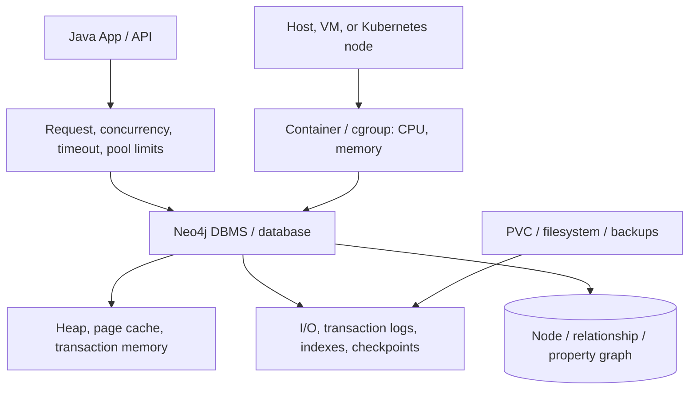
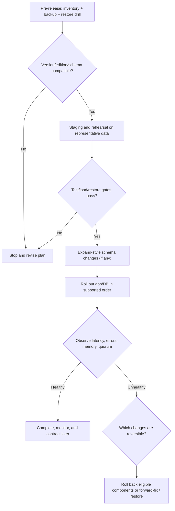
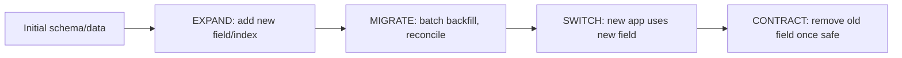

# Resource Limits, Safe Updates, and Rollback Plans When Deploying Neo4j

## 1. Why Does Deploying a Graph Database Require a Dedicated Plan?

Neo4j stores application data as a **property graph** of nodes, relationships, and properties. Services use **Cypher**, the **Neo4j Java Driver**, or **Spring Data Neo4j** to write orders, query connections, or traverse paths. In real deployments, changes go beyond a binary or container: a single release can simultaneously alter **schema indexes/constraints, RAM settings, persisted data, Neo4j version, and client behavior**.

Suppose a product recommendation service starts running a query that traverses two extra hops. The API stays up, yet intermediate relationship counts surge; heap or transaction memory spikes, latency climbs, the connection pool drains, and the Neo4j pod may get OOM-killed. Blindly raising the RAM limit without factoring in page cache and host limits can make things worse. Conversely, if a migration drops an old property, **rolling back to the previous application image** may fail to restore functionality.

This lesson belongs to the **Deployment** chapter of the `DATABASE_ENGINE_GRAPH_NEO4J` module, focusing on three tightly coupled pillars:

1. **Resource limits** — budgeting CPU, RAM, storage, connections, transactions, and queries.
2. **Safe updates** — ordered changes, maintaining compatibility, monitoring signals, and enforcing stop gates.
3. **Rollback plans** — knowing exactly which components are reversible, and when to *forward-fix* or restore data from backups.

### Learning Outcomes

After this lesson, you will be able to:

- Build a Neo4j resource budget based on workload and machine/container limits.
- Distinguish Kubernetes `requests` and `limits` from internal Neo4j resource limits.
- Define prerequisites for rolling updates, cluster deployments, or config changes.
- Design data and Cypher migrations following **expand → migrate → switch → contract**.
- Write runbooks with pre-, mid-, and post-release checks and **rollback gates**.
- Distinguish app, config, schema, and database binary rollbacks from **data recovery**.
- Organize load, fault, and recovery testing without putting production at risk.

> **Version scope:** Neo4j 5.x, newer releases, Enterprise clusters, Community, Aura, and Kubernetes/Helm do not share identical feature sets or upgrade procedures. All YAML samples, memory numbers, commands, and deployment sequences below are **conditional illustrations**, not copy-paste runbooks. In particular, rolling upgrades and downgrade feasibility must be verified against your **source/target versions, edition, store format, and official documentation**.

## 2. Three Resource Management Scopes Not to Equate



| Scope | Example Limits | Affected Unit | What Must NOT Be Inferred |
| --- | --- | --- | --- |
| Application | Request concurrency, Driver pool, query deadline | Requests pushed into Neo4j | Larger pool means the server processes faster |
| Neo4j runtime | JVM heap, page cache, transaction memory | Query memory, cached pages | Setting page cache equal to total RAM is safe |
| Container/VM | Memory limit, CPU quota, CPU request | Process resource ceiling/capacity | Pod running means database is ready |
| Storage | PVC capacity/IOPS, logs, backups | Persistence and recoverability | Free PVC space means no I/O bottleneck |
| Cluster | Primary/secondary, quorum, placement | Fault tolerance and load spread | Having replicas means having a backup to rewind time |

**Foundational rule:** Every limit must specify **units, enforcement layer, version, measured load, and what happens when hit**. Writing `memory: 32Gi` in a manifest without knowing how internal regions consume it will not protect the system.

## 3. Splitting the RAM Budget: Heap, Page Cache, Native, and OS

### 3.1. Planning Formula

One way to budget against container memory limits:

\[
M_{\mathrm{container}}\;\geq\;
M_{\mathrm{heap,max}}+
M_{\mathrm{pagecache}}+
M_{\mathrm{native}}+
M_{\mathrm{OS/filecache}}+
M_{\mathrm{plugins}}+
M_{\mathrm{headroom}}
\]

This is a **peak-and-headroom budget formula**, not a claim that every region stays pinned at its full allocation simultaneously. Avoid adding **initial heap and max heap** as two separate regions: they bound **the same heap**.

Components:

- **JVM heap:** query structures, Java objects, intermediate collections, and some transaction state.
- **Neo4j page cache:** holds store pages and eligible indexes to minimize disk reads.
- **Native/direct memory:** off-heap buffers and allocations, networking, runtime overhead.
- **OS filesystem cache:** especially critical for Lucene-backed indexes such as full-text/vector depending on version; not all indexes sit inside Neo4j page cache.
- **Plugins/algorithms:** APOC, GDS, or extensions can add extra load and memory regions.
- **Headroom:** peak variance, GC, compaction, checkpoints, ops tasks, and noisy load.

### 3.2. Example for a Container with a 32 GiB Limit

| Item | *Illustrative* Budget |
| --- | ---: |
| Max JVM heap | 8 GiB |
| Neo4j page cache | 14 GiB |
| Native/OS/filesystem cache/plugins | 6 GiB |
| Uncommitted headroom | 4 GiB |
| **Total** | **32 GiB** |

This is **not** a default recommendation for every environment. If vector indexes or GDS are used, 6 GiB may be too small; if queries `collect()` large payloads, 8 GiB heap may be tight; if the hot graph is huge, 14 GiB page cache may not fit.

Example `neo4j.conf` syntax for **one load-tested workload**:

```properties
server.memory.heap.initial_size=8g
server.memory.heap.max_size=8g
server.memory.pagecache.size=14g
```

In Neo4j 5.x, `server.memory.*` keys are commonly used; confirm exact names/semantics for your version. The values `8g` and `14g` only make sense alongside an actual **runtime resource limit**.

### 3.3. Why Container OOM-Kill Differs from JVM `OutOfMemoryError`

| Symptom | Possible Cause | Investigation Direction |
| --- | --- | --- |
| JVM throws `OutOfMemoryError` | Heap or related JVM region exhausted | Heap/GC, memory profile, queries, transactions |
| Container gets `OOMKilled` | Total cgroup-accounted memory exceeded limit | Heap + page cache + native + filesystem cache + plugins |
| GC pauses spike | Heap pressure, dense allocations | Bad query plans, huge result sets, concurrency |
| Page cache faults rise | Working set exceeds cache or cold warm-up | Queries, store/indexes, I/O, page cache size |
| RAM sufficient yet disk I/O bottlenecks | Low storage latency/IOPS, full scans | `PROFILE`, indexes, volume throughput |

**Never fix `OOMKilled` merely by increasing `-Xmx`.** Raising heap shrinks memory left for caches and native allocations, sometimes causing the pod to be killed even faster.

## 4. CPU, Transaction Concurrency, and Connection Pools

### 4.1. CPU Request Differs from CPU Limit

In Kubernetes:

- `resources.requests.cpu` guides scheduling and reserved capacity per cluster policy.
- `resources.limits.cpu` caps CPU usage via quota/throttling.
- Adding cores or raising CPU limits helps only if the workload can use them without hitting lock, I/O, or heap bottlenecks.

A query traversing too many relationships burns CPU even when returning only a few rows. Under heavy CPU throttling, query duration climbs, **connections stay checked out longer**, and Java Driver wait queues grow. Therefore, pair CPU sizing with **Cypher optimization**.

### 4.2. Concurrent Requests Do Not Scale Linearly with CPU Count

Suppose:

- 120 requests/second call Neo4j.
- Each query holds a connection for an average of 250 ms under measured load.

Estimated average active connections:

\[
\lambda \times W =
120\ \text{request/s}\times0.25\ \text{s}
=30
\]

If queries slow to 1 second due to I/O or lock contention, the average jumps to **120** at the exact same QPS. This is a queueing-theory estimate, **not an exact formula for choosing pool size**.

On the Java Driver side, consider:

- `withMaxConnectionPoolSize`: caps connections per target endpoint; across multi-member clusters and multiple app pods, total connections multiply.
- `withConnectionAcquisitionTimeout`: max wait for an available connection.
- `TransactionConfig.withTimeout`: server-side transaction time limit per config/version.
- `withMaxTransactionRetryTime`: retry budget for managed transactions.
- `withFetchSize`: batch fetch chunk size—**not** a cap on total returned records.

**A Java pool limit is not a cluster-wide resource limit.** 10 pods each allowing 50 connections to one target can exert up to 500 potential connections there. Size pools and pod counts in balance with Neo4j Bolt capacity, RAM, and active queries.

### 4.3. Backpressure Before Hitting the Database

If an API can receive 10,000 requests while Neo4j only handles a fraction stably, never let every thread wait on the pool until timeout. Apply:

- Admission control or bounded semaphores per use case.
- Bounded queues with explicit lengths and timeouts; fail fast intentionally when overloaded.
- Per-tenant/actor rate limits where appropriate.
- Budgeted timeouts from gateway → service → Driver → transaction.
- Retries with backoff and jitter; **never** stack unbounded retries across multiple layers.

When a request fails around commit, never assume it rolled back. Critical node/relationship writes need **idempotency keys, unique constraints, and duplicate-key handling rules**.

## 5. Disk, Transaction Logs, and Upgrade Headroom

### 5.1. Operational Volume Budgeting

Neo4j needs space for:

1. Graph store: nodes, relationships, properties.
2. Schema indexes, constraint-backed indexes, search data.
3. Transaction logs, checkpoints, and metadata.
4. Temporary workspace for imports, index builds, restores, or migrations per operation type.
5. Safety headroom before hitting operational thresholds.

Example of **one** 500 GiB PVC using illustrative measurements:

| Item | Capacity |
| --- | ---: |
| Graph store | 280 GiB |
| Index files excluded from store figure above | 45 GiB |
| Observed peak transaction logs | 35 GiB |
| Maintenance workspace | 50 GiB |
| Growth / variance reserve | 90 GiB |
| **Total budget** | **500 GiB** |

These numbers are **hypothetical** for practicing the method, not an official Neo4j footprint. If a real system puts store and transaction logs on **separate** volumes, budget each volume individually without double-counting filesystem metrics.

### 5.2. What Happens When a Volume Nearly Fills Up?

- New transactions fail because logs or data files cannot be written.
- Checkpoints, log rotation, and backups break or stall.
- Index population/upgrades run out of temporary space.
- Recovery after a restart becomes harder with zero free space.

**Never manually delete transaction logs or index files to "rescue disk."** Resolve via Neo4j-supported retention/pruning/backups/volume expansion with an explicit runbook and safety checks.

### 5.3. Capacity Is Not Full Storage Capability

Plenty of GiB with low IOPS/bandwidth still causes:

- Slow random traversals on page cache misses.
- Checkpoints or imports contending for I/O with live queries.
- Backups/restores blowing past RTO.
- Sluggish page cache warm-up after restarts.

Measure **latency, throughput, IOPS, queue depth, and page faults**, not just volume percent-used.

## 6. Docker and Kubernetes: Where Do Realistic Limits Go?

### 6.1. Kubernetes `resources` Example

The snippet below illustrates **part of a pod template**, not a complete Neo4j cluster manifest:

```yaml
spec:
  template:
    spec:
      terminationGracePeriodSeconds: 120
      containers:
        - name: neo4j
          image: neo4j:5.26
          resources:
            requests:
              cpu: "2"
              memory: 24Gi
              ephemeral-storage: 2Gi
            limits:
              cpu: "4"
              memory: 32Gi
              ephemeral-storage: 8Gi
          volumeMounts:
            - name: data
              mountPath: /data
```

This snippet **cannot run as a production cluster on its own**: it omits StatefulSet metadata, PVs/PVCs, networking/routing, credentials/TLS, probes, initial-member discovery, edition settings, and official chart components. The image tag and values are pinned as examples; **never use a floating `latest` tag** for a stateful database.

Meaning:

- Container memory limit is the **total ceiling** across all cgroup-tracked memory regions, not just JVM heap.
- Memory request differs from memory limit; never treat the gap as guaranteed free RAM.
- Low CPU limits can cause throttling; CPU requests primarily drive scheduling.
- `ephemeral-storage` does not replace persistent PVC capacity for database data.
- Mount `/data` to durable storage per Neo4j container/Helm guidance.

### 6.2. StatefulSet and PersistentVolume

Neo4j is stateful; restart/recreation workflows must **preserve the right volume, metadata, and instance identity** for the topology.

- PVCs must use an appropriate StorageClass, access mode, and IOPS; never assume storage allows multiple pods to mount one volume read/write.
- When a pod is replaced, critical data must remain on the PV, not inside the container's writable layer.
- Verify reclaim policies and cleanup behavior when deleting a Helm release/StatefulSet: **never accidentally delete PVCs/PVs holding production data**.
- For clusters, use **Neo4j-supported Helm charts/operators and runbooks** for your version instead of copying a single-pod manifest and scaling replicas to three.

### 6.3. Readiness, Liveness, and Startup

| Check | Purpose | Deployment Trap |
| --- | --- | --- |
| Startup probe | Gives the database enough time for boot/recovery | Threshold too short causes restart loops |
| Readiness probe | Admits traffic only when the instance is ready | Open TCP port doesn't prove target database/routing works |
| Liveness probe | Detects wedged states needing restart | Overly sensitive probe kills pods during GC or recovery |
| App smoke query | Verifies business queries and privileges | `RETURN 1` doesn't fully test Cypher/schema/RBAC |

Distinguish **process alive**, **DBMS online**, **target database online**, and **ready to serve reads/writes in the right role**. Probe design must fit Neo4j version, TLS, and clustering without adding heavy load per check.

### 6.4. PodDisruptionBudget Does Not Replace Quorum Conditions

A PodDisruptionBudget (PDB) limits certain **voluntary evictions** during Kubernetes node maintenance, yet:

- PDBs do not stop power loss or sudden node failures.
- `minAvailable` does not automatically know how many primaries each database holds.
- Kubernetes can mark pods `Ready` while the database still lacks quorum or write capability.

Pair PDBs with **topology, anti-affinity/zone placement, server/database status checks, and valid update ordering**.

## 7. Sizing Resource Budgets from Workload Before Picking Config Numbers

### 7.1. Baseline Dataset to Collect

Before releasing, gather at least:

| Group | Metrics / Questions |
| --- | --- |
| Data | Nodes, relationships, property/index sizes, degree P95/P99, growth rate |
| Queries | P50/P95/P99, DB Hits, Rows, heap/query memory, timeout counts |
| Transactions | Active transactions, lock hold times, retries, deadlocks |
| Java Driver | Pool acquisition delay, connection errors, active/idle/waiting counts if observable |
| Runtime | CPU usage/throttling, heap/GC, page cache hits/faults, native/OS memory |
| Storage | Free GiB, IOPS, latency, log growth, checkpoints, backup duration |
| HA | Routing/failover, database status, primary allocations, per-role lag |

Never look only at averages. Releases must examine **tail latency, peak windows, and minute/hour growth rates**. A single expensive query appearing in 1% of requests can exhaust the pool and degrade everyone else.

### 7.2. How to Determine a Starting Point

1. Confirm **database version/edition/store format**.
2. Gather current load and growth forecasts.
3. Run `neo4j-admin server memory-recommendation` as a **heuristic** for physical/allocated RAM in self-managed setups.
4. Place heap/page cache/native/OS/plugin budgets inside the container or VM limit.
5. Run representative workloads against realistically sized data.
6. Ramp load gradually, measuring when timeouts, CPU throttling, page cache faults, and I/O saturation appear.
7. Pick sizing with **safety headroom** rather than a short-lived peak QPS ceiling.

Example advisor command:

```bash
neo4j-admin server memory-recommendation --memory=32g
```

This command is a planning heuristic, not a substitute for load testing. For containers, pass the **actual container limit**, not total host RAM.

## 8. Classifying Changes Before Designing a Rollout

A release can span multiple change types with very different rollback characteristics:

| Type | Example | Key Risk | General Strategy |
| --- | --- | --- | --- |
| Client application | Add GraphQL/REST query, change SDN mapping | Old/new query incompatibility, pool growth | App canary, backward-compatible API |
| Cypher/queries | Add hops, add aggregations | CPU/heap/I/O, fan-out, timeouts | `EXPLAIN`/`PROFILE` and load tests |
| Schema | Create range index, unique constraint | Index population, duplicate data, write load | Prepare schema ahead, monitor status |
| Data migration | Rename IDs, add properties, swap relationships | Mass bad writes, lost original data | Small batches, idempotent, audit/checkpoints |
| Neo4j configuration | Heap, page cache, timeouts, Bolt settings | OOM, restarts, behavior changes | Review budget, observed rollout |
| Neo4j binary/version | Patch, minor/major upgrade | Store format, protocol, plugin, cluster compatibility | Vendor-supported upgrade path |
| Cluster topology | Add/remove servers or primaries | Quorum, routing, replication, reallocation | Dedicated allocation and failover plan |

**Do not bundle huge changes into one un-analyzable step.** Changing Java Driver pool size, lowering memory limits, upgrading the Neo4j image, and running a property-dropping migration all at once makes root-causing P99 spikes or data corruption nearly impossible.

## 9. Safe Gated Release Workflow



### 9.1. Gate 0: Lock Scope and Risk

Before deploying, record in the change ticket:

- Scope: database names, clusters, Java services, chart/image versions.
- **Baseline**: data counts, query latency, CPU/RAM, disk, failure rate, backup age.
- Compatibility: Neo4j Server ↔ Java Driver ↔ SDN ↔ APOC/GDS ↔ plugins.
- Expected downtime, read/write impact, change-freeze schedule.
- **RPO/RTO**, latest backup, and test restore results.
- Designated owner for stop/rollback decisions, communication channels, and watch hours.

### 9.2. Gate 1: Test in a Comparable Environment

Staging should mirror production **node/relationship structures, indexes, degrees, and write rates**. A 100-node graph cannot expose fan-out explosions on million-edge supernodes.

Verify:

1. Queries/schema/constraints and transactional use cases.
2. Migrations using the exact planned batch size.
3. Load tests covering reads/writes, bursts, timeouts, and retries.
4. Pod/server restarts, checking recovery and readiness.
5. Restoring a backup into an isolated environment to confirm the runbook works.

### 9.3. Gate 2: Gated Rollout with Pause Points

- Apply backward-compatible schema changes first if the new app needs them.
- Roll out app or database using its appropriate strategy—**never mix both strategies carelessly**.
- Proceed only when instances/databases hold expected roles, smoke queries succeed, and metrics stay stable.
- On critical alerts, **halt expansion** before deciding remediation.

### 9.4. Gate 3: Post-Release Verification

Inspect both **operational health** and **graph correctness**:

```cypher
SHOW DATABASES;
```

In environments with sufficient privileges and API support:

```cypher
SHOW SERVERS;
```

DBMS-level availability does not replace business queries. Example:

```cypher
MATCH (c:DeployCustomer {tenantId: $tenantId, customerId: $id})
RETURN c.customerId AS customerId,
       c.status AS status;
```

During rollout, also verify:

- Read/write requests succeed with expected privileges.
- Required schemas/indexes are ready.
- Error rates, timeouts, retries, and driver acquisition wait.
- CPU throttling, heap, GC, page cache faults, and storage.
- No migration batch ran twice or silently skipped error rows.

## 10. Safe Migrations: Expand First, Drop Later

**Expand → migrate → switch → contract** is a sound pattern for data changes when old and new app versions must coexist.



### 10.1. Example: Migrating from `state` to `status`

Suppose `:DeployCustomer` nodes currently hold `state` (`ACTIVE`/`SUSPENDED`). The new app wants `status` and needs lookups by tenant + status.

**Step A — Expand schema:** add the index without removing the old field.

```cypher
CREATE RANGE INDEX deploy_customer_tenant_status IF NOT EXISTS
FOR (c:DeployCustomer)
ON (c.tenantId, c.status);
```

Wait for index creation and check:

```cypher
SHOW INDEXES
YIELD name, type, state, labelsOrTypes, properties
WHERE name = 'deploy_customer_tenant_status'
RETURN name, type, state, labelsOrTypes, properties;
```

Do not assume an index creation command returning means the index is immediately **ONLINE** on a large database.

**Step B — Batch migrate:** during transition, the new app can read `coalesce(c.status,c.state)` if compatibility rules allow; writers must **dual-write** or use change tracking to avoid data drift.

A batched update:

```cypher
MATCH (c:DeployCustomer)
WHERE c.status IS NULL
  AND c.state IS NOT NULL
WITH c
LIMIT $batchSize
SET c.status = c.state
RETURN count(c) AS updated;
```

Re-run safely until records missing `status` reach 0; cap `$batchSize` at the job layer. In multi-writer systems, decide how to handle records written **between backfill runs**; one pass does not guarantee permanent sync.

**Step C — Switch:** the new app switches to preferring `status` once:

- Data quality is reconciled.
- Query plans on the new index meet criteria.
- Old writers no longer create records missing the new field (or compatibility code handles them).
- Canaries and error budgets pass.

**Step D — Contract:** drop `state` and old indexes/schema only after confirming **zero code/consumers still rely on them** and the old-app rollback window has closed.

```cypher
// ONLY to illustrate destructive cleanup after the stabilization period:
// MATCH (c:DeployCustomer) REMOVE c.state;
```

Never run destructive contract steps in the initial rollout; doing so demands detailed data recovery plans rather than merely rolling back an app image.

### 10.2. Unique Constraints and Non-Compliant Data

Before creating a new uniqueness constraint:

- Check for **duplicate keys** within the domain.
- Account for nodes missing the property: uniqueness constraints differ from property existence/key constraints.
- Separate data cleanup from constraint creation.
- Test two concurrent transactions once the index/constraint is online.

Example constraint on tenant + ID:

```cypher
CREATE CONSTRAINT deploy_customer_business_key IF NOT EXISTS
FOR (c:DeployCustomer)
REQUIRE (c.tenantId, c.customerId) IS UNIQUE;
```

Never auto-merge customers merely because they share a name or email unless application identity rules explicitly define that.

## 11. Java Driver and Spring Data Neo4j During Two-Version App Rollouts

### 11.1. Compatibility During Canary

During a rollout, **old and new app versions run side by side**. Therefore:

| Task | Compatibility Requirement |
| --- | --- |
| Reading new property | Fallback during backfill or wait until data is complete |
| Writing new relationship | Old app must not misinterpret or strip it when saving aggregates |
| Changing labels/types | Transition window supporting both old and new models |
| Adding constraints | Old writers must not keep creating violating records |
| Changing queries | Execution plans on new data/indexes must be measured |
| Upgrading Driver/SDN | Server and Bolt compatibility per official matrix |

In **Spring Data Neo4j**, never assume every `save()` updates only the property changed on a DTO: entity mapping and aggregate relationships can overwrite wider graph sections. For targeted edge updates, consider explicit Cypher and integration tests on realistic data.

### 11.2. Timeouts and Retries Can Alter Rollout Outcomes

A release with slower queries holds connections longer. If both the API and Driver retry, real load can surge abruptly:

```text
1 request
  -> gateway retries 2x
      -> service retries 2x
          -> Driver retries managed transaction
```

Do not turn these layers into a **retry storm**. Enforce an end-to-end budget and separate transient errors from data/constraint/syntax errors. For writes, require idempotency so disconnects near commit do not duplicate nodes/relationships.

### 11.3. Application Canary Is Not a Database Canary

You can route 5% of traffic to a new app version and ramp up while sharing a **backward-compatible schema**. However, a database is shared state: once a migration deletes data or upgrades the store format, a 5% traffic split **cannot isolate the impact** of that change.

Therefore, handle **reversible schema/data changes** first, using app canaries only to validate service-layer effects.

## 12. Updating Neo4j Server and Clusters: Unlike Stateless Apps

### 12.1. Standalone

For a standalone instance, plan:

1. Inventory versions, edition, plugins, configs, and databases.
2. Check the **Neo4j-supported** upgrade path (including store format and JDK requirements).
3. Take edition-appropriate backups/dumps; confirm restorability.
4. Stop writes / schedule a maintenance window if downtime is required.
5. Replace binary/image/config in the exact upgrade manual sequence.
6. Start up, verify recovery, indexes, online databases, and business queries.
7. Monitor post-release before reopening full traffic.

If an upgrade alters the **store format**, reverting the image tag may **fail to read the database**. Recovery plans must cite the pre-upgrade backup and environment rebuild steps—never promise "just `helm rollback`."

### 12.2. Cluster

In multi-primary clusters, risks include:

- Losing quorum if multiple primaries stop or upgrade simultaneously.
- Remaining members incompatible in protocol/version with upgraded members.
- Differing primary/secondary roles, routing, and per-database member allocations.
- Long reallocation/replication or disk exhaustion when members rejoin.

**Use rolling upgrades only for exact version pairs and topologies supported by Neo4j.** Some major upgrades require special steps or downtime. Never treat "always upgrade secondaries first, then one primary at a time" as universal law for every release.

Conditional workflow:

1. Check the compatibility matrix and version-upgrade steps in the manual.
2. Verify sufficient quorum/capacity and pre-change backups.
3. Pause automation that might move or disrupt members unexpectedly.
4. Upgrade members one by one **in the order confirmed by version docs**, observing cluster leave/join behavior.
5. Advance to the next member only after verifying **database allocations, roles, sync, read/write queries, and cluster stability**.
6. Verify plugin/Driver compatibility, finish post-upgrade steps, and monitor.

### 12.3. Do Not Let Kubernetes Delete All Pods Simultaneously

Automation updating every instance at once can destroy quorum. StatefulSet rolling updates **do not inherently understand all Neo4j election conditions or roles**. Configure update strategies and coordination per official chart/operator guidance, backed by PDBs, anti-affinity, zone placement, and explicit human operators.

Especially avoid upgrading databases like this:

```bash
# Example of WHAT NOT TO DO in production:
# kubectl delete pods --all -l app=neo4j
```

This is shown strictly as a warning comment, **not an operational step**. Simultaneous deletion can break read/write availability while the cluster is unstable.

## 13. Automatic Stop Gates and Rollback Triggers

### 13.1. Define Gates Before Starting

An **illustrative** release acceptance matrix:

| Signal | Pre-Release | Continue Condition |
| --- | --- | --- |
| HTTP 5xx | Current baseline | Stays within agreed threshold |
| P95/P99 query/API | Peak-hour baseline | Does not breach error budget/SLO |
| Database status | Online/expected roles | No unexpected offline critical databases |
| Cluster quorum | Matches config requirements | Write capability intact |
| CPU throttling | Not overloaded | No sustained spike |
| Heap/GC/OOM | Stable | Zero OOM/restart loops; no sharp GC surge |
| Page cache/I/O | Within bounds | No page-fault storms or storage saturation |
| Disk free | Sufficient for logs/upgrades/recovery | Above safety floor |
| Correctness | Invariants and API contract checks | Zero bad data or tenant leaks |

**Specific thresholds must reflect SLOs, load, and environment**, never arbitrary rules like "always roll back if P99 rises 10%." A data integrity bug may demand immediate stop even when latency looks great.

### 13.2. Three Response Modes

1. **Pause rollout:** halt further progression, hold current state for investigation.
2. **Roll back reversible components:** revert configs or app versions while schema/data remain compatible.
3. **Forward-fix or restore:** apply a forward bug fix, or restore from a verified recovery point after halting writers.

Define who authorizes each decision, what diagnostic state to capture, and how to notify connected services.

## 14. Rollback Plans: What Exactly Gets Rolled Back?

| Component | What Can Be Done? | Conditions / Limits |
| --- | --- | --- |
| Java application | Redeploy prior image, shift traffic back | Schema/API/data remain backward-compatible |
| Feature flag | Disable new feature/query | Turning off code does not undo already-committed writes |
| Neo4j configuration | Revert config and restart per guidance | Must fit resource limits; may need maintenance window |
| New index | Keep or drop once confirmed unnecessary | Dropping indexes can slow queries; does not restore data |
| New constraint | Adjust only if business-safe | Dropping constraints weakens data protection; never react mechanically |
| Non-destructive data backfill | Read old property again or forward-fix | Mutated data needs audit trails and checkpoints |
| Property/node/relationship-deleting migration | Usually **has no natural undo** | Restore data, replay from event logs, or forward-fix |
| Neo4j binary/store format | May require dedicated recovery path | Direct downgrade may be unsupported |
| Cluster topology | Reallocate servers/roles per procedure | Must not break quorum or arbitrarily wipe state |

### 14.1. Application Rollback ≠ Database Rollback

Suppose the new app writes `status` and ignores `state`. If the rollout immediately removes `state`, rolling back to the old app causes it to read `null` and fail. Therefore, **the app rollback window** must be reflected in the `contract` schedule: never drop legacy data until the approved rollback window expires.

### 14.2. Restoring a Backup Can Lose Valid Recent Writes

Restoring a 10:00 backup after an incident at 10:17 **drops valid transactions committed after 10:00**. Before restoring production:

- Pinpoint when corruption began and the **target recovery point**.
- Pause/freeze relevant writers and capture state if possible.
- Assess **RPO and scope of lost writes**; notify business stakeholders.
- Verify backup chain, storage capacity, restore time, and consistency.
- Plan to replay or reconcile events/orders recorded in external systems.
- Use an isolated recovery environment to verify before switching clients.

An HA replica is a **live data copy**, not a historical snapshot; committed bad writes usually replicate there too. Never treat "pick a secondary with stale data" as a restore substitute without formal guarantees and plans.

### 14.3. Binary Rollback After Store Format Upgrade

Do not confuse `helm rollback` or switching `image: neo4j:old` with reverting the store. Upgrades can modify **store formats, metadata, and system state**. Old binaries are not guaranteed to read upgraded stores, and testing directly on production volumes increases risk.

When direct downgrade is unsupported by the vendor, safe paths are **fix-forward**, or provisioning a compatible instance/cluster and restoring from the pre-upgrade backup via a verified procedure.

## 15. Step-by-Step Sample Deployment Runbook

### 15.1. Pre-Change Preparation

| Step | Owner | Completion Evidence |
| --- | --- | --- |
| 1. Inventory versions/cluster/configs | DB platform team | Timestamped version inventory |
| 2. Check app/Driver/SDN/Neo4j compatibility | Tech lead | Compatibility checklist |
| 3. Backup and restore drill | DB operations | Artifact + successful restore log |
| 4. Check PVC free space, page cache, heap/CPU | SRE | Baseline dashboard and headroom |
| 5. Verify migration queries & indexes | Data/DB engineer | Staging run + `PROFILE`/row counts |
| 6. Set gates, approvers, maintenance window | Release manager | Change record and comms plan |

### 15.2. Execution

1. Record a release start marker; throttle competing ETL/batch jobs.
2. Apply safe **expand schema** changes; wait for indexes/constraints to come online.
3. Run backfills in small transactions with `batchId` and checkpoints; check row counts per batch.
4. Roll out app canary or Neo4j Server using the **strategy supported for each**.
5. After each step, verify database online status, app smoke tests, latency, and error rates.
6. If a gate fails, **pause**, identify the faulty component, and execute the designated branch.
7. Keep compatibility code/schema intact through the rollback window.
8. Once stable, close the release and schedule **contract** in a separate controlled change.

### 15.3. Post-Release

Record:

- Running image/chart/config versions.
- Timestamps, affected databases/clusters, backup artifacts.
- Completed migration jobs and accepted checkpoints.
- Before/after metrics: P99, CPU/GC, page cache, index status, disk.
- Smoke test results, invariants, remaining issues, and follow-up tickets.
- End time of the application rollback window.

If an incident occurred, the postmortem should state **which safeguard failed** and what test or gate to add, rather than merely writing "rollback succeeded."

## 16. Three Sample Incident Scenarios

### Scenario A — OOMKilled After Reducing Memory Limit

**Context:** Pre-release, the pod had a 32 GiB limit, 8 GiB max heap, and 14 GiB page cache. The new release cut the limit to 20 GiB while leaving Neo4j configs unchanged.

**Symptoms:** Pod gets OOMKilled under rising load, APIs time out, and Bolt connections drop repeatedly.

**Analysis:** Heap + page cache alone consume **22 GiB**, before native/OS/plugins. A 20 GiB limit cannot fit the minimum budget here.

**Action:** Halt rollout, restore limits/configs compatible with host resources if permitted, inspect database health post-restart, and watch load. Then **re-tune memory budgets with measurements**, rather than blindly raising both heap and page cache.

### Scenario B — New Query Overloads System During App Canary

**Context:** A new API runs `(u)-[:FOLLOWS*1..6]->(v)` on a graph with huge supernodes without narrowing the starting anchor.

**Symptoms:** P99 spikes, CPU climbs, Driver acquisition times out, even though RAM isn't full.

**Action:** Disable the feature flag/canary, analyze the query with `EXPLAIN`/`PROFILE` on representative data, narrow anchors, and cap path depth and results. Adjust pool sizes only after fixing the expensive query.

```cypher
// Example focusing on one user instead of expanding from all nodes:
MATCH (u:DeployUser {userId: $userId})
MATCH p = (u)-[:FOLLOWS*1..3]->(v:DeployUser)
RETURN v.userId AS connectedId, length(p) AS hops
LIMIT 100;
```

Even this query can be expensive under extreme fan-out; `LIMIT` caps returned rows, **not all intermediate expansion steps**. Measure against real workloads and consider returning booleans or shortest paths depending on the use case.

### Scenario C — Backfill Accidentally Drops Legacy Property

**Context:** A migration removed `state` before the old app stopped reading it. When rolling back to the old app image, requests failed on missing properties.

**Action:** Do not merely redeploy images. Protect writers, assess what can be reconstructed from `status`, backup points, or business logs; choose forward-fix or restore per approved RPO. Add a dual-read/dual-write phase and defer `contract` to the next release.

## 17. Pre-Release Testing and Rollback Rehearsals

### 17.1. Required Test Types

| Test | Goal | Priority |
| --- | --- | --- |
| Query correctness | Zero wrong nodes/relationships/tenants | Mandatory |
| Migration idempotency | Re-runs do not duplicate or mis-overwrite data | Mandatory |
| Concurrency + constraints | Zero duplicates under concurrent writers | Mandatory for critical data |
| Rollback app compatibility | Old app still works while schema is expanded | Mandatory if rollback window exists |
| Load testing | P95/P99, resources, pool/timeouts | High |
| Pod restart/recovery | Database returns online cleanly | High |
| Cluster failover/quorum | Test losing a member per topology | High for Enterprise HA |
| Backup restore drill | Can recover data and privileges | Mandatory for production |
| Upgrade rehearsal | Binary/store/config/plugin compatibility | Mandatory before DB upgrades |

### 17.2. An Idempotent Migration Test

For the `state → status` batch, after running twice:

```cypher
MATCH (c:DeployCustomer)
WHERE c.state IS NOT NULL
  AND (c.status IS NULL OR c.status <> c.state)
RETURN count(c) AS mismatched;
```

This checks a **transitional invariant** while `state` and `status` must stay synced. It stops applying once business rules allow the two fields to diverge or after contract finishes.

### 17.3. Rehearsing Release Halts and Recovery

Practice in staging:

1. Take a backup, restore to a fresh environment, and verify identities/relationships/constraints.
2. Run a migration with an injected mid-batch failure; verify checkpoints and resume.
3. Deploy the new app, then roll back the app while schema stays expanded: does the old app still work?
4. Simulate a failure after an **irreversible** change; practice **forward-fix** or restore, recording actual RPO/RTO.
5. Confirm no legacy jobs still write to the target database post-cutover.

Never run destructive tests (dropping databases, killing all pods, overwriting restores) in production without an authorized, verified plan.

## 18. Design Mistakes and Fixes

| Wrong Practice | Consequence | Right Practice |
| --- | --- | --- |
| Sizing container RAM to heap + page cache only | Native/OS starved, OOMKilled | Reserve RAM for all regions plus headroom |
| Increasing Java pool to compensate for slow queries | Pushes bottleneck onto DB server | Optimize Cypher, cap concurrency, re-measure |
| Monitoring only average CPU | Misses throttling, GC, and P99 | Monitor tail latency and saturation |
| Not storing data on PVCs | State lost when pod is replaced | Use durable storage and clear PV/PVC rules |
| Treating TCP probe as "write ready" | Admits traffic before DB online/quorum | Pair readiness with DB status and smoke queries |
| Deleting multiple primaries at once during updates | Loses quorum, causes downtime | Follow Neo4j-supported upgrade order |
| Assuming rolling upgrades work for all major versions | Can violate compatibility/store format | Check upgrade paths and downtime requirements |
| Creating index and immediately querying in app | Index not yet ONLINE | Wait for population, verify query plans |
| Dropping legacy property in first release | Old app cannot roll back | Expand/migrate/switch, contract later |
| Trusting `helm rollback` to revert the store | Old binary may not read upgraded store | Restore/fix-forward per manual |
| Skipping backups because replicas exist | Accidental deletes replicate everywhere | Independent backups and restore drills |
| Retry callbacks calling external APIs | Duplicate side effects despite DB rollback | Idempotency/outbox, separate transactions |
| Having backups without restore drills | Unknown backup chain/RBAC/recoverability | Rehearse recovery with representative data |
| Judging rollout solely by pod Ready | Business logic errors may still occur | Health + query + schema + correctness gates |

## 19. Practice Exercises and Solutions

### Exercise 1. RAM Budget

A Neo4j pod has a 24 GiB memory limit, 10 GiB max heap, and 12 GiB page cache. Operations reports "2 GiB left, so it's safe." Comment.

**Answer:** Insufficient evidence. RAM is still needed for native/direct memory, filesystem cache, OS/container, plugins, and headroom; total consumption can exceed 24 GiB under load. Measure empirically and adjust before deploying.

### Exercise 2. Rough Connection Concurrency Math

A service receives 200 requests/second, each holding a Bolt connection for 150 ms on average. Estimate average concurrency. What if queries slow to 750 ms?

**Answer:** Initially `200 × 0.15 = 30`, then `200 × 0.75 = 150`. This is only a queueing/concurrency estimate; do not blindly set pool size to 150 without accounting for multiple pods, servers/members, and load conditions.

### Exercise 3. Incompatible Schema

A new app release moves to the `status` property. Should you drop `state` during a 5% canary while 95% of traffic still runs the old app?

**Answer:** No. The old app may still read `state`; use expand, migrate, switch with compatibility code, and contract after the rollback window.

### Exercise 4. Cluster Rolling Upgrade

An Enterprise cluster has three primaries and one secondary. Operations wants to replace all three primaries simultaneously because "Kubernetes will restart them automatically." Why is this risky?

**Answer:** It risks losing quorum, disrupting routing/replication, and causing mixed-version failures. Upgrade order must follow the documentation for the exact **version/edition pair**, checking every database's status after each step.

### Exercise 5. Disk Limits

A 500 GiB PVC holds 280 GiB graph store, 45 GiB indexes, 35 GiB peak transaction logs, and 50 GiB temp workspace. How much remains for growth/headroom in this example?

**Answer:** `500 - 280 - 45 - 35 - 50 = 90 GiB`. Maintain operational safety margins instead of waiting until the volume fills up.

### Exercise 6. Can Helm Roll Back Everything?

After upgrading Neo4j DBMS, the store format upgraded and a new plugin wrote metadata. Can running `helm rollback` to the old image guarantee full database recovery?

**Answer:** No. Older binaries may not support the newer store format; you must use a version-appropriate rollback/restore path or forward-fix. Pre-upgrade backups, restore rehearsals, and compatibility checks are mandatory beforehand.

### Exercise 7. Deciding Among Pause, Rollback, and Restore

One migration updating `status` runs slowly without corrupting data; another migration accidentally deleted 5% of relationships. Should both be handled identically?

**Answer:** No. The slow migration can be paused to assess load, shrink batch sizes, and optimize; the accidental deletion is a data incident requiring writer freeze, audit/backup review, and forward-fix or restore per RPO/RTO.

### Exercise 8. Rollout Gate

The application reports 0% HTTP errors, yet P99 triples while page cache faults and acquisition timeouts climb. Should you promote the canary from 10% to 100%?

**Answer:** Do not rely solely on HTTP 5xx. Pause, investigate query plans, CPU/I/O/cache, connection hold times, and pool saturation; proceed only once metrics pass approved gates.

## 20. Final Pre-Production Deployment Checklist

- [ ] Clear inventory of **Neo4j version, edition, store format, plugins, Driver/SDN, and cluster topology**.
- [ ] Baseline measurements captured: query P95/P99, CPU throttling, heap/GC, page cache faults, disk, transaction logs, and pool.
- [ ] Container RAM limit exceeds heap + page cache + native/OS + headroom budget.
- [ ] CPU requests/limits load-tested against realistic workloads.
- [ ] PV/PVC configured with durable policies; room reserved for indexes/backups/upgrades.
- [ ] Health probes, startup/recovery times, and online database conditions tested.
- [ ] Edition-appropriate backups/dumps and **restore drill** succeeded.
- [ ] Schema/indexes/constraints and Cypher compatible across old/new apps.
- [ ] Migrations run in batches, idempotently, with audit/checkpoints and reconciliation.
- [ ] Caps enforced on query/path fan-out, connection pools, and end-to-end retries.
- [ ] Neo4j version pair and rolling upgrade method verified in official docs.
- [ ] Cluster steps preserve quorum and monitor database/server roles.
- [ ] Canary/gates, pause owner, and SLO-based alerts defined.
- [ ] Rollback plan distinguishes app, config, schema, store format, and data.
- [ ] Helm/image rollback is never promised as recovery for deleted data or upgraded stores.
- [ ] Data recovery approver, RPO/RTO plan, and dual-writer prevention at cutover assigned.
- [ ] Post-release monitoring, decision logs, and compatibility-window expiration recorded.

## 21. Summary

Neo4j **resource limits** must be designed end-to-end across the Java application, connection pools, and Cypher down to JVM heap, page cache, OS/native memory, CPU, and PVCs. Limits at one layer never replace measurements at another. A relationship-heavy query, long transaction, or unchecked pool change can overload the system even without node growth.

**Safe updates** require compatible data/schemas, staged rollouts, and explicit observability gates. For Neo4j clusters, stateful database changes must respect quorum, version/edition rules, and supported upgrade paths—stateless rollout templates cannot be applied blindly.

**Rollback plans** must specify which component rolls back. Reverting an app image does not restore deleted nodes, relationships, or properties, and may not be compatible with an upgraded store format. A responsible release therefore combines **verified backups, expand/migrate/switch/contract, rollback gates, forward-fixes where appropriate, and data recovery rehearsals**.

### References

- [Neo4j Operations Manual – Memory configuration](https://neo4j.com/docs/operations-manual/current/performance/memory-configuration/)
- [Neo4j Operations Manual – Neo4j on Kubernetes](https://neo4j.com/docs/operations-manual/current/kubernetes/)
- [Neo4j Operations Manual – Docker deployment](https://neo4j.com/docs/operations-manual/current/docker/)
- [Neo4j Operations Manual – Upgrade and migration](https://neo4j.com/docs/operations-manual/current/upgrade/)
- [Neo4j Operations Manual – Clustering](https://neo4j.com/docs/operations-manual/current/clustering/)
- [Neo4j Operations Manual – Backup and restore](https://neo4j.com/docs/operations-manual/current/backup-restore/)
- [Neo4j Cypher Manual – Indexes](https://neo4j.com/docs/cypher-manual/current/indexes/)
- [Neo4j Cypher Manual – Query tuning](https://neo4j.com/docs/cypher-manual/current/planning-and-tuning/)
- [Neo4j Java Driver Manual – Advanced connection](https://neo4j.com/docs/java-manual/current/connect-advanced/)
- [Spring Data Neo4j Reference](https://docs.spring.io/spring-data/neo4j/reference/)
