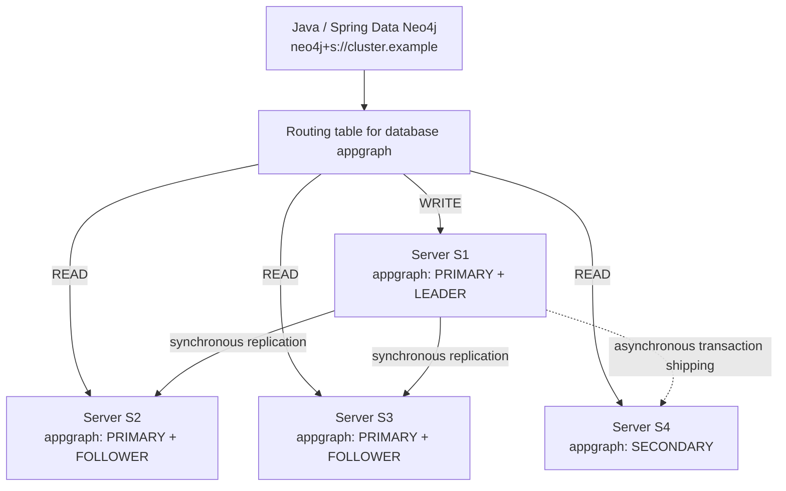
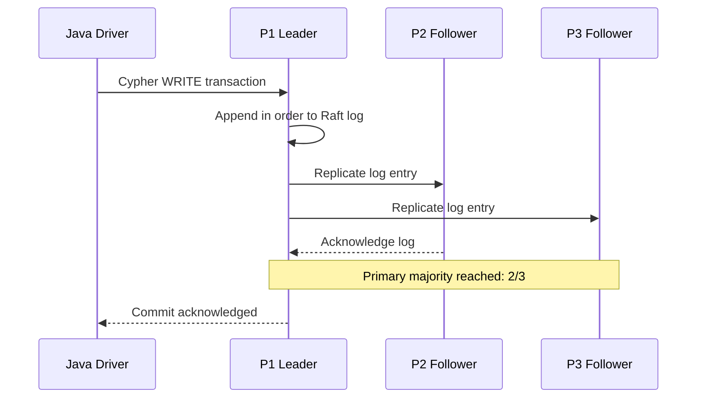
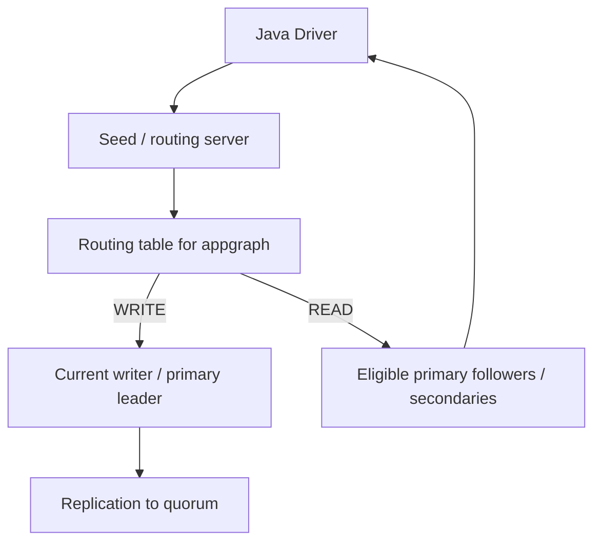

# Server Roles, Consensus Mechanisms, and Write Authority in a Neo4j Cluster

## 1. Why Must You Distinguish Servers, Database Replicas, and Write Authority?

Neo4j stores data as a **property graph**: nodes represent entities, relationships represent directed links, and labels/types and properties organize the data. Cypher creates and queries graphs; the Java Driver and Spring Data Neo4j carry those transactions from applications into the database.

When an application scales up in load or requires high availability, Neo4j **Enterprise Edition** can run multiple servers as a **cluster**. However, “having five machines” does not mean “all five machines can independently write to the same database.” You must distinguish:

1. **Server:** a Neo4j process with CPU, RAM, disk, endpoints, and the ability to host multiple databases.
2. **Database allocation/copy:** a replica of a **specific database** placed onto a server, holding a *primary* or *secondary* role.
3. **Leader/writer:** a **primary** elected as the coordinator to order and process write transactions for that database.
4. **Consensus/quorum:** the set of primaries requiring a majority to confirm writes are durable and safe.
5. **Database access/RBAC:** even when a writer exists, the database might be set to read-only mode or the **application account may lack WRITE privileges**.

**Core principle:** `PRIMARY`/`SECONDARY` roles belong to **database allocations**, not fixed server labels. With multiple databases, the same server can be a primary for database A, a secondary for B, leader for A, and follower for C. <https://neo4j.com/docs/operations-manual/current/clustering/introduction/>

### 1.1. Conceptual Model



The diagram simplifies a database with three primaries and one secondary. All replicas hold the same logical database, **not four independent business graphs**. Depending on routing policy, read queries may also go to other primaries or even the writer.

### 1.2. Scope and Deployment Conditions

- This lesson focuses on **Neo4j Enterprise clustering** with primary/secondary replicas of *standard databases*. Community Edition lacks an equivalent Enterprise cluster model.
- With **Neo4j Aura**, the managed service handles topology and operational procedures; applications still need to understand routing, read/write, and consistency, but cannot run arbitrary server-orchestration commands as in self-managed deployments.
- Recent Neo4j also provides **sharded databases** and cross-cluster replicas in certain versions/tiers. **Do not confuse** primary/secondary replicas of **a single standard database** in this lesson with data partitioning (*sharding*) or CDC mechanisms.
- Example administrative syntax applies to Enterprise and must only be run by authorized users against the **`system` database** in approved environments.

## 2. Roles of a Database Replica

| Replica type | Participates in write majority? | Can be writer/leader? | Can serve reads? | How updates arrive |
| --- | --- | --- | --- | --- |
| **Primary currently leader** | Yes | **Currently the writer** | Yes, depending on routing policy | Receives transactions, orders them, replicates to other primaries |
| **Primary currently follower** | Yes | Can be elected writer later | Yes | Syncs logs with leader and acknowledges per Raft |
| **Secondary** | **No** | **No** | Yes, used to scale read load | Receives transaction logs **asynchronously** from upstream |

### 2.1. Primary Does Not Mean All Primaries Write Independently

Every primary replica is eligible to **participate in write processing** and be elected leader. Yet at any instant there is **one writer** per logical database. Non-leader primaries act as followers and provide fault tolerance.

Example:

```text
Database appgraph:
   S1  PRIMARY / LEADER / writer=true
   S2  PRIMARY / FOLLOWER / writer=false
   S3  PRIMARY / FOLLOWER / writer=false
   S4  SECONDARY          / writer=false
```

When an application sends a write transaction, it must execute along the appropriate writer path. Follower primaries **do not simultaneously accept an independent commit stream** for `appgraph`.

### 2.2. Secondaries Scale Reads, Not Quorum

A secondary is a replica that receives committed transactions from primaries via an asynchronous mechanism. It suits reports, dashboards, read-heavy workloads, or offloading read pressure from primaries.

Consequences:

- Secondaries can **lag** behind the writer’s latest data.
- Adding more secondaries can increase **read query** throughput under appropriate workloads and routing; it does not increase primary Raft votes.
- Losing a secondary does not directly lose write quorum, though it reduces read capacity and can shift load onto remaining replicas.
- If no writer/quorum remains while a secondary still holds a copy, it may still serve some **reads**, but cannot be used to “elect” a new writer for a standard database.

Never promise business logic that “reading from a secondary always sees newly written data immediately” without a proper **causal consistency/bookmark** policy.

### 2.3. Role of the `system` Database

Neo4j stores DBMS metadata, database topology, and administrative data in the **`system` database**. Replicas of `system` also have primary/secondary roles and their own consensus mechanism, though mode configuration differs from standard databases:

```properties
# Example configuration only for a server intended to host a system primary.
server.cluster.system_database_mode=PRIMARY
```

Do not use `ALTER DATABASE system SET TOPOLOGY ...` as with user databases. Plan `system` topology as part of initial cluster architecture: if `system` loses quorum, topology administrative operations can be impaired even while some queries on user databases continue running.

## 3. Raft: Why Only One Leader Determines Write Order

**Raft** is the consensus protocol primaries use to agree on transaction ordering. Each standard database has its **own Raft group** among the primaries hosting that database.

### 3.1. Raft Roles

A primary participates in one of these roles:

| Raft role | Description |
| --- | --- |
| **Follower** | Receives heartbeats and log entries from leader, participates in votes; does not coordinate commits itself |
| **Candidate** | When no leader heartbeat arrives for long enough, requests votes to contest leadership |
| **Leader** | Acts as the ordering point for writes and coordinates replication/commits |

One server can be leader of database `appgraph` while being follower of database `analytics`. Thus “the cluster has a single leader” is **false** whenever the DBMS contains multiple databases.

### 3.2. A Write Transaction Flowing Through the Cluster



In a three-primary topology, the leader needs **itself plus at least one follower** to form a majority. One follower may respond slowly or temporarily disconnect; as long as the leader holds a valid majority, the cluster can keep committing.

The full lifecycle also includes transaction validation, logging, store application, and sending results to the client. Do not infer that **all** secondaries or **all three** primaries have applied the same transaction the instant the driver receives commit confirmation; the strict guarantee corresponds to Raft quorum and durability.

### 3.3. When the Leader Is Lost: Election

If followers stop receiving valid heartbeats from the leader:

1. After an election timeout, a follower may transition to **candidate**.
2. The candidate requests votes from other primaries in the same Raft group.
3. Primaries refuse to vote for candidates whose logs are behind Raft safety requirements.
4. A candidate receiving a **majority** becomes the new leader and assumes write responsibility.
5. The driver’s routing table refreshes to direct writes to the current writer.

During the role transition, transient errors, retries, and latency spikes can occur. **Never assume leader election is instantaneous** or that all in-flight transactions succeed. Applications must handle transient errors, timeouts, and uncertain commit outcomes.

### 3.4. How Raft Prevents Write Split-Brain

Two partitioned network groups may both **believe** their own server is leader briefly, yet they cannot **both obtain two disjoint majorities** from the same set of primaries. Only the side holding quorum can continue acknowledging valid commits, preventing two conflicting write histories from being accepted as dual sources of truth for one database.

That safety comes with a trade-off: **a minority partition must stop accepting writes**. Never enable “emergency writes” on a minority to bypass quorum in a standard cluster; forcing improper topology recovery risks data loss or breaking consistency.

## 4. Quorum and Fault Tolerance

With `N` primaries allocated for a database:

\[
\text{quorum}(N) = \left\lfloor \frac{N}{2} \right\rfloor + 1
\]

The number of primaries that can go offline while preserving write quorum in count terms is:

\[
F_{\max}=N-\text{quorum}(N)
\]

| Primaries N | Quorum needed | Max disconnected primaries tolerated | Interpretation |
| ---: | ---: | ---: | --- |
| 1 | 1 | 0 | No write fault tolerance |
| 2 | 2 | 0 | Losing one primary loses quorum |
| 3 | 2 | 1 | Common HA pattern |
| 4 | 3 | 1 | Higher cost than 3 without increasing tolerated failures |
| 5 | 3 | 2 | Tolerates two failed primaries |
| 7 | 4 | 3 | Higher fault tolerance, higher resource/latency cost |

In primary sizing, **odd counts** like 3 or 5 are usually more efficient than adjacent even counts for fault tolerance. The familiar formula:

\[
N=2F+1
\]

indicates that surviving `F` primary failures without losing write capability typically requires `2F+1` primary replicas. This condition concerns **replica count and reachability**; regional failure distribution, network latency, and overload still affect real-world behavior.

### 4.1. Three Primaries and Two Secondaries Scenario

```text
appgraph = 3 PRIMARY + 2 SECONDARY
P1 leader, P2/P3 followers; S1/S2 secondaries
Quorum = 2 primaries
```

| Incident | Quorum holds? | Write capability | Read capability |
| --- | --- | --- | --- |
| Lose one secondary | Yes, 3 primaries | Continues | Reduced read capacity |
| Lose P3, P1/P2 reachable | Yes, 2/3 | Can continue | From healthy replicas |
| Lose P1 leader, P2/P3 reachable | Yes, 2/3 | Brief pause for election, then can continue | Depends on role, lag, and routing |
| Lose P2 and P3, only P1 remains | **No**, 1/3 | **Cannot** accept new commits | May still read from available replicas without guarantee of latest data |
| Lose all three primaries, S1/S2 remain | No | **Cannot** | Secondaries may hold previously received data; recovery runbook needed |

**Secondaries are never counted in the quorum numerator/denominator.** In the case where P1 and two secondaries survive, having three live servers total is still **insufficient** for writes because only **1/3 primaries** remain.

### 4.2. Multi-Zone Clusters

Three primaries placed across three different zones can tolerate losing one zone. However, transactions must wait for a primary quorum, so inter-zone network latency can raise write latency. Only distribute primaries across zones when link reliability and latency budgets permit.

A “2 primaries in zone A, 1 in zone B” placement **loses write quorum if zone A fails**, even though zone B still has one live primary. Always calculate quorum **under zone-failure scenarios**, not merely by total server count.

If the primary goal is scaling reads in a distant region, secondaries may be more effective than placing distant primaries. Note that secondaries have **replication lag**, so weigh data freshness and read consistency needs.

## 5. Distinguishing Three Meanings of “Allowed to Write”

A Cypher `CREATE` or `MERGE` statement succeeds only if **all three layers** allow it:

| Layer | Question | Example write block |
| --- | --- | --- |
| **Cluster/quorum** | Does the database have a valid writer and primary majority? | 2/3 primaries lost, election incomplete |
| **Database access mode** | Is the database currently `read-write` or set to `read-only`? | `ALTER DATABASE appgraph SET ACCESS READ ONLY` |
| **User/role authorization** | Does the account have `ACCESS` and rights to create/edit nodes, relationships, properties? | Role only has `MATCH` privilege |

In addition, there are **network access**, TLS, authentication, and business-level errors such as constraints, locks, or transaction timeouts. “The database has a leader” **does not mean** every user is permitted to write.

### 5.1. Write Authority Decided by Raft

If `SHOW DATABASES` shows a primary with `writer = true`, that is **current topology status** indicating the replica is accepting writes. The `writer` column **does not represent** the privileges of account `app_writer`.

Followers can process read transactions, participate in replication, and become leader after elections. Secondaries are never elected writer. When a user sends a request to a non-writer server, client-side routing or server-side routing can forward it to the writer depending on configuration. Never force backends to send all writes to a hardcoded IP.

### 5.2. Write Authority at the Database Access Mode Level

On **self-managed Neo4j Enterprise**, operators can switch a standard database to read-only mode:

```cypher
// Run only on the system database, with DBA privileges.
ALTER DATABASE appgraph SET ACCESS READ ONLY;
```

To restore read-write access at the configuration layer:

```cypher
ALTER DATABASE appgraph SET ACCESS READ WRITE;
```

These two commands are **administrative examples only**—do not run them arbitrarily in production. `SET ACCESS READ WRITE` **does not create quorum**, **does not override user DENY privileges**, and can still be overridden by server settings like `server.databases.read_only` or equivalent under the stricter-mode-wins rule.

On Aura, access-mode admin operations have different restrictions than self-managed deployments; do not assume `ALTER DATABASE ... SET ACCESS` works on every tier.

### 5.3. Write Authority via RBAC

In Enterprise, database and graph privileges are granted to **roles**; a user can hold multiple roles. Syntax-illustration example run on `system` by a DBA:

```cypher
GRANT ACCESS ON DATABASE appgraph TO app_readers;
GRANT MATCH {*} ON GRAPH appgraph TO app_readers;

GRANT ACCESS ON DATABASE appgraph TO app_writers;
GRANT MATCH {*} ON GRAPH appgraph TO app_writers;
GRANT WRITE ON GRAPH appgraph TO app_writers;
```

This assumes `app_readers` and `app_writers` **already exist**, database `appgraph` exists, and the DBA has configured other necessary grants. `WRITE` permits graph write operations, but does not automatically include all **schema/token management** privileges; if the application introduces new labels/types/properties, token-creation privileges or DBA pre-created schema may be required.

Never grant `admin` to a backend merely to `MERGE` a node. Restrict privileges by label/type/property where business rules permit. The cluster **primary** role has nothing to do with a security role named `app_writers`.

### 5.4. Java Driver Read Access Mode Is Not a Security Mechanism

`session.executeRead(...)` and `AccessMode.READ` are **routing/performance** hints: the Driver picks an appropriate read endpoint. They are **not** authorization controls; do not assume a client holding write credentials/roles is safely blocked from writing simply because it calls `executeRead`. Real security lives in Neo4j RBAC, secrets, and network controls.

## 6. Each Database Has Its Own Topology

A Neo4j Enterprise cluster is a shared pool of server resources, rather than dedicating each server to a single database. Example:

| Server | `appgraph` | `analytics` | `system` |
| --- | --- | --- | --- |
| S1 | Primary **leader** | Primary follower | Primary |
| S2 | Primary follower | Primary **leader** | Primary |
| S3 | Primary follower | Secondary | Primary |
| S4 | Secondary | Primary follower | Secondary |
| S5 | Secondary | Not hosted | Not hosted |

Each user database has its **own leader, quorum, replication, and read scaling**. If `appgraph` loses quorum while `analytics` retains enough primaries, write behavior differs between the two databases. Therefore never interpret “cluster health = good” as a guarantee that **every database** has a working writer.

### 6.1. Server-Level Constraints Are Not Database Writer Roles

A server can be assigned an allocation constraint:

```cypher
// Administrative example; do not run in production without a plan.
ENABLE SERVER 'server-uuid' OPTIONS {modeConstraint: 'SECONDARY'};
```

Depending on server state, `modeConstraint: 'SECONDARY'` restricts which database allocations may be placed onto that server. It **does not turn** the server into any database’s leader, nor does it allow secondaries to write. `PRIMARY` or `NONE` can be used when aligned with server capacity and purpose.

Adding servers, changing `modeConstraint`, or cordoning/deallocating can trigger database reallocation and impact performance. **Distinguish** server lifecycle management from per-database topology adjustments.

### 6.2. Creating Topology for a Database

In an Enterprise test environment with enough enabled servers and resources, a DBA on `system` can create:

```cypher
CREATE DATABASE appgraph
SET TOPOLOGY 3 PRIMARIES 2 SECONDARIES
WAIT;
```

To alter allocations for an existing database:

```cypher
ALTER DATABASE appgraph
SET TOPOLOGY 3 PRIMARIES 2 SECONDARIES
WAIT;
```

`WAIT` waits for orchestration outcomes up to an appropriate timeout, but **does not replace** verifying actual status afterward. Commands can fail if eligible servers/resources are insufficient, metadata quorum is lost, or placement constraints block allocation. Do not alter topology during instability just to test syntax.

**Do not add primaries merely to increase writes/second.** A standard database still has **one writer**; adding primaries primarily increases fault tolerance and failure resilience, while writes still replicate to quorum. For read-heavy workloads, adding secondaries and optimizing Cypher/indexes/routing usually make the real difference.

## 7. Observing Topology and Identifying the Active Writer

### 7.1. `SHOW SERVERS`: Inspecting Server State, Not Inferring the Writer

From the `system` database of an Enterprise cluster:

```cypher
SHOW SERVERS
YIELD name, address, state, health, hosting
RETURN name, address, state, health, hosting
ORDER BY name;
```

Explanation:

- `state`: administrative state of the **server** (e.g., `Free`, `Enabled`, `Cordoned`, `Deallocating`).
- `health`: current availability status per monitoring checks.
- `hosting`: list of databases hosted by the server.
- `address`: Bolt endpoint administrators can use for lookup/access.

A server in `Enabled` state or `health=Available` does not mean it is the writer for any database. You must check the **specific database replica** in `SHOW DATABASES`.

### 7.2. `SHOW DATABASES`: Primary/Secondary and the `writer` Column

```cypher
SHOW DATABASES
YIELD name, serverID, address, role, writer, access, currentStatus
WHERE name = 'appgraph'
RETURN name, serverID, address, role,
       writer, access, currentStatus
ORDER BY writer DESC, role, serverID;
```

Example **hypothetical output** for a 3P+2S cluster:

| name | serverID | role | writer | access | currentStatus |
| --- | --- | --- | --- | --- | --- |
| appgraph | S1 | primary | true | read-write | online |
| appgraph | S2 | primary | false | read-write | online |
| appgraph | S3 | primary | false | read-write | online |
| appgraph | S4 | secondary | false | read-write | online |
| appgraph | S5 | secondary | false | read-write | online |

Each row represents a **database allocation** on a server, not five separate logical databases named `appgraph`. The `access=read-write` column is the **database-wide access policy**, which does not mean secondaries can be written to. A secondary shows `access=read-write` while still having `writer=false`.

**Never assume the writer is permanent:** `S1` can become a follower and `S2` the writer after a failover or leadership balancing. If an application hardcodes `S1` as its write target, it will break on subsequent elections.

### 7.3. Checking Replica Counts and Replication Lag

Current operations documentation also exposes fields `currentPrimariesCount`, `currentSecondariesCount`, `requestedPrimariesCount`, `requestedSecondariesCount`, `lastCommittedTxn`, and `replicationLag`:

```cypher
SHOW DATABASES
YIELD name, serverID, role, writer,
      currentPrimariesCount, requestedPrimariesCount,
      currentSecondariesCount, requestedSecondariesCount,
      lastCommittedTxn, replicationLag
WHERE name = 'appgraph'
RETURN name, serverID, role, writer,
       currentPrimariesCount, requestedPrimariesCount,
       currentSecondariesCount, requestedSecondariesCount,
       lastCommittedTxn, replicationLag
ORDER BY role, serverID;
```

`replicationLag` is the difference in **transaction count** relative to the observed writer state; it does not equal milliseconds of delay. A secondary can show high lag when upstream is busy, the network is slow, or it just restarted. Mismatches between `current...Count` and `requested...Count` can happen during active reallocation, but prolonged discrepancies require investigation.

When analyzing lag, be sure to:

1. Check **which database**, which server, and exact timestamp.
2. Observe trends across multiple samples rather than relying on a single `SHOW DATABASES` snapshot.
3. Distinguish secondary lag, follower primary lag, and an incident with no writer.
4. Correlate with logs, network, disk, and read query load; never use lag alone to decide to drop/reallocate data.

### 7.4. Checking Privileges and Access Mode

When users report “cannot write,” ask:

```cypher
// On system: can the database accept writes topologically?
SHOW DATABASES
YIELD name, role, writer, access, currentStatus
WHERE name = 'appgraph'
RETURN name, role, writer, access, currentStatus;
```

If there is a `writer=true`, `access=read-write`, and `currentStatus=online`, topology may be healthy. In that case Cypher errors still arise from RBAC, constraints, data issues, locks, timeouts, or the application selecting the wrong database. Use the actual error message and a test account with the **exact same role** to pinpoint the cause rather than immediately granting admin privileges.

## 8. Driver Routing: Writes to Leader, Reads by Policy

### 8.1. Choosing the Right Cluster URI

For routing-capable drivers, use the `neo4j://` or `neo4j+s://` scheme. In production environments requiring TLS server-identity verification, commonly choose:

```text
neo4j+s://graph-cluster.internal.example:7687
```

This is an **illustrative** URI—replace it with real endpoints and trust settings. `neo4j+s://` does not send all traffic to a single machine: the Driver retrieves a **routing table** containing `writers`, `readers`, and `routers` for the **selected database**.

Conceptual flow:



- The Driver **refreshes** its routing table after a TTL or upon detecting that the writer is no longer valid.
- Infrastructure must allow clients to reach the DNS names, Bolt ports, and certificates of **all advertised members**, not just the seed endpoint.
- Using `bolt+s://` connects **directly** to one server without client-side routing; some tools need direct connections, but you must accept its failover and load-balancing limitations.
- Server-side routing also exists depending on configuration, yet the recommendation for cluster applications is using a **routing-enabled Neo4j Driver** rather than manually tracking leader addresses.

**Important:** even though a `MATCH` query can run on the writer, you generally do not want read-heavy queries competing for CPU, I/O, and page cache with write logs/commits. Routing policies can be tuned to prefer secondaries or non-writer primaries as needed.

### 8.2. `executeWrite` and `executeRead` in Their Proper Roles

The following example assumes database `appgraph`, a uniqueness constraint on `AppUser.userId`, and a current Neo4j Java Driver:

```java
import java.util.Map;
import org.neo4j.driver.AuthTokens;
import org.neo4j.driver.Driver;
import org.neo4j.driver.GraphDatabase;
import org.neo4j.driver.Session;
import org.neo4j.driver.SessionConfig;

public final class ClusterWriteRead {
    public static void main(String[] args) {
        String uri = System.getenv("NEO4J_URI");
        String user = System.getenv("NEO4J_USERNAME");
        String password = System.getenv("NEO4J_PASSWORD");

        // Real environments must validate these variables are non-empty.
        // Example URI: neo4j+s://graph-cluster.internal.example:7687
        try (Driver driver = GraphDatabase.driver(
                uri, AuthTokens.basic(user, password))) {
            driver.verifyConnectivity();

            try (Session session = driver.session(
                    SessionConfig.forDatabase("appgraph"))) {
                session.executeWrite(tx -> {
                    tx.run("""
                        MERGE (u:AppUser {userId: $userId})
                        SET u.displayName = $name
                        """,
                        Map.of("userId", "u-101", "name", "Lan")
                    ).consume();
                    return null;
                });

                String name = session.executeRead(tx ->
                    tx.run("""
                        MATCH (u:AppUser {userId: $userId})
                        RETURN u.displayName AS displayName
                        """, Map.of("userId", "u-101"))
                      .single()
                      .get("displayName")
                      .asString()
                );
                System.out.println("Name after commit: " + name);
            }
        }
    }
}
```

Explanation:

- `Driver` should be **reused** across requests; `Session` is short-lived and never shared across threads.
- `SessionConfig.forDatabase("appgraph")` selects the exact database. Do not rely on the default/home database in a multi-database cluster.
- `executeWrite(...)` opens a managed write transaction so the Driver **routes to the writer**. The callback may be re-executed on transient errors.
- `executeRead(...)` opens a read transaction that can be routed to primary followers or secondaries.
- Transactions within the **same session** have bookmarks managed sequentially by the driver, giving reads after writes **causal consistency**.
- `.consume()` ensures the write statement executes and its result is consumed inside the transaction before the callback exits.

This snippet assumes appropriate schema initialization and does not replace proper secret management. When an application needs atomic updates across multiple nodes/relationships, group related Cypher statements into **one managed transaction** instead of firing separate independent commits.

### 8.3. Callback Retries and External Side Effects

If leadership changes or the network blips mid-transaction, the Driver may automatically retry errors classified as transient. Therefore:

- Write callbacks to be **business-idempotent** and avoid shared mutable state.
- Never send emails, charge cards, or publish events **without deduplication** directly inside a callback, as a callback may be invoked more than once.
- Use uniqueness constraints and business keys to minimize duplicate creation on retried requests.
- If the connection drops right around commit, the client may **be uncertain** whether the transaction committed. Design status checks via business IDs, request IDs/outbox patterns, and appropriate retry handling.
- Prolonged quorum-loss errors cannot be “fixed” by infinite retries; configure timeouts, circuit breakers/health checks, proper alerts, and a cluster recovery plan.

### 8.4. Bookmarks Across Two Separate Sessions

Because secondaries update asynchronously, two independent sessions may observe new data at different times. When **read-your-writes across separate sessions** is required, pass bookmarks:

```java
import java.util.Set;
import org.neo4j.driver.Bookmark;
import org.neo4j.driver.SessionConfig;

Set<Bookmark> bookmarks;

try (var writeSession = driver.session(
        SessionConfig.forDatabase("appgraph"))) {
    writeSession.executeWriteWithoutResult(tx ->
        tx.run("""
            MATCH (u:AppUser {userId: $id})
            SET u.status = 'ACTIVE'
            """, Map.of("id", "u-101")).consume()
    );
    bookmarks = writeSession.lastBookmarks();
}

try (var readSession = driver.session(
        SessionConfig.builder()
            .withDatabase("appgraph")
            .withBookmarks(bookmarks)
            .build())) {
    String status = readSession.executeRead(tx ->
        tx.run("""
            MATCH (u:AppUser {userId: $id})
            RETURN u.status AS status
            """, Map.of("id", "u-101"))
          .single().get("status").asString()
    );
    // Expect status = "ACTIVE" after the preceding commit.
}
```

The snippet shows a method body where `driver` and `Map` are already in scope. Bookmarks make the read transaction wait until the target server reaches a state containing the known transaction. They **do not turn secondaries into strictly synchronous replicas**, do not guarantee unrelated queries observe the same global snapshot, and can increase latency when secondaries lag.

If using the modern `driver.executableQuery(...)` API, a bookmark manager can chain causality across subsequent calls. Across multiple processes/services, pass bookmarks explicitly or choose another consistency strategy if business rules demand it.

## 9. Spring Data Neo4j and Transactions During Cluster Failover

Spring Data Neo4j (SDN) builds on top of the **Neo4j Java Driver**. Repositories or `Neo4jClient` use mapping metadata to convert Java objects into nodes/relationships; Raft consensus and the writer live inside the database cluster, not inside the repository.

Example service updating a user:

```java
import org.springframework.stereotype.Service;
import org.springframework.transaction.annotation.Transactional;
import org.springframework.data.neo4j.core.Neo4jClient;

@Service
public class UserStatusService {
    private final Neo4jClient neo4jClient;

    public UserStatusService(Neo4jClient neo4jClient) {
        this.neo4jClient = neo4jClient;
    }

    @Transactional
    public void activate(String userId) {
        neo4jClient.query("""
            MATCH (u:AppUser {userId: $id})
            SET u.status = 'ACTIVE'
            """)
            .bind(userId).to("id")
            .run();
    }
}
```

Meaning:

- `@Transactional` manages service transactions via Spring’s transaction manager when SDN is configured properly, but **does not replace** Driver routing or cluster consensus.
- Using `neo4j+s://...` and configuring the target database for SDN is critical in multi-database clusters.
- If the database loses quorum or is set to read-only access mode, `@Transactional` cannot “force” a commit.
- If adding retries at the Spring layer, understand exceptions and idempotency: do not assume every method is safe to re-invoke or that a transaction rolled back upon a network timeout.
- Repository saves over an object graph can touch many relationships; use proper constraints/schema and transaction boundaries instead of splitting an atomic business operation into separate commits.

A typical Spring Boot application configuration:

```yaml
spring:
  neo4j:
    uri: PLACEHOLDER_NEO4J_URI
    authentication:
      username: PLACEHOLDER_NEO4J_USERNAME
      password: PLACEHOLDER_NEO4J_PASSWORD
  data:
    neo4j:
      database: appgraph
```

In real projects, replace placeholders with the appropriate Spring environment variable syntax; use a TLS endpoint whose hostname matches its certificate, manage secrets outside the repository, and verify the account has proper privileges on `appgraph`. **Never** connect directly to the database from a user’s frontend/browser using application credentials.

## 10. Incident Scenarios and Response Strategies

### 10.1. Leader Lost While Quorum Remains

Suppose 3 primaries exist, leader P1 goes down, and P2/P3 can still communicate:

1. The cluster detects missed heartbeats and triggers an election.
2. P2 or P3 becomes the new leader if it meets Raft safety criteria and receives sufficient votes.
3. Driver routing tables refresh once the writer change is detected.
4. Some in-flight requests may see transient failures; managed transactions retry according to Driver policy.
5. Applications confirm commits via transaction results or business keys rather than blindly re-sending non-idempotent side effects.

This is **failover**, not proof of 0 ms availability. Application RTO includes election, routing refresh, connection pool recovery, retries, and SLA thresholds.

### 10.2. Losing Two of Three Primaries

Quorum requires 2/3; when only one primary remains online:

- No primary subset is large enough to acknowledge new commits. The database loses **write** capability until quorum is restored or recovered per runbook.
- Surviving replicas may still answer **reads** under certain conditions, though results might be stale—especially on secondaries.
- Never “temporarily unlock WRITES” with `GRANT` or `SET ACCESS READ WRITE`: user permissions and access mode **do not fix missing quorum**.
- Investigate the two unreachable primaries, cluster network, disks, CPU, and allocation states. Recover members/cluster per official docs rather than creating a separate write branch on a minority.

### 10.3. Secondary Lagging by Thousands of Transactions

Symptom: a dashboard reading from a secondary looks older than an application update just made via the writer.

- Inspect `replicationLag` and `lastCommittedTxn` on that server compared to the writer; observe the trend.
- Evaluate upstream network links, disk I/O, log-apply throughput, and read query load.
- Where **read-your-writes** is needed, pass bookmarks across transactions/sessions or route that query type according to consistency requirements.
- Do not treat secondary lag as “committed data loss” while primary quorum is healthy; however, never claim secondaries have always applied every recent transaction.

### 10.4. Writer Exists Yet an Account Cannot Write

If `SHOW DATABASES` shows `writer=true` while the service is still rejected:

1. Check the URI, selected database, and session routing.
2. Inspect `access`, `currentStatus`, and read-only server/database settings.
3. Check user/role grants: `ACCESS`, `MATCH`, `WRITE`, and name/token privileges.
4. Check for constraint violations, locks, or transaction timeouts.
5. Reproduce using the same identity on a test database rather than switching immediately to an admin account.

Never blame Raft for every “write forbidden” error. Distinguish **cluster**, **database access**, **RBAC**, and **business query** failures.

## 11. Monitoring and Essential Dashboard Metrics

| Metric / signal | Why it matters | Alerting trigger |
| --- | --- | --- |
| `writer` per database | Is a primary leader accepting writes? | Missing writer on a writable database |
| `currentPrimariesCount` vs `requestedPrimariesCount` | Are enough allocations running for expected quorum? | Drops below majority or prolonged mismatch |
| `currentSecondariesCount` | Is read-scaling capacity intact? | Sudden loss of secondaries |
| `replicationLag` | Are secondaries/followers keeping up with logs? | Lag climbs continuously or fails to drain |
| `lastCommittedTxn` | Observed transaction watermark across replicas | Unexpected divergence across replicas |
| Leader election / leadership transfer rate | Is the cluster stable? | Frequent re-elections disrupting transactions |
| Write commit latency / transaction failures | Reflects Raft, network, and I/O cost | Sharp spike over baseline |
| Read latency / CPU / heap / page cache | Evaluates read scaling | Uneven hot server, GC pauses, or growing queues |
| DNS / routing table / member reachability | Can the Driver reach writer/reader endpoints? | Seed connects while other members time out |
| Inter-primary network latency | Quorum writes require cross-machine round trips | Latency spikes or packet loss |
| `system` database health | DBMS coordination capability | Quorum loss or admin topology errors |

Configure alerts **per database**, not solely on total live servers. A ten-server DBMS can still lose the writer for a database allocated across three primaries while other databases stay healthy.

Note that `SHOW DATABASES` and `SHOW SERVERS` require **corresponding administrative privileges**; applications should normally not hold those privileges. Monitoring systems should use dedicated identities and supported metrics/logs. Never let frontends fetch raw cluster topology directly, as internal endpoints can be sensitive.

## 12. Common Misconceptions That Break Architecture

| Misconception | Accurate understanding |
| --- | --- |
| “Five servers means five writers.” | Each **database** normally has **one** primary leader/writer at a time |
| “A server is permanently primary or secondary.” | Primary/secondary roles belong to **each database allocation**, not fixed per server |
| “Primary followers are read-only like secondaries.” | Followers are **write quorum** members eligible for leadership; secondaries do not join quorum |
| “Adding a secondary tolerates one more primary failure.” | Quorum counts only primaries |
| “Two primaries survive losing one.” | Quorum of 2 is 2, so losing one halts writes |
| “If quorum is lost, just run GRANT WRITE.” | Missing Raft quorum cannot be fixed with user privileges |
| “Read-write access mode guarantees apps can write.” | Requires writer/quorum, user privileges, network reachability, and valid transactions |
| “Adding primaries scales write throughput linearly.” | Writes still flow through one writer and replicate to a majority |
| “Secondaries always have the latest data.” | Asynchronous replication can lag |
| “Once the Driver writes, any session immediately sees it.” | Bookmarks/causal consistency are needed across separate sessions |
| “`executeRead` prevents writes as a security control.” | It is a routing hint, **not** an RBAC control |
| “Losing the leader definitely loses committed data.” | With proper quorum and durability, the new leader inherits committed logs; apps still need retry logic |
| “An `Enabled` server is writer for all databases.” | Check the `writer` column **per database** |
| “`SET ACCESS READ WRITE` restores quorum.” | It only changes access mode; it does not elect a leader or recover primaries |
| “Clustering replaces backups.” | Replication propagates accidental deletes too; independent backup/restore is mandatory |
| “Bolt only needs to reach the seed.” | Routing drivers connect directly to advertised members |

## 13. Non-Destructive Hands-On Exercises

These exercises are meant for a **test Neo4j Enterprise cluster** you are authorized to use. Never stop primaries, alter topology, or change access modes in production just for practice.

### Exercise 1 — Identifying Roles Correctly

A cluster has servers S1, S2, S3, S4. Database A has three primaries on S1/S2/S3, while database B has one primary on S2 and three secondaries on S1/S3/S4.

- Can server S2 be **writer of both A and B** simultaneously?
- If S1 and S3 fail, does A still have write quorum? Does B still have a writer if S2 stays healthy?
- Why is asking “Is S3 a secondary?” **missing the database name**?

*Hint:* analyze per database allocation and Raft group rather than lumping the whole cluster into one primary set.

### Exercise 2 — Calculating Quorum

For N primaries equal to 1, 2, 3, 4, 5, 7:

- Compute quorum using `floor(N/2) + 1`.
- Compute how many primaries can be lost while still writing.
- Explain why adding a fourth primary to a three-primary topology does not increase tolerated primary failures.
- If a zone holding 3/5 primaries is isolated, can the remaining zone sustain writes?

### Exercise 3 — Reading Monitoring Tables

On an available test cluster, run:

```cypher
SHOW SERVERS;
```

```cypher
SHOW DATABASES
YIELD name, serverID, role, writer, currentStatus, access
RETURN name, serverID, role, writer, currentStatus, access
ORDER BY name, writer DESC, serverID;
```

Group each row by database/role, count primaries/secondaries, and identify the writer. If the same server shows two different roles across two databases, explain why that is valid.

### Exercise 4 — Observing Read-Your-Writes

In an environment with secondaries, create a demo node via `executeWrite` and immediately read it in the **same session** via `executeRead`. Then read it in a separate session:

- Should you rely merely on a few milliseconds of sleep to guarantee seeing updates?
- What problem do bookmarks solve?
- If a secondary lags by many transactions, how might waiting on a bookmark affect latency?

### Exercise 5 — Write Errors: Separating Three Layers

For a failed write request, classify the cause:

1. `SHOW DATABASES` shows no writer, with only one of three primaries active.
2. Writer and quorum exist, but `access=read-only`.
3. Writer exists and `read-write`, but the user only holds `MATCH` privilege.
4. Writer and privileges are sufficient, but `MERGE` violates a uniqueness constraint.

Provide **four distinct remediations** for these four cases. Do not apply `GRANT WRITE` as a blanket fix.

### Exercise 6 — Read Scaling Design

A workload is 90% read queries, and reporting dashboards drive high CPU on the primary writer; writes must survive losing any single server.

- Does a 1 primary + 4 secondaries topology satisfy write HA?
- Why is 3 primaries + some secondaries a better fit for these requirements?
- Should you upgrade to 5 primaries to speed up writes, or prioritize tuning Cypher, indexes, and routing?
- Define how to measure replication lag, read latency, and impact on write latency.

**Completion criteria:** learners distinguish servers from allocations, identify leader/writer per database, compute quorum, understand secondary limits, configure read/write routing and bookmarks, interpret `SHOW DATABASES`/`SHOW SERVERS`, and explain why having a writer alone is insufficient for an account to write.

## 14. Official References

- [Neo4j Operations Manual — Introduction: clustering architecture](https://neo4j.com/docs/operations-manual/current/clustering/introduction/): per-database primary/secondary, quorum, system database, fault tolerance, and read scaling.
- [Neo4j Operations Manual — Clustering glossary](https://neo4j.com/docs/operations-manual/current/clustering/glossary/): Raft group, leader, follower, and secondary definitions.
- [Neo4j Operations Manual — Elections, leadership, routing](https://neo4j.com/docs/operations-manual/current/clustering/setup/routing/): elections and how the Driver discovers writer/readers.
- [Neo4j Operations Manual — Managing databases in cluster](https://neo4j.com/docs/operations-manual/current/clustering/databases/): database topology and orchestration commands.
- [Neo4j Operations Manual — Managing servers](https://neo4j.com/docs/operations-manual/current/clustering/servers/): `ENABLE SERVER`, `modeConstraint`, and server states.
- [Neo4j Operations Manual — Monitor databases](https://neo4j.com/docs/operations-manual/current/clustering/monitoring/show-databases-monitoring/): `SHOW DATABASES`, `writer`, `role`, and `replicationLag`.
- [Neo4j Operations Manual — Monitor servers](https://neo4j.com/docs/operations-manual/current/clustering/monitoring/show-servers-monitoring/): `SHOW SERVERS`, health, and hosting.
- [Neo4j Operations Manual — Alter databases](https://neo4j.com/docs/operations-manual/current/database-administration/standard-databases/alter-databases/): `SET TOPOLOGY` and `SET ACCESS`.
- [Neo4j Operations Manual — Write privileges](https://neo4j.com/docs/operations-manual/current/authentication-authorization/privileges-writes/): graph WRITE/MERGE privileges and token privilege limits.
- [Neo4j Java Driver Manual — Run transactions](https://neo4j.com/docs/java-manual/current/transactions/): `executeRead`/`executeWrite`, retries, and routing behavior.
- [Neo4j Java Driver Manual — Coordinate parallel transactions](https://neo4j.com/docs/java-manual/current/bookmarks/): bookmarks and causal consistency across sessions.
