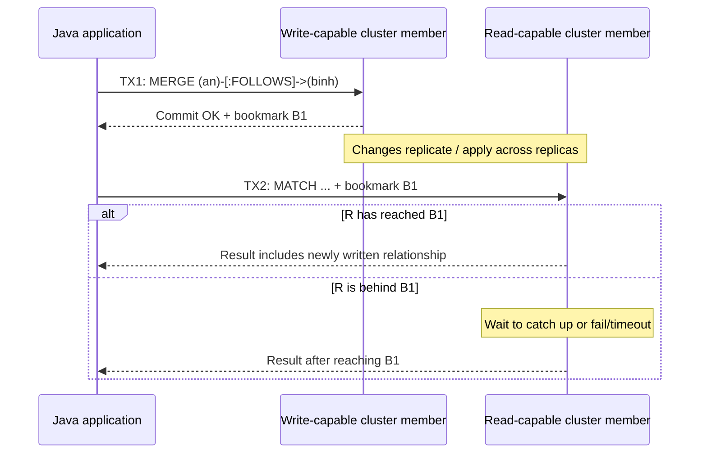
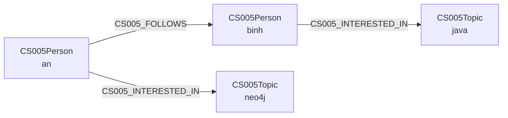
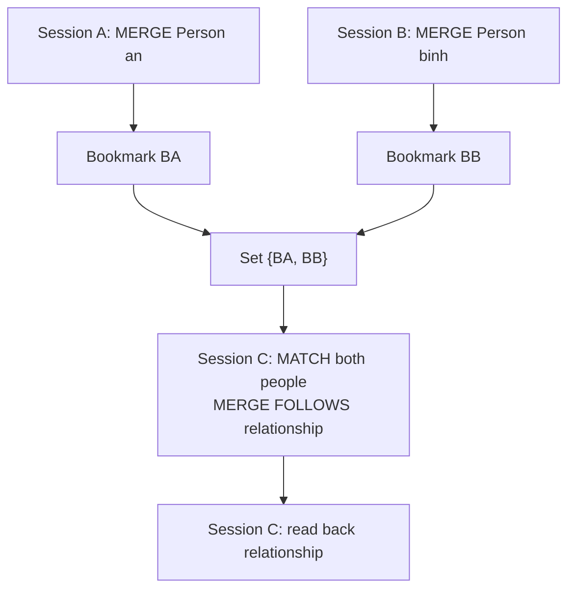
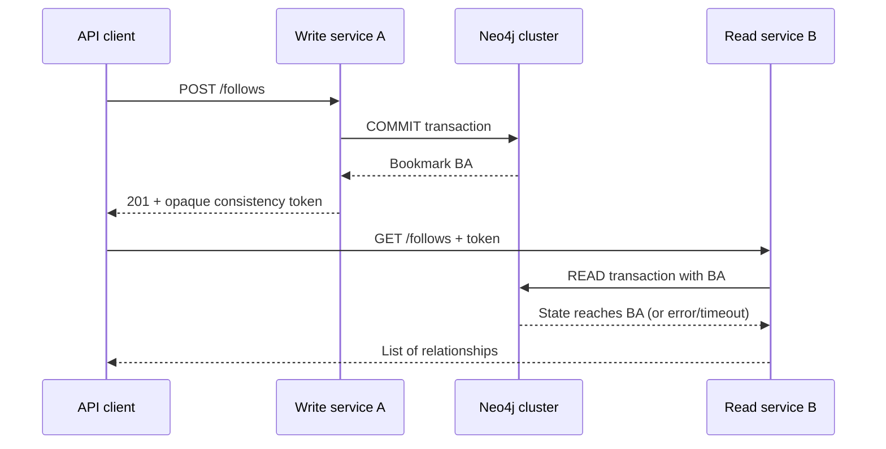

# Bookmarks and Causal Consistency in Multi-Session Applications

## 1. The Problem: Just Wrote Data, Yet the Read Session Does Not See It

Neo4j stores data as a **property graph**: nodes, relationships, and properties. When a Java Driver or Spring Data Neo4j application writes a node, updates a relationship, or creates a path with Cypher, the application usually expects the next read to **see the just-completed change**.

That seems obvious on a single database, but requires careful attention when Neo4j is deployed as a **cluster**. A write transaction may execute on a member eligible for writes, while the subsequent read request may route to a different member that needs time to apply confirmed changes. If the two requests use **two independent sessions** or two different application instances, a successful write return value alone does not guarantee that the read session is ordered chronologically after the write.

Business example:

1. `POST /people/an/follow/binh` creates the relationship `An -[:FOLLOWS]-> Binh`.
2. `GET /people/an/friends` is called immediately in another request.
3. The user expects **Binh** in the list because the follow action succeeded.

To guarantee observational ordering across sessions/servers, Neo4j uses **bookmarks**: tokens representing a database state watermark. A read transaction carrying a write transaction’s bookmark **will not execute before the serving member reaches at least that state**. This is **causal consistency**. It solves dependency ordering, not every consistency problem or every scaling requirement.

This lesson belongs to the **Clustering and Scaling** chapter in the `DATABASE_ENGINE_GRAPH_NEO4J` module. We will practice with the Java Driver, Cypher, nodes/relationships, and uniqueness constraints, while explaining Spring Data Neo4j integration, cluster routing, and measuring bookmark wait overhead.

**Learning outcomes:**

- Distinguish **eventual consistency**, **causal consistency**, **read-your-writes**, and **snapshots**.
- Know when a session manages bookmarks automatically and when the application must pass them between sessions.
- Use current Java Driver APIs properly: `Session.lastBookmarks()`, `SessionConfig.withBookmarks(...)`, and `BookmarkManager`.
- Combine bookmarks from **multiple independent transaction branches** before a dependent operation.
- Avoid confusing bookmarks with commit commands, credentials, global transaction IDs, or cross-database distributed transactions.
- Design testing, timeouts, monitoring, and error handling for read-after-write flows in a cluster.

## 2. Mental Model: One Transaction Establishes a Watermark for the Next



### 2.1. Comparing Guarantee Levels

| Concept | What is guaranteed / characteristics | What must **not** be inferred |
|---|---|---|
| **Eventual consistency** | Replicas eventually catch up during normal operation | Any arbitrary read right after a write sees the new data |
| **Read-your-writes** | A dependent chain of operations sees changes written by that chain | Every independent user instantaneously sees the exact same state |
| **Causal consistency** | Dependent transactions execute after the state mark they depend on | A frozen snapshot across multiple requests |
| **Bookmark B1** | State watermark issued by the server after a transaction; constrains subsequent transactions | Snapshot data, an access token, or a transaction number apps can do arithmetic on |
| **ACID transaction** | Changes inside **one transaction** commit or roll back together | Multiple transactions across sessions merged into one atomic transaction |

If transaction `T2` starts with `T1`’s bookmark, `T2` is guaranteed to observe a database at least as recent as `T1`. It **can also observe changes from other transactions committed after T1**; bookmarks **do not freeze time**. Therefore, never use bookmarks to fake snapshot consistency for long-lived pagination, point-in-time financial reporting, or across independent databases.

### 2.2. Why Routing Matters Here

On a Neo4j cluster, the Java Driver typically uses `neo4j://` or `neo4j+s://` URIs to obtain routing information. `executeWrite(...)` routes to a write-capable member, while `executeRead(...)` may be served by a reader in the routing table. A bookmark tells the chosen member the **minimum watermark** it must reach.

Conversely, `bolt://`/`bolt+s://` URIs point directly to a single server and do not provide driver-side cluster discovery and routing. In a cluster, use the URI provided by administrators, verify TLS, and avoid hardcoding a single machine when failover is needed.

**Note:** reading on the write-capable member still does not replace designing causal dependencies between sessions. Routing mode selects the route; a bookmark is a **database state precondition**. Nor is `AccessMode.READ` an RBAC authorization control.

## 3. Preparing the Practice Graph Dataset

Labels use the `CS005` prefix to avoid colliding with other lessons. Run the writes below on a **learning database** (e.g., `neo4j`). The lab runs on a single Neo4j instance to test the APIs; observing actual replication lag impact requires an authorized test cluster.



### 3.1. Create Uniqueness Constraints

```cypher
CREATE CONSTRAINT cs005_person_id IF NOT EXISTS
FOR (p:CS005Person)
REQUIRE p.id IS UNIQUE;
```

```cypher
CREATE CONSTRAINT cs005_topic_code IF NOT EXISTS
FOR (t:CS005Topic)
REQUIRE t.code IS UNIQUE;
```

`@Id` in Spring Data Neo4j or a plain `id` property **does not automatically create a constraint** in every setup. Constraints ensure `MERGE` on a business key prevents duplicate nodes under concurrent writes; bookmarks do not replace constraints.

### 3.2. Initialize Shared Topics

```cypher
UNWIND ['neo4j', 'java'] AS code
MERGE (:CS005Topic {code: code});
```

**Do not create the person nodes at this step** so the Java Driver code in later sections can demonstrate two sessions writing independent persons. If you practiced an earlier lesson and the graph already holds persons with the same label/ID, `MERGE` preserves identity while “nodes created” metrics will differ.

Verify:

```cypher
MATCH (t:CS005Topic)
RETURN t.code AS code
ORDER BY code;
```

Expected result: `java` and `neo4j`.

## 4. Three Levels of Bookmark Propagation in the Java Driver

**Java Driver 6.x** provides these APIs:

| Execution scope | Who manages bookmarks? | Recommended option |
|---|---|---|
| Multiple transactions in the **same `Session`** | Driver propagates bookmarks automatically between transactions | No manual bookmark management code needed |
| `Driver.executableQuery()` calls using the same driver and default manager | Driver automatically chains bookmarks across these calls | Convenient for standalone queries not needing multiple statements per transaction |
| **Two or more separate sessions** using `session.run/executeRead/executeWrite` | By default **do not** share bookmarks across sessions | Use `lastBookmarks()` + `withBookmarks(...)`, or share a `BookmarkManager` |
| **Two application instances / processes** | Each process has separate memory and driver | Must pass bookmarks via an explicitly designed channel or coordination layer; not automatic |

In Java Driver 6.x:

- `Session.lastBookmarks()` returns `Set<Bookmark>`.
- `SessionConfig.Builder.withBookmarks(Iterable<Bookmark>)` accepts one or more bookmarks.
- `Bookmark.value()` returns an opaque string for storage/transport; `Bookmark.from(String)` reconstructs the object from a stored value.
- Singular `Session.lastBookmark()` is a legacy API that was **removed in Java Driver 6.0**. Do not copy old `lastBookmark()` snippets into 6.x code.
- Never split, decode, or increment/decrement bookmark strings as counters; **the server/driver owns the token’s semantics**.

## 5. Simple Case: Multiple Transactions Within the Same Session

Within a single session, the Driver automatically carries the bookmark of a completed transaction into the next transaction. This is the simplest approach when business logic executes sequentially within one request or unit of work.

```java
import java.util.Map;
import org.neo4j.driver.Driver;
import org.neo4j.driver.SessionConfig;

public final class SameSessionDemo {
    public static boolean createThenRead(Driver driver, String id) {
        var config = SessionConfig.builder()
            .withDatabase("neo4j")
            .build();

        try (var session = driver.session(config)) {
            session.executeWriteWithoutResult(tx -> {
                tx.run("""
                    MERGE (p:CS005Person {id: $id})
                    SET p.name = $name
                    """, Map.of("id", id, "name", "An")).consume();
            });

            return session.executeRead(tx ->
                tx.run("""
                    MATCH (p:CS005Person {id: $id})
                    RETURN count(p) AS count
                    """, Map.of("id", id))
                  .single().get("count").asLong() == 1L
            );
        }
    }
}
```

Calling `createThenRead(driver, "an")` is expected to return `true`. The write transaction must **commit successfully** before the read transaction runs; `executeWriteWithoutResult` and `executeRead` are driver-managed transactions that may retry transient errors per configuration. Transaction callbacks must be retry-safe: never send emails, acknowledge messages, or trigger non-idempotent side effects inside callbacks.

**Do not mistake this for one transaction:** two `executeWrite`/`executeRead` calls are **two separate transactions**, even in the same session. If business rules require read–check–write atomicity, place the steps in **one transaction** with appropriate constraints/locks; bookmarks cannot substitute for atomicity.

## 6. Two Sessions: Passing Bookmarks Explicitly for Read-After-Write

Suppose a write service finishes and closes its session, and a read service opens a **new session**. The snippet below illustrates `lastBookmarks()` and `withBookmarks(...)` in valid Java Driver 6.x syntax:

```java
import java.util.Map;
import java.util.Set;
import org.neo4j.driver.Bookmark;
import org.neo4j.driver.Driver;
import org.neo4j.driver.SessionConfig;

public final class CausalReadDemo {
    public static String writeThenRead(Driver driver) {
        Set<Bookmark> afterWrite;

        // Session A: write and capture post-commit bookmark.
        try (var writer = driver.session(SessionConfig.builder()
                .withDatabase("neo4j")
                .build())) {
            writer.executeWriteWithoutResult(tx -> {
                tx.run("""
                    MERGE (p:CS005Person {id: $id})
                    SET p.name = $name
                    """, Map.of("id", "an", "name", "An")).consume();
            });
            afterWrite = writer.lastBookmarks();
        }

        // Session B: depends on A's write result.
        try (var reader = driver.session(SessionConfig.builder()
                .withDatabase("neo4j")
                .withBookmarks(afterWrite)
                .build())) {
            return reader.executeRead(tx ->
                tx.run("""
                    MATCH (p:CS005Person {id: $id})
                    RETURN p.name AS name
                    """, Map.of("id", "an"))
                  .single().get("name").asString()
            );
        }
    }
}
```

`writeThenRead(driver)` is expected to return `"An"`. Sequence:

1. Session A executes the write transaction; once the call succeeds, the driver holds the server’s bookmark.
2. `writer.lastBookmarks()` retrieves the latest **set** of bookmarks after A’s work.
3. Session B opens with those bookmarks. The first transaction in B requires the serving member to **reach at least A’s watermark**.
4. The `MATCH` query in B returns the written data if successful. If the member cannot catch up within a valid window, it may wait or raise an error/timeout.

`lastBookmarks()` may return an empty set if the session has not yet executed bookmark-producing work. **Never** treat an empty set as proof that a write succeeded; transaction success must be established from execution outcome and commit/error behavior.

### 6.1. Why Must You Consume the Result Inside the Transaction?

`tx.run(...)` returns a `Result` cursor. In the callbacks above, calling `.consume()` finishes processing the write result before the callback returns. This makes the sequence **run → consume → transaction commit → lastBookmarks** unambiguous.

With auto-commit `session.run(...)`, only after the result is fully consumed can the transaction be guaranteed complete. **Never capture bookmarks too early** and issue a dependent read while the write still has unconsumed results or an uncertain commit state.

## 7. Two Independent Branches: Combining Bookmarks Before Creating a Relationship

A more complex scenario: two workers create users `an` and `binh` in two independent sessions; another worker must link the two nodes after **both** complete.



Once the fixture in section 3 has `CS005Topic`, illustrative code:

```java
import java.util.HashSet;
import java.util.Map;
import java.util.Set;
import org.neo4j.driver.Bookmark;
import org.neo4j.driver.Driver;
import org.neo4j.driver.SessionConfig;

public final class FanInBookmarks {
    public static long connect(Driver driver) {
        Set<Bookmark> prerequisites = new HashSet<>();

        // Branch A does not depend on branch B.
        try (var a = driver.session(SessionConfig.forDatabase("neo4j"))) {
            a.executeWriteWithoutResult(tx -> {
                tx.run("""
                    MERGE (p:CS005Person {id: 'an'})
                    SET p.name = 'An'
                    """).consume();
            });
            prerequisites.addAll(a.lastBookmarks());
        }

        // Branch B can run concurrently on another worker.
        try (var b = driver.session(SessionConfig.forDatabase("neo4j"))) {
            b.executeWriteWithoutResult(tx -> {
                tx.run("""
                    MERGE (p:CS005Person {id: 'binh'})
                    SET p.name = 'Bình'
                    """).consume();
            });
            prerequisites.addAll(b.lastBookmarks());
        }

        // Open C only after both A and B have committed successfully.
        try (var c = driver.session(SessionConfig.builder()
                .withDatabase("neo4j")
                .withBookmarks(prerequisites)
                .build())) {
            c.executeWriteWithoutResult(tx -> {
                tx.run("""
                    MATCH (an:CS005Person {id: 'an'})
                    MATCH (binh:CS005Person {id: 'binh'})
                    MERGE (an)-[:CS005_FOLLOWS]->(binh)
                    """).consume();
            });

            return c.executeRead(tx ->
                tx.run("""
                    MATCH (:CS005Person {id: 'an'})
                          -[:CS005_FOLLOWS]->
                          (:CS005Person {id: 'binh'})
                    RETURN count(*) AS relationships
                    """)
                  .single().get("relationships").asLong()
            );
        }
    }
}
```

`connect(driver)` is expected to return `1` on a fixture without prior duplicate edges. The example runs A then B **sequentially for readability**; in a real system, the two jobs can run concurrently, provided you **wait for both to confirm commit success** before collecting bookmarks and launching C. If one job fails, do not launch C assuming all prerequisites exist.

**Why are multiple bookmarks needed?** C depends on **both branches**. Passing only BA cannot verify that the member serving C has reached B’s watermark, and passing only BB has the symmetric gap. `withBookmarks(Iterable<Bookmark>)` accepts a collection of marks so C’s initial transaction waits for all required preconditions.

**Not a distributed transaction:** A may commit while B fails; collecting bookmarks does not roll back A. If business rules require all three operations to succeed or fail together, consider combining them into **one Neo4j transaction** or implementing compensating workflows, idempotency, and explicit job state tracking.

## 8. `Driver.executableQuery()`: Automatic Bookmark Manager

In Java Driver 6.x, `Driver.executableQuery()` manages bookmarks via the driver’s **default bookmark manager**. Sequential `executableQuery().execute()` calls sharing the same driver can observe earlier changes without manually capturing or setting bookmarks.

```java
import java.util.Map;
import org.neo4j.driver.Driver;
import org.neo4j.driver.QueryConfig;
import org.neo4j.driver.RoutingControl;

public final class ExecutableQueryDemo {
    public static String upsertAndRead(Driver driver) {
        var writeCfg = QueryConfig.builder()
            .withDatabase("neo4j")
            .build();

        driver.executableQuery("""
            MERGE (p:CS005Person {id: $id})
            SET p.name = $name
            """)
            .withParameters(Map.of("id", "an", "name", "An"))
            .withConfig(writeCfg)
            .execute();

        var readCfg = QueryConfig.builder()
            .withDatabase("neo4j")
            .withRouting(RoutingControl.READ)
            .build();

        return driver.executableQuery("""
            MATCH (p:CS005Person {id: $id})
            RETURN p.name AS name
            """)
            .withParameters(Map.of("id", "an"))
            .withConfig(readCfg)
            .execute()
            .records().get(0).get("name").asString();
    }
}
```

Expected return value: `An`. `execute()` consumes the command’s result, so once it returns successfully, the manager updates its watermark accordingly. The two calls in the example are **awaited sequentially**; if you launch multiple `executableQuery` tasks concurrently, do not assume before–after ordering until orchestration awaits and establishes dependencies properly.

**Limits:** `executableQuery`’s default manager is scoped to the **Driver instance** and does not automatically share marks with a driver in another process. Furthermore, sessions opened via `driver.session()` **do not automatically use this manager**; connect them intentionally if you want a unified causal chain.

### 8.1. Mixing `executableQuery` and Sessions with the Same `BookmarkManager`

```java
import java.util.Map;
import org.neo4j.driver.Driver;
import org.neo4j.driver.QueryConfig;
import org.neo4j.driver.SessionConfig;

public final class MixedApiDemo {
    public static long run(Driver driver) {
        driver.executableQuery("""
            MERGE (p:CS005Person {id: $id})
            SET p.name = 'An'
            """)
            .withConfig(QueryConfig.builder()
                .withDatabase("neo4j")
                .build())
            .withParameters(Map.of("id", "an"))
            .execute();

        try (var session = driver.session(SessionConfig.builder()
                .withDatabase("neo4j")
                .withBookmarkManager(
                    driver.executableQueryBookmarkManager()
                )
                .build())) {
            session.executeWriteWithoutResult(tx -> {
                tx.run("""
                    MATCH (p:CS005Person {id: 'an'})
                    MERGE (t:CS005Topic {code: 'neo4j'})
                    MERGE (p)-[:CS005_INTERESTED_IN]->(t)
                    """).consume();
            });
        }

        return driver.executableQuery("""
            MATCH (:CS005Person {id: 'an'})
                  -[:CS005_INTERESTED_IN]->
                  (:CS005Topic {code: 'neo4j'})
            RETURN count(*) AS relationships
            """)
            .withConfig(QueryConfig.builder()
                .withDatabase("neo4j")
                .build())
            .execute()
            .records().get(0).get("relationships").asLong();
    }
}
```

A shared manager carries the **watermark from `executableQuery` into the session**, and then **the new watermark from the session back to `executableQuery`**. With the sample dataset, the expected result is `1`. Using `MERGE` for nodes/relationships avoids duplicates if the example runs repeatedly, though uniqueness constraints and proper concurrency design are still needed under parallel writes.

### 8.2. When Should You Not Use a Shared Manager?

A `BookmarkManager` can force **independent queries** to wait unnecessarily for the latest watermark of unrelated requests if every thread shares one manager. This increases latency and introduces coupling across tenants or units of work.

Define the **causal chain scope**:

- For sequential workflows in **one session**, no separate manager is needed.
- For multiple sessions within **one request/job**, passing bookmarks explicitly works cleanly.
- For related queries sharing **one driver**, `executableQuery()`/a shared manager is convenient.
- For **multi-tenant, independent workloads**, avoid funneling everything into one global watermark unnecessarily, and never share bookmarks across databases.

To opt out when causal binding is genuinely unnecessary on an `executableQuery` call, Neo4j supports `QueryConfig.builder().withBookmarkManager(null)`; this consistency/performance trade-off **must be an intentional decision**, not a default “optimization.”

## 9. Across Requests, Workers, and Processes: How to Transfer Bookmarks

Suppose microservice A handles a mobile write request, and microservice B handles a read request immediately afterward. The two services hold separate `Driver`s, so bookmarks **do not automatically appear in B**. If the contract demands read-your-writes across the two requests, you must provide a transport channel for the watermark.



**How to transfer it is an architectural decision**, whether via trusted internal message metadata, request context, or a per-user/aggregate coordination store. If sending a token to a client, treat it as **untrusted input**: enforce length limits, validate database/tenant binding, verify integrity (e.g., signing), and evaluate abuse risk. Bookmarks are **not** credentials and **do not grant** access to read any node; Neo4j still enforces RBAC against the transaction’s principal.

### 9.1. Serializing and Restoring Bookmarks in Java 6.x

An **illustrative example in a trusted service layer**:

```java
import java.util.List;
import java.util.Set;
import org.neo4j.driver.Bookmark;
import org.neo4j.driver.SessionConfig;

// After the transaction in the writer session completes:
Set<Bookmark> current = writer.lastBookmarks();

// Store and transmit only over controlled internal channels.
List<String> encoded = current.stream()
    .map(Bookmark::value)
    .toList();

// At the receiving service, after validating the token and scope:
List<Bookmark> restored = encoded.stream()
    .map(Bookmark::from)
    .toList();

var config = SessionConfig.builder()
    .withDatabase("neo4j")
    .withBookmarks(restored)
    .build();
```

This snippet assumes `writer` is a `Session` **still in scope after commit**. Real tokens may contain special characters and multiple entries; **never** cast them to `long` or parse internal segments. The code above only converts values; it is **not** a signature-verification, expiration, or HTTP API authorization mechanism.

### 9.2. Boundaries Never to Cross

| Boundary | Rule |
|---|---|
| **Database** | Only transfer bookmarks between sessions targeting the same database; never take a bookmark from `neo4j` and pass it blindly to `tenant_b` or `system`. Any special DB admin exceptions must follow version docs |
| **Cluster / lifecycle** | Never assume a bookmark from a different replica/cluster or from a replaced/restored database remains valid |
| **Tenant and user** | Tokens do not represent privileges; authenticate actors, tenants, and query permissions in both the service and Neo4j |
| **Time** | An old bookmark is not an old snapshot; it is only a minimum bound. Never use tokens to query historical points like a temporal database |
| **Size and storage** | Do not accumulate unbounded historical bookmarks in headers, caches, or databases; apply lifecycle policies and bounds |
| **Connection/commit errors** | Never invent a bookmark when commit status is unknown; for uncertain writes, look up operation ID/idempotency state first |

**Security:** Do not log full bookmarks indiscriminately or share them across tenants. Although a bookmark grants no data privileges, it can leak operational metadata and be abused to induce unnecessary wait latency if untrusted inputs are accepted.

## 10. Spring Data Neo4j: When Does the Framework Handle This Automatically?

When using **Spring Data Neo4j (SDN)**, the framework typically manages transactions and bookmarks internally so sequential transactions within the **same thread or reactive stream** observe prior changes. In standard Spring Boot/SDN apps, you do not need to manually wire bookmarks between `repository.save(...)` and `repository.findById(...)` inside the same workflow.

Example:

```java
import org.springframework.stereotype.Service;
import org.springframework.transaction.annotation.Transactional;

@Service
public class PersonLookupService {
    private final PersonRepository repository;

    public PersonLookupService(PersonRepository repository) {
        this.repository = repository;
    }

    @Transactional(readOnly = true)
    public boolean exists(String id) {
        return repository.findById(id).isPresent();
    }
}
```

Here `PersonRepository` is the repository defined by the application for `CS005Person`; the snippet illustrates a **read transaction**, not complete entity/repository code. SDN manages connections and mapping according to the Spring Data version in use.

**Key points:**

- `@Transactional` defines transaction boundaries at the service layer; if a write and read must be atomic, consider executing them in the **same transaction**.
- When moving from one HTTP request to another or across processes, **thread context/transaction context does not travel automatically**. Never claim cross-service read-your-writes merely because you use SDN.
- If mixing `Neo4jClient`, `Neo4jRepository`, and the **raw Java Driver**, verify how the transaction manager and bookmark manager are shared. Avoid opening raw Driver sessions assuming they automatically inherit SDN’s bookmarks.
- With reactive SDN, respect the **reactive context**; switching schedulers or subscribing out-of-band can break the expected coordination chain.
- Access control remains enforced by **Neo4j RBAC**, not bookmarks or `@Transactional(readOnly=true)`.

When causal consistency is needed **across multiple services**, define the HTTP/event contract explicitly (passing bookmarks or using an appropriate sync mechanism) rather than trusting the framework to propagate a token it cannot see.

## 11. What Do Bookmarks Not Solve?

### 11.1. They Do Not Guarantee a Frozen Snapshot Across Pages

Suppose page 1 fetches 20 items, and page 2 runs after new nodes are inserted. Carrying the same bookmark does not guarantee both pages see an immutable snapshot, because the newer transaction **can observe state newer than the bookmark**. For short atomic snapshots, use an appropriate transaction; for long reports/pagination, design keyset/cursor pagination with version/time boundaries rather than relying on bookmarks alone.

```cypher
MATCH (p:CS005Person)
RETURN p.id AS id
ORDER BY id
SKIP $offset
LIMIT $pageSize;
```

`ORDER BY` gives deterministic ordering, yet inserting/deleting nodes during `SKIP`-based pagination can still duplicate or skip rows. Bookmarks do not replace stable pagination designs.

### 11.2. They Do Not Replace Atomic Transactions or Constraints

If an application needs two nodes and their connecting relationship to **commit or roll back together**, placing all three `MERGE` clauses in **one managed transaction** may fit better than splitting A, B, and C as shown in the fan-in demo. Bookmarks only **coordinate observational ordering**—they never provide cross-transaction rollback after prior commits succeed.

```cypher
MERGE (a:CS005Person {id: $aId})
MERGE (b:CS005Person {id: $bId})
MERGE (a)-[:CS005_FOLLOWS]->(b);
```

Under concurrent writes, `MERGE` on a relationship does not replace business uniqueness/locking design; datasets with parallel edges need explicit idempotency rules.

### 11.3. They Are Not Eventual/Causal Sync Across Multiple Databases or Caches

Neo4j bookmarks do not guarantee data has reached **Elasticsearch, Redis, Kafka, CDC consumers, warehouses, or other databases**. If a UI reads from a stale cache, passing a Neo4j bookmark to a query will not refresh the cache. Solve cross-system freshness separately with outbox/CDC offsets, invalidation, watermarks, or orchestration workflows.

## 12. Speed and Latency: Only Pay Wait Cost When a Dependency Exists

A bookmark forces a transaction to start only on a member that has reached **at least the requested watermark**. If the serving reader lags behind, the query must **wait to catch up**, adding latency and risking timeouts. Blindly chaining bookmarks across every request can erode the benefits of **read scale-out**.

| Workload | Should you bind a bookmark? | Reason |
|---|---|---|
| Write a follow then immediately read the list | **Yes**, if read-your-writes is the contract | The read depends on the just-committed write |
| Two workers create nodes, another creates the edge | **Yes**: combine marks from both branches | The edge-creating worker depends on both endpoints |
| Public news feed unrelated to any write request | Usually **no cross-request bookmark needed** | Avoid waiting on unrelated watermarks |
| Point-in-time snapshot reporting | Bookmarks are **insufficient** | Requires dedicated snapshot/versioning design |
| Read in another service after an HTTP write | **Yes if needed** with a trusted token channel | Driver managers do not cross process boundaries automatically |
| External cache / local replica outside Neo4j | Neo4j bookmarks are **insufficient** | Requires a cross-system consistency contract |

### 12.1. Proper A/B Measurement

Run two variants under identical workload and concurrency:

- **Group A:** write → read in a new session without bookmarks, for workloads **accepting eventual consistency**.
- **Group B:** write → read in a new session with bookmarks, enforcing **read-your-writes**.

Measure separately:

| Metric | What to observe |
|---|---|
| Read-after-write `p50/p95/p99` | Tail latency when members wait for replication catch-up |
| Rate of violated read-after-write expectations | Divergence in A; in B, count success only if new data is seen or a clear error occurs |
| Retries, bookmark wait timeouts | Whether the system waits excessively or fails to catch up |
| QPS, CPU, memory, pool waits | Impact on concurrent serving capacity |
| Inter-member lag / cluster state | Root cause of slow reads when replicas trail |
| Cypher results / `DB Hits` | Distinguish expensive query plans from bookmark replication waits |

**Never run a single `PROFILE` and draw conclusions about bookmark cost:** `PROFILE` primarily measures Cypher operator work; time spent waiting for a member to catch up may fall outside operator execution costs. Measure **application end-to-end duration**, cluster logs/metrics, and routing behavior to attribute causes accurately.

### 12.2. Sample Decision Table for Practice

The numbers below are **hypothetical**, not an actual Neo4j benchmark:

| Variant | Read p95 (ms) | Rate missing just-committed write | Timeouts | Business conclusion |
|---|---:|---:|---:|---|
| New session, no bookmark | 35 | 1.2% under lag scenario | 0% | Fast, but **fails** read-your-writes |
| New session, with bookmark | 72 | 0% among successful requests | 0.1% | Meets requirement; must handle waits/timeouts |
| Read inside the same write transaction | 48 | 0% for data in transaction | 0% | Reasonable when part of one unit of work |

Never treat the hypothetical 0% as a universal promise: when a cluster lags or fails, requests may **fail** rather than return stale data. Consistency expectations must be captured in **correctness and timeout SLOs**, not latency SLOs alone.

## 13. Timeouts, Errors, Retries, and Uncertain Commit Outcomes

### 13.1. When a Bookmark Watermark Cannot Be Satisfied Yet

Suppose a member routed for a read lags behind the session’s required bookmark. Prepare for three operational outcomes:

1. The member catches up within the allowed window; the transaction starts and returns consistent state.
2. The driver/cluster routes to another eligible member via routing and retry mechanics.
3. It cannot satisfy the mark in time; the request times out or errors. **Never return stale data disguised as a consistent success**.

`TransactionConfig.withTimeout(...)` bounds server-side transaction execution time; it **does not replace the overall API deadline**, connection acquisition timeout, or driver retry budget. At the service level, budget for pool wait, retries, and response handling.

Example:

```java
import java.time.Duration;
import org.neo4j.driver.SessionConfig;
import org.neo4j.driver.TransactionConfig;

var txConfig = TransactionConfig.builder()
    .withTimeout(Duration.ofSeconds(2))
    .build();

try (var session = driver.session(SessionConfig.builder()
        .withDatabase("neo4j")
        .withBookmarks(prerequisites)
        .build())) {
    long count = session.executeRead(tx ->
        tx.run("""
            MATCH (p:CS005Person)
            RETURN count(p) AS count
            """).single().get("count").asLong(),
        txConfig
    );
    System.out.println(count);
}
```

`driver` and `prerequisites` come from earlier examples; in real systems, `Duration.ofSeconds(2)` is only illustrative and must be tuned against SLOs and replication lag.

### 13.2. Retries Are Not Always Safe

`executeRead`/`executeWrite` callbacks may be re-invoked by the driver on transient errors. **Never put external side effects inside callbacks**, such as charging an external API, sending emails, or acking queue messages. For writes, use idempotency keys, uniqueness constraints, and commit-status checks if an ACK is lost.

If the server commits but the return connection drops, the application cannot tell if the commit succeeded; in that case **never fabricate a bookmark** or assume missing a bookmark means guaranteed rollback. Design an **operation ID** to reconcile state before non-idempotent retries.

A `Bookmark` is a post-**successful-transaction** watermark, not atomic proof that an external action (HTTP, queue, cache) also committed.

## 14. Testing Properly on Both Single Instance and Cluster

### 14.1. Testing Logic on a Single Neo4j Instance

A single instance still validates:

1. Creating constraints, topics, and two nodes via Java.
2. Capturing `lastBookmarks()` after a write transaction commits.
3. Opening a new session with `withBookmarks(...)` to read or create relationships.
4. Verifying node/edge counts, relationship direction, and query results.
5. Re-running idempotent code and confirming no duplicate nodes appear.

Independent verification queries:

```cypher
MATCH (p:CS005Person)
RETURN p.id AS id, p.name AS name
ORDER BY id;
```

Expected after the Java practice code: `an` and `binh`.

```cypher
MATCH (:CS005Person {id: 'an'})-[r:CS005_FOLLOWS]->
      (:CS005Person {id: 'binh'})
RETURN count(r) AS followsCount;
```

Expected: `followsCount = 1`.

```cypher
MATCH (:CS005Person {id: 'an'})-[r:CS005_INTERESTED_IN]->
      (:CS005Topic {code: 'neo4j'})
RETURN count(r) AS interestedInCount;
```

After running `MixedApiDemo.run()`, expected: `interestedInCount = 1`.

### 14.2. What a Single Instance Does **Not** Prove

On a single database, read sessions do not experience **lagging replicas**. Therefore passing tests on a single instance **does not prove**:

- That routing URIs actually send reads to a different member.
- That bookmark-bound transactions wait on lagging cluster replicas.
- That the system survives failover while meeting SLOs.
- That applications across separate processes/hosts propagate bookmarks properly.

If your organization has a test Neo4j Enterprise cluster:

1. Use `neo4j://`/`neo4j+s://` and a least-privilege account on a dedicated database.
2. Observe topology/routing via approved admin tools; confirm read members differ from the write member.
3. Run write → read sequences in **new sessions** with and without bookmarks under controlled load.
4. Simulate lag/failover following approved test procedures—never inject faults directly in production.
5. Record p95/p99, timeouts, retries, bookmark state, and correctness for every request.

**Never use `Thread.sleep(...)` or a fixed 100 ms delay as a causal consistency mechanism.** A fixed sleep can be too short when the cluster is slow and wasteful when fast; bookmarks express a **state condition**, not guessed wall-clock time.

## 15. Common Design Mistakes

| Mistake | Consequence | Fix |
|---|---|---|
| Write in session A, read in session B without bookmark | May miss the write when the read member lags | Pass `lastBookmarks()` to `withBookmarks(...)` |
| Capturing bookmarks before transaction commits | No guaranteed new watermark | Wait for callback/transaction completion and consume results |
| Calling `lastBookmark()` in Driver 6.x | API no longer exists | Use `lastBookmarks()` and `Set<Bookmark>` |
| Mixing `executableQuery` and manual sessions without sharing manager | Causal chain breaks | Use `driver.executableQueryBookmarkManager()` |
| Using one global bookmark across all tenants/unrelated requests | Wait latency rises, workloads couple | Scope watermarks per unit of work and database |
| Passing a bookmark from a different database | No valid causal chain guarantee | Bind tokens to database/cluster and validate scope |
| Treating bookmarks as snapshot/pagination cursors | Subsequent pages still see newer commits | Use dedicated version/cursor/snapshot strategies |
| Using `bolt://` to one server while expecting cluster routing | Loses expected cluster routing | Use proper routing URI supplied for the cluster |
| Forgetting timeouts when members fail to catch up | Requests hang, pools/workers exhaust | Configure transaction timeouts, API deadlines, and retry budgets |
| Logging or accepting arbitrary bookmarks from clients | Metadata leakage, wait abuse, or wrong scope | Validate and bound tokens; never treat tokens as privileges |
| Treating bookmarks as replacements for uniqueness/idempotency | Parallel writes still create duplicates/lost updates | Use constraints, transactions, versions, and operation IDs |
| Testing only on a single instance | Fails to reproduce replica lag or failover | Test on an isolated cluster with deliberate load and faults |

## 16. Self-Practice Exercises

1. **Causal timeline:** diagram T1 writing a node on member A and T2 reading on member B. State the precondition T2 must meet to see the node and explain how bookmarks differ from `sleep(100)`.
2. **Self-managed session:** using `SameSessionDemo`, create `an` and read it back in the same session. Do you need to call `lastBookmarks()` manually? Why?
3. **Two sessions:** run `CausalReadDemo`. Print `lastBookmarks().size()` on the writer side (without dumping full tokens into shared logs), and verify the reader sees `An`.
4. **Fan-in:** run jobs A/B to create `an`/`binh`, then C to create the relationship. If you only pass A’s bookmark, what guarantee is missing?
5. **Mixing APIs:** pass `driver.executableQueryBookmarkManager()` when opening a session; verify a subsequent `executableQuery()` observes the relationship just written.
6. **Concurrency:** execute A and B on two workers and launch C only after both futures complete **successfully**. If B fails, how do you handle the already-committed A?
7. **Multi-tenant:** design an API passing a consistency token between two services. Explain how to bind the token to tenant/database/user and prevent tampering.
8. **Read-your-writes and cache:** after a successful Neo4j write, a read request hits a stale Redis cache. Can a Neo4j bookmark fix the Redis result? What mechanism is needed?
9. **Pagination:** paginate the graph twice with `SKIP/LIMIT` across two transactions, inserting a new person in between. Demonstrate that bookmarks do not provide a fixed snapshot.
10. **Benchmark:** propose A/B metrics to measure the trade-off between bookmark waiting and latency, separating replica wait time from Cypher `DB Hits`.
11. **Commit ambiguity:** simulate losing the ACK after a write transaction. Can the client guess the new bookmark? Build a verification flow using an operation ID.
12. **Driver upgrade:** an older codebase calls `lastBookmark()`. Describe the Java Driver 6.x API change and how to preserve multi-bookmark support.

**Mastery criteria:** learners read and write accurately along causal chains within and across sessions; combine multiple watermarks in fan-in flows; never mistake bookmarks for privileges, snapshots, or distributed transactions; and establish testing/monitoring plans for cluster wait latency.

## 17. Cleaning Up Practice Data

**Run only on the learning database containing `CS005`-prefixed data.** Never run `DETACH DELETE` against a business database:

```cypher
MATCH (p:CS005Person)
DETACH DELETE p;
```

```cypher
MATCH (t:CS005Topic)
DETACH DELETE t;
```

```cypher
DROP CONSTRAINT cs005_person_id IF EXISTS;
```

```cypher
DROP CONSTRAINT cs005_topic_code IF EXISTS;
```

## 18. Official References

- [Neo4j Java Driver Manual — Coordinate parallel transactions](https://neo4j.com/docs/java-manual/current/bookmarks/): `Session.lastBookmarks()`, `withBookmarks(...)`, `executableQuery`, and sharing bookmark managers.
- [Neo4j Java Driver Manual — Transactions](https://neo4j.com/docs/java-manual/current/transactions/): session/transaction lifecycles, retries, and routing modes.
- [Neo4j Java Driver Manual — Query the database](https://neo4j.com/docs/java-manual/current/query-simple/): `Driver.executableQuery()`, database configuration, and parameters.
- [Neo4j Java Driver Manual — Upgrade from older versions](https://neo4j.com/docs/java-manual/current/upgrade/): `lastBookmark` → `lastBookmarks` changes in Java Driver 6.
- [Neo4j Java Driver API — Bookmark](https://neo4j.com/docs/api/java-driver/current/org.neo4j.driver/org/neo4j/driver/Bookmark.html): `value()` and `from(String)`.
- [Neo4j Java Driver API — SessionConfig.Builder](https://neo4j.com/docs/api/java-driver/current/org.neo4j.driver/org/neo4j/driver/SessionConfig.Builder.html): `withBookmarks(...)`, `withBookmarkManager(...)`, and `withDatabase(...)`.
- [Neo4j Operations Manual — Clustering glossary](https://neo4j.com/docs/operations-manual/current/clustering/glossary/): definition of causal consistency and replica catch-up waiting.
- [Neo4j Java Driver Manual — Advanced connection information](https://neo4j.com/docs/java-manual/current/connect-advanced/): `neo4j://` routing and direct `bolt://`.
- [Spring Data Neo4j Reference — FAQ](https://docs.spring.io/spring-data/neo4j/reference/faq.html): SDN interaction with cluster bookmarks and transactions.
- [Neo4j Query API — Coordinate transactions and enforce causal consistency](https://neo4j.com/docs/query-api/current/bookmarks/): bookmarks when communicating via the Query API outside the Java Driver.
