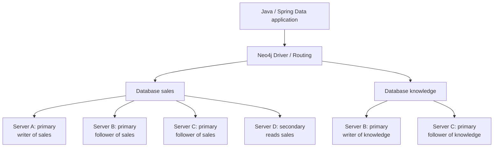
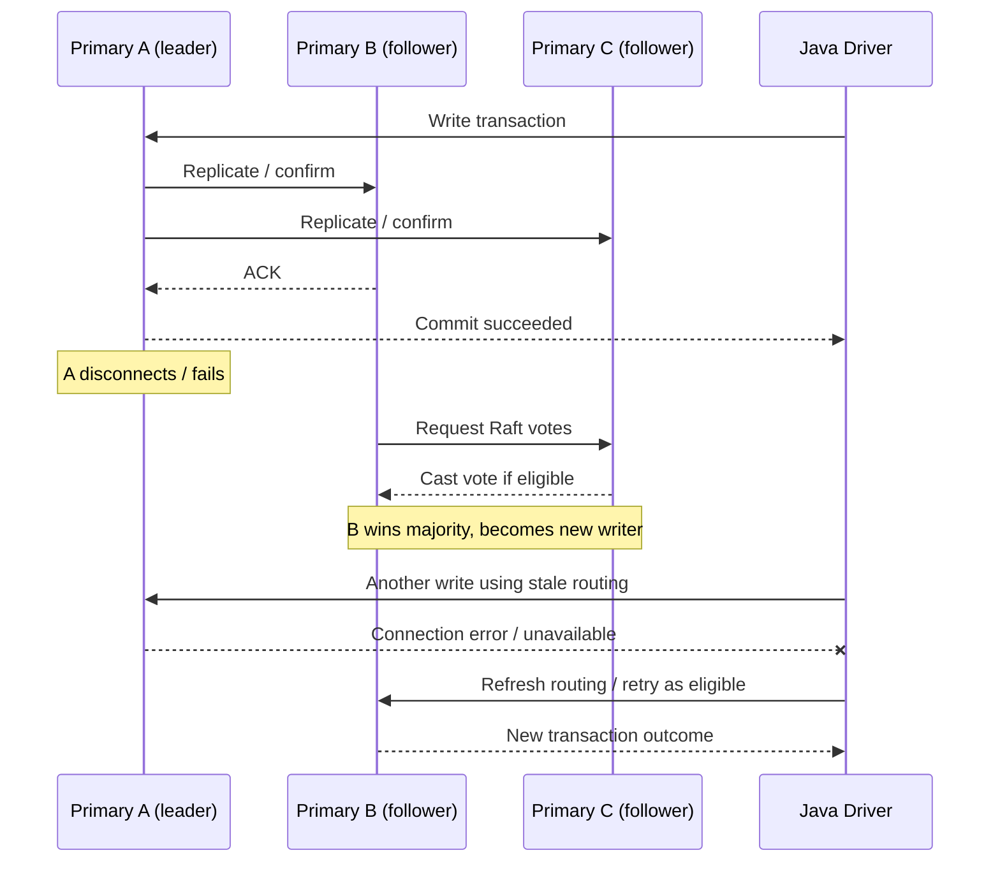
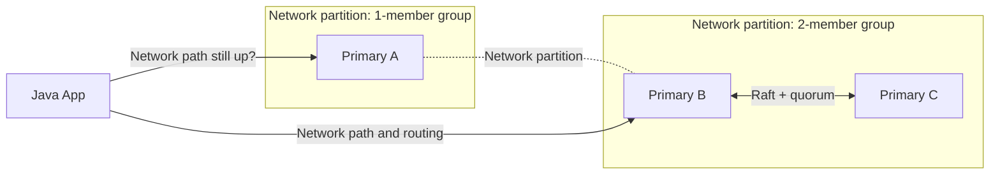
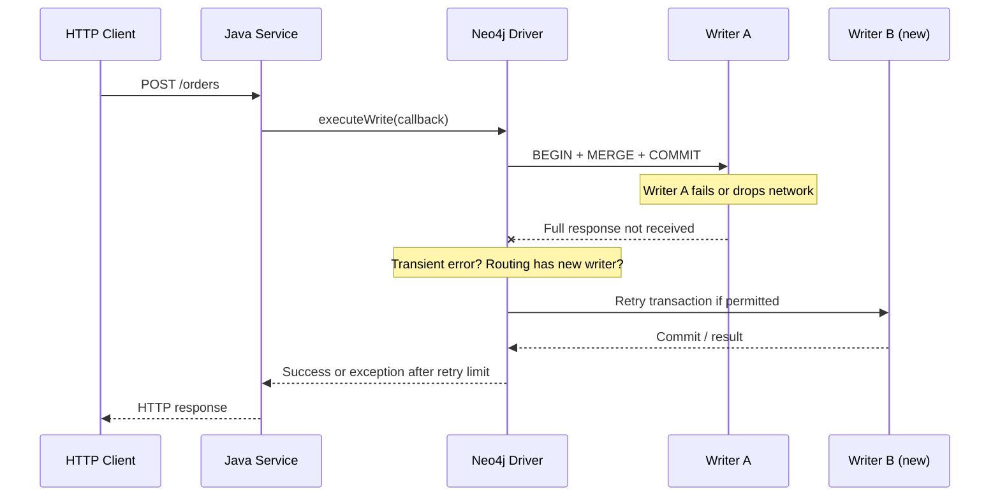
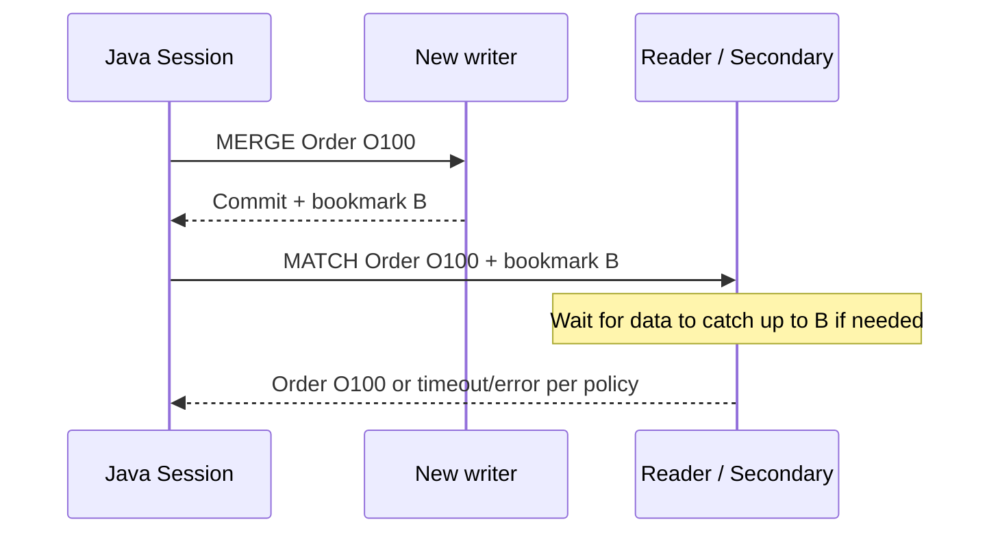
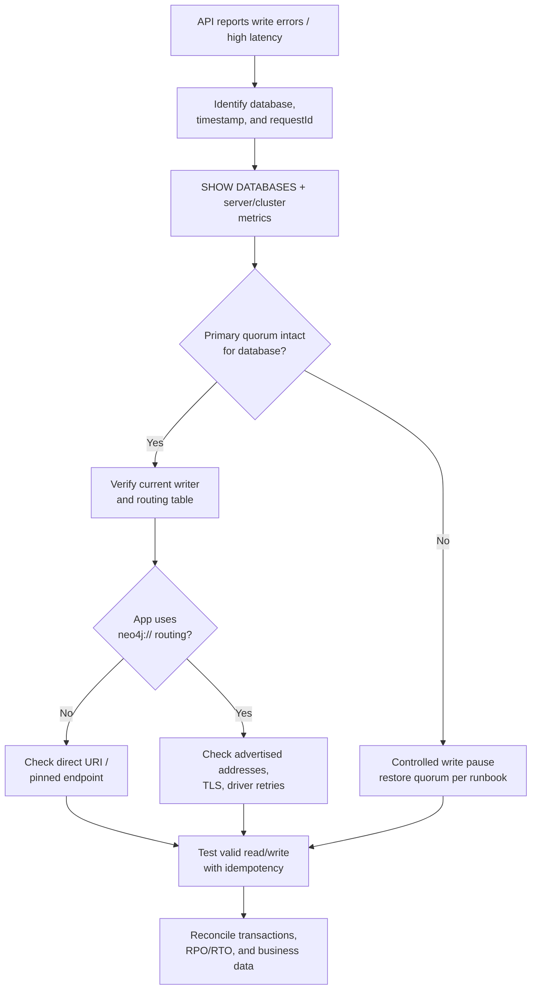

# Server Failures, Leader Election, and Connection Behavior During Role Changes

A **Neo4j cluster** is not simply multiple servers holding a graph. For each database, some replicas participate in acknowledging write transactions; one replica acts as the **leader/writer**, while other replicas receive replicated data. When a server shuts down, loses network connectivity, or becomes overloaded, the system must decide **whether enough members remain to keep accepting writes**, **who can become the new leader**, and **where Java applications should connect**.

This lesson belongs to the **Clustering and Scaling** chapter of the **DATABASE_ENGINE_GRAPH_NEO4J** module, focusing on using Neo4j to model nodes and relationships, query with Cypher, optimize indexes/constraints, and integrate via the Java Driver and Spring Data Neo4j. The core focus is **server failures, Raft leader election mechanics, and connection behavior when the leader role changes**. The material below builds on the **modern Neo4j Enterprise cluster** model; exact role names, admin commands, deployment capabilities, and APIs must be cross-checked against the **version and edition** in use. A standalone Neo4j Community instance or a managed instance does not automatically allow the same cluster controls as a self-managed deployment.

> **Core mindset:** A cluster can re-elect a leader automatically and the Java Driver can re-route **operations eligible for retry**. That **does not mean** every in-flight transaction continues uninterrupted, every request succeeds, or applications no longer need idempotency.

## 1. The Crucial Unit Is the Database, Not Just the Server

A Neo4j cluster can host multiple databases. Each database has its own **primary allocations** and **secondary allocations** configuration. One server may be a primary for one database, a secondary for another, or not host a given database at all.



**Distinguishing the roles:**

| Term | Meaning | Can be elected writer? |
| --- | --- | --- |
| **Server** | Neo4j machine/process providing resources for one or more databases | Not itself an election role |
| **Primary allocation** | Database replica participating in the Raft group and confirming writes | Yes, within an eligible primary group |
| **Leader / writer** | A primary currently ordering write transactions for that database | Is the current writer |
| **Follower** | Non-leader primary participating in log replication/acknowledgment | Can become a new candidate |
| **Secondary allocation** | Replica updated from primaries, typically used to scale read capacity | **Cannot** be elected writer within the primary group |
| **Raft group** | Group of primaries participating in consensus for **one database** | Elects an independent leader for that database |

In a multi-database cluster, **there is no single global leader responsible for writes across all databases**. For example, Server A can be the writer of `sales`, while Server B is the writer of `knowledge`. If A fails, electing a new leader for `sales` does not require `knowledge` to change its writer.

### 1.1. Primaries and Secondaries Do Not Have the Same Responsibilities

- **Primaries** participate in consensus-backed writes. With multiple primaries, one writer sends changes to the other primaries and requires majority acknowledgments per protocol before a transaction is considered committed.
- **Secondaries** receive changes asynchronously via the appropriate replication mechanism, helping spread **read** load; they do not cast a Raft vote to replace a lost primary and do not promote themselves to leader in normal elections.
- Adding **secondaries** generally boosts read query capacity; it does not add votes to survive additional primary failures for write transactions.
- Adding **primaries** changes topology and consensus overhead, rather than merely “adding machines to make every query faster.”

Do not equate a **primary** of a given database with always accepting direct writes from clients: in a multi-primary setup, **only the primary holding the writer role** is the write target for that database.

### 1.2. Quorum Belongs to Each Database

In a Raft model with `n` primaries currently in the group, the majority vote count is:

\[
\operatorname{majority}(n)=\left\lfloor\frac{n}{2}\right\rfloor+1
\]

For typical odd-numbered primary topologies:

| Number of primaries | Majority required | Primaries that can be lost while keeping majority |
| ---: | ---: | ---: |
| 1 | 1 | 0 |
| 3 | 2 | 1 |
| 5 | 3 | 2 |

This table describes **quorum among primary database replicas**, not a guarantee that losing those machines causes zero service interruption. For instance, with three primaries, losing the writer can cause write transactions to fail **during the role transition window**, even though the remaining two primaries can elect a new writer.

If primaries sit on the same host or in the same failure domain, the table does not accurately reflect infrastructure resilience. HA design must evaluate **failure domains**: host, rack, availability zone, network, power, and storage.

## 2. How Does Raft Elect a Leader?

Neo4j uses the **Raft** mechanism among a database’s primaries to guarantee write transactions follow a consistent order. Simplified summary:

1. Under normal operation, one primary is the **leader**; the remaining primaries are **followers**.
2. The leader sends heartbeats and replicates logs to followers.
3. When a follower does not hear from the leader for a configured/protocol duration, it can start an election and become a **candidate**.
4. The candidate requests votes from other primaries; it becomes leader only with a **majority of votes** and by satisfying log-freshness requirements.
5. Once elected, the new leader assumes the writer role; Drivers and the routing layer must refresh routing info to send writes to the right place.
6. Without a majority, **you must never manually create an independent writer** on the minority side.



This is an **illustrative flow**, not an exact guarantee of election duration or packet ordering across every release. Failure-detection time is affected by **network timeouts, system load, GC pauses, server health, and cluster settings**.

### 2.1. Why Is a Leader Needed?

If two independent primaries both accepted writes in different orders during a network split, the graph would diverge into two conflicting states. Raft aims to maintain a single valid commit sequence backed by a **majority**, thereby preventing **split-brain writers** within the protected consensus group.

For the `sales` database, this matters when two requests concurrently update a relationship:

```cypher
MATCH (c:Customer {customerId: $customerId})
MATCH (o:Order {orderId: $orderId})
MERGE (c)-[:PLACED]->(o);
```

The write transaction is confirmed under cluster consensus, yet **quorum does not replace unique constraints, transaction logic, or optimistic locking controls**. Consensus keeps the commit log consistent across primaries; it does not fix an incorrect business Cypher query.

### 2.2. Leader Change Does Not Mean Loss of Committed Data

A transaction that has **committed and been acknowledged successfully** under multi-primary consensus is designed to remain durable across failures within the fault-tolerance budget. A candidate with an outdated log cannot simply seize the writer role and discard agreed-upon commits.

However, distinguish carefully:

- **Received successful commit response:** solid basis to treat the transaction as completed per database guarantees.
- **Sent command, but connection dropped before response:** the client **cannot tell from the network error alone** whether the server committed or not.
- **In-flight transaction not yet committed:** may roll back or need full re-execution when the leader fails.
- **Lagging secondary replica:** may not immediately see new updates; use bookmarks whenever read-your-writes is required.

Rules for handling **uncertain** responses are especially critical for `CREATE`, `MERGE`, `SET`, counter increments/decrements, and external system integrations.

## 3. When a Server Fails, What Happens?

Not every failure triggers the same behavior.

| Incident | Database primary quorum | Typical behavior |
| --- | --- | --- |
| Secondary lost | Primary vote count unchanged | Reads lose one target; no writer election needed because secondaries do not join Raft elections |
| Follower primary lost, majority remains | Still sufficient | Current writer can continue writes, though tolerance for another failure drops |
| Writer/leader primary lost, majority remains | Still sufficient | Brief write interruption; remaining primaries can elect a new leader |
| Too many primaries lost, no majority | **Insufficient** | Cannot continue committing valid writes under consensus |
| Network splits into majority and minority | Only majority holds quorum | Majority can sustain elections/writes; minority cannot commit independently |
| Server running, but Bolt unreachable from Java | May remain healthy inside cluster | App hits connection/routing errors even though Raft is healthy |
| Server overloaded, GC pauses, slow I/O | Depends on severity | Can cause timeouts, repeated elections, and latency spikes even without host shutdown |

**Reads during quorum loss** depend on where surviving replicas sit, database state, routing, privileges, version, and required consistency; **there is no blanket guarantee** that all read queries keep working when write quorum is lost.

### 3.1. Three-Primary Example: A, B, C

Initially:

```text
Database sales
  A = PRIMARY, writer = true
  B = PRIMARY, writer = false
  C = PRIMARY, writer = false
Majority = 2/3
```

Scenario where A fails completely:

1. Transactions bound to A may be interrupted.
2. B and C still hold **2/3 votes**.
3. Either B or C can be elected the new leader once Raft conditions are met.
4. The Driver’s routing table updates to direct writes to the new writer.
5. Applications using managed transactions may automatically retry transient errors; non-retryable or expired errors must still be handled.

Scenario where both A and B fail:

- C alone holds only **1/3** of the votes.
- It cannot elect a valid writer to keep accepting writes under the original consensus configuration.
- Adding a live **secondary** does not turn `1/3` into `2/3`.
- You must restore primaries/configuration following **official runbooks**, never manually “enable write mode” on C to bypass quorum.

### 3.2. Network Loss Differs from Process Loss

During a network partition, a primary process can keep running normally while unable to reach enough peers. Checking `ping` or process status alone does not prove a member sits on the majority side or can serve writes.



If A was the old leader but becomes isolated, a client still able to reach A **does not mean A can commit new writes**. On the B–C side, an eligible member can be elected as the new writer. Once networking heals, the cluster converges back to a valid topology.

Never hardcode a single static IP as the write target simply because that server used to be the leader.

## 4. Writers and Routing Can Differ Per Database

Suppose a cluster hosts two databases:

| Server | `sales` | `knowledge` |
| --- | --- | --- |
| A | Primary — writer | Primary — follower |
| B | Primary — follower | Primary — writer |
| C | Primary — follower | Primary — follower |
| D | Secondary — read | Not hosted |

If A fails:

- `sales` evaluates quorum and can elect a writer on B or C.
- `knowledge` can keep B as its writer, provided `knowledge`’s own quorum remains intact.
- D is a secondary of `sales` and cannot become a writer candidate.
- A Java request to `sales` cannot treat `knowledge` working fine as evidence that `sales` has recovered.

**Therefore cluster monitoring must be broken down by database × server × role**, not just a “how many cluster servers are up” metric.

## 5. Neo4j Java Driver Routing During Leader Transitions

Java applications typically use an administrator-provided URI rather than hardcoding the current writer.

| URI scheme | Cluster usage | Notes |
| --- | --- | --- |
| `neo4j://host:7687` | **Routing** connection; Driver fetches routing table for reader/writer/router endpoints | Use when endpoints and topology support routing |
| `neo4j+s://host:7687` | Routing over TLS with strict certificate verification | Standard in managed services like Aura |
| `neo4j+ssc://host:7687` | Routing over TLS accepting self-signed certificates per scheme | Only when policy/certificates require it; never use to bypass production TLS errors |
| `bolt://host:7687` | **Direct** to a single server | Does not automatically discover a new writer via routing table |
| `bolt+s://...` / `bolt+ssc://...` | Direct with corresponding TLS settings | Still pinned to a specific server |

With `neo4j://`, the Driver retrieves lists of servers capable of **ROUTE, READ, and WRITE** from Neo4j’s routing metadata and refreshes them when needed. This allows the Driver to redirect **new or retried transactions** to the new writer.

However, there is no guarantee that:

- A transaction executing mid-flight on a failed writer seamlessly “migrates” intact to another writer.
- Every read/write query retries forever until it succeeds.
- The routing table updates **instantaneously with zero error window**.
- The seed endpoint remains reachable if only one address is configured and that server dies.
- Every returned member address is reachable from the application’s network.

### 5.1. Discovery Endpoint Reachability Issues

A cluster can run smoothly internally while the application **cannot reach member addresses** due to misconfigured advertised addresses, DNS, firewalls, Kubernetes services, or NAT.

Example:

```text
Java client -> neo4j://cluster.example.internal:7687
              -> routing table received from cluster
                 READ  = db-b.internal:7687, db-c.internal:7687
                 WRITE = db-a.internal:7687
```

If the client cannot resolve `db-b.internal`, read calls can fail even though `cluster.example.internal` connected fine. With routing, **do not test only the initial address**; verify every advertised server address is reachable from the client’s network zone.

When deploying behind load balancers/proxies, use routing and endpoint setups supported by Neo4j; never assume a simple TCP load balancer replaces discovery and read/write separation.

### 5.2. Why Can Direct `bolt://` Fail After Failover?

Suppose an application uses:

```text
bolt://server-a.internal:7687
```

A is the writer of `sales`. When A fails, the application remains bound to A even after B is elected leader. A Driver using a direct scheme **lacks the cluster-routing mechanism to discover B as `neo4j://` does**.

Even if A remains up as a follower instead of writer, direct write queries will error because that server no longer accepts writes for the database. For applications needing HA, prefer the **routing URI provided by your architecture** instead of pinning to one member just because it is today’s writer.

## 6. Session and Transaction Behavior During Failover

**A role transition** must be examined at the request, transaction, and socket levels:



The diagram only shows the **retryable case**. In reality, if A committed before the response was lost, the application observes an **indeterminate** state. Retrying the same business intent without idempotency risks applying the effect twice.

### 6.1. Outcomes the Client Must Distinguish

| Situation | What does the client know for sure? | How to handle |
| --- | --- | --- |
| Commit ACK received | Transaction is confirmed committed | Return result; run business checks if needed |
| Error before sending Cypher | Intended transaction did not execute | Safe to retry per policy |
| Error during uncommitted transaction | Likely rolled back, though check specific error semantics | Retry transaction from scratch if retryable; never reuse broken tx/session |
| Connection lost **right at COMMIT** | **Uncertain** whether transaction committed | Rely on idempotency key / business reconciliation; never guess rollback |
| No WRITE endpoint / quorum | Cannot write right now | Report temporary unavailability, queue, or bounded retry |
| Temporary READ endpoint error | Other readers may remain | Driver refreshes routing / retries if eligible |

**Do not lump all errors into “just retry once.”** You must account for error type, timing, retry deadline, and whether the request triggers external side effects.

### 6.2. Managed Transactions vs. Explicit Transactions

In the Neo4j Java Driver, two common patterns exist:

- `session.executeRead(...)` / `session.executeWrite(...)` are **managed transactions**: the Driver can automatically re-run the callback on transient errors per retry policy.
- `session.beginTransaction()` creates an **explicit transaction**: the application controls begin, commit, rollback, and retry logic; never assume the Driver automatically retries the whole block.

After a transaction fails, **never keep using that failed transaction object** to issue further writes as if nothing happened. On retry, open a fresh transaction; design callbacks without uncontrolled external side effects.

## 7. Java Driver Example: READ/WRITE and Role Transitions

This Java Driver 5.x example reads URI/database and credentials from environment variables. `NEO4J_URI` must be the routing URI **supplied by the cluster environment**, such as `neo4j+s://cluster.example.internal:7687` when TLS is required.

### 7.1. Preparing Constraints in the Test Environment

Run Cypher with proper privileges on the **test database**:

```cypher
CREATE CONSTRAINT order_business_key IF NOT EXISTS
FOR (o:Order)
REQUIRE (o.tenantId, o.orderId) IS UNIQUE;
```

A composite business key prevents repeated `MERGE` calls with the same `(tenantId, orderId)` from creating duplicate nodes. It also guards against race conditions creating duplicate nodes across concurrent transactions per constraint rules. **This is not a blank check to retry every kind of update**: `SET x = x + 1` can still increment twice.

### 7.2. Saving an Order and Reading It Back via the Routing Driver

```java
import java.util.List;
import java.util.Map;

import org.neo4j.driver.AuthTokens;
import org.neo4j.driver.Driver;
import org.neo4j.driver.GraphDatabase;
import org.neo4j.driver.Session;
import org.neo4j.driver.SessionConfig;

public final class ClusterOrderExample {

    private static String requiredEnv(String name) {
        String value = System.getenv(name);
        if (value == null || value.isBlank()) {
            throw new IllegalArgumentException(
                "Missing environment variable: " + name);
        }
        return value;
    }

    public static void main(String[] args) {
        String uri = requiredEnv("NEO4J_URI");
        String user = requiredEnv("NEO4J_USER");
        String password = requiredEnv("NEO4J_PASSWORD");
        String database = requiredEnv("NEO4J_DATABASE");

        Map<String, Object> params = Map.of(
            "tenantId", "TENANT-A",
            "orderId", "O100",
            "status", "CREATED"
        );

        try (Driver driver = GraphDatabase.driver(
                uri, AuthTokens.basic(user, password))) {

            driver.verifyConnectivity();

            try (Session session = driver.session(
                    SessionConfig.forDatabase(database))) {

                // Write through the writer for the selected database.
                session.executeWrite(tx -> {
                    tx.run("""
                        MERGE (o:Order {
                          tenantId: $tenantId,
                          orderId: $orderId
                        })
                        SET o.status = $status
                        """, params).consume();
                    return null;
                });

                // Read-after-write in the same session:
                // session bookmark preserves causal consistency.
                List<String> statuses = session.executeRead(tx ->
                    tx.run("""
                        MATCH (o:Order {
                          tenantId: $tenantId,
                          orderId: $orderId
                        })
                        RETURN o.status AS status
                        """, Map.of(
                            "tenantId", "TENANT-A",
                            "orderId", "O100"
                        ))
                      .list(rec -> rec.get("status").asString())
                );

                System.out.println(statuses);
            }
        }
    }
}
```

Key takeaways:

1. `Driver` is created **once** and manages connection pools/routing. In server apps, bind it to application lifecycle rather than creating a Driver per request.
2. `SessionConfig.forDatabase(database)` specifies the **target database**; routing/writers are per database, not cluster-wide.
3. `executeWrite` requests a write transaction; `executeRead` requests a read transaction, enabling the Driver to target the appropriate role.
4. When leadership shifts, managed transactions encountering transient errors can be **retried by the Driver** per policy, though exceptions still surface once retry time expires or on non-retryable errors.
5. `MERGE` on a unique key plus `SET` to a deterministic value makes **initialization/state assignment** safer to re-run; it does not cover every business case.
6. Writing and reading within the **same session** preserves the bookmark chain for **read-your-writes** on the cluster when applications follow these API rules.
7. The example sends no emails, payments, or external jobs inside callbacks; external side effects need separate mechanisms to prevent duplication on retries.

### 7.3. READ Mode Is a Routing Choice, Not Access Control

Calling `executeRead(...)` is a **read-query / routing hint**, not a substitute for Neo4j authorization. Never rely on read mode to stop an account that holds write privileges when query inputs are untrusted; **grant appropriate Neo4j RBAC privileges** instead.

Conversely, never send pure read queries via `executeWrite(...)` out of habit, as that funnels unnecessary load onto the writer instead of utilizing read scaling.

## 8. Idempotency: The Hardest Problem When Commit Feedback Is Lost

Suppose a user submits an order creation request once. The API sends the request, Neo4j commits, but the network drops before the app receives the ACK. Then the client or Driver retries.

### 8.1. Desired Outcome

Same business intent:

```json
{
  "tenantId": "TENANT-A",
  "orderId": "O100",
  "status": "CREATED",
  "requestId": "REQ-9842"
}
```

If the write statement is:

```cypher
CREATE (o:Order {
  tenantId: $tenantId,
  orderId: $orderId,
  status: $status
});
```

re-running it creates duplicate nodes (or fails a constraint if one exists), unsuitable for APIs that must tolerate normal retries. A more idempotent write:

```cypher
MERGE (o:Order {
  tenantId: $tenantId,
  orderId: $orderId
})
SET o.status = $status
RETURN o.orderId AS orderId;
```

This assumes the same request always carries a **deterministic target state** and immutable `(tenantId, orderId)` key. On retry, it converges to the same state. However, if another request already updated status to `SHIPPED` after the first attempt, replaying `CREATED` could **regress the status**. Thus production systems need **version/event ordering, valid state-transition checks**, or idempotency receipts.

### 8.2. Dangerous Case: Incrementing Counters

```cypher
MATCH (c:Customer {customerId: $customerId})
SET c.rewardPoints = coalesce(c.rewardPoints, 0) + $points;
```

If the same request executes twice after an ambiguous commit error, `rewardPoints` can be added twice. `MERGE` on a node does not prevent this double-increment bug.

Business-layer safeguards:

- Attach a unique **idempotency key** or `requestId` to the operation.
- Persist an applied receipt/state **inside the same transaction** as the points or order update, backed by an appropriate **unique constraint**.
- When a duplicate request arrives, return the previously recorded outcome instead of incrementing again.
- For multi-step workflows, use **outbox/event processing** and deduplication to keep external side effects from repeating.
- Before retrying after an ambiguous commit, **query status by business key/`requestId`** if the business contract allows.

A receipt constraint model can look like:

```cypher
CREATE CONSTRAINT command_receipt_key IF NOT EXISTS
FOR (r:CommandReceipt)
REQUIRE (r.tenantId, r.requestId) IS UNIQUE;
```

In execution logic, do not simply `MERGE` the receipt and **unconditionally** add points. Check whether the receipt was already applied and keep updating + marking the receipt **atomic inside the same transaction**, paired with a verified concurrency strategy. A unique constraint prevents two receipts with the same key; it does not automatically make an addition statement idempotent.

### 8.3. Retries and External Events Outside the Database

Never place side effects such as:

- Sending confirmation emails;
- Charging a payment gateway;
- Publishing messages to a broker;
- Creating files or calling external HTTP APIs;

directly inside an `executeWrite(...)` callback assuming it runs exactly once. The Driver can re-execute callbacks. Use a **transactional outbox, idempotency keys, or dedicated workflows** suited to your architecture.

## 9. Bookmarks and Consistent Reads After Leader Changes

Secondaries receive updates asynchronously and can **lag** behind primaries. A read routed to a lagging replica may not immediately reflect a just-committed change unless **causal consistency** guarantees are used.

### 9.1. Causal Consistency Within One Session



A **bookmark** represents a database progression mark so subsequent transactions can wait for the target replica to catch up to a known state. Within a **single properly managed session**, the Driver maintains the bookmark chain to support read-your-writes.

Do not misunderstand bookmarks as making every reader instantaneously up to date:

- A replica may have to wait until it receives sufficient updates.
- If the replica cannot catch up within the allowed window, the query can error/timeout.
- Bookmarks define **visibility preconditions**; they do not change the asynchronous nature of secondary replication.
- Requests using **independent sessions** do not automatically share causal context unless the application uses proper bookmark management.
- `Driver.executableQuery(...)` has its own bookmark-management mechanism in modern APIs; verify version and scope rules.

### 9.2. Multi-Request Systems and Separate Sessions

For instance, one HTTP request writes an Order and the next request opens a new Session to read it. If business rules require reading the preceding write, design bookmark propagation/coordination at the application layer or use an API with an appropriate bookmark manager. Never assume “two requests share one Driver” guarantees causal ordering across all asynchronous flows.

When consistency matters, **never hack around it by sleeping 200 ms before reading**: replication lag varies with load and networking. Use proper causal constraints and handle timeouts explicitly.

## 10. Spring Data Neo4j and Failover States

Spring Boot / Spring Data Neo4j applications typically obtain connections from a framework-managed Java Driver. Example configuration:

```yaml
spring:
  neo4j:
    uri: ${NEO4J_URI}
    authentication:
      username: ${NEO4J_USER}
      password: ${NEO4J_PASSWORD}
```

**Note:** this YAML uses standard Spring property placeholder syntax. The URI must be the **environment-provided routing endpoint** and satisfy TLS policy.

In Spring Data Neo4j:

- Repositories and `Neo4jClient` run over the Driver; applications should never create dozens of separate Drivers/pools per service.
- Transaction methods can fail during leader switches even when clients remain connected to the cluster.
- `@Transactional` **does not guarantee automatic retries** of business logic on rollback; if needed, wrap retries **outside** the transaction boundary, start a fresh transaction, and retry only safe operations.
- `@Version` detects stale updates when using Spring Data object mapping, but does not replace API request idempotency on re-submitted requests.
- Never catch all `DataAccessException`s and report success; retry only properly classified errors with bounded attempts and duration.

### 10.1. Distinguishing Timeouts, Conflicts, and Retries

| Situation | Cause | Handling |
| --- | --- | --- |
| Temporary unavailable / leader switch | Writer briefly unavailable or routing stale | Managed retry or outer retry policy |
| Optimistic locking conflict | Entity version changed by another transaction | Business conflict; re-read instead of blindly overwriting |
| Unique constraint violation | Duplicate business key or creation race | Check idempotency key and creation logic |
| Transaction timeout | Lock waits, overload, network, or heavy query | Measure and investigate; verify commit state if uncertain |
| Authentication/authorization error | Invalid credentials or missing privileges | Do not retry indefinitely; fix config/privileges |
| DNS/TLS/certificate error | Broken infrastructure connectivity | Fix network/CA; never disable TLS arbitrarily |

**Managed transaction retries and Spring Retry are two distinct layers.** Stacking retries in both layers without careful coordination can cause excessive retry amplification and breach SLAs.

## 11. Inspecting Role Status with Administrative Cypher

On supported Neo4j Enterprise versions with authorized accounts, operators can inspect status using `SHOW DATABASES`:

```cypher
SHOW DATABASES
YIELD name, address, role, writer,
      currentStatus, requestedStatus, statusMessage
RETURN name, address, role, writer,
       currentStatus, requestedStatus, statusMessage
ORDER BY name, address;
```

In versions that support it, you can filter to one database:

```cypher
SHOW DATABASE sales
YIELD name, address, role, writer, currentStatus, statusMessage
RETURN name, address, role, writer, currentStatus, statusMessage
ORDER BY address;
```

Run in the proper administrative context (such as the `system` database when required), following your version’s privileges and syntax. **Never execute admin commands from an application account that only needs CRUD access.**

### 11.1. Interpreting the Output

| Field | Meaning |
| --- | --- |
| `name` | Database being observed |
| `address` | Associated server address; may be empty when server is unavailable |
| `role` | **primary/secondary/unknown** of the database replica, not leader/follower labels |
| `writer` | `true` for the replica currently accepting writes for the database when healthy |
| `currentStatus` | Actual state such as `online`, `starting`, `offline`, or another error state |
| `requestedStatus` | Desired state requested by administration |
| `statusMessage` | Details if there is a mismatch or error |

**Common pitfall:** `role = 'primary'` **does not** mean that server is the current leader. In a three-primary cluster, normally only one row for that database has `writer = true` in steady state; the other two primary rows are followers.

`SHOW DATABASES` returns **multiple rows per database**, one per server hosting a replica. During failures, rows may fluctuate or sit in transitional states; observe across time rather than concluding from a single snapshot.

### 11.2. Essential Operational Observability and Metrics

| Category | Questions |
| --- | --- |
| Database availability | Is the target database `online`? Does it have a writer? |
| Quorum and elections | How many primaries are healthy? Are elections happening repeatedly? |
| Topology | Across which failure domains is the database placed? |
| Replication/catch-up | Are followers/secondaries lagging or copying stores? |
| Java Driver | Rate of routing refreshes, connection errors, exhausted retries? |
| Requests | p95/p99 latency, HTTP 5xx/503, timeouts, and success rate? |
| Transactions | Active transaction count, lock waits, deadlocks, or commit failures? |
| Network | DNS, TLS, advertised addresses, packet loss, inter-node latency? |
| Resources | CPU, heap, GC pauses, page cache, disk I/O, disk space? |
| Security | Are roles/credentials, database privileges, and certificates still valid? |

Some metric names and status endpoints differ across Enterprise versions and managed offerings. When building dashboards, verify the **exact metric names exposed by your live environment** rather than guessing a Raft metric name and assuming quorum is monitored.

## 12. Runbook: Detecting Server Failure and Writer Switch



### Step 1 — Isolate the Scope

Record:

- Affected database: `sales` or `knowledge`.
- Which operations fail: READ, WRITE, or both?
- Timestamp, timezone, request ID/trace ID, affected request count.
- URI scheme and Java Driver / Spring Data Neo4j versions.
- Which server is lost/unreachable, and which servers hold primaries/secondaries for the database.
- Any ongoing maintenance, upgrades, certificate rotations, DNS, firewall, or scheduler changes.

Never say merely “two machines remain in the cluster so it must be fine”: verify whether **the database has two healthy primaries** or whether those two servers only hold secondaries.

### Step 2 — Verify Quorum and Writer

Use commands/status/metrics allowed by your version and privileges. For a three-primary database, verify **at least two healthy primaries** can communicate to form a majority. Inspect the current writer via `SHOW DATABASES` and verify the replica is `online`.

If quorum is lost, **never attempt writes onto the minority side**. Prioritize restoring members/networking or triggering the operations-approved DR procedure.

### Step 3 — Verify Connectivity from Java

- Is the URI `neo4j://` or `neo4j+s://` per architecture?
- Is the initial router reachable? Are fallback entrypoints configured?
- Can the addresses returned by the routing table resolve and connect from the application?
- Do TLS/certificates match hostnames and CAs?
- Is the application accidentally pinned to the old writer via `bolt://`?
- Is the Driver using managed transactions appropriate for each operation?
- Do callbacks contain external side effects that could repeat on retry?

### Step 4 — Restore Service and Reconcile

Resume normal write traffic only after:

1. The database has a stable writer/quorum per version behavior.
2. An **idempotent** write check and verification read succeed on an appropriate test/canary database.
3. Requests with uncertain commit outcomes are reconciled by `requestId`/business key.
4. CDC/import jobs neither accidentally replay nor skip changes.
5. Latency, retry, and connection-error metrics return within acceptable thresholds.
6. Critical data integrity is verified: nodes, relationships, constraints, and business invariants.

### 12.1. Risky Actions to Avoid

- **Never force a minority primary to act as writer** just to keep accepting writes.
- Never delete database/cluster metadata or alter topology unplanned.
- Never restart all primaries simultaneously to “clear state.”
- Never treat a secondary replica as a backup capable of undoing logical mistakes.
- Never switch to `bolt://` pinned to one server without evaluating failover impact.
- Never raise max retry time indefinitely, hanging HTTP requests and amplifying load during prolonged outages.
- Never swap `neo4j+s://` for `neo4j+ssc://` to bypass production certificate errors.
- Never blindly retry non-idempotent transactions without proof or a request key.

## 13. Planned Role Switches Differ from Unexpected Failures

**Planned maintenance** and **unplanned failover** have different goals and control surfaces:

| Situation | Approach |
| --- | --- |
| Maintaining one primary | Verify remaining primaries hold quorum, are caught up, and have capacity headroom |
| Rolling upgrade | Follow upgrade/cluster-status docs for your exact version to pick safe sequencing |
| Intentional leadership transfer | Use system-supported operations; never edit Raft logs/metadata manually |
| Unexpected server failure | Let election run when quorum holds; focus on root cause and recovery |
| Losing multiple primaries / quorum | Execute recovery/DR runbook; do not expect election to resolve itself |
| Topology changes | Evaluate replication, allocations, database characteristics, and stored data size |

For a database with **three primaries**, before stopping one member, verify the remaining two primaries are healthy and sufficiently up to date. If you stop one primary for maintenance and a second primary unexpectedly loses networking, the database loses quorum.

**Stopping a server does not affect only one database**: a server can host multiple primary allocations, each in an independent Raft group. Assess impact across **every** database hosted on that server.

## 14. Testing Failover Safely in Staging

Never test by randomly killing a production writer “to see if the cluster heals itself” without a change plan, communications, recovery plan, and blast-radius limits.

### 14.1. Simulation Test Suite

Prepare a **Neo4j Enterprise staging** environment whose topology sufficiently mirrors target production, e.g., three primaries for `sales` across separate failure domains.

Fixture:

```cypher
CREATE CONSTRAINT customer_key IF NOT EXISTS
FOR (c:Customer)
REQUIRE (c.tenantId, c.customerId) IS UNIQUE;

CREATE CONSTRAINT order_key IF NOT EXISTS
FOR (o:Order)
REQUIRE (o.tenantId, o.orderId) IS UNIQUE;
```

Idempotent data-creation query for testing:

```cypher
MERGE (c:Customer {
  tenantId: $tenantId,
  customerId: $customerId
})
MERGE (o:Order {
  tenantId: $tenantId,
  orderId: $orderId
})
SET o.status = 'CREATED'
MERGE (c)-[:PLACED]->(o);
```

After each run, verify a node/relationship pair:

```cypher
MATCH (c:Customer {
  tenantId: $tenantId,
  customerId: $customerId
})-[r:PLACED]->(o:Order {
  tenantId: $tenantId,
  orderId: $orderId
})
RETURN count(r) AS placedRelations,
       collect(o.status) AS statuses;
```

With clean data and one business relationship per pair, expect `placedRelations = 1` and status `CREATED`. If two concurrent transactions create a missing edge simultaneously, also evaluate application-level locking/concurrency controls; **do not infer global relationship uniqueness from `MERGE` alone**.

### 14.2. Scenarios to Test

1. **Lose one secondary:** observe read capacity and read routing; writer does not need to change.
2. **Lose one follower primary:** verify writes continue, while fault-tolerance margin drops.
3. **Lose writer primary:** record detection time, election, routing refresh, retries, and HTTP error count.
4. **Lose two of three primaries:** confirm writes halt without quorum; do not force a writer.
5. **2+1 network partition:** confirm the minority side cannot commit writes independently.
6. **Broken advertised address:** routing metadata exists, yet clients cannot reach reader/writer; test DNS and external cluster networking.
7. **Lost commit ACK:** drop the connection at the critical boundary and verify API request idempotency.
8. **Read-after-write via secondary:** use bookmarks to confirm read-your-writes while observing waits/timeouts.
9. **Two databases on the same server:** which databases are impacted when one server fails, and do both switch writers?
10. **Recovering failed server:** observe replica catch-up/store copying before declaring it fully healthy.

### 14.3. Acceptance Criteria

| Criterion | How to evaluate |
| --- | --- |
| **Write availability** | Write success rate before/during/after fault; clear error responses |
| **Election duration** | Interval from writer unavailability until new writer accepts transactions |
| **Driver recovery** | Routing/retries recover properly without infinite loops |
| **Commit correctness** | Zero loss of acknowledged commits and zero duplicate effects on client retries |
| **Causal reads** | Bookmark-bound reads observe committed writes or fail cleanly at timeout |
| **Graph integrity** | Nodes, relationships, constraints, and data invariants remain valid |
| **Recovery behavior** | Rejoining node catches up logs without destabilizing the cluster |
| **Observability** | Logs/metrics/traces suffice to correlate from request down to database and server |
| **RTO/SLO** | Compare outage duration and error rates against business targets |

**Never claim “zero downtime”** if experiments show transient failed requests during election. HA reduces outage windows; it does not make in-flight transactions immortal.

## 15. When Can a Cluster Still Not Prevent an Incident?

Limits to remember:

- **Valid erroneous writes:** `DETACH DELETE` achieves consensus and replicates to all primaries; clustering does not replace backup/restore.
- **Ransomware or full infrastructure-zone loss:** if members share a failure domain, logical redundancy is insufficient.
- **Buggy application queries:** quorum guarantees consensus, not semantically correct Cypher.
- **Missing unique constraints:** duplicate business keys remain possible across write paths.
- **Broken client → cluster network path:** servers may be healthy while clients cannot reach them.
- **Lagging secondaries:** read scaling does not mean every reader is instantaneously up to date.
- **Uncertain commit responses:** the Driver may retry, yet the API still needs idempotency to prevent double effects.
- **Multi-database clusters:** one database being online does not prove another database has quorum.

Production architecture typically combines **clustering + backup/DR + monitoring + idempotent APIs + indexes/constraints + failover testing**. No single technology replaces all of these pieces.

## 16. Practice Exercises

### Exercise 1 — Determining Quorum

A database has three primaries A/B/C. A is the writer. If A stops, how many votes remain? What conditions allow B or C to become the new writer? If B also fails, why can C not accept writes on its own? Answer in terms of **database quorum**, not merely running machine count.

### Exercise 2 — Secondaries and Availability

A database has three primaries and two secondaries. After one primary is lost, both secondaries continue running smoothly. Do the two secondaries compensate for the lost Raft vote? What happens to read capacity and load on surviving servers?

### Exercise 3 — Per-Database Leaders

A is writer of `sales`, B is writer of `knowledge`. A fails, while B/C retain a majority for `sales`. Which database needs a writer election evaluation? Why is it wrong to conclude the entire cluster has one global leader?

### Exercise 4 — Routing URI vs. Direct URI

Compare the behavior of `neo4j://router.internal:7687` and `bolt://server-a.internal:7687` when A transitions from writer to follower. What must you verify regarding **advertised addresses, DNS, TLS, and the routing table** when using a routing URI?

### Exercise 5 — Read/Write with the Java Driver

Using `ClusterOrderExample`, explain the roles of `executeWrite`, `executeRead`, `SessionConfig.forDatabase`, and Driver/Session lifecycles. What can happen if an application routinely runs read queries inside WRITE transactions?

### Exercise 6 — Uncertain Commit Outcomes

A client sends a command to add 100 reward points. The server may have committed, yet the network drops before the ACK. Why is retrying `SET points = points + 100` risky? Propose a design using **`requestId`, receipts, unique constraints, and transactions** to prevent double counting.

### Exercise 7 — Read-Your-Writes

A request successfully creates Order O100, and immediately afterward a read session hits a lagging secondary. Why might the order be missing without causal context? How do bookmarks help? If the secondary fails to catch up to the bookmark within timeout, how should the application respond?

### Exercise 8 — Monitoring the Writer

Write a `SHOW DATABASE sales` query returning `name, address, role, writer, currentStatus`. Why is `role = 'primary'` insufficient to confirm a server is the leader? If rows briefly appear as `starting`, what else should you inspect before firing an alert?

### Exercise 9 — Network Partition

In a three-primary group, A is network-partitioned from B/C. A’s process stays up and legacy apps still open sockets to A. Can A continue committing independent writes? Why is forcing a leader on the minority side dangerous?

### Exercise 10 — Failover Drill

Design a staging test: create three primaries, run an idempotent write API, stop the writer, wait for election, verify routing recovery, read via bookmark, and reconcile the graph. Define **role-switch time, retry rate, zero duplicate data, and HTTP error rate** as acceptance metrics.

### Exercise 11 — Classifying Failures

Classify: quorum loss, bad DNS, expired TLS certificate, optimistic lock conflict, unique constraint violation, and connection drop at commit. Which require infrastructure remediation, which are business conflicts, and which require checking request state before retrying?

## 17. Key Takeaways

In a **Neo4j Enterprise cluster**, **primary allocations** of **each database** form a **Raft**-style consensus group. When a writer fails, remaining primaries can elect a new writer only if they hold a **majority** and satisfy valid log criteria. **Secondaries** scale read capacity and do not add votes for writer elections. Quorum loss makes writes unavailable even while some servers keep running.

The **Neo4j Java Driver** with **`neo4j://`/`neo4j+s://`** URIs routes between readers and writers and can retry **managed transactions** on transient errors. However, **in-flight transactions do not migrate intact**, commit-time errors can leave outcomes unknown to the client, and callbacks may re-run. Therefore combine **business keys, constraints, idempotency, transaction boundaries, bookmarks, monitoring, and failover drills**. A healthy cluster is one whose resilience has been **measured and verified**, not merely one with multiple powered-on servers.

## Official References

- [Neo4j Operations Manual — Clustering architecture](https://neo4j.com/docs/operations-manual/current/clustering/introduction/): primaries, secondaries, quorum, and availability.
- [Neo4j Operations Manual — Leadership, routing, load balancing](https://neo4j.com/docs/operations-manual/current/clustering/setup/routing/): Raft, elections, and writer routing.
- [Neo4j Operations Manual — Monitor databases](https://neo4j.com/docs/operations-manual/current/clustering/monitoring/show-databases-monitoring/): `SHOW DATABASES`, roles, and server/database status.
- [Neo4j Java Driver Manual — Connection](https://neo4j.com/docs/java-manual/current/connect-advanced/): routing/direct URIs, TLS, and connectivity.
- [Neo4j Java Driver Manual — Managed transactions](https://neo4j.com/docs/java-manual/current/transactions/): retries, transactions, and sessions.
- [Neo4j Java Driver Manual — Bookmarks](https://neo4j.com/docs/java-manual/current/bookmarks/): causal consistency and read-your-writes.

**Version note:** `current` documentation links point to the latest release at the time of access; when deploying, match documentation versions to the exact **Neo4j server, Java Driver, and Spring Data Neo4j** versions in use.
