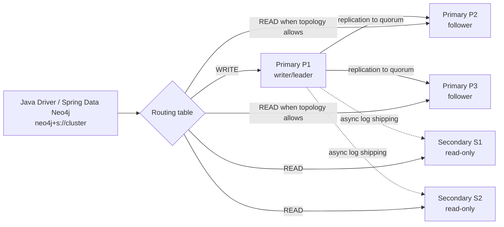
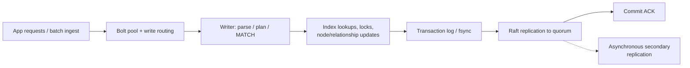

# Scaling Reads and Identifying Write-Path Bottlenecks in Neo4j

As a graph system grows, queries looking up relationships, friend recommendations, pathfinding, and profile reads can outpace the capacity of a single Neo4j machine. Adding replicas to **distribute read queries** is a major solution. However, if the primary demand is creating nodes, updating relationships, and committing write transactions, adding machines **does not automatically turn one database into multiple independent writers**.

That is the difference between **read scaling** and **write scaling**. In a Neo4j cluster where a database has multiple primaries, **only one primary acts as writer (leader) for that database at a time**. The other primaries participate in replication and fault tolerance; secondaries primarily serve read queries and receive updates asynchronously. Consequently, if the bottleneck is a massive write transaction or multiple requests contending on a single node, adding secondaries will likely not increase write throughput.

This lesson belongs to the **Clustering and Scaling** chapter of the `DATABASE_ENGINE_GRAPH_NEO4J` module. It applies property graphs, Cypher, indexes/constraints, the Java Driver, and Spring Data Neo4j to distinguish **read-path bottlenecks** from **write-path bottlenecks**, choose topologies, route queries, monitor synchronization lag, and build a measurement-driven scaling plan.

**Expected outcomes:** after this lesson, you will be able to explain why adding secondaries scales reads, why adding primaries does not add writers for the same database, use routing/bookmarks to maintain required consistency, and follow a bottleneck-isolation runbook before buying more hardware.

## 1. Define the Performance Problem Before Scaling

Two systems both handling 10,000 requests/minute may require completely different topologies:

| Workload profile | System A: graph lookup | System B: continuous write activity |
| --- | --- | --- |
| Majority of queries | `MATCH`, aggregations, recommendations, path views | `MERGE`, `CREATE`, `SET`, `DELETE` |
| Data path | Reading nodes and relationships/indexes | Lock checks, write locks, commit, and replication |
| Primary risks | Query CPU, page cache, read I/O, oversized results | Overloaded writer, lock contention, transaction log, quorum/network |
| Viable scaling options | Add secondaries, optimize read routing and queries | Optimize transactions/indexes, reduce contention, batching/concurrency; secondaries do not add writers |
| Essential checks | Read p95/p99, throughput, page faults, read routing | Write p95/p99, commit latency, lock waits, replication lag, retries |

Establish SLOs before choosing machine counts:

- **Throughput:** how many read transactions/s and write transactions/s at peak?
- **Latency:** what are the maximum acceptable read and write p95/p99 latencies?
- **Consistency:** after a write request completes, must the immediately following read observe that change?
- **Availability:** must writes survive losing one primary, or two failures?
- **Data scale:** total graph/index size, hot working set, growth rate, and returned payload sizes?
- **Resource ceilings:** CPU, RAM/page cache, IOPS, bandwidth, inter-member latency, and client resources?

You cannot decide “add two Neo4j nodes” from graph node count alone. **Read/write ratio, query shape, branching degree, and concurrency determine the true bottleneck.**

## 2. Cluster Architecture: Primary, Writer, and Secondary

In Neo4j Enterprise clustering, **primary/secondary roles bind to replicas of each database**, rather than fixing a server as primary for the whole cluster. One server can hold a primary of database A and a secondary of database B if mode constraints and allocation rules permit.

Diagram illustrating database `learning` with **three primaries** and **two secondaries**:



The diagram clarifies the flow without implying secondaries always pull logs directly from the writer: Neo4j can choose an appropriate primary/upstream source for secondaries to sync from.

### 2.1. Primaries for Fault-Tolerant Writes

A primary can serve reads and, if elected writer, handle writes. Primaries participate in consensus to protect commits. With three primaries, a write commits only once confirmed by a **primary majority (quorum)** per Neo4j replication mechanics.

Under normal conditions:

- **One primary**: cannot sustain writes if that primary goes down.
- **Three primaries**: typically tolerates **one primary failure** while retaining write capability.
- **Five primaries**: typically tolerates **two primary failures** if remaining members and networking still form quorum.

The standard pattern to tolerate `F` failures is `2F + 1` primaries. This is a **write availability choice**, not a formula guaranteeing write throughput scales with primary count. Adding primaries can increase communication and replication overhead per commit.

### 2.2. Secondaries for Read Scaling

A secondary is a database replica receiving updates **asynchronously** from the primary group. It executes **read-only** queries, distributing read CPU, page cache, and I/O across multiple machines.

Expected benefits:

- Reduces read queries hitting primaries, especially the writer.
- Increases aggregate CPU/RAM/page cache serving reads.
- Isolates read-heavy analytics from transactional writes on primaries.
- Preserves some read availability when another server fails, depending on topology and routing.

Limits:

- Secondaries **never become writers** for the database just because applications open many connections.
- Secondaries may **not yet see recently committed transactions** due to asynchronous replication.
- More secondaries increase replica storage, transaction log shipping/apply cost, networking, monitoring, and admin overhead.
- A slow Cypher query caused by massive expansion remains slow on **each** secondary; distribution only reduces inter-request contention.

### 2.3. Be Careful with the Term “Leader”

In Neo4j documentation, **writer/leader** emphasizes which replica receives writes for a database. Failovers happen and a **new writer is elected**. The Java Driver with a routing URI refreshes topology as needed; never hardcode the current writer’s hostname in business code.

## 3. An Example Identifying Scaling Limits

Suppose at peak hours an application processes:

| Operation | Hypothetical load | Target latency |
| --- | ---: | --- |
| Profile/relationship reads | 900 requests/s | p95 under 100 ms |
| Interaction count updates | 100 transactions/s | p95 under 150 ms |
| Single read query solo | 20 ms | — |
| Single write commit solo | 15 ms | — |

These are **illustrative figures**, not Neo4j benchmarks or default capacities.

Suppose before/after profiling reveals writer CPU is largely consumed by the 900 reads/s, pushing commit latency up. Adding one or two secondaries and routing reads to them can **free CPU/page cache on the writer**, improving both read p95 and write p95.

Now suppose the root cause is different: **all 100 write transactions/s update the exact same `:Counter {id: 'global'}` node**. Transactions contend on locks even when **zero read queries** hit the writer. In that situation, adding secondaries does not resolve the write-lock bottleneck.

**Lesson:** write improvements gained by **offloading reads from the writer** are completely different from **adding writers**. A standard database still has one writer at a time.

## 4. Prerequisites for Effective Read Scaling

Before adding secondaries, check sequentially:

1. **Are read queries actually routed to read nodes?** If requests still run in WRITE mode, secondaries will not absorb load as expected.
2. **Are readers slow due to non-selective Cypher?** Label scans, Cartesian products, or expansions producing millions of intermediate rows still need fixing.
3. **Does the working set fit in page cache?** Each secondary maintains its own cache; adding replicas does not eliminate disk I/O per cold request.
4. **Is too much data returned?** Returning entire `path`s, `collect(node)`, or `RETURN *` still saturates network/Driver/application resources.
5. **Is read-after-write required?** If many reads must wait for secondaries to catch up to bookmarks, throughput may fall short of expectations.
6. **Are network and routing healthy?** DNS, TLS, advertised addresses, driver routing tables, and connection pools must all work properly.
7. **Are secondaries keeping up with replication?** If replication lag remains persistently high, adding secondaries may not improve user experience.

### 4.1. Never Add Secondaries to Mask a Bad Query

Non-selective example:

```cypher
// May expand far too many relationships before selecting top-k.
MATCH (u:User)-[:FOLLOWS*1..5]->(friend:User)
RETURN u.userId AS userId,
       collect(DISTINCT friend) AS allReachable;
```

This example uses familiar variable-length relationship syntax from **Cypher 5**; for Cypher 25, use the corresponding quantified path pattern syntax. In graphs with high branching factors, intermediate rows explode. If the business only needs **10 nearest suggestions for one user**, start from the specific `$userId`, bound hop depth, filter candidates appropriately, limit results, and return only needed fields. Never tack `LIMIT 10` at the end and assume all earlier expansion was bounded.

A narrower read query:

```cypher
MATCH (u:User {userId: $userId})
MATCH (u)-[:FOLLOWS]->(f:User)
RETURN f.userId AS userId,
       f.displayName AS name
ORDER BY f.userId
LIMIT $pageSize;
```

The second query fetches only **direct followees**, which is not semantically equivalent to all friends within five hops. Change queries only when **business semantics match**.

**Conclusion:** read scale-out addresses **load distribution**, while query tuning addresses **cost per request**. Large graphs usually need both.

## 5. Proper Routing with the Neo4j Java Driver

### 5.1. Routing URIs vs. Direct Connections

| URI | Behavior | When to use |
| --- | --- | --- |
| `neo4j://host:7687` | Driver uses routing to discover eligible members | Clusters and environments permitting driver routing |
| `neo4j+s://host:7687` | Routing with TLS certificate verification | Clusters with trusted TLS/CA |
| `bolt://host:7687` | Direct connection to a single endpoint | Standalone instances or deliberately direct admin tasks |
| `bolt+s://host:7687` | Direct Bolt with TLS certificate verification | Direct connections requiring TLS |

Using `bolt://` against a specific primary will not distribute read queries across secondaries as routing topology does. In a cluster, always use the URI/hostname and TLS policy provided by your deployment.

### 5.2. READ Queries Must Declare Intent Explicitly

Example with the **modern Neo4j Java Driver** and an application-managed `Driver driver`:

```java
import org.neo4j.driver.QueryConfig;
import org.neo4j.driver.RoutingControl;

// Read-only: driver can select a reader from the routing table.
var readResult = driver.executableQuery("""
        MATCH (c:Course {courseId: $courseId})
        RETURN c.title AS title
        """)
    .withParameters(java.util.Map.of("courseId", "C101"))
    .withConfig(QueryConfig.builder()
        .withDatabase("learning")
        .withRouting(RoutingControl.READ)
        .build())
    .execute();
```

With `Driver.executableQuery()`, the default path routes as WRITE; to scale reads, explicitly pass `RoutingControl.READ` on read-only queries. Verify exact APIs and method names against your project’s resolved **Java Driver version**.

Never treat `RoutingControl.READ` as an authorization boundary: applications still need least-privilege accounts, and query semantics must genuinely be read-only.

### 5.3. Session, `executeRead`, and `executeWrite`

With `Session`, `executeRead()` and `executeWrite()` declare transaction intent and enable Driver routing and transient error retries:

```java
import java.util.List;
import java.util.Map;
import org.neo4j.driver.Driver;
import org.neo4j.driver.Session;
import org.neo4j.driver.SessionConfig;

// Assumes Driver driver is created once per application.
try (Session session = driver.session(
        SessionConfig.forDatabase("learning"))) {

    List<String> ids = session.executeRead(tx ->
        tx.run("""
            MATCH (c:Course)
            WHERE c.published = true
            RETURN c.courseId AS id
            ORDER BY id
            LIMIT $limit
            """, Map.of("limit", 20))
          .list(record -> record.get("id").asString())
    );

    System.out.println(ids);
}
```

The snippet **performs no writes**, making it suitable for testing read routing. In real systems, add key/tenant `WHERE` predicates, cursor pagination, and project only the DTO fields needed by the API.

For write queries, use `executeWrite()`. Callbacks can be retried by the Driver on transient failures, so never execute non-idempotent side effects like sending emails, charging payments, or updating external systems inside callbacks.

### 5.4. Spring Data Neo4j

With Spring Data Neo4j:

- Repositories use the Spring-managed Driver and transaction manager.
- Read-only services should express `@Transactional(readOnly = true)` as supported by the framework version.
- **Verify actual routing** with metrics, Driver/cluster logs, and integration tests; never assume every repository method automatically hits secondaries.
- Invoking custom `@Query` writes or altering transaction boundaries can make an execution path non-read-only.
- Do not instantiate two independent Driver beans/pools without a clear need and resource accounting.

**Optimizing routing is a joint effort across deployment, the Java Driver, Spring transactions, and database privileges**, not just changing a hostname in `application.yml`.

## 6. Read-After-Write: Secondaries Can Lag Yet Data Must Be Accurate

Because secondaries receive transactions asynchronously, a request can finish writing on the writer and immediately read from a secondary **before the secondary applies the new transaction**.

Example sequence:

```text
T0: POST /enroll
    WRITE: (:Student {id:'S01'})-[:ENROLLED_IN]->(:Course {id:'C101'})
    → Writer commit succeeds.

T1: GET /my-courses
    READ routes to a secondary that has not applied transaction T0 yet.

T2: Secondary receives and applies transaction T0.
```

If GET at T1 returns without `C101`, the application delivers an inconsistent user experience.

### 6.1. Bookmarks and Causal Consistency

The Neo4j Java Driver supports **bookmarks**: tokens representing committed transaction state. When a read transaction runs with a bookmark from a prior write, the cluster ensures the serving node has reached at least that state before executing.

The simplest approach is **writing and reading within the same Session**:

```java
import java.util.Map;
import org.neo4j.driver.Driver;
import org.neo4j.driver.Session;
import org.neo4j.driver.SessionConfig;

try (Session session = driver.session(
        SessionConfig.forDatabase("learning"))) {

    // Actual write: run only against a test database.
    session.executeWrite(tx -> {
        tx.run("""
            MERGE (s:Student {studentId: $studentId})
            MERGE (c:Course {courseId: $courseId})
            MERGE (s)-[:ENROLLED_IN]->(c)
            """, Map.of(
                "studentId", "S01",
                "courseId", "C101"
            )).consume();
        return null;
    });

    long enrolled = session.executeRead(tx ->
        tx.run("""
            MATCH (:Student {studentId: $studentId})
                  -[r:ENROLLED_IN]->
                  (:Course {courseId: $courseId})
            RETURN count(r) AS n
            """, Map.of(
                "studentId", "S01",
                "courseId", "C101"
            )).single().get("n").asLong()
    );

    System.out.println("Observed relationships: " + enrolled);
}
```

The Driver manages bookmarks automatically within **the same Session**, so causally ordered reads may wait for the chosen member to catch up. In an ideal example without parallel edges, the result is `1`. To guarantee idempotency under competing writers, pair proper schema/constraints with concurrency controls; `MERGE` **does not replace relationship uniqueness rules**.

When writes and reads happen in **two different sessions** (or two separate services), pass bookmarks explicitly or use a `BookmarkManager` per current Driver APIs if read-your-writes across them is required. With `driver.executableQuery()`, the Driver manages default bookmarks for the query chain; verify your exact version and configuration.

**Trade-off:** if a secondary lags, bookmark-bound requests must **wait**. Do not apply causal chains to unrelated analytics if the product tolerates a few seconds of staleness. Consistency trades off against throughput and latency.

### 6.2. Classifying Queries by Consistency Requirements

| Feature | Strict read-after-write needed? | Routing guidance |
| --- | --- | --- |
| Enrollment confirmation screen | **Yes**, must see new relationship | Same session/bookmark, or writer read per business rule |
| Popular course list refreshed every minute | Short lag acceptable | Read routing to secondaries |
| Reading status of a just-paid transaction | **High consistency required** | Causal consistency and solid transaction design |
| Daily summary reports | Typically tolerates SLA lag | Secondaries if isolated from writer |
| Admin reconciliation after migration | Depends on accuracy and watermark rules | Bookmarks, writer, or paused pipeline per runbook |

Do not equate **causal consistency** with “every read always sees the global latest state across every machine at every instant.” Bookmarks establish causal ordering relative to known transactions; someone else’s newly committed transaction outside the causal chain is not automatically forced onto every reader.

## 7. Changing Topology to Increase Read Capacity

Suppose database `learning` currently has three primaries and one secondary, and additional eligible servers are available. When read demand grows, administrators can change the **requested secondary replica count**.

**The Cypher commands below require administrative privileges and belong only in test environments or approved production change procedures. Never run them ad-hoc on live systems.**

Inspect current state:

```cypher
// Connect to the system database with a privileged viewing account.
SHOW DATABASE learning
YIELD name, address, role, writer, currentStatus
RETURN name, address, role, writer, currentStatus
ORDER BY role, address;
```

Some versions also expose `replicationLag` in `YIELD`. If fewer replicas appear than expected, verify version, privileges, individual member statuses, and database allocations.

To request a new topology (e.g., scaling up to **two secondaries**):

```cypher
// TOPOLOGY CHANGE: requires admin privileges and capacity.
ALTER DATABASE learning
SET TOPOLOGY 3 PRIMARIES 2 SECONDARIES;
```

Prerequisites:

- The cluster has **enough ENABLED servers** matching `modeConstraint` to host the requested replicas.
- Each member has sufficient disk/RAM/CPU and network bandwidth for database seeding/sync.
- Allocation takes time while the new copy reaches `online` and catches up.
- If constraints cannot be satisfied, the command errors; `ALTER DATABASE` **does not** provision new physical servers.
- Databases may not allow automatically shrinking from multiple primaries down to **one** primary under Neo4j rules; never use topology changes to “reduce quorum for speed” without reading the exact manual.

Re-check after changing:

```cypher
SHOW DATABASE learning
YIELD name, address, role, writer,
      currentStatus, replicationLag
RETURN name, address, role, writer,
       currentStatus, replicationLag
ORDER BY role, address;
```

`replicationLag` measures transaction-number delta behind the writer (on supported versions), **not request latency in milliseconds**. To verify a new copy has genuinely caught up, monitor multiple samples under workload rather than trusting a single `currentStatus = 'online'` row.

### 7.1. Before Using `ALTER DATABASE`

Safe workflow:

1. Measure workload and establish a baseline; confirm read saturation is the real problem.
2. Verify backups/recovery and topology rollback steps per runbook.
3. Provision servers, resources, networking, and compatible Neo4j versions.
4. Inspect `SHOW SERVERS`, current/requested allocations, and mode constraints.
5. Apply topology changes only inside an approved maintenance/change window.
6. Monitor catch-up speed, lag, page cache warmup, routing errors, and CPU/disk/network.
7. Re-run load tests comparing p95/p99, throughput, and cluster cost.
8. If ineffective, revisit queries/routing rather than adding secondaries indefinitely.

When a cluster hosts multiple databases, a server may saturate due to the **sum of other databases**. “Database `learning` has two secondaries” does not mean those two servers’ resources belong exclusively to `learning`.

## 8. Identifying Write-Path Bottlenecks

A database has one active writer; commits depend on writer transaction processing plus topology-defined replication/quorum. When write p95/p99 spikes, the bottleneck can sit at any of several stages.



This diagram shows **cost stages**. Internal kernel, transaction log, and replication sequencing can vary by version; do not use it to assert an exact low-level I/O ordering.

### 8.1. Writer Starved of CPU or Heap

Symptoms:

- Writer CPU stays pinned high as write throughput rises.
- Heap/GC pressure climbs, transaction memory approaches limits.
- A `MERGE` query does excessive work due to missing indexes or high cardinality.
- The writer is simultaneously executing heavy read queries.

Remediations:

- Index/constrain business keys used in `MERGE`.
- Run `EXPLAIN` to inspect plans, checking `NodeIndexSeek` vs. `NodeByLabelScan`.
- Reduce intermediate rows; replace massive `collect()` calls with targeted computation.
- Batch writes and cap concurrency at the ingestion layer.
- Offload independent read queries to secondaries where workload permits.

### 8.2. Lock Contention on a “Hot Node”

Example where every request updates the same summary node:

```cypher
// Anti-pattern when many workers concurrently update a single node.
MATCH (c:DailyCounter {day: $day})
SET c.total = c.total + 1
RETURN c.total AS total;
```

Transactions must serialize write locks on that same node. With many concurrent workers, throughput stalls on lock waits even while writer CPU looks idle.

Options to evaluate:

- Avoid updating a global counter on **every single event** if real-time precision is unnecessary.
- Record events/operations by separate keys and aggregate periodically or on read paths where appropriate.
- Shard counters by tenant/shard/time bucket **if business rules permit**, then sum across buckets.
- Minimize lock hold duration; keep unrelated heavy queries out of the write transaction.
- Acquire locks in a consistent order across workers to reduce deadlocks when updating multiple entities.

**Caution:** sharding counters or aggregating asynchronously changes consistency semantics. Never apply it to account balances, quotas, or invariants demanding strict immediate accuracy without an alternative transactional design.

### 8.3. Oversized Transactions

Ingesting hundreds of thousands of relationships in one transaction causes:

- Huge heap/transaction memory usage.
- Long lock hold times.
- Transaction log and replication bursts.
- Expensive rollbacks/retries if an error hits mid-way.
- Latency spikes for small concurrent transactions.

Example `UNWIND` ingestion pattern:

```cypher
// $rows is key-validated, deduplicated, and batched by the application.
UNWIND $rows AS row
MATCH (s:Student {studentId: row.studentId})
MATCH (c:Course {courseId: row.courseId})
MERGE (s)-[:ENROLLED_IN]->(c);
```

Determine batch size empirically—starting around a few hundred rows for relationship-heavy writes and tuning against latency, GC, transaction memory, and lock waits. **There is no universal optimal batch size.** Because `MATCH` silently skips rows when a Student or Course is missing, the pipeline must reconcile source row counts against applied outcomes.

When multiple workers write overlapping keys, `MERGE` and indexes prevent duplicate nodes, but do not automatically resolve every conflict or enforce uniqueness on parallel relationships if the model allows them.

### 8.4. Transaction Logs, `fsync`, and Storage Latency

Neo4j must write transaction logs and preserve durability. When the write volume has high **write await/latency**, commits stall even with spare writer CPU.

Inspect:

- Disk write IOPS/throughput and latency on the actual database/transaction log volumes.
- Checkpoint/flush activity and free disk space.
- I/O contention from backups, index population, or co-located workloads.
- Write transaction frequency and commit size.

**Never** assume increasing page cache fixes slow commits: `fsync` and log durability are separate from read page faults.

### 8.5. Quorum and Inter-Primary Networking

Primaries coordinate on commits; one slow primary or high inter-member network latency can stretch the wait for quorum acknowledgments.

Signs:

- Write latency rises after adding primaries or relocating members geographically.
- Network RTT, packet loss, retransmissions, or socket queues increase.
- Abnormal Raft replication/append/commit metrics.
- One member with slow disk/CPU slows log processing.
- Active failover/leader election or ongoing topology shifts.

Increasing primaries from three to five to “speed up writes” can **do the opposite**: quorum requires more members and can raise commit latency. The payoff is higher primary fault tolerance. Choose primary count for **resilience requirements** backed by benchmarks.

## 9. `EXPLAIN`, `PROFILE`, and Separating Query Cost from Cluster Cost

A slow write query is easily mistaken for a cluster problem. Example:

```cypher
EXPLAIN
MATCH (s:Student {studentId: $studentId})
MATCH (c:Course {courseId: $courseId})
MERGE (s)-[:ENROLLED_IN]->(c);
```

`EXPLAIN` builds the execution plan **without running the write**. It reveals whether Neo4j finds Student/Course via index seeks or label scans, estimated rows, and planned operators.

`PROFILE` **actually executes** the query. On `MERGE` or `CREATE`, running `PROFILE` **modifies data**. Only profile write queries in controlled test environments.

Analysis steps:

1. **Check input cardinality:** does a request meant to create one relationship actually match only two endpoints?
2. **Check indexes/constraints:** do lookups on `studentId`/`courseId` hit proper indexes?
3. **Inspect `Rows` and `DB Hits`:** are unnecessary expansions or row multiplications occurring before the write?
4. **Check locks/contention:** are concurrent transactions updating the same Student/Course?
5. **Check post-plan commit costs:** transaction log, quorum/replication, disk/network.
6. **Separate database latency from end-to-end latency:** the Java Driver might be waiting on pools, retries, or client payload processing.

When moving read-only workloads to secondaries lowers write p95, attribute it to **reduced CPU/I/O contention** rather than claiming Neo4j gained multiple writers.

## 10. Monitoring Metrics for Read Scaling and Write Bottlenecks

### 10.1. Measure Per Member and Per Database

A chart showing “average cluster CPU 40%” can hide a writer at 95% CPU while secondaries sit at 10%. Every dashboard needs labels for **database, server/instance, role, and writer flag** (per exporter capabilities).

| Metric | Meaning | Signal to investigate |
| --- | --- | --- |
| Read transactions/s per member | Actual routing distribution | Almost all reads hitting writer despite secondaries |
| Read p95/p99 latency | Application impact | Climbs alongside reader CPU/page faults |
| Write transactions/s and commit p95/p99 | Write-path health | Latency rises while throughput flattens |
| Writer CPU, heap, GC | Query and transaction capacity | Writer saturated while readers sit idle |
| Page cache hits/faults, disk reads | Working set and read I/O | Cold secondaries or undersized cache |
| Disk write IOPS/await | Log/checkpoint/write storage | Slow commits tracking write latency |
| Lock waits/deadlocks/retries | Transaction contention | Spikes when workers hit shared keys |
| Raft leader/append/commit/applied | Quorum and primary replication | Unstable leader, widening commit/apply gap |
| Secondary replication lag | Read replica freshness | Sustained or steadily rising lag |
| Bolt pool waits, timeouts, routing errors | Client or network bottlenecks | Slow app despite fast individual queries |

### 10.2. Observing Topology from Cypher

Connect to the `system` database with sufficient privileges:

```cypher
SHOW SERVERS
YIELD name, address, state, health, modeConstraint
RETURN name, address, state, health, modeConstraint
ORDER BY name;
```

To inspect database replicas and the current writer:

```cypher
SHOW DATABASE learning
YIELD name, address, role, writer,
      currentStatus, replicationLag
RETURN name, address, role, writer,
       currentStatus, replicationLag
ORDER BY role, address;
```

Available columns depend on version and privileges. `replicationLag` is not latency in seconds; it can represent **transaction-number offset** between replica and writer. A brief bump during catch-up is not automatically an incident; a **sustained trend** warrants action.

### 10.3. Interpreting Raft Metrics Semantically

Depending on Neo4j version/edition/exporter, relevant metrics include:

- `cluster.raft.is_leader`: whether the member is currently leader for that database.
- `cluster.raft.append_index`, `commit_index`, and `applied_index`: proposed, committed, and applied log positions.
- `cluster.raft.message_processing_delay` or similar metrics: message-processing delay.
- Database-level last committed transaction / replication lag.

If `commit_index` advances while one primary’s `applied_index` trails persistently, that member may be slow to apply logs. Never compare Raft numbers across **two different databases** to infer lag: indexes are scoped to each database’s Raft group.

Secondary replication lag must be tracked using **secondary-appropriate metrics**, without assuming secondaries share primary Raft roles/metrics. Exact metric names and prefixes can vary; inspect the metric catalog of your **running server**.

## 11. Fault Tolerance Does Not Equal Write Scalability

| Illustrative topology | Primary goal | What must not be inferred |
| --- | --- | --- |
| 1 primary | Simplicity, minimal replication overhead | No writer fault tolerance, no independent read scaling |
| 3 primaries | Tolerates one primary failure while quorum holds | **Not** three concurrent writers for the same database |
| 3 primaries + 2 secondaries | Scale read capacity while keeping primary HA | **Does not** scale write throughput linearly across 5 machines |
| 5 primaries + secondaries | Tolerates two primary failures plus read scaling | Write latency is not automatically better than 3 primaries |
| Multiple databases distributed across cluster | Isolate workloads and resource quotas per database | No automatic cross-database ACID transactions |

When workloads are partitioned into **independent databases**, each database gets its **own writer**. That can distribute aggregate system writes if business domains cleanly separate data and avoid cross-database transactions. However, splitting a unified graph into multiple databases/shards is a **data-modeling and application-architecture decision**, not a simple topology toggle. Cross-partition path queries become harder or require federation/Composite database designs, without automatic global ACID transactions.

## 12. Practical Limits of Read Scaling

Adding secondaries does not grant infinite read capacity. Several costs grow with replica count:

- **Storage:** each replica stores full graph data, indexes, and required logs.
- **Memory/page cache:** each server maintains its own cache and must warm up under real traffic.
- **Network:** secondaries must pull transaction streams and drivers manage routing metadata.
- **Indirect write amplification:** write-heavy workloads generate updates every secondary must apply.
- **Operational complexity:** more TLS certs, monitoring, backup policies, patching/upgrades, and failover drills.
- **Replica lag:** lagging readers can return stale data unless bookmarks are used.
- **Unintended query fan-out:** N+1 mapping or excessive independent queries can still overwhelm all readers.

For instance, when increasing secondaries from 1 to 3 yields only a 10% total throughput gain, check whether:

1. The Driver is actually routing most reads to secondaries.
2. Read queries are single-thread CPU-heavy and remain slow on every server.
3. The API is bottlenecked on network serialization or the Java Driver pool.
4. Secondaries suffer high page faults due to cold caches.
5. High write rates impose heavy replication/apply load on every secondary.
6. The workload is throttled outside Neo4j (e.g., at an API gateway).

Measure **throughput, p95/p99, error rate, and per-replica cost**, not machine count alone.

## 13. Load Testing to Prove Scaling Effectiveness

A credible test holds **data, queries, and concurrency policy constant** while documenting topology/routing changes.

### 13.1. Two Separate Test Suites

**Read load test:**

- Production-like mix of `MATCH`/traversal/aggregation queries.
- Clients using `RoutingControl.READ` or `executeRead()`.
- Measure throughput, read p95/p99, per-member CPU/page cache, network, and replication lag.
- Repeat across **0, 1, and 2 secondaries** where supported, after warming caches.

**Write load test:**

- Representative `MERGE` node/relationship and `SET` property transactions.
- Include both **key-independent** and **hot-node contention** cases.
- Measure write p95/p99, throughput, lock waits, retries, log I/O, and Raft metrics.
- Hold primary count fixed while varying secondaries to isolate gains from read offloading.
- Never run `CREATE`/`DELETE` write load tests against production data.

### 13.2. Hypothetical Results Table

| Scenario | Read throughput | Read p95 | Write p95 | Interpretation |
| --- | ---: | ---: | ---: | --- |
| 3 primaries, 0 secondaries, read+write | 700/s | 180 ms | 240 ms | Writer/primaries also carry read load |
| 3 primaries, 2 secondaries, read+write | 1,100/s | 95 ms | 170 ms | Read contention on primaries likely reduced |
| 3 primaries, 2 secondaries, hot-counter writes only | — | — | 650 ms | Lock contention persists |
| 5 primaries, 2 secondaries, hot-counter writes only | — | — | 700 ms | More primaries do not fix hot-key bottleneck |

**All numbers are hypothetical** to illustrate interpretation—not Neo4j benchmarks. Actual results depend on data, indexes, storage, hardware, config, JVM, networking, and queries. Never cite this table as a promise that two secondaries increase throughput by any fixed percentage.

### 13.3. Correctness Testing Is Mandatory

Beyond speed, verify:

- Read APIs return exact node/relationship counts per scope and tenant.
- Sessions/Bookmarks ensure read-after-write flows observe required updates.
- Writer failover causes neither partial transactions nor retry duplicates.
- Batch ingestion is idempotent; connection drops do not trigger repeated external side effects.
- Queries routed to secondaries perform no writes and do not depend on unavailable features.
- When secondaries lag or fail, routing/fallback matches SLOs and consistency policies.

## 14. Bottleneck-Isolation Runbook Before Scaling the Cluster

### Step 1 — Pin Down the Symptoms

Is latency rising on **reads**, **writes**, or both? Is the p95/p99 spike in the API, query execution, or commit? Are errors/timeouts/retries increasing?

### Step 2 — Compare Writer and Readers on the Same Timeline

Inspect CPU/GC/page cache/I/O across the writer, follower primaries, and secondaries for the database. If writer CPU is 95% while secondaries sit at 20%, suspect routing or write workload. If all readers show high page faults/CPU together, query/data access is likely the shared bottleneck.

### Step 3 — Verify Routing

Check `neo4j://`/`neo4j+s://` URIs, Driver read modes, Spring transactions, routing tables, DNS/TLS, and member states. Never add secondaries while all traffic still goes to the writer.

### Step 4 — Inspect Cypher Execution Plans

Use `EXPLAIN` to check indexes/scans/cardinality. For read-only queries in permitted environments, run `PROFILE` to check Rows, DB Hits, Sort/Aggregation/Expand. For write queries, run `PROFILE` **only in test environments**.

### Step 5 — Inspect Transactions and Commits

If writes are slow: check hot nodes, lock waits, batch sizes, transaction memory, write I/O, network RTT, quorum/Raft, and retries. Separate **slow pre-commit execution** from **slow commit** using real logs and metrics.

### Step 6 — Inspect Secondary Freshness

Inspect `replicationLag`, last committed transactions, and bookmark waits. Adding readers will not meet SLOs if every request stalls waiting for replicas to catch up.

### Step 7 — Apply Controlled Changes

Prioritize:

1. Fix bad queries or missing indexes.
2. Trim payloads, tune batching, eliminate N+1, and bound concurrency.
3. Fix read-only routing.
4. Add secondaries once read saturation is proven and capacity supports them.
5. Upgrade writer/storage/network resources if write bottlenecks demand it.
6. Consider domain partitioning across multiple databases only if the data model supports it.

### Step 8 — Re-Measure and Document the Decision

Record old/new topology and versions, baseline, workload, p95/p99, throughput, errors, lag, CPU, GC, disk I/O, and cost. Keep a rollback plan if read consistency breaks, costs outstrip gains, or replication turns unstable.

## 15. Common Misconceptions

| Misconception | Accurate understanding |
| --- | --- |
| “Three primaries means three writers.” | One database has **one elected writer/leader** at a time. |
| “Adding secondaries directly boosts write throughput.” | Secondaries serve **reads**, helping writes only **indirectly** by offloading reads. |
| “Secondaries always see records the moment the writer commits.” | Secondary replication is **asynchronous**; use bookmarks for read-after-write. |
| “More primaries always mean faster commits.” | More primaries increase fault tolerance but can increase quorum/replication overhead. |
| “READ mode is an authorization control.” | READ mode only guides routing; enforce privileges separately. |
| “`bolt://writer` distributes read queries automatically.” | Direct URIs do not replace cluster routing URIs. |
| “With bookmarks, every read is instantaneous.” | Readers may wait for transactions to apply, increasing latency. |
| “Adding replicas fixes Cartesian products.” | Every replica still runs the bad query; optimize Cypher instead. |
| “`SHOW DATABASE` online means zero replica lag.” | Online status and replication lag are separate signals. |
| “Failover affects zero requests.” | Transient errors/retries and writer election pauses can still occur. |
| “Read scale-out always improves p99.” | p99 can still be dominated by networking, client pools, cold caches, query cost, or consistency waits. |
| “Quorum replaces backups.” | Replication/HA does not replace backup and recovery strategies. |

## 16. Self-Check Exercises

**Question 1.** A database has three primaries and four secondaries. How many primary writers are elected at a time? Does adding another secondary increase that number?

**Question 2.** A system has high write p95 and low read p95. 90% of write transactions update the same `DailyCounter`. Name three metrics to measure before buying another secondary.

**Question 3.** Why does a three-primary topology normally tolerate one primary failure while keeping writes alive, whereas two primaries lack equivalent write fault tolerance on one loss?

**Question 4.** A user enrolls in a course on the writer, then immediately reads their course list from a secondary. Why might the enrollment be missing, and what should you do when read-your-writes is required?

**Question 5.** The Java Driver uses `bolt://server-1` and all reads hit `server-1`. The cluster already has two secondaries sitting at very low CPU. Propose connection/routing changes.

**Question 6.** After adding secondaries, read throughput increases while write p95 stays flat. Give two valid explanations without assuming the deployment is broken.

**Question 7.** When `replicationLag = 120`, does that mean 120 milliseconds? What else should you observe?

**Question 8.** Why is scaling from three to five primaries not automatically a good fix for high commit latency? What actually improves in the fault-tolerance model?

**Question 9.** What consequences can running `PROFILE MERGE` in production cause? What tool should you use to inspect the plan without executing writes?

**Question 10.** If a graph contains cross-tenant relationships, is splitting into multiple databases for write scale merely a topology change? Name at least two application-level trade-offs.

**Suggested answers:**

1. One writer for the database; secondaries do not increase writer count.
2. Lock waits, write latency/throughput, hot-key distribution, writer CPU, disk log I/O, and retries.
3. Three primaries leave two members forming quorum; two primaries lose majority when one is lost.
4. Secondaries replicate asynchronously; use bookmarks/causal sessions or read from an appropriate writer path.
5. Use routing URI `neo4j://`/`neo4j+s://` and READ routing/`executeRead()`.
6. Hot-node contention or write log/quorum bottleneck; or primaries were not carrying heavy read load to begin with.
7. No, lag can be measured in transaction count; watch trends, apply rate, and impact on causal reads.
8. Replication/quorum overhead may rise; the main gain is surviving one additional primary failure.
9. `PROFILE` actually executes the write command; use `EXPLAIN` to view the plan safely.
10. Must partition data, adjust keys/queries, handle cross-database traversals, and manage transaction/consistency boundaries.

## 17. References

- [Neo4j Operations Manual — Introduction to clustering](https://neo4j.com/docs/operations-manual/current/clustering/introduction/): primary/secondary roles, single writer per database, quorum, read scaling, causal consistency, and failover.
- [Neo4j Operations Manual — Managing databases in a cluster](https://neo4j.com/docs/operations-manual/current/clustering/databases/): configuring topology via `CREATE DATABASE`/`ALTER DATABASE` and server constraints.
- [Neo4j Operations Manual — Monitor databases](https://neo4j.com/docs/operations-manual/current/clustering/monitoring/show-databases-monitoring/): inspecting role, writer, replication lag, and primary/secondary counts.
- [Neo4j Operations Manual — Metrics reference](https://neo4j.com/docs/operations-manual/current/monitoring/metrics/reference/): Raft metrics, CPU/GC/page cache, and transaction monitoring.
- [Neo4j Java Driver Manual — Query the database](https://neo4j.com/docs/java-manual/current/query-simple/): `RoutingControl.READ` and `ExecutableQuery`.
- [Neo4j Java Driver Manual — Run transactions](https://neo4j.com/docs/java-manual/current/transactions/): `Session`, `executeRead`, and `executeWrite`.
- [Neo4j Java Driver Manual — Coordinate parallel transactions](https://neo4j.com/docs/java-manual/current/bookmarks/): bookmarks, read-after-write, and synchronization limits.
- [Neo4j Cypher Manual — Execution plans](https://neo4j.com/docs/cypher-manual/current/planning-and-tuning/execution-plans/): `EXPLAIN`, `PROFILE`, `Rows`, and `DB Hits`.

**Remember:** Neo4j can **scale reads using secondaries**, yet a single database still has **one writer** at a time; primaries primarily provide write fault tolerance, and every commit must account for quorum. Before scaling out, verify read routing, replica lag, causal consistency needs, and per-query cost. When the write path bottlenecks, prioritize identifying **hot nodes/locks, transaction batching, indexes, transaction logs, networking, and replication**, instead of assuming adding cluster members automatically accelerates writes.
