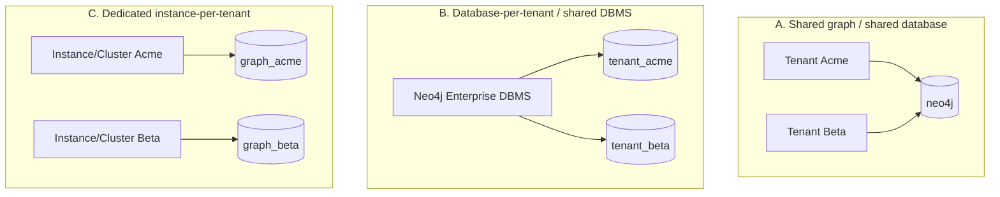
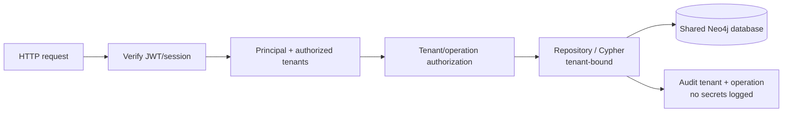
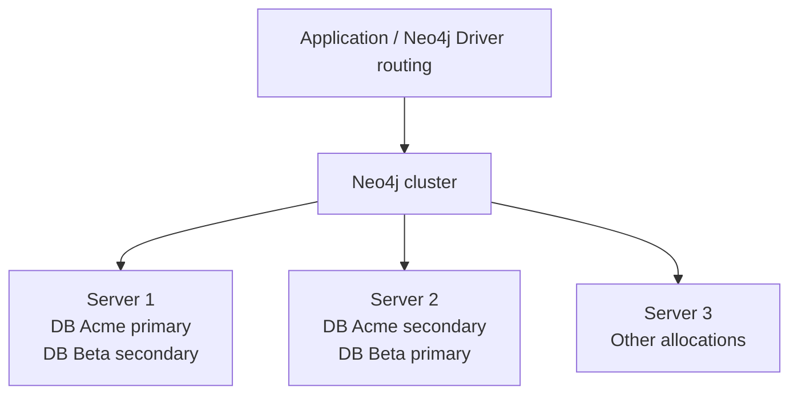
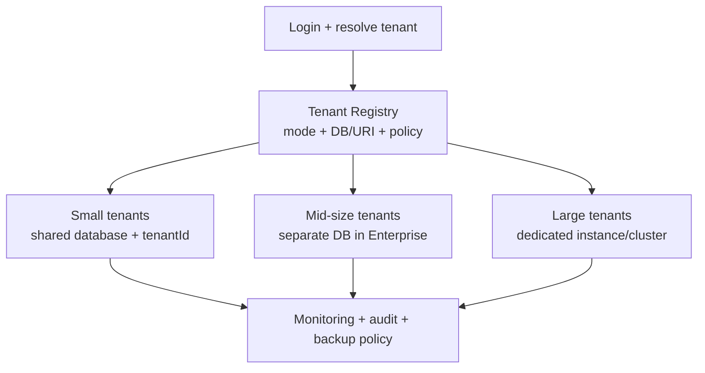

# Evaluating Multi-Database and Tenant Isolation Based on Neo4j Capabilities

A SaaS product built on Neo4j typically serves **multiple independent customers/organizations** (*tenants*). Each tenant has its own users, orders, products, transactions, and relationship network. The problem is not merely deciding where to store nodes and relationships, but answering:

- Can tenant A’s data be queried, modified, or traversed into from tenant B?
- When one tenant runs a very heavy graph query, do other tenants slow down?
- Can backups, restores, data deletion, and privileges be managed **independently** per tenant?
- How many databases, database-level privileges, clusters, or real isolation boundaries do Neo4j Community, Enterprise, and Aura tiers support?
- How does the cost of a thousand small tenants compare to ten large enterprise tenants?

This lesson belongs to the **Clustering and Scaling** chapter of the `DATABASE_ENGINE_GRAPH_NEO4J` module. This module uses Neo4j to model property graphs, query nodes/relationships/paths with Cypher, manage indexes and constraints, tune queries, ingest data, integrate with the Java Driver / Spring Data Neo4j, and operate graph systems. The focus here is **evaluating multi-database and tenant isolation based on what Neo4j actually supports**, without assuming every edition/plan shares the same features.

After this lesson, you will know how to choose among **shared graph**, **database-per-tenant**, or **dedicated instance** models, understand transaction and authorization boundaries, write tenant-safe Cypher, select databases with the Driver, test cross-tenant access, and design a migration workflow as the system scales.

> **Version context:** Content reflects Neo4j as of November 2026 and the official documentation cited at the end. Neo4j spans multiple editions, Aura plans, and release-specific features; **check your exact version, edition, license, plan, and environment limits before applying**. Statements creating multiple databases and granular privileges are examples for supported editions and **cannot run as-is in Community Edition**.

## 1. Concepts to Keep Separate

| Concept | Meaning | Example |
| --- | --- | --- |
| **Tenant** | Customer/organization requiring data and privilege separation | Acme Corp, Beta Corp |
| **Node / relationship** | Data elements in a property graph | `(:Customer)-[:PLACED]->(:Order)` |
| **Standard database** | A graph-storing database serving as the normal transaction boundary | `tenant_acme` |
| **DBMS / Neo4j instance** | Database management system hosting databases and system metadata | One Neo4j Enterprise process |
| **`system` database** | Stores admin metadata, users/roles, and DBMS info | Not a business tenant graph |
| **Cluster** | Multiple servers operating databases under supported topology | Primary/secondary allocations |
| **Database alias** | Reference name routing to a database | Application alias for a physical database |
| **Home database** | Default database for a user when the client omits one | `tenant_acme` |
| **Isolated instance** | Tenant has separate runtime/compute/DBMS | Dedicated Neo4j deployment for Acme |

**Multi-database does not mean multi-instance.** An Enterprise DBMS can manage many standard databases, yet they may all run on **the same machine/cluster, sharing CPU, RAM, disk, and operational components**.

**Multi-tenant does not mean multi-database.** One database can hold multiple tenants’ data if every node, relationship, and operation enforces tenant boundaries properly.

**A database is not a label namespace.** Inside a shared database, `:Customer` is shared; to separate tenants via properties, the application must encode boundaries into keys and queries.

### 1.1. Distinguishing Data Plane and Control Plane

- **Data plane:** `MATCH`, `MERGE`, `SET`, transactions, and path traversals executed on graph data.
- **Control plane:** creating/dropping databases, managing accounts/roles, allocating databases across clusters, backups, and monitoring.

In Neo4j, the `system` database belongs to the control plane. Business data belongs in standard databases. Never use `system` to store customer nodes simply because it exists in every installation.

## 2. Multi-Database Capability Depends on Edition and Service Plan

You cannot design around `CREATE DATABASE tenant_a` without knowing which Neo4j offering you run.

| Environment | Multiple user standard databases supported? | Practical interpretation |
| --- | --- | --- |
| **Neo4j Community Edition** | **Only one standard database** for user data | Cannot do database-per-tenant inside a *single Community instance* |
| **Neo4j Enterprise Edition self-managed** | **Multiple standard databases** | Governed by `dbms.max_databases`, resources, license, and environment limits |
| **AuraDB Business Critical** | Supports multiple databases in one instance when enabled by tier/plan | Databases share instance compute/memory and face RAM/plan caps |
| **AuraDB Virtual Dedicated Cloud** | Supports multiple databases in one instance when enabled by tier/plan | Subject to instance limits and service terms |
| **Other Aura plans** | **Do not assume** multiple databases are available | Check documented features and limits for your active plan |

Per current Neo4j Operations Manual documentation, Community Edition allows **exactly one standard database**; Enterprise Edition manages multiple standard databases. Enterprise includes `dbms.max_databases`, currently defaulting to **100** (counting online/offline databases within config limits), though that is not a promise that one server has enough resources to run 100 heavy databases.

On AuraDB, multiple-databases documentation currently lists **Business Critical** and **Virtual Dedicated Cloud**. Current limits scale with RAM, defaulting up to **5 databases per GB of RAM**, with plan ceilings of **100** and **250** databases respectively. These are **product limits at the time of reference**, not capacity-planning formulas or guaranteed per-tenant performance quotas. Verify enabled features and plan terms when provisioning instances.

**Do not confuse Cypher syntax versions with product capabilities.** An article showing `CREATE DATABASE` does not mean your Community/Free instance can execute it.

### 2.1. Inspecting the Environment Before Choosing a Design

Practical checklist:

1. Neo4j version, Community or Enterprise, self-managed or Aura?
2. Are you permitted to create/drop standard databases?
3. Max database count, RAM/CPU limits, and actual user counts?
4. Are **RBAC** and database-scoped privileges available?
5. How are credentials provisioned: native users, SSO, or identity provider?
6. Are per-database independent backups/restores available?
7. Are cluster topologies/allocations and corresponding routing supported?
8. Are composite databases or other database types available, and do they fit the use case?
9. What are the per-database/instance, plugin/GDS, and operational costs?

Basic inspection query with an appropriately privileged account:

```cypher
SHOW DATABASES
YIELD name, type, currentStatus, requestedStatus, access
RETURN name, type, currentStatus, requestedStatus, access
ORDER BY name;
```

Output depends on the caller’s privileges; a user granted access only to tenant A may not see other databases. **Not seeing tenant B in the list does not prove every path to B is blocked**: run explicit access tests.

## 3. Five Layers of “Isolation” to Evaluate

Designers often say “the data is isolated” while talking about completely different things.

| Layer | Evaluation question | Shared database | Separate DB in same DBMS | Dedicated instance |
| --- | --- | --- | --- | --- |
| **Logical isolation** | Can a query see another tenant’s nodes? | Relies on filters/policies | Stronger database boundary | Clearer per-instance boundary |
| **Authorization isolation** | Can tenant A’s identity read/write B? | App/RBAC per capability | Database-scoped RBAC where supported | Separate credentials/instances |
| **Transaction isolation** | Can one transaction write both tenants? | **Possible**, if code allows | Standard transactions cannot span multiple standard DBs | No transactions across instances |
| **Resource isolation** | Do A’s heavy queries starve B’s CPU/RAM? | High risk | **Still shared** at instance/cluster level | Stronger isolation with separate compute |
| **Operational isolation** | Can backups/restores/upgrades run per tenant? | Complex; mixed data | Easier at the database level | Easy per-tenant schedules, higher fleet overhead |

A separate database within the same DBMS offers a **better data/transaction boundary** than an app-enforced `tenantId` field, yet it is **not a hard compute boundary**. A runaway traversal expanding millions of relationships can still saturate shared heap, page cache, and CPU.

For regulated environments, also verify **per-tenant encryption keys, backups, regional residency, and host/operator admin access**. Database-per-tenant may fall short of requirements demanding “separate infrastructure and encryption keys per customer.”

## 4. Three Common Multi-Tenant Architectures



### A — Single Graph Distinguished by `tenantId`

All data resides in one standard database. Nodes carry `tenantId`; queries and keys must constrain by tenant.

**Pros:**

- Works in Community Edition and single-database plans.
- Database count does not grow with tenant count.
- Easy to share unified indexes, constraints, and migrations.
- Fits **large numbers of small tenants** with uniform workloads and centralized operations.

**Cons:**

- Missing a single query filter risks **cross-tenant data leaks**.
- A single transaction can accidentally create an edge linking two tenants.
- Hard to restore “only tenant A’s data” via database-level operations.
- Backups, page cache, logs, and hardware resources are shared.
- Path `MATCH` traversals can pass through another tenant’s node unless the entire path is constrained.

### B — One Standard Database per Tenant in the Same DBMS

For example, `tenant_acme` and `tenant_beta` are two databases managed by Neo4j Enterprise. Clients must **select the right database**; RBAC grants each identity access only to its assigned database.

**Pros:**

- Clear database boundary reduces the risk of normal queries reading mixed data.
- Per-database indexes/constraints simplify per-tenant schema lifecycles.
- Backups/restores, monitoring, and incident handling target specific databases.
- Standard transactions cannot write two standard databases simultaneously.
- Avoids running separate Neo4j processes as in dedicated instances.

**Cons:**

- Requires a supporting edition/plan.
- Tenants still compete for CPU, memory, disk, network, and cluster capacity.
- Many databases incur metadata, store, index, backup, migration, and monitoring overhead.
- **Cross-tenant** graph traversals become harder because relationships cannot directly connect nodes across two standard databases.
- Applications must manage `tenantId -> database` mappings consistently across transactions.

### C — Dedicated Instance/Cluster per Tenant

Each tenant gets dedicated runtime, storage, identity, and topology; heavy tenants can run on dedicated infrastructure.

**Pros:**

- Strongest resource and admin isolation when compute/host/network are genuinely separated.
- Easy per-customer tuning of config, upgrades, backup schedules, and regions.
- Fits large enterprise tenants, strict SLAs, or specialized compliance mandates.

**Cons:**

- Many instances/clusters to patch, monitor, back up, rotate secrets for, and operate.
- Idle capacity and costs multiply quickly across thousands of small tenants.
- Cross-instance analytics and tenant moves are complex.
- Dedicated instances **still need HA/backups** when high availability is required; a standalone instance is not automatically HA.

## 5. Trade-Off Matrix by Tenant Scale

| Criterion | Shared graph | Database-per-tenant | Instance-per-tenant |
| --- | --- | --- | --- |
| Usable on single Community instance | **Yes** | **No** | Possible via many separate Community instances; evaluate licensing/ops |
| Many small tenants | Great fit when code guards strictly | Overhead grows with DB count | High overhead |
| Per-tenant schema/data divergence | Harder | Easier to manage differences | Most flexible |
| Database-enforced data isolation | No | Yes | Yes |
| Hard compute isolation | No | Not by default | Possible with dedicated infrastructure |
| Direct cross-tenant relationships | Possible (requires policy) | No direct edges across DBs | No direct edges across instances |
| Per-tenant backup | Needs custom export/filter or pipeline | Per-DB backup support | Per instance |
| Java Driver access | One DB, filter `tenantId` | Select `withDatabase` per session | Select URI/Driver per tenant |
| Schema migrations | One shared schema | Run migrations per database | Run migrations per deployment |
| Risk of missing query filter | High without strict enforcement | Lower inside right DB; DB mapping can still bug out | Endpoint mapping can still bug out |
| Noisy-neighbor exposure | High | Still present | Greatly reduced |

**Never choose solely from one number** like “tenant count.” Factor in graph sizes, branching degree, GDS workloads, whether tenants author custom Cypher, data residency laws, and provisioning automation.

## 6. Designing a Safe Shared Graph with Tenant-Scoped Keys

Consider a sales SaaS. Two tenants both have customer ID `C-101` and order `O-901`. Running `MERGE (c:Customer {customerId:'C-101'})` alone **wrongly merges two organizations’ customers**.

### 6.1. Composite Business Keys

```cypher
CREATE CONSTRAINT customer_per_tenant IF NOT EXISTS
FOR (c:Customer)
REQUIRE (c.tenantId, c.customerId) IS UNIQUE;

CREATE CONSTRAINT order_per_tenant IF NOT EXISTS
FOR (o:Order)
REQUIRE (o.tenantId, o.orderId) IS UNIQUE;
```

Key takeaways:

- `(tenantId, customerId)` uniquely identifies a customer **within a tenant**.
- A uniqueness constraint over a property tuple prevents two nodes from sharing identical values when all properties are present.
- **Uniqueness does not automatically enforce property existence.** Validate inputs and, where edition supports it, consider existence/node-key constraints.
- If multiple entity types share an ID format, give each its own label and constraint.

### 6.2. Safe Node Upserts

```cypher
MERGE (c:Customer {
  tenantId: $tenantId,
  customerId: $customerId
})
ON CREATE SET c.createdAt = datetime()
SET c.fullName = $fullName
RETURN c.tenantId AS tenantId,
       c.customerId AS customerId;
```

`$tenantId` must be derived by the backend from an **authenticated and authorized principal**—never trust a raw `tenantId` field sent by an HTTP client.

Dangerous example:

```cypher
// DO NOT use if customerId is not globally unique.
MERGE (c:Customer {customerId: $customerId})
SET c.fullName = $fullName;
```

If Acme and Beta both have `C-101`, the wrong query overwrites the other tenant’s node. Therefore **tenant must live inside the identity and every critical query**, not merely in API headers.

### 6.3. Creating Relationships Only When Both Endpoints Belong to the Same Tenant

```cypher
MATCH (c:Customer {
  tenantId: $tenantId,
  customerId: $customerId
})
MATCH (o:Order {
  tenantId: $tenantId,
  orderId: $orderId
})
MERGE (c)-[:PLACED]->(o);
```

If either the order or customer does not exist in the active tenant, `MATCH` yields zero rows and no edge is created. This **fail-closed policy** beats auto-creating unverified nodes.

**Warning:** `MERGE (c)-[:PLACED]->(o)` makes re-execution idempotent in many cases, yet **does not automatically prevent all concurrent writer races** without proper relationship uniqueness/idempotency controls. For event streams, add versioning/ordering and concurrency tests.

### 6.4. Path Queries Must Check **Every Intermediate Node**

A subtle bug:

```cypher
// Wrong if cross-tenant edges could exist in the graph:
// checks only start and end, ignoring intermediate nodes.
MATCH p =
  (a:Customer {tenantId: $tenantId, customerId: $customerId})
  -[:KNOWS*1..3]-
  (b:Customer {tenantId: $tenantId})
RETURN b.customerId;
```

A path `Acme:A -> Beta:X -> Acme:B` would still match if only the start and end belong to Acme.

Enforce the condition across all nodes in the path:

```cypher
MATCH p =
  (a:Customer {tenantId: $tenantId, customerId: $customerId})
  -[:KNOWS*1..3]-
  (b:Customer)
WHERE all(n IN nodes(p) WHERE n.tenantId = $tenantId)
RETURN DISTINCT b.customerId AS relatedCustomer
LIMIT 100;
```

This keeps path results inside the tenant. Still, **bounding depth and filtering post-expansion** does not guarantee cheap execution on high-degree graphs. The best defense is **never creating cross-tenant edges when disallowed by business rules**, alongside query-level predicates and tests.

### 6.5. What If Cross-Tenant Links Genuinely Exist?

Some B2B networks model relationships between companies, products, or transactions of two customers. You cannot naively apply “every edge shares one tenant on both ends” everywhere.

Separate clearly:

- **Intra-tenant relationships:** traversable within one tenant’s privileges.
- **Explicitly shared relationships:** governed by consent policies, disclosure scopes, and authorization.
- **Public/global entities:** independent identities and access rules.
- **Cross-tenant analytics:** runs over authorized datasets, potentially in a separate analytical graph.

Seeing a global relationship **does not imply permission to read all properties of the linked tenants**.

## 7. The Application Layer Enforces Tenant Authorization in Shared Databases

In a shared graph, code-level filtering must be a **security invariant**, not a casual reminder to “remember WHERE.”



Recommended rules:

1. Authenticate users or workloads; **never trust raw `tenantId` from request inputs**.
2. Look up the principal’s authorized tenant list; on “workspace switch,” re-verify privileges before changing tenant context.
3. Pass `tenantId` as a Cypher parameter **from server-side authorization context**.
4. Enforce policies centrally; review **every custom Cypher query**, especially path queries, `CALL`s, imports, and analytical jobs.
5. Validate both endpoints before creating or moving relationships to prevent accidental cross-links.
6. Separate operational admin accounts from API service accounts; never grant DBMS privileges to APIs.
7. Emit audit logs with tenant ID, operation, and actor—without logging tokens, passwords, or sensitive data.

### Is “`WHERE c.tenantId = $tenantId`” Enough?

No. A query can start on a filtered node and traverse an edge to an unfiltered node:

```cypher
MATCH (c:Customer {tenantId: $tenantId})
      -[:PLACED]->(o:Order)
RETURN o;
```

If bad data introduced a stray cross-tenant relationship, this query still returns another tenant’s Order. Ensure **target nodes**, **intermediate nodes**, and **edges/endpoints** all respect the policy.

Fixed example:

```cypher
MATCH (c:Customer {tenantId: $tenantId})
      -[:PLACED]->(o:Order {tenantId: $tenantId})
RETURN o.orderId AS orderId,
       o.status AS status;
```

Even so, the safest defense combines **pre-write validation, properly scoped queries, and unauthorized-access tests**, not merely adding a predicate on a reporting screen.

### Should You Use Graph Privileges to Filter Tenants in a Shared DB?

Neo4j Enterprise and supported tiers offer **fine-grained RBAC** at database, graph, label, relationship-type, and certain property conditions (*property-based access control*). You can use this to add defense-in-depth, but:

- Verify exact **edition/plan support and privilege semantics** before designing around it.
- Label/property read privileges do not automatically build a complete tenant policy across all writes, GDS/procedures, or services.
- Data and properties mutate, and overlapping role grants can yield unintended access.
- On Community, never assume Enterprise custom roles or property-level policies exist.

Therefore **RBAC is an added defense layer**, while tenant policies and ownership must still be enforced and tested at the application layer.

## 8. Hands-On Multi-Database on Enterprise Edition

This section applies **only to self-managed Neo4j Enterprise** (or environments confirmed to support it equivalently); never assume it runs on Community or all Aura plans.

### 8.1. Creating Two Databases in the DBMS

With an authorized admin account, run Cypher administration commands:

```cypher
CREATE DATABASE tenant_acme IF NOT EXISTS;
CREATE DATABASE tenant_beta IF NOT EXISTS;
```

Database admin commands execute in the **`system` database context** and are normally routed properly over Bolt. In tools/clients that do not switch automatically, target `system` explicitly per documentation.

Check status:

```cypher
SHOW DATABASES
YIELD name, type, currentStatus, requestedStatus
WHERE name IN ['tenant_acme', 'tenant_beta']
RETURN name, type, currentStatus, requestedStatus
ORDER BY name;
```

Wait until each database reaches `currentStatus = 'online'` before running business queries. Database creation includes asynchronous steps; **never assume the database is ready solely because the command returned**.

**Very dangerous:** `CREATE OR REPLACE DATABASE tenant_acme` **deletes the existing database and recreates it**, wiping data and schema. Never use `OR REPLACE` to make provisioning scripts “idempotent.” Use `IF NOT EXISTS` whenever replacement is not intended.

### 8.2. Data in Each Database Is Independent

Select `tenant_acme` in your client, then run:

```cypher
CREATE CONSTRAINT customer_id IF NOT EXISTS
FOR (c:Customer)
REQUIRE c.customerId IS UNIQUE;
```

```cypher
MERGE (c:Customer {customerId: 'C-101'})
SET c.fullName = 'Mai - Acme'
RETURN c.customerId, c.fullName;
```

Switch to `tenant_beta`, create the identically named constraint, and insert a node with the same ID:

```cypher
CREATE CONSTRAINT customer_id IF NOT EXISTS
FOR (c:Customer)
REQUIRE c.customerId IS UNIQUE;
```

```cypher
MERGE (c:Customer {customerId: 'C-101'})
SET c.fullName = 'Mai - Beta'
RETURN c.customerId, c.fullName;
```

Both nodes share `customerId = 'C-101'` yet live in **two separate databases**. Identically named constraints in two databases do not collide because each standard database has an independent schema.

**A database name is not a node property.** When database-per-tenant is properly implemented, regular queries do not need `tenantId` on every node purely for separation; however, systems should maintain audit/ownership metadata in a **control-plane registry** with strict mapping.

### 8.3. Selecting Databases During Manual Testing

In `cypher-shell`, specify the database with `-d` at connect time. Neo4j Browser has UI/command database selection, such as `:use tenant_acme` in supported versions. **`:use` is a Browser command, not a Cypher statement for the Java Driver.**

To avoid mistakes when running the snippets above, verify which database your client targets **before inserting data**. Leaving it on default `neo4j` writes nodes to the default database and misleads you into thinking multi-tenancy is working.

## 9. Database-Level RBAC: A Clearer Security Boundary

On Enterprise or supported Aura tiers, you can bind access privileges to individual databases.

Administrative example in a **test** environment:

```cypher
CREATE ROLE acme_reader IF NOT EXISTS;

GRANT ACCESS
ON DATABASE tenant_acme
TO acme_reader;

GRANT MATCH {*}
ON GRAPH tenant_acme
TO acme_reader;
```

Meaning:

- `ACCESS` lets the role connect to the database.
- `MATCH {*}` grants traversal and property read access within the specified graph.
- Grants no write, user-management, or database-creation rights.
- This illustrates **two privileges only**, not a complete RBAC policy.

### Auditing Effective Privileges Is Mandatory

A user can hold **multiple roles** simultaneously, including default or previously assigned roles. If Acme’s user still holds a role granting read access to `tenant_beta`, creating `acme_reader` does not revoke the old grant.

Required practices:

1. Provision dedicated users/service identities per tenant or privilege group.
2. Inspect all existing roles and privileges.
3. Revoke unnecessary grants on other databases.
4. Explicitly verify **connecting to `tenant_acme` succeeds while `tenant_beta` fails**.
5. Test both unauthorized reads and unauthorized writes.
6. Separate DBMS/`system` admin rights from everyday data privileges.
7. Ensure tenant secrets are never issued to other workloads.

Example privilege inspection in an authorized environment:

```cypher
SHOW ROLE acme_reader PRIVILEGES AS COMMANDS;
```

**Never mistake a home database for security:** setting `HOME DATABASE tenant_acme` only sets the user’s default database; if they still hold privileges on `tenant_beta`, they can access it simply by selecting `tenant_beta`.

### Database-Level Privileges Differ from `tenantId`-Level Filtering

In database-per-tenant, role `acme_reader` can be restricted to `tenant_acme`. In a shared database, a role with `ACCESS ON DATABASE neo4j` **does not automatically block** querying nodes with `tenantId='beta'`. The two models enforce isolation at different boundaries.

## 10. Java Driver: Selecting the Right Database per Tenant

The Neo4j Java Driver supports **session-level database selection**. Always specify the database **explicitly** to avoid depending on a user’s default/home database and to keep routing efficient.

### 10.1. Tenant → Database Mapping Resolver

Use a server-controlled registry:

```java
import java.util.Map;

public final class TenantDatabaseRegistry {

    private final Map<String, String> allowedDatabases = Map.of(
        "acme", "tenant_acme",
        "beta", "tenant_beta"
    );

    public String databaseForAuthorizedTenant(String tenantId) {
        String database = allowedDatabases.get(tenantId);
        if (database == null) {
            throw new IllegalArgumentException("Unknown tenant");
        }
        return database;
    }
}
```

This is a static illustration. In production, the mapping belongs in a privileged, versioned, audited registry/control plane. **Never accept raw database names from HTTP requests** without verifying the principal is authorized for that tenant.

### 10.2. Reading Customers from the Selected Database

```java
import java.util.List;
import java.util.Map;

import org.neo4j.driver.Driver;
import org.neo4j.driver.Session;
import org.neo4j.driver.SessionConfig;

public final class CustomerGraphService {

    private final Driver driver;
    private final TenantDatabaseRegistry registry;

    public CustomerGraphService(
        Driver driver,
        TenantDatabaseRegistry registry
    ) {
        this.driver = driver;
        this.registry = registry;
    }

    public List<String> findCustomerIds(
        String authorizedTenantId
    ) {
        // authorizedTenantId is already verified from security context.
        String db = registry.databaseForAuthorizedTenant(
            authorizedTenantId
        );

        SessionConfig config = SessionConfig.builder()
            .withDatabase(db)
            .build();

        try (Session session = driver.session(config)) {
            return session.executeRead(tx ->
                tx.run("""
                    MATCH (c:Customer)
                    RETURN c.customerId AS customerId
                    ORDER BY customerId
                    LIMIT 100
                    """).list(record ->
                        record.get("customerId").asString()
                    )
            );
        }
    }
}
```

Guarantees and limits:

- `SessionConfig.withDatabase(db)` selects the standard database; never inject database names into Cypher `MATCH`.
- `executeRead` uses a managed transaction with transient-error retries; in a cluster, the Driver routes reads per configuration.
- `Driver` is shared over the application lifecycle; `Session` is short-lived and never shared concurrently across threads.
- `db` must come from an **authorized registry**, never raw client payloads.
- The example omits HTTP auth/tenant authorization; that is a mandatory precondition, **not an automatic Driver feature**.
- **Server-side database privileges remain an essential safeguard** if resolver code ever has a bug.

When connecting to a cluster URI, actual routing also depends on addresses, routing mechanics, read/write mode, and edition. Simply changing `withDatabase` does not automatically dedicate a physical machine to that tenant.

### Handling Multiple Tenants in One Request

An HTTP request authorized to aggregate across multiple tenants must not open one transaction and try calling multiple databases. Instead, use **separate sessions/transactions** and aggregate in the service layer, or use a supported federated query mechanism.

Aggregation entails **freshness differences and partial-failure risks**: tenant A may have updated while tenant B has not. There is no default global ACID transaction across multiple standard databases.

## 11. Spring Data Neo4j: Selecting Databases by Use Case

For single-database applications, Spring Boot typically configures:

```yaml
spring:
  data:
    neo4j:
      database: tenant_acme
```

In multi-tenant setups, SDN provides **`DatabaseSelectionProvider`**, supplying the database name used by repositories/templates. However, be cautious:

- The provider may be queried **before each interaction** with a repository or template.
- If tenant context mutates between two calls in one business flow, reads/writes can hit **two different databases**.
- Naive `ThreadLocal` storage breaks in async/reactive or multithreaded flows.
- A `@Transactional` block needs a **stable** tenant/database boundary—never switch tenants mid-transaction.
- When a workflow spans multiple databases, prefer explicit Driver/client sessions and transactions.

Conceptual pseudo-code (not a complete production setup):

```java
import java.util.Optional;
import org.springframework.data.neo4j.core.DatabaseSelectionProvider;

// Provider must connect to a resolver bound to security context.
// Never use a global static variable mutated per request.
DatabaseSelectionProvider provider = () ->
    Optional.of(authorizedTenantDatabaseResolver.currentDatabase());
```

Here `authorizedTenantDatabaseResolver` is an **application-built dependency**, not a built-in SDN class. Implement and register the bean per your exact SDN version’s documentation, and test concurrency, reactive contexts, and rollbacks with multiple tenants.

**Design note:** Repositories simplify object–graph mapping, yet do not replace a tenant coordinator. For complex path queries, reports, or GDS, `Neo4jClient` or the Java Driver with explicit database selection often fits better.

## 12. Clustering and Multi-Database: Allocation Does Not Mean Resource Isolation

An Enterprise cluster has multiple servers, and each database has **allocations** placed per topology: primary/secondary depending on version and cluster config. One DBMS/cluster can host many databases with different active placements.



This diagram shows intuition only: real topologies must be configured with admin commands and verified per edition/version, not treated as a single universal layout.

### 12.1. What Improves?

- Distributing a database across servers improves availability under the cluster model.
- A database can hold multiple replicas/roles to serve reads or survive failover per supported topology.
- Placement can vary between databases.
- Drivers use `neo4j://` or `neo4j+s://` routing URIs and read/write modes to pick servers from cluster routing tables.

### 12.2. What Is **Not** Guaranteed?

- Multiple databases **do not automatically give each tenant a dedicated machine**.
- Databases hosted on the same server **still compete for CPU/RAM/I/O**.
- A database is not automatically sharded into pieces simply by having primaries/secondaries.
- Secondaries/replicas do not mean writes execute independently on every copy.
- Clustering does not protect against accidental logical deletes; committed mutations replicate—**backups remain mandatory**.
- Adding servers does not guarantee any single graph query speeds up proportionally.
- Adding databases does not merge cross-database queries into one ACID transaction.

Thus **clustering** addresses availability, routing, placement, and scale; **multi-tenancy** addresses authorization, data separation, resources, and lifecycles. They intersect without replacing each other.

## 13. “Noisy Neighbor”: Shared Resources Across Databases

Within the same instance or cluster, databases can share:

- CPU and query scheduling.
- JVM heap, page cache, and native memory.
- Disk I/O and network bandwidth.
- Client-side connection pools if sharing a Driver and infrastructure.
- Backup, import, GDS, migration, or full-text indexing jobs.
- Server restarts and upgrade windows.

Suppose Acme executes `MATCH p = ...*1..10` on a high-degree graph returning vast paths. Even though Beta sits in its own database, Acme can spike CPU/heap on the shared server and slow down Beta.

### Choose Mitigations Based on Evidence

| Symptom | Mitigation to evaluate | Avoid doing |
| --- | --- | --- |
| Heavy path queries | Index start points, bound scope, optimize Cypher/GDS | Assuming database-per-tenant reduces CPU by itself |
| Oversized import batches | Split batches, schedule, throttle concurrency | Raising timeouts indefinitely |
| One tenant has sustained heavy load | Move that tenant to a dedicated instance/cluster | Keeping all on one host while promising hard SLA isolation |
| Overhead from too many tiny DBs | Consolidate small tenants into shared DB per policy | Creating a database for every trial user blindly |
| Concurrent backups saturate I/O | Stagger schedules, cap concurrency, size storage | Backing up every DB at once unmonitored |
| GDS projections exhaust RAM | Bound projections, enforce quotas/job scheduling | Assuming named GDS graphs are physically isolated per DB |

### Capacity Plan by Aggregate Workload, Not “Database Count”

Let:

- `N` be tenant count.
- `G_i` be graph+index storage of tenant `i`.
- `Q_i` be query rate/s and average query cost of tenant `i`.
- `P_i` be peak concurrency.
- `M_db` be per-database operational, metadata, and memory overhead.
- `B_i` be backup size and frequency.

Mental model:

\[
\text{Total storage demand}
\approx \sum_{i=1}^{N} G_i
+ \text{indexes/logs/headroom/backup staging}
\]

\[
\text{Contention risk}
\propto \text{sum of overlapping peak workloads}
\]

Both expressions are **mental models**, not official Neo4j sizing formulas. Never translate `N=100` into “100 databases will definitely run smoothly.” Measure representative workloads, high-degree graphs, query plans, and peak overlaps.

## 14. Per-Tenant Backups, Restores, and Data Deletion

Major operational differences surface during incidents.

### 14.1. Shared Database

A database backup typically contains **all tenants’ data**. To restore only tenant A back to yesterday:

- You may need to restore the backup onto a **temporary isolated instance**.
- Extract/export tenant A’s records by valid keys.
- Reconcile constraints, relationships, shared data, and mutations committed after the backup timestamp.
- Apply an idempotent import/reconciliation workflow.
- Avoid overwriting valid newer data belonging to other tenants.

**There is no built-in `RESTORE TENANT A` command** merely because nodes have a `tenantId` property.

### 14.2. Database-per-Tenant

Backups and restores can be scheduled per **specific database**, depending on edition/plan and tooling. This simplifies differing RPO/RTO requirements per tenant, yet still requires:

- Managing users/roles and critical metadata in the DBMS `system` database.
- Verifying privileges post-restore; data stores and accounts/roles are not always restored from the same artifact.
- Tracking which servers host each database in a cluster.
- Preventing a backup/restore from accidentally overwriting another tenant’s database.
- Verifying Neo4j and plugin compatibility.
- Tracking storage costs as database counts and backup schedules grow.

With Aura multiple databases, per-database backup/export/restore capabilities and limits depend on tier. Never apply self-managed `neo4j-admin` commands blindly to Aura when the managed service restricts direct store/file access.

### 14.3. No Single Atomic Transaction Across Standard Databases

Suppose a system transfers asset ownership from `tenant_acme` to `tenant_beta`. Writing to two databases:

1. Transaction A writes/removes state in Acme.
2. Transaction B writes/updates state in Beta.

If A commits and B fails, state is **temporarily inconsistent**. Never rely on a single `@Transactional` or Cypher request to create an ACID transaction across two standard databases.

Design a **distributed workflow**: business events, outbox, idempotency, retries, and reconciliation; or store ownership in one authoritative source and sync to read graphs. This is vital for payments, ownership transfers, quotas, and auditable records.

## 15. Shared Data and Cross-Database Queries

When each tenant has its own database, a node in `tenant_acme` cannot create a direct `:FOLLOWS` edge to a node in `tenant_beta` like an intra-graph edge. The database is the graph/transaction boundary.

Options:

| Need | Approach |
| --- | --- |
| Read-only shared data such as a global catalog | Replicate/sync controlled read-only copies, or query an authoritative catalog service |
| Aggregate reporting across tenants | Query each database and aggregate in the application/analytics layer |
| Authorized traversals between two tenants | Design a dedicated linking graph or controlled shared graph |
| Shared identifier keys | Use external/business IDs; never use `elementId()` as a cross-DB key |
| Cross-database graph JOINs | Evaluate composite databases/federation **if edition/plan supports it** |
| Atomic writes across two tenants | Revisit domain boundaries; do not expect cross-DB atomic transactions |

### Does Composite Database Solve Everything?

Neo4j supports **composite databases** in eligible environments: a logical query layer referencing multiple graphs via constituent aliases and `USE`. It can aggregate authorized results across databases.

However:

- Composite databases **do not physically merge all nodes** into one standard database.
- Composite queries carry semantic and graph-access limitations.
- **Writing to multiple constituent databases inside one transaction is not allowed** under current semantics.
- Access privileges, aliases, identities, and routing must be configured explicitly.
- Never pick composite solely to avoid designing proper inter-tenant authorization.

Conceptual federated-read example within **admin-granted scope**:

```cypher
// Illustrative composite/federated example; run only
// after configuring constituents, aliases, and privileges.
CALL {
  USE tenant_catalog.acme
  MATCH (c:Customer)
  RETURN count(c) AS customerCount
}
RETURN customerCount;
```

This queries **one constituent graph**, not an automatic scan across all tenants. Constituent alias names and `USE` syntax must match the configured composite database. Aggregating multiple graphs requires structured subqueries and explicit grants; never let clients inject arbitrary unauthorized graph names.

### Are Database Aliases a Security Boundary?

**No.** Aliases manage naming and routing—for example, switching from an old physical database to a new one with minimal app disruption. Yet `ACCESS` privileges on the alias/database, tenant mapping checks, and RBAC must still be enforced. Aliases are not a free shortcut to grant or hide tenant access.

## 16. When to Choose Shared Graph vs. Separate Databases

You do not always need database-per-tenant on day one.

### Shared Graph Usually Fits When:

- Many small tenants share uniform graph schemas.
- Provisioning/operating one database per tenant is cost-prohibitive.
- The environment uses Community or a single-database tier.
- Tenant filtering is rigorously tested and data does not mandate physical separation.
- Per-tenant point-in-time restores with strict SLAs are not required.

### Database-per-Tenant Usually Fits When:

- Enterprise or supporting Aura tiers are available and within budget.
- Customers demand clearer data, privilege, and backup boundaries.
- Creation of DBs, schemas, accounts, secrets, and monitoring per tenant can be automated.
- Tenants do not need direct cross-DB graph paths, or shared data is modeled separately.
- Shared compute still meets SLOs.

### Dedicated Instance/Cluster Usually Fits When:

- A few large tenants run heavy workloads that starve smaller tenants.
- Separate regions, encryption keys, configs, networks, or upgrade schedules are required.
- Compliance or contracts require stronger isolation than logical databases.
- Budget and operational capacity support managing multiple environments.
- Independent SLAs/HA configs and verification are required.

### Hybrid: Small Tenants Shared, Large Tenants Separated

A practical architecture:



The registry must be a **trusted, versioned source of truth**. A mapping bug can send an authenticated request to the wrong tenant’s database; therefore enforce access checks at both the service and database/instance layers.

Do not adopt too many multi-tenancy modes before your team can test and operate them; hybrid setups multiply routing, migration, and incident-response complexity.

## 17. Migrating a Tenant from a Shared Graph to a Dedicated Database

As a tenant grows, you may migrate their data from model A to model B. This requires more than copying nodes matching `tenantId`: relationships, keys, and concurrent updates during migration must all be handled safely.

### 17.1. Step-by-Step Procedure

1. **Inventory:** labels, relationship types, properties, schema, `tenantId`, node/edge counts, and shared data.
2. **Audit access:** identify every actor/service reading or writing the tenant and authoritative data sources.
3. **Provision target database:** e.g., `tenant_acme`, dedicated users/roles, and constraints/indexes; preserve external IDs.
4. **Establish a data checkpoint:** snapshot or verifiable CDC checkpoint with zero event gaps.
5. **Export/transform:** only authorized tenant nodes, valid edges, and policy-approved shared data.
6. **Import into target database:** use business keys and controlled `MERGE`/batches; record source version.
7. **Catch up live changes:** replay post-checkpoint events with deduplication and ordering guards.
8. **Reconcile:** node counts, edge counts, key properties, unique constraints, and sample path queries.
9. **Verify authorization:** Acme user reads/writes the new DB; Beta user is denied access to Acme’s DB.
10. **Controlled cutover:** update tenant registry and drain or coordinate in-flight requests.
11. **Observe and keep rollback ready:** monitor errors, data drift, and latency; rollback plans must account for post-cutover writes.
12. **Decommission safely:** purge tenant data from the shared graph only after verifying recovery paths, retention, and contractual obligations.

### 17.2. Common Risks

| Risk | Symptom | Prevention |
| --- | --- | --- |
| Missing endpoint nodes | Edge imports fail or create bad placeholders | Node-first imports, pending-link reconciliation |
| Cross-tenant edges | Data leak or missing allowed links | Explicit shared/global graph policies |
| Key collisions | `MERGE` merges wrong nodes / constraint errors | Standardized business keys and uniqueness |
| Events during export | Target DB falls behind source | Snapshot + CDC/checkpoint + replay |
| Dual active writers | Data diverges post-cutover | Single writer/epoch and coordinated write locks |
| Wrong target DB privileges | Tenant rejected or reads wrong data | Negative tests and privilege audits |
| Apps hold stale sessions | Requests keep writing to shared graph | Drain connections/sessions, versioned registry |
| Rollback only flips mapping | Post-cutover writes are lost | Reverse-sync/reconciliation plan |
| Data purged too early | No recovery path left | Backups + retention + deletion approvals |

**Never use `elementId()` or internal store IDs as entity-matching keys when migrating to a new DB.** Use stable business IDs; Neo4j can assign completely different internal IDs after import/restore.

## 18. Onboarding, Offboarding, and Tenant Operations

### 18.1. Onboarding a New Tenant

With a shared graph:

1. Create the tenant record in the registry.
2. Provision application-layer identities/roles.
3. Configure default data and shared access policies.
4. Seed initial nodes/edges with accurate `tenantId`.
5. Run cross-tenant access tests before opening to users.

With database-per-tenant:

1. Check database count quotas and capacity headroom.
2. Create the DB and wait for `online`.
3. Run schema migrations on the new DB.
4. Create users/roles/secrets and grant least-privilege access.
5. Record the tenant → database mapping in the registry.
6. Verify connectivity and sample queries.
7. Enable backups, retention, and metrics.
8. Open traffic and run negative authorization checks.

**Never grant DBMS admin privileges to runtime onboarding services if a controlled provisioning job can handle it.** Creating/dropping databases requires high privilege and belongs outside everyday request handlers.

### 18.2. Offboarding and Data Deletion Requests

- **Shared graph:** locate all tenant nodes/edges, shared links, mapping tables, caches, logs, and backups per retention rules. `DETACH DELETE` does not purge copies already shipped downstream.
- **Database-per-tenant:** `DROP DATABASE` cleanly deletes the DB scope, yet is **irreversible data destruction**; verify exact tenant identity, approvals, backups/retention, and clean up related accounts/aliases.
- **Instance-per-tenant:** tear down deployments, volumes, secrets, and networks cleanly without leaving orphaned resources.

In production, never expose an API that takes a `tenantId` and immediately runs `DROP DATABASE`. Use multi-step workflows, dual ID verification, auditing, retention holds, and recovery windows.

### 18.3. Organizing Backups and Observability

Every tenant needs metadata such as:

| Registry attribute | Example | Purpose |
| --- | --- | --- |
| `tenantId` | `acme` | Stable business identifier |
| `deploymentMode` | `SHARED_DB` / `MULTI_DB` / `DEDICATED` | Selects routing strategy |
| `databaseName` | `tenant_acme` | Selects target database |
| `instanceRef` | `cluster-east-01` | Selects endpoint/Driver |
| `status` | `ACTIVE` / `MIGRATING` / `SUSPENDED` | Blocks bad routing during migrations |
| `schemaVersion` | `12` | Tracks migrations |
| `dataEpoch` | `7` | Detects stale routing across cutovers |
| `backupPolicy` | `daily / 7d retention` | RPO and retention |
| `region` | `ap-southeast-1` | Residency and operations |
| `owner` | Operations team | Incident ownership |

The registry can live outside Neo4j or in a dedicated control-plane service. If stored inside Neo4j, strictly protect it so tenants cannot modify their own mappings.

## 19. Testing Tenant Isolation with Negative Tests

**A single passing positive access test never proves isolation.** You must verify that **unauthorized actions** are denied or return zero data.

### 19.1. Sample Test Dataset

- Tenant Acme has `Customer {customerId:'C-101'}` and Order `O-901`.
- Tenant Beta has the **same** IDs `C-101` and `O-901`, with different properties.
- Each tenant has an internal path.
- A test-only fixture deliberately creates a **bad cross-tenant edge** (only in test) to catch queries missing path guards.
- An Acme test user holds privileges solely for tenant Acme.
- A test admin user inspects both sides for verification.

### 19.2. Test Matrix

| Test | Shared graph | Database-per-tenant |
| --- | --- | --- |
| Acme reads Customer C-101 | Returns only `tenantId=acme` node | Returns only node in `tenant_acme` |
| Acme requests Beta via body/header | Rejected at authorization layer | Registry/roles block selecting Beta DB |
| Acme updates Beta’s Order | 0 rows or auth error; Beta untouched | Read/write to `tenant_beta` must be denied |
| Traverse path containing Beta node | Forbidden path never returned | No paths exist across standard DBs |
| Import event with wrong tenant | Validate and reject; no edges created | Verify event → DB mapping; never ingest to wrong DB |
| User holding multiple roles | Verify effective privileges and policies | Check grants/denies across every database |
| App account attempts `CREATE DATABASE` | Denied | Lacks DBMS privileges |
| Heavy query from Acme | Monitor noisy-neighbor impact | Verify contention if sharing an instance |
| Per-tenant backup/restore | Requires filtered export/reconciliation | Test restoring the specific DB |
| Caches and logs | Cache keys include tenant; logs redact | Cache keys include tenant+database; safe logs |

### 19.3. Java Driver Assertion Example for Separate Databases

```java
// Two connections from the same Acme test user; the account
// must be configured without ACCESS privileges to tenant_beta.
try (Session acme = driver.session(
        SessionConfig.builder()
            .withDatabase("tenant_acme")
            .build())) {

    long count = acme.executeRead(tx ->
        tx.run("MATCH (c:Customer) RETURN count(c) AS n")
          .single().get("n").asLong()
    );

    // Assert count matches Acme's fixture.
}

// Negative test: open session to tenant_beta with Acme's user
// and assert an authorization error when executing a query.
// Do not assert session() throws: the Driver may defer
// connecting/fetching metadata until the first run.
```

This is an **illustrative test snippet**, assuming `Session`, `SessionConfig`, `Driver`, and JUnit assertions are imported. Never embed real passwords in test code.

**For multi-role users, always test using production-equivalent credentials** rather than running checks as an admin user and guessing application-user security.

## 20. Limits of Privileges, Namespaces, and New Features

### 20.1. Namespaces and Access Control

- A database name selects where a query runs; it is **not a tenant authorization claim**.
- Home database only sets a default; it does not replace RBAC.
- Aliases route names; they do not replace security boundaries.
- Labels and relationship types are not safe default tenant namespaces.
- Graph property-based policies operate strictly within edition/plan capabilities and must be verified against real queries.
- Each user should hold only workload-appropriate privileges; admin accounts are not API accounts.

### 20.2. Multi-Database DBMS Is Not “One Cluster per Tenant”

`CREATE DATABASE` provisions a logical database per product limits, not additional hosts or CPUs. Database topologies in a cluster can be configured, yet you must verify server allocations and resource capacity.

### 20.3. Composite, Sharding, and Replication Are Separate Capabilities

Recent Neo4j releases add models like composite databases, sharded property databases, and cross-cluster replicas. **Do not equate** these models with giving each tenant a standard database:

- Composite enables federated access across graphs without creating atomic multi-database writes.
- Sharding addresses data-distribution limits of **one database** under supported product tiers; it does not automatically create tenant isolation.
- Cross-cluster replicas provide inter-cluster reading/replication in supported versions, not backups or tenant-level authorization.

Adopt these capabilities only when your environment supports them and real requirements demand them. Never architect production around a new feature without verifying licensing, constraints, and operational readiness.

## 21. A Practical Decision Table

Suppose a platform serves three customer tiers:

| Tenant group | Characteristics | Option to evaluate |
| --- | --- | --- |
| 2,000 individual / small-team tenants | Few thousand nodes each, uniform queries | Shared DB + `tenantId`, strict access controls |
| 60 mid-sized businesses | Distinct graphs, per-tenant backup/reconciliation needed | Enterprise database-per-tenant if RAM/limits fit |
| 3 large enterprises | Huge graphs, heavy workloads, custom SLAs/data residency | Dedicated instance/cluster |

This is an **illustrative scenario**, not an official Neo4j rule for thresholds like 2,000/60/3. If all 2,000 small tenants run whole-graph algorithms concurrently, a shared DB may saturate. If 60 businesses carry tiny workloads, multi-DB overhead might be unjustified.

**Recommended decision process:**

1. Define required isolation across **security, data, resources, and operations** per contracts.
2. Verify whether your Neo4j edition/plan provides those isolation guarantees.
3. Quantify graph sizes, write rates, path depths, peak concurrency, and GDS memory.
4. Estimate DBMS, storage, backup, schema-migration, secrets, and operational staffing costs.
5. Design the tenant registry and authorization context.
6. Build a proof-of-concept including **negative security tests**.
7. Measure p95/p99 and noisy-neighbor effects under concurrent multi-tenant load.
8. Rehearse per-tenant backup/restore and tenant migration.
9. Pick one model with pre-defined **tier-graduation triggers**.
10. Re-evaluate whenever workloads, compliance, editions, or service pricing change.

## 22. Common Mistakes

| Mistake | Consequence | Fix |
| --- | --- | --- |
| “Community supports multiple DBs because `system` exists.” | Confuses system DB with user DBs | Community allows only one standard user database |
| “One DB per tenant = total CPU isolation.” | Noisy-neighbor issues, missed SLAs | Measure shared resources; dedicate instances for heavy tenants |
| “`@Transactional` updates two databases atomically.” | Partial commits when the second DB fails | Design distributed/idempotent workflows |
| “`CREATE OR REPLACE DATABASE` is safe for provisioning.” | Can wipe existing data | Use `IF NOT EXISTS` and verify status |
| “Database name from the request is trustworthy.” | Routes to another tenant’s DB | Resolve from an authorized principal |
| “User with home database A cannot reach B.” | User may still hold roles on B | Audit effective privileges and test B |
| “Checking `tenantId` on start/end nodes suffices.” | Paths can traverse another tenant’s nodes | Constrain entire paths and block bad edges |
| “Uniqueness on `customerId` protects a shared graph.” | Merges nodes from tenants with colliding IDs | Composite key `(tenantId, customerId)` |
| “No backups needed because cluster replicas exist.” | Accidental deletes/corruption replicate | Backups and restore drills |
| “Every Aura tier supports multi-DB.” | Unimplementable architecture | Check plan/feature/tier documentation |
| “Every database gets isolated default CPU/RAM quotas.” | Misunderstands shared resources | Size by instance and aggregate workload |
| “Composite allows cross-tenant ACID writes.” | Non-existent transaction assumption | No single-transaction multi-database writes |
| “Migrating a tenant just copies nodes matching `tenantId`.” | Drops edges, corrupts sources, misses events | Snapshot + CDC, edge checks, controlled cutover |
| “Granting a new role automatically revokes old ones.” | Users retain multiple roles | Audit all privileges and run negative tests |
| “Neo4j internal IDs work as cross-DB keys.” | Unstable across imports/restores | Use business IDs |
| “Dropping a database erases all copies.” | Logs, backups, caches, and exports retain data | Offboarding with retention and audit |

## 23. Applied Exercises

**Exercise 1 — Identifying edition limits.** A system runs Neo4j Community with user database `neo4j` and `system`. Can it create `tenant_beta` in the same DBMS? To isolate two tenants’ data, name at least two alternative architectures.

**Exercise 2 — Tenant-scoped keys.** Acme and Beta both have `customerId='C-101'`. Write the constraint and `MERGE` preventing the two nodes from merging. Explain why `customerId` alone is insufficient.

**Exercise 3 — Cross-tenant paths.** A graph contains `A(acme)-[:KNOWS]->X(beta)-[:KNOWS]->B(acme)`. Will a query filtering only A and B by `tenantId='acme'` return B? Write the predicate checking **every node in the path**.

**Exercise 4 — Database-per-tenant.** On Enterprise, create `tenant_acme` and `tenant_beta`, then write the `SHOW DATABASES` check and the statements granting read privileges to Acme’s role. List negative tests to run before declaring isolation verified.

**Exercise 5 — Java Driver.** Write a resolver function mapping an authenticated `tenantId` to an allowed database name from a registry, then open a session with `SessionConfig.withDatabase`. Why must you never take the database name directly from an HTTP header?

**Exercise 6 — Spring Data Neo4j.** Analyze the risk when a `DatabaseSelectionProvider` reads a static variable mutated per request. Propose how to keep tenant/database selection stable within transactions and async code.

**Exercise 7 — Noisy neighbor.** Two databases share one Neo4j instance. Tenant A runs heavy path queries and tenant B’s p99 spikes. Why is database separation insufficient? Propose measurements and fixes.

**Exercise 8 — Cross-database atomicity.** A business transaction wants to update Acme and Beta together. Why can you not simply wrap both in one ACID transaction? Sketch a retry/idempotency/compensation design.

**Exercise 9 — Backups.** Acme needs its data restored without affecting Beta. Compare the workflow in a shared DB vs. database-per-tenant, mentioning `system` database, privileges, and backup permissions.

**Exercise 10 — Scaling tiers.** With 1,000 small tenants and 5 very large tenants, propose shared, multi-DB, or dedicated models. What triggers graduating a tenant from a shared DB to a dedicated instance?

**Exercise 11 — Migration.** Outline how to move Acme from a shared graph to its own database without losing changes occurring during import. Why is copying a snapshot alone insufficient?

**Exercise 12 — Tenant lifecycle.** When a tenant requests data deletion, where outside the graph store must you check? How do you ensure you never drop another tenant’s database by mistake?

### Architecture Selection Checklist

- [ ] Verified exact Neo4j edition, plan, license, and current database limits.
- [ ] Separated **data isolation**, **authorization**, **transaction isolation**, **resource isolation**, and **operational isolation**.
- [ ] In a shared DB, every isolated label carries tenant keys and composite constraints.
- [ ] All path and relationship queries guard against unauthorized cross-tenant hops.
- [ ] `tenantId` is sourced from an authorized identity, never trusted from self-declared input.
- [ ] In multi-DB, apps select databases explicitly and roles bind to the exact database.
- [ ] Negative tests executed with single-tenant-scoped credentials.
- [ ] Transaction boundaries never assume cross-database ACID atomicity.
- [ ] Noisy-neighbor behavior measured across CPU, memory, I/O, and p95/p99.
- [ ] Backups, restores, migrations, and offboarding designed per tenant.
- [ ] Secure, versioned registry maps tenant → mode → database/instance.
- [ ] Graduation path exists to move large tenants to dedicated instances/clusters.
- [ ] Never use `CREATE OR REPLACE DATABASE` or `DROP DATABASE` as routine initialization.
- [ ] Version-specific capabilities and limits re-verified prior to production rollout.

## 24. Reference Documentation

Official sources to verify syntax and capabilities against your **Neo4j edition, version, and plan at deployment time**:

- [Neo4j Operations Manual — Database administration](https://neo4j.com/docs/operations-manual/current/database-administration/): standard databases, `system` database, Community/Enterprise limits, and transaction boundaries.
- [Neo4j Operations Manual — Create databases](https://neo4j.com/docs/operations-manual/current/database-administration/standard-databases/create-databases/): `CREATE DATABASE`, `IF NOT EXISTS`, and `OR REPLACE` warnings.
- [Neo4j Operations Manual — Show databases](https://neo4j.com/docs/operations-manual/current/database-administration/standard-databases/listing-databases/): statuses, database allocations, and privilege-scoped visibility.
- [Neo4j Operations Manual — Database privileges](https://neo4j.com/docs/operations-manual/current/authentication-authorization/database-administration/): `GRANT ACCESS` and database-level grants.
- [Neo4j Operations Manual — Read privileges](https://neo4j.com/docs/operations-manual/current/authentication-authorization/privileges-reads/): `TRAVERSE`, `READ`, `MATCH`, and edition-dependent property-based access control.
- [Neo4j Operations Manual — Clustering databases](https://neo4j.com/docs/operations-manual/current/clustering/databases/): primary/secondary allocations and cluster database placement.
- [Neo4j Operations Manual — Configuration settings](https://neo4j.com/docs/operations-manual/current/configuration/configuration-settings/): `dbms.max_databases` and operational settings.
- [Neo4j Aura — Multiple databases](https://neo4j.com/docs/aura/managing-instances/multiple-databases/): supported tiers, RAM-based limits, management, and backup/restore.
- [Neo4j Java Driver Manual — Transactions and database selection](https://neo4j.com/docs/java-manual/current/transactions/): `SessionConfig.withDatabase` and managed transactions.
- [Spring Data Neo4j — DatabaseSelectionProvider API](https://docs.spring.io/spring-data/neo4j/docs/current/api/org/springframework/data/neo4j/core/DatabaseSelectionProvider.html): selecting databases for repositories/templates and context caveats.
- [Neo4j Operations Manual — Composite database queries](https://neo4j.com/docs/operations-manual/current/scalability/composite-databases/querying-composite-databases/): federated queries and multi-graph write limits.

**Remember:** there is no single “one graph per customer” pattern that fits every Neo4j edition and workload. **Community** generally requires sharing one database or running separate instances; **Enterprise and supported Aura plans** allow database-per-tenant while still sharing instance-level resources; and **dedicated instances/clusters** increase isolation at higher operational cost. A sound design simultaneously protects **tenant identity**, **Cypher path boundaries**, **database privileges**, **transaction boundaries**, **shared resources, and recoverability**.
