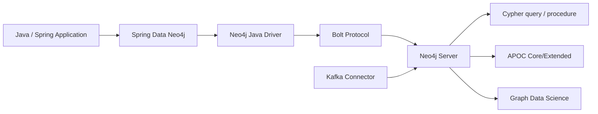
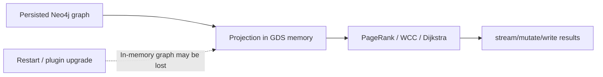
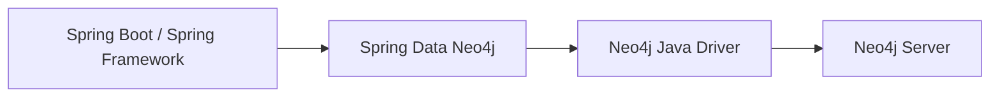
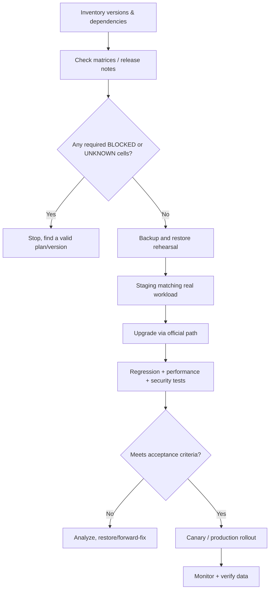

# Reading Compatibility Matrices for Server, Driver, Cypher, and Extensions in Neo4j

When upgrading Neo4j, the question "can the new server run the old application?" usually **does not have a single yes/no answer**. The Bolt connection may succeed while an old Cypher query fails due to a syntax change; the Java Driver may work with the new server while the Java runtime version does not meet requirements; or APOC and Graph Data Science (GDS) may not yet have a compatible release for the target Neo4j version you plan to deploy.

This lesson belongs to the **Upgrades and Migration** chapter of the **DATABASE_ENGINE_GRAPH_NEO4J** module. The module uses Neo4j to model a **property graph**, query nodes, relationships, and paths with **Cypher**, and integrate **Neo4j Java Driver**, **Spring Data Neo4j**, and extensions. The goal of this lesson is to learn how to **read, cross-reference, and record evidence from multiple compatibility matrices** before changing the version of a production graph system serving users.

> **Important principle:** Do not assume that components sharing the same major number, such as "5.x", are automatically compatible. Support documentation varies by release, edition, and deployment model. This lesson teaches **a method for checking and verifying**, rather than creating a static table claiming that all specific version pairs are officially supported by the vendor.

After this lesson, you will be able to:

- Distinguish **connectivity**, **official support**, **syntax compatibility**, and **behavioral compatibility**.
- Read matrices for **Neo4j Server**, **Bolt/Java Driver**, **Cypher**, **APOC/GDS**, and related frameworks/connectors.
- Collect runtime versions and identify the application's actual dependencies.
- Build a `current → target` table with evidence, edition conditions, and testing status.
- Design staging tests, follow a supported upgrade path, and prepare a recovery plan.
- Diagnose post-upgrade errors without automatically blaming every incident on "Neo4j incompatibility".

## 1. Why Is There No "Single Matrix"?

A production Neo4j system can have multiple layers:



Each connection path has its own compatibility question:

| Pair to check | Primary question | Preferred source of truth |
| --- | --- | --- |
| **Old server → new server** | Is there a direct upgrade path? Are there store format, backup, or clustering changes? | Neo4j Operations Manual, upgrade guide, release notes |
| **Java Driver ↔ Server/Bolt** | Does the driver support the server and the required protocol features? | Driver compatibility/installation/upgrade docs |
| **JDK ↔ Java Driver/SDN** | Does the Java runtime meet the library's requirements? | Driver release requirements, Spring Data/Boot requirements |
| **Cypher query ↔ Server/Cypher version** | Does the query parse, execute, and preserve exact results/semantics? | Cypher Manual, deprecations/removals, query migration guide |
| **APOC ↔ Neo4j** | Do the JAR and procedures/functions match the target Neo4j version? | APOC installation/version compatibility docs |
| **GDS ↔ Neo4j** | Does the GDS version support the server, edition, Java version, and algorithms in use? | GDS installation/compatibility/algorithm docs |
| **Spring Data Neo4j ↔ Driver/Neo4j** | Are the framework/driver and Spring Boot versions supported together? | SDN reference, Spring Boot dependency management |
| **Kafka Connector ↔ Kafka Connect/Neo4j** | Do the connector, Kafka Connect runtime, and target Neo4j match requirements? | Connector documentation for the exact release |

For systems running on **Aura**, do not assume every APOC procedure or GDS installation capability is identical to self-managed deployments. **Edition, service tier, and operating model** are additional dimensions of the matrix.

## 2. Four Levels of Compatibility to Distinguish

Even if two components connect successfully, they may not satisfy the same level of compatibility.

| Level | Meaning | Example |
| --- | --- | --- |
| **Supported** | The vendor documents that the version pair or upgrade path is supported | The driver falls within the server range explicitly stated in the release docs |
| **Protocol-compatible** | Both endpoints can handshake and communicate over Bolt | `verifyConnectivity()` succeeds |
| **Feature-compatible** | The required syntax, procedures, algorithms, and transaction options actually exist | The query runs, and `gds.*` has the corresponding procedure |
| **Behavior-compatible** | Results, ordering, constraints, performance, and transaction semantics remain correct for business logic | The same query returns the exact expected nodes/relationships |

**Do not infer official support from "tested one query and it ran".** A version pair might work in testing yet fall outside the officially supported scope, lack security fixes, or fail during retry/routing in a cluster.

Likewise, a published supported pair **does not guarantee** that every application query is automatically compatible: a query might use a deprecated API or a procedure from another plugin.

### A Common Misconception

- The application calls `driver.verifyConnectivity()` → succeeds.
- It then calls `CALL gds.pageRank.stream('customers')` → fails because GDS is not installed, is disabled, or has a version mismatch.
- Correct conclusion: **the Driver–Server connection path works**, but **the plugin/algorithm capability is not ready**. You should not automatically change the driver just because you see a `gds.*` error.

## 3. How to Read an Official Version Matrix

Before filling in "compatible", identify **which component** and **which support scope** the documentation table is describing.

### 3.1. Columns to Read Carefully

| Field in documentation | How to interpret |
| --- | --- |
| **Component/version** | The product and version being described, which may be a 5.x line or a year/month-based release |
| **Compatible with** | The range of partner versions allowed together, sometimes with patch restrictions |
| **Required minimum** | The minimum required version, not necessarily the most recommended version in all cases |
| **Tested/verified** | Combinations verified according to the docs; other combinations are not necessarily guaranteed to fail |
| **Deprecated** | Still usable, but recommended to migrate away from before removal |
| **Removed/unsupported** | Not usable in the target version according to the specification |
| **Edition/licensing** | Requires Enterprise, a plugin license, or a specific service tier |
| **Prerequisites** | JDK, OS, store format, cluster configuration, preparatory procedures |
| **Upgrade path** | May require stepping through one or more intermediate versions, backup/restore, or rebuild |
| **Release date/end of support** | Period during which maintenance/support applies; check your organization's support policy |

If a column only says "latest", that information **is not enough to reproduce the decision six months later**. Record the **exact version numbers**, official documentation URL, access date, and conditional notes.

### 3.2. Always Verify Source and Target Versions

An upgrade path is a directed relationship:

```text
Currently running version (source) --> intended version (target)
```

Do not assume that supporting an upgrade from `A → B` means you can **downgrade from `B → A`**. Once the new server has converted on-disk data, libraries, schemas, or internal structures may no longer be backward-compatible.

A rollback plan usually must rely on a **valid pre-upgrade backup/snapshot and a tested restore procedure**, not by reverting the container image to the old version and reopening a volume already touched by the new version.

### 3.3. A Blank Cell Does Not Mean "Compatible"

If the documentation table does not mention the pair `Driver D` and `Server S`, mark it **UNVERIFIED**, do not fill in **PASS**. Similarly, if plugin docs only list the server range without listing the Java runtime, check the Java requirement in another official source.

## 4. Collecting an Inventory of Running Versions

Before reading compatibility matrices, you need to know **what is actually running** in the system, not just what declaration files say.

### 4.1. Neo4j Server and Edition

When you have privileges to run the appropriate procedure:

```cypher
CALL dbms.components()
YIELD name, versions, edition
RETURN name, versions, edition;
```

The output shows the DBMS component, version list, and edition. **Field names and permission mechanisms depend on the version**; in some managed environments, version inspection may use the console or driver metadata instead of arbitrary procedures.

Check the target databases when authorized:

```cypher
SHOW DATABASES
YIELD name, currentStatus, requestedStatus
RETURN name, currentStatus, requestedStatus
ORDER BY name;
```

Do not assume a read-only application account has permission to list other databases. In a multi-database environment, record **the exact database the app accesses**, not only the server version.

### 4.2. Are APOC and GDS Actually Present?

To inspect procedures exposed by the system:

```cypher
SHOW PROCEDURES
YIELD name, signature
WHERE name STARTS WITH 'apoc.'
RETURN name, signature
ORDER BY name
LIMIT 30;
```

```cypher
SHOW PROCEDURES
YIELD name, signature
WHERE name STARTS WITH 'gds.'
RETURN name, signature
ORDER BY name
LIMIT 30;
```

For installed functions:

```cypher
SHOW FUNCTIONS
YIELD name
WHERE name STARTS WITH 'apoc.'
   OR name STARTS WITH 'gds.'
RETURN name
ORDER BY name
LIMIT 30;
```

**Correct interpretation:**

- Empty results may be caused by **not being installed**, **lack of permission**, **the function/procedure not existing in that version**, or a managed environment exposing only a subset.
- `SHOW PROCEDURES` does not guarantee every API **works properly** for your workload. You need to test specific procedures and verify parameter/return schemas.
- In versions that provide corresponding version functions, `RETURN gds.version()` or `RETURN apoc.version()` can help cross-check; only call them after confirming the function exists and the account has permission.

Do not use deprecated/removed legacy administrative procedures from internet examples as a substitute for your own system's inventory results.

### 4.3. Java Driver, Spring, and JDK

In a Java project, determine the **actual versions on the runtime classpath**:

- `org.neo4j.driver:neo4j-java-driver`.
- `org.springframework.data:spring-data-neo4j` if using SDN.
- The **Spring Boot** version and Java runtime (JDK).
- Other transitive dependencies that may manage or override the Driver.
- The Kafka connector, GDS client, or APOC invocation library versions, if any.

Examples of commands used solely to **inspect dependencies in the application's own repository** (not run within this lesson's authoring workflow):

```bash
# Maven: inspect dependency tree and the driver actually resolved.
mvn dependency:tree -Dincludes=org.neo4j.driver:neo4j-java-driver

# Gradle: inspect dependencies on the runtime classpath.
./gradlew dependencies --configuration runtimeClasspath

# Java runtime running the application.
java -version
```

A POM or Gradle declaration is not necessarily the final resolved version when a framework BOM, dependency management, or constraints intervene. **The runtime classpath and dependency lockfile** are the reliable sources to verify active libraries.

### 4.4. Sample Inventory Table

| Layer | Current | Target | Evidence to collect |
| --- | --- | --- | --- |
| Server | Running version | Proposed version | `dbms.components()`/console + release notes |
| Edition/deployment | Community/Enterprise/Aura | Keep or change | License/tier, permissions, feature availability |
| Java runtime | Deployed JDK version | Target JDK | Runtime/manifest, Driver/SDN requirements |
| Java Driver | Version resolved in app | Planned version | Dependency tree, driver manual |
| Cypher | Syntax currently used | Query target | Query inventory and Cypher Manual |
| APOC | Core/Extended + JAR version | Target plugin version | Installation matrix, active plugins |
| GDS | Version, algorithms used | Target version | Compatibility + license/memory |
| Spring Data | SDN + Boot | Target version set | Spring support matrix |
| Kafka Connector | Connector & worker version | Target version | Connector docs + Kafka runtime |

Only after the inventory is backed by evidence should you proceed to fill in compatibility results.

## 5. Reading the Neo4j Server Matrix and Upgrade Path

Server migration is not merely changing an image tag. Depending on the source and target versions, the following may change:

- Database **storage format/metadata**.
- `neo4j.conf` **configuration** and setting names.
- **Schema/index/constraint** syntax and administrative procedures.
- **Cypher parser/planner/runtime** and removed syntax cases.
- **Cluster topology** and rolling upgrade rules.
- **Backup/dump compatibility**, restore requirements, or migration tools.
- Supported **JVM and operating system versions**.
- **Plugin load paths, licenses, and security policies**.

Read the **upgrade guide matching your exact source/target**, not just the target version's changelog. If the documentation requires going through an intermediate version, follow that path strictly or change the migration architecture (such as export/import per the appropriate documentation).

### 5.1. Three Ways to Change the System

| Approach | Nature | What to check |
| --- | --- | --- |
| **In-place upgrade** | Replace Neo4j on the same storage environment | Store compatibility, downtime, backup, config/plugins |
| **Rolling upgrade cluster** | Replace cluster members sequentially in a supported order | Compatibility between mixed temporary members, quorum, routing, ordering |
| **Side-by-side migration** | Stand up a new system, migrate data/traffic | Change synchronization, cutover, consistency verification, data rollback |

**Do not assume rolling upgrades are always supported** across every major version. Neo4j has specific rules per version range and topology; if the docs forbid mixing member versions during transition, the plan must change.

### 5.2. Notes on Format and Rollback

Suppose the source has a pre-upgrade backup. A safe procedure must answer:

1. Which **compatible tools and formats** for source/target were used to create the backup?
2. Does the backup contain the required databases along with schemas/constraints and data?
3. Have you **actually restored** that backup in a test environment?
4. If the application has written new data after cutover, how many changes would a rollback lose? Is that RPO acceptable?
5. Do you need a **forward-fix** strategy instead of downgrading the server?

**Having a backup** is different from **having proven recoverability**.

## 6. Driver and Bolt: "Being Able to Connect" Is Not Enough

**Bolt** is the connection protocol between the driver and Neo4j. The Java Driver can negotiate protocol capabilities based on what both it and the server support; however, **successful negotiation does not automatically mean** all features are supported by the driver/framework against the target server.

When reading the Neo4j Java Driver matrix, distinguish:

| Compatibility dimension | What to verify |
| --- | --- |
| Driver ↔ Server | Supported version range, Bolt capabilities, and feature limitations |
| Driver ↔ Java Runtime | Minimum JDK, tested JDK versions |
| Driver ↔ Cluster/Routing | Routing URI, discovery, bookmarks, read/write sessions |
| Driver ↔ Transaction | Managed transactions, retries, timeouts, error handling |
| Driver ↔ Data types | Conversion of `DATE`, `DATETIME`, vectors/new data types |
| Driver ↔ App framework | API signatures and dependencies used by Spring Data or other frameworks |

**Do not use "server and driver must share the same major version" as the sole rule.** Cross-major pairs may be officially supported, while a same-major pair can still be incompatible due to patch level, JDK, features, or support policy.

### 6.1. A Real Smoke Test with Java Driver

The following snippet illustrates a **minimal check**, not a complete compatibility test suite:

```java
import org.neo4j.driver.AuthTokens;
import org.neo4j.driver.Driver;
import org.neo4j.driver.GraphDatabase;
import org.neo4j.driver.Session;
import org.neo4j.driver.SessionConfig;

import java.util.List;

public final class ServerVersionProbe {
    public record Component(
        String name, List<String> versions, String edition) {}

    public static List<Component> inspect(
            Driver driver, String database) {

        try (Session session = driver.session(
                SessionConfig.forDatabase(database))) {

            return session.executeRead(tx ->
                tx.run("""
                    CALL dbms.components()
                    YIELD name, versions, edition
                    RETURN name, versions, edition
                    """)
                  .list(record -> new Component(
                      record.get("name").asString(),
                      record.get("versions")
                          .asList(v -> v.asString()),
                      record.get("edition").asString()
                  ))
            );
        }
    }

    public static void main(String[] args) {
        String uri = System.getenv("NEO4J_URI");
        String username = System.getenv("NEO4J_USERNAME");
        String password = System.getenv("NEO4J_PASSWORD");
        String database = System.getenv("NEO4J_DATABASE");

        try (Driver driver = GraphDatabase.driver(
                uri, AuthTokens.basic(username, password))) {

            driver.verifyConnectivity();
            for (Component c : inspect(driver, database)) {
                System.out.println(c.name() + ": " + c.versions());
            }
        }
    }
}
```

**Usage notes:** this program assumes full environment configuration and a user authorized to execute the inspection procedure; production code should validate variables before creating the driver and avoid logging secrets. For web applications, the Driver should live across the app's entire lifecycle, not be recreated per request.

`verifyConnectivity()` checks the connection path; `dbms.components()` retrieves versions. The next step must execute **real business queries** and test critical transactions, especially when the application uses routing/clustering.

### 6.2. Testing Transactions and Network Errors

An older driver might execute a simple `MATCH` yet run into issues with features the application relies on, such as:

- Transaction retries or transient error classification.
- Timeouts and session routing.
- Mapping of new property/temporal types.
- Bookmark handling across multiple databases or cluster members.
- TLS security scope and certificates.

Therefore, tests should cover **read/write** operations matching the real workload rather than stopping at `RETURN 1`.

## 7. Cypher Compatibility: Parser, Semantics, and Execution Plans

Cypher is Neo4j's query language, and its syntax and semantics can be extended, deprecated, or removed when the server changes.

### 7.1. Types of Risk

| Risk | Examples to review |
| --- | --- |
| **New syntax absent on older servers** | Dynamic labels/types, new clauses, or explicitly declared Cypher versions |
| **Legacy syntax deprecated/removed** | Certain legacy administrative commands and procedures |
| **Semantic changes** | Null handling, coercion, expressions, variable scope, or path matching behavior |
| **Schema/DDL changes** | Syntax for creating indexes, constraints, and showing schema |
| **Function/procedure changes** | Names, parameter counts/types, return columns |
| **Planner/runtime changes** | Query still returns correct results, but performance differs |
| **GQL/Cypher version support scope** | A feature only exists when selecting a specific dialect/version |

### 7.2. Cypher 5 and Cypher 25

In modern Neo4j releases that support multiple **Cypher versions**, you may encounter **Cypher 5** and **Cypher 25**. Query version selection and feature availability must be verified against the **server release**; do not assume older Neo4j 5.x releases support every newer syntax feature.

Syntax examples that are only valid **if the target server supports selecting versions this way**:

```cypher
CYPHER 5
MATCH (p:Product)
RETURN p.productId AS id
LIMIT 5;
```

```cypher
CYPHER 25
MATCH (p:Product)
RETURN p.productId AS id
LIMIT 5;
```

**These two snippets are not a promise that both will run on every server.** Consult the Cypher Manual for the target version to learn how to select versions, which syntax has been removed, and which default version is active.

**Do not confuse these three numbers:**

1. The **Neo4j Server** product version.
2. The **Cypher** language version supported by the engine.
3. The **Java Driver** version speaking Bolt.

They have **independent release lifecycles** and do not always share the same version numbers.

### 7.3. Node/Relationship Identifiers and Legacy APIs

Codebases that used `id(n)` or internal numeric IDs to store long-lived references face risks when features are deprecated, identifier semantics change, or data is exported/imported.

```cypher
// Do not use internal IDs as long-term business keys.
MATCH (n:Customer)
RETURN id(n) AS internalId;
```

```cypher
// Use a unique, durable business key instead.
MATCH (n:Customer)
RETURN n.customerId AS customerId;
```

`elementId(n)` is also a technical identifier and is not guaranteed to remain stable across all imports, migrations, or restores. For applications needing durable identifiers, use a property such as `customerId` backed by a **uniqueness constraint**.

### 7.4. Using EXPLAIN and PROFILE to Inspect Plans

A query may keep returning correct data while becoming slower after planner/runtime changes:

```cypher
EXPLAIN
MATCH (c:Customer {customerId: $customerId})
      -[:PLACED]->(o:Order)
RETURN o.orderId AS orderId, o.createdAt AS createdAt
ORDER BY createdAt DESC
LIMIT 20;
```

```cypher
PROFILE
MATCH (c:Customer {customerId: $customerId})
      -[:PLACED]->(o:Order)
RETURN o.orderId AS orderId, o.createdAt AS createdAt
ORDER BY createdAt DESC
LIMIT 20;
```

`EXPLAIN` does not run the query, whereas `PROFILE` **executes the query** to provide actual runtime metrics. For write queries, only use PROFILE under controlled conditions in a test environment. Compare `Rows`, `DB Hits`, `Estimated Rows`, index seeks, expands, sorts, memory, and latency on **representative data**, avoiding conclusions drawn from a query over only a handful of nodes.

If an index was renamed or is missing, or if statistics differ after migration, the plan may change. **A different execution plan is not automatically a compatibility error**, but performance must be evaluated against SLOs.

## 8. APOC: Core, Extended, and Execution Permissions

**APOC** provides additional procedures/functions for Cypher, such as data manipulation, import utilities, or graph processing. Depending on the version and deployment form, APOC is split into packages such as **Core** and **Extended**.

Questions to answer before upgrading:

1. Which `apoc.*` procedures/functions does the application use?
2. Do they belong to Core or Extended, and which version is currently installed?
3. Is the target plugin JAR explicitly compatible with the target Neo4j Server according to APOC docs?
4. Have parameter signatures, return values, or procedure security mechanisms changed?
5. Do you need to configure `apoc.conf` or allowlist/unrestricted procedures per the new documentation?
6. Does the deployment allow installing plugins, or does it only expose a managed subset (such as Aura)?

### 8.1. "Having the JAR" Does Not Mean "Usable"

A plugin that mismatches the server may:

- Fail to load when the DBMS starts.
- Throw missing class/method errors.
- Expose procedure names but block calls due to permissions/configuration.
- Have changed signatures causing application queries to fail.
- Run successfully but exhibit different behavior or resource cost than the older version.

After deployment, check with `SHOW PROCEDURES`/`SHOW FUNCTIONS` and then run **a smoke test on a real procedure** used by the application. Do not blindly set `unrestricted` for all of APOC as a "quick fix" for permission errors; follow least privilege and explicit allowlists.

### 8.2. Dependency Inventory Example

```text
Server: actual version A
Plugin: APOC Core version X
APOC Extended: yes / no
Used procedures:
  - apoc.<procedure-1>
  - apoc.<procedure-2>
Permissions/config:
  - procedure execution privileges
  - allowlist/unrestricted policy
Status for target B:
  - PASS / BLOCKED / UNKNOWN
```

This is an **inventory template**, not an installation command. Do not fill in arbitrary version numbers as if they were confirmed by Neo4j.

## 9. GDS: Version Compatibility and In-Memory Graph Lifecycle

**Graph Data Science (GDS)** has its own compatibility matrix with Neo4j and specific resource/edition/license requirements per release. Even when the driver connects, GDS algorithms can still fail if the plugin is incompatible.

Checklist:

| Area | What to verify |
| --- | --- |
| Neo4j server version | Neo4j range supported by the **specific GDS version** |
| Runtime/JDK | Java and deployment environment requirements |
| Edition/license | Whether the plugin/algorithm features are licensed/allowed |
| Graph projection API | Whether native/Cypher projections and parameters have changed |
| Algorithms | Procedure names, `stream`/`mutate`/`write` modes, options, and outputs |
| Memory | Whether projections and algorithms have enough RAM under the new workload |
| Graph catalog | How graph names, sessions/users, drops, and refreshes are managed |
| Aura vs self-managed | Ability to install/run GDS on the target service tier |

Example of an algorithm-dependent query:

```cypher
CALL gds.pageRank.stream('customerGraph')
YIELD nodeId, score
RETURN nodeId, score
ORDER BY score DESC
LIMIT 10;
```

It only runs if **GDS is compatible and `customerGraph` exists in the catalog**. A restarted or newly upgraded server may no longer hold in-memory projections even though Neo4j's on-disk data remains intact.

### Prepare to Re-project After a GDS Upgrade



For jobs depending on GDS, have a **graph re-projection procedure**, and verify node/relationship counts, property schemas, and algorithm outputs before restoring traffic or batch schedules.

Distinguish `write` (which can write data back to Neo4j) from `mutate` (which modifies the in-memory graph) and `stream` (which returns results); do not treat these modes as equivalent when testing migrations.

## 10. Spring Data Neo4j, Spring Boot, and Kafka Connector

An application often does not call the Neo4j Java Driver directly everywhere. It may go through **Spring Data Neo4j (SDN)**, and SDN is managed by **Spring Boot** or a dependency BOM.

### 10.1. Framework and Driver Pairing



Do not only ask "Does Driver D support Neo4j S?", also ask:

- Which **Driver version** does this **SDN version** require/support?
- Does the current **Spring Boot version** manage a different SDN version than the one declared by developers?
- Is the **JDK** required by Spring Boot/SDN available on the new runtime?
- Have repository mappings, `@Transactional`, `Neo4jClient`, or data type converters changed behavior?
- If the application explicitly declares a newer Driver than the BOM, does that introduce **dependency conflicts** or fall outside combinations tested by Spring?

**Do not force an independent major driver upgrade** inside a Spring application assuming Spring Data Neo4j will automatically be compatible just because API names look similar. Verify the BOM/dependency tree and the SDN documentation for the version in use.

### 10.2. Kafka Connector and Integration Components

If an event ingestion pipeline uses **Neo4j Connector for Apache Kafka**, also check:

- Kafka Connect worker/runtime and converters/plugins.
- The specific Neo4j Connector version.
- Target Neo4j server/version and schema.
- Source/sink feature scope of the connector.
- Cypher write strategy, authentication/TLS, and retry/DLQ handling.
- Compatibility with JSON/Avro/Protobuf event schemas.

A started connector does not prove **every message is applied correctly**. After upgrading, verify idempotency, offsets/acks, duplicate/out-of-order handling, and the resulting graph data.

If Kafka is not used, **do not add the connector to the deployment checklist just because this module mentions it**. The matrix must reflect the system's actual dependencies.

## 11. Consolidated Deployment Matrix: Evidence-Based Template

Below is a **governance template**, not a table of real supported versions. Use it for a specific system after checking official documentation.

| ID | Pair to verify | Current | Target | Evidence | Status |
| --- | --- | --- | --- | --- | --- |
| M1 | Neo4j Server → Server | Server A | Server B | Upgrade guide A→B | **UNKNOWN** |
| M2 | Java Driver ↔ Server B | Driver D1 | Driver D2 | Driver support matrix | **UNKNOWN** |
| M3 | JDK ↔ Driver D2 | JDK J1 | JDK J2 | Driver requirements | **UNKNOWN** |
| M4 | Spring Data ↔ Driver D2 | SDN S1 | SDN S2 | SDN/Boot dependency docs | **UNKNOWN** |
| M5 | Cypher queries ↔ Server B | Query set Q1 | Query set Q2 | Cypher deprecations + tests | **UNKNOWN** |
| M6 | APOC ↔ Server B | APOC P1 | APOC P2 | APOC install docs | **UNKNOWN** |
| M7 | GDS ↔ Server B | GDS G1 | GDS G2 | GDS compatibility docs | **UNKNOWN** |
| M8 | Kafka Connector ↔ Server B | Connector K1 | K2 if used | Kafka/Neo4j docs | **UNKNOWN / N/A** |
| M9 | Edition/managed feature | Deployment E1 | Deployment E2 | License/Aura features | **UNKNOWN** |
| M10 | Backup/restore path | Backup type B1 | Recovery target | Operations backup docs + restore test | **UNKNOWN** |

A cell only transitions to **PASS** when it has **matching documentation evidence and sufficient real testing for that environment**. You can define statuses as:

- **PASS:** supported by the vendor and key tests have passed.
- **DOC_PASS_TEST_PENDING:** documentation matches, but staging tests have not yet run.
- **BLOCKED:** unsupported or blocked by an error preventing deployment.
- **UNKNOWN:** insufficient evidence so far.
- **N/A:** component is not present in the system.

At production go/no-go decision time, leave no **UNKNOWN** in any **required dependency** cell.

### Evidence Recording Template for a Matrix Row

```text
Matrix row: M6 (APOC -> target Neo4j)
Target Neo4j: <exact-version>
Target APOC Core: <exact-version>
Edition/deployment: <Enterprise/self-managed/Aura/...>
Official documentation: <URL, release tag, access date>
Supported in docs: YES / NO / UNCLEAR
Observed procedure: <name + signature>
Staging test: PASS / FAIL / NOT_RUN
Owner: <team>
Decision: PASS / BLOCKED / UNKNOWN
```

Do not merely attach a screenshot showing "connected successfully". Evidence must be tied to **exact versions, operating conditions, and repeatable tests**.

## 12. Recommended Reading Order for Official References

For a version change, you can follow this reading order:

1. **Neo4j Operations Manual — Upgrade:** identify valid upgrade paths, store formats, and backup/cluster requirements.
2. **Neo4j release notes/deprecations:** APIs, settings, and behaviors that changed.
3. **Neo4j Java Driver Manual — Installation/Upgrade:** server ranges, JDKs, API and Bolt changes.
4. **Cypher Manual:** language versions, syntax changes, deprecated/removed features.
5. **APOC installation/release notes:** JARs, Core/Extended, procedure signatures, configuration.
6. **Graph Data Science installation/upgrade:** server compatibility, algorithms, and projection APIs.
7. **Spring Data Neo4j/Boot:** dependency management, JDK, mapping/transactions.
8. **Kafka Connector docs** or other plugins if the system actually uses them.
9. **Deployment docs:** Enterprise/Community/Aura and tier permissions/features.
10. **Project docs and staging tests:** validate business conditions absent from vendor documentation.

**Prioritize documentation for the target release** rather than old blog posts. When multiple guides conflict, record the version, release date, deployment type, and verify via testing; do not stitch together snippets from different sources.

## 13. A Controlled Upgrade Process



### Step 1 — Lock the Inventory

Record Server/edition, Driver, JDK, SDN/Boot, APOC, GDS, connectors, and Neo4j configuration files. Check databases, node/relationship counts, indexes/constraints, and critical queries.

### Step 2 — Lock the Supported Upgrade Path

Do not jump across multiple major versions or switch between Community and Enterprise/Aura while ignoring data migration requirements, licensing, and security settings.

### Step 3 — Backup and Test Restore

Measure recovery time and verify complete data and schema restoration. When using side-by-side migration, have a plan to handle write changes occurring between snapshot time and traffic cutover.

### Step 4 — Upgrade Staging and Run Regression Tests

At minimum, verify:

- Driver connections over TLS/routing, read/write permissions per role.
- Cypher DDL and parameterized business queries.
- Node/relationship CRUD, uniqueness constraints, and transaction rollbacks.
- APOC/GDS procedures/functions called by the application.
- Java/SDN mappings, temporal values, retries, and timeouts.
- Kafka/CDC backfill, idempotency, and lag if applicable.
- Query plans, p95/p99, DB Hits, heap/page cache, and latency under representative load.

### Step 5 — Production Cutover with Clear Stop Criteria

A good plan states clearly **when to stop**, not only when to start. For example:

| Signal | Illustrative stop condition |
| --- | --- |
| Compatibility | A required dependency has status `BLOCKED` or `UNKNOWN` |
| Data | Loss of business nodes/relationships, constraint violations, or reconciliation mismatch |
| API | Success/latency SLO clearly violated during canary |
| Plugin | Critical procedure missing or returning wrong results |
| Security | Roles lack required permissions or hold excessive privileges, invalid TLS |
| Recovery | Unable to complete restore within agreed RTO/RPO |

Numeric SLO thresholds must be defined from the real system; this table only illustrates the **categories of conditions** to establish.

### Step 6 — Post-Upgrade Monitoring

Track before-and-after baselines: error rate, query p95/p99, Bolt errors, transaction rollbacks, GC/page cache, import lag, GDS projections, and procedure errors. Do not only observe that the database is `ONLINE`; verify **data correctness and API behavior**.

## 14. Dedicated Checklist for Data, Schema, and Queries

When moving between server versions or migrating across instances:

| Item | What to reconcile |
| --- | --- |
| Node/relationship | Counts by label/type, business keys, and key relationships |
| Property types | Integer/float/string, temporal, spatial, list, and new types if any |
| Constraint | Unique, existence/key per edition and supported syntax |
| Index | Index types, properties, property ordering, population status |
| Query plan | Index seeks, expands, sorts, estimated/actual rows |
| Procedures/functions | Names, signatures, permissions, outputs |
| Data import | CSV, LOAD CSV, CDC, Kafka, retries/idempotency |
| Java Driver | Connections, sessions, transactions, Value/Record mapping |
| SDN | Entity mapping, relationship lifecycle, @Transactional |
| GDS | Projections, catalog, algorithms, memory |
| Backup/restore | Data, schema, accounts/config per target procedure |
| Security | Users/roles, TLS, auth providers, password rotation |

Do not conclude "migration succeeded" just because node counts match. Two graphs can have the exact same node count yet **differ in relationships, properties, constraints, or business data state**.

### Example Post-Upgrade Reconciliation Cypher

```cypher
MATCH (c:Customer)
RETURN count(c) AS customerCount;
```

```cypher
MATCH (:Customer)-[r:PLACED]->(:Order)
RETURN count(r) AS placedRelationshipCount;
```

```cypher
SHOW CONSTRAINTS
YIELD name, type, entityType
RETURN name, type, entityType
ORDER BY name;
```

These commands are only **preliminary checks**; supplement them with reconciliation by business keys and critical fields. `SHOW CONSTRAINTS` requires appropriate schema inspection privileges.

## 15. Common Compatibility Errors and How to Isolate Them

| Symptom | Likely area to check | Verification step |
| --- | --- | --- |
| Driver fails to connect | Bolt/protocol, TLS, routing, credentials | Driver–Server compatibility, network, certificates |
| Driver connects, but a query hits a syntax error | Cypher version/deprecation | Target Cypher Manual, test minimal query |
| `Unknown procedure/function` | APOC/GDS absent or API changed | `SHOW PROCEDURES`/`SHOW FUNCTIONS`, plugin manifest |
| Plugin fails to load on startup | JAR mismatches server, classpath/config | Plugin compatibility, startup logs |
| Query returns different results than before | Semantic change or migrated data | Compare input data, Cypher version, regression |
| Query is slower | Planner/indexes/statistics, cache, or data skew | `EXPLAIN`/`PROFILE`, indexes, p95/p99 |
| Spring fails on startup with class/method error | SDN/Driver/Boot/JDK dependency mismatch | Runtime dependency tree, Spring support docs |
| GDS graph missing after restart | In-memory catalog not yet re-projected | Re-project and verify schema/counts |
| Kafka sink writes duplicates or loses relationships | Mapping, retry/offset/idempotency, schema | Inspect eventId, DLQ, reconciliation |
| Backup load fails | Unsupported format/version/edition | Restore procedure in Operations Manual |
| User lacks permissions after migration | Different RBAC/edition/auth provider | `SHOW CURRENT USER`, roles/privileges |
| Cluster not ready | Upgrade order/quorum/routing | Topology upgrade guide, cluster metrics |

**Do not fix issues by granting unrestricted permissions or disabling authentication** just to bypass post-upgrade errors. Separate **protocol**, **Cypher**, **plugin**, **framework**, and **authorization** before making changes.

## 16. Self-Check Exercises

**Question 1.** The Java Driver successfully calls `verifyConnectivity()` against the new Neo4j server. Can you conclude that GDS, APOC, and all Cypher queries are already compatible?

<details>
<summary>Suggested answer</summary>

No. Connectivity only verifies part of the protocol and authentication handshake. You still need to check procedures/functions, signatures, permissions, Cypher syntax, semantics, and test real queries and algorithms.

</details>

**Question 2.** The driver and server share the same "5.x" major number. Is this sufficient evidence to mark them `SUPPORTED`?

<details>
<summary>Suggested answer</summary>

No. You must read the official support matrix for the exact Driver and Server versions, verify the JDK, required features, and support policy; sharing a major number does not replace evidence.

</details>

**Question 3.** A compatibility table does not list the planned APOC–Neo4j pair. Should you mark `PASS` or `UNKNOWN`?

<details>
<summary>Suggested answer</summary>

Mark `UNKNOWN` and continue checking official documentation or change the target version. Being able to copy a JAR into the plugins directory does not prove that the pair is supported.

</details>

**Question 4.** Why can't you assume you can downgrade the server by restoring the old Neo4j image after running the new version on the same volume?

<details>
<summary>Suggested answer</summary>

The store format, schema, or metadata may have been converted by the new version and no longer be backward-compatible. Rollback must rely on a vendor-supported recovery path, typically requiring a pre-upgrade backup/snapshot and a tested restore.

</details>

**Question 5.** A query with `CYPHER 25` runs on a new test environment. Will it definitely run on all older Neo4j 5.x servers?

<details>
<summary>Suggested answer</summary>

No. Version selection syntax and Cypher features depend on the server release. Cross-reference the Cypher Manual for the target version, and do not confuse the Cypher language version with the Server or Driver major version.

</details>

**Question 6.** Upgrading the Spring Boot BOM causes the runtime to use a different Driver version than directly declared. What must you check?

<details>
<summary>Suggested answer</summary>

Check the dependency tree/runtime classpath, Spring Data Neo4j's support for the Driver and JDK, and the Driver's support matrix with Neo4j Server. Do not look only at `pom.xml` while ignoring dependency management.

</details>

**Question 7.** After a restart, `gds.pageRank.stream('graphA')` reports that the graph does not exist, yet the Neo4j data is still present. Were source nodes lost?

<details>
<summary>Suggested answer</summary>

Not necessarily. The GDS graph catalog lives in memory, and projections can be lost after a restart or upgrade. Check the GDS plugin and re-run the projection from the source data; verify nodeCount, relationshipCount, and schema.

</details>

**Question 8.** Why is `PROFILE` useful even when Cypher executes without errors after an upgrade?

<details>
<summary>Suggested answer</summary>

Because valid parsing and correct results do not guarantee unchanged performance. Changes in the planner, runtime, or indexes can increase rows, DB Hits, sorts, or latency. Running PROFILE on representative data helps detect performance regressions; remember that PROFILE executes the query.

</details>

**Question 9.** During a server migration, both databases have the same `count(:Customer)`. Is that enough to conclude the graph data is equivalent?

<details>
<summary>Suggested answer</summary>

No. You must reconcile relationships by type and business key, properties, constraints/indexes, and business rules. Two graphs can have the exact same node count while having incorrect links or data.

</details>

**Question 10.** Why is an `UNKNOWN` cell in a required dependency matrix a reason to halt production deployment?

<details>
<summary>Suggested answer</summary>

Because there is insufficient evidence regarding official support, features, and testing to assess risk. You must verify official documentation or adjust versions, then validate on staging before deciding to upgrade production.

</details>

## Key Takeaways

- **A compatibility matrix is a multi-dimensional relationship**, not merely checking the Neo4j Server version.
- Distinguish **supported**, **protocol-compatible**, **feature-compatible**, and **behavior-compatible**.
- Record **exact current/target versions, edition/deployment, official documentation, lookup date, and staging test results** for every pair.
- Server, Java Driver/Bolt, Cypher 5/25, APOC, GDS, SDN/Spring Boot, JDK, and Kafka Connector have **different release schedules and prerequisites**.
- **Driver connectivity does not prove Cypher/plugin compatibility**; you must run real queries, procedures, transactions, and mappings.
- Upgrading the server can change **store format**, schema, and query plans; do not assume you can downgrade on an upgraded volume.
- **Backup + restore rehearsal**, regression tests, and deployment stop criteria are just as important as reading documentation.
- Only mark **PASS** when the combination is supported and has passed required testing; never turn an **UNKNOWN** cell into "it will probably work".

### Official References

- [Neo4j Operations Manual — Upgrade](https://neo4j.com/docs/operations-manual/current/upgrade/)
- [Neo4j Operations Manual — Backup and restore](https://neo4j.com/docs/operations-manual/current/backup-restore/)
- [Neo4j Java Driver Manual](https://neo4j.com/docs/java-manual/current/)
- [Neo4j Cypher Manual](https://neo4j.com/docs/cypher-manual/current/)
- [APOC — Installation](https://neo4j.com/docs/apoc/current/installation/)
- [Graph Data Science — Installation](https://neo4j.com/docs/graph-data-science/current/installation/)
- [Graph Data Science — Upgrade](https://neo4j.com/docs/graph-data-science/current/installation/upgrade/)
- [Spring Data Neo4j — Reference](https://docs.spring.io/spring-data/neo4j/reference/)
- [Spring Boot — Dependency Versions](https://docs.spring.io/spring-boot/appendix/dependency-versions/)
- [Neo4j Connector for Apache Kafka](https://neo4j.com/docs/kafka/)
